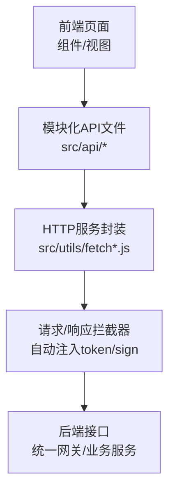
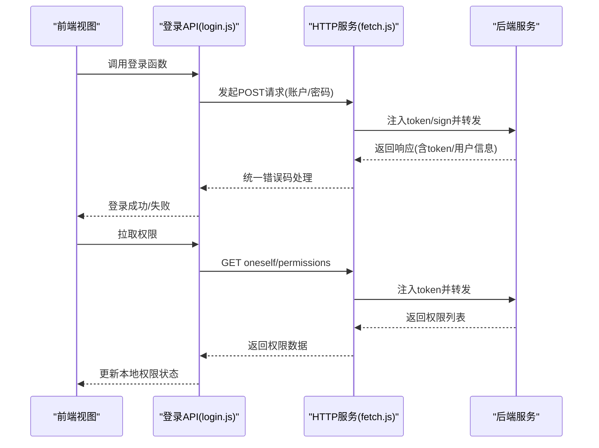
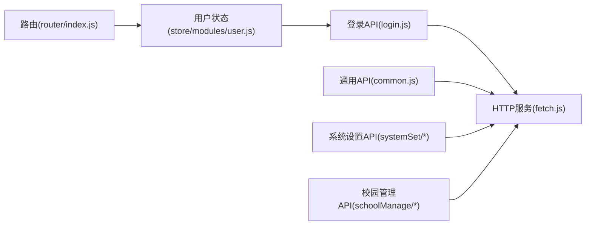

# API参考

<cite>
**本文引用的文件**
- [fetch.js](file://src/utils/fetch.js)
- [fetchNew.js](file://src/utils/fetchNew.js)
- [login.js](file://src/api/login.js)
- [common.js](file://src/api/common/common.js)
- [user.js](file://src/store/modules/user.js)
- [index.js](file://src/router/index.js)
- [permission.js](file://src/api/systemSet/permission.js)
- [stuAttendanceRecord.js](file://src/api/schoolManage/stuAttendanceRecord.js)
- [repair.js](file://src/api/schoolManage/repair.js)
- [courseSet.js](file://src/api/systemSet/courseSet.js)
- [constants.js](file://src/utils/constants.js)
</cite>

## 目录
1. [简介](#简介)
2. [项目结构](#项目结构)
3. [核心组件](#核心组件)
4. [架构总览](#架构总览)
5. [详细组件分析](#详细组件分析)
6. [依赖关系分析](#依赖关系分析)
7. [性能与限流](#性能与限流)
8. [故障排查指南](#故障排查指南)
9. [结论](#结论)
10. [附录](#附录)

## 简介
本文件为校园管理系统前端侧的API参考文档，覆盖系统内所有已实现的RESTful接口。内容包括：
- 接口的HTTP方法、URL模式、请求参数、响应格式与错误码
- 认证机制、权限要求与使用限制
- 请求与响应示例路径（以“代码片段路径”形式给出）
- 版本管理、兼容性与废弃策略说明
- 性能指标、限流规则与最佳实践建议

## 项目结构
前端通过统一的HTTP服务封装层发起请求，主要分为两类：
- 全局拦截器与通用服务：在请求前注入token与签名参数，在响应后统一处理错误码与登出逻辑
- 模块化API文件：按功能域划分，如登录、通用、系统设置、校园管理等

图表来源
- [fetch.js:13-171](file://src/utils/fetch.js#L13-L171)
- [fetchNew.js:8-135](file://src/utils/fetchNew.js#L8-L135)

章节来源
- [fetch.js:13-171](file://src/utils/fetch.js#L13-L171)
- [fetchNew.js:8-135](file://src/utils/fetchNew.js#L8-L135)

## 核心组件
- HTTP服务与拦截器
  - 自动注入token与签名参数
  - 统一错误码处理与登出逻辑
  - 多个baseURL的服务别名（如ucenter-web、growth-web等）
- 登录与权限
  - 支持多种登录方式与切换学校
  - 权限拉取与本地缓存
- 通用能力
  - 字典查询、课程查询、教师/学生信息查询等

章节来源
- [fetch.js:13-171](file://src/utils/fetch.js#L13-L171)
- [login.js:1-259](file://src/api/login.js#L1-L259)
- [user.js:120-324](file://src/store/modules/user.js#L120-L324)
- [common.js:14-459](file://src/api/common/common.js#L14-L459)

## 架构总览
以下序列图展示典型登录流程与权限拉取过程：

图表来源
- [login.js:25-37](file://src/api/login.js#L25-L37)
- [login.js:189-200](file://src/api/login.js#L189-L200)
- [fetch.js:66-169](file://src/utils/fetch.js#L66-L169)
- [user.js:287-303](file://src/store/modules/user.js#L287-L303)

## 详细组件分析

### 认证与会话
- 登录
  - 方法与URL：POST /login
  - 请求参数：account、password、clientType（可选）
  - 响应字段：token、用户信息、角色列表、部门列表等
  - 示例路径：[login.js:25-37](file://src/api/login.js#L25-L37)
- 刷新/获取用户信息
  - 方法与URL：POST /login/refresh
  - 请求参数：token
  - 示例路径：[login.js:16-24](file://src/api/login.js#L16-L24)
- 登出
  - 方法与URL：POST /login/logout
  - 请求参数：token
  - 示例路径：[login.js:5-13](file://src/api/login.js#L5-L13)
- 微信登录/绑定/扫码登录
  - 方法与URL：POST /login/weixin、POST /login/weixin/bind、POST /login/weixin
  - 参数：code/state/loginType/clientType等
  - 示例路径：[login.js:92-177](file://src/api/login.js#L92-L177)
- 切换学校
  - 能力查询：GET /login/switchSchool/ability
  - 列表：GET /login/switchSchool/list
  - 登录：GET /login/switchSchool/login
  - 示例路径：[login.js:238-258](file://src/api/login.js#L238-L258)

章节来源
- [login.js:1-259](file://src/api/login.js#L1-L259)
- [fetch.js:66-169](file://src/utils/fetch.js#L66-L169)
- [user.js:120-324](file://src/store/modules/user.js#L120-L324)

### 权限管理
- 查询用户权限
  - 方法与URL：GET /oneself/permissions
  - 请求参数：moduleCode（可选）
  - 示例路径：[login.js:189-200](file://src/api/login.js#L189-L200)
- 查询用户所有权限（旧版）
  - 方法与URL：POST /permission/getUserPerm
  - 请求参数：schoolId、userId
  - 示例路径：[permission.js:15-25](file://src/api/systemSet/permission.js#L15-L25)
- 根据上级权限ID获取子权限
  - 方法与URL：POST /permission/getNewUserSonPerm
  - 请求参数：permId
  - 示例路径：[permission.js:31-39](file://src/api/systemSet/permission.js#L31-L39)

章节来源
- [login.js:189-200](file://src/api/login.js#L189-L200)
- [permission.js:15-39](file://src/api/systemSet/permission.js#L15-L39)

### 通用能力
- 字典查询
  - 根据字典code获取字典项列表（需鉴权）
    - 方法与URL：POST /structure/sysDictionary/findDicsByCode
    - 示例路径：[common.js:29-34](file://src/api/common/common.js#L29-L34)
  - 根据字典code获取字典项列表（无需鉴权）
    - 方法与URL：POST /common/sysDictionary/findDicsByCode
    - 示例路径：[common.js:39-46](file://src/api/common/common.js#L39-L46)
  - 获取学校字典详情
    - 方法与URL：POST /common/schoolDictionary/getSchoolDicDetailsByTypeCode
    - 示例路径：[common.js:49-57](file://src/api/common/common.js#L49-L57)
- 课程查询
  - 获取所有课程（需鉴权）
    - 方法与URL：GET /api/teacherClass/querySchoolAllCourse
    - 示例路径：[common.js:120-129](file://src/api/common/common.js#L120-L129)
  - 获取所教学科/班级
    - 方法与URL：GET /api/teacherClass/queryClass、/api/teacherClass/queryClassGrade
    - 示例路径：[common.js:133-149](file://src/api/common/common.js#L133-L149)
- 用户与组织
  - 根据ID查询用户详情（需鉴权）
    - 方法与URL：GET /api/user/getUserById
    - 示例路径：[common.js:339-347](file://src/api/common/common.js#L339-L347)
  - 根据ID查询学生信息（需鉴权）
    - 方法与URL：POST /user/student/info
    - 示例路径：[common.js:329-337](file://src/api/common/common.js#L329-L337)
  - 查询用户所负责的部门列表
    - 方法与URL：GET /api/depart/getDepartListByUserId
    - 示例路径：[common.js:448-458](file://src/api/common/common.js#L448-L458)

章节来源
- [common.js:14-459](file://src/api/common/common.js#L14-L459)

### 校园管理（示例）
- 学生考勤
  - 获取年级/班级列表（需鉴权）
    - 方法与URL：GET /api/depart/querySchoolGradeClass、GET /api/depart/querySchoolClass
    - 示例路径：[stuAttendanceRecord.js:34-56](file://src/api/schoolManage/stuAttendanceRecord.js#L34-L56)
  - 学生考勤明细
    - 方法与URL：GET /structure/stuTransfer/findStuAttendanceList
    - 示例路径：[stuAttendanceRecord.js:76-90](file://src/api/schoolManage/stuAttendanceRecord.js#L76-L90)
  - 统计汇总
    - 方法与URL：GET /structure/stuTransfer/statisticsSummary
    - 示例路径：[stuAttendanceRecord.js:95-110](file://src/api/schoolManage/stuAttendanceRecord.js#L95-L110)
- 报修管理
  - 报修列表
    - 方法与URL：POST /structure/repair/getManagerRepairList
    - 示例路径：[repair.js:4-16](file://src/api/schoolManage/repair.js#L4-L16)

章节来源
- [stuAttendanceRecord.js:1-111](file://src/api/schoolManage/stuAttendanceRecord.js#L1-L111)
- [repair.js:1-19](file://src/api/schoolManage/repair.js#L1-L19)

### 系统设置（示例）
- 课程设置
  - 课程列表分页
    - 方法与URL：POST /structure/course/getCourseList
    - 示例路径：[courseSet.js:13-25](file://src/api/systemSet/courseSet.js#L13-L25)
  - 选择课程列表
    - 方法与URL：POST /structure/course/getChooseCourseList
    - 示例路径：[courseSet.js:35-43](file://src/api/systemSet/courseSet.js#L35-L43)
  - 编辑/新增/删除课程
    - 方法与URL：POST /structure/course/editCourse、POST /structure/course/addCourse、POST /structure/course/delCourse
    - 示例路径：[courseSet.js:52-99](file://src/api/systemSet/courseSet.js#L52-L99)
  - 平台课程导入
    - 方法与URL：POST /curriculumSetting/importCurriculum（JSON）
    - 示例路径：[courseSet.js:157-169](file://src/api/systemSet/courseSet.js#L157-L169)

章节来源
- [courseSet.js:1-217](file://src/api/systemSet/courseSet.js#L1-L217)

### 数据模型与常量
- 教师类型、岗位、荣誉、政治面貌、学历等常量映射
  - 示例路径：[constants.js:1-275](file://src/utils/constants.js#L1-L275)

章节来源
- [constants.js:1-275](file://src/utils/constants.js#L1-L275)

## 依赖关系分析
- API文件依赖HTTP服务封装
  - login.js、common.js、systemSet/*、schoolManage/* 等均通过 fetch 或 systemFetch 发起请求
- HTTP服务封装依赖全局配置
  - baseURL、超时、token/sign注入、错误码处理
- 权限与路由
  - 权限列表用于控制菜单与按钮显示，路由定义了页面入口

图表来源
- [login.js:1-259](file://src/api/login.js#L1-L259)
- [common.js:1-459](file://src/api/common/common.js#L1-L459)
- [fetch.js:13-171](file://src/utils/fetch.js#L13-L171)
- [user.js:120-324](file://src/store/modules/user.js#L120-L324)
- [index.js:1-207](file://src/router/index.js#L1-L207)

章节来源
- [login.js:1-259](file://src/api/login.js#L1-L259)
- [common.js:1-459](file://src/api/common/common.js#L1-L459)
- [fetch.js:13-171](file://src/utils/fetch.js#L13-L171)
- [user.js:120-324](file://src/store/modules/user.js#L120-L324)
- [index.js:1-207](file://src/router/index.js#L1-L207)

## 性能与限流
- 超时设置
  - 默认请求超时：10秒（部分服务为30秒）
  - 示例路径：[fetch.js:16](file://src/utils/fetch.js#L16)、[fetchNew.js:11](file://src/utils/fetchNew.js#L11)
- 错误码与重试
  - 统一错误码处理，遇到特定错误码触发登出与提示
  - 示例路径：[fetch.js:104-169](file://src/utils/fetch.js#L104-L169)
- 限流与并发
  - 未发现显式限流策略；建议前端对高频接口进行去抖/节流与并发控制
- 最佳实践
  - 对分页接口统一传入 pageNo/pageSize
  - 对需要签名的接口避免在URL中明文传递敏感参数
  - 使用统一拦截器集中处理token/sign，减少重复逻辑

章节来源
- [fetch.js:16](file://src/utils/fetch.js#L16)
- [fetchNew.js:11](file://src/utils/fetchNew.js#L11)
- [fetch.js:104-169](file://src/utils/fetch.js#L104-L169)

## 故障排查指南
- 常见错误码
  - -1、400、401、403、404、500、1000、1001、1002、1003、1004、1050、1051、1053、1054、1056
  - 登录超时（1000）会触发登出与跳转
  - 示例路径：[fetch.js:108-159](file://src/utils/fetch.js#L108-L159)
- 登录失败
  - 检查token是否正确注入
  - 确认登录接口参数是否完整
  - 示例路径：[login.js:25-37](file://src/api/login.js#L25-L37)
- 权限不足
  - 拉取权限后确认本地权限列表是否包含目标接口URL
  - 示例路径：[login.js:189-200](file://src/api/login.js#L189-L200)、[user.js:87-96](file://src/store/modules/user.js#L87-L96)

章节来源
- [fetch.js:108-159](file://src/utils/fetch.js#L108-L159)
- [login.js:25-37](file://src/api/login.js#L25-L37)
- [login.js:189-200](file://src/api/login.js#L189-L200)
- [user.js:87-96](file://src/store/modules/user.js#L87-L96)

## 结论
本API参考文档梳理了前端侧已实现的REST接口，明确了认证、权限、错误处理与最佳实践。建议在后续迭代中补充：
- 完整的接口版本号与变更日志
- 明确的废弃策略与迁移指引
- 更详细的响应体结构与示例

## 附录

### 认证与权限
- 认证方式
  - token：通过Cookie中的Admin-Token注入
  - 签名：对特定路由自动注入sign参数
- 权限要求
  - 非鉴权接口：明确标注“无需鉴权”的接口
  - 鉴权接口：需在请求中包含token
- 使用限制
  - 登录超时将触发自动登出
  - 部分接口仅支持JSON提交

章节来源
- [fetch.js:81-96](file://src/utils/fetch.js#L81-L96)
- [fetch.js:124-159](file://src/utils/fetch.js#L124-L159)
- [login.js:189-200](file://src/api/login.js#L189-L200)

### 版本管理与兼容性
- 当前未发现显式的API版本号字段
- 建议在URL或请求头中引入版本标识，并在拦截器中统一处理
- 兼容性策略
  - 保持参数向后兼容
  - 对废弃接口提供迁移指引与过渡期

[本节为通用建议，不直接分析具体文件]

### 错误码一览（节选）
- 200：成功
- 400/403/404/500：访问被禁止/资源不存在/内部服务器错误
- 1000：登录超时
- 1001/1002/1003：参数不合法/请求格式不合法
- 1004：需要HTTPS
- 1050：账号或密码错误
- 1051：用户被禁用
- 1053：学校异常
- 1054：身份不允许登录
- 1056：账号不存在

章节来源
- [fetch.js:108-124](file://src/utils/fetch.js#L108-L124)