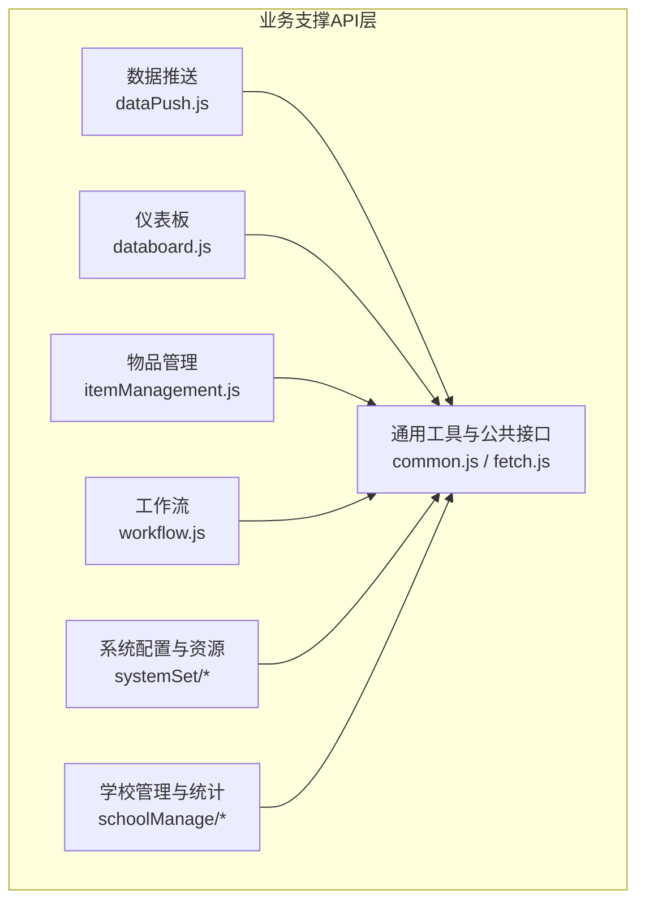
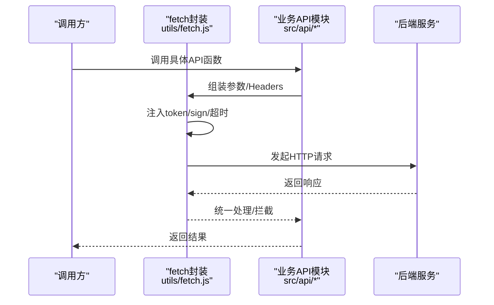
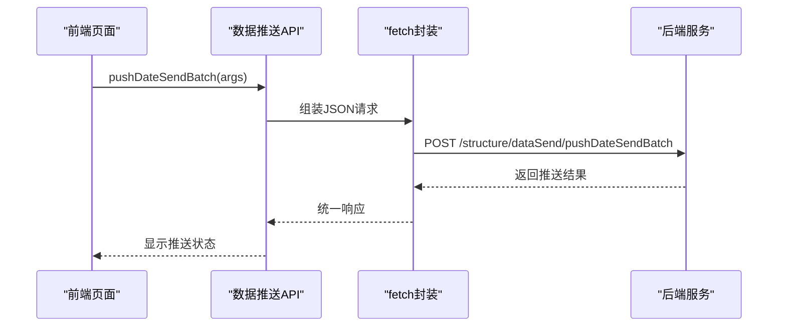
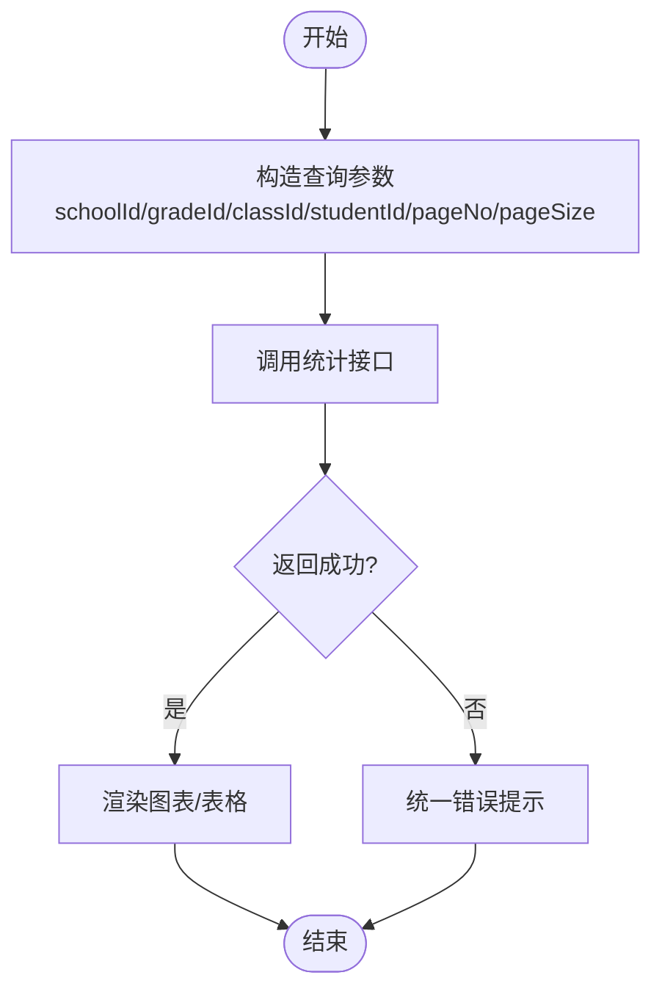
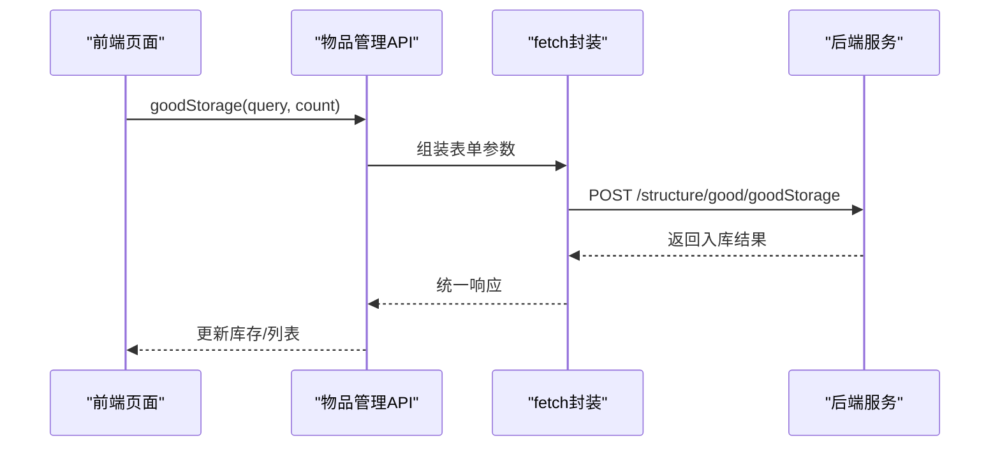
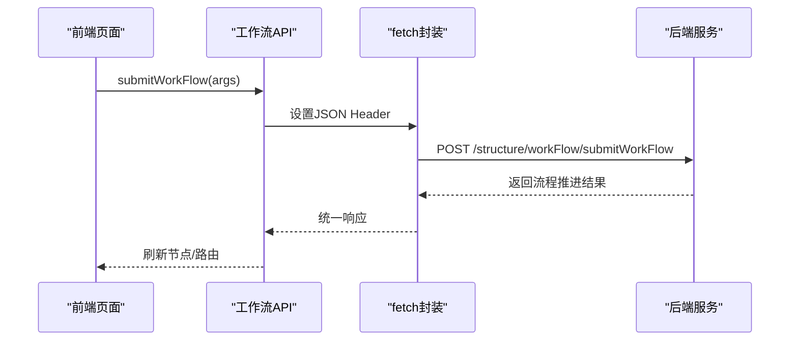
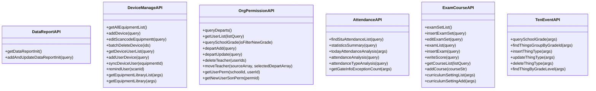
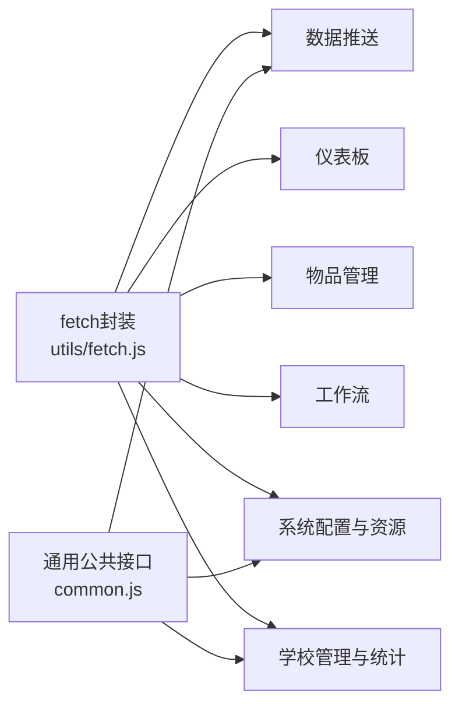

# 业务支撑API

<cite>
**本文引用的文件**
- [dataPush.js](file://src/api/dataPush.js)
- [databoard.js](file://src/api/databoard.js)
- [itemManagement.js](file://src/api/itemManagement.js)
- [workflow.js](file://src/api/workflow.js)
- [dataReport.js](file://src/api/systemSet/dataReport.js)
- [deviceManage.js](file://src/api/systemSet/deviceManage.js)
- [org.js](file://src/api/systemSet/org.js)
- [permission.js](file://src/api/systemSet/permission.js)
- [fetch.js](file://src/utils/fetch.js)
- [common.js](file://src/api/common/common.js)
- [stuAttendanceRecord.js](file://src/api/schoolManage/stuAttendanceRecord.js)
- [teacherAttendanceStatistics.js](file://src/api/schoolManage/teacherAttendanceStatistics.js)
- [exam.js](file://src/api/systemSet/exam.js)
- [courseSet.js](file://src/api/systemSet/courseSet.js)
- [tenEvent.js](file://src/api/systemSet/tenEvent.js)
</cite>

## 目录
1. [简介](#简介)
2. [项目结构](#项目结构)
3. [核心组件](#核心组件)
4. [架构总览](#架构总览)
5. [详细组件分析](#详细组件分析)
6. [依赖关系分析](#依赖关系分析)
7. [性能考虑](#性能考虑)
8. [故障排查指南](#故障排查指南)
9. [结论](#结论)
10. [附录](#附录)

## 简介
本文件面向业务支撑类功能的API使用与集成，覆盖数据推送、仪表板、物品管理、工作流、系统配置与资源管理、权限与组织、考勤统计、教学评估与课程设置、十件事管理等支撑性能力。文档从接口规范、数据模型、处理流程、集成方案、性能优化与扩展设计等维度进行系统化梳理，帮助开发者快速理解与落地。

## 项目结构
业务支撑API主要位于以下目录：
- 数据推送：src/api/dataPush.js
- 仪表板：src/api/databoard.js
- 物品管理：src/api/itemManagement.js
- 工作流：src/api/workflow.js
- 系统配置与资源管理：
  - 数据报表：src/api/systemSet/dataReport.js
  - 设备管理：src/api/systemSet/deviceManage.js
  - 组织与权限：src/api/systemSet/org.js、src/api/systemSet/permission.js
  - 考勤统计：src/api/schoolManage/stuAttendanceRecord.js、src/api/schoolManage/teacherAttendanceStatistics.js
  - 教学评估与课程：src/api/systemSet/exam.js、src/api/systemSet/courseSet.js
  - 十件事：src/api/systemSet/tenEvent.js
- 通用工具与封装：src/utils/fetch.js
- 通用公共接口：src/api/common/common.js

**图表来源**
- [dataPush.js:1-121](file://src/api/dataPush.js#L1-L121)
- [databoard.js:1-173](file://src/api/databoard.js#L1-L173)
- [itemManagement.js:1-480](file://src/api/itemManagement.js#L1-L480)
- [workflow.js:1-150](file://src/api/workflow.js#L1-L150)
- [dataReport.js:1-26](file://src/api/systemSet/dataReport.js#L1-L26)
- [deviceManage.js:1-189](file://src/api/systemSet/deviceManage.js#L1-L189)
- [org.js:1-800](file://src/api/systemSet/org.js#L1-L800)
- [permission.js:1-40](file://src/api/systemSet/permission.js#L1-L40)
- [stuAttendanceRecord.js:1-111](file://src/api/schoolManage/stuAttendanceRecord.js#L1-L111)
- [teacherAttendanceStatistics.js:1-248](file://src/api/schoolManage/teacherAttendanceStatistics.js#L1-L248)
- [exam.js:1-455](file://src/api/systemSet/exam.js#L1-L455)
- [courseSet.js:1-217](file://src/api/systemSet/courseSet.js#L1-L217)
- [tenEvent.js:1-71](file://src/api/systemSet/tenEvent.js#L1-L71)
- [fetch.js:1-240](file://src/utils/fetch.js#L1-L240)
- [common.js:1-459](file://src/api/common/common.js#L1-L459)

**章节来源**
- [fetch.js:1-240](file://src/utils/fetch.js#L1-L240)
- [common.js:1-459](file://src/api/common/common.js#L1-L459)

## 核心组件
- 数据推送服务：支持批次数据推送、批次查询、人员清单分页、提醒未读等能力，适用于消息/通知/数据同步场景。
- 仪表板服务：提供按年级/班级/学生维度的统计分析接口，涵盖类型统计、学生统计、学年统计、科目统计、性别统计、排名统计等。
- 物品管理服务：覆盖物品与分类的增删改查、库存入库、统计分析、订单管理、归还管理、字典单位等。
- 工作流服务：提供流程定义、历史记录、起始环节、当前环节、处理人查询、下一步骤决策、提交流程等。
- 系统配置与资源：数据报表初始化、设备管理（扫码设备、用户、库）、组织与权限、课程与评估、十件事管理。
- 通用工具：统一请求封装、多环境BaseURL、签名与鉴权、超时控制、错误拦截与登录态处理。

**章节来源**
- [dataPush.js:1-121](file://src/api/dataPush.js#L1-L121)
- [databoard.js:1-173](file://src/api/databoard.js#L1-L173)
- [itemManagement.js:1-480](file://src/api/itemManagement.js#L1-L480)
- [workflow.js:1-150](file://src/api/workflow.js#L1-L150)
- [dataReport.js:1-26](file://src/api/systemSet/dataReport.js#L1-L26)
- [deviceManage.js:1-189](file://src/api/systemSet/deviceManage.js#L1-L189)
- [org.js:1-800](file://src/api/systemSet/org.js#L1-L800)
- [permission.js:1-40](file://src/api/systemSet/permission.js#L1-L40)
- [stuAttendanceRecord.js:1-111](file://src/api/schoolManage/stuAttendanceRecord.js#L1-L111)
- [teacherAttendanceStatistics.js:1-248](file://src/api/schoolManage/teacherAttendanceStatistics.js#L1-L248)
- [exam.js:1-455](file://src/api/systemSet/exam.js#L1-L455)
- [courseSet.js:1-217](file://src/api/systemSet/courseSet.js#L1-L217)
- [tenEvent.js:1-71](file://src/api/systemSet/tenEvent.js#L1-L71)
- [fetch.js:1-240](file://src/utils/fetch.js#L1-L240)

## 架构总览
前端通过统一的请求封装层发起HTTP调用，自动注入token与签名，按模块区分不同后端域，实现跨域与多租户隔离。业务模块按功能域拆分，便于扩展与维护。

**图表来源**
- [fetch.js:65-169](file://src/utils/fetch.js#L65-L169)
- [dataPush.js:33-43](file://src/api/dataPush.js#L33-L43)
- [itemManagement.js:223-239](file://src/api/itemManagement.js#L223-L239)

**章节来源**
- [fetch.js:1-240](file://src/utils/fetch.js#L1-L240)

## 详细组件分析

### 数据推送API
- 功能要点
  - 批次管理：新增、更新、删除、分页查询、详情查询
  - 人员清单：按批次分页查询、删除人员
  - 推送与提醒：批量推送、提醒未读
  - 字典值：获取系统字典值用于配置
- 典型流程
  - 新建批次 -> 填充人员清单 -> 批量推送 -> 监控未读 -> 提醒未读
- 错误与边界
  - 参数校验失败、网络异常、鉴权失败会触发统一错误提示与登出逻辑

**图表来源**
- [dataPush.js:33-43](file://src/api/dataPush.js#L33-L43)

**章节来源**
- [dataPush.js:1-121](file://src/api/dataPush.js#L1-L121)

### 仪表板API
- 功能要点
  - 年级/班级/学生维度统计：类型、学生、学年、科目、性别、排名、学期排名等
  - 支持分页与筛选，统一timeout控制
- 使用建议
  - 按需组合查询条件，避免一次性拉取过多数据
  - 对高频查询可做本地缓存与节流

**图表来源**
- [databoard.js:11-81](file://src/api/databoard.js#L11-L81)

**章节来源**
- [databoard.js:1-173](file://src/api/databoard.js#L1-L173)

### 物品管理API
- 功能要点
  - 物品与分类：增删改查、树形结构、字典单位
  - 订单与统计：按时间、部门、用户、物品维度统计
  - 入库与归还：入库登记、归还订单查询、审批详情
  - 维度查询：按goodId/departmentId/userId等多维聚合
- 处理流程
  - 新增物品/分类 -> 入库登记 -> 订单统计 -> 归还处理 -> 审批流程

**图表来源**
- [itemManagement.js:223-239](file://src/api/itemManagement.js#L223-L239)

**章节来源**
- [itemManagement.js:1-480](file://src/api/itemManagement.js#L1-L480)

### 工作流API
- 功能要点
  - 流程定义与历史：获取流程、历史记录
  - 环节控制：起始环节、当前环节、处理人列表
  - 步骤决策：根据条件获取下一步骤
  - 提交流程：提交并传递上下文
- 集成建议
  - 在提交前校验必填字段与权限
  - 对批量类型与用户选择进行前端校验

**图表来源**
- [workflow.js:125-149](file://src/api/workflow.js#L125-L149)

**章节来源**
- [workflow.js:1-150](file://src/api/workflow.js#L1-L150)

### 系统配置与资源API
- 数据报表初始化
  - 查询与新增/修改报表初始化配置
- 设备管理
  - 扫码设备的增删改查、用户绑定/同步、提醒未上传照片、设备库查询
- 组织与权限
  - 部门/用户/角色/权限查询与同步、导入导出、启用/禁用、移动/删除
- 考勤统计
  - 教师/学生考勤明细、类型分析、汇总统计、异常门禁统计
- 教学评估与课程
  - 成绩设置、考试管理、成绩录入与分析、评语模板、课程设置
- 十件事
  - 年级事件类型管理、按上下学期分组查询

**图表来源**
- [dataReport.js:1-26](file://src/api/systemSet/dataReport.js#L1-L26)
- [deviceManage.js:1-189](file://src/api/systemSet/deviceManage.js#L1-L189)
- [org.js:1-800](file://src/api/systemSet/org.js#L1-L800)
- [permission.js:1-40](file://src/api/systemSet/permission.js#L1-L40)
- [stuAttendanceRecord.js:1-111](file://src/api/schoolManage/stuAttendanceRecord.js#L1-L111)
- [teacherAttendanceStatistics.js:1-248](file://src/api/schoolManage/teacherAttendanceStatistics.js#L1-L248)
- [exam.js:1-455](file://src/api/systemSet/exam.js#L1-L455)
- [courseSet.js:1-217](file://src/api/systemSet/courseSet.js#L1-L217)
- [tenEvent.js:1-71](file://src/api/systemSet/tenEvent.js#L1-L71)

**章节来源**
- [dataReport.js:1-26](file://src/api/systemSet/dataReport.js#L1-L26)
- [deviceManage.js:1-189](file://src/api/systemSet/deviceManage.js#L1-L189)
- [org.js:1-800](file://src/api/systemSet/org.js#L1-L800)
- [permission.js:1-40](file://src/api/systemSet/permission.js#L1-L40)
- [stuAttendanceRecord.js:1-111](file://src/api/schoolManage/stuAttendanceRecord.js#L1-L111)
- [teacherAttendanceStatistics.js:1-248](file://src/api/schoolManage/teacherAttendanceStatistics.js#L1-L248)
- [exam.js:1-455](file://src/api/systemSet/exam.js#L1-L455)
- [courseSet.js:1-217](file://src/api/systemSet/courseSet.js#L1-L217)
- [tenEvent.js:1-71](file://src/api/systemSet/tenEvent.js#L1-L71)

## 依赖关系分析
- 统一请求封装
  - 多个baseURL适配不同域（如ucenter-web、module-web、wxcepInterface等）
  - 自动注入token与签名，支持JSON与表单两种提交方式
  - 统一错误拦截与登录态失效处理
- 模块间耦合
  - 业务API模块均依赖fetch封装，降低重复代码
  - 通用公共接口（common.js）提供字典、课程、视频等跨模块能力
- 外部依赖
  - Element UI消息提示、Cookies、jQuery（用于按钮禁用/启用）

**图表来源**
- [fetch.js:13-240](file://src/utils/fetch.js#L13-L240)
- [common.js:1-459](file://src/api/common/common.js#L1-L459)

**章节来源**
- [fetch.js:1-240](file://src/utils/fetch.js#L1-L240)
- [common.js:1-459](file://src/api/common/common.js#L1-L459)

## 性能考虑
- 请求合并与分页
  - 仪表板与统计类接口建议分页加载，避免一次性请求大量数据
- 缓存策略
  - 对不频繁变化的枚举/字典类数据（如单位、事件类型）进行本地缓存
- 超时与重试
  - 高耗时接口设置合理timeout，必要时在UI层增加loading反馈
- 网络优化
  - 图片/视频资源优先CDN，减少首屏等待
- 错误兜底
  - 统一拦截器中对常见错误码进行提示与引导，避免无提示失败

[本节为通用指导，无需特定文件引用]

## 故障排查指南
- 常见错误码与处理
  - 登录超时（1000）：触发登出并跳转登录页
  - 参数非法（1001/1002/1003）：检查请求参数与Header
  - 权限不足（401/403）：确认token与签名有效
- 建议排查步骤
  - 检查请求URL与BaseURL配置
  - 核对token与sign是否注入
  - 查看响应code与msg，定位问题模块
  - 对高耗时接口增加超时与重试策略

**章节来源**
- [fetch.js:104-169](file://src/utils/fetch.js#L104-L169)

## 结论
本文档系统梳理了业务支撑相关API的功能域、接口规范、数据模型与处理流程，并提供了统一的请求封装与错误处理策略。通过模块化设计与清晰的依赖关系，能够高效支撑数据推送、仪表板、物品管理、工作流、系统配置与资源管理、权限与组织、考勤统计、教学评估与课程设置、十件事管理等业务场景。建议在实际集成中遵循参数校验、缓存策略、超时与重试、错误兜底等最佳实践，确保系统稳定性与用户体验。

## 附录
- 扩展接口设计建议
  - 对高频统计接口增加本地缓存与增量更新
  - 对批量操作增加进度条与分批提交
  - 对复杂流程增加可视化流程图与节点说明
- 集成方案
  - 前端按模块引入对应API函数，统一通过fetch封装发起请求
  - 对跨域与多租户场景，使用不同baseURL与鉴权策略
  - 对大文件/图片上传，结合通用上传接口与签名机制

[本节为通用指导，无需特定文件引用]