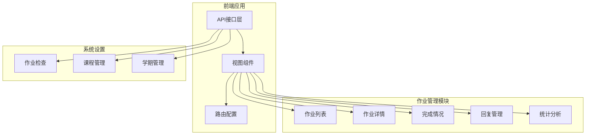
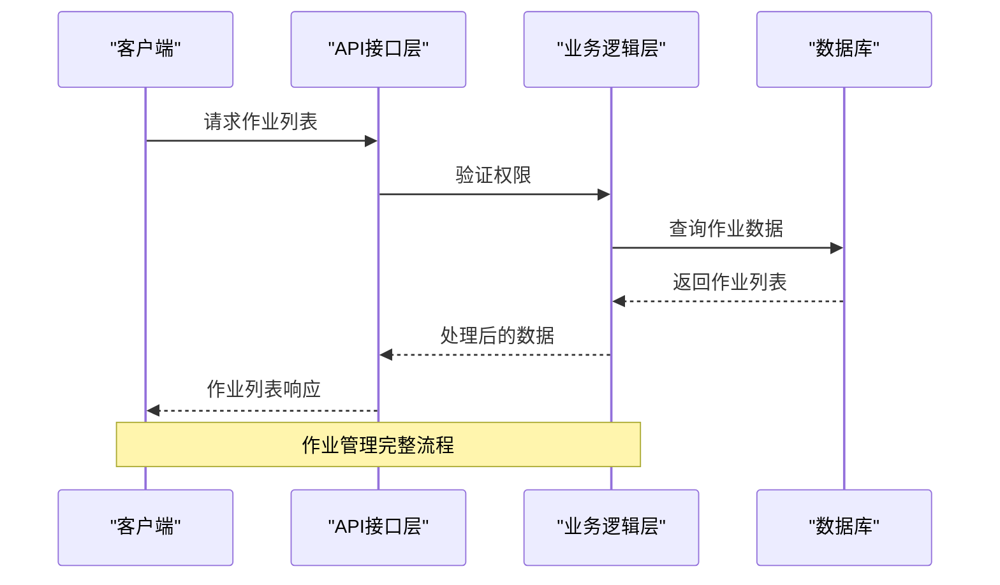
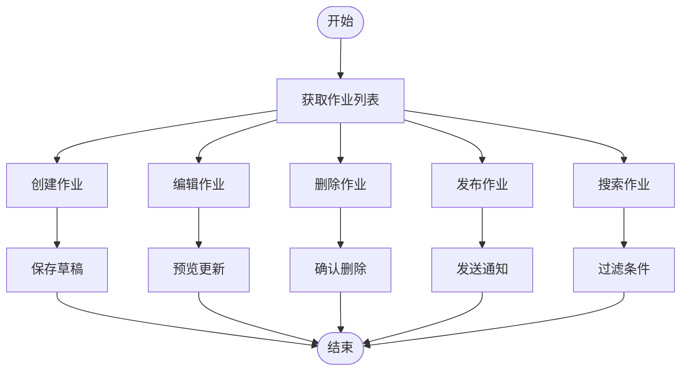
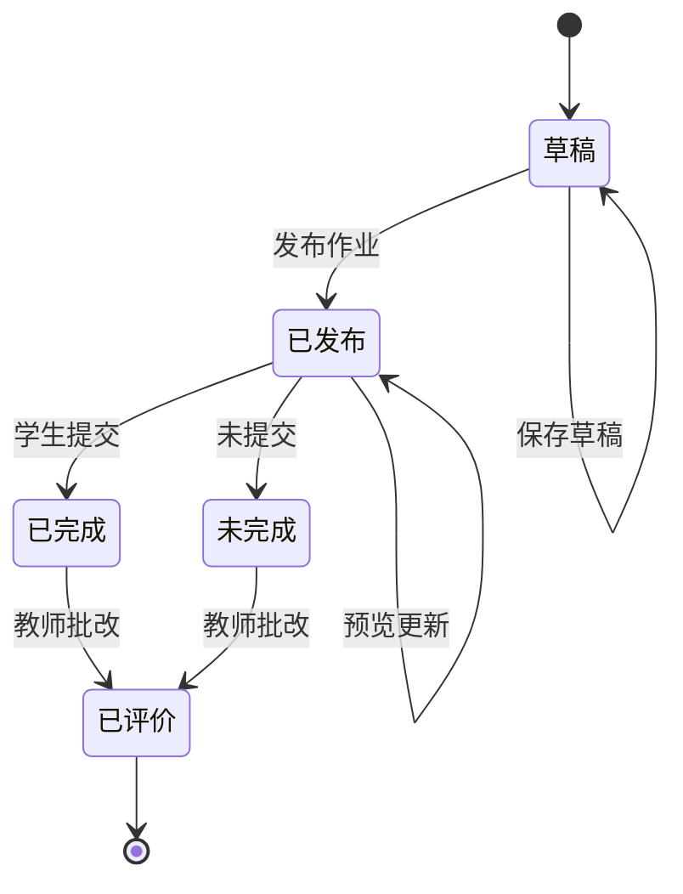
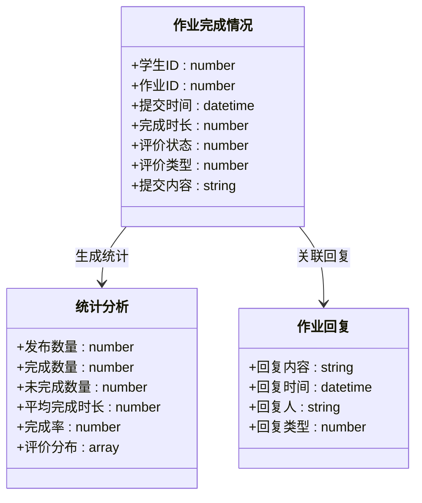
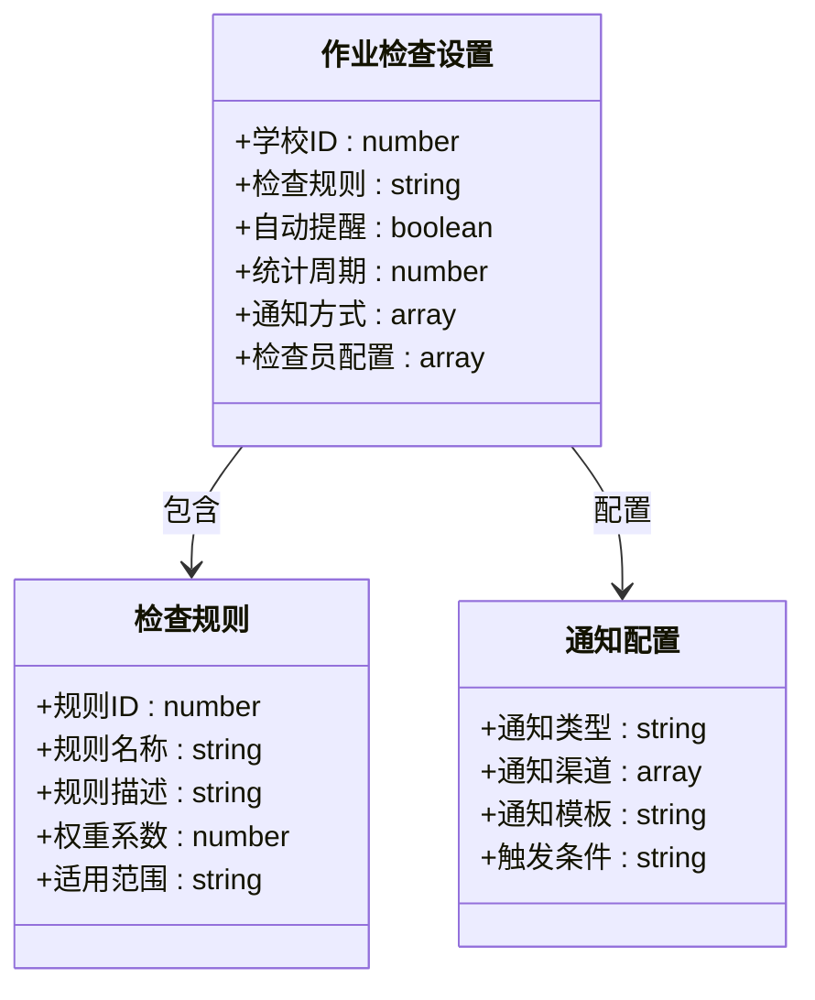
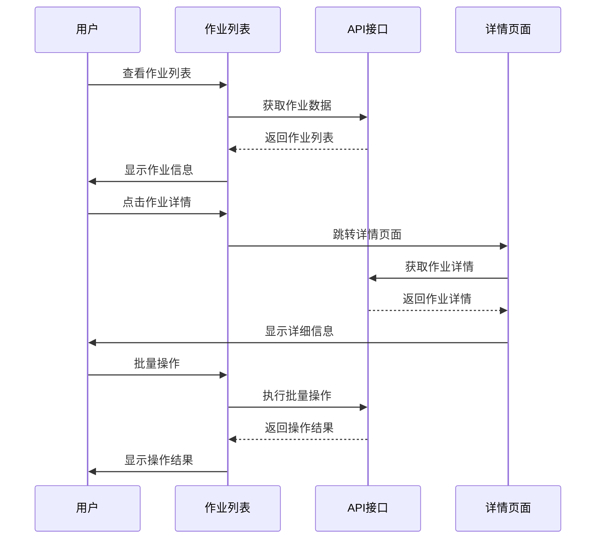
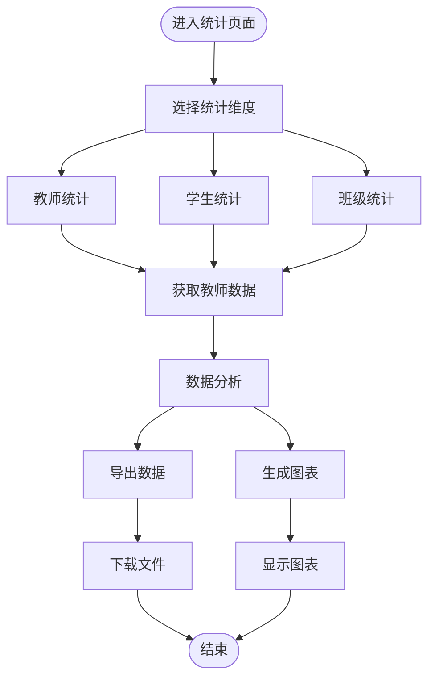
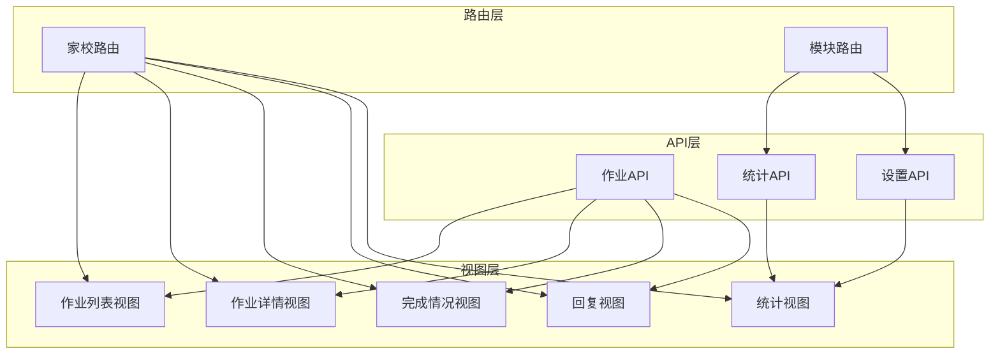
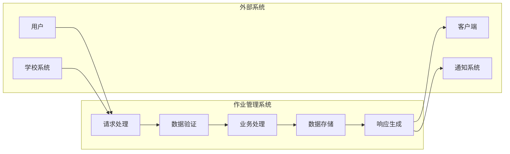

# 作业管理API

<cite>
**本文档引用的文件**
- [homework.js](file://src/api/homework.js)
- [homeworkInspection.js](file://src/api/systemSet/homeworkInspection.js)
- [homeworkIndex.vue](file://src/views/homeworkManage/homeworkIndex.vue)
- [homeworkDetail.vue](file://src/views/homeworkManage/homeworkDetail.vue)
- [homeworkStatis.vue](file://src/views/homeworkManage/homeworkStatis.vue)
- [homeworkManageFinishList.vue](file://src/views/homeworkManage/homeworkManageFinishList.vue)
- [homeworkManageReplyList.vue](file://src/views/homeworkManage/homeworkManageReplyList.vue)
- [homeSchool.js](file://src/router/normal/homeSchool.js)
</cite>

## 目录
1. [简介](#简介)
2. [项目结构](#项目结构)
3. [核心组件](#核心组件)
4. [架构概览](#架构概览)
5. [详细组件分析](#详细组件分析)
6. [依赖关系分析](#依赖关系分析)
7. [性能考虑](#性能考虑)
8. [故障排除指南](#故障排除指南)
9. [结论](#结论)

## 简介
本文件详细记录了作业管理相关API的接口规范，涵盖作业布置、提交检查、批改反馈、统计分析等核心功能。文档包括作业创建、发布、收交、评价等操作的API说明，以及作业类型管理、完成情况统计、学习效果分析等功能的接口文档。同时文档化了作业数据模型、截止时间管理、质量评估机制，并提供作业报告生成和个性化学习建议接口。

## 项目结构
作业管理系统主要由以下部分组成：

**图表来源**
- [homework.js:1-645](file://src/api/homework.js#L1-L645)
- [homeSchool.js:211-250](file://src/router/normal/homeSchool.js#L211-L250)

**章节来源**
- [homework.js:1-645](file://src/api/homework.js#L1-L645)
- [homeSchool.js:211-250](file://src/router/normal/homeSchool.js#L211-L250)

## 核心组件
作业管理系统包含以下核心组件：

### API接口层
- 作业管理API：提供作业创建、编辑、删除、查询等基础操作
- 统计分析API：提供作业完成情况统计和学习效果分析
- 系统设置API：提供作业检查设置和配置管理

### 视图组件层
- 作业列表组件：展示作业列表、状态管理和批量操作
- 作业详情组件：显示作业具体内容、附件和统计数据
- 完成情况组件：管理学生作业完成状态和评价
- 回复管理组件：处理作业回复和消息交互
- 统计分析组件：提供多维度的数据统计和报表

### 路由配置
系统通过路由配置实现模块化导航，支持作业管理的完整工作流程。

**章节来源**
- [homeworkIndex.vue:1-320](file://src/views/homeworkManage/homeworkIndex.vue#L1-L320)
- [homeworkDetail.vue:1-454](file://src/views/homeworkManage/homeworkDetail.vue#L1-L454)
- [homeworkManageFinishList.vue:1-261](file://src/views/homeworkManage/homeworkManageFinishList.vue#L1-L261)
- [homeworkManageReplyList.vue:1-422](file://src/views/homeworkManage/homeworkManageReplyList.vue#L1-L422)

## 架构概览
作业管理系统的整体架构采用前后端分离设计，通过API接口层统一管理业务逻辑：

**图表来源**
- [homework.js:24-35](file://src/api/homework.js#L24-L35)
- [homework.js:290-332](file://src/api/homework.js#L290-L332)

系统架构特点：
- **模块化设计**：每个功能模块独立封装，便于维护和扩展
- **统一接口规范**：所有API遵循一致的参数格式和响应结构
- **权限控制**：基于角色的访问控制确保数据安全
- **状态管理**：完整的作业生命周期管理

## 详细组件分析

### 作业管理API详解

#### 作业列表管理
作业列表管理提供完整的作业生命周期操作：

**图表来源**
- [homework.js:24-35](file://src/api/homework.js#L24-L35)
- [homework.js:59-140](file://src/api/homework.js#L59-L140)
- [homework.js:255-264](file://src/api/homework.js#L255-L264)

**章节来源**
- [homework.js:24-35](file://src/api/homework.js#L24-L35)
- [homework.js:59-140](file://src/api/homework.js#L59-L140)
- [homework.js:255-264](file://src/api/homework.js#L255-L264)

#### 作业发布与状态管理
作业发布流程包含多种状态转换：

**图表来源**
- [homework.js:43-52](file://src/api/homework.js#L43-L52)
- [homework.js:103-140](file://src/api/homework.js#L103-L140)

#### 作业完成情况管理
完成情况管理提供详细的统计和分析功能：

**图表来源**
- [homework.js:352-373](file://src/api/homework.js#L352-L373)
- [homework.js:495-511](file://src/api/homework.js#L495-L511)
- [homework.js:419-431](file://src/api/homework.js#L419-L431)

**章节来源**
- [homework.js:352-373](file://src/api/homework.js#L352-L373)
- [homework.js:495-511](file://src/api/homework.js#L495-L511)
- [homework.js:419-431](file://src/api/homework.js#L419-L431)

### 系统设置API

#### 作业检查设置
作业检查设置提供灵活的配置选项：

**图表来源**
- [homeworkInspection.js:13-29](file://src/api/systemSet/homeworkInspection.js#L13-L29)

**章节来源**
- [homeworkInspection.js:13-29](file://src/api/systemSet/homeworkInspection.js#L13-L29)

### 视图组件交互流程

#### 作业列表组件
作业列表组件提供完整的作业管理界面：

**图表来源**
- [homeworkIndex.vue:125-172](file://src/views/homeworkManage/homeworkIndex.vue#L125-L172)
- [homeworkIndex.vue:290-298](file://src/views/homeworkManage/homeworkIndex.vue#L290-L298)

**章节来源**
- [homeworkIndex.vue:125-172](file://src/views/homeworkManage/homeworkIndex.vue#L125-L172)
- [homeworkIndex.vue:290-298](file://src/views/homeworkManage/homeworkIndex.vue#L290-L298)

#### 作业统计组件
统计组件提供多维度的数据分析：

**图表来源**
- [homeworkStatis.vue:176-183](file://src/views/homeworkManage/homeworkStatis.vue#L176-L183)
- [homeworkStatis.vue:236-282](file://src/views/homeworkManage/homeworkStatis.vue#L236-L282)

**章节来源**
- [homeworkStatis.vue:176-183](file://src/views/homeworkManage/homeworkStatis.vue#L176-L183)
- [homeworkStatis.vue:236-282](file://src/views/homeworkManage/homeworkStatis.vue#L236-L282)

## 依赖关系分析

### 组件间依赖关系
作业管理系统各组件之间存在清晰的依赖关系：

**图表来源**
- [homework.js:1-645](file://src/api/homework.js#L1-L645)
- [homeSchool.js:211-250](file://src/router/normal/homeSchool.js#L211-L250)

### 数据流分析
系统内部数据流遵循标准化的处理模式：

**图表来源**
- [homework.js:14-19](file://src/api/homework.js#L14-L19)
- [homework.js:290-332](file://src/api/homework.js#L290-L332)

**章节来源**
- [homework.js:14-19](file://src/api/homework.js#L14-L19)
- [homework.js:290-332](file://src/api/homework.js#L290-L332)

## 性能考虑
作业管理系统在设计时充分考虑了性能优化：

### 缓存策略
- **列表缓存**：作业列表数据采用本地缓存，减少重复请求
- **状态缓存**：作业状态变化实时更新，避免频繁刷新
- **统计缓存**：统计结果定期更新，提高响应速度

### 分页加载
- **无限滚动**：支持大数据量的分页加载
- **懒加载**：图片和附件采用懒加载策略
- **虚拟滚动**：长列表使用虚拟滚动提升性能

### 并发处理
- **请求合并**：多个小请求合并为批量请求
- **并发限制**：控制同时进行的请求数量
- **错误重试**：网络异常时自动重试机制

## 故障排除指南

### 常见问题诊断
作业管理系统可能遇到的问题及解决方案：

#### API请求失败
- **问题现象**：API请求返回错误状态码
- **可能原因**：网络连接异常、权限不足、参数错误
- **解决方法**：检查网络连接、验证用户权限、确认请求参数

#### 数据加载缓慢
- **问题现象**：页面加载时间过长
- **可能原因**：数据量过大、网络延迟、服务器性能问题
- **解决方法**：启用分页加载、优化查询条件、检查服务器性能

#### 状态不同步
- **问题现象**：界面状态与实际数据不一致
- **可能原因**：缓存未更新、异步操作冲突
- **解决方法**：手动刷新页面、清除缓存、检查异步操作

### 调试工具
系统提供了完善的调试工具：
- **开发者工具**：浏览器开发者工具监控网络请求
- **日志系统**：详细的错误日志记录
- **性能监控**：实时监控系统性能指标

**章节来源**
- [homework.js:255-264](file://src/api/homework.js#L255-L264)
- [homeworkIndex.vue:237-278](file://src/views/homeworkManage/homeworkIndex.vue#L237-L278)

## 结论
作业管理系统通过模块化的架构设计和标准化的API接口，实现了完整的作业管理功能。系统支持从作业创建到统计分析的全流程管理，提供了灵活的配置选项和强大的扩展能力。

### 主要优势
- **功能完整**：覆盖作业管理的所有核心功能
- **易于扩展**：模块化设计便于功能扩展
- **用户体验**：直观的界面设计和流畅的操作体验
- **数据安全**：完善的安全机制和权限控制

### 发展方向
未来可以考虑的功能增强：
- **智能推荐**：基于学习数据的个性化作业推荐
- **移动端支持**：开发移动端应用提升使用便利性
- **AI辅助**：利用人工智能技术提供智能批改和分析
- **集成扩展**：与其他教育系统的深度集成

通过持续优化和功能扩展，作业管理系统将为教育工作者提供更加高效、便捷的作业管理解决方案。