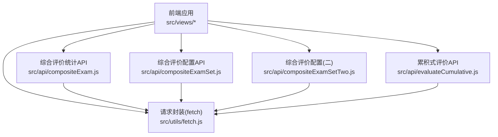
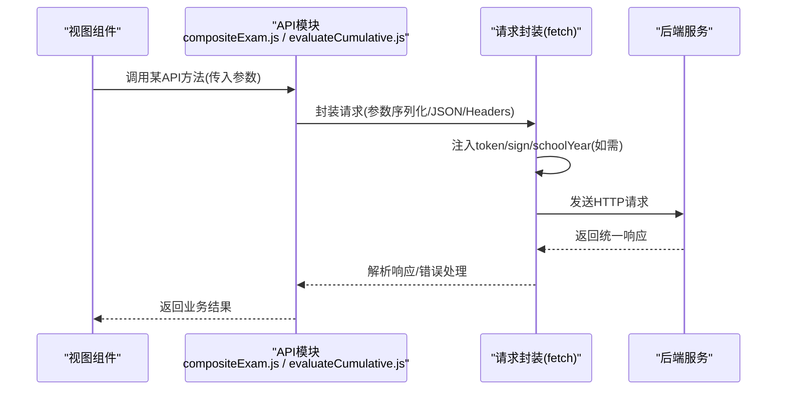
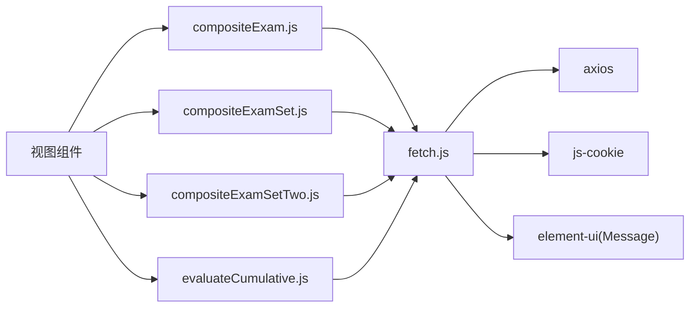

# 成绩管理API

<cite>
**本文引用的文件**
- [src/api/compositeExam.js](file://src/api/compositeExam.js)
- [src/api/compositeExamSet.js](file://src/api/compositeExamSet.js)
- [src/api/compositeExamSetTwo.js](file://src/api/compositeExamSetTwo.js)
- [src/utils/fetch.js](file://src/utils/fetch.js)
- [src/api/evaluateCumulative.js](file://src/api/evaluateCumulative.js)
- [src/router/moduleList.js](file://src/router/moduleList.js)
</cite>

## 目录
1. [简介](#简介)
2. [项目结构](#项目结构)
3. [核心组件](#核心组件)
4. [架构总览](#架构总览)
5. [详细组件分析](#详细组件分析)
6. [依赖关系分析](#依赖关系分析)
7. [性能考虑](#性能考虑)
8. [故障排查指南](#故障排查指南)
9. [结论](#结论)
10. [附录](#附录)

## 简介
本文件面向“成绩管理”相关功能的API使用与集成，覆盖以下能力范围：
- 考试与综合评价的创建、配置与发布
- 多科目成绩录入与统计
- 成绩发布、分数计算与等级评定
- 班级排名与年级统计
- 综合评价（如课堂行为、品德、体质健康等）的数据采集与报表
- 成绩分析报表与趋势预测接口

说明：
- 当前仓库中与“成绩管理”直接对应的API集中在综合评价与累积式评价模块，以及部分路由定义中体现的功能入口。
- 本文件以现有API为依据进行接口规范说明，并在无法定位到具体实现时明确标注“待确认”。

## 项目结构
围绕成绩管理的前端API主要位于以下位置：
- 综合评价统计与配置：src/api/compositeExam.js、src/api/compositeExamSet.js、src/api/compositeExamSetTwo.js
- 累积式评价（含学生成长档案、教师评价等）：src/api/evaluateCumulative.js
- 请求封装与统一鉴权：src/utils/fetch.js
- 功能模块路由入口（用于定位页面与功能范围）：src/router/moduleList.js

图表来源
- [src/api/compositeExam.js:1-142](file://src/api/compositeExam.js#L1-L142)
- [src/api/compositeExamSet.js:1-195](file://src/api/compositeExamSet.js#L1-L195)
- [src/api/compositeExamSetTwo.js:1-175](file://src/api/compositeExamSetTwo.js#L1-L175)
- [src/api/evaluateCumulative.js:217-255](file://src/api/evaluateCumulative.js#L217-L255)
- [src/utils/fetch.js:1-240](file://src/utils/fetch.js#L1-L240)

章节来源
- [src/api/compositeExam.js:1-142](file://src/api/compositeExam.js#L1-L142)
- [src/api/compositeExamSet.js:1-195](file://src/api/compositeExamSet.js#L1-L195)
- [src/api/compositeExamSetTwo.js:1-175](file://src/api/compositeExamSetTwo.js#L1-L175)
- [src/api/evaluateCumulative.js:217-255](file://src/api/evaluateCumulative.js#L217-L255)
- [src/utils/fetch.js:1-240](file://src/utils/fetch.js#L1-L240)
- [src/router/moduleList.js:1952-2136](file://src/router/moduleList.js#L1952-L2136)

## 核心组件
- 综合评价统计API（按日期/周次/时间段/检查项维度统计）
- 综合评价配置API（值班组、检查项、分组、课表节次等）
- 综合评价配置API（二）（复杂检查项与检查基线管理）
- 累积式评价API（学生成长档案、教师评价记录、按维度得分等）

章节来源
- [src/api/compositeExam.js:1-142](file://src/api/compositeExam.js#L1-L142)
- [src/api/compositeExamSet.js:1-195](file://src/api/compositeExamSet.js#L1-L195)
- [src/api/compositeExamSetTwo.js:1-175](file://src/api/compositeExamSetTwo.js#L1-L175)
- [src/api/evaluateCumulative.js:217-255](file://src/api/evaluateCumulative.js#L217-L255)

## 架构总览
前端通过统一的请求封装层向后端发起HTTP请求，自动注入token与签名参数；后端返回统一响应结构，前端在拦截器中进行错误提示与登录态处理。

图表来源
- [src/utils/fetch.js:13-240](file://src/utils/fetch.js#L13-L240)
- [src/api/compositeExam.js:1-142](file://src/api/compositeExam.js#L1-L142)
- [src/api/evaluateCumulative.js:217-255](file://src/api/evaluateCumulative.js#L217-L255)

## 详细组件分析

### 综合评价统计API
- 按日期统计
  - 接口路径：structure/compositeStatistic/statisticScore
  - 方法：POST
  - 参数要点：checkDate、gradeId、seeType、dutyId
  - 返回：按日期聚合的统计结果
- 按日期统计详情
  - 接口路径：structure/compositeStatistic/getDetailByDate
  - 方法：POST
  - 参数要点：checkTime、classId、itemId
  - 返回：指定日期下按班级/检查项的明细
- 按周次统计
  - 接口路径：structure/compositeStatistic/statisticScore
  - 方法：POST
  - 参数要点：gradeId、seeType、severalWeek、dutyId
  - 返回：按周次聚合的统计结果
- 按周次统计详情
  - 接口路径：structure/compositeStatistic/getDetailByWeek
  - 方法：POST
  - 参数要点：severalWeek、classId、itemId
  - 返回：指定周次下按班级/检查项的明细
- 按时间段统计
  - 接口路径：structure/compositeStatistic/statisticScore
  - 方法：POST
  - 参数要点：startTimeStr、endTimeStr、gradeId、seeType、dutyId
  - 返回：按时间段聚合的统计结果
- 按检查项统计
  - 接口路径：structure/compositeStatistic/findStatisticByItem
  - 方法：POST
  - 参数要点：gradeId、itemId、pageNo、pageSize、dutyId
  - 返回：按检查项分页统计结果
- 问题反馈相关
  - 查询有问题反馈的值班组：structure/compositeNew/findDutyBasehavingRecordList（GET）
  - 条件查询问题反馈列表（分页）：structure/compositeNew/findCheckEventListByPage（GET）
  - 导出问题反馈列表（Excel）：structure/compositeNew/exportFindCheckEventList（GET）

章节来源
- [src/api/compositeExam.js:1-142](file://src/api/compositeExam.js#L1-L142)

### 综合评价配置API（值班与检查项）
- 获取值班组列表：structure/composite/getDutySetList（POST）
- 删除值班表：structure/composite/delDuty（POST），参数：dutyId
- 添加值班表：structure/composite/addDuty（POST），参数：对象
- 值班表详情：structure/composite/getDutyById（POST），参数：dutyId
- 编辑值班组：structure/composite/editDuty（POST），参数：对象
- 添加/编辑分组：structure/composite/addGroup（POST），参数：day、dutyId、groupName、groupType、id、old_user、monCheckUser、tuesdayCheckUser、wednesdayCheckUser、thursdayCheckUser、fridayCheckUser等
- 删除分组：structure/composite/delGroup（POST），参数：groupId
- 检查项列表（分页）：structure/composite/getCheckItemList（POST），参数：itemName、pageNo、pageSize
- 获取检查组列表：structure/composite/getCheckGroupList（POST），参数：dutyId
- 获取全部检查项：structure/composite/getCheckItemListAll（POST），参数：isStar
- 获取课表节次信息：structure/composite/getClassNoList（POST）
- 添加/编辑检查项：structure/composite/addItem（POST），参数：对象
- 删除检查项：structure/composite/delItem（POST），参数：itemId
- 根据ID获取检查项：structure/composite/getItemById（POST），参数：itemId
- 获取学校综合检查设置：structure/composite/getCompositeCheckInit（POST）
- 新增/修改综合检查设置：structure/composite/addAndUpdateCompositeCheckInit（POST），参数：JSON
- 批量新增检查项分组：structure/composite/addCompositeCheckItemGroupList（POST），参数：JSON

章节来源
- [src/api/compositeExamSet.js:1-195](file://src/api/compositeExamSet.js#L1-L195)

### 综合评价配置API（二）
- 新增/修改复杂检查初始化：structure/complex/addAndUpdateComplexInit（POST），参数：JSON
- 获取复杂检查初始化：structure/complex/getComplexInit（GET）
- 查询检查组列表：structure/complex/getComplexCheckBaseList（GET）
- 删除检查组：structure/complex/delComplexCheckBase（POST），参数：baseId
- 获取检查项列表：structure/complex/getComplexCheckItemList（GET）
- 删除检查项：structure/complex/delComplexCheckItem（POST），参数：itemId
- 新增检查项：structure/complex/addComplexCheckItem（POST），参数：JSON
- 更新检查项：structure/complex/updateComplexCheckItem（POST），参数：JSON
- 获取检查项详情：structure/complex/getComplexCheckItem（POST），参数：itemId
- 新增检查基线：structure/complex/addComplexCheckBase（POST），参数：JSON
- 更新检查基线：structure/complex/updateComplexCheckBase（POST），参数：JSON
- 获取检查基线详情：structure/complex/getComplexCheckBase（POST），参数：baseId
- 按日期范围查询检查基线列表：structure/complex/getComplexCheckBaseListByDateScope（GET），参数：startDate、endDate、pageNo、pageSize
- 按值班用户查询统计：structure/complex/getComplexCheckStatisticsByDutyUser（GET），参数：startDate、endDate、userName
- 查询检查记录列表：structure/complex/getComplexCheckRecordList（GET），参数：baseId、checkDate
- 查询责任人明细：structure/complex/getComplexRecordByDutyUser（GET），参数：startDate、endDate、userId
- 查询检查统计：structure/complex/getComplexCheckStatistics（GET），参数：baseId、checkDate

章节来源
- [src/api/compositeExamSetTwo.js:1-175](file://src/api/compositeExamSetTwo.js#L1-L175)

### 累积式评价API
- 获取学生助力记录（分页）：structure/cumulAssess/getStuAssessRecordPageList（POST），参数：userId、pageNo、pageSize
- 获取学校-年级学生得分列表（分页）：structure/cumulAssess/getSchoolStuPointPageList（POST），参数：gradeId、classId、startDate、endDate、pageNo、pageSize
- 获取学校教师评价记录列表（分页）：structure/cumulAssess/getSchoolTeacherAssessDataPageList（POST），参数：type、startDate、endDate、pageNo、pageSize
- 获取学生所有维度得分列表：structure/cumulAssess/getStuAllDimensionDataList（GET），参数：stuId

章节来源
- [src/api/evaluateCumulative.js:217-255](file://src/api/evaluateCumulative.js#L217-L255)

### 请求封装与统一鉴权
- 自动注入token：除白名单外，默认在请求参数中附加token
- 自动注入sign：命中签名列表的接口自动附加sign
- 自动注入schoolYear：归档模式下默认附加schoolYear
- 统一错误处理：对特定code进行提示与登出处理
- 支持JSON与表单两种提交方式：根据headers.content-type决定

章节来源
- [src/utils/fetch.js:13-240](file://src/utils/fetch.js#L13-L240)

## 依赖关系分析
- 组件耦合
  - 视图组件仅依赖API模块，API模块依赖fetch封装
  - fetch封装依赖全局环境变量、Cookie、Element UI消息提示、路由跳转
- 外部依赖
  - Axios作为HTTP客户端
  - Element UI用于消息提示
  - js-cookie用于token读取
- 接口契约
  - 所有POST接口默认使用URLSearchParams序列化参数
  - 需要JSON提交的接口显式设置headers.content-type为application/json并序列化data

图表来源
- [src/api/compositeExam.js:1-142](file://src/api/compositeExam.js#L1-L142)
- [src/api/compositeExamSet.js:1-195](file://src/api/compositeExamSet.js#L1-L195)
- [src/api/compositeExamSetTwo.js:1-175](file://src/api/compositeExamSetTwo.js#L1-L175)
- [src/api/evaluateCumulative.js:217-255](file://src/api/evaluateCumulative.js#L217-L255)
- [src/utils/fetch.js:1-240](file://src/utils/fetch.js#L1-L240)

## 性能考虑
- 请求参数过滤：在非ucenter-web场景下，会过滤掉值为null/undefined的参数键，减少无效负载
- 超时控制：默认10秒超时，可根据网络环境调整
- 分页接口：统计类接口均支持pageNo/pageSize，建议前端按需分页加载
- JSON提交：仅在必要时使用JSON提交，避免不必要的序列化开销

章节来源
- [src/utils/fetch.js:36-63](file://src/utils/fetch.js#L36-L63)
- [src/utils/fetch.js:216-240](file://src/utils/fetch.js#L216-L240)

## 故障排查指南
- 登录超时（code=1000）
  - 行为：弹出错误提示并触发登出流程
  - 建议：捕获Promise reject，引导用户重新登录
- 通用错误码
  - 对于[-1, 400, 401, 403, 404, 500, 1000, 1001, 1002, 1003, 1004, 1050, 1051, 1053, 1054, 1056]等，统一弹出错误提示
- 参数校验
  - 若接口需要JSON提交，确保headers.content-type为application/json且data为JSON字符串
- 白名单与签名
  - 白名单接口无需token；签名接口需确保sign存在

章节来源
- [src/utils/fetch.js:104-169](file://src/utils/fetch.js#L104-L169)

## 结论
- 本仓库的成绩管理相关API主要集中在“综合评价统计/配置”与“累积式评价”两大模块，覆盖了从配置到统计、从明细到报表的完整链路。
- 前端通过统一的fetch封装完成鉴权、签名、错误处理与参数序列化，保证了接口调用的一致性与可维护性。
- 对于“多科目成绩管理、班级排名、年级统计、等级评定、趋势预测”等更细化的能力，当前API未直接暴露对应接口，建议结合现有统计接口扩展或补充后端接口后再行对接。

## 附录

### 功能模块与路由映射（参考）
- 累积式评价模块入口：/main/stuEvaluate/evaluateCumulative
- 综合评价统计与配置相关路由入口可见moduleList.js中的相关条目

章节来源
- [src/router/moduleList.js:1952-2136](file://src/router/moduleList.js#L1952-L2136)