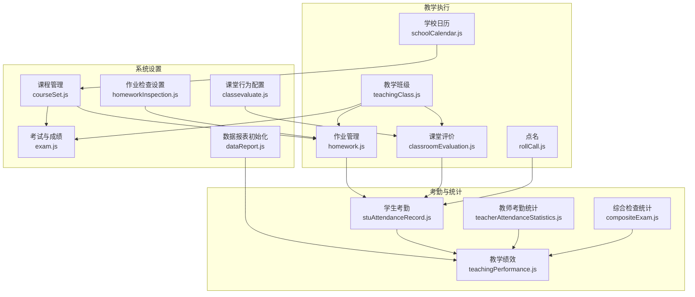
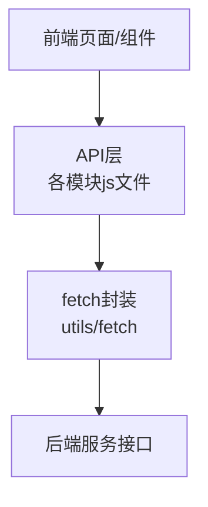
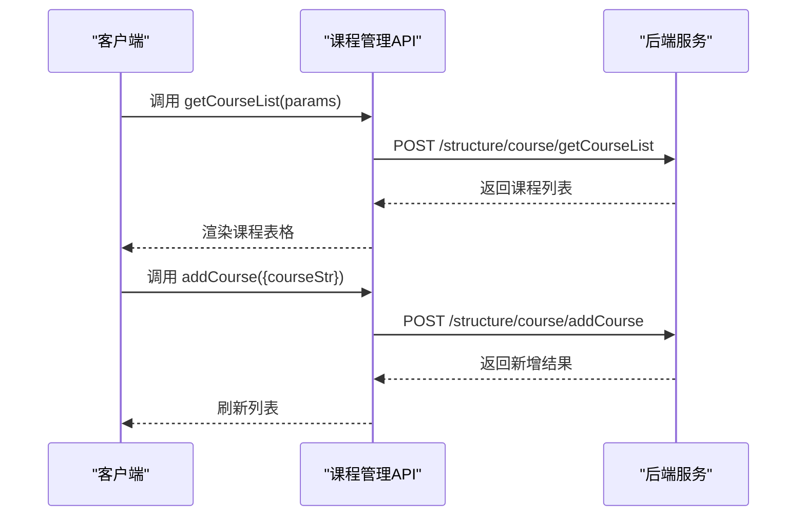
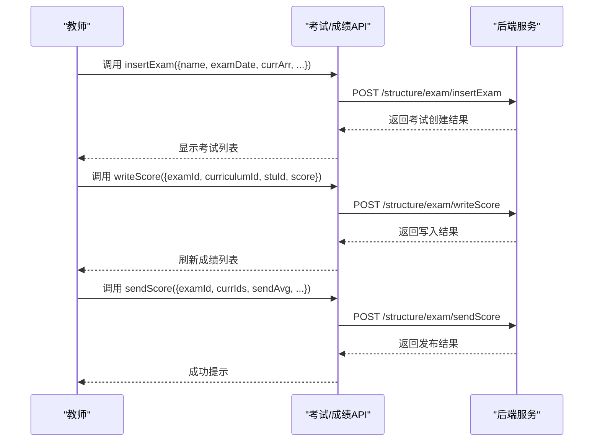
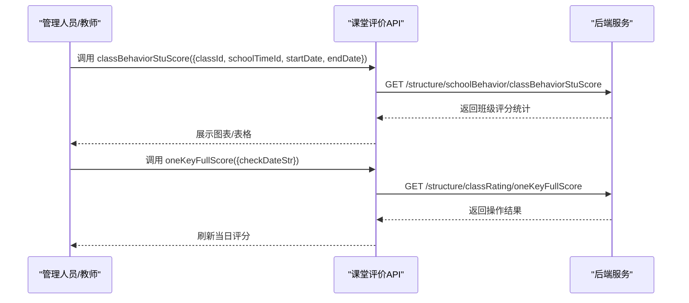
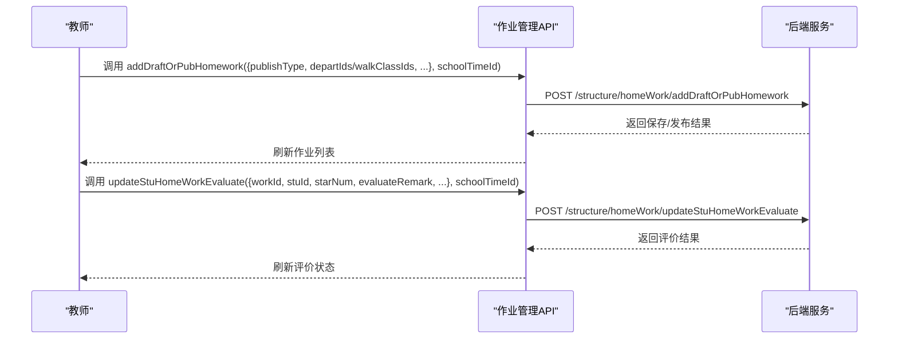
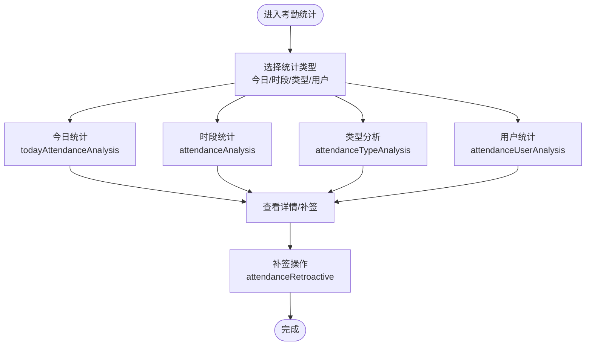
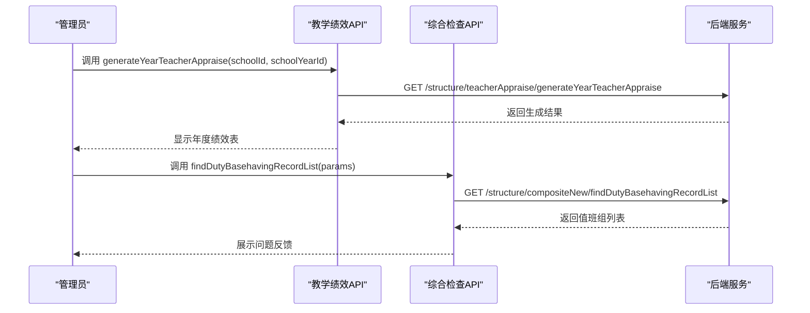
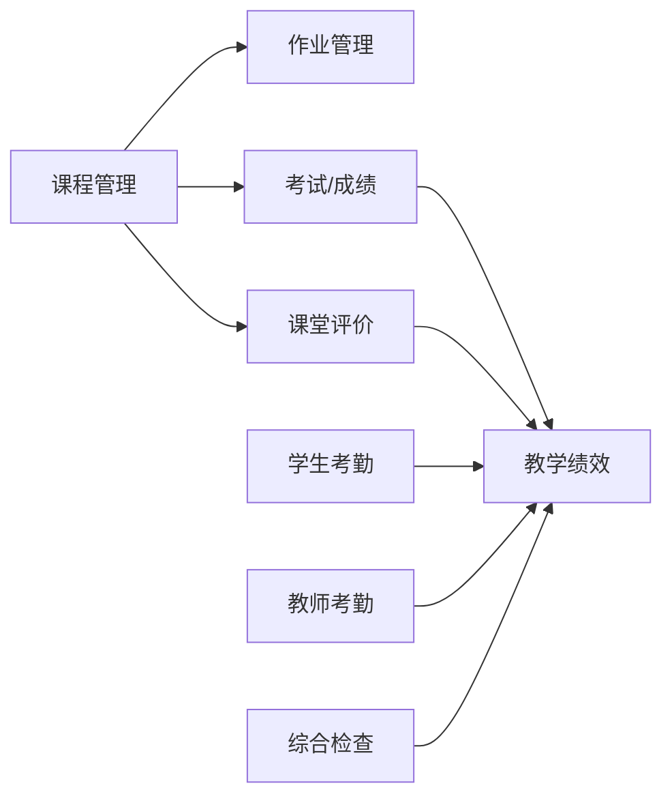

# 教学管理API

<cite>
**本文档引用的文件**
- [src/api/systemSet/courseSet.js](file://src/api/systemSet/courseSet.js)
- [src/api/systemSet/exam.js](file://src/api/systemSet/exam.js)
- [src/api/systemSet/classevaluate.js](file://src/api/systemSet/classevaluate.js)
- [src/api/systemSet/homeworkInspection.js](file://src/api/systemSet/homeworkInspection.js)
- [src/api/systemSet/dataReport.js](file://src/api/systemSet/dataReport.js)
- [src/api/schoolManage/stuAttendanceRecord.js](file://src/api/schoolManage/stuAttendanceRecord.js)
- [src/api/schoolManage/teacherAttendanceStatistics.js](file://src/api/schoolManage/teacherAttendanceStatistics.js)
- [src/api/homework.js](file://src/api/homework.js)
- [src/api/classroomEvaluation.js](file://src/api/classroomEvaluation.js)
- [src/api/rollCall.js](file://src/api/rollCall.js)
- [src/api/teachingPerformance.js](file://src/api/teachingPerformance.js)
- [src/api/teacherComment.js](file://src/api/teacherComment.js)
- [src/api/compositeExam.js](file://src/api/compositeExam.js)
- [src/api/schoolCalendar.js](file://src/api/schoolCalendar.js)
- [src/api/teachingClass.js](file://src/api/teachingClass.js)
</cite>

## 目录
1. [简介](#简介)
2. [项目结构](#项目结构)
3. [核心组件](#核心组件)
4. [架构概览](#架构概览)
5. [详细组件分析](#详细组件分析)
6. [依赖关系分析](#依赖关系分析)
7. [性能考虑](#性能考虑)
8. [故障排除指南](#故障排除指南)
9. [结论](#结论)
10. [附录](#附录)

## 简介
本文件面向教学管理系统的前端开发者与后端对接人员，系统性梳理课程安排、成绩管理、课堂评价、作业管理、考勤统计、教学评估与报表等核心业务的API接口规范。文档涵盖接口定义、参数说明、调用流程、数据模型与业务流程，并提供可视化图表帮助理解。

## 项目结构
教学管理相关API主要分布在以下模块：
- 课程与教学设置：课程管理、课堂行为配置、教学评估设置
- 成绩与考试：考试设置、成绩录入与分析、评语管理
- 作业管理：作业发布、统计与评价
- 考勤管理：学生考勤与教师考勤统计
- 教学评估与报表：教学绩效、综合检查统计、数据报表初始化
- 日历与基础设置：学校日历、点名等

**图表来源**
- [src/api/systemSet/courseSet.js:1-217](file://src/api/systemSet/courseSet.js#L1-L217)
- [src/api/systemSet/exam.js:1-455](file://src/api/systemSet/exam.js#L1-L455)
- [src/api/systemSet/classevaluate.js:1-39](file://src/api/systemSet/classevaluate.js#L1-L39)
- [src/api/systemSet/homeworkInspection.js:1-29](file://src/api/systemSet/homeworkInspection.js#L1-L29)
- [src/api/systemSet/dataReport.js:1-26](file://src/api/systemSet/dataReport.js#L1-L26)
- [src/api/homework.js:1-645](file://src/api/homework.js#L1-L645)
- [src/api/classroomEvaluation.js:1-242](file://src/api/classroomEvaluation.js#L1-L242)
- [src/api/rollCall.js:1-10](file://src/api/rollCall.js#L1-L10)
- [src/api/schoolCalendar.js:1-110](file://src/api/schoolCalendar.js#L1-L110)
- [src/api/teachingClass.js:1-139](file://src/api/teachingClass.js#L1-L139)
- [src/api/schoolManage/stuAttendanceRecord.js:1-111](file://src/api/schoolManage/stuAttendanceRecord.js#L1-L111)
- [src/api/schoolManage/teacherAttendanceStatistics.js:1-248](file://src/api/schoolManage/teacherAttendanceStatistics.js#L1-L248)
- [src/api/compositeExam.js:1-142](file://src/api/compositeExam.js#L1-L142)
- [src/api/teachingPerformance.js:1-140](file://src/api/teachingPerformance.js#L1-L140)

**章节来源**
- [src/api/systemSet/courseSet.js:1-217](file://src/api/systemSet/courseSet.js#L1-L217)
- [src/api/systemSet/exam.js:1-455](file://src/api/systemSet/exam.js#L1-L455)
- [src/api/systemSet/classevaluate.js:1-39](file://src/api/systemSet/classevaluate.js#L1-L39)
- [src/api/systemSet/homeworkInspection.js:1-29](file://src/api/systemSet/homeworkInspection.js#L1-L29)
- [src/api/systemSet/dataReport.js:1-26](file://src/api/systemSet/dataReport.js#L1-L26)
- [src/api/homework.js:1-645](file://src/api/homework.js#L1-L645)
- [src/api/classroomEvaluation.js:1-242](file://src/api/classroomEvaluation.js#L1-L242)
- [src/api/rollCall.js:1-10](file://src/api/rollCall.js#L1-L10)
- [src/api/schoolCalendar.js:1-110](file://src/api/schoolCalendar.js#L1-L110)
- [src/api/teachingClass.js:1-139](file://src/api/teachingClass.js#L1-L139)
- [src/api/schoolManage/stuAttendanceRecord.js:1-111](file://src/api/schoolManage/stuAttendanceRecord.js#L1-L111)
- [src/api/schoolManage/teacherAttendanceStatistics.js:1-248](file://src/api/schoolManage/teacherAttendanceStatistics.js#L1-L248)
- [src/api/compositeExam.js:1-142](file://src/api/compositeExam.js#L1-L142)
- [src/api/teachingPerformance.js:1-140](file://src/api/teachingPerformance.js#L1-L140)

## 核心组件
- 课程管理：提供课程列表、新增/编辑/删除、导入平台课程、学校课程设置等能力
- 成绩与考试：支持考试设置、班级科目查询、成绩录入、分析与发布、评语模板
- 课堂评价：提供班级/教师评价统计、行为配置、评分初始化与批量满分
- 作业管理：作业发布、预览、草稿、编辑、统计、评价与提醒
- 考勤管理：学生考勤明细与汇总、教师考勤统计与补签
- 教学评估与报表：教学绩效批次与分析、综合检查统计、数据报表初始化
- 基础设置：学校日历、点名、教学班级管理

**章节来源**
- [src/api/systemSet/courseSet.js:13-217](file://src/api/systemSet/courseSet.js#L13-L217)
- [src/api/systemSet/exam.js:6-455](file://src/api/systemSet/exam.js#L6-L455)
- [src/api/classroomEvaluation.js:22-242](file://src/api/classroomEvaluation.js#L22-L242)
- [src/api/homework.js:24-645](file://src/api/homework.js#L24-L645)
- [src/api/schoolManage/stuAttendanceRecord.js:11-111](file://src/api/schoolManage/stuAttendanceRecord.js#L11-L111)
- [src/api/schoolManage/teacherAttendanceStatistics.js:17-248](file://src/api/schoolManage/teacherAttendanceStatistics.js#L17-L248)
- [src/api/teachingPerformance.js:25-140](file://src/api/teachingPerformance.js#L25-L140)
- [src/api/compositeExam.js:14-142](file://src/api/compositeExam.js#L14-L142)
- [src/api/schoolCalendar.js:23-110](file://src/api/schoolCalendar.js#L23-L110)
- [src/api/rollCall.js:2-10](file://src/api/rollCall.js#L2-L10)
- [src/api/teachingClass.js:10-139](file://src/api/teachingClass.js#L10-L139)

## 架构概览
教学管理API采用统一的HTTP客户端封装，通过不同fetch实例区分业务域（如系统设置、作业域、通用域），并以URL路径与参数形式暴露REST风格接口。各模块职责清晰，耦合度低，便于扩展与维护。

**图表来源**
- [src/api/systemSet/courseSet.js:1-5](file://src/api/systemSet/courseSet.js#L1-L5)
- [src/api/systemSet/exam.js:1-2](file://src/api/systemSet/exam.js#L1-L2)
- [src/api/homework.js:1-2](file://src/api/homework.js#L1-L2)

## 详细组件分析

### 课程管理（课程设置）
- 功能要点
  - 课程列表分页查询、选择课程列表
  - 新增/编辑/删除课程
  - 学校课程设置：新增、更新、删除、导入平台课程、获取平台课程列表
- 关键接口
  - 课程列表：getCourseList
  - 选择课程列表：getChooseCourseList
  - 编辑课程：editCourse
  - 新增课程：addCourse
  - 删除课程：delCourse
  - 课程详情：getCourseDetailById
  - 学校课程列表：curriculumSettingList
  - 学校课程详情：curriculumSettingDetail
  - 学校课程删除：curriculumSettingDelete
  - 导入平台课程：curriculumSettingImport
  - 平台课程列表：listPlatformCurriclumList
  - 新增学校课程：curriculumSettingAdd
  - 编辑学校课程：curriculumSettingUpdate

**图表来源**
- [src/api/systemSet/courseSet.js:13-99](file://src/api/systemSet/courseSet.js#L13-L99)

**章节来源**
- [src/api/systemSet/courseSet.js:13-217](file://src/api/systemSet/courseSet.js#L13-L217)

### 成绩与考试（考试设置与成绩管理）
- 功能要点
  - 考试设置：新增、编辑、删除、详情、列表
  - 成绩维护：按考试获取学生成绩、写入学生成绩、成绩分析
  - 成绩发布：按科目发布平均分、最高分、最低分、排名
  - 评语管理：保存评语、评语模板维护
  - 班级切换与当前学期获取
- 关键接口
  - 考试设置列表：examSetList
  - 删除设置：deleteExamSet
  - 获取班级科目：getclassCurrBySchoolTimeId
  - 添加设置：insertExamSet
  - 设置详情：examSetDetails
  - 编辑设置：editExamSet
  - 考试列表：examList
  - 添加考试：insertExam
  - 编辑考试：editExam
  - 删除考试：deleteExam
  - 考试详情：examDetails
  - 成绩维护：examScoreMaintain
  - 写入学生成绩：writeScore
  - 成绩分析：examScoreAnalysis
  - 按学期/科目获取学生成绩：getStuScoreBySchoolTimeIdAndCurrId
  - 学生成绩分析图：stuScoreAnalysisBySchoolTimeIdAndCurrId
  - 发送成绩：sendScore
  - 班级成绩分析：classStuScoreAnalysisBySchoolTimeId
  - 学生成绩数据：stuScoreAnanlysisBySchoolTimeIdData
  - 保存评语：saveStuComment
  - 录入评语模板：insertTeacherComment
  - 选择评语模板：chooseComment
  - 切换班级：changeDepart
  - 当前学期：getCurrentSchoolTimeBySchoolId
  - 判断角色：possessRole
  - 获取教师部门：getTeacherDepart
  - 走班班级列表：getThManageWalkClassList

**图表来源**
- [src/api/systemSet/exam.js:143-319](file://src/api/systemSet/exam.js#L143-L319)

**章节来源**
- [src/api/systemSet/exam.js:6-455](file://src/api/systemSet/exam.js#L6-L455)

### 课堂评价（班级与教师评价）
- 功能要点
  - 学期列表、班级列表、课程与教师查询
  - 班级行为评分统计、教师行为评分统计
  - 课堂评价记录按日期/周次查询、一键满分、详情查询
  - 学校行为配置、节次列表
  - 学生初始评分的增删改查与初始化
- 关键接口
  - 学期列表：getSchoolTimeAllList
  - 班级统计：classBehEvalCurrBehTypeStuScore
  - 学生考评信息：getSchoolBehaviorStuListInfoType
  - 班级评分：classBehaviorStuScore
  - 教师评分：teacherBehaviorStuScore
  - 班级列表：querySchoolClass
  - 课程查询：queryCourseByClassIds
  - 教师查询：queryTeacherByClassIdAndCourseId
  - 节次列表：getsectionNoList
  - 行为配置：getSchoolBehaviorInstallNew
  - 按日期查询：listByCheckDateStr
  - 一键满分：oneKeyFullScore
  - 详情查询：getScoreDetailById
  - 日期区间查询：listByDateStr
  - 周次列表：findSeveralWeekListBySchoolTimeId
  - 班级记录：findClassRatingRecordList
  - 考勤统计：getSchoolBehaviorStuCallAttanceList
  - 学期课程查询：queryCourseListTerm
  - 教师学期课程查询：queryTeacherCourseListTerm
  - 删除学生初始分：delStuInitscore
  - 获取学生初始分：getStuInitscore
  - 获取班级初始分列表：getStuInitscoreList
  - 新增学生初始分：addStuInitscore
  - 初始化学生初始分：initStuInitscoreList
  - 时间段查询：listTimeByWeekDayByDate

**图表来源**
- [src/api/classroomEvaluation.js:22-138](file://src/api/classroomEvaluation.js#L22-L138)

**章节来源**
- [src/api/classroomEvaluation.js:7-242](file://src/api/classroomEvaluation.js#L7-L242)

### 作业管理（发布、统计与评价）
- 功能要点
  - 作业列表、发布/预览、草稿/发布、编辑、删除
  - 已读、已完成、未完成、未读学生列表
  - 学生提交内容查看、回复管理、导出回复
  - 教师评价（音频、图片、星级、备注）、提醒未提交学生
  - 作业统计（教师/学生维度）
  - 作业设置（自动提醒、短信通知、课后服务统计）
- 关键接口
  - 学期列表：getSchoolTimeAllList
  - 作业设置：getSchoolHomeworkSet
  - 作业列表：getHomeworkList
  - 发布作业：updateAndPubHomework
  - 新增/预览：addAndPreviewHomework
  - 新增草稿/发布：addDraftOrPubHomework
  - 编辑/预览：editAndPreviewHomework
  - 编辑草稿/发布：editDraftOrPubHomework
  - 保存课后服务统计：saveHomeworkAfterClassInfo
  - 删除作业：delHomework
  - 更新已读数：updateReadCount
  - 教师课程列表：getCourseList
  - 按课程获取班级：getClassListByCourseId
  - 获取班级列表：getClassList
  - 作业详情：getHomeworkById
  - 已读列表：getReadList
  - 已完成列表：getFinishStuList
  - 未完成列表：getUnFinishStuList
  - 未读列表：getUnReadStudentList
  - 学生提交内容：getStuWorkInfo
  - 按类型完成列表：getFinishStuListByType
  - 回复分页列表：getReplyPageListByHId
  - 保存回复：addReplyInfo
  - 导出回复：exportHomeworkReply
  - 教师评价：updateStuHomeWorkEvaluate
  - 提醒未提交学生：remindUnfinishedStu
  - 作业统计（教师）：getHomeworkStaticsPageDatas
  - 作业统计（学生）：getHomeworkStuStaticsForLeader
  - 已发布列表：getPubHomeworkList
  - 年级列表：getGradeList
  - 按年级获取班级：getClassListByGradeIdForManager
  - 班主任班级：getClassListForHeader
  - 作业设置新增/编辑：addAndEditWorkSet
  - 角色列表：queryRoleList
  - 年级列表：querySchoolGrade
  - 按年级获取班级：queryClassByGradeId
  - 部门列表：getDepartListByUserId
  - 管理与其它部门：getManageAndOtherDepart

**图表来源**
- [src/api/homework.js:103-140](file://src/api/homework.js#L103-L140)
- [src/api/homework.js:458-476](file://src/api/homework.js#L458-L476)

**章节来源**
- [src/api/homework.js:4-645](file://src/api/homework.js#L4-L645)

### 考勤管理（学生与教师）
- 学生考勤
  - 当天统计：statisticByClassId
  - 获取所教班级：possessRole
  - 年级/班级列表：getSchoolGradeClass、querySchoolClass
  - 教师所教班级：queryAllClassCourse
  - 考勤明细：findStuAttendanceList
  - 统计汇总：statisticsSummary
- 教师考勤统计
  - 今日统计：todayAttendanceAnalysis
  - 出差/加班统计：getOutApplyCount、getExtraUserCountBySchoolIdAndDateRange
  - 按日期记录：getTeacherRecordListByDate
  - 月度记录：getAttendanceRecordThListByMonth
  - 类型分析（迟到/早退/缺勤/异常）：todayAttendanceTypeAnalysis、attendanceTypeAnalysis
  - 考勤汇总：attendanceUserAnalysis
  - 用户类型记录：attendanceTypeUser
  - 补签：attendanceRetroactive
  - 请假统计：getStatisticsTypeCount
  - 部门类型查询：queryDepartByTypes
  - 月度加班扣减统计：getSchoolOvertimeDeductionStaticsByMonth
  - 教师汇总收集：teacherAnalysisCollect
  - 闸机异常统计：getGateInfoExceptionCount、getGateInfoExceptionList

**图表来源**
- [src/api/schoolManage/teacherAttendanceStatistics.js:17-248](file://src/api/schoolManage/teacherAttendanceStatistics.js#L17-L248)
- [src/api/schoolManage/stuAttendanceRecord.js:11-111](file://src/api/schoolManage/stuAttendanceRecord.js#L11-L111)

**章节来源**
- [src/api/schoolManage/stuAttendanceRecord.js:8-111](file://src/api/schoolManage/stuAttendanceRecord.js#L8-L111)
- [src/api/schoolManage/teacherAttendanceStatistics.js:6-248](file://src/api/schoolManage/teacherAttendanceStatistics.js#L6-L248)

### 教学评估与报表
- 教学绩效
  - 年级列表：querySchoolGrade
  - 学年/当前学期：getSchoolYear、getCurrentSchoolTimeBySchoolId
  - 年度绩效分析：queryTeacherAppraiseYearAnalysis
  - 绩效批次：queryTeacherAppraiseBatch
  - 班级汇总：queryTeacherAppraiseClass
  - 绩效分析：queryTeacherAppraiseAnalysis
  - 删除批次：deleteTeacherAppraiseBatch
  - 生成年度绩效：generateYearTeacherAppraise
  - 批次详情：getTeacherAppraiseBatchById
  - 按年级获取考试：getExamListByGradeId
  - 保存批次：saveTeacherAppraiseBatch
- 综合检查统计
  - 值班组：findDutyList
  - 日期统计：dateStatisticScore
  - 日期详情：dateDetailByDate
  - 周次统计：weekStatisticScore
  - 周次详情：weekDetailByDate
  - 时间段统计：timeStatisticScore
  - 检查项统计：findStatisticByItem
  - 有问题反馈的值班组：findDutyBasehavingRecordList
  - 问题反馈列表（分页/导出）：findCheckEventListByPage、exportFindCheckEventList
- 数据报表初始化
  - 获取初始化设置：getDataReportInit
  - 新增/修改初始化设置：addAndUpdateDataReportInit

**图表来源**
- [src/api/teachingPerformance.js:88-140](file://src/api/teachingPerformance.js#L88-L140)
- [src/api/compositeExam.js:121-142](file://src/api/compositeExam.js#L121-L142)
- [src/api/systemSet/dataReport.js:6-25](file://src/api/systemSet/dataReport.js#L6-L25)

**章节来源**
- [src/api/teachingPerformance.js:3-140](file://src/api/teachingPerformance.js#L3-L140)
- [src/api/compositeExam.js:3-142](file://src/api/compositeExam.js#L3-L142)
- [src/api/systemSet/dataReport.js:3-26](file://src/api/systemSet/dataReport.js#L3-L26)

### 基础设置与辅助功能
- 学校日历
  - 新增/编辑/删除：insertSchoolCalendar、editSchoolCalendar、deleteSchoolCalendar
  - 重置日期：resetSchoolDate
  - 日历列表：schoolCalendarList
  - 月份日期：getMonthDate
  - 设置日期：setCalendarDate
  - 学年/详情：getSchoolYear、getSchoolCalendarDetails
- 点名
  - 获取点名名称：getCallName
- 教学班级
  - 分页列表：getTeachingClassList
  - 新增/修改：saveOrUpdate
  - 弹窗课程：toAddPop
  - 是否存在：isExist
  - 删除：deletes
  - 编辑入口：TeachingEdit
  - 文件上传：uploadFile
  - 同步到企业微信：updateSyncWxDepartAdmins

**章节来源**
- [src/api/schoolCalendar.js:3-110](file://src/api/schoolCalendar.js#L3-L110)
- [src/api/rollCall.js:2-10](file://src/api/rollCall.js#L2-L10)
- [src/api/teachingClass.js:10-139](file://src/api/teachingClass.js#L10-L139)

## 依赖关系分析
- 模块内聚性
  - 各模块围绕单一职责划分（课程、考试、作业、考勤、评估、报表），接口边界清晰
- 模块间耦合
  - 课程与作业、考试、课堂评价存在间接关联（课程作为组织单位贯穿）
  - 考勤数据可作为教学绩效与综合检查的输入
- 外部依赖
  - 统一使用fetch封装，区分业务域fetch实例，便于隔离与扩展

**图表来源**
- [src/api/systemSet/courseSet.js:1-217](file://src/api/systemSet/courseSet.js#L1-L217)
- [src/api/systemSet/exam.js:1-455](file://src/api/systemSet/exam.js#L1-L455)
- [src/api/classroomEvaluation.js:1-242](file://src/api/classroomEvaluation.js#L1-L242)
- [src/api/homework.js:1-645](file://src/api/homework.js#L1-L645)
- [src/api/schoolManage/stuAttendanceRecord.js:1-111](file://src/api/schoolManage/stuAttendanceRecord.js#L1-L111)
- [src/api/schoolManage/teacherAttendanceStatistics.js:1-248](file://src/api/schoolManage/teacherAttendanceStatistics.js#L1-L248)
- [src/api/compositeExam.js:1-142](file://src/api/compositeExam.js#L1-L142)
- [src/api/teachingPerformance.js:1-140](file://src/api/teachingPerformance.js#L1-L140)

## 性能考虑
- 分页查询：多处接口支持pageNo/pageSize，建议前端实现懒加载与虚拟滚动
- 参数过滤：统一使用URLSearchParams或JSON序列化，避免超大数据体
- 批量操作：课堂评价一键满分、作业导出等批量接口需注意后端限流与前端进度提示
- 缓存策略：对不频繁变动的数据（如课程列表、学期列表）可增加本地缓存

## 故障排除指南
- 常见错误
  - 参数缺失：确保必填字段（如examId、schoolTimeId、classId等）完整传递
  - 权限不足：涉及角色判断与部门切换的接口需确认当前用户角色与权限
  - 时间范围：考勤与统计类接口需检查startDate/endDate格式与顺序
- 排查步骤
  - 查看网络面板请求与响应
  - 核对接口文档中的参数与返回值
  - 使用最小化参数复现问题
  - 关注后端日志与错误码

**章节来源**
- [src/api/systemSet/exam.js:143-319](file://src/api/systemSet/exam.js#L143-L319)
- [src/api/homework.js:103-140](file://src/api/homework.js#L103-L140)
- [src/api/schoolManage/teacherAttendanceStatistics.js:74-186](file://src/api/schoolManage/teacherAttendanceStatistics.js#L74-L186)

## 结论
本教学管理API体系覆盖课程、成绩、课堂评价、作业、考勤、评估与报表等核心教学业务，接口设计遵循REST风格，参数与返回值明确，适合前后端协作开发。建议在实际集成时结合业务场景进行参数校验与错误处理，并关注性能与用户体验优化。

## 附录
- 接口命名规范
  - 动词+名词：如insertExam、getHomeworkList
  - 动词+名词+对象：如updateStuHomeWorkEvaluate
  - 名词+动作：如getSchoolTimeAllList
- 参数传递方式
  - GET：URL拼接或URLSearchParams
  - POST：表单或JSON字符串，视具体接口而定
- 错误码约定
  - 建议后端返回统一错误码与错误信息，前端统一拦截与提示