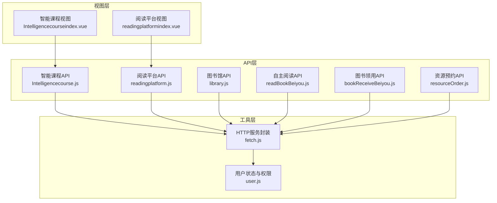
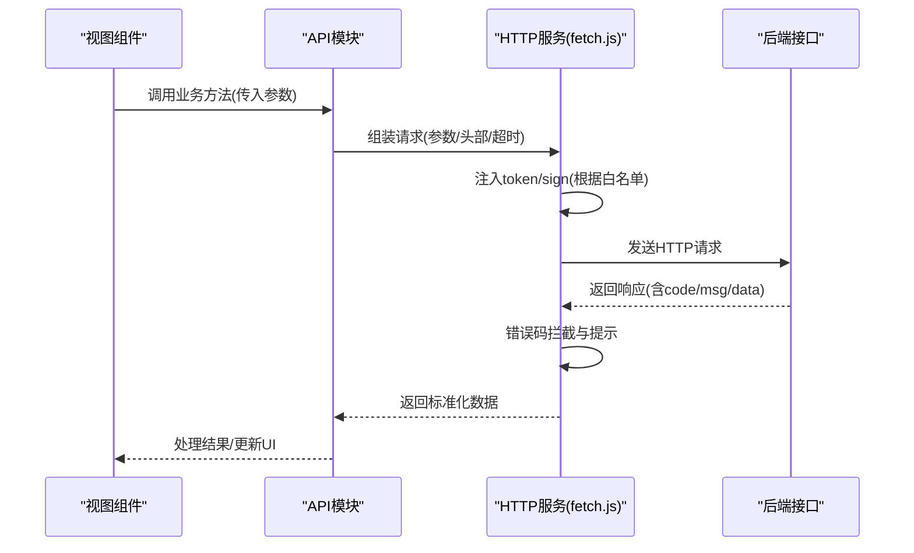
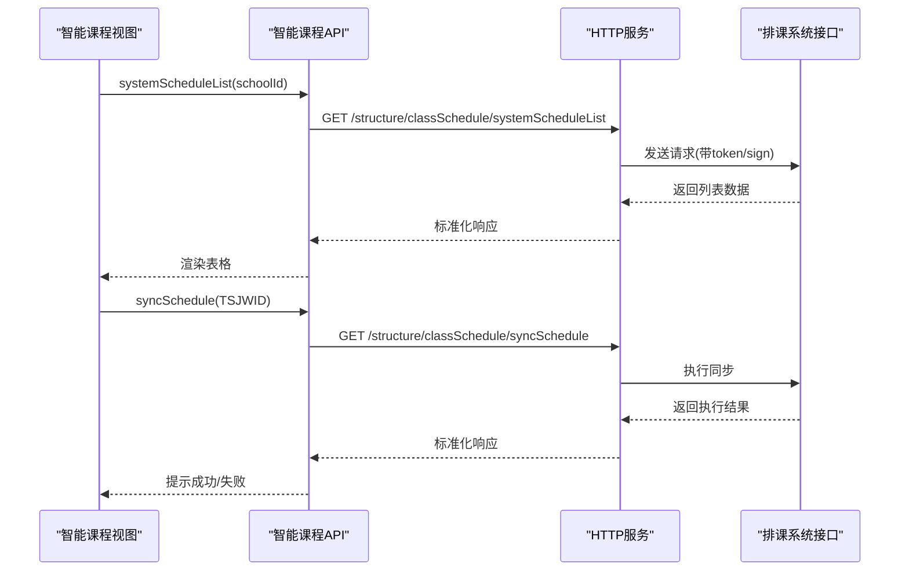
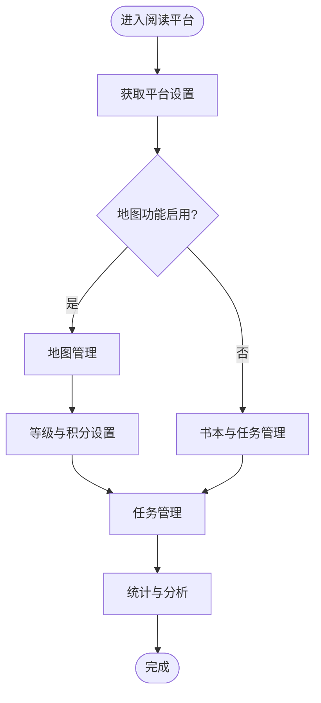
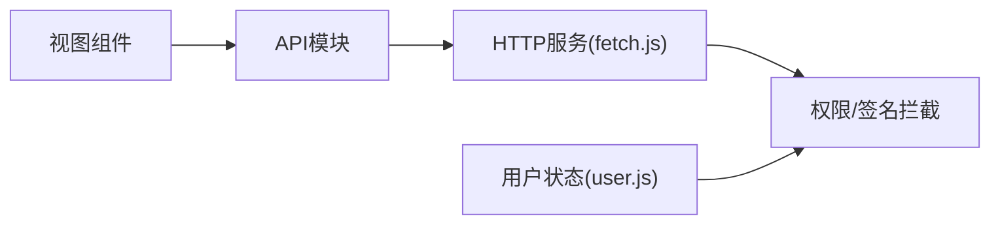

# 教学资源API

<cite>
**本文档引用的文件**
- [Intelligencecourse.js](file://src/api/Intelligencecourse.js)
- [readingplatform.js](file://src/api/readingplatform.js)
- [library.js](file://src/api/library.js)
- [readBookBeiyou.js](file://src/api/readBookBeiyou.js)
- [bookReceiveBeiyou.js](file://src/api/bookReceiveBeiyou.js)
- [resourceOrder.js](file://src/api/resourceOrder.js)
- [fetch.js](file://src/utils/fetch.js)
- [user.js](file://src/store/modules/user.js)
- [Intelligencecourseindex.vue](file://src/views/Intelligencecourse/Intelligencecourseindex.vue)
- [readingplatformindex.vue](file://src/views/readingplatform/readingplatformindex.vue)
</cite>

## 目录
1. [简介](#简介)
2. [项目结构](#项目结构)
3. [核心组件](#核心组件)
4. [架构总览](#架构总览)
5. [详细组件分析](#详细组件分析)
6. [依赖关系分析](#依赖关系分析)
7. [性能考虑](#性能考虑)
8. [故障排除指南](#故障排除指南)
9. [结论](#结论)

## 简介
本文件面向教学资源相关API的详细文档，覆盖智能课程、阅读平台、图书管理等核心功能。内容包括：
- 资源创建与管理：课程表、阅读任务、图书、资源预约等
- 分类与配置：阅读平台设置、地图与等级、书本类型与字典
- 访问统计与分析：阅读统计、使用统计、报表
- 权限控制与认证：基于Token与签名的请求拦截
- 数据模型与接口规范：参数、返回结构、错误码约定
- 推荐算法与学习路径：概念性说明（非具体实现）

## 项目结构
前端采用Vue + Element UI 架构，API封装在独立模块中，统一通过HTTP服务层进行请求与响应处理。

**图表来源**
- [Intelligencecourseindex.vue:33-72](file://src/views/Intelligencecourse/Intelligencecourseindex.vue#L33-L72)
- [readingplatformindex.vue:33-52](file://src/views/readingplatform/readingplatformindex.vue#L33-L52)
- [Intelligencecourse.js:1-70](file://src/api/Intelligencecourse.js#L1-L70)
- [readingplatform.js:1-411](file://src/api/readingplatform.js#L1-L411)
- [library.js:1-78](file://src/api/library.js#L1-L78)
- [readBookBeiyou.js:1-470](file://src/api/readBookBeiyou.js#L1-L470)
- [bookReceiveBeiyou.js:1-190](file://src/api/bookReceiveBeiyou.js#L1-L190)
- [resourceOrder.js:1-555](file://src/api/resourceOrder.js#L1-L555)
- [fetch.js:13-171](file://src/utils/fetch.js#L13-L171)
- [user.js:28-96](file://src/store/modules/user.js#L28-L96)

**章节来源**
- [Intelligencecourse.js:1-70](file://src/api/Intelligencecourse.js#L1-L70)
- [readingplatform.js:1-411](file://src/api/readingplatform.js#L1-L411)
- [library.js:1-78](file://src/api/library.js#L1-L78)
- [readBookBeiyou.js:1-470](file://src/api/readBookBeiyou.js#L1-L470)
- [bookReceiveBeiyou.js:1-190](file://src/api/bookReceiveBeiyou.js#L1-L190)
- [resourceOrder.js:1-555](file://src/api/resourceOrder.js#L1-L555)
- [fetch.js:13-171](file://src/utils/fetch.js#L13-L171)
- [user.js:28-96](file://src/store/modules/user.js#L28-L96)

## 核心组件
- 智能课程API：提供排课系统集成、课程表同步与删除等能力
- 阅读平台API：涵盖平台设置、任务管理、地图与等级、书本与任务管理
- 图书馆API：书本类型字典、分页查询、审批与CRUD
- 自主阅读API：班级/学校书库、阅读方式、统计与记录
- 图书领用API：类型管理、领用记录、统计分析
- 资源预约API：资源类型与资源管理、预约流程、审批与统计

**章节来源**
- [Intelligencecourse.js:7-70](file://src/api/Intelligencecourse.js#L7-L70)
- [readingplatform.js:3-411](file://src/api/readingplatform.js#L3-L411)
- [library.js:3-78](file://src/api/library.js#L3-L78)
- [readBookBeiyou.js:3-470](file://src/api/readBookBeiyou.js#L3-L470)
- [bookReceiveBeiyou.js:3-190](file://src/api/bookReceiveBeiyou.js#L3-L190)
- [resourceOrder.js:3-555](file://src/api/resourceOrder.js#L3-L555)

## 架构总览
API请求通过HTTP服务层统一处理，自动注入Token与签名参数，并对错误码进行集中处理与提示。

**图表来源**
- [fetch.js:66-169](file://src/utils/fetch.js#L66-L169)
- [Intelligencecourseindex.vue:63-96](file://src/views/Intelligencecourse/Intelligencecourseindex.vue#L63-L96)

**章节来源**
- [fetch.js:13-171](file://src/utils/fetch.js#L13-L171)
- [user.js:87-96](file://src/store/modules/user.js#L87-L96)

## 详细组件分析

### 智能课程API
- 功能要点
  - 获取排课系统列表
  - 同步课程表
  - 创建课表并推送基础数据
  - 获取/保存排课系统设置
  - 删除课表
- 关键接口
  - systemScheduleList(schoolId)
  - syncSchedule(TSJWID)
  - systemSourceDataPost(schoolId, scheduleName)
  - getSystemSetBySchoolId(schoolId)
  - saveSystemSet(schoolId, systemAdminLoginId, systemKey)
  - deleteSchedule(TSJWID)
- 使用示例
  - 视图组件通过API调用并展示列表，支持确认执行与删除操作

**图表来源**
- [Intelligencecourse.js:8-26](file://src/api/Intelligencecourse.js#L8-L26)
- [Intelligencecourseindex.vue:63-96](file://src/views/Intelligencecourse/Intelligencecourseindex.vue#L63-L96)

**章节来源**
- [Intelligencecourse.js:7-70](file://src/api/Intelligencecourse.js#L7-L70)
- [Intelligencecourseindex.vue:33-121](file://src/views/Intelligencecourse/Intelligencecourseindex.vue#L33-L121)

### 阅读平台API
- 平台设置与任务
  - getReadPlatSysSet()
  - insertOrUpdateReadPlatSysSet(args)
  - getReadPlatTaskCover()
  - addAndUpdateReadPlatTaskCover(args)
  - getSchoolReadPlatSetInfo()
  - readPlatBaseSet(args)
- 管理员与班级
  - queryManagerTeacherBySchoolId(args)
  - insertOrEditReadManageTeacher(args)
  - getManageTeacherById(readManageTeacherId)
  - deleteManageTeacher(ids)
- 地图与等级
  - readPlatMapList()
  - insertReadPlatMap(args)
  - updateReadPlatMap(args)
  - readPlatMapDetails(mapId)
  - deleteReadPlatMap(mapId)
  - getReadPlatBookMap()
- 书本与任务
  - getReadPlatBookList()
  - initReadPlat()
  - delReadPlatBookById(platBookId)
  - addReadPlatBook(args)
  - getPlayWordBookList(args)
  - getReadPlatBookById(platBookId)
  - updateReadPlatBook(args)
  - getReadPlatBookTaskListPc(args)
  - delReadPlatBookTask(taskId)
  - addReadPlatBookTask(args)
  - updateReadPlatBookTask(args)
  - getReadPlatBookTaskById(taskId)
- 字典与年级/班级
  - listValue()
  - querySchoolGrade()
  - querySchoolClass()

**图表来源**
- [readingplatform.js:3-411](file://src/api/readingplatform.js#L3-L411)
- [readingplatformindex.vue:33-52](file://src/views/readingplatform/readingplatformindex.vue#L33-L52)

**章节来源**
- [readingplatform.js:1-411](file://src/api/readingplatform.js#L1-L411)
- [readingplatformindex.vue:33-58](file://src/views/readingplatform/readingplatformindex.vue#L33-L58)

### 图书馆API
- 书本类型字典
  - findDicsByCode(dicCode='booktype')
- 分页查询
  - getPlayWordBookListByNum(query)
- 审批与CRUD
  - batchPlayWordBook(args)
  - addPlayWordBook(args)
  - updatePlayWordBook(args)
  - getPlayWordBookById(bookId)
  - delPlayWordBookById(bookId)

**章节来源**
- [library.js:1-78](file://src/api/library.js#L1-L78)

### 自主阅读API
- 书库与批次
  - getReadIndependBookSchList()
  - addReadIndependBookSch(args)
  - updateReadIndependBookSch(args)
  - delReadIndependBookSch(args)
  - getReadIndependBatchListAll(classId)
  - getReadIndependBookList(args)
  - getReadIndependBookSch(bookId)
- 阅读方式
  - getReadIndependWayList(args)
  - addReadIndependWay(args)
  - updateReadIndependWay(args)
  - delReadIndependWay(args)
- 统计与记录
  - getReadIndependBookStatisticalList(args)
  - getReadIndependStuStatisticalList(args)
  - getReadIndependStuBookTypeStatisticalList(args)
  - getReadIndependStuWayTypeStatisticalList(args)
  - getReadIndependStuRecordList(args)
  - delReadIndependStuRecord(args)
  - getStuListByClassId(args)
  - getBookCountListByStuId(args)
  - getStuWayListByStuId(args)
  - getStuCountListByBookId(args)
  - getStuWayListByBookId(args)
  - getStuCountListByStuId(args)
  - getNowReadIndependBatch(args)
  - updateReadIndependBatch(args)
  - updateReadIndependBatchStatus(args)
  - addReadIndependBatch(args)
  - delReadIndependBatch(batchId)
  - getReadIndependBatchList(args)
  - getReadIndepenStudBookStatisticalList(args)
  - getReadIndependStuStatisticalList2(args)

**章节来源**
- [readBookBeiyou.js:1-470](file://src/api/readBookBeiyou.js#L1-L470)

### 图书领用API
- 类型管理
  - getBookTypeBySchoolId()
  - insertBookType(args)
  - editBookType(args)
  - getBookTypeById(args)
  - deleteBookTypeById(args)
- 领用记录
  - pcQueryManageBookReceiveRecord(args)
  - pcQueryBookReceiveRecord(args)
  - insertBookReceiveRecord(args)
  - editBookReceiveRecord(args)
  - getBookReceiveRecordById(args)
  - deleteBookReceiveRecord(args)
- 统计分析
  - bookReceiveAnalysis(args)

**章节来源**
- [bookReceiveBeiyou.js:1-190](file://src/api/bookReceiveBeiyou.js#L1-L190)

### 资源预约API
- 审批流程
  - resourceExamineList(args)
  - resourceExamineDetailInfo(args)
  - passExamineResource(args)
  - noPassExamineOrder(args)
  - deleteResourceOrder(args)
- 资源类型
  - resourceTypeList(args)
  - getResourceTypeInfo(args)
  - addResourceType(args)
  - updateResourceType(args)
  - deleteResourceType(args)
- 资源管理
  - resourcesList(args)
  - getResourcesInfo(args)
  - addResources(args)
  - updateResources(args)
  - deleteResources(args)
- 预约与统计
  - toOrderResource()
  - resourceOrderList(args)
  - reloadChangeType(args)
  - loadResOrder(args)
  - resourceOrderDetailInfo(args)
  - toOrderResourceFromActivity(args)
  - orderResources(args)
  - toOrderResourceDetail(args)
  - resourceOrderFeedback(args)
  - cancelOrderResource(args)
  - cancelOrderResourceByManager(args)
  - getAllResourceOrderList(args)
  - getSchoolResourceOrderPageList(args)
  - getScancodeEquipmentListByType()
  - getResourceTypeListForStatics()
  - getResourceListForStatics(args)
- 家长资源
  - getParentResourceListByPage(args)
  - getParentResource(resourceId)
  - delParentResource(resourceId)
  - updateParentResource(args)
  - addParentResource(args)
  - getParentResourceRecordList(args)
  - updateParentResourceRecord(args)
  - updateParentResourceRecordList(args)
  - getParentResourceList(searchtype)

**章节来源**
- [resourceOrder.js:1-555](file://src/api/resourceOrder.js#L1-L555)

## 依赖关系分析
- API模块依赖HTTP服务层，统一处理参数拼装、Token与签名注入、错误码拦截
- 视图组件通过API模块调用后端接口，避免直接与网络层耦合
- 用户权限通过Store中的权限列表与路由权限路径关联

**图表来源**
- [fetch.js:66-169](file://src/utils/fetch.js#L66-L169)
- [user.js:87-96](file://src/store/modules/user.js#L87-L96)

**章节来源**
- [fetch.js:13-171](file://src/utils/fetch.js#L13-L171)
- [user.js:87-96](file://src/store/modules/user.js#L87-L96)

## 性能考虑
- 超时与并发
  - 长耗时操作使用长超时HTTP服务实例，避免普通请求阻塞
  - 合理设置分页参数，减少一次性传输数据量
- 上传与媒体
  - 视频上传采用签名直传策略，降低前端压力
  - 图片/视频封面自动生成与缓存，减少重复计算
- 错误处理
  - 对常见错误码进行统一提示，避免频繁重试导致雪崩

[本节为通用指导，无需特定文件引用]

## 故障排除指南
- 登录失效
  - 当返回登录超时错误码时，触发登出并跳转登录页
- 参数校验
  - 不合法参数/请求格式错误会统一提示，检查必填字段与类型
- 网络异常
  - 统一错误消息提示，建议重试或检查网络

**章节来源**
- [fetch.js:104-169](file://src/utils/fetch.js#L104-L169)
- [user.js:134-152](file://src/store/modules/user.js#L134-L152)

## 结论
本项目围绕教学资源构建了完善的API体系，覆盖智能课程、阅读平台、图书管理与资源预约等核心场景。通过统一的HTTP服务层实现权限、签名与错误处理的一致性，配合视图层的业务交互，形成清晰的前后端协作模式。建议在后续迭代中补充接口文档与自动化测试，持续提升稳定性与可维护性。