# 课堂评价API

<cite>
**本文档引用的文件**
- [classroomEvaluation.js](file://src/api/classroomEvaluation.js)
- [classroomEvaluationApp.js](file://src/api/classroomEvaluationApp.js)
- [classroomEvaluationtwo.js](file://src/api/classroomEvaluationtwo.js)
- [teacherComment.js](file://src/api/teacherComment.js)
- [evaluateCumulative.js](file://src/api/evaluateCumulative.js)
- [classevaluate.js](file://src/api/systemSet/classevaluate.js)
- [teachingPerformance.js](file://src/api/teachingPerformance.js)
- [listenClass.js](file://src/api/listenClass.js)
- [ketang.js](file://src/api/ketang.js)
- [fetch.js](file://src/utils/fetch.js)
- [classroomEvaluationStudent.vue](file://src/views/classroomEvaluation/classroomEvaluationStudent.vue)
- [classroomEvaluationTeacher.vue](file://src/views/classroomEvaluation/classroomEvaluationTeacher.vue)
</cite>

## 目录
1. [简介](#简介)
2. [项目结构](#项目结构)
3. [核心组件](#核心组件)
4. [架构概览](#架构概览)
5. [详细组件分析](#详细组件分析)
6. [依赖关系分析](#依赖关系分析)
7. [性能考虑](#性能考虑)
8. [故障排除指南](#故障排除指南)
9. [结论](#结论)

## 简介
本文件档详细记录了课堂评价相关API的接口规范，涵盖课堂观察、教学评价、学生评教、教师互评等核心功能。文档包含评价指标设置、评价执行、结果统计等操作的API说明，并提供课堂质量分析、教师教学评估、学生学习效果评价等功能的接口文档。同时，文档化了评价数据模型、评分标准和权重计算，并包含评价报告生成和改进建议接口。

## 项目结构
课堂评价API主要分布在以下模块中：
- 基础课堂评价API：classroomEvaluation.js
- 课堂评价应用API：classroomEvaluationApp.js  
- 版本二课堂评价API：classroomEvaluationtwo.js
- 教师评语API：teacherComment.js
- 累积评价API：evaluateCumulative.js
- 系统设置API：classevaluate.js
- 教学绩效API：teachingPerformance.js
- 听课记录API：listenClass.js
- 课堂行为配置API：ketang.js
- 通用请求封装：fetch.js

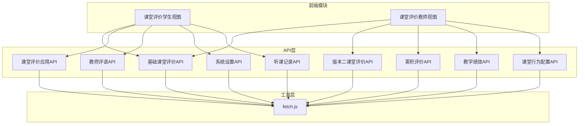

**图表来源**
- [classroomEvaluation.js:1-242](file://src/api/classroomEvaluation.js#L1-L242)
- [classroomEvaluationApp.js:1-242](file://src/api/classroomEvaluationApp.js#L1-L242)
- [classroomEvaluationtwo.js:1-198](file://src/api/classroomEvaluationtwo.js#L1-L198)
- [teacherComment.js:1-69](file://src/api/teacherComment.js#L1-L69)
- [evaluateCumulative.js:1-315](file://src/api/evaluateCumulative.js#L1-L315)
- [classevaluate.js:1-39](file://src/api/systemSet/classevaluate.js#L1-L39)
- [teachingPerformance.js:1-140](file://src/api/teachingPerformance.js#L1-L140)
- [listenClass.js:1-95](file://src/api/listenClass.js#L1-L95)
- [ketang.js:1-172](file://src/api/ketang.js#L1-L172)
- [fetch.js:1-240](file://src/utils/fetch.js#L1-L240)

**章节来源**
- [classroomEvaluation.js:1-242](file://src/api/classroomEvaluation.js#L1-L242)
- [classroomEvaluationApp.js:1-242](file://src/api/classroomEvaluationApp.js#L1-L242)
- [classroomEvaluationtwo.js:1-198](file://src/api/classroomEvaluationtwo.js#L1-L198)
- [teacherComment.js:1-69](file://src/api/teacherComment.js#L1-L69)
- [evaluateCumulative.js:1-315](file://src/api/evaluateCumulative.js#L1-L315)
- [classevaluate.js:1-39](file://src/api/systemSet/classevaluate.js#L1-L39)
- [teachingPerformance.js:1-140](file://src/api/teachingPerformance.js#L1-L140)
- [listenClass.js:1-95](file://src/api/listenClass.js#L1-L95)
- [ketang.js:1-172](file://src/api/ketang.js#L1-L172)
- [fetch.js:1-240](file://src/utils/fetch.js#L1-L240)

## 核心组件
课堂评价系统由多个相互协作的API模块组成，每个模块负责特定的功能领域：

### 基础课堂评价模块
提供核心的课堂评价功能，包括：
- 学生课堂行为评分统计
- 教师课堂评价统计
- 班级评价记录查询
- 学期课程关联查询

### 课堂评价应用模块  
支持移动端和应用端的课堂评价功能：
- 学生课堂行为记录
- 考勤统计
- 课后服务评价
- 行为类型配置

### 版本二课堂评价模块
提供增强版的评价功能：
- 多维度评价统计
- 学生成绩排名分析
- 教师评价统计
- 评价指标配置

### 教师评语模块
管理教师评语内容：
- 评语列表查询
- 评语新增编辑
- 评语删除管理

### 累积评价模块
处理累积性评价：
- 维度配置管理
- 学生评价记录
- 教师评价数据
- 积分兑换规则

**章节来源**
- [classroomEvaluation.js:19-175](file://src/api/classroomEvaluation.js#L19-L175)
- [classroomEvaluationApp.js:1-242](file://src/api/classroomEvaluationApp.js#L1-L242)
- [classroomEvaluationtwo.js:1-198](file://src/api/classroomEvaluationtwo.js#L1-L198)
- [teacherComment.js:1-69](file://src/api/teacherComment.js#L1-L69)
- [evaluateCumulative.js:1-315](file://src/api/evaluateCumulative.js#L1-L315)

## 架构概览
课堂评价系统采用分层架构设计，通过统一的请求封装层处理HTTP通信和认证。

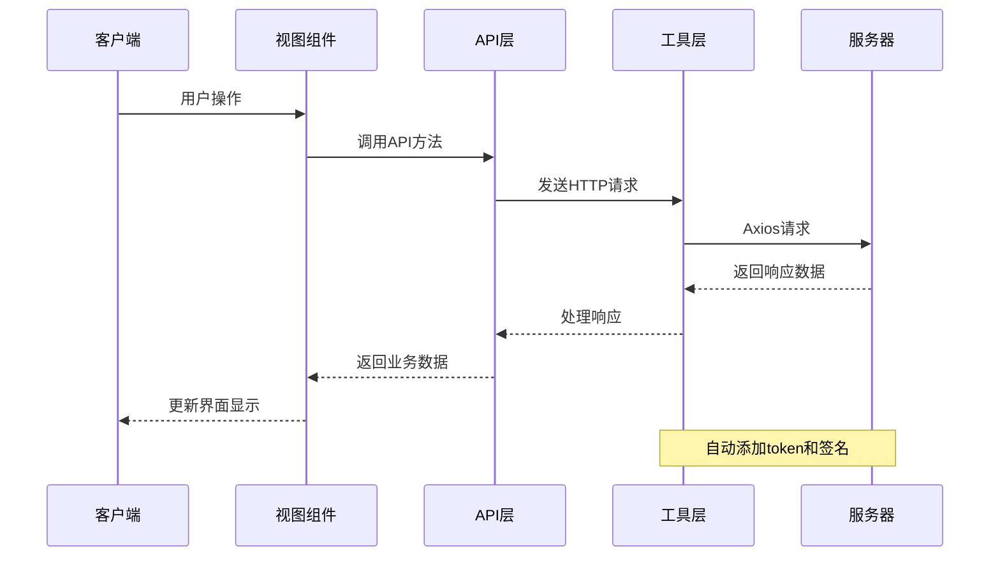

**图表来源**
- [fetch.js:66-101](file://src/utils/fetch.js#L66-L101)
- [fetch.js:104-169](file://src/utils/fetch.js#L104-L169)

系统的核心特点：
- 统一的请求拦截器自动添加认证信息
- 支持多种数据传输格式
- 错误处理和状态码管理
- Token自动续期机制

**章节来源**
- [fetch.js:1-240](file://src/utils/fetch.js#L1-L240)

## 详细组件分析

### 基础课堂评价API分析

#### 学期和课程管理
提供学期列表查询和课程关联功能：

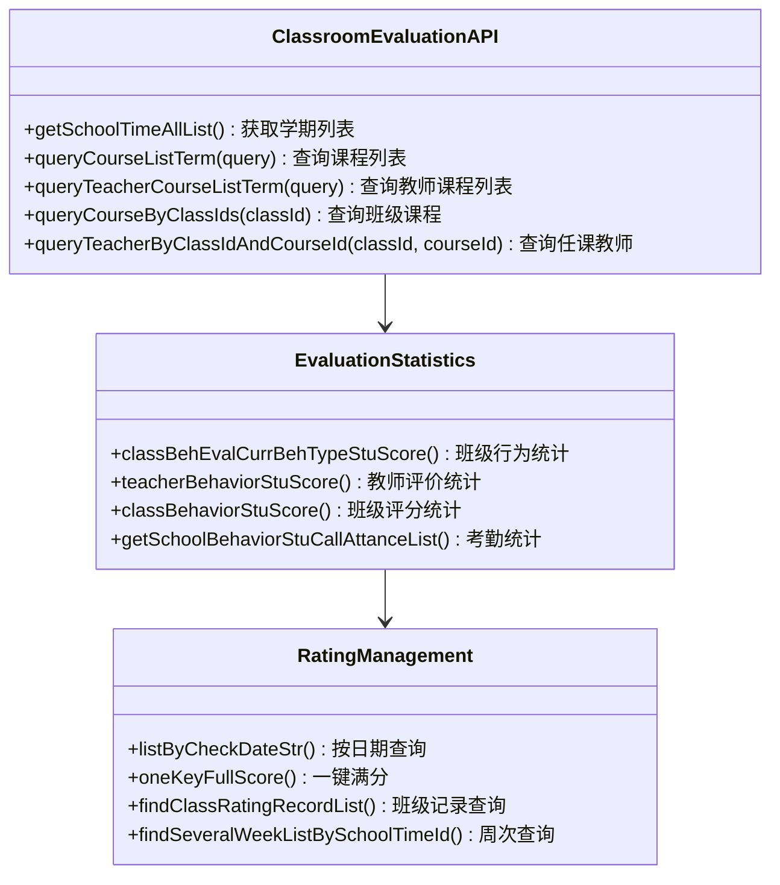

**图表来源**
- [classroomEvaluation.js:8-175](file://src/api/classroomEvaluation.js#L8-L175)

#### 学生评价管理
支持学生评价的完整生命周期：

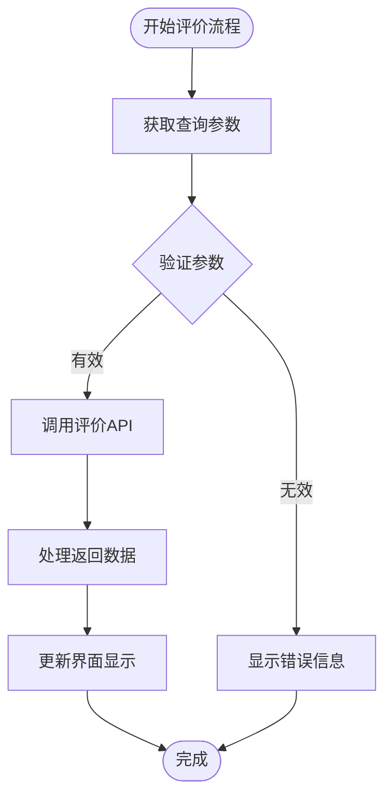

**图表来源**
- [classroomEvaluation.js:22-58](file://src/api/classroomEvaluation.js#L22-L58)

**章节来源**
- [classroomEvaluation.js:1-242](file://src/api/classroomEvaluation.js#L1-L242)

### 课堂评价应用API分析

#### 应用端评价功能
提供移动端和应用端的课堂评价能力：

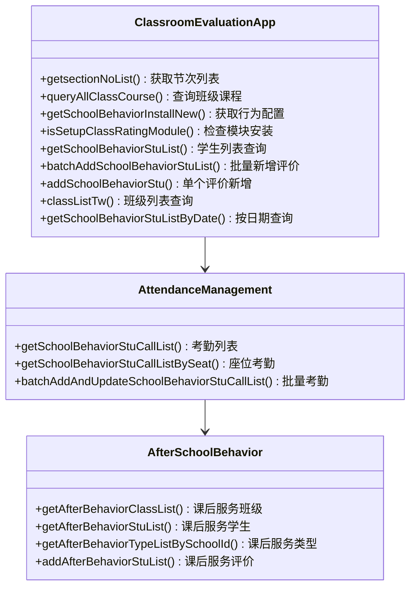

**图表来源**
- [classroomEvaluationApp.js:1-242](file://src/api/classroomEvaluationApp.js#L1-L242)

**章节来源**
- [classroomEvaluationApp.js:1-242](file://src/api/classroomEvaluationApp.js#L1-L242)

### 版本二课堂评价API分析

#### 增强评价功能
提供更全面的评价统计和分析能力：

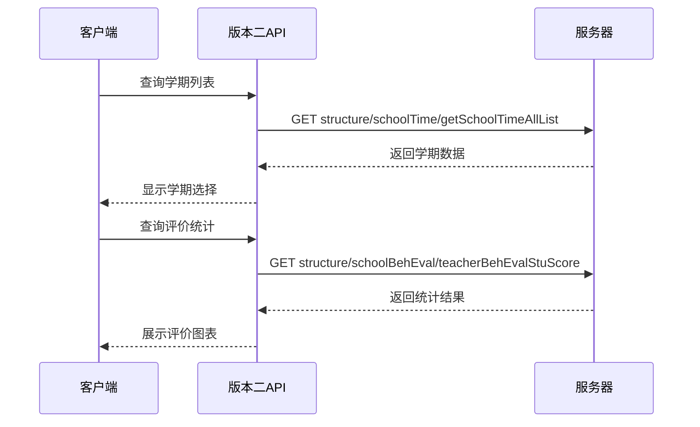

**图表来源**
- [classroomEvaluationtwo.js:47-66](file://src/api/classroomEvaluationtwo.js#L47-L66)

**章节来源**
- [classroomEvaluationtwo.js:1-198](file://src/api/classroomEvaluationtwo.js#L1-L198)

### 教师评语API分析

#### 评语管理系统
提供完整的教师评语管理功能：

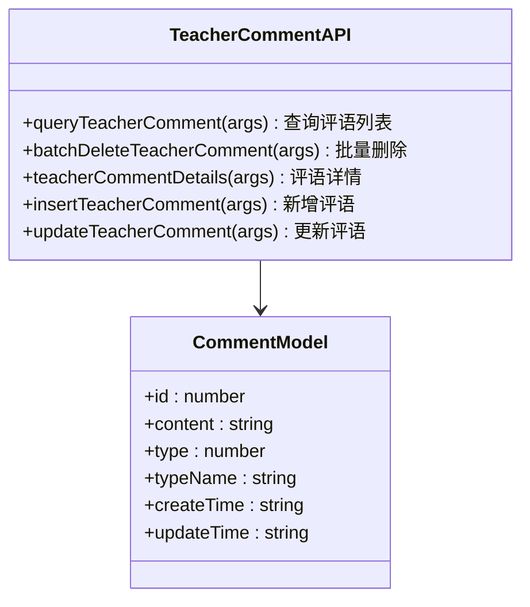

**图表来源**
- [teacherComment.js:1-69](file://src/api/teacherComment.js#L1-L69)

**章节来源**
- [teacherComment.js:1-69](file://src/api/teacherComment.js#L1-L69)

### 累积评价API分析

#### 累积评价体系
处理长期累积的评价数据：

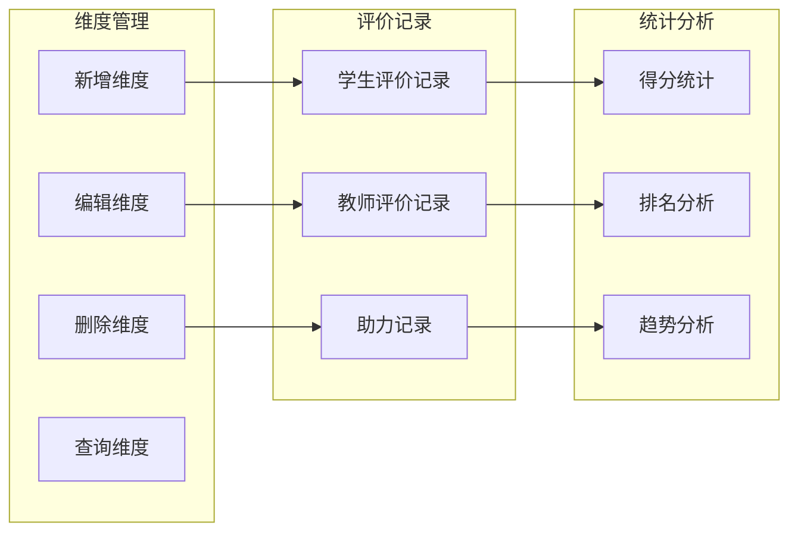

**图表来源**
- [evaluateCumulative.js:1-315](file://src/api/evaluateCumulative.js#L1-L315)

**章节来源**
- [evaluateCumulative.js:1-315](file://src/api/evaluateCumulative.js#L1-L315)

### 系统设置API分析

#### 课堂评价配置
提供系统级别的评价配置管理：

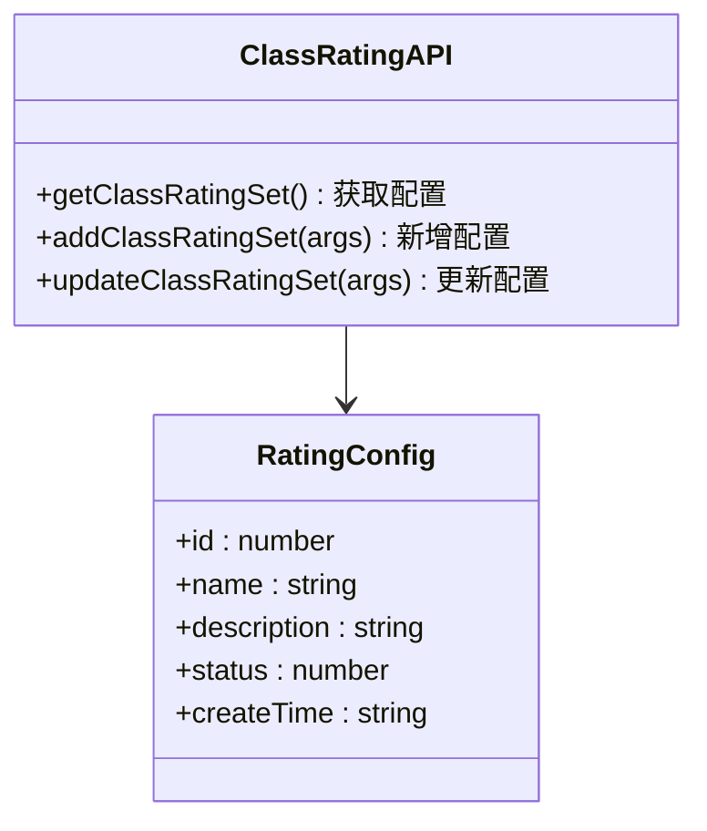

**图表来源**
- [classevaluate.js:1-39](file://src/api/systemSet/classevaluate.js#L1-L39)

**章节来源**
- [classevaluate.js:1-39](file://src/api/systemSet/classevaluate.js#L1-L39)

### 教学绩效API分析

#### 教师绩效评估
提供教学绩效的综合评估功能：

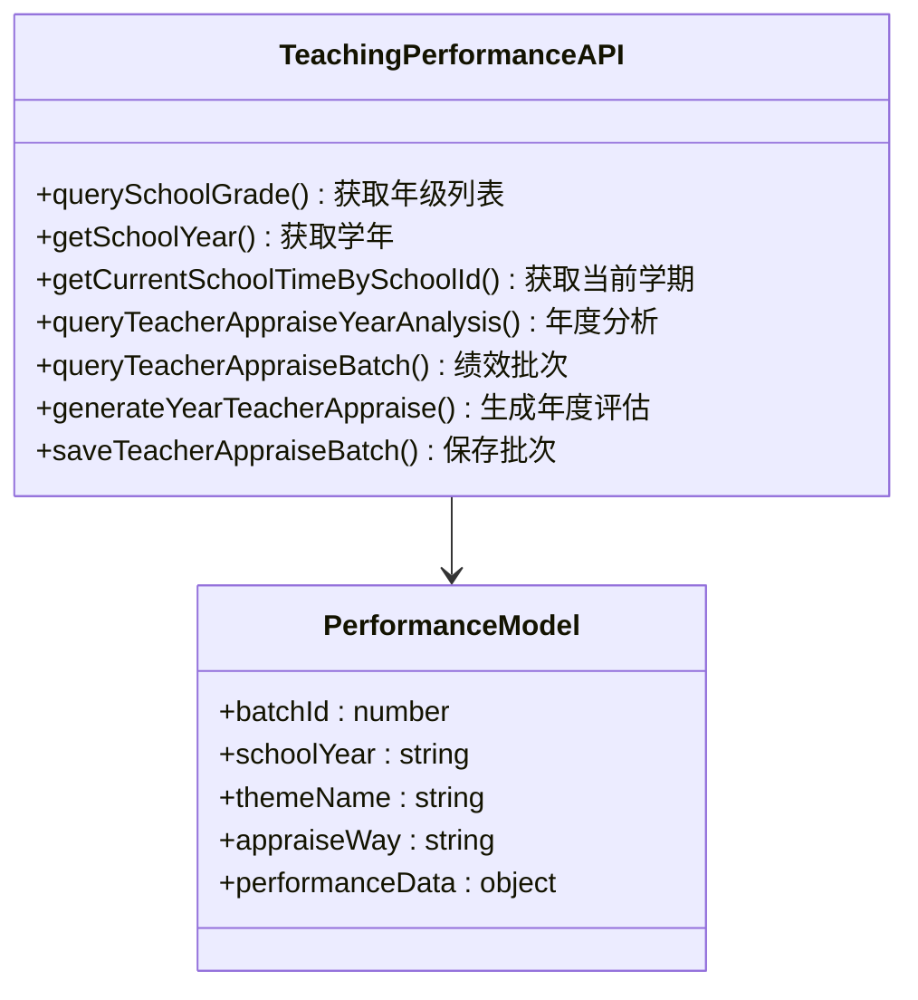

**图表来源**
- [teachingPerformance.js:1-140](file://src/api/teachingPerformance.js#L1-L140)

**章节来源**
- [teachingPerformance.js:1-140](file://src/api/teachingPerformance.js#L1-L140)

### 听课记录API分析

#### 听课评估功能
支持教师听课和评估管理：

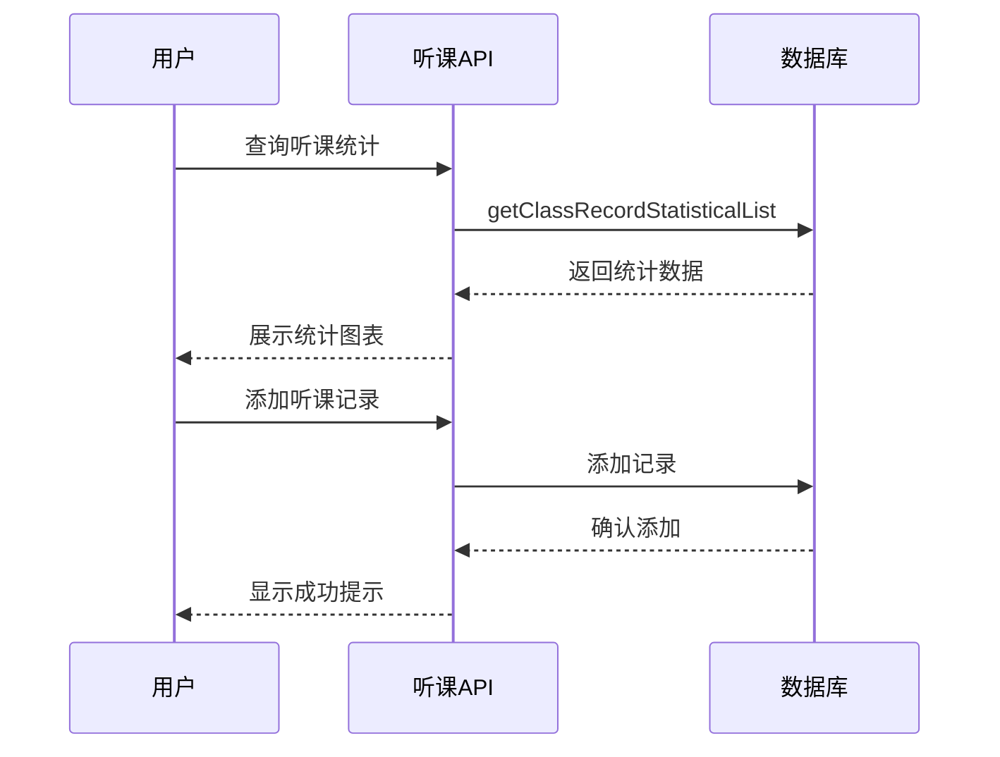

**图表来源**
- [listenClass.js:1-95](file://src/api/listenClass.js#L1-L95)

**章节来源**
- [listenClass.js:1-95](file://src/api/listenClass.js#L1-L95)

### 课堂行为配置API分析

#### 行为类型管理
提供课堂行为类型的灵活配置：

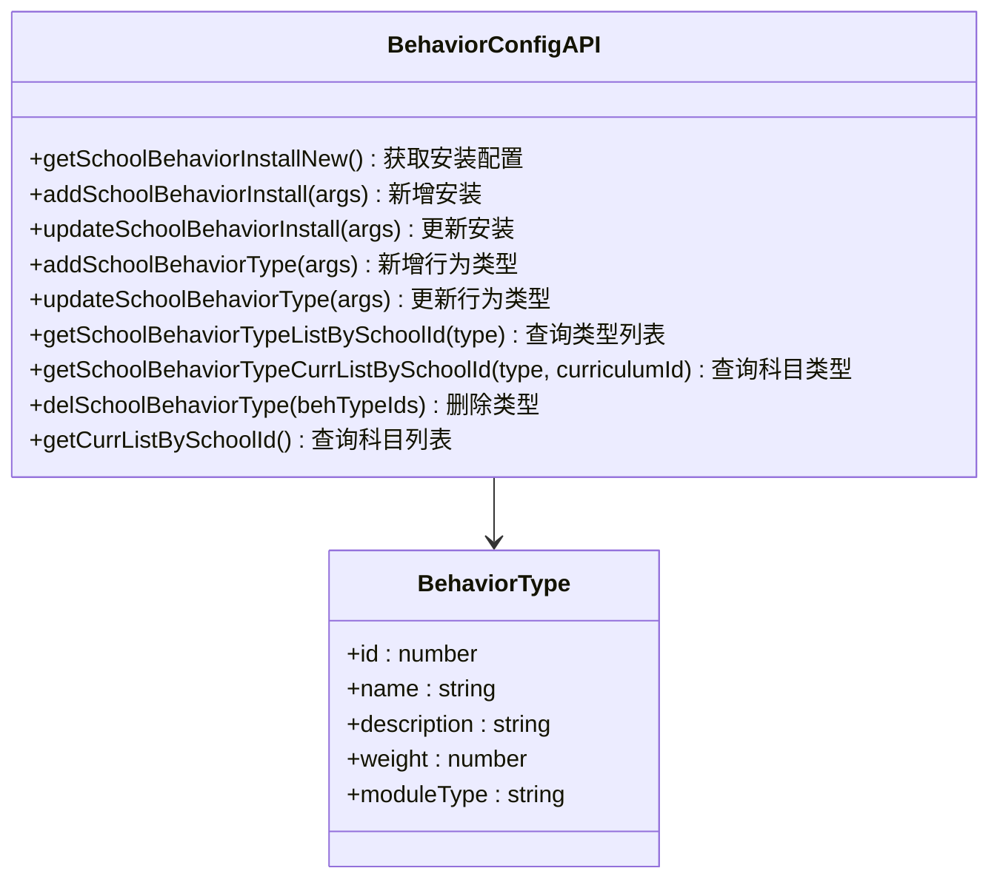

**图表来源**
- [ketang.js:1-172](file://src/api/ketang.js#L1-L172)

**章节来源**
- [ketang.js:1-172](file://src/api/ketang.js#L1-L172)

## 依赖关系分析

### API层依赖关系
课堂评价系统的API层具有清晰的职责分离和依赖关系：

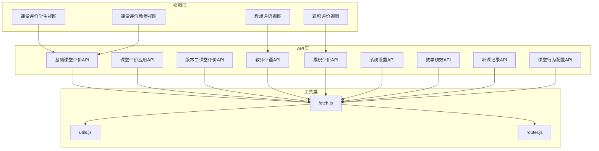

**图表来源**
- [classroomEvaluation.js:1-5](file://src/api/classroomEvaluation.js#L1-L5)
- [classroomEvaluationApp.js:1-2](file://src/api/classroomEvaluationApp.js#L1-L2)
- [teacherComment.js](file://src/api/teacherComment.js#L1)
- [evaluateCumulative.js:1-2](file://src/api/evaluateCumulative.js#L1-L2)

### 数据流分析
课堂评价系统的数据流遵循统一的模式：

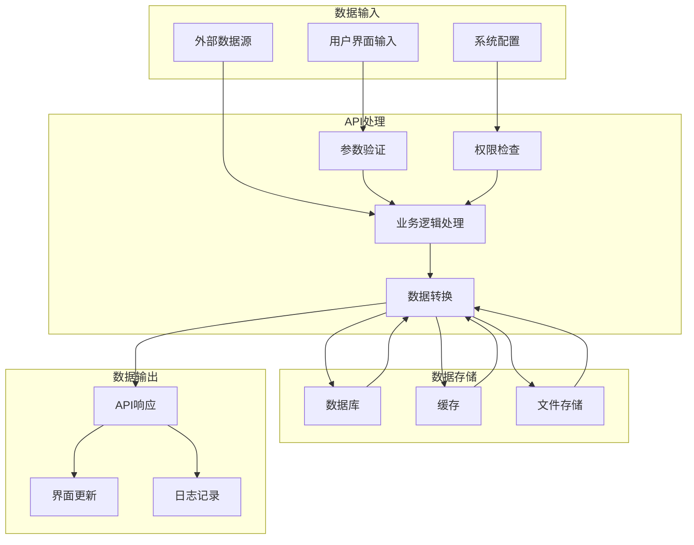

**图表来源**
- [fetch.js:66-101](file://src/utils/fetch.js#L66-L101)
- [fetch.js:104-169](file://src/utils/fetch.js#L104-L169)

**章节来源**
- [fetch.js:1-240](file://src/utils/fetch.js#L1-L240)

## 性能考虑
课堂评价系统在设计时充分考虑了性能优化：

### 请求优化策略
- **批量操作**：支持批量新增和更新操作，减少网络请求次数
- **分页加载**：大量数据采用分页方式加载，避免内存溢出
- **缓存机制**：常用配置和静态数据进行缓存处理
- **懒加载**：非关键数据采用懒加载策略

### 数据处理优化
- **数据压缩**：传输大数据时进行压缩处理
- **增量更新**：支持增量数据更新，减少全量刷新
- **并发控制**：限制同时进行的请求数量，避免系统过载

### 前端性能优化
- **虚拟滚动**：大量数据表格采用虚拟滚动技术
- **组件复用**：公共组件进行复用，减少重复渲染
- **异步加载**：非关键功能异步加载，提升首屏速度

## 故障排除指南

### 常见问题诊断
1. **认证失败**
   - 检查Token是否过期
   - 验证签名参数是否正确
   - 确认请求头格式

2. **数据查询异常**
   - 验证查询参数格式
   - 检查权限范围
   - 确认数据存在性

3. **性能问题**
   - 检查请求频率
   - 验证数据量大小
   - 监控网络延迟

### 错误处理机制
系统采用统一的错误处理机制：

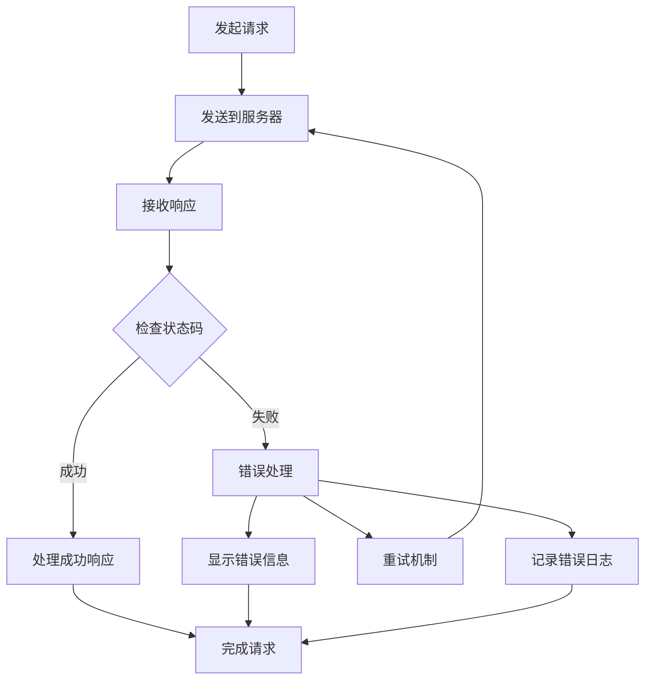

**图表来源**
- [fetch.js:124-159](file://src/utils/fetch.js#L124-L159)

**章节来源**
- [fetch.js:1-240](file://src/utils/fetch.js#L1-L240)

## 结论
课堂评价API系统提供了完整的课堂评价解决方案，涵盖了从基础评价到高级分析的全方位功能。系统采用模块化设计，具有良好的扩展性和维护性。通过统一的请求封装和错误处理机制，确保了系统的稳定性和可靠性。

主要优势包括：
- **功能完整性**：覆盖课堂评价的各个环节
- **架构清晰**：层次分明，职责明确
- **性能优化**：多层面的性能优化策略
- **易于扩展**：模块化设计便于功能扩展
- **稳定可靠**：完善的错误处理和监控机制

建议在实际使用中：
1. 根据具体需求选择合适的API模块
2. 注意参数验证和错误处理
3. 合理使用缓存机制提升性能
4. 定期监控系统性能指标
5. 及时更新和维护系统功能