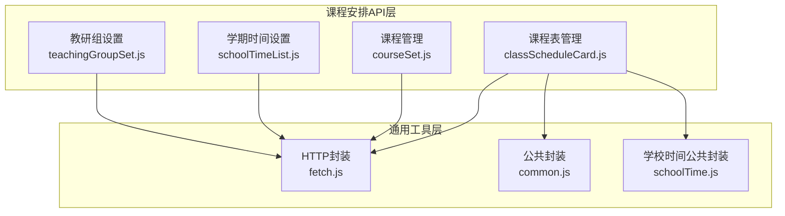
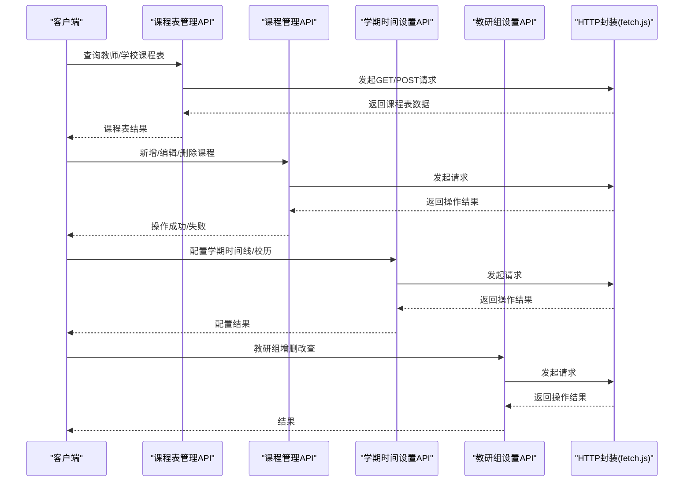
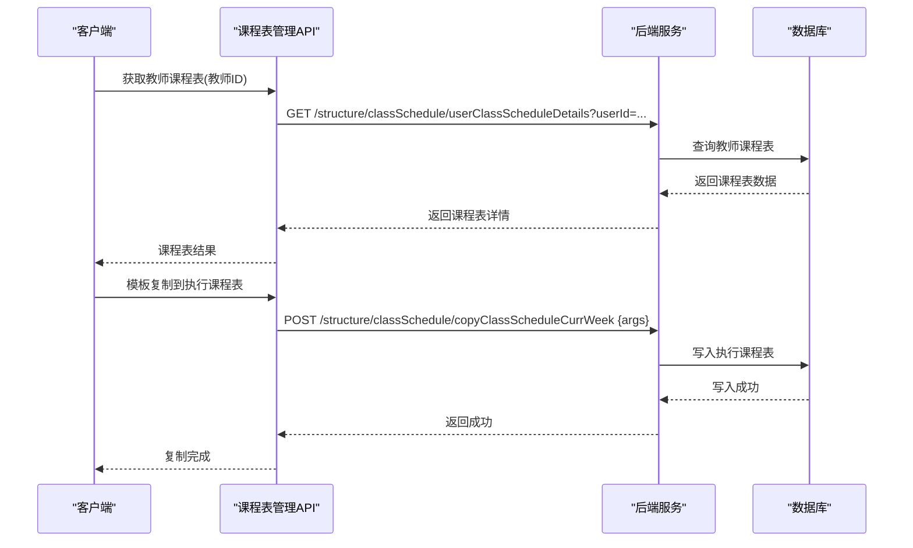
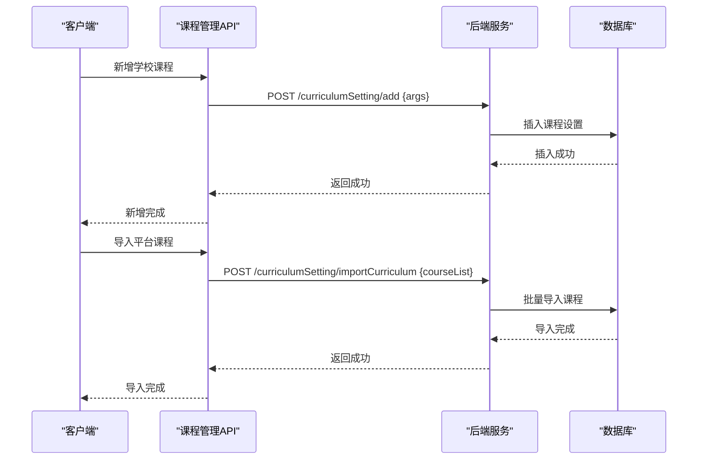
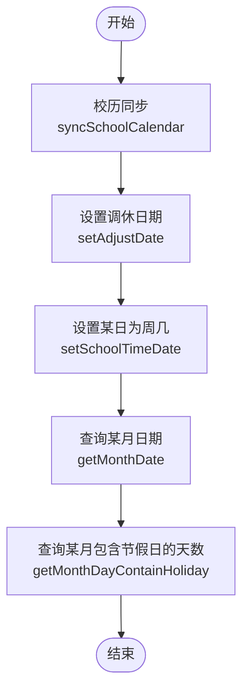
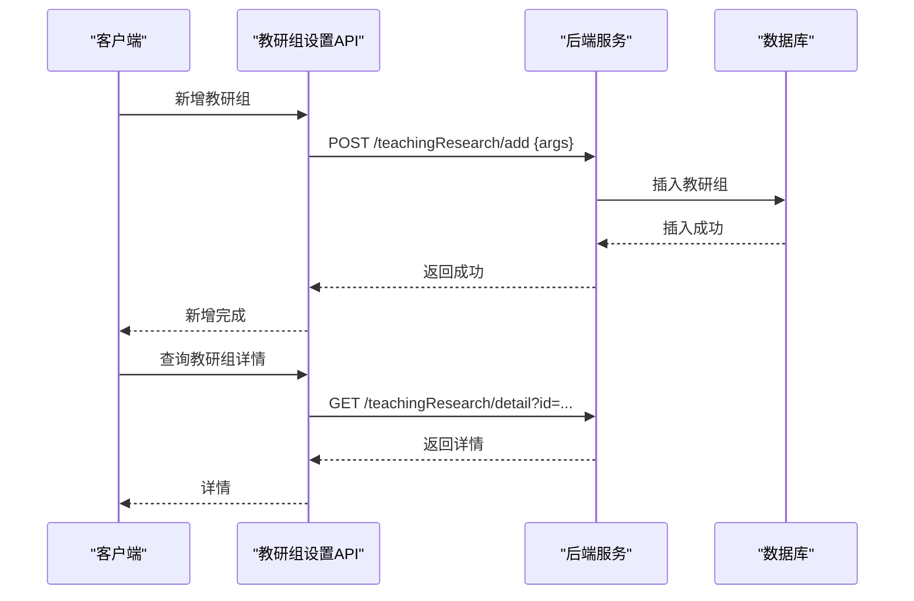
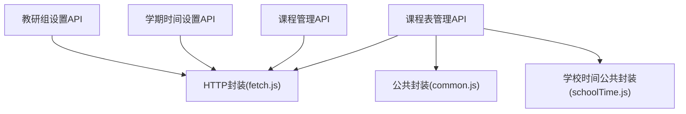

# 课程安排API

<cite>
**本文引用的文件**
- [classScheduleCard.js](file://src/api/classScheduleCard.js)
- [courseSet.js](file://src/api/systemSet/courseSet.js)
- [schoolTimeList.js](file://src/api/schoolTimeList.js)
- [teachingGroupSet.js](file://src/api/systemSet/teachingGroupSet.js)
- [fetch.js](file://src/utils/fetch.js)
- [common.js](file://src/api/common/common.js)
- [schoolTime.js](file://src/api/common/schoolTime.js)
</cite>

## 目录
1. [简介](#简介)
2. [项目结构](#项目结构)
3. [核心组件](#核心组件)
4. [架构总览](#架构总览)
5. [详细组件分析](#详细组件分析)
6. [依赖关系分析](#依赖关系分析)
7. [性能考虑](#性能考虑)
8. [故障排查指南](#故障排查指南)
9. [结论](#结论)
10. [附录](#附录)

## 简介
本文件面向课程安排相关API的使用与集成，覆盖以下能力范围：
- 课程表管理：教师/学校维度课程表查询、复制上学期课程表、刷新当前学期课程表、删除课程表、按学期周次/教师查询课程表详情、课程表设置与更新、模板复制到执行课程表、停课记录维护等。
- 教学班管理：教研组设置（增删改查）。
- 作息时间设置：学期时间线配置、校历同步与节假日调整、月度日期设置、当前学期切换、学期详情查询等。
- 课程管理：课程基础信息维护（新增、编辑、删除、分页查询、导入平台课程、获取平台国标课程列表）、学校课程设置（新增、编辑、删除、分页查询、详情查询）。

本文件以接口规范形式呈现，配合数据模型、排课流程与冲突检测机制说明，帮助前后端协同开发与系统集成。

## 项目结构
课程安排相关API主要位于以下模块：
- 课程表管理：src/api/classScheduleCard.js
- 课程管理：src/api/systemSet/courseSet.js
- 学期时间设置：src/api/schoolTimeList.js
- 教研组设置：src/api/systemSet/teachingGroupSet.js
- 通用工具：src/utils/fetch.js
- 公共接口封装：src/api/common/common.js、src/api/common/schoolTime.js

图表来源
- [classScheduleCard.js:1-291](file://src/api/classScheduleCard.js#L1-L291)
- [courseSet.js:1-217](file://src/api/systemSet/courseSet.js#L1-L217)
- [schoolTimeList.js:1-158](file://src/api/schoolTimeList.js#L1-L158)
- [teachingGroupSet.js:1-82](file://src/api/systemSet/teachingGroupSet.js#L1-L82)
- [fetch.js](file://src/utils/fetch.js)
- [common.js](file://src/api/common/common.js)
- [schoolTime.js](file://src/api/common/schoolTime.js)

章节来源
- [classScheduleCard.js:1-291](file://src/api/classScheduleCard.js#L1-L291)
- [courseSet.js:1-217](file://src/api/systemSet/courseSet.js#L1-L217)
- [schoolTimeList.js:1-158](file://src/api/schoolTimeList.js#L1-L158)
- [teachingGroupSet.js:1-82](file://src/api/systemSet/teachingGroupSet.js#L1-L82)
- [fetch.js](file://src/utils/fetch.js)

## 核心组件
- 课程表管理API：提供教师/学校维度课程表查询、复制、刷新、删除、设置、模板复制到执行、停课记录等能力。
- 课程管理API：提供课程基础信息与学校课程设置的增删改查、分页查询、导入平台课程、获取平台国标课程列表等。
- 学期时间设置API：提供学期时间线配置、校历同步、节假日调整、当前学期切换、月度日期设置、学期详情查询等。
- 教研组设置API：提供教研组的增删改查与详情查询。

章节来源
- [classScheduleCard.js:5-291](file://src/api/classScheduleCard.js#L5-L291)
- [courseSet.js:6-217](file://src/api/systemSet/courseSet.js#L6-L217)
- [schoolTimeList.js:3-158](file://src/api/schoolTimeList.js#L3-L158)
- [teachingGroupSet.js:3-82](file://src/api/systemSet/teachingGroupSet.js#L3-L82)

## 架构总览
课程安排API通过统一的HTTP封装进行请求与响应处理，课程表管理、课程管理、学期时间设置、教研组设置分别对应不同的后端服务路径，前端通过参数拼装与JSON序列化实现数据传递。

图表来源
- [classScheduleCard.js:5-291](file://src/api/classScheduleCard.js#L5-L291)
- [courseSet.js:6-217](file://src/api/systemSet/courseSet.js#L6-L217)
- [schoolTimeList.js:3-158](file://src/api/schoolTimeList.js#L3-L158)
- [teachingGroupSet.js:3-82](file://src/api/systemSet/teachingGroupSet.js#L3-L82)
- [fetch.js](file://src/utils/fetch.js)

## 详细组件分析

### 课程表管理API
- 接口概览
  - 教师获取课程表、学校获取课程表、复制上学期课程表、刷新当前学期课程表、删除课程表、按学期周次/教师查询课程表详情、课程表设置与更新、模板复制到执行课程表、停课记录维护、学期周次查询、教师课程统计等。
- 关键接口说明
  - 教师获取课程表：GET 请求，路径为 structure/classSchedule/teacherClassScheduleList。
  - 复制上学期课程表：GET 请求，路径为 structure/classSchedule/copyTermClassSchedule。
  - 刷新当前学期课程表课程名称：GET 请求，路径为 structure/classSchedule/refreshClassScheduleCurr。
  - 学校获取课程表：GET 请求，路径为 structure/classSchedule/schoolClassSchedule。
  - 根据id(学期周次)获取课程表详情：GET 请求，路径为 structure/classSchedule/classScheduleDetails，参数包含id。
  - 根据id(学期周次)获取课程表详情（带周次）：GET 请求，路径为 structure/classSchedule/classScheduleDetailsWeek，参数包含id与week。
  - 删除课程表：GET 请求，路径为 structure/classSchedule/deleteClassSchedule，参数包含ids。
  - 根据教师id获取教师课程表：GET 请求，路径为 structure/classSchedule/userClassScheduleDetails，参数包含userId。
  - 根据教师id获取教师课程表（带周次）：GET 请求，路径为 structure/classSchedule/userClassScheduleDetailsWeek，参数包含userId与week。
  - 学校课程表设置：GET 请求，路径为 structure/classSchedule/classScheduleSet，参数包含schoolId。
  - 新增或编辑课程表设置：POST 请求，路径为 structure/classSchedule/insertOrUpdateClassScheduleSet，参数包含morning、noon、afternoon、forenoon、night、singleDouble、schoolId。
  - 更新课程表：POST 请求，路径为 structure/classSchedule/updateClassSchedule，参数包含课程表数据。
  - 根据id获取课程表详情：GET 请求，路径为 structure/classSchedule/classScheduleDetailsById，参数包含id。
  - 删除该教师当前学期的课表：GET 请求，路径为 structure/classSchedule/deleteTeacherScheduleBySchoolTimeId，参数包含teacherId。
  - 查询学校所有学期列表：GET 请求，路径为 structure/schoolTime/getSchoolTimeAllList。
  - 根据schoolTimeId获取学期的周次：GET 请求，路径为 structure/schoolTime/getSchoolTimeWeeks，参数包含schoolTimeId。
  - 根据学期id、开始日期、结束日期查询老师课统计：GET 请求，路径为 structure/classSchedule/getClassScheduleTeacherStaticListWeek，参数包含endDate、schoolTimeId、startDate、currId。
  - 模板课程表复制到执行课程表中：POST 请求，路径为 structure/classSchedule/copyClassScheduleCurrWeek，参数为JSON对象。
  - 新增停课记录：POST 请求，路径为 structure/classSchedule/addClassScheduleStop，参数为JSON对象。
  - 停课记录详情：GET 请求，路径为 structure/classSchedule/getClassScheduleStopDeails，参数包含stopId。
- 数据模型要点
  - 课程表设置包含上午、下午、晚上、中午、单双周等字段，用于定义每日作息节次。
  - 课程表详情包含学期周次、课程安排、教师、班级、教室等信息。
  - 停课记录包含停课原因、时间段、涉及课程等信息。
- 排课流程与冲突检测
  - 流程：选择学期与周次 → 加载模板/执行课程表 → 调整课程时间与教室 → 冲突检测（时间、教师、教室） → 保存并生成报表。
  - 冲突检测：同一时间同一教师/教室不可重复排课；跨周次与单双周需匹配；停课记录优先级高于正常课程。
- 统计与报表
  - 教师课程统计：按学期、周次、教师维度统计课程时长与节数。
  - 报表导出：支持按学期与周次导出课程表与统计结果。

图表来源
- [classScheduleCard.js:74-291](file://src/api/classScheduleCard.js#L74-L291)

章节来源
- [classScheduleCard.js:5-291](file://src/api/classScheduleCard.js#L5-L291)

### 课程管理API
- 接口概览
  - 课程基础信息：分页查询、选择课程列表、编辑课程、新增课程、删除课程、根据id获取课程详情。
  - 学校课程设置：分页查询、详情查询、删除、导入平台课程、获取平台国标课程列表、新增学校课程、编辑学校课程。
- 关键接口说明
  - 分页获取课程列表：POST 请求，路径为 structure/course/getCourseList，参数包含pageNo、pageSize、searchName。
  - 选择课程列表：POST 请求，路径为 structure/course/getChooseCourseList。
  - 编辑课程：POST 请求，路径为 structure/course/editCourse，参数包含id、nickName。
  - 新增课程：POST 请求，路径为 structure/course/addCourse，参数包含courseStr。
  - 删除课程：POST 请求，路径为 structure/course/delCourse，参数包含idStr。
  - 根据id获取课程详情：POST 请求，路径为 structure/course/getCourseDetailById，参数包含id。
  - 分页获取学校课程设置：POST 请求，路径为 curriculumSetting/list，参数包含searchName、pageNo、pageSize。
  - 获取学校课程详情：GET 请求，路径为 curriculumSetting/detail，参数包含id。
  - 删除学校课程：GET 请求，路径为 curriculumSetting/delete，参数包含idStr。
  - 导入平台课程：POST 请求，路径为 curriculumSetting/importCurriculum，参数为JSON对象。
  - 获取平台国标课程列表：GET 请求，路径为 curriculumSetting/listPlatformCurriclumList。
  - 新增学校课程：POST 请求，路径为 curriculumSetting/add，参数包含examType、isMain、level、name、logoUrl、otherName、order、classHourFactor。
  - 编辑学校课程：POST 请求，路径为 curriculumSetting/update，参数包含examType、isMain、level、name、logoUrl、otherName、order、id、classHourFactor。
- 数据模型要点
  - 课程基础信息：包含id、名称、简称等。
  - 学校课程设置：包含考试类型、主科目标识、级别、名称、Logo、其他名称、排序、课时系数等。

图表来源
- [courseSet.js:119-217](file://src/api/systemSet/courseSet.js#L119-L217)

章节来源
- [courseSet.js:6-217](file://src/api/systemSet/courseSet.js#L6-L217)

### 学期时间设置API
- 接口概览
  - 学期时间线配置：新增、更新、查询全部、查询某学校学期列表、设置当前学期、学期详情查询。
  - 校历与节假日：校历同步、设置调休日期、查询某月包含节假日的天数。
  - 月度日期设置：设置某日为周几。
- 关键接口说明
  - 查询某学校学期列表：POST 请求，路径为 structure/schoolTime/querySchoolTimeListBySchoolId，参数包含pageNo、pageSize。
  - 新增学期时间：POST 请求，路径为 structure/schoolTime/insertSchoolTime，参数包含endDate、isCurrent、schoolId、schoolYear、schoolYearId、startDate、term、afterEndDate、beforeStartDate。
  - 查询全部学期列表：POST 请求，路径为 structure/schoolTime/getSchoolTimeAllList。
  - 更新学期时间：POST 请求，路径为 structure/schoolTime/updateSchoolTime，参数包含id、endDate、isCurrent、schoolId、schoolYear、schoolYearId、startDate、term、afterEndDate、beforeStartDate。
  - 设置当前学期：POST 请求，路径为 structure/schoolTime/setIsCurrent，参数包含id。
  - 学期详情查询：POST 请求，路径为 structure/schoolTime/schoolTimeDetails，参数包含id。
  - 校历同步：POST 请求，路径为 structure/schoolTime/syncSchoolCalendar，参数包含schoolYear、term。
  - 设置调休日期：POST 请求，路径为 structure/schoolTime/setAdjustDate，参数包含adjustDate、date、isAdjust、schoolTimeId。
  - 查询某月包含节假日的天数：POST 请求，路径为 structure/schoolTime/getMonthDayContainHoliday，参数包含date、schoolTimeId。
  - 设置某日为周几：POST 请求，路径为 structure/schoolTime/setSchoolTimeDate，参数包含date、schoolTimeId、weekDay。
  - 查询某月日期：POST 请求，路径为 structure/schoolTime/getMonthDate，参数包含date、schoolTimeId。
  - 查询学年：POST 请求，路径为 structure/schoolTime/getSchoolYear。
- 数据模型要点
  - 学期时间线：包含学年、学期、开始/结束日期、当前学期标记、前后扩展日期等。
  - 校历与节假日：包含调休日期、节假日标记等。

图表来源
- [schoolTimeList.js:122-158](file://src/api/schoolTimeList.js#L122-L158)

章节来源
- [schoolTimeList.js:3-158](file://src/api/schoolTimeList.js#L3-L158)

### 教研组设置API
- 接口概览
  - 教研组列表查询、详情查询、删除、新增、修改。
- 关键接口说明
  - 教研组列表：GET 请求，路径为 teachingResearch/list。
  - 教研组详情：GET 请求，路径为 teachingResearch/detail，参数包含id。
  - 教研组删除：GET 请求，路径为 teachingResearch/delete，参数包含id。
  - 教研组新增：POST 请求，路径为 teachingResearch/add，参数包含成员、副组长、年级、正副组长、学科、名称等。
  - 教研组修改：POST 请求，路径为 teachingResearch/update，参数包含id与上述字段。
- 数据模型要点
  - 教研组：包含名称、学科、正副组长、成员、年级等信息。

图表来源
- [teachingGroupSet.js:3-82](file://src/api/systemSet/teachingGroupSet.js#L3-L82)

章节来源
- [teachingGroupSet.js:3-82](file://src/api/systemSet/teachingGroupSet.js#L3-L82)

## 依赖关系分析
- 组件耦合
  - 课程表管理API依赖HTTP封装与公共封装，用于统一请求与参数处理。
  - 课程管理API依赖HTTP封装与系统设置接口，用于课程基础信息与学校课程设置。
  - 学期时间设置API依赖HTTP封装，用于学期时间线与校历配置。
  - 教研组设置API依赖HTTP封装，用于教研组增删改查。
- 外部依赖
  - fetch.js 提供统一的HTTP请求封装，支持GET/POST、参数拼装、JSON序列化与超时控制。
  - common.js 与 schoolTime.js 提供公共方法与学校时间相关封装。

图表来源
- [classScheduleCard.js:1-10](file://src/api/classScheduleCard.js#L1-L10)
- [courseSet.js:1-4](file://src/api/systemSet/courseSet.js#L1-L4)
- [schoolTimeList.js:1-2](file://src/api/schoolTimeList.js#L1-L2)
- [teachingGroupSet.js:1](file://src/api/systemSet/teachingGroupSet.js#L1)
- [fetch.js](file://src/utils/fetch.js)
- [common.js](file://src/api/common/common.js)
- [schoolTime.js](file://src/api/common/schoolTime.js)

章节来源
- [classScheduleCard.js:1-10](file://src/api/classScheduleCard.js#L1-L10)
- [courseSet.js:1-4](file://src/api/systemSet/courseSet.js#L1-L4)
- [schoolTimeList.js:1-2](file://src/api/schoolTimeList.js#L1-L2)
- [teachingGroupSet.js:1](file://src/api/systemSet/teachingGroupSet.js#L1)
- [fetch.js](file://src/utils/fetch.js)
- [common.js](file://src/api/common/common.js)
- [schoolTime.js](file://src/api/common/schoolTime.js)

## 性能考虑
- 请求合并与批处理：批量导入平台课程与批量复制模板到执行课程表建议采用POST JSON方式，减少请求次数。
- 参数优化：分页查询使用pageNo与pageSize，避免一次性返回大量数据。
- 超时控制：模板复制与停课记录新增设置了较长超时时间，确保大体量数据处理稳定性。
- 缓存策略：课程表详情与学期列表可结合业务场景引入缓存，降低后端压力。

## 故障排查指南
- 常见问题
  - 请求失败：检查URL路径与参数拼装是否正确，确认后端服务可用性。
  - 参数错误：核对必填参数（如id、schoolTimeId、userId等），确保类型与格式正确。
  - 超时：模板复制与停课记录新增默认超时较长，若仍失败，检查网络与后端性能。
- 排查步骤
  - 使用浏览器开发者工具查看请求与响应状态码。
  - 核对参数拼装逻辑，确保URLSearchParams正确传参。
  - 对于JSON参数，确认content-type与JSON序列化是否正确。
- 相关接口定位
  - 课程表管理：[classScheduleCard.js:5-291](file://src/api/classScheduleCard.js#L5-L291)
  - 课程管理：[courseSet.js:6-217](file://src/api/systemSet/courseSet.js#L6-L217)
  - 学期时间设置：[schoolTimeList.js:3-158](file://src/api/schoolTimeList.js#L3-L158)
  - 教研组设置：[teachingGroupSet.js:3-82](file://src/api/systemSet/teachingGroupSet.js#L3-L82)

章节来源
- [classScheduleCard.js:5-291](file://src/api/classScheduleCard.js#L5-L291)
- [courseSet.js:6-217](file://src/api/systemSet/courseSet.js#L6-L217)
- [schoolTimeList.js:3-158](file://src/api/schoolTimeList.js#L3-L158)
- [teachingGroupSet.js:3-82](file://src/api/systemSet/teachingGroupSet.js#L3-L82)

## 结论
本文件系统梳理了课程安排相关API的功能边界与接口规范，涵盖课程表管理、课程管理、学期时间设置与教研组设置四大模块。通过统一的HTTP封装与清晰的数据模型，能够支撑完整的排课、冲突检测与统计分析需求。建议在实际集成中遵循参数规范与超时策略，并结合业务场景优化请求与缓存策略。

## 附录
- 术语说明
  - 学期时间线：指学年、学期、开始/结束日期及当前学期标记的集合。
  - 执行课程表：当前学期实际执行的课程安排。
  - 模板课程表：预设的课程安排模板，可复制到执行课程表。
  - 冲突检测：在同一时间、同一教师或同一教室下，避免重复排课。
- 参考接口路径
  - 课程表管理：structure/classSchedule/*
  - 课程管理：structure/course/*
  - 学校课程设置：curriculumSetting/*
  - 学期时间设置：structure/schoolTime/*
  - 教研组设置：teachingResearch/*