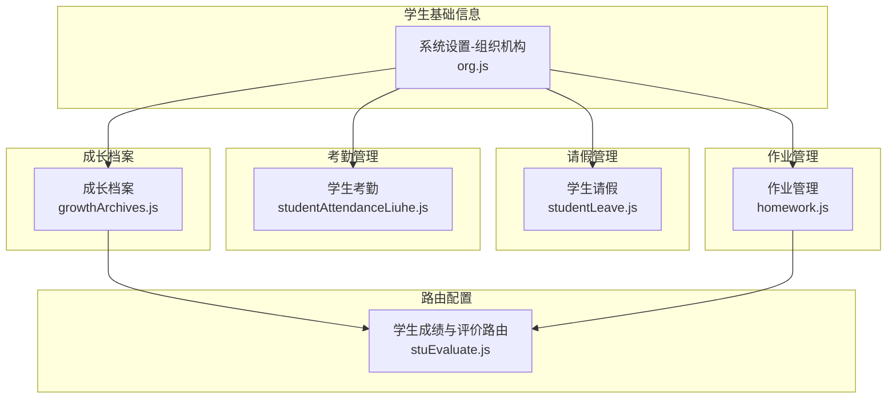
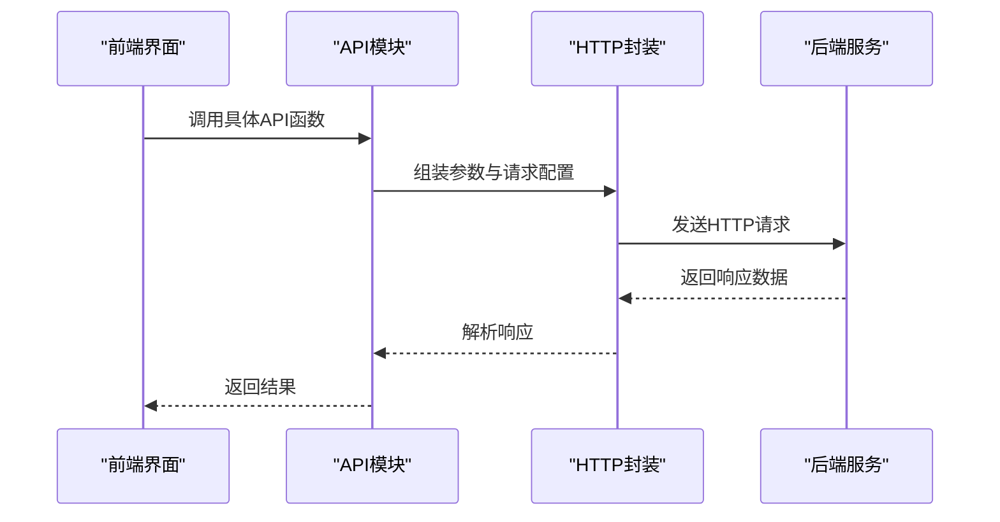
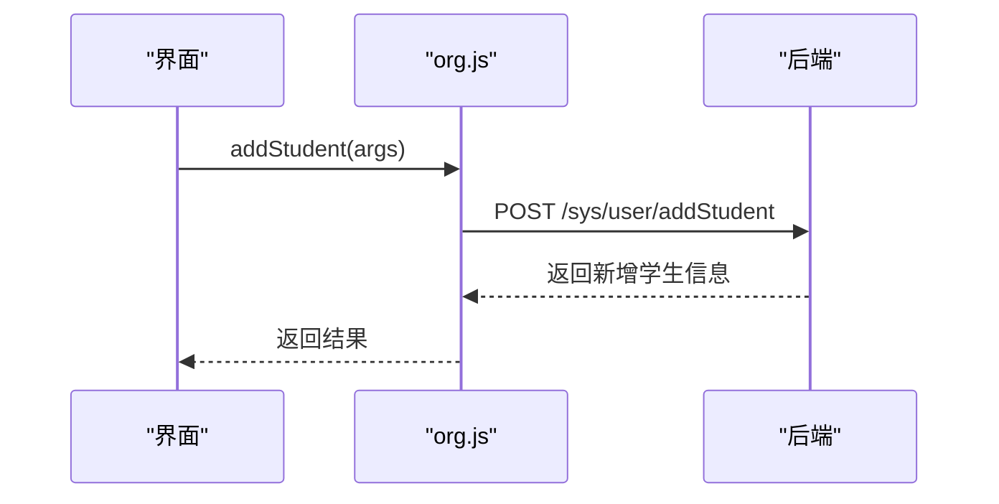
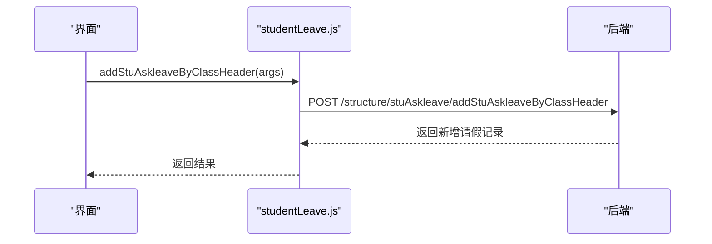
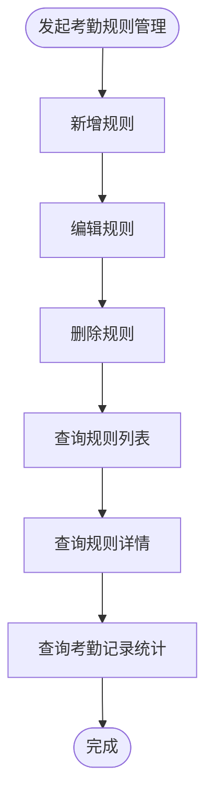
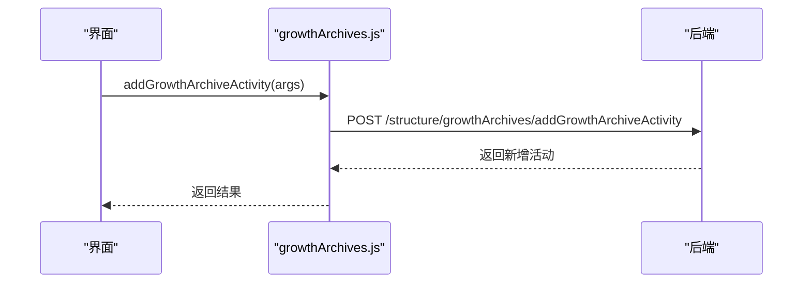
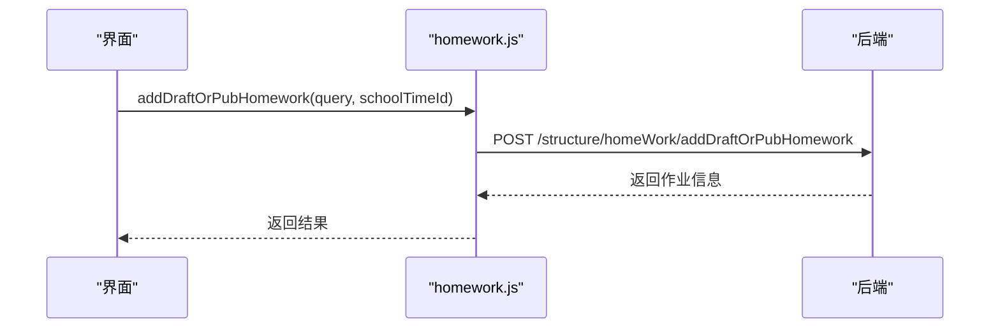
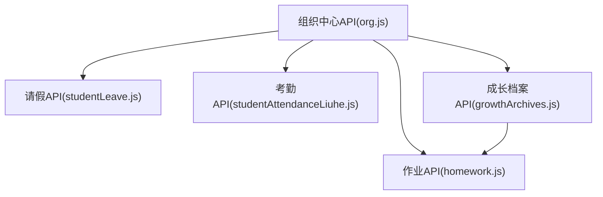

# 学生管理API

<cite>
**本文档引用的文件**
- [studentLeave.js](file://src/api/studentLeave.js)
- [studentAttendanceLiuhe.js](file://src/api/studentAttendanceLiuhe.js)
- [growthArchives.js](file://src/api/growthArchives.js)
- [homework.js](file://src/api/homework.js)
- [org.js](file://src/api/systemSet/org.js)
- [stuEvaluate.js](file://src/router/normal/stuEvaluate.js)
</cite>

## 目录
1. [简介](#简介)
2. [项目结构](#项目结构)
3. [核心组件](#核心组件)
4. [架构总览](#架构总览)
5. [详细组件分析](#详细组件分析)
6. [依赖关系分析](#依赖关系分析)
7. [性能考虑](#性能考虑)
8. [故障排查指南](#故障排查指南)
9. [结论](#结论)
10. [附录](#附录)

## 简介
本文件面向学生管理相关API的详细技术文档，覆盖以下核心能力：
- 学生基本信息管理：新增、更新、删除、移动班级等
- 请假申请与审批：列表查询、新增、详情、统计、批量修改、删除
- 考勤记录与规则：规则新增/编辑/删除/查询、考勤记录分页统计
- 成长档案：活动管理、附件与留言、发布与统计、类型字典维护
- 作业管理：作业列表、发布/草稿、完成/未完成统计、回复与评价、统计报表
- 路由与模块：学生成绩与评价相关页面路由配置

本文件提供接口规范、参数说明、响应格式、错误处理建议与使用示例，并辅以流程图与架构图帮助理解。

## 项目结构
学生管理相关API主要分布在以下模块：
- 学生基础信息：系统设置-组织机构中的学生管理接口
- 请假管理：学生请假相关接口
- 考勤管理：学生考勤规则与记录接口
- 成长档案：成长档案活动与附件管理接口
- 作业管理：作业发布、统计与评价接口
- 路由配置：学生成绩与评价相关页面路由

图表来源
- [org.js:679-751](file://src/api/systemSet/org.js#L679-L751)
- [studentLeave.js:14-30](file://src/api/studentLeave.js#L14-L30)
- [studentAttendanceLiuhe.js:16-55](file://src/api/studentAttendanceLiuhe.js#L16-L55)
- [growthArchives.js:52-67](file://src/api/growthArchives.js#L52-L67)
- [homework.js:24-35](file://src/api/homework.js#L24-L35)
- [stuEvaluate.js:384-422](file://src/router/normal/stuEvaluate.js#L384-L422)

章节来源
- [org.js:679-751](file://src/api/systemSet/org.js#L679-L751)
- [studentLeave.js:14-30](file://src/api/studentLeave.js#L14-L30)
- [studentAttendanceLiuhe.js:16-55](file://src/api/studentAttendanceLiuhe.js#L16-L55)
- [growthArchives.js:52-67](file://src/api/growthArchives.js#L52-L67)
- [homework.js:24-35](file://src/api/homework.js#L24-L35)
- [stuEvaluate.js:384-422](file://src/router/normal/stuEvaluate.js#L384-L422)

## 核心组件
本节对各模块的关键API进行要点梳理，便于快速定位与使用。

- 学生基础信息管理
  - 新增学生：支持姓名、性别、出生日期、学籍号、证件类型/号码、所属班级、微信部门等字段
  - 更新学生：支持修改上述字段及头像
  - 删除学生：支持批量删除
  - 移动学生：支持将学生移动到其他班级，家长信息随迁
  - 获取详情：支持获取学生基本信息、家长列表等

- 请假管理
  - 列表查询：支持按时间段、班级、状态、学生姓名分页查询
  - 新增请假：支持多字段录入，含停课节数、起止时间、是否早操/午休/晚餐、医疗类型、症状JSON、住宿类型等
  - 详情查询：按请假ID查询
  - 统计与批量修改：支持按条件统计、批量修改请假记录
  - 删除请假：按ID删除

- 考勤管理
  - 规则管理：新增/编辑/删除考勤规则，包含名称、开始/结束时间、提醒对象等
  - 记录统计：支持按年级/班级/时间段/姓名分页查询考勤记录

- 成长档案
  - 活动管理：分页查询、新增、编辑、删除活动
  - 附件与留言：新增/删除附件、关联/取消关联学生、加星/取消加星、批量新增评语、新增留言、删除留言、查询留言列表
  - 发布与统计：查询是否可直接发布、发布活动、活动学生数据统计
  - 类型字典：查询/保存成长类型字典

- 作业管理
  - 作业列表：支持按学期、标题分页查询
  - 发布/草稿：支持新增保存预览、新增草稿或提交发布、编辑保存预览、编辑草稿或提交发布
  - 完成统计：已完成/未完成/未读列表、按类型筛选
  - 评价与提醒：回复列表、保存回复、导出回复、教师评价、提醒未提交学生
  - 统计报表：教师/学生维度统计

章节来源
- [org.js:679-751](file://src/api/systemSet/org.js#L679-L751)
- [studentLeave.js:14-30](file://src/api/studentLeave.js#L14-L30)
- [studentLeave.js:43-81](file://src/api/studentLeave.js#L43-L81)
- [studentLeave.js:96-104](file://src/api/studentLeave.js#L96-L104)
- [studentLeave.js:118-132](file://src/api/studentLeave.js#L118-L132)
- [studentLeave.js:167-177](file://src/api/studentLeave.js#L167-L177)
- [studentLeave.js:233-242](file://src/api/studentLeave.js#L233-L242)
- [studentAttendanceLiuhe.js:16-55](file://src/api/studentAttendanceLiuhe.js#L16-L55)
- [studentAttendanceLiuhe.js:69-86](file://src/api/studentAttendanceLiuhe.js#L69-L86)
- [growthArchives.js:52-67](file://src/api/growthArchives.js#L52-L67)
- [growthArchives.js:70-87](file://src/api/growthArchives.js#L70-L87)
- [growthArchives.js:89-106](file://src/api/growthArchives.js#L89-L106)
- [growthArchives.js:108-116](file://src/api/growthArchives.js#L108-L116)
- [growthArchives.js:118-123](file://src/api/growthArchives.js#L118-L123)
- [growthArchives.js:125-133](file://src/api/growthArchives.js#L125-L133)
- [growthArchives.js:135-144](file://src/api/growthArchives.js#L135-L144)
- [growthArchives.js:146-155](file://src/api/growthArchives.js#L146-L155)
- [growthArchives.js:158-171](file://src/api/growthArchives.js#L158-L171)
- [growthArchives.js:184-194](file://src/api/growthArchives.js#L184-L194)
- [growthArchives.js:196-205](file://src/api/growthArchives.js#L196-L205)
- [growthArchives.js:207-217](file://src/api/growthArchives.js#L207-L217)
- [growthArchives.js:219-228](file://src/api/growthArchives.js#L219-L228)
- [growthArchives.js:230-238](file://src/api/growthArchives.js#L230-L238)
- [growthArchives.js:240-267](file://src/api/growthArchives.js#L240-L267)
- [growthArchives.js:269-287](file://src/api/growthArchives.js#L269-L287)
- [growthArchives.js:289-297](file://src/api/growthArchives.js#L289-L297)
- [growthArchives.js:299-312](file://src/api/growthArchives.js#L299-L312)
- [growthArchives.js:314-323](file://src/api/growthArchives.js#L314-L323)
- [growthArchives.js:325-333](file://src/api/growthArchives.js#L325-L333)
- [growthArchives.js:335-343](file://src/api/growthArchives.js#L335-L343)
- [growthArchives.js:345-367](file://src/api/growthArchives.js#L345-L367)
- [growthArchives.js:393-425](file://src/api/growthArchives.js#L393-L425)
- [homework.js:24-35](file://src/api/homework.js#L24-L35)
- [homework.js:59-95](file://src/api/homework.js#L59-L95)
- [homework.js:103-140](file://src/api/homework.js#L103-L140)
- [homework.js:148-184](file://src/api/homework.js#L148-L184)
- [homework.js:192-228](file://src/api/homework.js#L192-L228)
- [homework.js:352-373](file://src/api/homework.js#L352-L373)
- [homework.js:458-476](file://src/api/homework.js#L458-L476)
- [homework.js:495-527](file://src/api/homework.js#L495-L527)
- [homework.js:530-541](file://src/api/homework.js#L530-L541)

## 架构总览
前端通过统一的HTTP封装调用后端接口，部分模块使用不同的baseURL（如组织中心、作业中心等）。接口遵循REST风格，常用方法为GET/POST，参数传递方式包括URL参数与表单参数。

图表来源
- [org.js:679-751](file://src/api/systemSet/org.js#L679-L751)
- [studentLeave.js:14-30](file://src/api/studentLeave.js#L14-L30)
- [studentAttendanceLiuhe.js:16-55](file://src/api/studentAttendanceLiuhe.js#L16-L55)
- [growthArchives.js:52-67](file://src/api/growthArchives.js#L52-L67)
- [homework.js:24-35](file://src/api/homework.js#L24-L35)

## 详细组件分析

### 学生基础信息管理
- 新增学生
  - 方法与路径：POST /sys/user/addStudent
  - 请求参数：姓名、性别、出生日期、学籍号、证件类型、证件号码、所属班级、微信部门、学习阶段、户籍人口等
  - 响应：成功返回新增学生信息
  - 使用示例：调用 addStudent(args) 并传入上述字段
- 更新学生
  - 方法与路径：POST /sys/user/updateStudent
  - 请求参数：id必填，其余字段可选（同新增）
  - 响应：成功返回更新后的学生信息
  - 使用示例：调用 updateStudent(args)
- 删除学生
  - 方法与路径：POST /sys/user/deleteStudent
  - 请求参数：names、userIds（支持批量）
  - 响应：成功返回删除结果
  - 使用示例：调用 deleteStudent(array)
- 移动学生
  - 方法与路径：POST /sys/user/moveStudent
  - 请求参数：names、ids、selectedDepartId
  - 响应：成功返回移动结果
  - 使用示例：调用 moveStudent(users, targetClass)

图表来源
- [org.js:679-696](file://src/api/systemSet/org.js#L679-L696)

章节来源
- [org.js:679-751](file://src/api/systemSet/org.js#L679-L751)

### 请假管理
- 列表查询
  - 方法与路径：GET /structure/stuAskleave/getStuAskleaveListByClassHead
  - 请求参数：endDate、pageNo、pageSize、startDate、classId、leaveState、studentName
  - 响应：分页请假记录列表
- 新增请假
  - 方法与路径：POST /structure/stuAskleave/addStuAskleaveByClassHeader
  - 请求参数：studentId、停课节数/时长、起止时间、是否早操/午休/晚餐、医疗类型、症状JSON、住宿类型、内容、照片JSON、是否批量等
  - 响应：成功返回新增请假记录
- 详情查询
  - 方法与路径：GET /structure/stuAskleave/getStuAskleaveInfo
  - 请求参数：askId
  - 响应：请假详情
- 统计与批量修改
  - 统计接口：GET /structure/stuAskleaveThree/getStuAskleaveThreeListByNum
  - 批量修改：POST /structure/stuAskleave/updateStuAskLeaveListByBatch
- 删除请假
  - 方法与路径：GET /structure/stuAskleave/delStuAskleave
  - 请求参数：askId

图表来源
- [studentLeave.js:43-81](file://src/api/studentLeave.js#L43-L81)

章节来源
- [studentLeave.js:14-30](file://src/api/studentLeave.js#L14-L30)
- [studentLeave.js:43-81](file://src/api/studentLeave.js#L43-L81)
- [studentLeave.js:96-104](file://src/api/studentLeave.js#L96-L104)
- [studentLeave.js:118-132](file://src/api/studentLeave.js#L118-L132)
- [studentLeave.js:167-177](file://src/api/studentLeave.js#L167-L177)
- [studentLeave.js:233-242](file://src/api/studentLeave.js#L233-L242)

### 考勤管理
- 规则管理
  - 新增：POST /structure/stuAttendance/addStuAttendanceRule（参数：ruleName、beginTime、endTime、remindMaster、remindParent）
  - 编辑：POST /structure/stuAttendance/editStuAttendanceRule（参数：id必填）
  - 删除：POST /structure/stuAttendance/delStuAttendanceRuleById（参数：id）
  - 查询列表：POST /structure/stuAttendance/getSchoolStuAttendanceRuleList
  - 查询详情：POST /structure/stuAttendance/getStuAttendanceRuleInfoById（参数：id）
- 考勤记录统计
  - 方法与路径：POST /structure/stuAttendance/getPriodStuAttendanceRecordPageList
  - 请求参数：beginDate、endDate、gradeId、classId、userName、pageNo、pageSize

图表来源
- [studentAttendanceLiuhe.js:16-55](file://src/api/studentAttendanceLiuhe.js#L16-L55)
- [studentAttendanceLiuhe.js:69-86](file://src/api/studentAttendanceLiuhe.js#L69-L86)

章节来源
- [studentAttendanceLiuhe.js:16-55](file://src/api/studentAttendanceLiuhe.js#L16-L55)
- [studentAttendanceLiuhe.js:69-86](file://src/api/studentAttendanceLiuhe.js#L69-L86)

### 成长档案
- 活动管理
  - 分页查询：POST /structure/growthArchives/getGrowthArchivesActivityPageList（参数：activityKeys、activityTypeCode、classId、gradeId、schoolTimeId、searchTitle、type、pageNo、pageSize）
  - 新增：POST /structure/growthArchives/addGrowthArchiveActivity（参数：活动名称、班级/学生信息、类型编码/名称、学期ID等）
  - 编辑：POST /structure/growthArchives/editGrowthArchiveActivity（参数：id必填）
  - 删除：POST /structure/growthArchives/deleteGrowthArchivesActivityById（参数：id）
  - 详情：POST /structure/growthArchives/getGrowthArchivesActivityModelById（参数：activityId）
- 附件与留言
  - 新增附件：POST /structure/growthArchives/addActivityFile（参数：activityId、fileType、fileUrl、photoAxis、photoDetails、stuId）
  - 关联/取消关联学生：POST /structure/growthArchives/addActivityFileStu、POST /structure/growthArchives/deleteActivityFileStu、POST /structure/growthArchives/batchAddOrCancelFileStu（参数：activityId、fileId、fromType）
  - 加星/取消加星：POST /structure/growthArchives/starOrCancelStarActivityFile（参数：fileId、starStatus）
  - 删除附件：POST /structure/growthArchives/deleteActivityFileById（参数：id）
  - 批量新增评语：POST /structure/growthArchives/batchAddActivityFileStuComment（参数：activityId、fileId、comment）
  - 新增留言：POST /structure/growthArchives/addActivityFileStuMessage（参数：activityId、fileId、stuId、message、fromType=1）
  - 删除留言：POST /structure/growthArchives/deleteActivityFileStuMessage（参数：fileId、stuId）
  - 查询留言：POST /structure/growthArchives/getFileMessageList（参数：fileId）
- 发布与统计
  - 是否可发布：POST /structure/growthArchives/isCanPublishActivity（参数：activityId）
  - 发布活动：POST /structure/growthArchives/publishGrowthArchivesActivity（参数：activityId）
  - 活动学生统计：POST /structure/growthArchives/getActivityStuStaticsDataList（参数：activityId）
- 类型字典
  - 查询/保存成长类型字典：POST /structure/growthArchives/getSchoolGrowthTypeDicList、POST /structure/growthArchives/saveSchoolGrowthTypeDics（参数：useType、数组JSON）

图表来源
- [growthArchives.js:70-87](file://src/api/growthArchives.js#L70-L87)

章节来源
- [growthArchives.js:52-67](file://src/api/growthArchives.js#L52-L67)
- [growthArchives.js:70-87](file://src/api/growthArchives.js#L70-L87)
- [growthArchives.js:89-106](file://src/api/growthArchives.js#L89-L106)
- [growthArchives.js:108-116](file://src/api/growthArchives.js#L108-L116)
- [growthArchives.js:118-123](file://src/api/growthArchives.js#L118-L123)
- [growthArchives.js:125-133](file://src/api/growthArchives.js#L125-L133)
- [growthArchives.js:135-144](file://src/api/growthArchives.js#L135-L144)
- [growthArchives.js:146-155](file://src/api/growthArchives.js#L146-L155)
- [growthArchives.js:158-171](file://src/api/growthArchives.js#L158-L171)
- [growthArchives.js:184-194](file://src/api/growthArchives.js#L184-L194)
- [growthArchives.js:196-205](file://src/api/growthArchives.js#L196-L205)
- [growthArchives.js:207-217](file://src/api/growthArchives.js#L207-L217)
- [growthArchives.js:219-228](file://src/api/growthArchives.js#L219-L228)
- [growthArchives.js:230-238](file://src/api/growthArchives.js#L230-L238)
- [growthArchives.js:240-267](file://src/api/growthArchives.js#L240-L267)
- [growthArchives.js:269-287](file://src/api/growthArchives.js#L269-L287)
- [growthArchives.js:289-297](file://src/api/growthArchives.js#L289-L297)
- [growthArchives.js:299-312](file://src/api/growthArchives.js#L299-L312)
- [growthArchives.js:314-323](file://src/api/growthArchives.js#L314-L323)
- [growthArchives.js:325-333](file://src/api/growthArchives.js#L325-L333)
- [growthArchives.js:335-343](file://src/api/growthArchives.js#L335-L343)
- [growthArchives.js:345-367](file://src/api/growthArchives.js#L345-L367)
- [growthArchives.js:393-425](file://src/api/growthArchives.js#L393-L425)

### 作业管理
- 作业列表
  - 方法与路径：POST /structure/homeWork/getHomeworkList
  - 请求参数：pageNo、pageSize、searchTitle、schoolTimeId
- 发布/草稿
  - 新增保存预览：POST /structure/homeWork/addAndPreviewHomework（参数：标题、内容、课程、附件、发布类型、是否家长上交、图片JSON、视频JSON、发布时间、预完成时长、短信内容、发布范围JSON等）
  - 新增草稿或提交发布：POST /structure/homeWork/addDraftOrPubHomework（参数同上）
  - 编辑保存预览：POST /structure/homeWork/editAndPreviewHomework（参数：id、标题、内容、课程、附件、发布类型、是否家长上交、图片JSON、视频JSON、发布时间、预完成时长、短信内容、发布范围JSON等）
  - 编辑草稿或提交发布：POST /structure/homeWork/editDraftOrPubHomework（参数同上）
- 完成统计
  - 已完成/未完成：POST /structure/homeWork/getFinishStuList、POST /structure/homeWork/getUnFinishStuList（参数：homeworkId、schoolTimeId）
  - 已完成/未完成按类型：POST /structure/homeWork/getFinishStuListByType（参数：departId、homeworkId、pageNo、pageSize、stuName、type、schoolTimeId）
  - 未读列表：POST /structure/homeWork/getUnReadStudentList（参数：homeworkId、schoolTimeId）
- 评价与提醒
  - 教师评价：POST /structure/homeWork/updateStuHomeWorkEvaluate（参数：evaluateRemark、evaluateAudioJson、evaluatePicJson、starNum、isRevised、stuWorkId、workId、schoolTimeId、stuId）
  - 回复列表：POST /structure/homeWork/getReplyPageListByHId（参数：homeworkId、pageNo、pageSize、searchName、schoolTimeId）
  - 保存回复：POST /structure/homeWork/addReplyInfo（参数：content、homeworkId、schoolTimeId）
  - 导出回复：POST /structure/homeWork/exportHomeworkReply（参数：homeworkId、schoolTimeId）
  - 提醒未提交学生：POST /structure/homeWork/remindUnfinishedStu（参数：homeworkId、schoolTimeId）
- 统计报表
  - 教师统计：POST /structure/homeWork/getHomeworkStaticsPageDatas（参数：classId、gradeId、pageNo、pageSize、roleId、searchName、schoolTimeId）
  - 学生统计：POST /structure/homeWork/getHomeworkStuStaticsForLeader（参数：classId、gradeId、pageNo、pageSize、stuName、schoolTimeId）

图表来源
- [homework.js:103-140](file://src/api/homework.js#L103-L140)

章节来源
- [homework.js:24-35](file://src/api/homework.js#L24-L35)
- [homework.js:59-95](file://src/api/homework.js#L59-L95)
- [homework.js:103-140](file://src/api/homework.js#L103-L140)
- [homework.js:148-184](file://src/api/homework.js#L148-L184)
- [homework.js:192-228](file://src/api/homework.js#L192-L228)
- [homework.js:352-373](file://src/api/homework.js#L352-L373)
- [homework.js:458-476](file://src/api/homework.js#L458-L476)
- [homework.js:495-527](file://src/api/homework.js#L495-L527)
- [homework.js:530-541](file://src/api/homework.js#L530-L541)

### 路由与页面
学生成绩与评价相关页面通过路由集中配置，包括成长档案相关页面、课堂评价、综合实践等模块。这些页面与成长档案、作业管理API紧密配合，实现数据展示与交互。

章节来源
- [stuEvaluate.js:384-422](file://src/router/normal/stuEvaluate.js#L384-L422)

## 依赖关系分析
- 组件耦合
  - 学生基础信息与组织中心强耦合，涉及用户与部门关系
  - 成长档案与作业管理均依赖学期时间（schoolTimeId）进行数据隔离
  - 请假与考勤均依赖班级/年级维度进行统计
- 外部依赖
  - 部分模块使用不同baseURL（如组织中心、作业中心），需注意跨域与鉴权策略
  - 路由层与API层解耦，通过函数式API调用实现页面与数据层分离

图表来源
- [org.js:679-751](file://src/api/systemSet/org.js#L679-L751)
- [studentLeave.js:14-30](file://src/api/studentLeave.js#L14-L30)
- [studentAttendanceLiuhe.js:16-55](file://src/api/studentAttendanceLiuhe.js#L16-L55)
- [growthArchives.js:52-67](file://src/api/growthArchives.js#L52-L67)
- [homework.js:24-35](file://src/api/homework.js#L24-L35)

## 性能考虑
- 分页查询：优先使用分页参数（pageNo、pageSize）避免一次性加载大量数据
- 批量操作：尽量使用批量接口（如批量修改请假、批量新增评语）减少请求次数
- 缓存策略：对于不频繁变化的数据（如学期列表、字典项）可在前端缓存
- 请求合并：在业务允许的情况下合并多次请求，降低网络开销

## 故障排查指南
- 参数校验
  - 必填字段缺失：检查请求参数是否完整（如id、askId、activityId、homeworkId等）
  - 类型不匹配：确保数值型字段传入数字，日期字段传入合法格式
- 权限问题
  - 确认当前用户具备相应角色与权限（如发布作业、管理成长档案等）
- 接口异常
  - 若出现跨域或鉴权失败，检查baseURL与Cookie/Token配置
  - 对于批量操作，确认输入参数格式正确（JSON字符串、逗号分隔等）

## 结论
本文档系统梳理了学生管理相关的核心API，覆盖学生基础信息、请假、考勤、成长档案与作业管理等关键场景。通过明确的接口规范、参数说明与流程图，开发者可快速集成与扩展功能。建议在实际开发中结合业务需求选择合适的接口组合，并关注分页与权限控制，确保系统稳定高效运行。

## 附录
- 错误码说明（通用建议）
  - 200：请求成功
  - 400：参数错误或缺失
  - 401：未授权或会话失效
  - 403：无权限访问
  - 404：资源不存在
  - 500：服务器内部错误
- 使用示例（以函数调用形式）
  - 新增学生：addStudent(args)
  - 新增请假：addStuAskleaveByClassHeader(args)
  - 新增活动：addGrowthArchiveActivity(args)
  - 新增作业草稿：addDraftOrPubHomework(query, schoolTimeId)
  - 查询考勤记录：getPriodStuAttendanceRecordPageList(args)