# 宿舍管理API

<cite>
**本文档引用的文件**
- [dormitoryManage.js](file://src/api/dormitoryManage.js)
- [dormitoryInspection.js](file://src/api/dormitoryInspection.js)
- [visitor.js](file://src/api/visitor.js)
- [visitorReservation.js](file://src/api/visitorReservation.js)
- [fetch.js](file://src/utils/fetch.js)
- [dormitoryManageIndex.vue](file://src/views/dormitoryManagement/dormitoryManageIndex.vue)
- [dormitoryCheckInStatistics.vue](file://src/views/dormitoryManagement/dormitoryCheckInStatistics.vue)
- [dormitoryInspectionindex.vue](file://src/views/sysSet/dormitoryInspection/dormitoryInspectionindex.vue)
- [dormitoryInspectionadd.vue](file://src/views/sysSet/dormitoryInspection/dormitoryInspectionadd.vue)
- [generalLogistics.js](file://src/router/normal/generalLogistics.js)
</cite>

## 目录
1. [简介](#简介)
2. [项目结构](#项目结构)
3. [核心组件](#核心组件)
4. [架构概览](#架构概览)
5. [详细组件分析](#详细组件分析)
6. [依赖关系分析](#依赖关系分析)
7. [性能考虑](#性能考虑)
8. [故障排除指南](#故障排除指南)
9. [结论](#结论)

## 简介
本项目为宿舍管理系统，提供完整的宿舍分配、入住登记、检查管理、访客管理、预约管理等接口规范。系统采用前后端分离架构，前端使用Vue.js框架，后端通过统一的API接口进行数据交互。

## 项目结构
宿舍管理系统的整体架构采用模块化设计，主要分为以下几个核心模块：

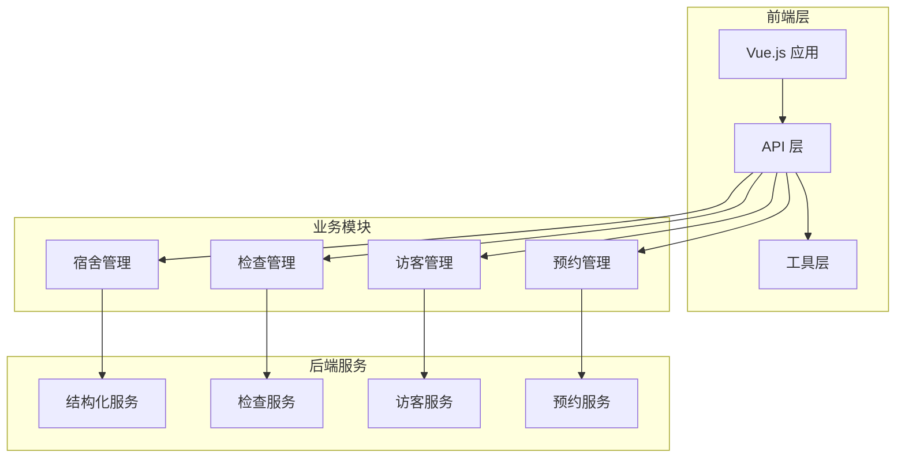

**图表来源**
- [dormitoryManage.js:1-397](file://src/api/dormitoryManage.js#L1-L397)
- [dormitoryInspection.js:1-225](file://src/api/dormitoryInspection.js#L1-L225)

**章节来源**
- [dormitoryManage.js:1-397](file://src/api/dormitoryManage.js#L1-L397)
- [dormitoryInspection.js:1-225](file://src/api/dormitoryInspection.js#L1-L225)

## 核心组件
系统的核心组件包括宿舍管理、检查管理、访客管理和预约管理四大模块，每个模块都提供了完整的API接口。

### 宿舍管理模块
- 宿舍楼管理：支持宿舍楼的增删改查操作
- 宿舍房间管理：提供房间的分配、调整和统计功能
- 入住登记：处理学生的住宿分配和信息管理
- 出入记录：记录学生的进出时间和状态
- 统计报表：提供住宿情况的统计分析

### 检查管理模块
- 检查项目管理：维护检查标准和评分规则
- 检查组管理：组织检查人员和分配检查任务
- 检查记录：记录每次检查的结果和评分
- 统计分析：按周、月统计检查情况

### 访客管理模块
- 访客登记：记录访客的基本信息和访问时间
- 访客预约：管理访客的预约申请和审核
- 访客统计：统计访客的访问频率和时间段

### 预约管理模块
- 预约申请：处理各类预约的申请和审批
- 预约查询：提供预约状态的实时查询
- 预约统计：统计各类预约的数量和趋势

**章节来源**
- [dormitoryManage.js:29-397](file://src/api/dormitoryManage.js#L29-L397)
- [dormitoryInspection.js:1-225](file://src/api/dormitoryInspection.js#L1-L225)

## 架构概览
系统采用统一的API调用机制，所有接口都通过fetch.js进行封装，支持多种数据传输格式和认证机制。

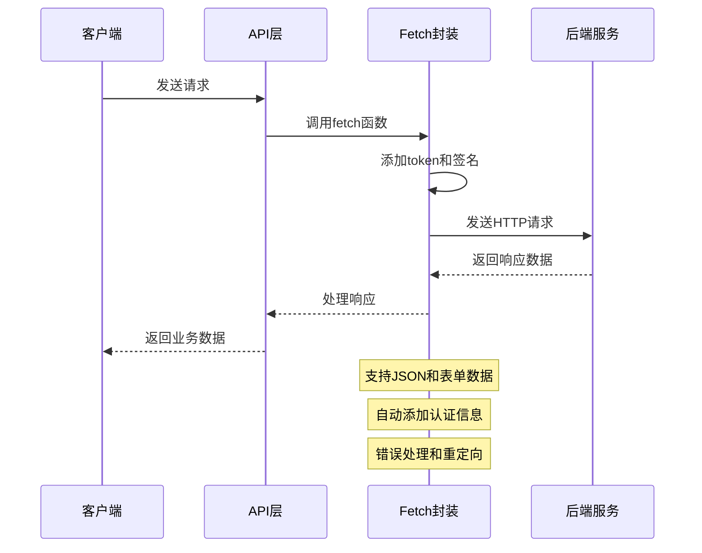

**图表来源**
- [fetch.js:1-240](file://src/utils/fetch.js#L1-L240)

**章节来源**
- [fetch.js:1-240](file://src/utils/fetch.js#L1-L240)

## 详细组件分析

### 宿舍管理API详解

#### 宿舍楼管理接口
宿舍楼管理提供了完整的宿舍楼生命周期管理功能：

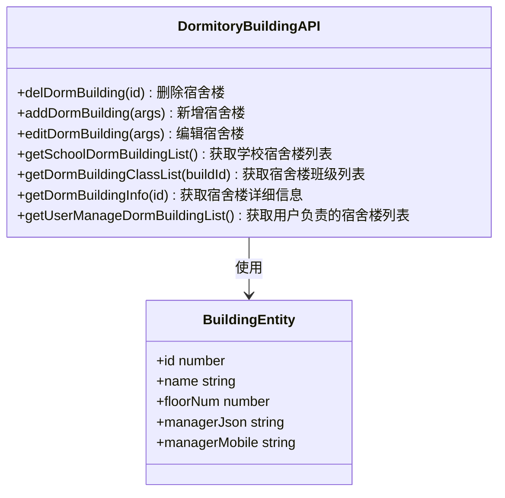

**图表来源**
- [dormitoryManage.js:35-128](file://src/api/dormitoryManage.js#L35-L128)

#### 宿舍房间管理接口
房间管理提供了灵活的房间分配和统计功能：

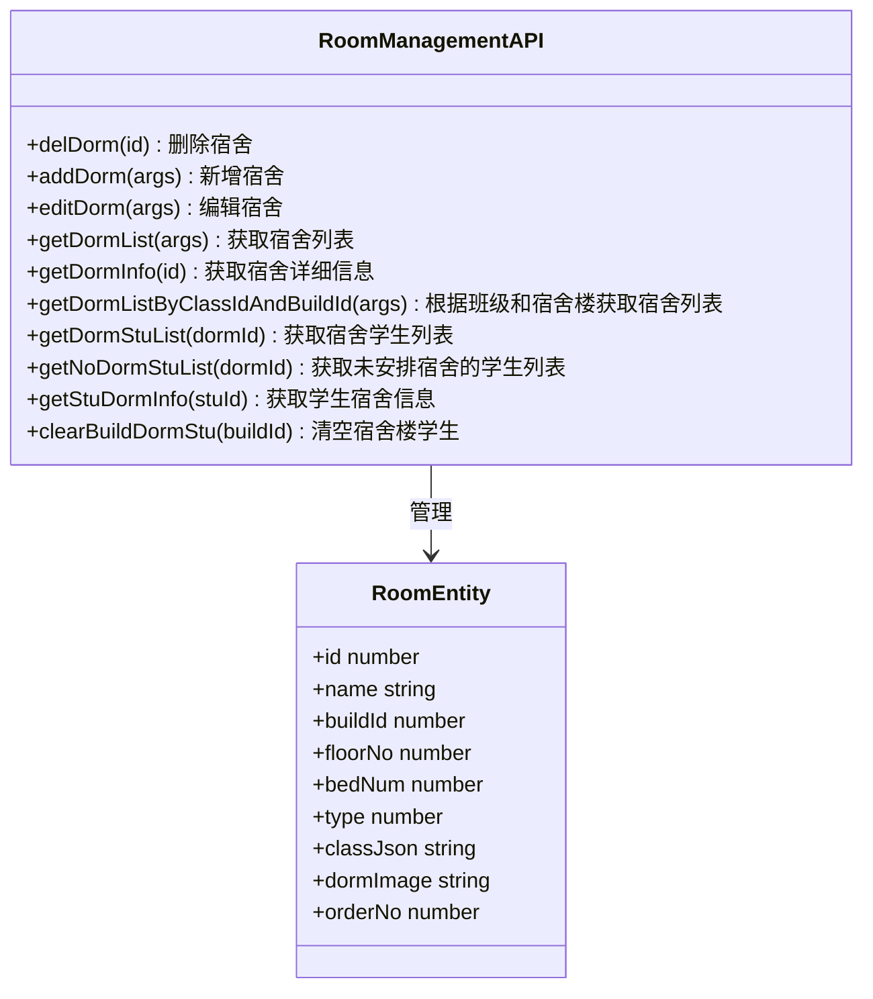

**图表来源**
- [dormitoryManage.js:136-250](file://src/api/dormitoryManage.js#L136-L250)

#### 入住登记管理接口
入住登记提供了完整的学生住宿管理功能：

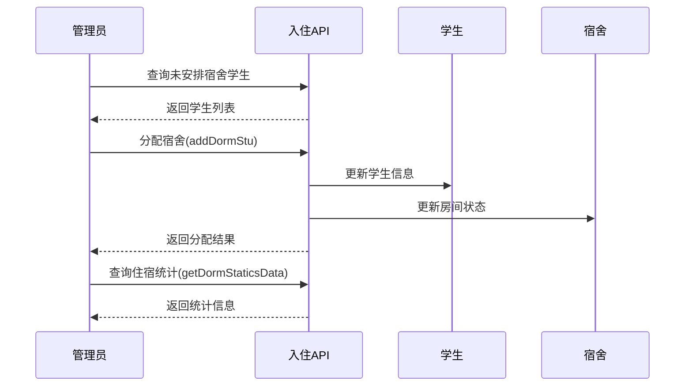

**图表来源**
- [dormitoryManage.js:271-325](file://src/api/dormitoryManage.js#L271-L325)

**章节来源**
- [dormitoryManage.js:130-397](file://src/api/dormitoryManage.js#L130-L397)

### 检查管理API详解

#### 检查项目管理接口
检查项目管理提供了灵活的检查标准配置功能：

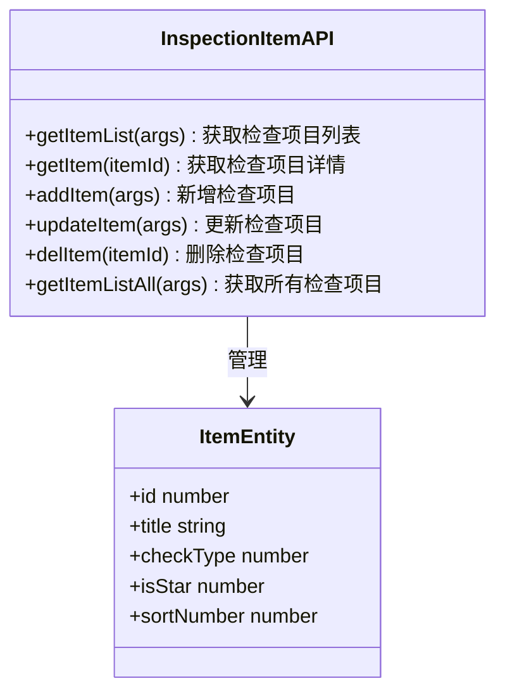

**图表来源**
- [dormitoryInspection.js:2-113](file://src/api/dormitoryInspection.js#L2-L113)

#### 检查组管理接口
检查组管理提供了检查人员和任务的组织功能：

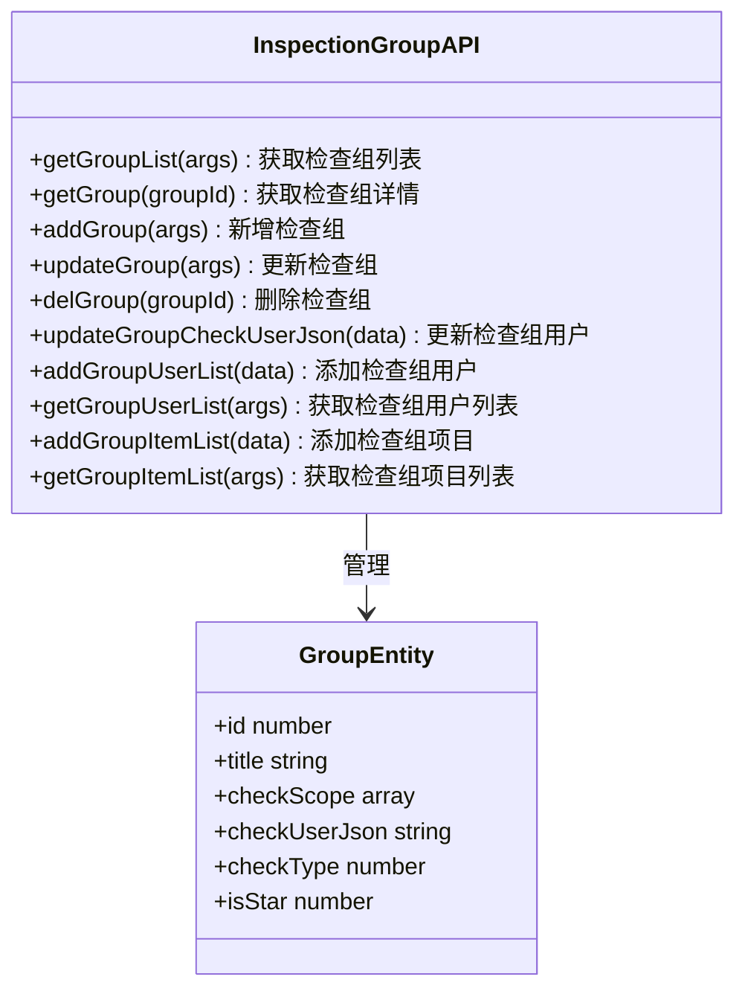

**图表来源**
- [dormitoryInspection.js:13-177](file://src/api/dormitoryInspection.js#L13-L177)

#### 统计分析接口
统计分析提供了多维度的数据统计功能：

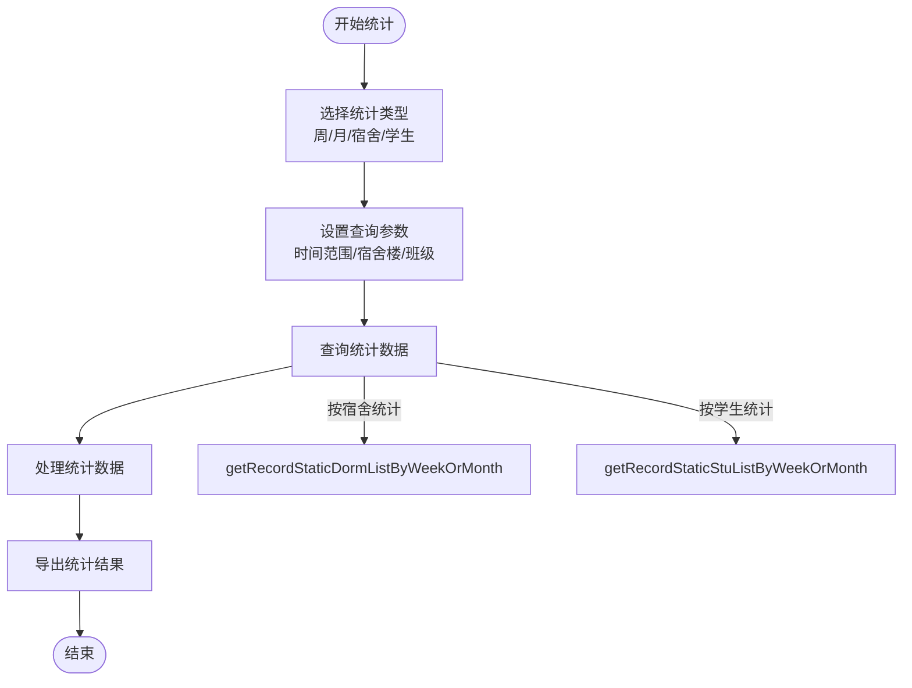

**图表来源**
- [dormitoryInspection.js:178-223](file://src/api/dormitoryInspection.js#L178-L223)

**章节来源**
- [dormitoryInspection.js:1-225](file://src/api/dormitoryInspection.js#L1-L225)

### 访客管理API详解

#### 访客登记接口
访客登记提供了完整的访客信息管理功能：

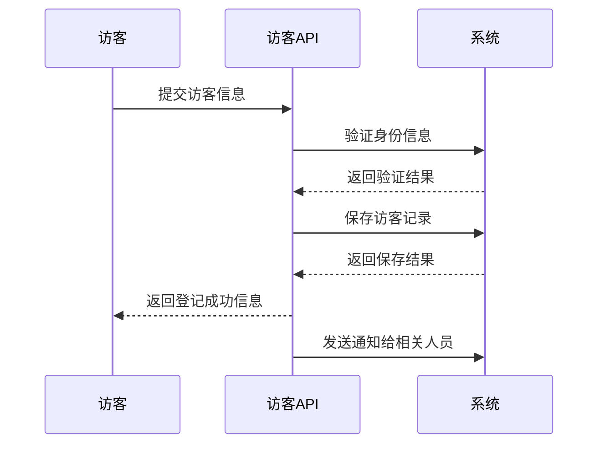

**图表来源**
- [visitor.js:3-25](file://src/api/visitor.js#L3-L25)

#### 访客预约接口
访客预约提供了预约申请和管理功能：

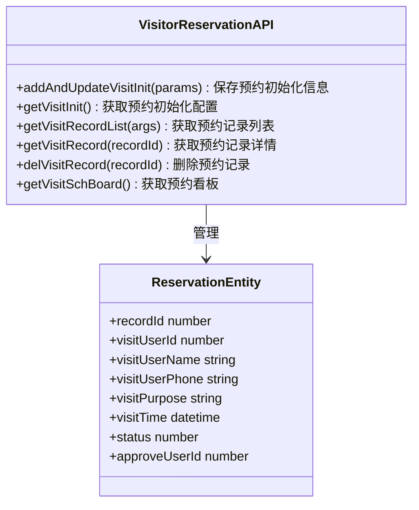

**图表来源**
- [visitorReservation.js:3-61](file://src/api/visitorReservation.js#L3-L61)

**章节来源**
- [visitor.js:1-25](file://src/api/visitor.js#L1-L25)
- [visitorReservation.js:1-61](file://src/api/visitorReservation.js#L1-L61)

### 归寝预警管理
系统提供了智能的归寝预警功能，帮助管理人员及时发现晚归学生：

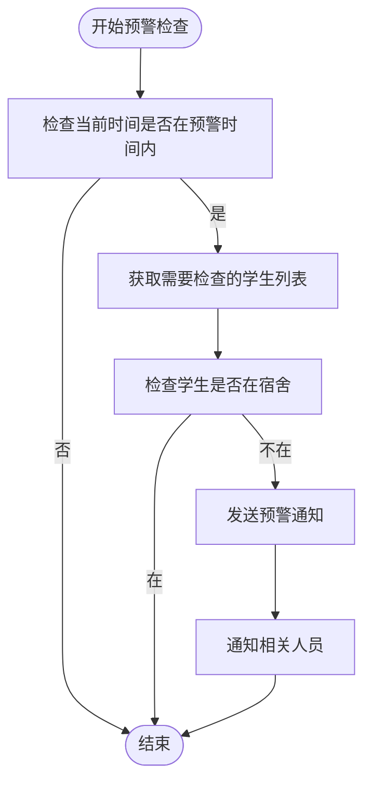

**图表来源**
- [dormitoryManage.js:372-396](file://src/api/dormitoryManage.js#L372-L396)

**章节来源**
- [dormitoryManage.js:366-396](file://src/api/dormitoryManage.js#L366-L396)

## 依赖关系分析

### 前端路由与页面映射
系统通过路由配置将API接口与具体的功能页面进行关联：

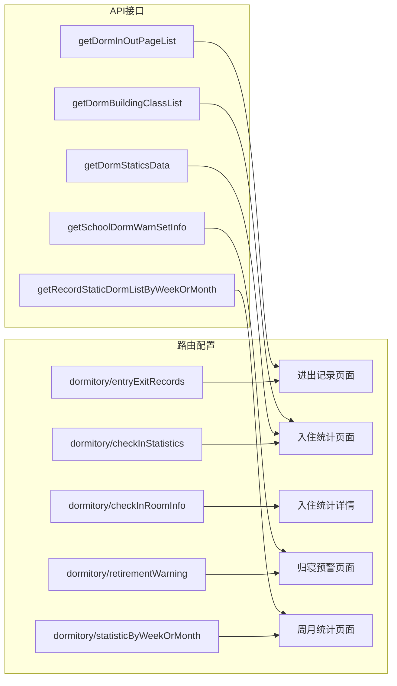

**图表来源**
- [generalLogistics.js:520-551](file://src/router/normal/generalLogistics.js#L520-L551)

### 数据流关系
系统中的数据流向体现了清晰的业务逻辑：

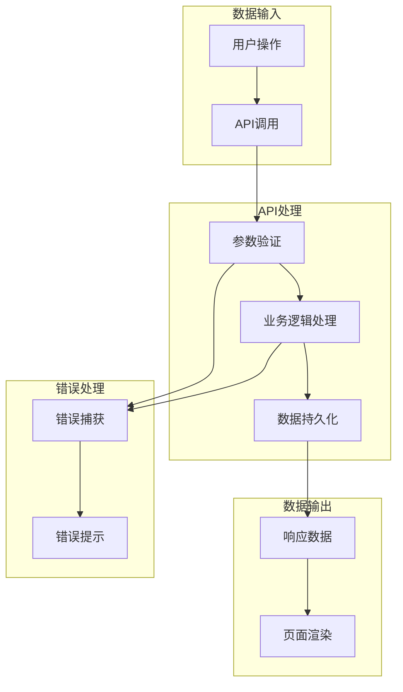

**图表来源**
- [fetch.js:104-169](file://src/utils/fetch.js#L104-L169)

**章节来源**
- [generalLogistics.js:520-551](file://src/router/normal/generalLogistics.js#L520-L551)
- [fetch.js:104-169](file://src/utils/fetch.js#L104-L169)

## 性能考虑
系统在设计时充分考虑了性能优化，主要体现在以下几个方面：

### API调用优化
- **批量请求**：支持多个API请求的批量处理，减少网络往返次数
- **缓存策略**：对常用数据进行客户端缓存，提高响应速度
- **分页加载**：大数据量场景下采用分页加载，避免一次性传输过多数据

### 数据传输优化
- **压缩传输**：对响应数据进行适当的压缩处理
- **增量更新**：支持局部数据更新，减少不必要的页面刷新
- **懒加载**：非关键资源采用懒加载策略

### 前端性能优化
- **组件复用**：通过组件化设计提高代码复用率
- **虚拟滚动**：大数据表格采用虚拟滚动技术提升渲染性能
- **防抖节流**：对频繁触发的操作进行防抖节流处理

## 故障排除指南

### 常见问题及解决方案

#### 认证失败
当出现认证失败时，系统会自动处理并跳转到登录页面：

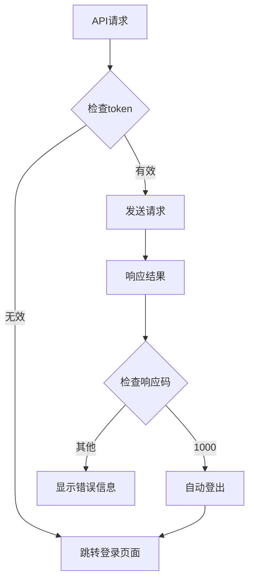

**图表来源**
- [fetch.js:134-152](file://src/utils/fetch.js#L134-L152)

#### 网络异常处理
系统对网络异常进行了完善的处理机制：

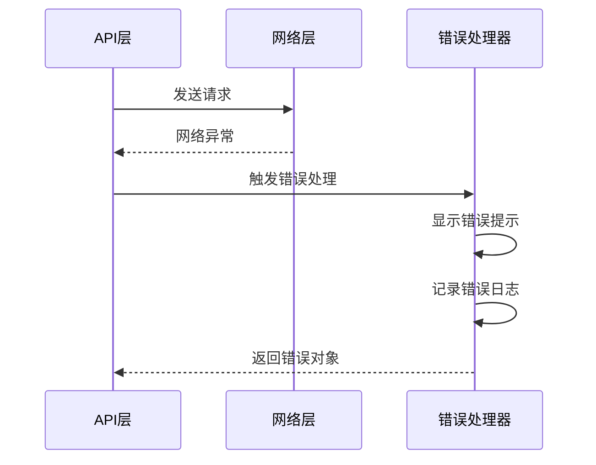

**图表来源**
- [fetch.js:161-169](file://src/utils/fetch.js#L161-L169)

#### 数据格式错误
对于数据格式错误的情况，系统会进行相应的处理：

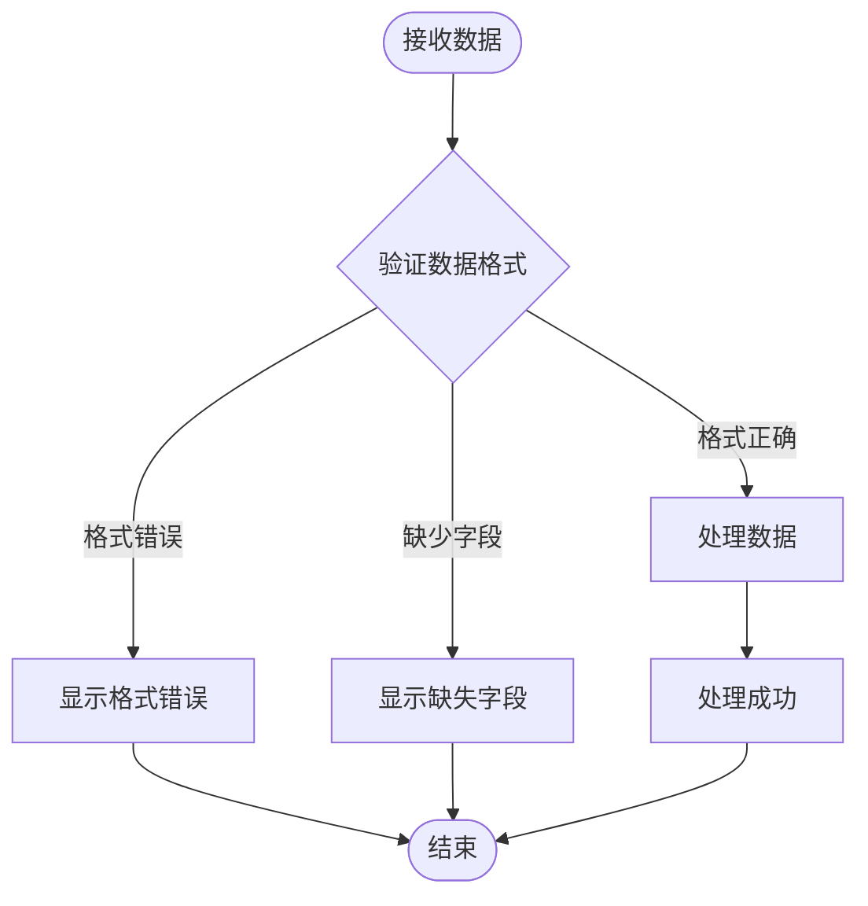

**章节来源**
- [fetch.js:104-169](file://src/utils/fetch.js#L104-L169)

## 结论
本宿舍管理系统通过模块化的API设计，提供了完整的宿舍管理功能。系统具有以下特点：

1. **功能完整性**：涵盖了宿舍管理的所有核心功能，包括分配、登记、检查、访客管理等
2. **接口标准化**：采用统一的API规范，便于集成和扩展
3. **用户体验友好**：提供直观的操作界面和清晰的业务流程
4. **性能优化**：通过多种技术手段确保系统的高效运行
5. **错误处理完善**：建立了完善的错误处理和异常恢复机制

系统的设计充分考虑了实际使用场景，能够满足不同规模学校的需求，为宿舍管理提供了强有力的技术支撑。