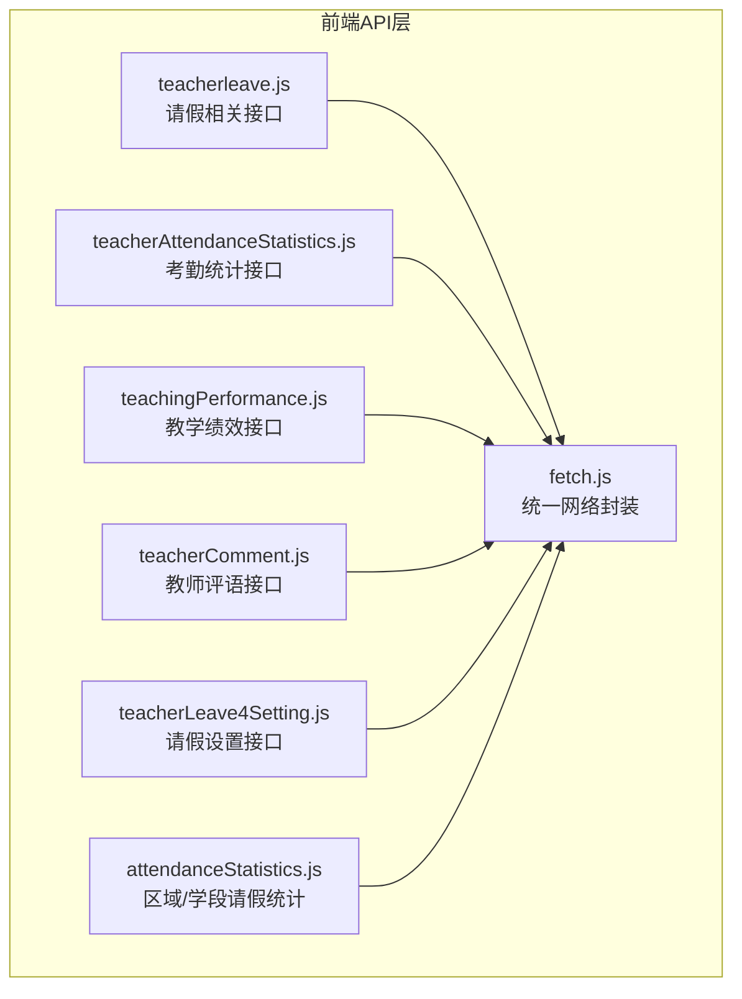
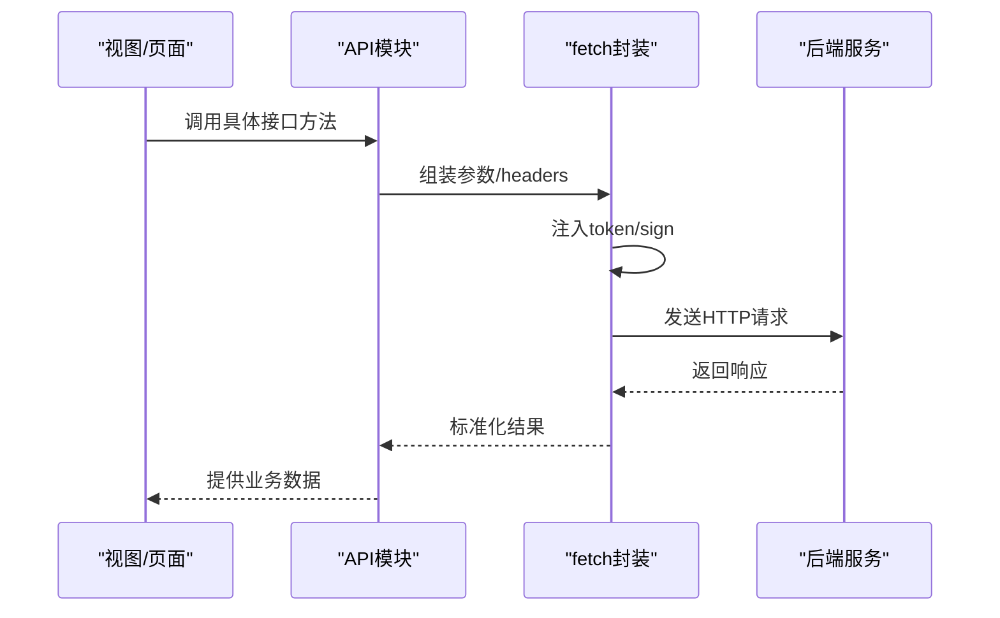
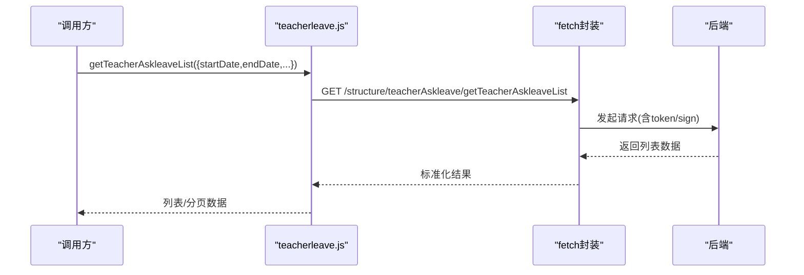
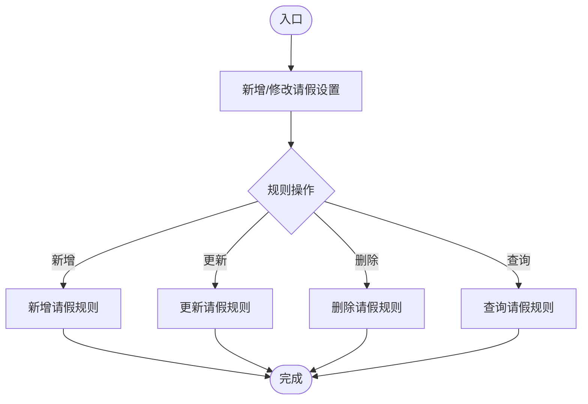
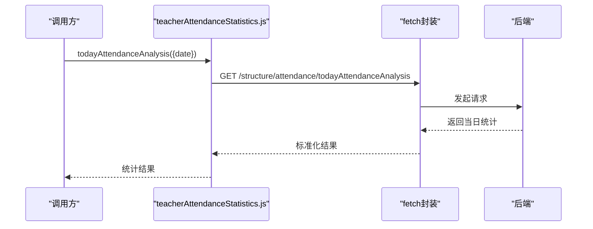
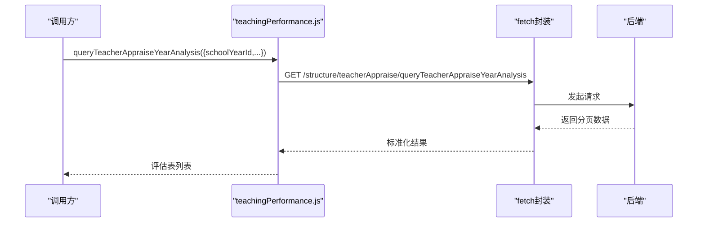
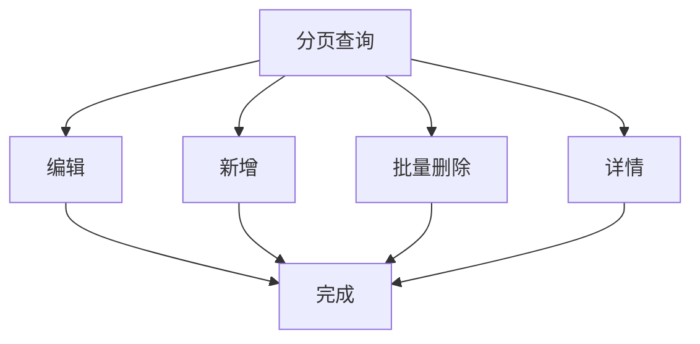
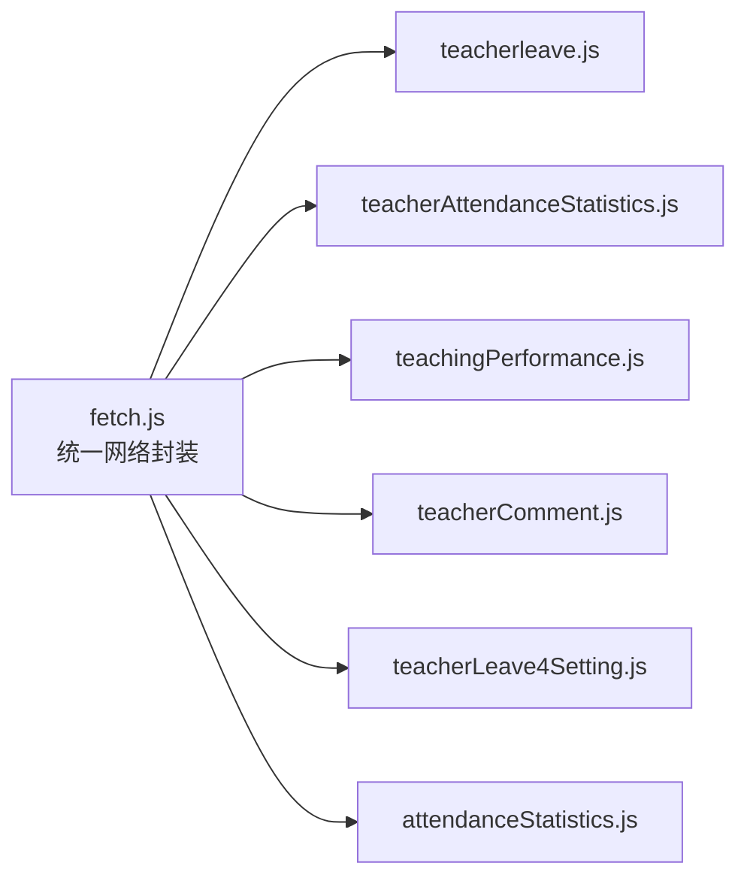

# 教师管理API

<cite>
**本文引用的文件**
- [src/api/teacherleave.js](file://src/api/teacherleave.js)
- [src/api/schoolManage/teacherAttendanceStatistics.js](file://src/api/schoolManage/teacherAttendanceStatistics.js)
- [src/api/teachingPerformance.js](file://src/api/teachingPerformance.js)
- [src/api/teacherComment.js](file://src/api/teacherComment.js)
- [src/api/systemSet/teacherLeave4Setting.js](file://src/api/systemSet/teacherLeave4Setting.js)
- [src/api/attendanceStatistics.js](file://src/api/attendanceStatistics.js)
- [src/utils/fetch.js](file://src/utils/fetch.js)
</cite>

## 目录
1. [简介](#简介)
2. [项目结构](#项目结构)
3. [核心组件](#核心组件)
4. [架构总览](#架构总览)
5. [详细组件分析](#详细组件分析)
6. [依赖关系分析](#依赖关系分析)
7. [性能考虑](#性能考虑)
8. [故障排查指南](#故障排查指南)
9. [结论](#结论)
10. [附录](#附录)

## 简介
本文件面向教师管理相关业务场景，系统性梳理并规范以下能力的API：教师基本信息管理、请假申请与统计、考勤统计与异常处理、教学绩效评估、教师评语管理。文档覆盖接口定义、参数说明、调用流程、数据流转与集成要点，并提供可视化图示帮助理解。

## 项目结构
教师管理API主要分布在如下模块：
- 请假管理：src/api/teacherleave.js、src/api/systemSet/teacherLeave4Setting.js
- 考勤统计：src/api/schoolManage/teacherAttendanceStatistics.js、src/api/attendanceStatistics.js
- 教学绩效：src/api/teachingPerformance.js
- 教师评语：src/api/teacherComment.js
- 通用网络层：src/utils/fetch.js

图表来源
- [src/api/teacherleave.js:1-108](file://src/api/teacherleave.js#L1-L108)
- [src/api/schoolManage/teacherAttendanceStatistics.js:1-248](file://src/api/schoolManage/teacherAttendanceStatistics.js#L1-L248)
- [src/api/teachingPerformance.js:1-140](file://src/api/teachingPerformance.js#L1-L140)
- [src/api/teacherComment.js:1-69](file://src/api/teacherComment.js#L1-L69)
- [src/api/systemSet/teacherLeave4Setting.js:1-71](file://src/api/systemSet/teacherLeave4Setting.js#L1-L71)
- [src/api/attendanceStatistics.js:1-100](file://src/api/attendanceStatistics.js#L1-L100)
- [src/utils/fetch.js:1-240](file://src/utils/fetch.js#L1-L240)

章节来源
- [src/api/teacherleave.js:1-108](file://src/api/teacherleave.js#L1-L108)
- [src/api/schoolManage/teacherAttendanceStatistics.js:1-248](file://src/api/schoolManage/teacherAttendanceStatistics.js#L1-L248)
- [src/api/teachingPerformance.js:1-140](file://src/api/teachingPerformance.js#L1-L140)
- [src/api/teacherComment.js:1-69](file://src/api/teacherComment.js#L1-L69)
- [src/api/systemSet/teacherLeave4Setting.js:1-71](file://src/api/systemSet/teacherLeave4Setting.js#L1-L71)
- [src/api/attendanceStatistics.js:1-100](file://src/api/attendanceStatistics.js#L1-L100)
- [src/utils/fetch.js:1-240](file://src/utils/fetch.js#L1-L240)

## 核心组件
- 统一网络层：基于 axios 的封装，自动注入 token、签名、请求参数序列化、响应拦截与错误提示。
- 请假管理：支持按时间段统计、按条件筛选、详情查询、模块开关检测；支持请假规则配置。
- 考勤统计：支持按日/月/时间段统计、按类型分析、用户维度统计、异常补签、门禁异常统计。
- 教学绩效：支持学年/批次/班级/评估表分页查询、生成学年评估、详情查询、删除批次、保存批次。
- 教师评语：支持分页查询、批量删除、详情、新增、编辑。

章节来源
- [src/utils/fetch.js:1-240](file://src/utils/fetch.js#L1-L240)
- [src/api/teacherleave.js:1-108](file://src/api/teacherleave.js#L1-L108)
- [src/api/schoolManage/teacherAttendanceStatistics.js:1-248](file://src/api/schoolManage/teacherAttendanceStatistics.js#L1-L248)
- [src/api/teachingPerformance.js:1-140](file://src/api/teachingPerformance.js#L1-L140)
- [src/api/teacherComment.js:1-69](file://src/api/teacherComment.js#L1-L69)

## 架构总览
前端通过各功能模块的API文件发起HTTP请求，统一经 fetch 封装进行参数拼接、鉴权与签名处理，再由后端服务返回数据。不同业务域使用不同的基础路径与服务实例。

图表来源
- [src/utils/fetch.js:13-240](file://src/utils/fetch.js#L13-L240)
- [src/api/teacherleave.js:1-108](file://src/api/teacherleave.js#L1-L108)
- [src/api/schoolManage/teacherAttendanceStatistics.js:1-248](file://src/api/schoolManage/teacherAttendanceStatistics.js#L1-L248)
- [src/api/teachingPerformance.js:1-140](file://src/api/teachingPerformance.js#L1-L140)
- [src/api/teacherComment.js:1-69](file://src/api/teacherComment.js#L1-L69)

## 详细组件分析

### 请假管理API
- 模块开关检测：用于判断特定模块是否启用。
- 请假统计（按时间段）：支持分页、部门过滤。
- 请假列表（按时间段+多条件）：支持类型、状态、姓名、部门过滤。
- 请假详情：按主键查询。
- 其他分析接口：按日期范围/列表进行分析（内部路由区分）。

图表来源
- [src/api/teacherleave.js:39-54](file://src/api/teacherleave.js#L39-L54)
- [src/utils/fetch.js:13-240](file://src/utils/fetch.js#L13-L240)

章节来源
- [src/api/teacherleave.js:1-108](file://src/api/teacherleave.js#L1-L108)

### 请假设置API
- 新增/修改请假设置
- 新增/更新/删除/查询请假规则
- 查询当前学校请假设置

图表来源
- [src/api/systemSet/teacherLeave4Setting.js:1-71](file://src/api/systemSet/teacherLeave4Setting.js#L1-L71)

章节来源
- [src/api/systemSet/teacherLeave4Setting.js:1-71](file://src/api/systemSet/teacherLeave4Setting.js#L1-L71)

### 考勤统计API
- 当日统计、时间段统计、类型分析、用户维度统计
- 异常补签、门禁异常统计
- 区域/学段请假统计（跨域）

图表来源
- [src/api/schoolManage/teacherAttendanceStatistics.js:17-26](file://src/api/schoolManage/teacherAttendanceStatistics.js#L17-L26)
- [src/utils/fetch.js:13-240](file://src/utils/fetch.js#L13-L240)

章节来源
- [src/api/schoolManage/teacherAttendanceStatistics.js:1-248](file://src/api/schoolManage/teacherAttendanceStatistics.js#L1-L248)
- [src/api/attendanceStatistics.js:1-100](file://src/api/attendanceStatistics.js#L1-L100)

### 教学绩效API
- 年级列表、学年/学期查询
- 分页查询学年评估、批次、班级汇总、评估表
- 生成学年评估、删除批次、详情查询、保存批次

图表来源
- [src/api/teachingPerformance.js:24-37](file://src/api/teachingPerformance.js#L24-L37)
- [src/utils/fetch.js:13-240](file://src/utils/fetch.js#L13-L240)

章节来源
- [src/api/teachingPerformance.js:1-140](file://src/api/teachingPerformance.js#L1-L140)

### 教师评语API
- 分页查询、批量删除、详情、新增、编辑

图表来源
- [src/api/teacherComment.js:1-69](file://src/api/teacherComment.js#L1-L69)

章节来源
- [src/api/teacherComment.js:1-69](file://src/api/teacherComment.js#L1-L69)

## 依赖关系分析
- 统一网络层依赖
  - 自动注入 token：除白名单外，默认在请求参数中附加 token。
  - 自动注入 sign：命中签名列表的接口自动附加 sign。
  - 参数序列化：对非 JSON 的 POST/GET 自动转换为 URLSearchParams。
- 各API模块依赖统一网络层，实现一致的鉴权与错误处理。

图表来源
- [src/utils/fetch.js:13-240](file://src/utils/fetch.js#L13-L240)
- [src/api/teacherleave.js:1-108](file://src/api/teacherleave.js#L1-L108)
- [src/api/schoolManage/teacherAttendanceStatistics.js:1-248](file://src/api/schoolManage/teacherAttendanceStatistics.js#L1-L248)
- [src/api/teachingPerformance.js:1-140](file://src/api/teachingPerformance.js#L1-L140)
- [src/api/teacherComment.js:1-69](file://src/api/teacherComment.js#L1-L69)
- [src/api/systemSet/teacherLeave4Setting.js:1-71](file://src/api/systemSet/teacherLeave4Setting.js#L1-L71)
- [src/api/attendanceStatistics.js:1-100](file://src/api/attendanceStatistics.js#L1-L100)

章节来源
- [src/utils/fetch.js:1-240](file://src/utils/fetch.js#L1-L240)

## 性能考虑
- 请求合并与去重：对高频查询（如考勤类型分析）建议前端做缓存与去抖。
- 分页策略：列表类接口统一使用 pageNo/pageSize，避免一次性拉取大量数据。
- 参数最小化：仅传递必要字段，减少请求体大小。
- 错误快速失败：统一拦截器对错误码进行快速反馈，避免无效重试。

## 故障排查指南
- 常见错误码
  - 1000：登录超时，需重新登录。
  - 401/403：权限不足或未登录。
  - 404：资源不存在。
  - 500：服务器内部错误。
- 排查步骤
  - 确认 token 是否存在且有效。
  - 确认 sign 是否按要求注入（针对签名接口）。
  - 检查请求参数类型与必填项。
  - 查看统一拦截器中的错误提示与路由跳转逻辑。

章节来源
- [src/utils/fetch.js:104-169](file://src/utils/fetch.js#L104-L169)

## 结论
本文档梳理了教师管理相关的核心API，明确了请假、考勤、绩效、评语等模块的接口规范与调用方式，并提供了统一网络层的依赖关系与错误处理机制。建议在实际开发中遵循分页、参数最小化与错误快速反馈的原则，确保接口稳定与性能可控。

## 附录
- 统一网络封装要点
  - 自动注入 token 与 sign。
  - 支持多种 baseURL 的服务实例。
  - 对 GET/POST 进行参数序列化处理。
  - 统一响应拦截与错误提示。

章节来源
- [src/utils/fetch.js:13-240](file://src/utils/fetch.js#L13-L240)