# 校园管理API

<cite>
**本文引用的文件**
- [src/api/schoolManage/stuAttendanceRecord.js](file://src/api/schoolManage/stuAttendanceRecord.js)
- [src/api/schoolManage/teacherAttendanceStatistics.js](file://src/api/schoolManage/teacherAttendanceStatistics.js)
- [src/api/systemSet/deviceManage.js](file://src/api/systemSet/deviceManage.js)
- [src/api/schoolManage/repair.js](file://src/api/schoolManage/repair.js)
- [src/api/dormitoryManage.js](file://src/api/dormitoryManage.js)
- [src/api/systemSet/dataReport.js](file://src/api/systemSet/dataReport.js)
- [src/api/schoolManage/onDutyStatistics.js](file://src/api/schoolManage/onDutyStatistics.js)
- [src/api/attendanceStatistics.js](file://src/api/attendanceStatistics.js)
- [src/utils/fetch.js](file://src/utils/fetch.js)
- [src/api/common/common.js](file://src/api/common/common.js)
- [src/api/systemSet/org.js](file://src/api/systemSet/org.js)
- [src/api/systemSet/permission.js](file://src/api/systemSet/permission.js)
- [src/api/systemSet/schoolDictionary.js](file://src/api/systemSet/schoolDictionary.js)
- [src/api/systemSet/courseSet.js](file://src/api/systemSet/courseSet.js)
- [src/api/systemSet/teacherAttendanceSet.js](file://src/api/systemSet/teacherAttendanceSet.js)
</cite>

## 目录
1. [简介](#简介)
2. [项目结构](#项目结构)
3. [核心组件](#核心组件)
4. [架构总览](#架构总览)
5. [详细组件分析](#详细组件分析)
6. [依赖关系分析](#依赖关系分析)
7. [性能与安全考量](#性能与安全考量)
8. [故障排查指南](#故障排查指南)
9. [结论](#结论)
10. [附录](#附录)

## 简介
本文件为“校园管理API”的完整技术文档，覆盖学生管理、教师管理、考勤统计、宿舍管理、设备管理、数据报表与统计分析、人员组织与权限、课程与字典管理等校园日常运营所需的核心接口规范。文档面向前后端开发者与集成方，提供接口定义、调用方式、参数说明、错误处理与集成示例，帮助快速完成系统对接与二次开发。

## 项目结构
- API模块按业务域划分，主要集中在 src/api 下：
  - schoolManage：学生与教师考勤、值班统计、报修等
  - systemSet：设备管理、数据报表、组织权限、课程与字典、考勤规则等
  - common：通用字典、课程、用户查询等
- 工具层：
  - src/utils/fetch.js：统一HTTP客户端封装，支持多环境、多BaseURL、自动注入token与签名、拦截器与错误处理

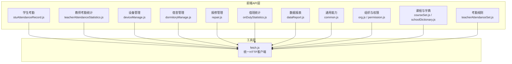

图表来源
- [src/api/schoolManage/stuAttendanceRecord.js:1-111](file://src/api/schoolManage/stuAttendanceRecord.js#L1-L111)
- [src/api/schoolManage/teacherAttendanceStatistics.js:1-248](file://src/api/schoolManage/teacherAttendanceStatistics.js#L1-L248)
- [src/api/systemSet/deviceManage.js:1-189](file://src/api/systemSet/deviceManage.js#L1-L189)
- [src/api/dormitoryManage.js:1-397](file://src/api/dormitoryManage.js#L1-L397)
- [src/api/schoolManage/repair.js:1-19](file://src/api/schoolManage/repair.js#L1-L19)
- [src/api/schoolManage/onDutyStatistics.js:1-52](file://src/api/schoolManage/onDutyStatistics.js#L1-L52)
- [src/api/systemSet/dataReport.js:1-26](file://src/api/systemSet/dataReport.js#L1-L26)
- [src/api/common/common.js:1-459](file://src/api/common/common.js#L1-L459)
- [src/api/systemSet/org.js:1-800](file://src/api/systemSet/org.js#L1-L800)
- [src/api/systemSet/permission.js:1-40](file://src/api/systemSet/permission.js#L1-L40)
- [src/api/systemSet/schoolDictionary.js:1-188](file://src/api/systemSet/schoolDictionary.js#L1-L188)
- [src/api/systemSet/courseSet.js:1-217](file://src/api/systemSet/courseSet.js#L1-L217)
- [src/api/systemSet/teacherAttendanceSet.js:1-288](file://src/api/systemSet/teacherAttendanceSet.js#L1-L288)
- [src/utils/fetch.js:1-240](file://src/utils/fetch.js#L1-L240)

章节来源
- [src/utils/fetch.js:1-240](file://src/utils/fetch.js#L1-L240)

## 核心组件
- HTTP客户端与拦截器
  - 自动注入token与签名参数
  - 支持多BaseURL（如系统中心、成长档案、客户端等）
  - 统一错误码映射与提示
- 学生考勤
  - 按班级/年级/日期查询统计、明细、汇总
- 教师考勤
  - 当日/时段分析、类型分析、汇总、补签
- 设备管理
  - 设备增删改查、设备用户同步、提醒、库房检索
- 宿舍管理
  - 楼栋、房间、学生入住、进出记录、预警设置
- 报修管理
  - 报修列表分页查询
- 值班统计
  - 上报记录新增、按日期统计、登记列表
- 数据报表
  - 初始化设置读取与更新
- 通用能力
  - 字典、课程、用户、部门、学期等通用查询
- 组织与权限
  - 部门树、用户分页、角色与模块、权限查询
- 课程与字典
  - 课程增删改查、平台课程导入、学校课程设置
- 考勤规则
  - 规则增删改查、生效、用户维护、地点维护、推送设置

章节来源
- [src/utils/fetch.js:1-240](file://src/utils/fetch.js#L1-L240)
- [src/api/schoolManage/stuAttendanceRecord.js:1-111](file://src/api/schoolManage/stuAttendanceRecord.js#L1-L111)
- [src/api/schoolManage/teacherAttendanceStatistics.js:1-248](file://src/api/schoolManage/teacherAttendanceStatistics.js#L1-L248)
- [src/api/systemSet/deviceManage.js:1-189](file://src/api/systemSet/deviceManage.js#L1-L189)
- [src/api/dormitoryManage.js:1-397](file://src/api/dormitoryManage.js#L1-L397)
- [src/api/schoolManage/repair.js:1-19](file://src/api/schoolManage/repair.js#L1-L19)
- [src/api/schoolManage/onDutyStatistics.js:1-52](file://src/api/schoolManage/onDutyStatistics.js#L1-L52)
- [src/api/systemSet/dataReport.js:1-26](file://src/api/systemSet/dataReport.js#L1-L26)
- [src/api/common/common.js:1-459](file://src/api/common/common.js#L1-L459)
- [src/api/systemSet/org.js:1-800](file://src/api/systemSet/org.js#L1-L800)
- [src/api/systemSet/permission.js:1-40](file://src/api/systemSet/permission.js#L1-L40)
- [src/api/systemSet/schoolDictionary.js:1-188](file://src/api/systemSet/schoolDictionary.js#L1-L188)
- [src/api/systemSet/courseSet.js:1-217](file://src/api/systemSet/courseSet.js#L1-L217)
- [src/api/systemSet/teacherAttendanceSet.js:1-288](file://src/api/systemSet/teacherAttendanceSet.js#L1-L288)

## 架构总览
- 前端通过各业务API模块调用后端服务
- 统一由fetch.js封装HTTP请求，自动处理：
  - 参数序列化（URLSearchParams或JSON）
  - token与签名注入
  - 多BaseURL路由（系统中心、成长档案、客户端、接口等）
  - 响应拦截与错误码处理

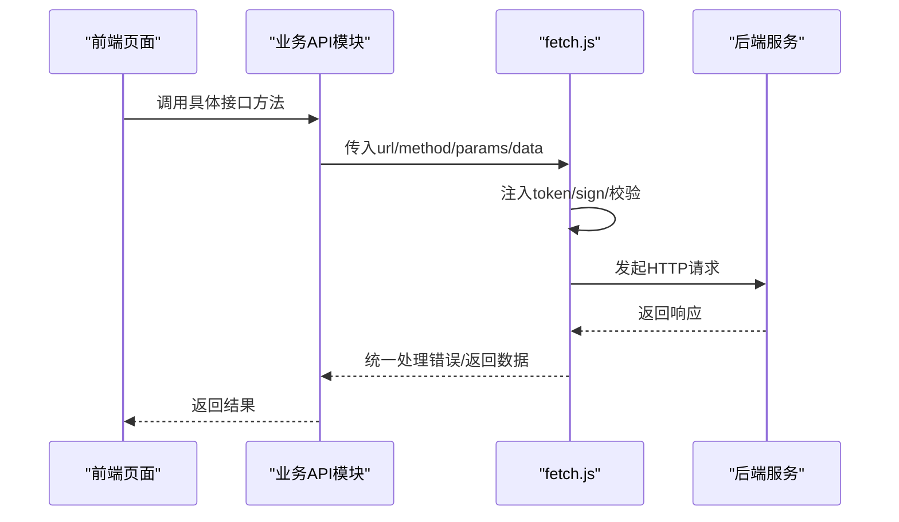

图表来源
- [src/utils/fetch.js:1-240](file://src/utils/fetch.js#L1-L240)
- [src/api/schoolManage/stuAttendanceRecord.js:1-111](file://src/api/schoolManage/stuAttendanceRecord.js#L1-L111)
- [src/api/systemSet/deviceManage.js:1-189](file://src/api/systemSet/deviceManage.js#L1-L189)

## 详细组件分析

### 学生考勤接口
- 接口概览
  - 统计按班级/年级/日期
  - 查询所教学班级
  - 获取年级/班级列表
  - 学生考勤明细
  - 统计汇总
- 典型流程（统计汇总）
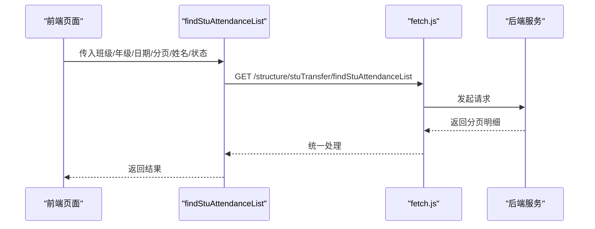

图表来源
- [src/api/schoolManage/stuAttendanceRecord.js:76-90](file://src/api/schoolManage/stuAttendanceRecord.js#L76-L90)

章节来源
- [src/api/schoolManage/stuAttendanceRecord.js:1-111](file://src/api/schoolManage/stuAttendanceRecord.js#L1-L111)

### 教师考勤统计接口
- 接口概览
  - 当日统计、时段统计、类型分析、用户维度汇总
  - 根据用户与类型查询记录、补签
  - 外出申请、加班统计、闸机异常统计
- 典型流程（类型分析）
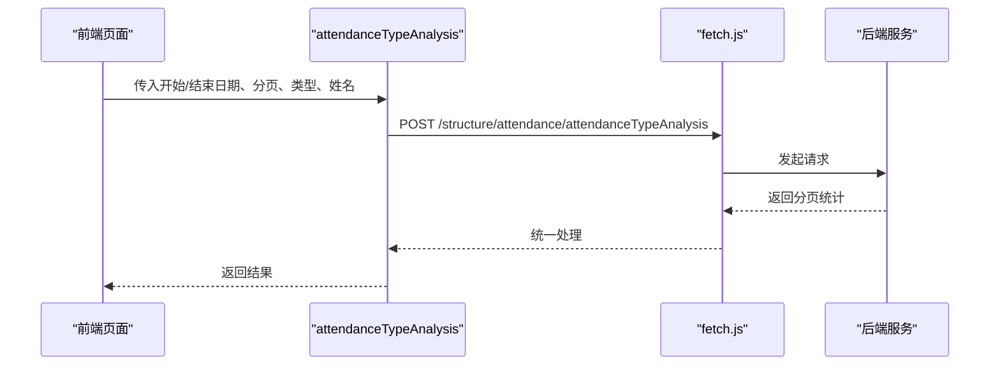

图表来源
- [src/api/schoolManage/teacherAttendanceStatistics.js:109-123](file://src/api/schoolManage/teacherAttendanceStatistics.js#L109-L123)

章节来源
- [src/api/schoolManage/teacherAttendanceStatistics.js:1-248](file://src/api/schoolManage/teacherAttendanceStatistics.js#L1-L248)

### 设备管理接口
- 接口概览
  - 查询全部设备、新增/编辑设备
  - 批量删除设备
  - 设备用户查询、新增、按部门批量新增、删除
  - 同步设备用户、提醒未上传照片用户
  - 设备库房检索
- 典型流程（同步设备用户）
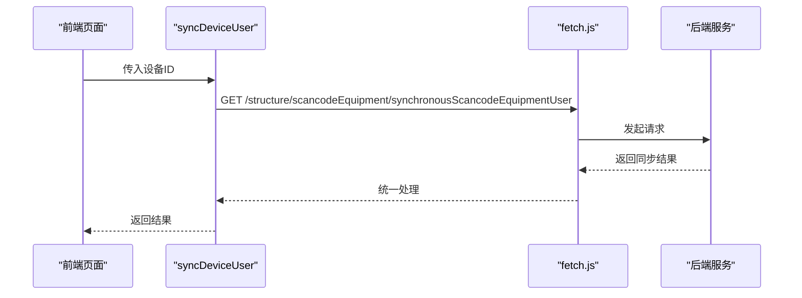

图表来源
- [src/api/systemSet/deviceManage.js:125-134](file://src/api/systemSet/deviceManage.js#L125-L134)

章节来源
- [src/api/systemSet/deviceManage.js:1-189](file://src/api/systemSet/deviceManage.js#L1-L189)

### 宿舍管理接口
- 接口概览
  - 楼栋：新增/编辑/删除/列表/详情/负责列表
  - 房间：按楼/楼层/班级查询、新增/编辑/删除、详情
  - 学生：按宿舍查询、新增/删除、重置、查询学生宿舍信息
  - 出入记录：按条件分页查询
  - 预警设置：查询/保存
- 典型流程（学生入住）
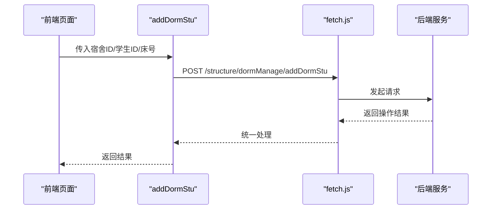

图表来源
- [src/api/dormitoryManage.js:271-283](file://src/api/dormitoryManage.js#L271-L283)

章节来源
- [src/api/dormitoryManage.js:1-397](file://src/api/dormitoryManage.js#L1-L397)

### 报修管理接口
- 接口概览
  - 报修列表分页查询（标题、起止时间）
- 典型流程（报修列表）
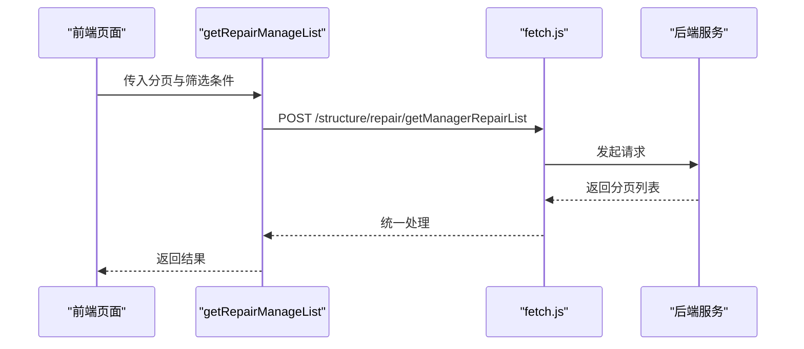

图表来源
- [src/api/schoolManage/repair.js:4-16](file://src/api/schoolManage/repair.js#L4-L16)

章节来源
- [src/api/schoolManage/repair.js:1-19](file://src/api/schoolManage/repair.js#L1-L19)

### 值班统计接口
- 接口概览
  - 新增上报记录（JSON）
  - 按日期查询统计
  - 按日期/类型/姓名查询登记列表
- 典型流程（新增上报记录）
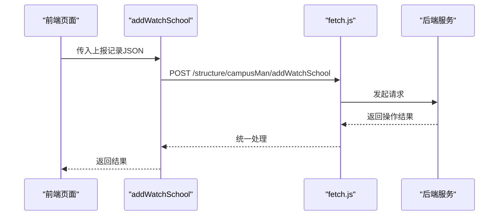

图表来源
- [src/api/schoolManage/onDutyStatistics.js:7-17](file://src/api/schoolManage/onDutyStatistics.js#L7-L17)

章节来源
- [src/api/schoolManage/onDutyStatistics.js:1-52](file://src/api/schoolManage/onDutyStatistics.js#L1-L52)

### 数据报表接口
- 接口概览
  - 查询数据报告初始化设置
  - 新增/修改初始化设置（JSON）
- 典型流程（初始化设置）
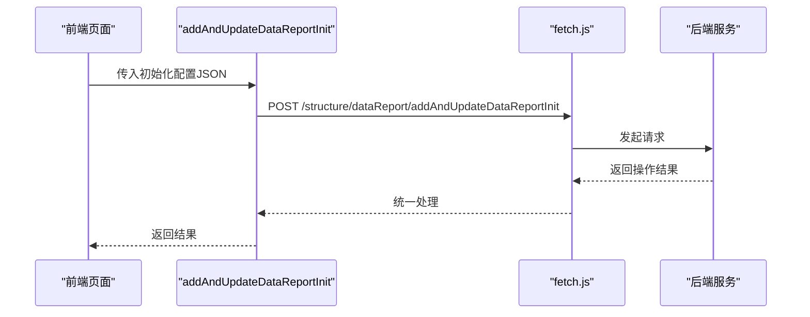

图表来源
- [src/api/systemSet/dataReport.js:16-25](file://src/api/systemSet/dataReport.js#L16-L25)

章节来源
- [src/api/systemSet/dataReport.js:1-26](file://src/api/systemSet/dataReport.js#L1-L26)

### 通用能力接口
- 接口概览
  - 字典：按code查询学校/系统字典、子字典、详情
  - 课程：查询课程、选择课程、详情
  - 用户：按ID查询学生/家长、按班级查询学生列表
  - 部门：查询年级/班级列表、负责人、部门树
  - 学期：获取当前学期周信息
- 典型流程（查询年级/班级列表）
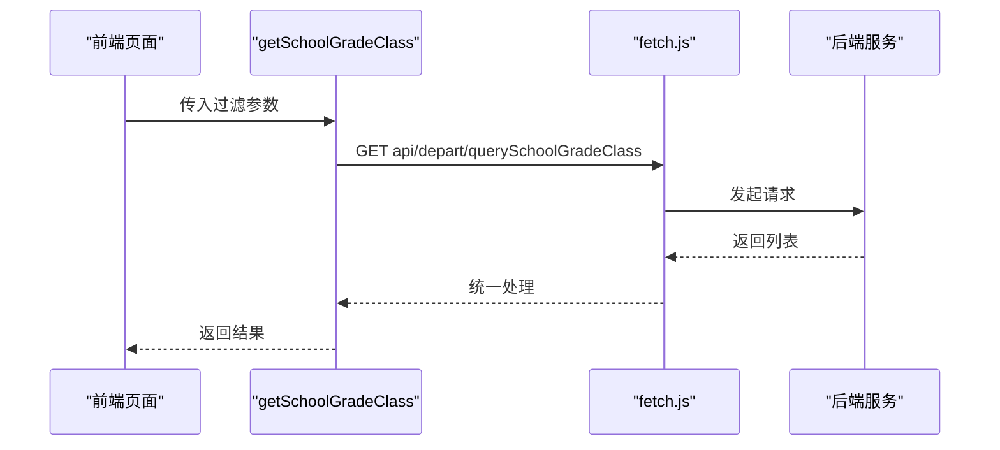

图表来源
- [src/api/common/common.js:215-226](file://src/api/common/common.js#L215-L226)

章节来源
- [src/api/common/common.js:1-459](file://src/api/common/common.js#L1-L459)

### 组织与权限接口
- 接口概览
  - 部门：树形查询、分页用户列表、新增/更新/删除、详情、负责人、其他负责人
  - 用户：详情、自身详情、启用/禁用、移动/删除、重置密码
  - 角色：角色列表、按用户查询角色与模块
  - 权限：用户权限、子权限
- 典型流程（查询用户权限）
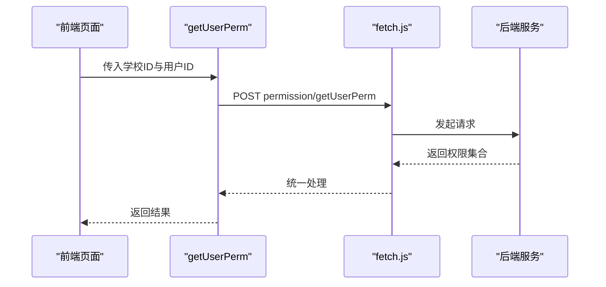

图表来源
- [src/api/systemSet/permission.js:15-25](file://src/api/systemSet/permission.js#L15-L25)

章节来源
- [src/api/systemSet/org.js:1-800](file://src/api/systemSet/org.js#L1-L800)
- [src/api/systemSet/permission.js:1-40](file://src/api/systemSet/permission.js#L1-L40)

### 课程与字典接口
- 接口概览
  - 课程：列表、选择列表、新增/编辑/删除、详情、平台课程导入、学校课程增删改
  - 字典：类型/项/值的增删改查、分页列表
- 典型流程（平台课程导入）
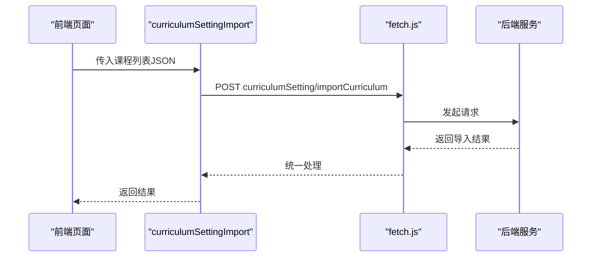

图表来源
- [src/api/systemSet/courseSet.js:157-169](file://src/api/systemSet/courseSet.js#L157-L169)

章节来源
- [src/api/systemSet/schoolDictionary.js:1-188](file://src/api/systemSet/schoolDictionary.js#L1-L188)
- [src/api/systemSet/courseSet.js:1-217](file://src/api/systemSet/courseSet.js#L1-L217)

### 考勤规则接口
- 接口概览
  - 规则：列表、新增/编辑/删除、详情、立即生效
  - 用户：按规则查询用户、添加/移除、立即生效
  - 地点：列表、新增/编辑/删除、详情
  - 设置：获取/保存推送与设备设置
- 典型流程（编辑考勤规则）
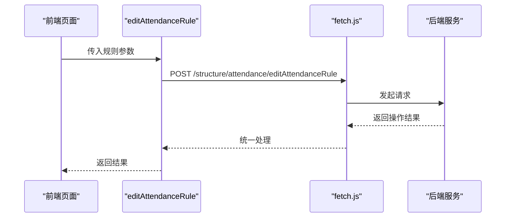

图表来源
- [src/api/systemSet/teacherAttendanceSet.js:62-87](file://src/api/systemSet/teacherAttendanceSet.js#L62-L87)

章节来源
- [src/api/systemSet/teacherAttendanceSet.js:1-288](file://src/api/systemSet/teacherAttendanceSet.js#L1-L288)

## 依赖关系分析
- 组件耦合
  - 所有业务API均依赖统一HTTP客户端（fetch.js），保证一致性与可维护性
  - 通用能力（common.js）与组织权限（org.js/permission.js）为上层模块提供基础数据支撑
- 外部依赖
  - 多BaseURL适配不同业务域（系统中心、成长档案、客户端、接口等）
  - Cookie中Admin-Token用于鉴权，部分接口自动注入sign参数

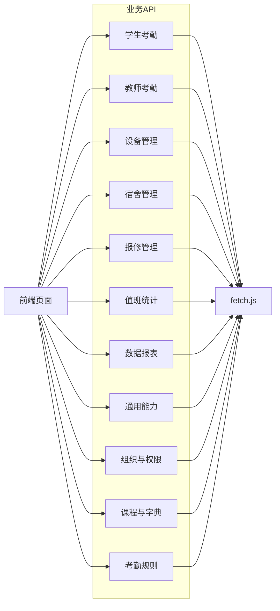

图表来源
- [src/utils/fetch.js:1-240](file://src/utils/fetch.js#L1-L240)
- [src/api/schoolManage/stuAttendanceRecord.js:1-111](file://src/api/schoolManage/stuAttendanceRecord.js#L1-L111)
- [src/api/schoolManage/teacherAttendanceStatistics.js:1-248](file://src/api/schoolManage/teacherAttendanceStatistics.js#L1-L248)
- [src/api/systemSet/deviceManage.js:1-189](file://src/api/systemSet/deviceManage.js#L1-L189)
- [src/api/dormitoryManage.js:1-397](file://src/api/dormitoryManage.js#L1-L397)
- [src/api/schoolManage/repair.js:1-19](file://src/api/schoolManage/repair.js#L1-L19)
- [src/api/schoolManage/onDutyStatistics.js:1-52](file://src/api/schoolManage/onDutyStatistics.js#L1-L52)
- [src/api/systemSet/dataReport.js:1-26](file://src/api/systemSet/dataReport.js#L1-L26)
- [src/api/common/common.js:1-459](file://src/api/common/common.js#L1-L459)
- [src/api/systemSet/org.js:1-800](file://src/api/systemSet/org.js#L1-L800)
- [src/api/systemSet/permission.js:1-40](file://src/api/systemSet/permission.js#L1-L40)
- [src/api/systemSet/schoolDictionary.js:1-188](file://src/api/systemSet/schoolDictionary.js#L1-L188)
- [src/api/systemSet/courseSet.js:1-217](file://src/api/systemSet/courseSet.js#L1-L217)
- [src/api/systemSet/teacherAttendanceSet.js:1-288](file://src/api/systemSet/teacherAttendanceSet.js#L1-L288)

## 性能与安全考量
- 性能
  - 使用URLSearchParams进行参数序列化，避免重复构造
  - 对大对象使用JSON传输时显式设置content-type
  - 部分接口支持分页参数，建议前端合理设置分页大小
- 安全
  - 自动注入token与sign参数，敏感接口默认携带
  - 对特定接口白名单放行（无需token），其余接口统一鉴权
  - 错误码统一拦截，避免敏感信息泄露

章节来源
- [src/utils/fetch.js:1-240](file://src/utils/fetch.js#L1-L240)

## 故障排查指南
- 常见问题
  - 登录过期：响应码1000触发登出与跳转
  - 参数缺失：检查是否正确传入必填参数（如token、sign）
  - 跨域/网络：确认BaseURL与环境配置一致
- 排查步骤
  - 查看控制台网络请求与响应
  - 核对请求头content-type与body格式
  - 确认接口是否在无token白名单中
- 相关接口
  - 统一错误处理与消息提示
  - 特定接口（如设备同步）设置较长超时

章节来源
- [src/utils/fetch.js:104-169](file://src/utils/fetch.js#L104-L169)

## 结论
本API文档系统梳理了校园管理核心业务域的接口规范，明确了调用方式、参数约定与错误处理策略。通过统一HTTP客户端与多BaseURL适配，确保跨域与多业务场景的稳定接入。建议在实际集成中遵循分页、鉴权与签名规范，并结合本文档的流程图与接口清单进行联调测试。

## 附录
- 统一HTTP客户端能力
  - 多BaseURL：系统中心、成长档案、客户端、接口等
  - 参数处理：自动转换为URLSearchParams或JSON
  - 鉴权与签名：自动注入token与sign
  - 错误处理：统一拦截与提示
- 业务接口清单（节选）
  - 学生考勤：统计、明细、汇总、班级/年级查询
  - 教师考勤：当日/时段/类型/用户维度统计、补签
  - 设备管理：设备与用户全生命周期管理
  - 宿舍管理：楼栋/房间/学生/出入/预警
  - 报修管理：报修列表
  - 值班统计：上报记录与登记列表
  - 数据报表：初始化设置
  - 通用能力：字典、课程、用户、部门、学期
  - 组织与权限：部门树、用户管理、角色与权限
  - 课程与字典：平台与学校课程、字典增删改查
  - 考勤规则：规则、用户、地点、设置

章节来源
- [src/utils/fetch.js:1-240](file://src/utils/fetch.js#L1-L240)
- [src/api/schoolManage/stuAttendanceRecord.js:1-111](file://src/api/schoolManage/stuAttendanceRecord.js#L1-L111)
- [src/api/schoolManage/teacherAttendanceStatistics.js:1-248](file://src/api/schoolManage/teacherAttendanceStatistics.js#L1-L248)
- [src/api/systemSet/deviceManage.js:1-189](file://src/api/systemSet/deviceManage.js#L1-L189)
- [src/api/dormitoryManage.js:1-397](file://src/api/dormitoryManage.js#L1-L397)
- [src/api/schoolManage/repair.js:1-19](file://src/api/schoolManage/repair.js#L1-L19)
- [src/api/schoolManage/onDutyStatistics.js:1-52](file://src/api/schoolManage/onDutyStatistics.js#L1-L52)
- [src/api/systemSet/dataReport.js:1-26](file://src/api/systemSet/dataReport.js#L1-L26)
- [src/api/common/common.js:1-459](file://src/api/common/common.js#L1-L459)
- [src/api/systemSet/org.js:1-800](file://src/api/systemSet/org.js#L1-L800)
- [src/api/systemSet/permission.js:1-40](file://src/api/systemSet/permission.js#L1-L40)
- [src/api/systemSet/schoolDictionary.js:1-188](file://src/api/systemSet/schoolDictionary.js#L1-L188)
- [src/api/systemSet/courseSet.js:1-217](file://src/api/systemSet/courseSet.js#L1-L217)
- [src/api/systemSet/teacherAttendanceSet.js:1-288](file://src/api/systemSet/teacherAttendanceSet.js#L1-L288)