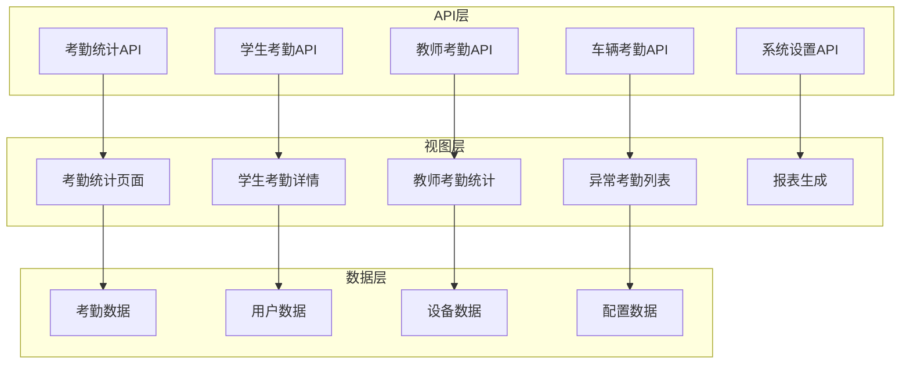
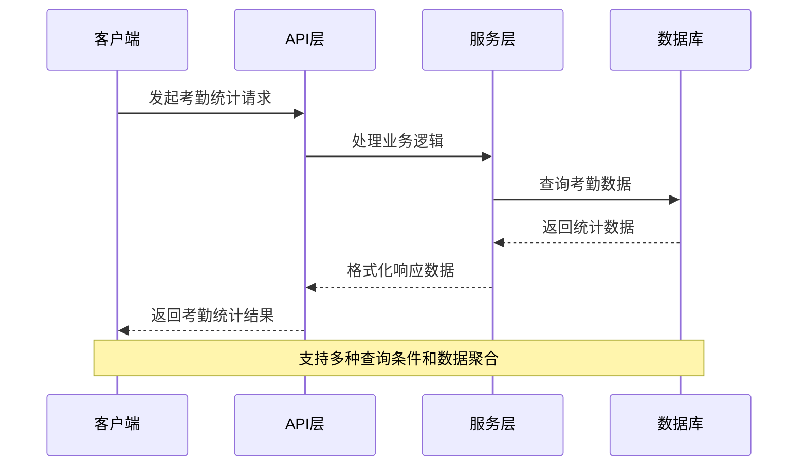
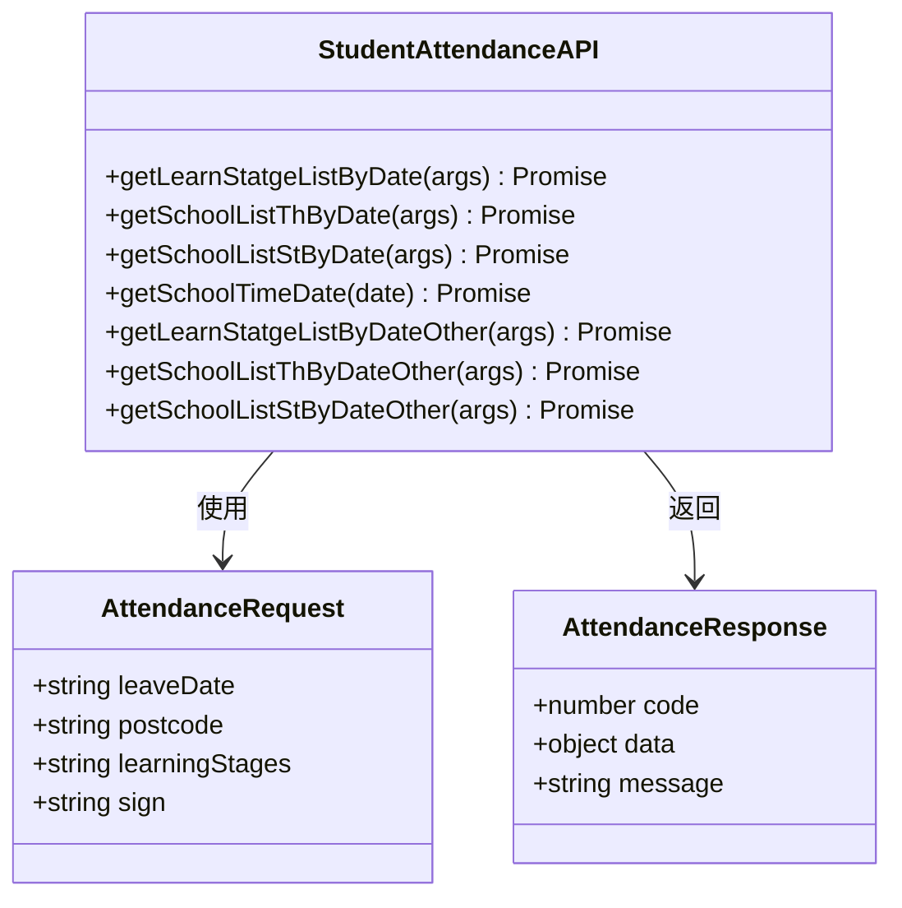
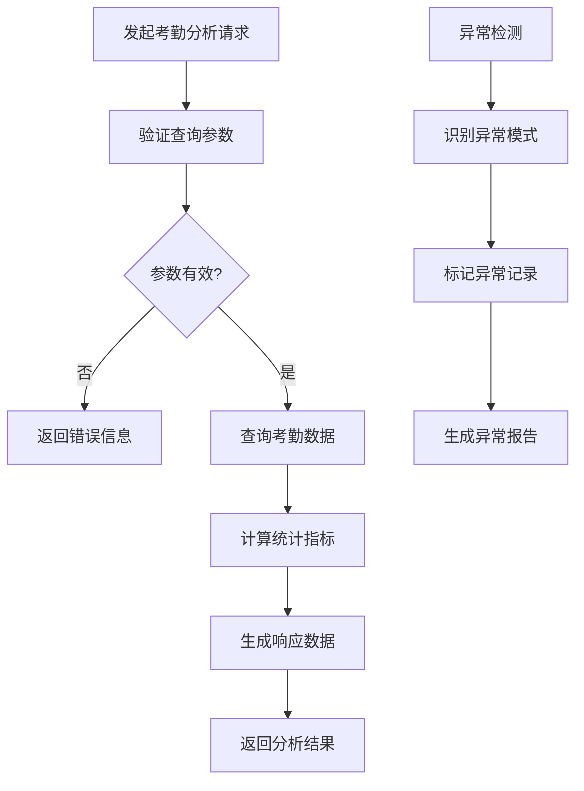
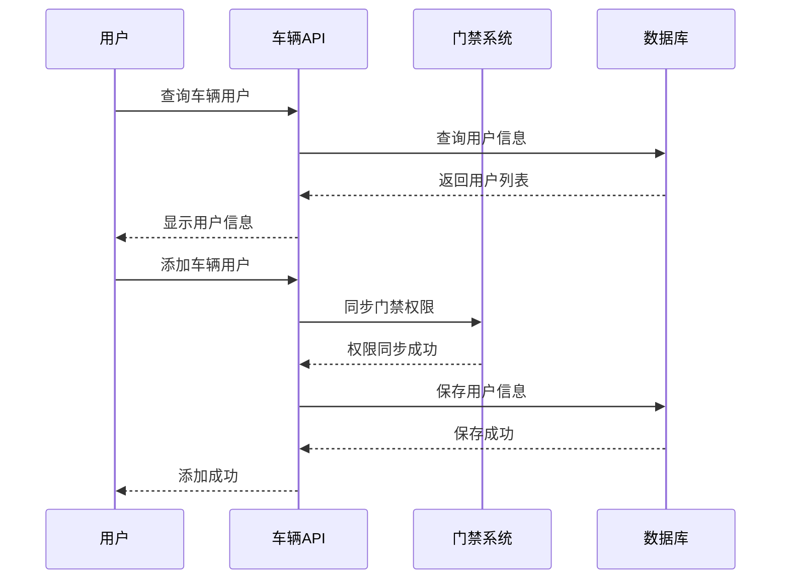
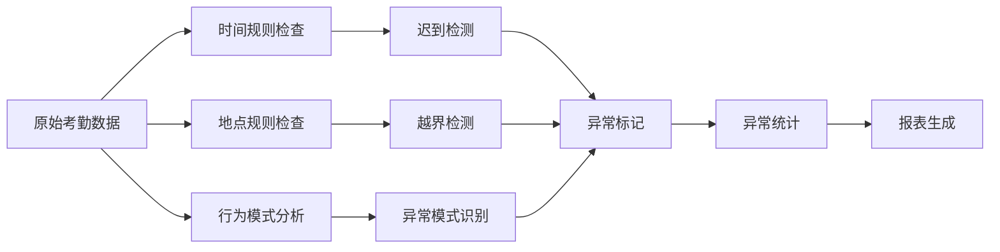
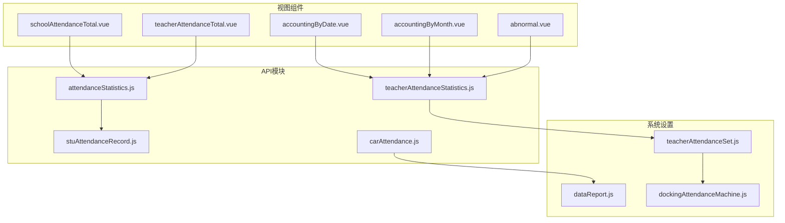
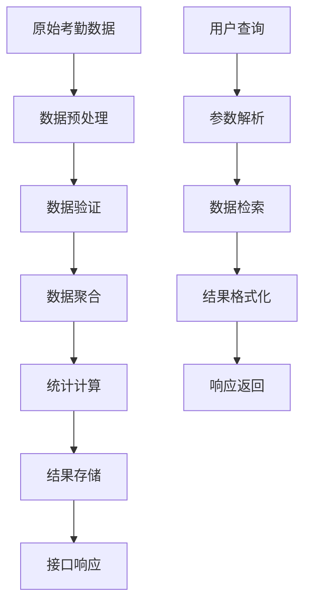
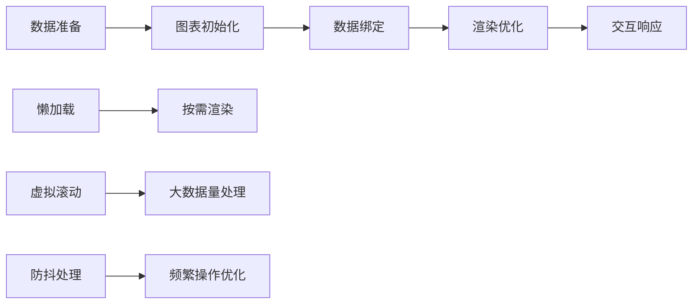

# 考勤统计API

<cite>
**本文档引用的文件**
- [attendanceStatistics.js](file://src/api/attendanceStatistics.js)
- [stuAttendanceRecord.js](file://src/api/schoolManage/stuAttendanceRecord.js)
- [teacherAttendanceStatistics.js](file://src/api/schoolManage/teacherAttendanceStatistics.js)
- [carAttendance.js](file://src/api/carAttendance.js)
- [teacherAttendanceSet.js](file://src/api/systemSet/teacherAttendanceSet.js)
- [dataReport.js](file://src/api/systemSet/dataReport.js)
- [dockingAttendanceMachine.js](file://src/api/systemSet/dockingAttendanceMachine.js)
- [schoolAttendanceDetail.vue](file://src/views/attendanceStatistics/schoolAttendanceDetail.vue)
- [schoolAttendanceTotal.vue](file://src/views/attendanceStatistics/schoolAttendanceTotal.vue)
- [teacherAttendanceTotal.vue](file://src/views/attendanceStatistics/teacherAttendanceTotal.vue)
- [accountingByDate.vue](file://src/views/attenAccounting/accountingByDate.vue)
- [accountingByMonth.vue](file://src/views/attenAccounting/accountingByMonth.vue)
- [abnormal.vue](file://src/views/attenAccounting/abnormal.vue)
- [abnormallist.vue](file://src/views/attenAccounting/abnormallist.vue)
</cite>

## 目录
1. [简介](#简介)
2. [项目结构](#项目结构)
3. [核心组件](#核心组件)
4. [架构概览](#架构概览)
5. [详细组件分析](#详细组件分析)
6. [依赖关系分析](#依赖关系分析)
7. [性能考虑](#性能考虑)
8. [故障排除指南](#故障排除指南)
9. [结论](#结论)

## 简介

本项目提供了完整的考勤统计相关API，涵盖学生考勤统计、教师考勤分析、车辆考勤管理等功能模块。系统支持多维度的考勤数据汇总、异常统计、报表生成、趋势分析等核心功能，并提供灵活的时间范围查询和数据聚合算法。

主要功能特性包括：
- 学生考勤统计：按学校、年级、班级维度的数据汇总
- 教师考勤分析：实时考勤状态监控和历史数据分析
- 车辆考勤管理：校园车辆出入管理和统计分析
- 异常考勤检测：自动识别和统计异常考勤情况
- 报表生成：支持Excel导出和图表展示
- 趋势分析：月度、年度数据趋势分析

## 项目结构

项目采用模块化的架构设计，主要分为以下几个核心模块：

**图表来源**
- [attendanceStatistics.js:1-100](file://src/api/attendanceStatistics.js#L1-L100)
- [teacherAttendanceStatistics.js:1-248](file://src/api/schoolManage/teacherAttendanceStatistics.js#L1-L248)

**章节来源**
- [attendanceStatistics.js:1-100](file://src/api/attendanceStatistics.js#L1-L100)
- [teacherAttendanceStatistics.js:1-248](file://src/api/schoolManage/teacherAttendanceStatistics.js#L1-L248)

## 核心组件

### 考勤统计API模块

系统提供了三个主要的考勤统计API模块：

1. **基础考勤统计API** (`src/api/attendanceStatistics.js`)
   - 支持按日期查询请假统计
   - 提供学生和教师的考勤数据查询
   - 支持不同学段的考勤统计

2. **学生考勤记录API** (`src/api/schoolManage/stuAttendanceRecord.js`)
   - 学生考勤明细查询
   - 统计汇总功能
   - 班级和年级数据查询

3. **教师考勤统计API** (`src/api/schoolManage/teacherAttendanceStatistics.js`)
   - 实时考勤状态分析
   - 时间段考勤统计
   - 异常考勤检测

**章节来源**
- [attendanceStatistics.js:1-100](file://src/api/attendanceStatistics.js#L1-L100)
- [stuAttendanceRecord.js:1-111](file://src/api/schoolManage/stuAttendanceRecord.js#L1-L111)
- [teacherAttendanceStatistics.js:1-248](file://src/api/schoolManage/teacherAttendanceStatistics.js#L1-L248)

## 架构概览

系统采用前后端分离架构，通过API接口实现数据交互：

**图表来源**
- [schoolAttendanceTotal.vue:215-239](file://src/views/attendanceStatistics/schoolAttendanceTotal.vue#L215-L239)
- [teacherAttendanceTotal.vue:168-224](file://src/views/attendanceStatistics/teacherAttendanceTotal.vue#L168-L224)

系统架构特点：
- **模块化设计**：每个功能模块独立封装，便于维护和扩展
- **统一的数据格式**：所有API返回标准化的数据结构
- **灵活的查询条件**：支持多种筛选和排序方式
- **实时数据更新**：支持动态刷新和数据同步

## 详细组件分析

### 学生考勤统计模块

#### API接口规范

**图表来源**
- [attendanceStatistics.js:6-45](file://src/api/attendanceStatistics.js#L6-L45)

#### 数据统计维度

系统支持以下统计维度：
- **按学段统计**：小学、初中、高中、幼儿园
- **按年级统计**：每个学段的年级分布
- **按请假类型统计**：病假、事假、公假等
- **按班级统计**：具体班级的考勤情况

**章节来源**
- [schoolAttendanceDetail.vue:170-231](file://src/views/attendanceStatistics/schoolAttendanceDetail.vue#L170-L231)
- [schoolAttendanceTotal.vue:215-267](file://src/views/attendanceStatistics/schoolAttendanceTotal.vue#L215-L267)

### 教师考勤分析模块

#### 实时考勤监控

**图表来源**
- [accountingByDate.vue:229-291](file://src/views/attenAccounting/accountingByDate.vue#L229-L291)

#### 考勤类型分类

系统支持以下考勤类型的分析：
- **签到状态**：正常签到、迟到、未签到
- **签退状态**：正常签退、早退、未签退
- **请假状态**：各类请假类型的统计
- **外出状态**：公务外出和因私外出
- **加班状态**：工作时间和加班时间统计

**章节来源**
- [teacherAttendanceStatistics.js:74-123](file://src/api/schoolManage/teacherAttendanceStatistics.js#L74-L123)
- [accountingByMonth.vue:146-295](file://src/views/attenAccounting/accountingByMonth.vue#L146-L295)

### 车辆考勤管理模块

#### 车辆出入管理

**图表来源**
- [carAttendance.js:16-35](file://src/api/carAttendance.js#L16-L35)

**章节来源**
- [carAttendance.js:1-114](file://src/api/carAttendance.js#L1-L114)

### 异常考勤检测模块

#### 异常识别算法

系统采用多维度的异常检测机制：

**图表来源**
- [abnormal.vue:154-173](file://src/views/attenAccounting/abnormal.vue#L154-L173)

**章节来源**
- [abnormal.vue:1-196](file://src/views/attenAccounting/abnormal.vue#L1-L196)
- [abnormallist.vue:1-200](file://src/views/attenAccounting/abnormallist.vue#L1-L200)

## 依赖关系分析

### API依赖关系

**图表来源**
- [schoolAttendanceTotal.vue:80-81](file://src/views/attendanceStatistics/schoolAttendanceTotal.vue#L80-L81)
- [teacherAttendanceTotal.vue:114-115](file://src/views/attendanceStatistics/teacherAttendanceTotal.vue#L114-L115)

### 数据流分析

系统采用分层的数据处理架构：

**图表来源**
- [stuAttendanceRecord.js:95-110](file://src/api/schoolManage/stuAttendanceRecord.js#L95-L110)
- [teacherAttendanceStatistics.js:94-141](file://src/api/schoolManage/teacherAttendanceStatistics.js#L94-L141)

**章节来源**
- [stuAttendanceRecord.js:1-111](file://src/api/schoolManage/stuAttendanceRecord.js#L1-L111)
- [teacherAttendanceStatistics.js:1-248](file://src/api/schoolManage/teacherAttendanceStatistics.js#L1-L248)

## 性能考虑

### 数据查询优化

系统在数据查询方面采用了多项优化策略：

1. **分页查询**：所有列表查询都支持分页，避免大数据量查询
2. **缓存机制**：常用配置和静态数据采用缓存策略
3. **批量操作**：支持批量数据处理，减少网络请求次数
4. **异步加载**：大表格采用异步加载，提升用户体验

### 图表渲染优化

**图表来源**
- [accountingByMonth.vue:146-295](file://src/views/attenAccounting/accountingByMonth.vue#L146-L295)

## 故障排除指南

### 常见问题及解决方案

#### 数据查询失败

**问题描述**：考勤统计数据查询失败或返回空数据

**可能原因**：
- 查询时间范围不正确
- 用户权限不足
- 系统数据异常

**解决步骤**：
1. 检查查询参数是否完整
2. 验证用户权限设置
3. 确认系统数据状态

#### 图表显示异常

**问题描述**：考勤图表无法正常显示或显示错误

**解决方法**：
1. 检查浏览器兼容性
2. 刷新页面重新加载数据
3. 清除浏览器缓存

#### 导出功能异常

**问题描述**：Excel导出功能无法正常使用

**解决方案**：
1. 检查浏览器弹窗拦截设置
2. 确认文件大小限制
3. 尝试使用其他浏览器

**章节来源**
- [schoolAttendanceDetail.vue:170-231](file://src/views/attendanceStatistics/schoolAttendanceDetail.vue#L170-L231)
- [abnormal.vue:154-173](file://src/views/attenAccounting/abnormal.vue#L154-L173)

## 结论

本考勤统计系统提供了完整的考勤数据管理解决方案，具有以下优势：

1. **功能完整性**：涵盖学生、教师、车辆等多场景考勤管理
2. **数据准确性**：采用多维度数据验证和异常检测机制
3. **用户体验**：提供直观的图表展示和灵活的查询功能
4. **扩展性强**：模块化设计便于功能扩展和维护

系统通过标准化的API接口和统一的数据格式，为后续的功能扩展和系统集成奠定了良好的基础。建议在实际部署中重点关注数据安全和性能优化，确保系统的稳定运行。