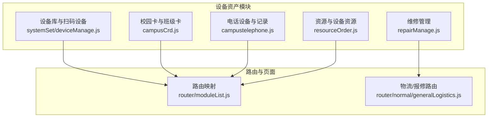
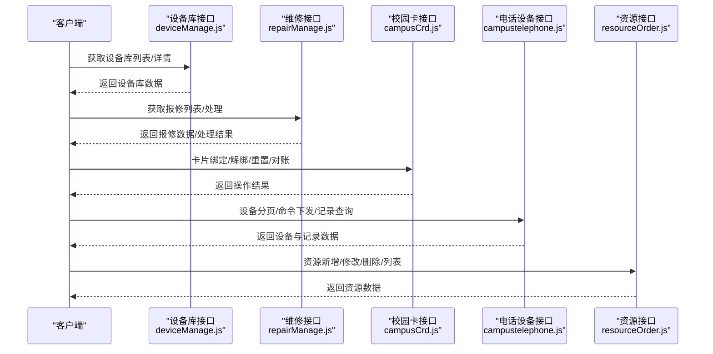
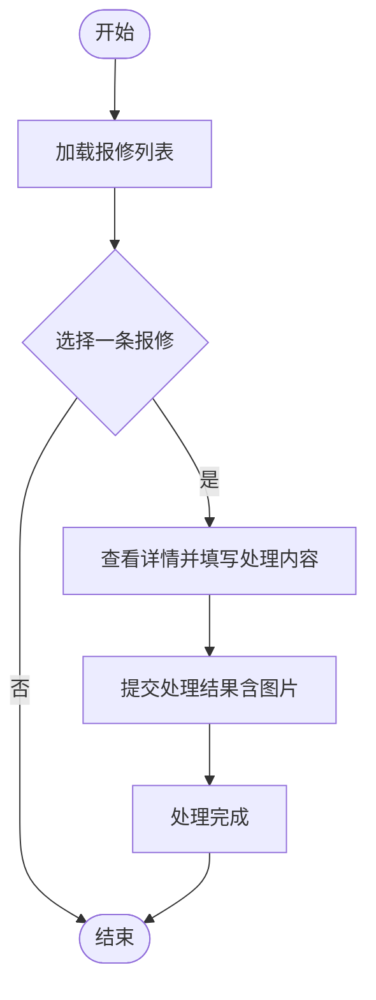
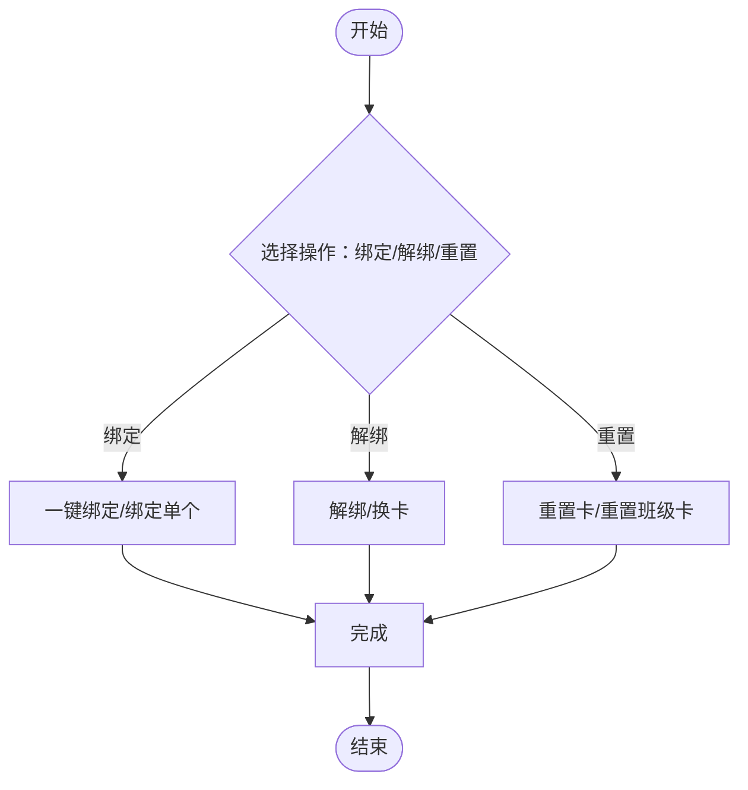
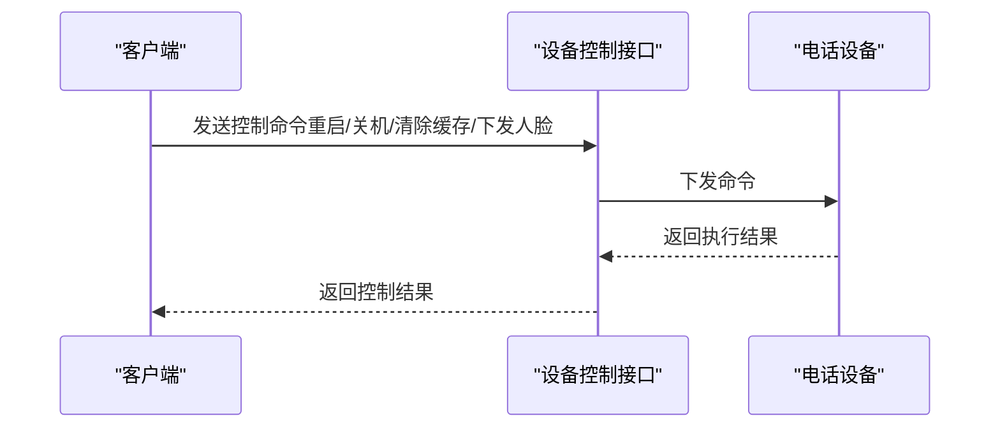
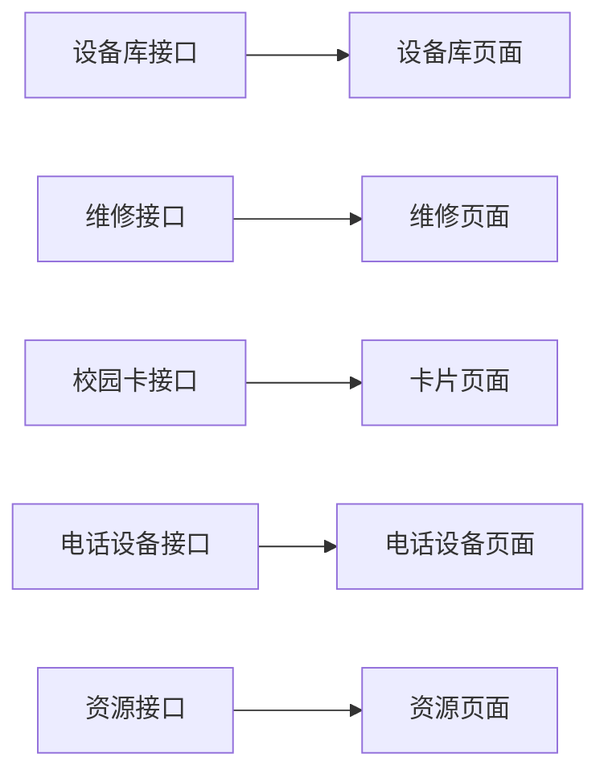

# 设备资产API

<cite>
**本文引用的文件**
- [src/api/systemSet/deviceManage.js](file://src/api/systemSet/deviceManage.js)
- [src/api/repairManage.js](file://src/api/repairManage.js)
- [src/api/campusCrd.js](file://src/api/campusCrd.js)
- [src/api/campustelephone.js](file://src/api/campustelephone.js)
- [src/api/resourceOrder.js](file://src/api/resourceOrder.js)
- [src/router/moduleList.js](file://src/router/moduleList.js)
- [src/router/normal/generalLogistics.js](file://src/router/normal/generalLogistics.js)
</cite>

## 目录
1. [简介](#简介)
2. [项目结构](#项目结构)
3. [核心组件](#核心组件)
4. [架构总览](#架构总览)
5. [详细组件分析](#详细组件分析)
6. [依赖关系分析](#依赖关系分析)
7. [性能考量](#性能考量)
8. [故障排查指南](#故障排查指南)
9. [结论](#结论)
10. [附录](#附录)

## 简介
本文件面向设备资产相关业务的前后端对接，覆盖设备库管理、维修管理、校园卡管理与卡片绑定统计、卡片交易与消费记录等接口规范。文档基于仓库中现有的API实现进行整理，明确各模块职责、请求方式、参数与返回要点，并通过图示展示关键流程，帮助开发者快速理解与集成。

## 项目结构
围绕设备资产相关功能，前端在以下API文件中定义了统一的HTTP调用封装与业务接口：
- 设备库与扫码设备管理：systemSet/deviceManage.js
- 维修管理：repairManage.js
- 校园卡与班级卡管理：campusCrd.js
- 电话类设备管理与通话/充值记录：campustelephone.js
- 资源与设备资源管理（含设备序列号与JSON配置）：resourceOrder.js
- 路由映射（用于定位页面与权限路径）：router/moduleList.js、router/normal/generalLogistics.js

图表来源
- [src/api/systemSet/deviceManage.js](file://src/api/systemSet/deviceManage.js)
- [src/api/repairManage.js](file://src/api/repairManage.js)
- [src/api/campusCrd.js](file://src/api/campusCrd.js)
- [src/api/campustelephone.js](file://src/api/campustelephone.js)
- [src/api/resourceOrder.js](file://src/api/resourceOrder.js)
- [src/router/moduleList.js](file://src/router/moduleList.js)
- [src/router/normal/generalLogistics.js](file://src/router/normal/generalLogistics.js)

章节来源
- [src/api/systemSet/deviceManage.js](file://src/api/systemSet/deviceManage.js)
- [src/api/repairManage.js](file://src/api/repairManage.js)
- [src/api/campusCrd.js](file://src/api/campusCrd.js)
- [src/api/campustelephone.js](file://src/api/campustelephone.js)
- [src/api/resourceOrder.js](file://src/api/resourceOrder.js)
- [src/router/moduleList.js](file://src/router/moduleList.js)
- [src/router/normal/generalLogistics.js](file://src/router/normal/generalLogistics.js)

## 核心组件
- 设备库与扫码设备管理：提供设备全量查询、新增、编辑、批量删除、设备用户查询与同步、提醒、设备库列表与详情等能力。
- 维修管理：提供报修列表、用户报修列表、管理员处理列表、报修类型与地点的增删改查、处理结果提交、处理人列表等。
- 校园卡与班级卡：提供卡列表查询、新增卡、卡信息查询、解绑、一键绑定/解绑、重置卡、来源设置、订单状态查询、对账、换卡等；同时支持班级卡模板与静态卡管理。
- 电话设备与记录：提供用户与设备分页查询、命令下发与记录、通话/充值记录、设备控制（重启/关机/清除缓存/下发人脸）、设备信息查询与删除。
- 资源与设备资源：提供资源新增/修改/删除、资源详情、资源列表、设备序列号与JSON配置字段等。

章节来源
- [src/api/systemSet/deviceManage.js](file://src/api/systemSet/deviceManage.js)
- [src/api/repairManage.js](file://src/api/repairManage.js)
- [src/api/campusCrd.js](file://src/api/campusCrd.js)
- [src/api/campustelephone.js](file://src/api/campustelephone.js)
- [src/api/resourceOrder.js](file://src/api/resourceOrder.js)

## 架构总览
前端通过统一的HTTP封装发起请求，后端按模块提供REST风格接口。设备资产相关接口主要集中在“structure”命名空间下，部分校园卡与班级卡相关接口使用“structure/campusCard”、“structure/classCardManage”等前缀。

图表来源
- [src/api/systemSet/deviceManage.js](file://src/api/systemSet/deviceManage.js)
- [src/api/repairManage.js](file://src/api/repairManage.js)
- [src/api/campusCrd.js](file://src/api/campusCrd.js)
- [src/api/campustelephone.js](file://src/api/campustelephone.js)
- [src/api/resourceOrder.js](file://src/api/resourceOrder.js)

## 详细组件分析

### 设备库与扫码设备管理
- 接口职责
  - 查询全部设备列表
  - 新增/编辑扫码设备
  - 批量删除设备
  - 设备用户查询与同步
  - 提醒未上传照片的设备用户
  - 设备库列表与详情查询
  - 晨检设备初始化（AI诺达）

- 关键接口与参数
  - 获取全部设备列表：GET structure/scancodeEquipment/getAllScancodeEquipmentList
  - 新增设备：POST structure/scancodeEquipment/addScancodeEquipment（JSON体）
  - 编辑设备：POST structure/scancodeEquipment/editScancodeEquipment（JSON体）
  - 批量删除：POST structure/scancodeEquipment/batchDeleteScancodeEquipment（表单）
  - 查询设备用户：POST structure/scancodeEquipment/getScancodeEquipmentUser（分页+筛选）
  - 新增设备用户：POST structure/scancodeEquipment/addScancodeEquipmentUser（JSON体）
  - 同步设备用户：GET structure/scancodeEquipment/synchronousScancodeEquipmentUser（表单）
  - 提醒未上传照片：GET structure/scancodeEquipment/remindScancodeEquipmentUser（表单）
  - 设备库列表：GET structure/scancodeEquipment/getEquipmentLibraryList（筛选项）
  - 设备库详情：GET structure/scancodeEquipment/getEquipmentLibrary（筛选项）
  - 晨检初始化：GET common/aiNuoDa/morningCheckInit（超时600000ms）

- 数据模型与复杂度
  - 列表查询通常为O(n)扫描与过滤；分页参数控制时间复杂度与内存占用。
  - 同步用户与提醒接口为轻量级网络请求，复杂度近似O(1)。

- 错误处理与边界
  - 批量删除需确保ids格式正确；同步用户需提供设备ID。
  - 晨检初始化接口设置了较长超时，注意服务端响应时间与网络稳定性。

章节来源
- [src/api/systemSet/deviceManage.js](file://src/api/systemSet/deviceManage.js)

### 维修管理
- 接口职责
  - 报修列表与用户报修列表
  - 管理员处理列表与筛选
  - 报修详情与处理结果提交
  - 报修类型与地点的增删改查
  - 报修类型树结构与上级类型查询
  - 处理人列表与全量报修列表

- 关键接口与参数
  - 获取报修列表：POST structure/repair/getManagerRepairList（分页+筛选）
  - 获取用户报修列表：POST structure/repair/getUserRepairList（分页）
  - 获取所有报修列表：POST structure/repair/getAllRepairList（分页+筛选）
  - 删除报修：POST structure/repair/delRepairList（表单）
  - 报修详情：POST structure/repair/getRepairInfo（表单）
  - 处理结果提交：POST structure/repair/updateDealRepair（表单，含图片URL数组）
  - 报修类型列表：POST structure/repair/getRepairTypeList（分页+筛选）
  - 报修类型详情：POST structure/repair/getRepairTypeInfo（表单）
  - 修改报修类型：POST structure/repair/updateRepairType（表单）
  - 删除报修类型：POST structure/repair/delRepairTypeList（表单）
  - 报修地点列表：POST structure/repair/getRepairPlaceList（分页+筛选）
  - 新增报修地点：POST structure/repair/addRepairPlace（表单）
  - 编辑报修地点：POST structure/repair/updateRepairPlace（表单）
  - 删除报修地点：POST structure/repair/delRepairPlaceById（表单）
  - 批量删除报修地点：POST structure/repair/delRepairPlaceByIds（表单）
  - 报修类型树：POST structure/repair/findRepairPlaceTreeList（表单）
  - 上级类型查询：POST structure/repair/findParentRepairPlaceList（表单）
  - 报修类型详情（按ID）：POST structure/repair/getRepairTypeById（表单）
  - 全量报修列表：GET structure/repair/repairListAll（查询参数）
  - 处理人列表：GET structure/repair/getDealUserList（无参）

- 流程图：报修处理

图表来源
- [src/api/repairManage.js](file://src/api/repairManage.js)

章节来源
- [src/api/repairManage.js](file://src/api/repairManage.js)

### 校园卡与班级卡管理
- 接口职责
  - 卡列表查询（学生/教师/班级）
  - 新增卡（学生/教师/班级）
  - 卡信息查询与解绑
  - 一键绑定/解绑（含体温枪）
  - 重置卡与重置班级卡
  - 来源设置（批量新增）
  - 订单状态查询与对账
  - 换卡与校友卡解绑
  - 班级卡模板与静态卡管理（生成/编辑/删除/统计）

- 关键接口与参数
  - 学生卡列表：GET structure/campusCard/findCardList（筛选+分页）
  - 教师卡列表：GET structure/campusCard/findCardList（筛选+分页）
  - 班级卡列表：GET structure/campusCard/findCardList（筛选+分页）
  - 新增学生卡：POST structure/campusCard/addCampusCard（表单）
  - 新增教师卡：POST structure/campusCard/addCampusCard（表单）
  - 新增班级卡：POST structure/campusCard/addCampusCard（表单）
  - 卡信息查询：GET structure/campusCard/getCampusCardInfo（表单）
  - 解绑：POST structure/campusCard/deleteCampusCard（表单）
  - 一键绑定：POST structure/campusCard/whetherBindAllTwq（表单）
  - 绑定/解绑体温枪：POST structure/campusCard/bindOrunBindBatchTwq（表单）
  - 体温枪列表：GET structure/campusCard/findCampusCardListTwq（筛选+分页）
  - 家长验证码：GET structure/cardReaderSet/getCardReaderSetBySchoolId（无参）
  - 动态卡列表：GET structure/classCardManage/classCard（无参）
  - 生成放学卡：POST structure/classCardManage/buildClassCard（表单）
  - 班级卡/社团卡统计：GET structure/classCardManage/classCardStatic（查询参数）
  - 字典值列表：GET sysDic/listValue（查询参数）
  - 删除静态班级卡：POST structure/classCardManage/deleteClassCardStatic（表单）
  - 静态卡列表：GET structure/classCardManage/classCardStatic（查询参数）
  - 新增静态卡：POST structure/classCardManage/buildClassCardStatic（表单）
  - 编辑静态卡：POST structure/classCardManage/updateClassCardStatic（表单）
  - 条件查询卡池：GET structure/campusCardPool/listCardByModelAndPage（筛选+分页）
  - 批量新增卡：POST structure/campusCardPool/insertBatchCampusCard（JSON体）
  - 物理删除卡：POST structure/campusCardPool/deleteCardByCardNo（表单）
  - 重置卡：POST structure/campusCard/resetCard（表单）
  - 查询历史绑定：GET structure/campusCard/getAllCardBySid（表单）
  - 重置班级卡：POST structure/campusCard/resetClassCard（无参）
  - 班级卡列表：GET structure/campusCard/findClassCardList（表单）
  - 来源设置批量新增：POST structure/campuscardCompany/insertBatch（JSON体）
  - 来源列表：GET structure/campuscardCompany/listBySchoolId（无参）
  - 主动拉取订单状态：GET structure/oneCartoon/getUpdatetOrder（表单）
  - 对账（第三方充值）：GET structure/oneCartoon/listRechargeThird（筛选+分页）
  - 换卡：GET structure/campusCard/replaceCard（表单）
  - 一键解绑校友卡：GET structure/campusCard/resetSchoolFriendsCard（无参）

- 流程图：卡片绑定/解绑

图表来源
- [src/api/campusCrd.js](file://src/api/campusCrd.js)

章节来源
- [src/api/campusCrd.js](file://src/api/campusCrd.js)

### 电话设备与记录
- 接口职责
  - 用户与设备分页查询
  - 命令下发与记录查询
  - 通话/充值记录查询
  - 设备控制（重启/关机/清除缓存/下发人脸）
  - 设备信息查询与删除

- 关键接口与参数
  - 用户分页查询：GET structure/telephoneUser/getTelephoneUserForPage（筛选+分页）
  - 亲情号码列表：GET structure/telephoneUserFamilyNumber/getTelephoneUserFamilyNumberList（表单）
  - 命令下发记录：GET structure/telephoneDevicesCommandRecord/getTelephoneDevicesCommandRecordForPage（筛选+分页）
  - 通话记录：GET structure/telephoneUserCallRecord/getTelephoneUserCallRecordForPage（筛选+分页）
  - 充值记录：GET structure/telephoneUser/getTelephoneUserRechargeRecordForPage（筛选+分页）
  - 删除命令记录：POST structure/telephoneDevicesCommandRecord/delTelephoneDevicesCommandRecord（JSON体）
  - 设备分页查询：GET structure/telephoneDevices/getTelephoneDevicesForPage（筛选+分页）
  - 设备控制：POST structure/telephoneDevices/controlCommand（查询参数+JSON体）
  - 删除设备：GET structure/telephoneDevices/delTelephoneDevices（表单）
  - 新增设备：POST structure/telephoneDevices/addTelephoneDevices（JSON体）
  - 修改设备：POST structure/telephoneDevices/updateTelephoneDevices（JSON体）
  - 设备详情：GET structure/telephoneDevices/getTelephoneDevicesInfo（表单）
  - 设备库详情：GET structure/scancodeEquipment/getEquipmentLibrary（查询参数）

- 序列图：设备控制流程

图表来源
- [src/api/campustelephone.js](file://src/api/campustelephone.js)

章节来源
- [src/api/campustelephone.js](file://src/api/campustelephone.js)

### 资源与设备资源
- 接口职责
  - 资源新增/修改/删除/详情/列表
  - 设备序列号与设备JSON配置字段支持

- 关键接口与参数
  - 修改资源：POST structure/resource/updateResources（表单，含设备序列号与JSON配置）
  - 删除资源：POST structure/resource/deleteResources（表单）
  - 新增资源：POST structure/resource/addResources（表单，含设备序列号与JSON配置）
  - 资源详情：POST structure/resource/getResourcesInfo（表单）
  - 资源列表：POST structure/resource/resourcesList（分页+筛选）

- 复杂度与性能
  - 列表查询受分页参数影响；设备序列号与JSON配置字段可能增加请求体大小，注意网络传输开销。

章节来源
- [src/api/resourceOrder.js](file://src/api/resourceOrder.js)

## 依赖关系分析
- 模块内聚与耦合
  - 各模块相对独立，分别对应设备库、维修、校园卡、电话设备与资源管理，便于维护与扩展。
  - 设备库与电话设备共享“structure/scancodeEquipment”命名空间下的设备库查询接口，体现跨模块复用。

- 外部依赖与集成点
  - 校园卡与班级卡接口使用“structure/campusCard”、“structure/classCardManage”、“structure/campusCardPool”、“structure/campuscardCompany”、“structure/oneCartoon”等命名空间。
  - 电话设备接口使用“structure/telephoneUser”、“structure/telephoneDevices”、“structure/telephoneDevicesCommandRecord”等命名空间。

- 路由与页面映射
  - 路由模块中存在维修管理相关页面路径，便于前端导航与权限控制。

图表来源
- [src/router/moduleList.js](file://src/router/moduleList.js)
- [src/router/normal/generalLogistics.js](file://src/router/normal/generalLogistics.js)

章节来源
- [src/router/moduleList.js](file://src/router/moduleList.js)
- [src/router/normal/generalLogistics.js](file://src/router/normal/generalLogistics.js)

## 性能考量
- 分页与筛选
  - 列表接口普遍支持分页与筛选，建议前端合理设置pageSize并结合服务端分页，避免一次性加载过多数据。
- 请求体大小
  - 校园卡与资源接口可能携带较大JSON配置，建议在不影响业务的前提下压缩字段或延迟加载。
- 超时与并发
  - 晨检初始化接口设置了较长超时，注意网络波动与服务端响应时间；并发请求应避免阻塞关键路径。
- 缓存策略
  - 对于只读列表与静态字典类接口，可考虑本地缓存以减少重复请求。

## 故障排查指南
- 常见问题
  - 参数缺失：如批量删除设备需提供ids；同步用户需提供设备ID；处理报修需提供repairId与处理内容。
  - 内容类型错误：新增/编辑设备与校园卡接口要求JSON体，需设置正确的content-type。
  - 超时异常：晨检初始化接口超时较长，需关注网络质量与服务端处理耗时。
  - 权限不足：卡片绑定/解绑/重置等操作需具备相应角色权限。

- 排查步骤
  - 核对请求方法与URL前缀是否匹配模块命名空间。
  - 检查请求头content-type是否符合接口要求。
  - 使用最小化参数复现问题，逐步增加参数定位问题范围。
  - 查看网络面板与后端日志，确认服务端响应状态码与错误信息。

章节来源
- [src/api/systemSet/deviceManage.js](file://src/api/systemSet/deviceManage.js)
- [src/api/repairManage.js](file://src/api/repairManage.js)
- [src/api/campusCrd.js](file://src/api/campusCrd.js)
- [src/api/campustelephone.js](file://src/api/campustelephone.js)

## 结论
本文档梳理了设备资产相关的核心API，明确了设备库管理、维修管理、校园卡与班级卡管理、电话设备与记录、资源与设备资源等模块的接口职责与调用方式。通过分层说明与图示，有助于前后端协作与系统集成。后续可在现有基础上补充更多业务场景与错误码规范，持续完善接口文档。

## 附录
- 术语说明
  - 设备库：统一管理各类设备的目录与属性，支持查询、同步与提醒。
  - 报修：设备故障或异常的上报与处理流程，包含类型、地点、处理人等维度。
  - 校园卡：学生、教师与班级使用的身份识别与消费凭证，支持绑定、解绑、重置与对账。
  - 电话设备：校园内部署的通信设备，支持命令下发与记录查询。
  - 资源与设备资源：通用资源管理与设备资源的新增/修改/删除/列表等能力。