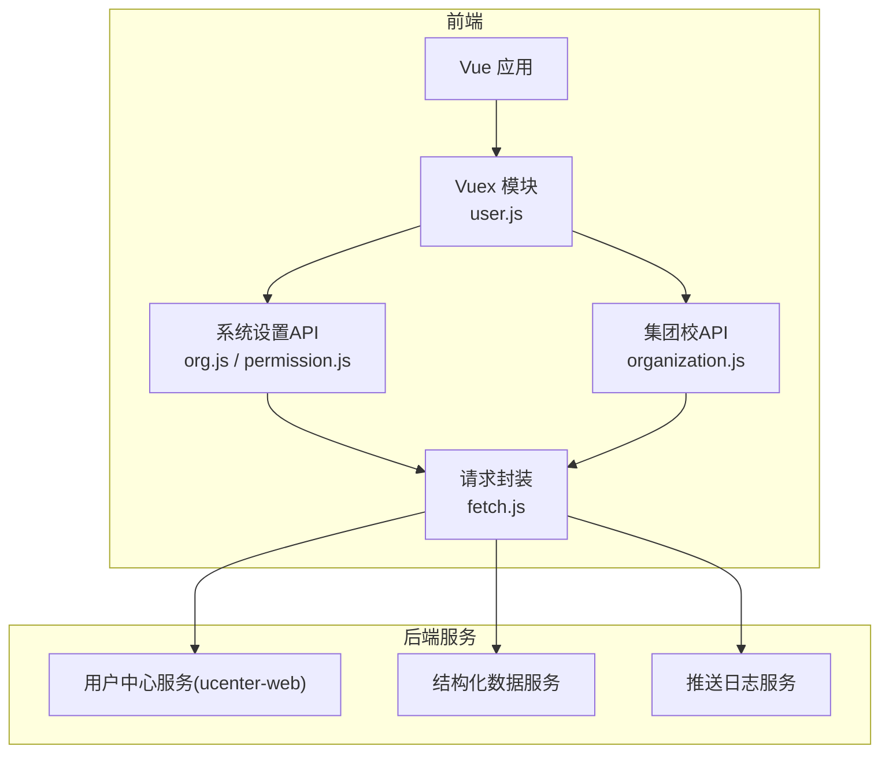
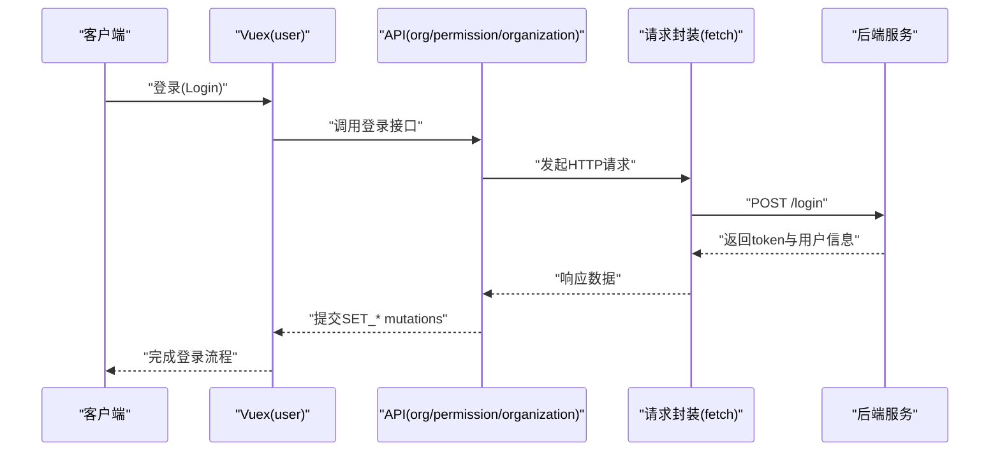
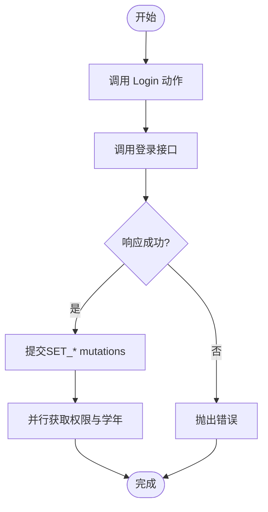
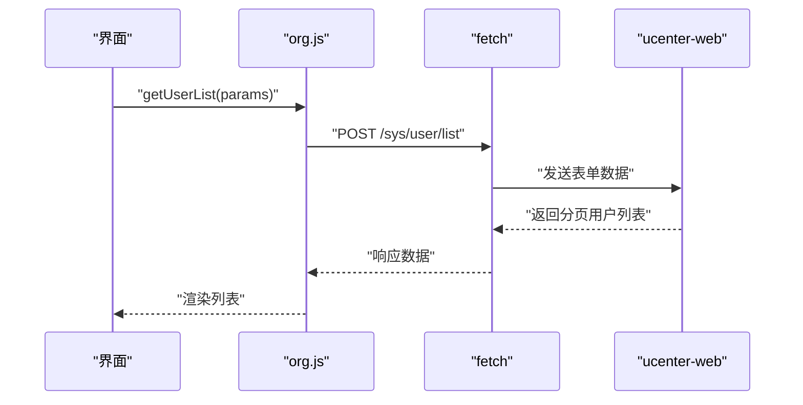
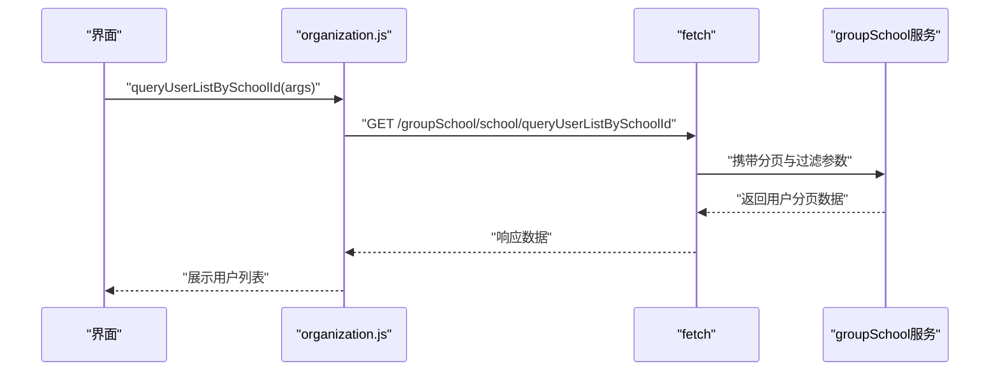
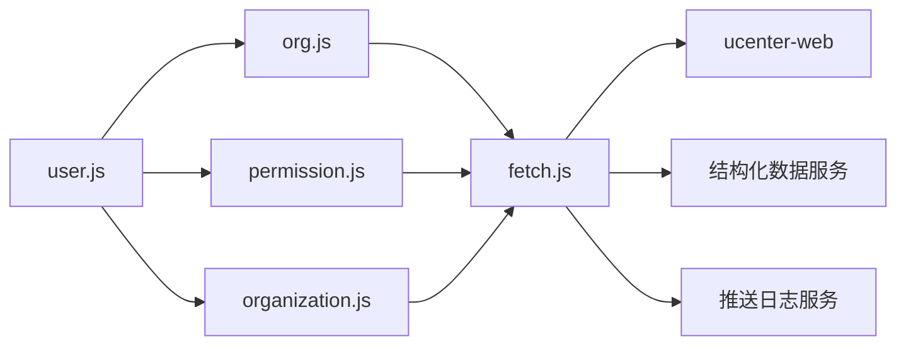

# 用户管理API

<cite>
**本文引用的文件**
- [src/store/modules/user.js](file://src/store/modules/user.js)
- [src/api/systemSet/org.js](file://src/api/systemSet/org.js)
- [src/api/systemSet/permission.js](file://src/api/systemSet/permission.js)
- [src/api/schoolUnion/organization.js](file://src/api/schoolUnion/organization.js)
- [src/utils/fetch.js](file://src/utils/fetch.js)
</cite>

## 目录
1. [简介](#简介)
2. [项目结构](#项目结构)
3. [核心组件](#核心组件)
4. [架构总览](#架构总览)
5. [详细组件分析](#详细组件分析)
6. [依赖关系分析](#依赖关系分析)
7. [性能考量](#性能考量)
8. [故障排查指南](#故障排查指南)
9. [结论](#结论)
10. [附录](#附录)

## 简介
本文件系统化梳理了本项目中的用户管理相关API，覆盖用户信息管理、角色与权限、组织架构管理、用户状态与同步、批量导入导出、以及操作日志等能力。文档面向前后端协作与运维人员，提供接口规范、数据模型要点、业务规则与常见问题排查建议。

## 项目结构
围绕用户管理的关键模块与文件如下：
- 用户状态与权限：Vuex 模块负责登录态、角色、权限、学校学年等上下文维护
- 组织与用户API：统一在系统设置模块下提供部门、用户、角色、同步、导入导出、日志等接口
- 集团校组织：提供跨校组织树、用户检索、角色查询等能力
- 请求封装：统一的请求工具对不同环境进行适配

图表来源
- [src/store/modules/user.js:120-325](file://src/store/modules/user.js#L120-L325)
- [src/api/systemSet/org.js:13-16](file://src/api/systemSet/org.js#L13-L16)
- [src/api/systemSet/permission.js:9-39](file://src/api/systemSet/permission.js#L9-L39)
- [src/api/schoolUnion/organization.js:1-129](file://src/api/schoolUnion/organization.js#L1-L129)
- [src/utils/fetch.js](file://src/utils/fetch.js)

章节来源
- [src/store/modules/user.js:1-447](file://src/store/modules/user.js#L1-L447)
- [src/api/systemSet/org.js:1-1345](file://src/api/systemSet/org.js#L1-L1345)
- [src/api/systemSet/permission.js:1-40](file://src/api/systemSet/permission.js#L1-L40)
- [src/api/schoolUnion/organization.js:1-129](file://src/api/schoolUnion/organization.js#L1-L129)
- [src/utils/fetch.js](file://src/utils/fetch.js)

## 核心组件
- 用户状态与权限
  - 登录、登出、获取用户信息、获取权限列表、切换学年、地图Key初始化等
  - 维护用户信息、角色列表、权限URL映射、部门列表、当前学年等
- 组织与用户API
  - 部门：查询树、新增、更新、删除、移动班级等
  - 用户：分页列表、详情、新增/编辑教师/学生、删除、移动、启用/禁用、重置密码、导入进度/结果、二维码导出、档案管理、日志等
  - 角色：查询全部角色、按用户查询角色、按学校与来源查询角色模块
  - 同步：部门与用户同步、仅部门同步、仅用户同步、更新同步状态
  - 集团校：组织树、部门树、用户检索、用户详情、家长查询、角色模块查询
- 权限API
  - 查询用户权限、根据父权限ID获取子权限
- 请求封装
  - 提供 axios 实例与全局配置，支持开发/生产环境切换

章节来源
- [src/store/modules/user.js:20-118](file://src/store/modules/user.js#L20-L118)
- [src/store/modules/user.js:120-325](file://src/store/modules/user.js#L120-L325)
- [src/api/systemSet/org.js:13-1345](file://src/api/systemSet/org.js#L13-L1345)
- [src/api/systemSet/permission.js:9-39](file://src/api/systemSet/permission.js#L9-L39)
- [src/api/schoolUnion/organization.js:1-129](file://src/api/schoolUnion/organization.js#L1-L129)
- [src/utils/fetch.js](file://src/utils/fetch.js)

## 架构总览
用户管理API采用“前端模块化API + Vuex状态管理 + 统一请求封装”的架构：
- Vuex 模块集中管理用户态与上下文（角色、权限、学校信息、学年）
- API 模块按功能域拆分（系统设置、集团校），统一通过 fetch 封装访问后端
- 后端服务包括用户中心、结构化数据、推送日志等

图表来源
- [src/store/modules/user.js:120-173](file://src/store/modules/user.js#L120-L173)
- [src/api/systemSet/org.js:13-16](file://src/api/systemSet/org.js#L13-L16)
- [src/utils/fetch.js](file://src/utils/fetch.js)

## 详细组件分析

### 用户状态与权限（Vuex）
- 状态字段
  - 用户标识、角色、权限URL集合与名称映射、部门列表、学校信息、当前/选择学年等
- 主要动作
  - 登录：写入token、用户信息、角色、部门、学校信息；并拉取权限与学年
  - 获取用户信息：刷新本地信息并拉取权限与学年
  - 获取权限：按模块码拉取权限列表并生成URL映射
  - 切换学年：持久化选择并更新当前学年
  - 登出：清理token与角色
- 关键流程
  - 登录成功后并行拉取权限与学年，确保后续菜单与功能可用

图表来源
- [src/store/modules/user.js:120-173](file://src/store/modules/user.js#L120-L173)
- [src/store/modules/user.js:287-304](file://src/store/modules/user.js#L287-L304)
- [src/store/modules/user.js:305-325](file://src/store/modules/user.js#L305-L325)

章节来源
- [src/store/modules/user.js:20-118](file://src/store/modules/user.js#L20-L118)
- [src/store/modules/user.js:120-325](file://src/store/modules/user.js#L120-L325)

### 组织与用户API（系统设置）
- 部门管理
  - 查询部门树、按ID查询详情、新增/更新/删除部门、移动班级到其他年级
- 用户管理
  - 分页获取部门下用户列表、用户详情、新增/编辑教师/学生、删除、移动、启用/禁用、重置密码
- 角色管理
  - 查询全部角色、按用户查询角色、按学校与来源查询角色模块
- 同步机制
  - 同步部门与用户、仅同步部门、仅同步用户、更新同步状态
- 批量导入导出
  - 导入进度/结果查询、下载失败结果、导出用户二维码
- 档案与日志
  - 教师/学生档案详情与新增/修改、用户操作日志列表
- 关键参数与行为
  - 多数接口使用 URLSearchParams 传递参数，部分新增/编辑接口使用 JSON
  - 支持批量操作（如批量删除、批量移动、批量新增班级）

图表来源
- [src/api/systemSet/org.js:32-46](file://src/api/systemSet/org.js#L32-L46)
- [src/api/systemSet/org.js:13-16](file://src/api/systemSet/org.js#L13-L16)
- [src/utils/fetch.js](file://src/utils/fetch.js)

章节来源
- [src/api/systemSet/org.js:13-1345](file://src/api/systemSet/org.js#L13-L1345)

### 集团校组织API
- 能力范围
  - 初始化集团校组织、按部门/常用组检索用户、分页查询某校用户、用户详情、家长查询、组织树与部门树、角色模块查询
- 使用场景
  - 跨校通讯录、跨校用户检索、跨校角色授权等

图表来源
- [src/api/schoolUnion/organization.js:51-67](file://src/api/schoolUnion/organization.js#L51-L67)
- [src/utils/fetch.js](file://src/utils/fetch.js)

章节来源
- [src/api/schoolUnion/organization.js:1-129](file://src/api/schoolUnion/organization.js#L1-L129)

### 权限API
- 用户权限查询：按学校与用户ID查询权限
- 子权限查询：按父权限ID获取子权限列表
- 典型用途：动态菜单生成、按钮级权限控制

章节来源
- [src/api/systemSet/permission.js:15-39](file://src/api/systemSet/permission.js#L15-L39)

## 依赖关系分析
- 模块耦合
  - Vuex(user) 依赖 API 模块与请求封装，API 模块再依赖请求封装访问后端
- 外部依赖
  - 后端服务：用户中心(ucenter-web)、结构化数据、推送日志
- 环境配置
  - 请求封装根据全局变量决定 base URL 与超时时间

图表来源
- [src/store/modules/user.js:120-325](file://src/store/modules/user.js#L120-L325)
- [src/api/systemSet/org.js:13-16](file://src/api/systemSet/org.js#L13-L16)
- [src/api/systemSet/permission.js:9-39](file://src/api/systemSet/permission.js#L9-L39)
- [src/api/schoolUnion/organization.js:1-129](file://src/api/schoolUnion/organization.js#L1-L129)
- [src/utils/fetch.js](file://src/utils/fetch.js)

章节来源
- [src/store/modules/user.js:120-325](file://src/store/modules/user.js#L120-L325)
- [src/api/systemSet/org.js:13-16](file://src/api/systemSet/org.js#L13-L16)
- [src/api/systemSet/permission.js:9-39](file://src/api/systemSet/permission.js#L9-L39)
- [src/api/schoolUnion/organization.js:1-129](file://src/api/schoolUnion/organization.js#L1-L129)
- [src/utils/fetch.js](file://src/utils/fetch.js)

## 性能考量
- 并发优化
  - 登录成功后并行拉取权限与学年，减少首屏等待
- 请求策略
  - 统一超时与baseURL配置，避免重复网络开销
- 批量操作
  - 批量导入/导出与批量移动/删除接口需注意后端分页与并发限制，避免一次性传输过大

## 故障排查指南
- 登录后无权限/菜单异常
  - 检查权限拉取是否成功、模块码是否正确
  - 确认权限URL映射是否生成
- 学年切换无效
  - 检查学年列表与当前学年字段是否更新
- 同步失败
  - 使用“是否存在同步失败数据”接口确认状态
  - 查看推送日志列表，定位具体事件与错误
- 导入失败
  - 通过导入进度/结果接口查看状态与错误明细
  - 下载失败结果Excel进行修正后重试

章节来源
- [src/store/modules/user.js:287-325](file://src/store/modules/user.js#L287-L325)
- [src/api/systemSet/org.js:1241-1251](file://src/api/systemSet/org.js#L1241-L1251)
- [src/api/systemSet/org.js:1253-1297](file://src/api/systemSet/org.js#L1253-L1297)
- [src/api/systemSet/org.js:1005-1029](file://src/api/systemSet/org.js#L1005-L1029)
- [src/api/systemSet/org.js:1324-1343](file://src/api/systemSet/org.js#L1324-L1343)

## 结论
本项目通过清晰的模块划分与统一的请求封装，提供了完善的用户管理能力：从用户与组织的基础CRUD，到角色与权限的细粒度控制，再到批量导入导出与同步机制，满足多场景需求。建议在实际接入时重点关注：
- 登录后并行加载权限与学年的时机
- 批量接口的分页与幂等性设计
- 同步失败与导入失败的可观测性与重试策略

## 附录

### 接口清单与要点

- 用户与组织
  - 部门：查询树、新增、更新、删除、移动班级
  - 用户：分页列表、详情、新增/编辑教师/学生、删除、移动、启用/禁用、重置密码
  - 角色：全部角色、按用户查询、按学校与来源查询
  - 同步：部门与用户同步、仅部门同步、仅用户同步、更新同步状态
  - 档案：教师/学生档案详情与新增/修改
  - 日志：用户操作日志列表
  - 导入导出：进度/结果查询、下载失败结果、导出用户二维码
  - 批量：批量新增班级、批量移动用户

- 集团校
  - 组织树、部门树、按部门/常用组检索用户、分页查询某校用户、用户详情、家长查询、角色模块查询

- 权限
  - 用户权限查询、子权限查询

章节来源
- [src/api/systemSet/org.js:13-1345](file://src/api/systemSet/org.js#L13-L1345)
- [src/api/schoolUnion/organization.js:1-129](file://src/api/schoolUnion/organization.js#L1-L129)
- [src/api/systemSet/permission.js:15-39](file://src/api/systemSet/permission.js#L15-L39)