# 系统配置API

<cite>
**本文档引用的文件**
- [schoolDictionary.js](file://src/api/systemSet/schoolDictionary.js)
- [org.js](file://src/api/systemSet/org.js)
- [courseSet.js](file://src/api/systemSet/courseSet.js)
- [permission.js](file://src/api/systemSet/permission.js)
- [tenEvent.js](file://src/api/systemSet/tenEvent.js)
- [volunteerService.js](file://src/api/systemSet/volunteerService.js)
- [deviceManage.js](file://src/api/systemSet/deviceManage.js)
- [dataReport.js](file://src/api/systemSet/dataReport.js)
- [teacherAttendanceSet.js](file://src/api/systemSet/teacherAttendanceSet.js)
- [readPunchClockSet.js](file://src/api/systemSet/readPunchClockSet.js)
- [dockingAttendanceMachine.js](file://src/api/systemSet/dockingAttendanceMachine.js)
</cite>

## 目录
1. [简介](#简介)
2. [项目结构](#项目结构)
3. [核心组件](#核心组件)
4. [架构概览](#架构概览)
5. [详细组件分析](#详细组件分析)
6. [依赖关系分析](#依赖关系分析)
7. [性能考虑](#性能考虑)
8. [故障排除指南](#故障排除指南)
9. [结论](#结论)

## 简介
本文件系统性梳理了新PC项目中的系统配置相关API，覆盖系统设置、时间管理、日历配置、数据字典、组织机构、课程设置、权限管理、考勤设置、设备管理、数据报告等多个维度的基础配置能力。文档重点包括：
- 配置项管理：字典类型与字典值的增删改查、分页查询
- 参数设置：考勤规则、考勤地点、阅读打卡、考勤机对接等
- 字典维护：学校字典类型、字典项、字典值的全链路管理
- 系统参数：数据报告初始化、志愿服务设置等
- 集成模式：统一通过fetch封装进行HTTP请求，支持URLSearchParams与JSON两种提交方式

## 项目结构
系统配置API主要位于src/api/systemSet目录下，按功能域划分模块：
- 数据字典：schoolDictionary.js
- 组织机构：org.js（含用户、部门、角色、同步等）
- 课程设置：courseSet.js
- 权限管理：permission.js
- 十件事：tenEvent.js
- 志愿服务：volunteerService.js
- 设备管理：deviceManage.js
- 数据报告：dataReport.js
- 教师考勤：teacherAttendanceSet.js
- 阅读打卡：readPunchClockSet.js
- 考勤机对接：dockingAttendanceMachine.js

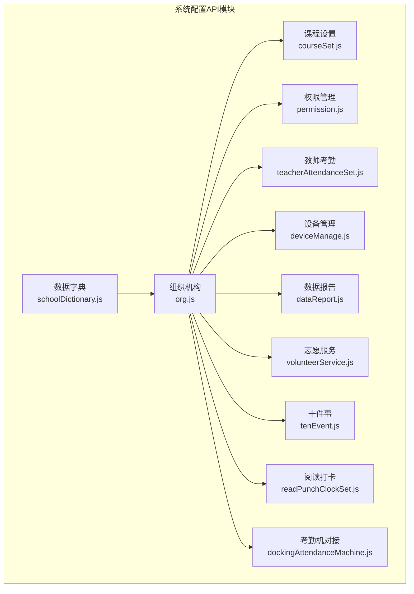

**图表来源**
- [schoolDictionary.js:1-188](file://src/api/systemSet/schoolDictionary.js#L1-L188)
- [org.js:1-1345](file://src/api/systemSet/org.js#L1-L1345)
- [courseSet.js:1-217](file://src/api/systemSet/courseSet.js#L1-L217)
- [permission.js:1-40](file://src/api/systemSet/permission.js#L1-L40)
- [tenEvent.js:1-71](file://src/api/systemSet/tenEvent.js#L1-L71)
- [volunteerService.js:1-99](file://src/api/systemSet/volunteerService.js#L1-L99)
- [deviceManage.js:1-189](file://src/api/systemSet/deviceManage.js#L1-L189)
- [dataReport.js:1-26](file://src/api/systemSet/dataReport.js#L1-L26)
- [teacherAttendanceSet.js:1-288](file://src/api/systemSet/teacherAttendanceSet.js#L1-L288)
- [readPunchClockSet.js:1-51](file://src/api/systemSet/readPunchClockSet.js#L1-L51)
- [dockingAttendanceMachine.js:1-43](file://src/api/systemSet/dockingAttendanceMachine.js#L1-L43)

**章节来源**
- [schoolDictionary.js:1-188](file://src/api/systemSet/schoolDictionary.js#L1-L188)
- [org.js:1-1345](file://src/api/systemSet/org.js#L1-L1345)

## 核心组件
本节概述各模块的核心职责与关键接口类别：
- 数据字典：提供字典类型、字典项、字典值的增删改查与分页查询
- 组织机构：提供部门、用户、角色、同步、导入导出等全链路能力
- 课程设置：提供课程列表、选择列表、新增编辑、删除、导入平台课程等
- 权限管理：提供用户权限查询与子权限获取
- 十件事：提供年级列表、事件类型增删改查、按年级学期查询
- 志愿服务：提供设置新增/修改、分组管理、列表查询与删除
- 设备管理：提供设备查询、新增/编辑、批量删除、设备用户管理、同步提醒
- 数据报告：提供初始化设置查询与新增/修改
- 教师考勤：提供考勤规则、用户、地点、设置的全链路管理
- 阅读打卡：提供年级查询、设置查询与保存
- 考勤机对接：提供初始化设置的新增/修改、查询与删除

**章节来源**
- [schoolDictionary.js:1-188](file://src/api/systemSet/schoolDictionary.js#L1-L188)
- [org.js:1-1345](file://src/api/systemSet/org.js#L1-L1345)
- [courseSet.js:1-217](file://src/api/systemSet/courseSet.js#L1-L217)
- [permission.js:1-40](file://src/api/systemSet/permission.js#L1-L40)
- [tenEvent.js:1-71](file://src/api/systemSet/tenEvent.js#L1-L71)
- [volunteerService.js:1-99](file://src/api/systemSet/volunteerService.js#L1-L99)
- [deviceManage.js:1-189](file://src/api/systemSet/deviceManage.js#L1-L189)
- [dataReport.js:1-26](file://src/api/systemSet/dataReport.js#L1-L26)
- [teacherAttendanceSet.js:1-288](file://src/api/systemSet/teacherAttendanceSet.js#L1-L288)
- [readPunchClockSet.js:1-51](file://src/api/systemSet/readPunchClockSet.js#L1-L51)
- [dockingAttendanceMachine.js:1-43](file://src/api/systemSet/dockingAttendanceMachine.js#L1-L43)

## 架构概览
系统配置API采用统一的HTTP请求封装，通过URLSearchParams或JSON提交参数，调用后端结构化接口。整体交互流程如下：

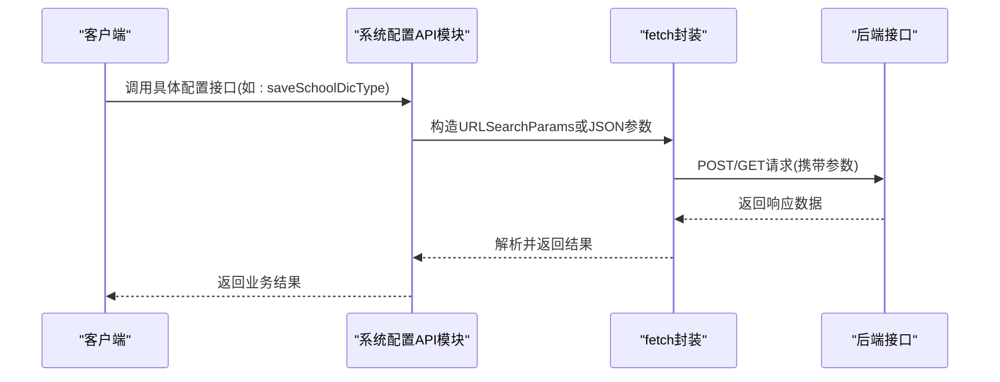

**图表来源**
- [schoolDictionary.js:23-37](file://src/api/systemSet/schoolDictionary.js#L23-L37)
- [org.js:13-16](file://src/api/systemSet/org.js#L13-L16)

## 详细组件分析

### 数据字典模块（schoolDictionary.js）
- 功能定位：提供学校字典类型的增删改查、字典项与字典值的管理，以及分页列表查询
- 关键接口类别：
  - 字典类型：加载列表、保存、按编码获取、删除
  - 字典项：保存、按编码获取、删除
  - 字典值：保存、按ID获取、按ID删除
  - 分页列表：按字典编码分页查询字典值
- 参数传递：统一使用URLSearchParams构造参数，部分接口使用JSON提交
- 错误处理：由fetch封装统一处理网络异常与状态码

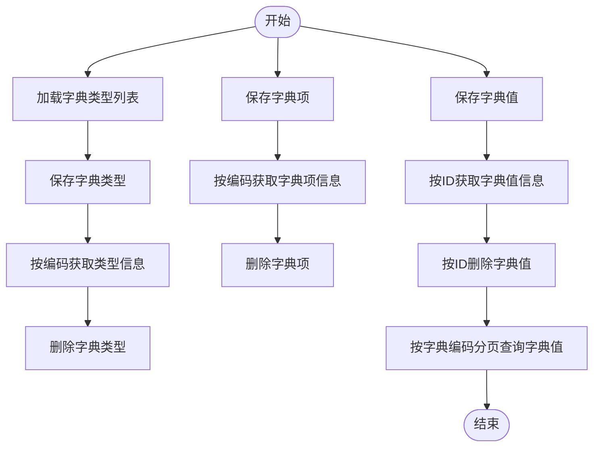

**图表来源**
- [schoolDictionary.js:9-187](file://src/api/systemSet/schoolDictionary.js#L9-L187)

**章节来源**
- [schoolDictionary.js:1-188](file://src/api/systemSet/schoolDictionary.js#L1-L188)

### 组织机构模块（org.js）
- 功能定位：提供部门、用户、角色、同步、导入导出、二维码生成、档案管理等全链路能力
- 关键接口类别：
  - 部门管理：查询树形部门、新增/更新/删除部门、移动班级到其他年级
  - 用户管理：分页查询部门用户、新增/更新/删除用户、移动用户、启用/禁用用户
  - 角色与权限：查询所有角色、按用户查询角色、查询角色与模块
  - 同步与导入：同步部门/用户、展示导入进度与结果、批量新增班级、获取order
  - 档案管理：教师/学生档案详情、新增或修改档案
  - 其他：二维码导出、家长查询、批量操作工具方法
- 参数传递：多数接口使用URLSearchParams；部分新增/编辑接口使用JSON
- 错误处理：通过独立的orgFetch实例与超时控制保障稳定性

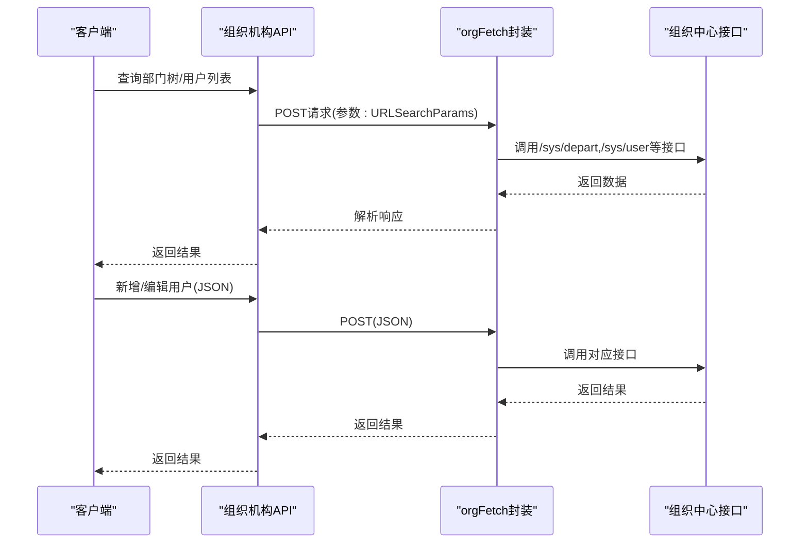

**图表来源**
- [org.js:21-512](file://src/api/systemSet/org.js#L21-L512)

**章节来源**
- [org.js:1-1345](file://src/api/systemSet/org.js#L1-L1345)

### 课程设置模块（courseSet.js）
- 功能定位：提供课程列表、选择列表、新增编辑、删除、导入平台课程、学校课程详情与增删改
- 关键接口类别：
  - 结构化课程：分页查询、详情查询、新增/编辑、删除
  - 平台课程：导入平台课程、获取平台国标课程列表
  - 学校课程：新增/编辑、删除、列表查询
- 参数传递：统一使用URLSearchParams或JSON提交
- 错误处理：由systemFetch封装处理

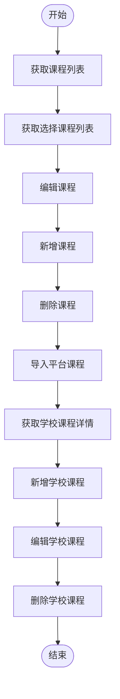

**图表来源**
- [courseSet.js:13-217](file://src/api/systemSet/courseSet.js#L13-L217)

**章节来源**
- [courseSet.js:1-217](file://src/api/systemSet/courseSet.js#L1-L217)

### 权限管理模块（permission.js）
- 功能定位：提供用户权限查询与子权限获取
- 关键接口：
  - 查询用户所有权限
  - 根据上级权限ID获取子权限
- 参数传递：URLSearchParams
- 错误处理：由fetch封装处理

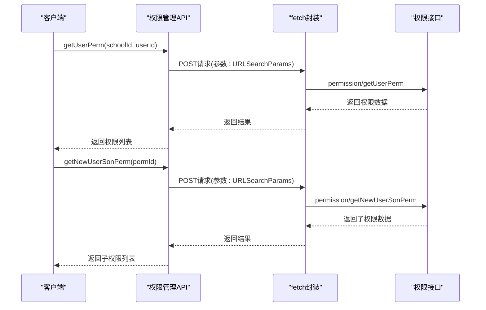

**图表来源**
- [permission.js:15-39](file://src/api/systemSet/permission.js#L15-L39)

**章节来源**
- [permission.js:1-40](file://src/api/systemSet/permission.js#L1-L40)

### 十件事模块（tenEvent.js）
- 功能定位：提供年级列表查询、事件类型增删改查、按年级学期查询事件列表
- 关键接口：
  - 年级列表：querySchoolGrade
  - 事件类型：insertThingType、updateThingType、deleteThingType
  - 事件列表：findThingByGradeLevel
  - 分组统计：findThingsGroupByGradeId
- 参数传递：URLSearchParams或JSON
- 错误处理：由fetch封装处理

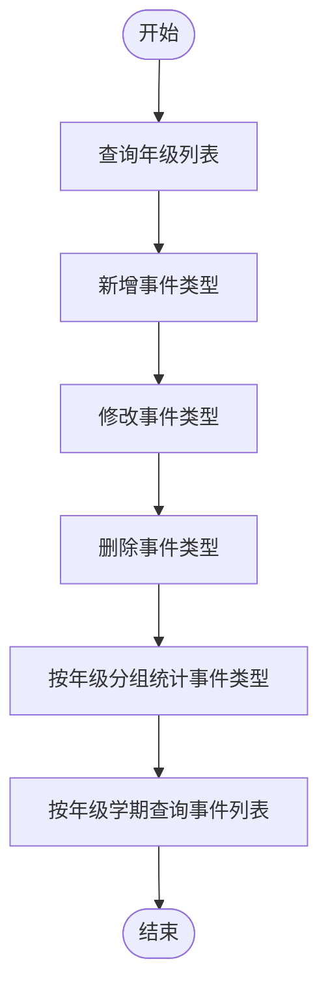

**图表来源**
- [tenEvent.js:5-71](file://src/api/systemSet/tenEvent.js#L5-L71)

**章节来源**
- [tenEvent.js:1-71](file://src/api/systemSet/tenEvent.js#L1-L71)

### 志愿服务模块（volunteerService.js）
- 功能定位：提供志愿服务设置与分组管理
- 关键接口：
  - 设置：addUpdateHeartVolunteerInit、getHeartVolunteerInit
  - 分组：addHeartVolunteerGroup、updateHeartVolunteerGroup、getHeartVolunteerGroupList、delHeartVolunteerGroup、getHeartVolunteerGroup
- 参数传递：统一使用URLSearchParams或JSON
- 错误处理：由fetch封装处理

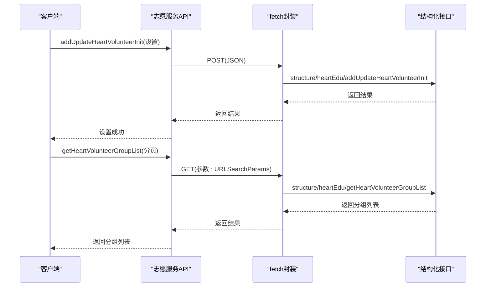

**图表来源**
- [volunteerService.js:16-98](file://src/api/systemSet/volunteerService.js#L16-L98)

**章节来源**
- [volunteerService.js:1-99](file://src/api/systemSet/volunteerService.js#L1-L99)

### 设备管理模块（deviceManage.js）
- 功能定位：提供扫码设备与设备用户管理、同步与提醒
- 关键接口：
  - 设备：getAllEquipmentList、addDevice、editScancodeEquipmentt、batchDeleteDevice
  - 设备用户：getDeviceUserList、addUserDevice、addScancodeEquipmentUserByDepart、delDeviceUser、syncDeviceUser、remindUser
  - 设备库：getEquipmentLibraryList、getEquipmentLibrary
  - AI诺达初始化：morningCheckInit
- 参数传递：URLSearchParams或JSON
- 错误处理：由fetch封装处理，部分接口使用专用wxcepInterface

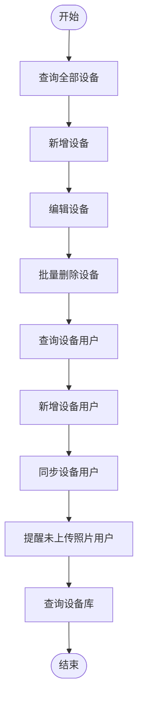

**图表来源**
- [deviceManage.js:8-189](file://src/api/systemSet/deviceManage.js#L8-L189)

**章节来源**
- [deviceManage.js:1-189](file://src/api/systemSet/deviceManage.js#L1-L189)

### 数据报告模块（dataReport.js）
- 功能定位：提供数据报告初始化设置的查询与新增/修改
- 关键接口：
  - getDataReportInit：查询初始化设置
  - addAndUpdateDataReportInit：新增/修改初始化设置
- 参数传递：URLSearchParams或JSON
- 错误处理：由fetch封装处理

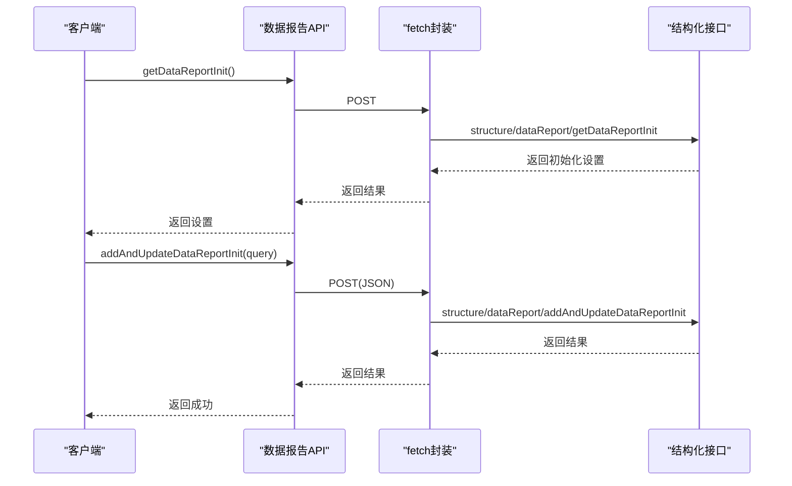

**图表来源**
- [dataReport.js:6-25](file://src/api/systemSet/dataReport.js#L6-L25)

**章节来源**
- [dataReport.js:1-26](file://src/api/systemSet/dataReport.js#L1-L26)

### 教师考勤模块（teacherAttendanceSet.js）
- 功能定位：提供考勤规则、用户、地点、设置的全链路管理
- 关键接口类别：
  - 考勤规则：列表、新增、编辑、删除、按ID获取、立即生效
  - 考勤用户：按规则查询用户、添加用户、移除用户、按用户ID立即生效
  - 考勤地点：列表、新增、编辑、删除、按ID获取
  - 考勤设置：获取设置、保存设置
- 参数传递：URLSearchParams
- 错误处理：由fetch封装处理

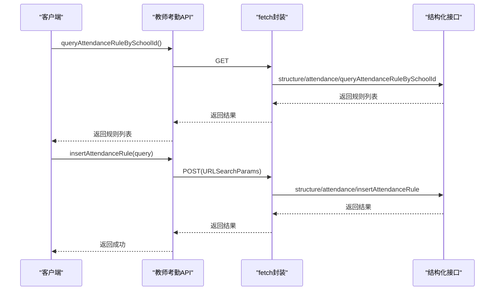

**图表来源**
- [teacherAttendanceSet.js:7-101](file://src/api/systemSet/teacherAttendanceSet.js#L7-L101)

**章节来源**
- [teacherAttendanceSet.js:1-288](file://src/api/systemSet/teacherAttendanceSet.js#L1-L288)

### 阅读打卡模块（readPunchClockSet.js）
- 功能定位：提供按学校类型查询年级列表、阅读打卡设置的查询与保存
- 关键接口：
  - listGradeBySchoolType：按学校类型查询年级列表
  - getReadClockInSet：获取阅读打卡设置
  - saveReadClockInSet：保存阅读打卡设置
- 参数传递：URLSearchParams
- 错误处理：由fetch封装处理

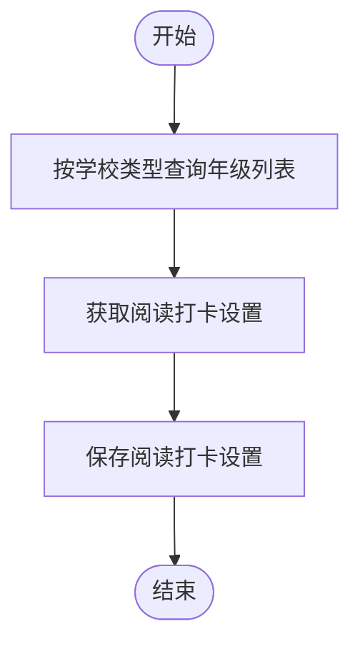

**图表来源**
- [readPunchClockSet.js:7-50](file://src/api/systemSet/readPunchClockSet.js#L7-L50)

**章节来源**
- [readPunchClockSet.js:1-51](file://src/api/systemSet/readPunchClockSet.js#L1-L51)

### 考勤机对接模块（dockingAttendanceMachine.js）
- 功能定位：提供考勤机初始化设置的新增/修改、查询与删除
- 关键接口：
  - addAndUpdateCheckWorkInit：新增/修改设置（JSON）
  - getCheckWorkInitBySchoolId：按学校ID查询设置
  - delCheckWorkInit：删除设置
- 参数传递：URLSearchParams或JSON
- 错误处理：由fetch封装处理

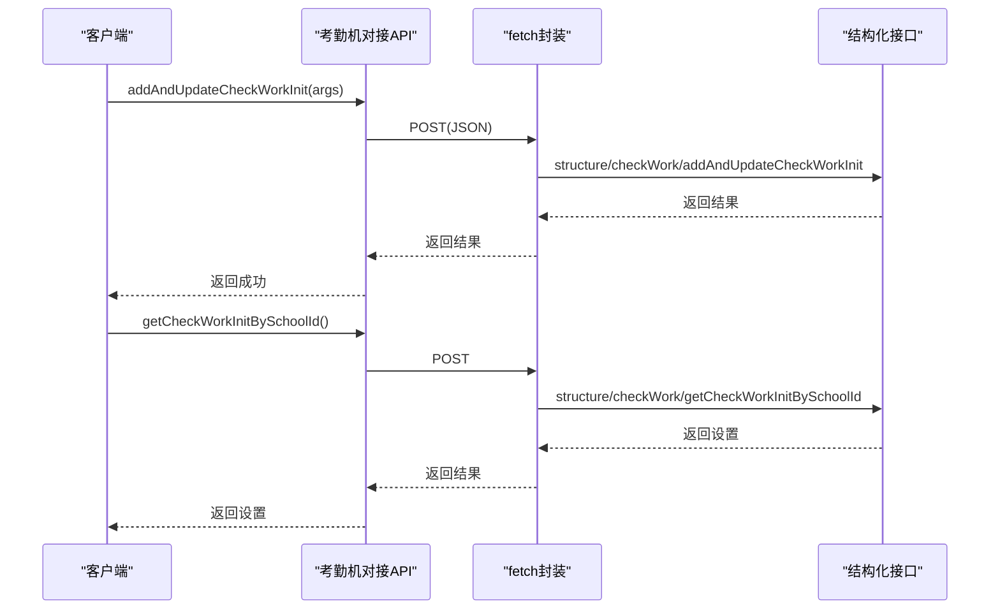

**图表来源**
- [dockingAttendanceMachine.js:6-29](file://src/api/systemSet/dockingAttendanceMachine.js#L6-L29)

**章节来源**
- [dockingAttendanceMachine.js:1-43](file://src/api/systemSet/dockingAttendanceMachine.js#L1-L43)

## 依赖关系分析
- 统一依赖：各模块均依赖src/utils/fetch封装，实现HTTP请求的统一处理
- 接口命名：遵循“结构化路径/模块名/具体操作”的命名约定，便于后端路由识别与维护
- 参数格式：URLSearchParams用于常规表单提交，JSON用于复杂对象提交
- 异常处理：通过fetch封装统一处理网络错误与状态码，保证前端一致性

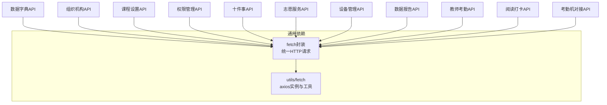

**图表来源**
- [schoolDictionary.js:1-1](file://src/api/systemSet/schoolDictionary.js#L1-L1)
- [org.js:11-11](file://src/api/systemSet/org.js#L11-L11)
- [courseSet.js:1-4](file://src/api/systemSet/courseSet.js#L1-L4)
- [permission.js:9-9](file://src/api/systemSet/permission.js#L9-L9)
- [tenEvent.js:1-2](file://src/api/systemSet/tenEvent.js#L1-L2)
- [volunteerService.js:1-1](file://src/api/systemSet/volunteerService.js#L1-L1)
- [deviceManage.js:1-4](file://src/api/systemSet/deviceManage.js#L1-L4)
- [dataReport.js:1-1](file://src/api/systemSet/dataReport.js#L1-L1)
- [teacherAttendanceSet.js:1-1](file://src/api/systemSet/teacherAttendanceSet.js#L1-L1)
- [readPunchClockSet.js:1-2](file://src/api/systemSet/readPunchClockSet.js#L1-L2)
- [dockingAttendanceMachine.js:1-1](file://src/api/systemSet/dockingAttendanceMachine.js#L1-L1)

**章节来源**
- [schoolDictionary.js:1-1](file://src/api/systemSet/schoolDictionary.js#L1-L1)
- [org.js:11-11](file://src/api/systemSet/org.js#L11-L11)
- [courseSet.js:1-4](file://src/api/systemSet/courseSet.js#L1-L4)
- [permission.js:9-9](file://src/api/systemSet/permission.js#L9-L9)
- [tenEvent.js:1-2](file://src/api/systemSet/tenEvent.js#L1-L2)
- [volunteerService.js:1-1](file://src/api/systemSet/volunteerService.js#L1-L1)
- [deviceManage.js:1-4](file://src/api/systemSet/deviceManage.js#L1-L4)
- [dataReport.js:1-1](file://src/api/systemSet/dataReport.js#L1-L1)
- [teacherAttendanceSet.js:1-1](file://src/api/systemSet/teacherAttendanceSet.js#L1-L1)
- [readPunchClockSet.js:1-2](file://src/api/systemSet/readPunchClockSet.js#L1-L2)
- [dockingAttendanceMachine.js:1-1](file://src/api/systemSet/dockingAttendanceMachine.js#L1-L1)

## 性能考虑
- 请求合并：对频繁调用的列表查询（如字典分页、用户分页）建议在前端做请求去抖与缓存
- 参数精简：优先使用URLSearchParams传递简单参数，减少JSON序列化开销
- 超时控制：针对长耗时操作（如同步、导入）设置合理超时与重试策略
- 批量操作：对批量删除、批量移动等操作，建议前端做二次确认与分批执行

## 故障排除指南
- 网络异常：检查fetch封装的错误拦截与提示，确认接口域名与路径正确
- 参数缺失：核对URLSearchParams构造逻辑，确保必填字段已附加
- JSON提交失败：确认headers中content-type为application/json且data为JSON字符串
- 跨域问题：确认后端CORS配置与代理转发规则
- 权限不足：检查权限接口返回与登录态，必要时重新登录或刷新权限

**章节来源**
- [schoolDictionary.js:1-188](file://src/api/systemSet/schoolDictionary.js#L1-L188)
- [org.js:1-1345](file://src/api/systemSet/org.js#L1-L1345)
- [courseSet.js:1-217](file://src/api/systemSet/courseSet.js#L1-L217)
- [permission.js:1-40](file://src/api/systemSet/permission.js#L1-L40)
- [tenEvent.js:1-71](file://src/api/systemSet/tenEvent.js#L1-L71)
- [volunteerService.js:1-99](file://src/api/systemSet/volunteerService.js#L1-L99)
- [deviceManage.js:1-189](file://src/api/systemSet/deviceManage.js#L1-L189)
- [dataReport.js:1-26](file://src/api/systemSet/dataReport.js#L1-L26)
- [teacherAttendanceSet.js:1-288](file://src/api/systemSet/teacherAttendanceSet.js#L1-L288)
- [readPunchClockSet.js:1-51](file://src/api/systemSet/readPunchClockSet.js#L1-L51)
- [dockingAttendanceMachine.js:1-43](file://src/api/systemSet/dockingAttendanceMachine.js#L1-L43)

## 结论
本系统配置API围绕“数据字典、组织机构、课程设置、权限管理、考勤设置、设备管理、数据报告、志愿服务、十件事、阅读打卡、考勤机对接”等核心领域构建，采用统一的fetch封装与标准化的参数传递方式，具备良好的扩展性与可维护性。建议在实际使用中结合业务场景优化请求策略与错误处理，确保配置变更的可靠性与一致性。