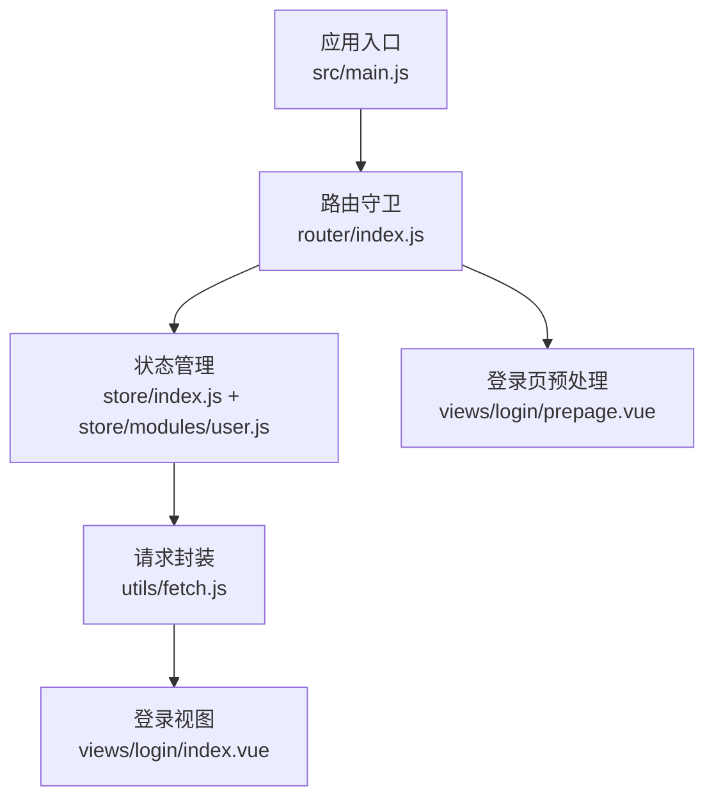
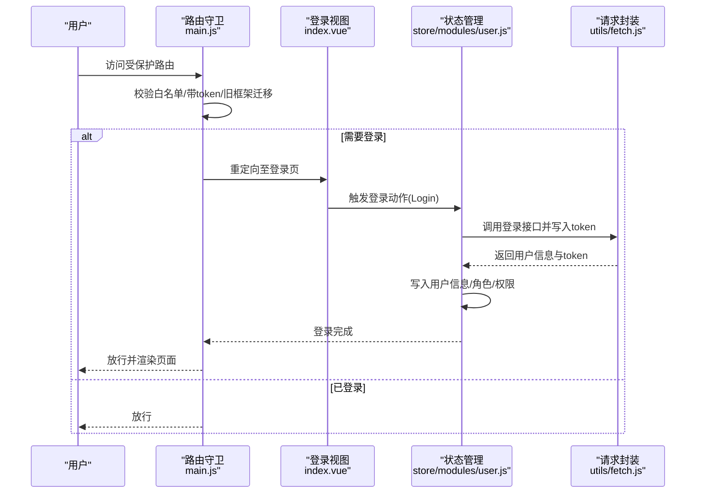
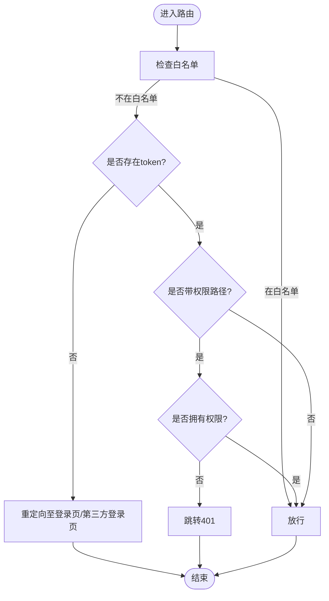
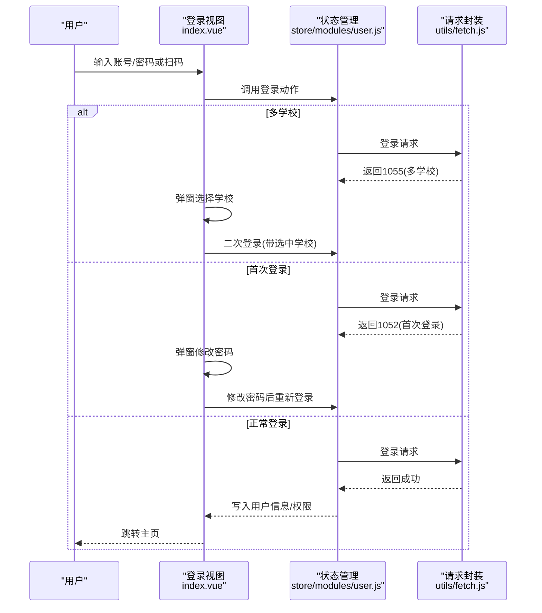
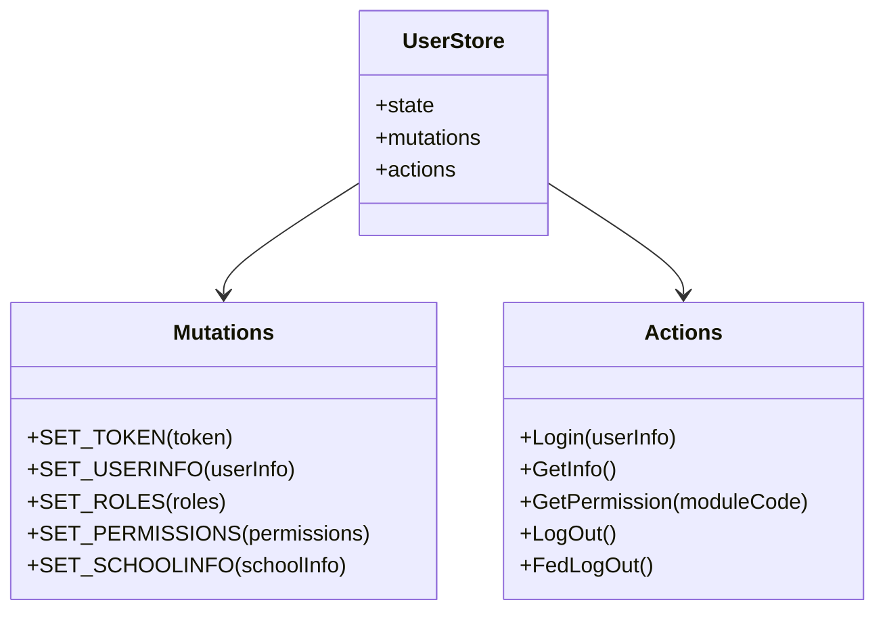
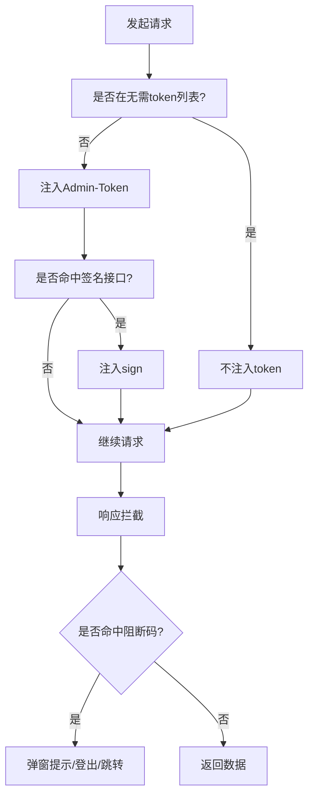
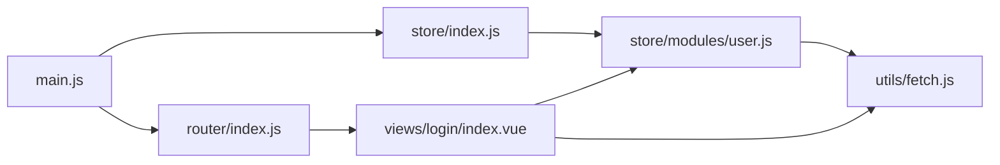

# 认证授权API

<cite>
**本文引用的文件**
- [main.js](file://src/main.js)
- [router/index.js](file://src/router/index.js)
- [store/index.js](file://src/store/index.js)
- [store/modules/user.js](file://src/store/modules/user.js)
- [utils/fetch.js](file://src/utils/fetch.js)
- [views/login/index.vue](file://src/views/login/index.vue)
- [views/login/prepage.vue](file://src/views/login/prepage.vue)
</cite>

## 目录
1. [简介](#简介)
2. [项目结构](#项目结构)
3. [核心组件](#核心组件)
4. [架构总览](#架构总览)
5. [详细组件分析](#详细组件分析)
6. [依赖关系分析](#依赖关系分析)
7. [性能考量](#性能考量)
8. [故障排查指南](#故障排查指南)
9. [结论](#结论)
10. [附录](#附录)

## 简介
本文件面向前端认证授权API的使用者与维护者，系统化梳理登录、登出、权限验证与角色切换等能力的实现规范与流程。重点覆盖以下方面：
- 用户登录与多学校场景处理
- 登录态维持与令牌注入机制
- 权限列表拉取与路由级权限校验
- 登出与前端清理
- 错误码与统一拦截处理
- 安全最佳实践与刷新/切换建议

## 项目结构
围绕认证授权的关键文件与职责如下：
- 路由守卫与白名单：在应用入口进行全局前置守卫，处理免登录白名单、带token跳转、旧框架迁移等场景
- 登录页面与交互：提供扫码登录、账号登录、首次登录改密、微信绑定等流程
- 状态管理：集中管理用户信息、角色、权限、学校信息等
- 请求封装：统一注入token、签名参数、错误码处理与登出联动
- 路由配置：常量路由与业务模块路由组合，支持系统管理与主应用

**图表来源**
- [main.js:73-198](file://src/main.js#L73-L198)
- [router/index.js:40-199](file://src/router/index.js#L40-L199)
- [store/index.js:10-17](file://src/store/index.js#L10-L17)
- [store/modules/user.js:20-447](file://src/store/modules/user.js#L20-L447)
- [utils/fetch.js:13-171](file://src/utils/fetch.js#L13-L171)
- [views/login/index.vue:112-539](file://src/views/login/index.vue#L112-L539)
- [views/login/prepage.vue:5-20](file://src/views/login/prepage.vue#L5-L20)

**章节来源**
- [main.js:1-221](file://src/main.js#L1-L221)
- [router/index.js:1-207](file://src/router/index.js#L1-L207)
- [store/index.js:1-20](file://src/store/index.js#L1-L20)
- [store/modules/user.js:1-447](file://src/store/modules/user.js#L1-L447)
- [utils/fetch.js:1-240](file://src/utils/fetch.js#L1-L240)
- [views/login/index.vue:1-769](file://src/views/login/index.vue#L1-L769)
- [views/login/prepage.vue:1-26](file://src/views/login/prepage.vue#L1-L26)

## 核心组件
- 应用入口与路由守卫
  - 全局前置守卫负责白名单放行、带token跳转、旧框架迁移、权限路径校验与登出联动
- 登录视图
  - 提供扫码登录、账号登录、多学校选择、首次登录改密、微信绑定等流程
- 状态管理（Vuex）
  - 统一存储token、用户信息、角色、权限映射、学校信息等，并提供登录、登出、权限拉取等动作
- 请求封装（Axios）
  - 自动注入token、签名参数；统一错误码处理与登出联动；按模块区分baseURL
- 路由配置
  - 常量路由包含登录页、错误页、系统管理等；业务路由按模块拆分

**章节来源**
- [main.js:58-198](file://src/main.js#L58-L198)
- [views/login/index.vue:112-539](file://src/views/login/index.vue#L112-L539)
- [store/modules/user.js:20-447](file://src/store/modules/user.js#L20-L447)
- [utils/fetch.js:13-171](file://src/utils/fetch.js#L13-L171)
- [router/index.js:40-199](file://src/router/index.js#L40-L199)

## 架构总览
整体认证授权流程由“路由守卫 → 登录视图 → 状态管理 → 请求封装 → 接口服务”构成，关键节点包括：
- 白名单与免登录跳转
- token注入与签名参数
- 权限列表与路由级权限校验
- 登录超时与统一登出

**图表来源**
- [main.js:73-198](file://src/main.js#L73-L198)
- [views/login/index.vue:313-331](file://src/views/login/index.vue#L313-L331)
- [store/modules/user.js:120-173](file://src/store/modules/user.js#L120-L173)
- [utils/fetch.js:65-101](file://src/utils/fetch.js#L65-L101)

## 详细组件分析

### 路由守卫与白名单
- 白名单包含登录页、二维码登录、部分公开页面等
- 支持带token跳转与旧框架迁移（userToken）场景
- 对带permissionPath的路由进行权限校验，不满足则跳转401
- 登录超时（1000）触发前端登出并跳转登录页或第三方登录页

**图表来源**
- [main.js:58-198](file://src/main.js#L58-L198)

**章节来源**
- [main.js:58-198](file://src/main.js#L58-L198)

### 登录视图与多学校流程
- 扫码登录：通过微信登录初始化，支持企业微信扫码
- 账号登录：提交账号与加密密码，处理多学校选择、首次登录改密、微信绑定
- 多学校场景：返回1055时弹窗选择学校，再走登录流程
- 首次登录改密：返回1052时弹窗提示修改密码
- 微信绑定：返回1060时弹窗输入手机号与验证码进行绑定

**图表来源**
- [views/login/index.vue:313-443](file://src/views/login/index.vue#L313-L443)
- [store/modules/user.js:120-173](file://src/store/modules/user.js#L120-L173)
- [utils/fetch.js:104-169](file://src/utils/fetch.js#L104-L169)

**章节来源**
- [views/login/index.vue:112-539](file://src/views/login/index.vue#L112-L539)

### 状态管理（用户模块）
- 状态字段：token、用户信息、角色、权限列表、学校信息、学年信息等
- 动作：
  - 登录：写入token与用户信息，拉取权限与学年
  - 获取用户信息：从后端拉取并写入
  - 权限拉取：根据模块编码获取权限列表并生成权限映射
  - 登出：清除token与角色，移除Cookie
  - 前端登出：仅清除本地token（用于某些场景快速登出）

**图表来源**
- [store/modules/user.js:20-447](file://src/store/modules/user.js#L20-L447)

**章节来源**
- [store/modules/user.js:20-447](file://src/store/modules/user.js#L20-L447)

### 请求封装与令牌注入
- 自动注入规则：
  - 未显式携带token且不在“无需token列表”时，自动追加Admin-Token
  - 对特定接口追加sign参数（来自sessionStorage.sign）
  - 归档模块自动追加schoolYear参数（来自store.selectedSchoolYear）
- 错误码处理：
  - 登录超时（1000）触发前端登出并跳转登录页或第三方登录页
  - 其他错误码统一弹窗提示

**图表来源**
- [utils/fetch.js:65-169](file://src/utils/fetch.js#L65-L169)

**章节来源**
- [utils/fetch.js:13-171](file://src/utils/fetch.js#L13-L171)

### 路由与权限校验
- 常量路由包含登录页、错误页、系统管理等
- 业务路由按模块拆分，配合路由元信息中的permissionPath进行权限校验
- 登录成功后，根据模块编码拉取权限列表并写入store

**章节来源**
- [router/index.js:40-199](file://src/router/index.js#L40-L199)
- [store/modules/user.js:287-304](file://src/store/modules/user.js#L287-L304)

## 依赖关系分析
- 应用入口依赖路由与状态管理，路由守卫依赖状态管理中的token与权限
- 登录视图依赖状态管理的登录动作与请求封装
- 请求封装依赖状态管理中的token与权限映射
- 路由配置依赖各模块路由文件

**图表来源**
- [main.js:1-221](file://src/main.js#L1-L221)
- [router/index.js:1-207](file://src/router/index.js#L1-L207)
- [store/index.js:1-20](file://src/store/index.js#L1-L20)
- [store/modules/user.js:1-447](file://src/store/modules/user.js#L1-L447)
- [utils/fetch.js:1-240](file://src/utils/fetch.js#L1-L240)
- [views/login/index.vue:1-769](file://src/views/login/index.vue#L1-L769)

**章节来源**
- [main.js:1-221](file://src/main.js#L1-L221)
- [router/index.js:1-207](file://src/router/index.js#L1-L207)
- [store/index.js:1-20](file://src/store/index.js#L1-L20)
- [store/modules/user.js:1-447](file://src/store/modules/user.js#L1-L447)
- [utils/fetch.js:1-240](file://src/utils/fetch.js#L1-L240)
- [views/login/index.vue:1-769](file://src/views/login/index.vue#L1-L769)

## 性能考量
- 登录成功后并行拉取权限与学年列表，减少首屏等待
- 仅对命中签名列表的接口注入sign参数，避免不必要的计算
- 登录超时统一处理，避免重复请求与无效重试

[本节为通用指导，无需具体文件分析]

## 故障排查指南
- 登录超时（1000）
  - 现象：弹窗提示并自动跳转登录页或第三方登录页
  - 处理：前端登出并重新登录；检查后端会话有效期与网络状况
- 参数错误/资源不存在/服务器错误
  - 现象：统一弹窗提示错误信息
  - 处理：检查接口参数与后端日志
- 权限不足（401）
  - 现象：跳转401页面
  - 处理：确认模块权限是否正确拉取与更新

**章节来源**
- [utils/fetch.js:104-169](file://src/utils/fetch.js#L104-L169)
- [main.js:134-151](file://src/main.js#L134-L151)

## 结论
本项目通过“路由守卫 + 登录视图 + 状态管理 + 请求封装”的分层设计，实现了完整的认证授权闭环。登录态以Cookie中的Admin-Token为核心，结合权限列表与路由元信息实现细粒度的权限控制。建议在现有基础上完善：
- 令牌刷新与轮询续期（如需）
- 角色切换与权限动态更新
- 更细粒度的错误码与国际化提示

[本节为总结，无需具体文件分析]

## 附录

### API与流程规范摘要
- 登录
  - 输入：账号、加密密码
  - 输出：token、用户信息、角色、学校信息
  - 流程：账号登录 → 多学校选择（可选） → 首次登录改密（可选） → 成功跳转
- 登出
  - 清除token与角色，移除Cookie
- 权限验证
  - 登录后按模块编码拉取权限列表，写入store并用于路由级校验
- 会话控制
  - 通过Admin-Token注入与路由守卫实现
- 错误处理
  - 统一拦截登录超时与业务错误码，触发登出或提示

**章节来源**
- [views/login/index.vue:313-443](file://src/views/login/index.vue#L313-L443)
- [store/modules/user.js:120-447](file://src/store/modules/user.js#L120-L447)
- [utils/fetch.js:65-169](file://src/utils/fetch.js#L65-L169)
- [main.js:73-198](file://src/main.js#L73-L198)