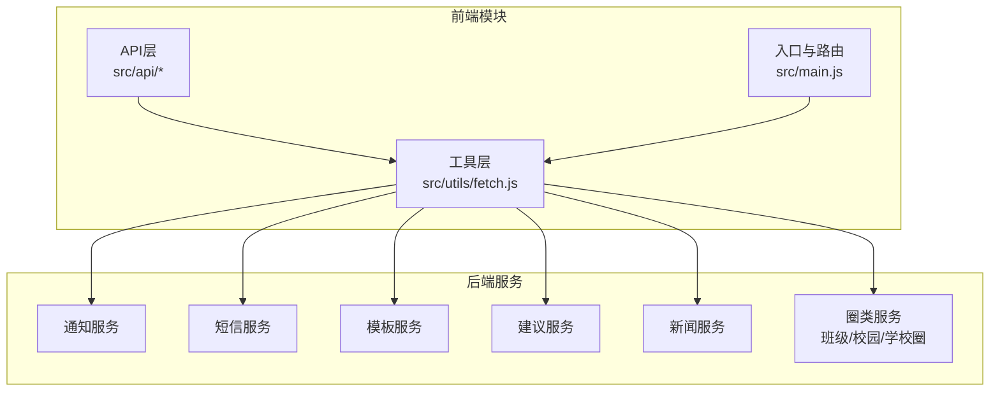
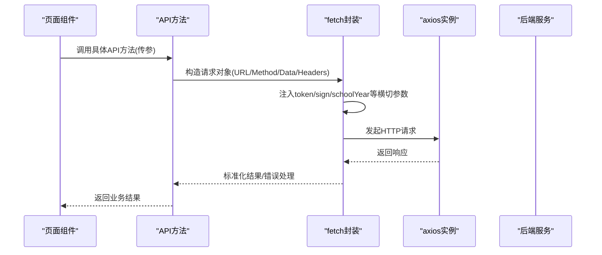
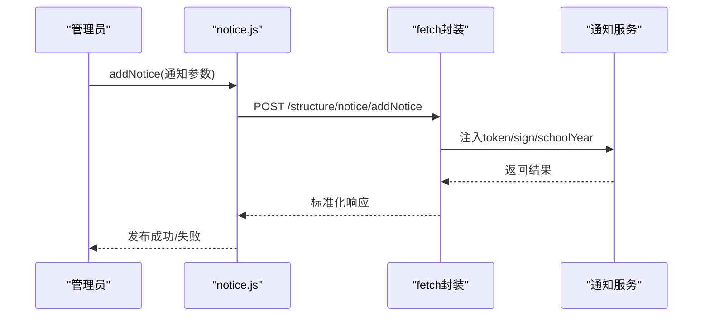
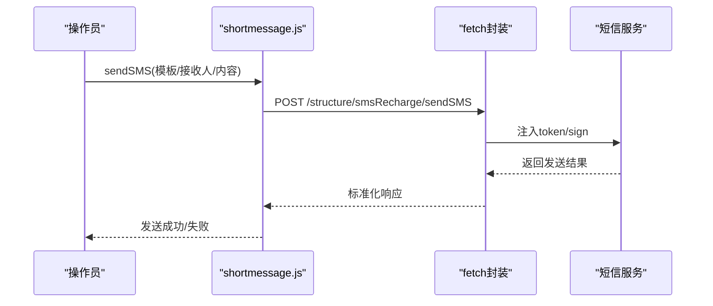
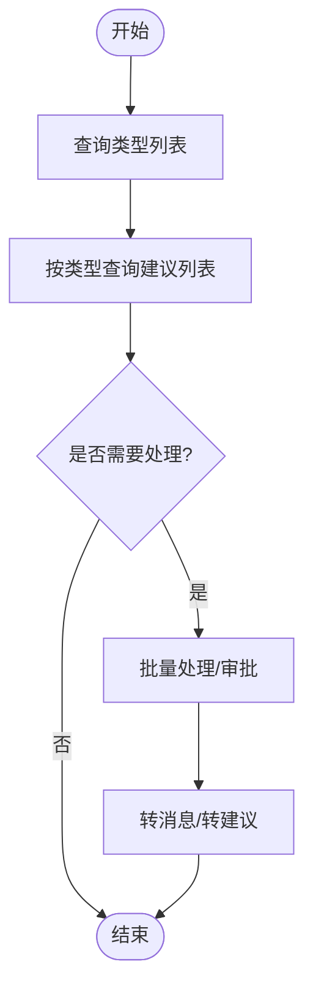
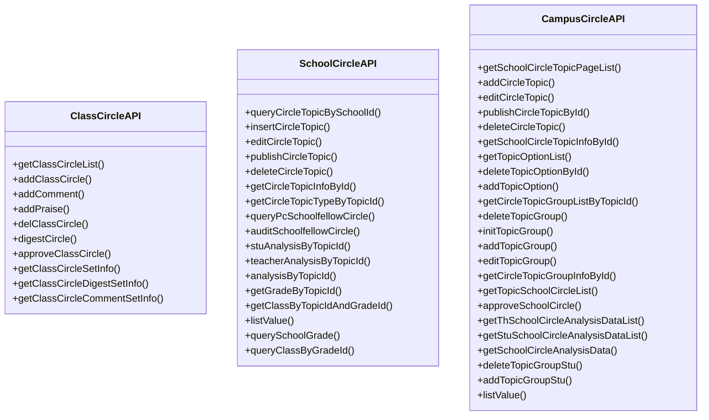
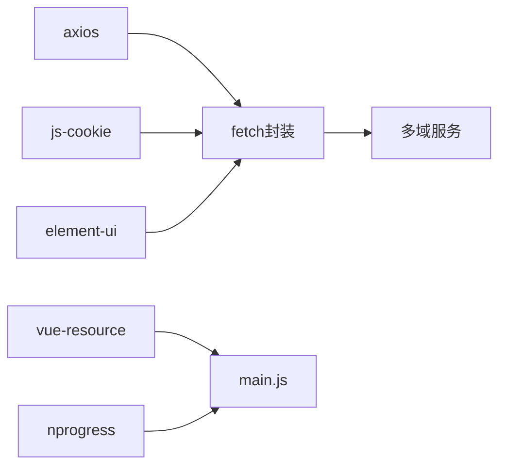

# 通信交互API

<cite>
**本文引用的文件**
- [notice.js](file://src/api/notice.js)
- [shortmessage.js](file://src/api/shortmessage.js)
- [messageTemplate.js](file://src/api/messageTemplate.js)
- [advice.js](file://src/api/advice.js)
- [news.js](file://src/api/news.js)
- [classCircle.js](file://src/api/classCircle.js)
- [schoolCircle.js](file://src/api/schoolCircle.js)
- [campusCircle.js](file://src/api/campusCircle.js)
- [fetch.js](file://src/utils/fetch.js)
- [main.js](file://src/main.js)
- [package.json](file://package.json)
</cite>

## 目录
1. [简介](#简介)
2. [项目结构](#项目结构)
3. [核心组件](#核心组件)
4. [架构总览](#架构总览)
5. [详细组件分析](#详细组件分析)
6. [依赖分析](#依赖分析)
7. [性能考虑](#性能考虑)
8. [故障排查指南](#故障排查指南)
9. [结论](#结论)
10. [附录](#附录)

## 简介
本文件面向“通信交互”相关API，覆盖通知公告、消息模板、校园圈、班级圈、意见建议、新闻资讯等家校沟通功能的接口规范与交互流程。文档同时阐述消息推送、通知发布、互动交流、反馈收集等能力的API说明，并给出通信数据模型、消息格式与交互流程的抽象描述，以及消息队列机制、推送策略与用户体验优化方案的建议。

## 项目结构
通信交互API主要位于前端模块 src/api 下，统一通过 src/utils/fetch.js 封装的 axios 服务进行网络请求，支持多环境与多域名适配；路由与鉴权在 src/main.js 中集中处理，确保 token、签名、归档等横切能力在请求阶段注入。

图表来源
- [fetch.js:13-171](file://src/utils/fetch.js#L13-L171)
- [notice.js:12-800](file://src/api/notice.js#L12-L800)
- [shortmessage.js:1-294](file://src/api/shortmessage.js#L1-L294)
- [messageTemplate.js:1-52](file://src/api/messageTemplate.js#L1-L52)
- [advice.js:1-166](file://src/api/advice.js#L1-L166)
- [news.js:1-266](file://src/api/news.js#L1-L266)
- [classCircle.js:1-472](file://src/api/classCircle.js#L1-L472)
- [schoolCircle.js:1-215](file://src/api/schoolCircle.js#L1-L215)
- [campusCircle.js:1-275](file://src/api/campusCircle.js#L1-L275)

章节来源
- [fetch.js:1-240](file://src/utils/fetch.js#L1-L240)
- [main.js:1-221](file://src/main.js#L1-L221)

## 核心组件
- 通知公告模块：提供通知列表、详情、发布、审批、转发、提醒、置顶、重复提醒、统计等能力。
- 短信模块：提供模板查询、模板增删改、群发、充值、余额提醒、群组管理、发送明细等能力。
- 消息模板模块：提供模板查询、增删改能力，支撑短信与通知场景。
- 意见建议模块：提供类型列表、建议列表、审批、批量处理、转办、统计等能力。
- 新闻资讯模块：提供新闻列表、新增/编辑、删除、详情、评论、点赞、发布/驳回、撤回等能力。
- 圈类模块：包括班级圈、学校圈、校园圈，覆盖发布、评论、点赞、加精、审批、统计、群组管理等。

章节来源
- [notice.js:12-800](file://src/api/notice.js#L12-L800)
- [shortmessage.js:1-294](file://src/api/shortmessage.js#L1-L294)
- [messageTemplate.js:1-52](file://src/api/messageTemplate.js#L1-L52)
- [advice.js:1-166](file://src/api/advice.js#L1-L166)
- [news.js:1-266](file://src/api/news.js#L1-L266)
- [classCircle.js:1-472](file://src/api/classCircle.js#L1-L472)
- [schoolCircle.js:1-215](file://src/api/schoolCircle.js#L1-L215)
- [campusCircle.js:1-275](file://src/api/campusCircle.js#L1-L275)

## 架构总览
通信交互API采用“统一请求封装 + 多域服务”的架构：
- 统一请求封装：fetch.js 提供多 baseURL 的 axios 实例，内置 token 注入、签名注入、归档参数、错误处理与提示。
- 多域服务：通知、短信、模板、建议、新闻、圈类分别对应不同的后端服务域，通过不同实例访问。
- 前端路由与鉴权：main.js 统一处理登录态、权限与白名单，确保请求前完成必要的上下文准备。

图表来源
- [fetch.js:65-169](file://src/utils/fetch.js#L65-L169)
- [notice.js:329-365](file://src/api/notice.js#L329-L365)
- [shortmessage.js:184-199](file://src/api/shortmessage.js#L184-L199)

章节来源
- [fetch.js:13-240](file://src/utils/fetch.js#L13-L240)
- [main.js:73-198](file://src/main.js#L73-L198)

## 详细组件分析

### 通知公告模块（notice）
- 主要能力
  - 列表查询：用户侧、发送侧、区端、全局发布、班级接收等多维度列表。
  - 详情查询：支持历史归档读取。
  - 发布与编辑：支持定时发送、附件、图片、签到、公开范围等。
  - 审批与转发：提交审批、批复、转发至其他区域。
  - 互动与统计：已读未读统计、阅读率、发送统计、重复提醒、置顶。
  - 回复与提醒：回复列表、提醒未读人、提醒全校。
- 关键接口示例
  - 列表：getUserNoticeList、getYSendNoticeList、getAllPublishNoticeList、getClassReceiveNoticeList
  - 详情：getNoticeInfo、getNoticeInfonew
  - 发布/编辑：addNotice、updateNotice、addNoticeDoe、updateNoticeDoe
  - 审批/转发：addNoticeSubmit、addNoticeApproval、forwardNotice
  - 统计/提醒：getNoticeReadRateList、remindNotReadUsers、remindAllUsers、saveNoticeRepeatReminderByNoticeId

图表来源
- [notice.js:329-365](file://src/api/notice.js#L329-L365)
- [fetch.js:65-169](file://src/utils/fetch.js#L65-L169)

章节来源
- [notice.js:12-800](file://src/api/notice.js#L12-L800)

### 短信模块（shortmessage）
- 主要能力
  - 模板管理：查询、新增、编辑、删除模板，支持场景与变量参数。
  - 群发与充值：按模板群发、单条发送、充值记录、余额提醒。
  - 群组管理：群组列表、新增、编辑、删除、详情。
  - 明细与统计：发送明细、按天统计、学校概览、状态统计。
- 关键接口示例
  - 模板：queryTemplateBySchoolId、addTemplate、editTemplate、deleteTemplate
  - 群发：sendSMS
  - 群组：getSchoolSmsMobileGroupPageList、addSmsMobileGroup、editSmsMobileGroup、deleteSmsMobileGroupById
  - 统计：findListByDay、statisticBySchoolId、statisticAll、listByState

图表来源
- [shortmessage.js:184-199](file://src/api/shortmessage.js#L184-L199)
- [fetch.js:65-169](file://src/utils/fetch.js#L65-L169)

章节来源
- [shortmessage.js:1-294](file://src/api/shortmessage.js#L1-L294)

### 消息模板模块（messageTemplate）
- 主要能力
  - 查询模板：按学校查询可用模板。
  - 模板维护：新增、编辑、删除模板。
- 关键接口示例
  - 查询：queryTemplateBySchoolId
  - 新增：addTemplate
  - 编辑：editTemplate
  - 删除：deleteTemplate

章节来源
- [messageTemplate.js:1-52](file://src/api/messageTemplate.js#L1-L52)

### 意见建议模块（advice）
- 主要能力
  - 类型与列表：查询类型列表、按类型查询建议列表。
  - 审批与处理：建议审批、批量处理、转办、转消息。
  - 权限与统计：处理人判定、按时间段统计。
- 关键接口示例
  - 类型：getAdviceTypeListAll、findAdviceTypeListByRole
  - 列表：getAdviceListByType、findAdviceListByRole
  - 处理：updateAdviceIsPublic、batchAdvice、turnToAdvice、turnToAdviceMsg
  - 统计：getAdviceSchTimeStatic

图表来源
- [advice.js:6-166](file://src/api/advice.js#L6-L166)

章节来源
- [advice.js:1-166](file://src/api/advice.js#L1-L166)

### 新闻资讯模块（news）
- 主要能力
  - 新闻管理：列表、新增/编辑、删除、详情、评论、点赞。
  - 审批流程：提交审核、发布/驳回、撤回。
  - 部门与评论：部门列表、评论列表、删除评论。
  - 置顶：置顶/取消置顶。
- 关键接口示例
  - 列表与详情：getNewsList、getNewsDetailById
  - 新增/编辑：addNews、updateNewsById、updatePubNews
  - 审批：getNewsListByApprUser、updatePubOrReject、updateAndPublish、revoke
  - 互动：updateCommentCount、queryCommentLst、deleteJournalismCommentById
  - 置顶：topJournalism

章节来源
- [news.js:1-266](file://src/api/news.js#L1-L266)

### 圈类模块
- 班级圈（classCircle）
  - 发布、评论、点赞、删除、详情、批量删除、加精、审批、统计、设置与权限控制、角色与评论设置、加精设置、加精权限判定、发布权限判定等。
- 学校圈（schoolCircle）
  - 主题列表、主题详情、插入/编辑主题、发布/删除、主题类型、帖子列表、审核、统计、年级/班级查询、字典值、年级/班级查询等。
- 校园圈（campusCircle）
  - 主题列表、主题详情、新增/编辑主题、发布/删除、主题类型、分组管理、帖子列表、审批、统计、字典值等。

图表来源
- [classCircle.js:10-472](file://src/api/classCircle.js#L10-L472)
- [schoolCircle.js:13-215](file://src/api/schoolCircle.js#L13-L215)
- [campusCircle.js:5-275](file://src/api/campusCircle.js#L5-L275)

章节来源
- [classCircle.js:1-472](file://src/api/classCircle.js#L1-L472)
- [schoolCircle.js:1-215](file://src/api/schoolCircle.js#L1-L215)
- [campusCircle.js:1-275](file://src/api/campusCircle.js#L1-L275)

## 依赖分析
- axios：统一网络请求库，提供拦截器与错误处理。
- element-ui：全局消息提示与UI组件。
- js-cookie：token存储与跨域Cookie管理。
- vue-resource：部分场景的HTTP请求扩展。
- nprogress：页面加载进度条。
- 多实例axios：针对不同域的服务提供独立配置（系统域、成长域、支付域、归档域等）。

图表来源
- [fetch.js:1-240](file://src/utils/fetch.js#L1-L240)
- [main.js:1-221](file://src/main.js#L1-L221)
- [package.json:12-43](file://package.json#L12-L43)

章节来源
- [fetch.js:1-240](file://src/utils/fetch.js#L1-L240)
- [main.js:1-221](file://src/main.js#L1-L221)
- [package.json:1-98](file://package.json#L1-L98)

## 性能考虑
- 请求合并与去抖：对高频列表查询（如通知、新闻、圈类）建议在前端做去抖与缓存，减少重复请求。
- 分页与懒加载：默认使用分页参数，避免一次性加载大量数据。
- 图片与视频上传：使用签名直传与CDN加速，上传组件按需加载。
- 错误重试与降级：在网络异常时提供重试与本地提示，必要时降级为静态展示。
- 归档与历史：对历史数据读取使用归档实例，避免主数据流阻塞。

## 故障排查指南
- 登录态失效
  - 现象：返回码为登录超时，页面跳转登录。
  - 排查：检查 token 是否存在且有效，确认 Cookie 与路由守卫逻辑。
- 签名或参数问题
  - 现象：返回参数非法或签名错误。
  - 排查：确认签名注入逻辑与必填参数是否完整。
- 跨域与CORS
  - 现象：跨域请求失败。
  - 排查：确认 baseURL 与代理配置，核对后端允许的域名与头信息。
- 响应错误提示
  - 现象：统一错误提示弹窗。
  - 排查：查看响应码与消息，定位具体接口与参数。

章节来源
- [fetch.js:104-169](file://src/utils/fetch.js#L104-L169)
- [main.js:73-198](file://src/main.js#L73-L198)

## 结论
通信交互API以统一的请求封装为基础，围绕通知公告、短信模板、圈类、意见建议、新闻资讯等模块构建了完整的家校沟通能力体系。通过清晰的接口职责划分、标准化的数据模型与交互流程，配合消息队列与推送策略建议，能够有效提升消息触达效率与用户体验。

## 附录

### 数据模型与消息格式（抽象）
- 通用请求参数
  - 分页：pageNo、pageSize
  - 时间：startDate、endDate
  - 搜索：searchTitle、searchName
  - 标识：noticeId、newsId、circleId、adviceId、templateId
  - 状态：state、isRead、isSign、isReply、isApprove
- 通用响应字段
  - code：业务状态码
  - msg：提示信息
  - data：业务数据（分页时为列表或统计对象）

章节来源
- [notice.js:12-800](file://src/api/notice.js#L12-L800)
- [news.js:1-266](file://src/api/news.js#L1-L266)
- [classCircle.js:1-472](file://src/api/classCircle.js#L1-L472)
- [schoolCircle.js:1-215](file://src/api/schoolCircle.js#L1-L215)
- [campusCircle.js:1-275](file://src/api/campusCircle.js#L1-L275)
- [shortmessage.js:1-294](file://src/api/shortmessage.js#L1-L294)
- [messageTemplate.js:1-52](file://src/api/messageTemplate.js#L1-L52)
- [advice.js:1-166](file://src/api/advice.js#L1-L166)