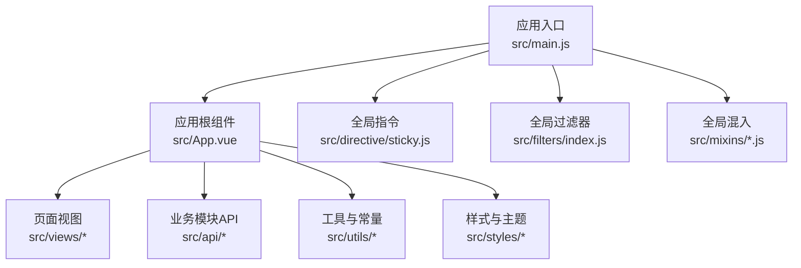
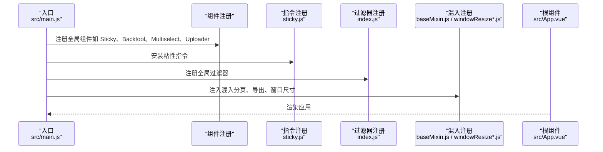
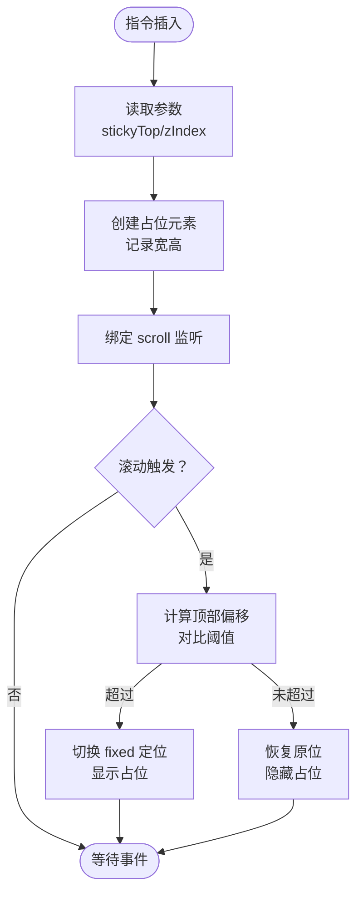
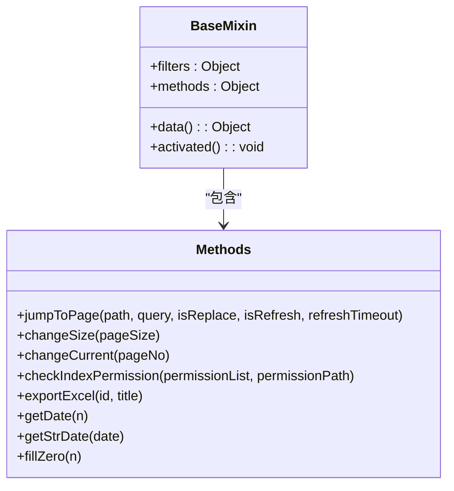
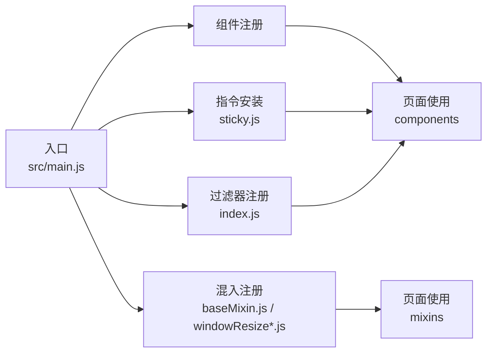

# UI组件

<cite>
**本文引用的文件**
- [src/main.js](file://src/main.js)
- [src/App.vue](file://src/App.vue)
- [src/directive/sticky.js](file://src/directive/sticky.js)
- [src/filters/index.js](file://src/filters/index.js)
- [src/mixins/baseMixin.js](file://src/mixins/baseMixin.js)
- [src/mixins/windowResize.js](file://src/mixins/windowResize.js)
- [src/mixins/windowResizeForBoe.js](file://src/mixins/windowResizeForBoe.js)
</cite>

## 目录
1. [简介](#简介)
2. [项目结构](#项目结构)
3. [核心组件](#核心组件)
4. [架构总览](#架构总览)
5. [组件详解](#组件详解)
6. [依赖关系分析](#依赖关系分析)
7. [性能考量](#性能考量)
8. [故障排查指南](#故障排查指南)
9. [结论](#结论)
10. [附录](#附录)

## 简介
本文件面向校园管理系统前端团队，系统化梳理并文档化项目中的UI组件库与配套能力，包括：
- 可复用组件的职责边界、属性定义、事件与插槽、样式定制方式
- 自定义指令、混入、过滤器的使用方法与最佳实践
- 生命周期与状态管理要点、性能优化建议
- 主题定制与响应式适配策略
- 常见问题定位与排障思路

目标是帮助设计师与开发者高效使用与扩展组件系统。

## 项目结构
本项目采用基于功能域的组织方式，核心入口在根目录，组件、指令、过滤器、混入等位于 src 下的对应目录；全局注册与路由守卫逻辑集中在入口文件中。

图表来源
- [src/main.js:1-221](file://src/main.js#L1-L221)
- [src/App.vue:1-183](file://src/App.vue#L1-L183)

章节来源
- [src/main.js:1-221](file://src/main.js#L1-L221)
- [src/App.vue:1-183](file://src/App.vue#L1-L183)

## 核心组件
本节从“可复用性”角度归纳当前项目中可直接使用的UI能力与扩展点，涵盖：
- 组件注册与全局可用性
- 全局指令与过滤器
- 可复用混入（mixin）
- 全局样式与主题入口

要点说明：
- 组件注册：通过全局注册实现按需引入与统一命名空间，便于在各页面直接使用。
- 指令与过滤器：以全局方式注入，减少重复代码，提升一致性。
- 混入：封装通用行为（如分页、导出、尺寸计算），在多个页面复用。
- 样式入口：集中引入主题与全局样式，保证视觉一致与可维护性。

章节来源
- [src/main.js:16-55](file://src/main.js#L16-L55)
- [src/App.vue:19-182](file://src/App.vue#L19-L182)

## 架构总览
下图展示应用启动阶段对组件、指令、过滤器、混入的装配流程，以及它们在运行期如何被页面消费。

图表来源
- [src/main.js:16-55](file://src/main.js#L16-L55)
- [src/directive/sticky.js:1-100](file://src/directive/sticky.js#L1-L100)
- [src/filters/index.js:1-121](file://src/filters/index.js#L1-L121)
- [src/mixins/baseMixin.js:1-103](file://src/mixins/baseMixin.js#L1-L103)
- [src/mixins/windowResize.js:1-63](file://src/mixins/windowResize.js#L1-L63)
- [src/mixins/windowResizeForBoe.js:1-34](file://src/mixins/windowResizeForBoe.js#L1-L34)
- [src/App.vue:1-183](file://src/App.vue#L1-L183)

## 组件详解

### 1) 全局指令：粘性布局指令
- 名称：sticky
- 功能：为元素提供“粘性”滚动行为，支持自定义粘性顶部间距与层级
- 使用场景：固定头部、侧栏吸顶、工具栏悬浮
- 参数
  - stickyTop：距离视窗顶部的粘性触发偏移（像素）
  - zIndex：元素层级
- 生命周期钩子
  - inserted：初始化监听与占位元素，绑定 scroll 监听
  - unbind：移除监听，清理资源
- 行为机制
  - 当滚动超过阈值时，元素切换为 fixed 定位并显示占位元素，避免布局塌陷
  - 滚动回退时恢复原位，隐藏占位

图表来源
- [src/directive/sticky.js:67-87](file://src/directive/sticky.js#L67-L87)

章节来源
- [src/directive/sticky.js:1-100](file://src/directive/sticky.js#L1-L100)

### 2) 全局过滤器
- 注册方式：遍历导出对象，统一注册为全局过滤器
- 常用用途：时间格式化、数字格式化、HTML 文本提取、千分位、时分秒截断
- 关键过滤器
  - 时间相对值：将时间戳转换为“分钟/小时/天”前
  - 时间格式化：支持多种模板输出
  - 时间忽略秒：将 HH:mm:ss 转换为 HH:mm
  - 数字格式化：科学计数缩写
  - 千分位：逗号分隔
  - HTML 转纯文本：去除标签
- 使用建议
  - 在模板或计算属性中使用，避免在大型列表中重复计算
  - 对于复杂格式化，优先在数据层处理，减少模板负担

章节来源
- [src/filters/index.js:1-121](file://src/filters/index.js#L1-L121)

### 3) 可复用混入（mixin）

#### 3.1 基础混入（baseMixin）
- 分页与导航
  - 内置分页参数：pageSize、pages、total、pageNo
  - 提供切换页大小与当前页的方法
  - 提供跳转页面方法（支持 replace 与刷新）
- 导出能力
  - 基于表格导出 Excel 的通用方法
- 日期工具
  - 获取相对日期、格式化日期、补零
- 其他
  - 在 keep-alive 场景中自动触发表格布局修正，避免错位
  - 权限校验辅助方法

图表来源
- [src/mixins/baseMixin.js:36-101](file://src/mixins/baseMixin.js#L36-L101)

章节来源
- [src/mixins/baseMixin.js:1-103](file://src/mixins/baseMixin.js#L1-L103)

#### 3.2 窗口尺寸混入（windowResize）
- 作用：根据浏览器窗口动态计算容器高度与宽度，适配不同布局
- 关键字段
  - cutH/cutW/headerH：裁剪高度/宽度与头部高度
  - maxH/maxW/boxH：计算后的最大高宽与容器高
  - 文件预览专用高度 filemaxH
- 生命周期
  - mounted：初始化并监听 resize
  - beforeDestroy：移除监听
- 路由联动
  - 监听路由变化，针对特定路径调整裁剪参数

章节来源
- [src/mixins/windowResize.js:1-63](file://src/mixins/windowResize.js#L1-L63)

#### 3.3 BOE 窗口尺寸混入（windowResizeForBoe）
- 作用：为 BOE 场景提供更精细的高度计算，适配内嵌与标题区差异
- 关键字段
  - comHeader、cutH2、innerBodyTitle/Title2 等
  - 计算 mainHeight、maxH、innerBodyH/H2
- 生命周期
  - mounted：初始化
  - beforeDestroy：移除监听

章节来源
- [src/mixins/windowResizeForBoe.js:1-34](file://src/mixins/windowResizeForBoe.js#L1-L34)

### 4) 全局组件注册与使用
- 已注册组件
  - 多选框：vue-multiselect
  - 粘性头部：Sticky
  - 返回工具：Backtool
  - 上传组件：Uploader（基于 wy-webUploader 动态创建）
- 使用方式
  - 在页面模板中直接使用对应标签名
  - 通过 props 传参、通过事件与插槽进行交互

章节来源
- [src/main.js:16-49](file://src/main.js#L16-L49)

### 5) 样式与主题
- 全局样式入口
  - 引入主题样式、normalize、自定义 SCSS
  - 在根组件中定义打印样式、滚动条样式、表单与表格基础样式
- 主题定制
  - 通过主题变量与 SCSS 混合覆盖，保持风格一致
  - 针对 Element UI 组件的局部样式微调
- 响应式适配
  - 基于媒体查询与动态高度计算，适配不同屏幕尺寸

章节来源
- [src/main.js:9-13](file://src/main.js#L9-L13)
- [src/App.vue:19-182](file://src/App.vue#L19-L182)

## 依赖关系分析
- 组件依赖
  - 页面依赖全局注册的组件与指令
  - 指令与过滤器作为运行期能力，不直接依赖具体页面
- 混入依赖
  - 混入依赖路由与工具库（如导出依赖 XLSX、FileSaver）
- 样式依赖
  - 根组件集中引入，页面无需重复引入

图表来源
- [src/main.js:16-55](file://src/main.js#L16-L55)
- [src/directive/sticky.js:4-88](file://src/directive/sticky.js#L4-L88)
- [src/filters/index.js:53-53](file://src/filters/index.js#L53-L53)
- [src/mixins/baseMixin.js:36-101](file://src/mixins/baseMixin.js#L36-L101)
- [src/mixins/windowResize.js:17-32](file://src/mixins/windowResize.js#L17-L32)
- [src/mixins/windowResizeForBoe.js:15-23](file://src/mixins/windowResizeForBoe.js#L15-L23)

## 性能考量
- 指令与过滤器
  - 指令仅在 DOM 插入时初始化，避免在模板中频繁创建新实例
  - 过滤器应尽量简单，避免在超大列表中重复计算，必要时在数据层预处理
- 混入与组件
  - 在 keep-alive 场景中，利用 activated 钩子触发表格布局修正，避免白屏或错位
  - 导出功能使用一次性生成与保存，避免多次 IO
- 样式与渲染
  - 集中引入样式，减少重复加载
  - 使用媒体查询与动态高度，避免强制重排

## 故障排查指南
- 粘性指令无效
  - 检查是否正确安装指令，确认 inserted 钩子已执行
  - 确认父容器存在且可滚动
- 过滤器结果异常
  - 核对输入类型与模板使用方式
  - 对于时间类过滤器，注意时区与格式匹配
- 表格错位
  - 在页面激活时触发布局修正（已在混入中处理）
- 导出失败
  - 检查表格选择器是否正确，确认浏览器允许下载
- 窗口尺寸异常
  - 确认 mounted 中已初始化，beforeDestroy 是否正确移除监听

章节来源
- [src/directive/sticky.js:85-87](file://src/directive/sticky.js#L85-L87)
- [src/mixins/baseMixin.js:21-27](file://src/mixins/baseMixin.js#L21-L27)
- [src/mixins/windowResize.js:30-32](file://src/mixins/windowResize.js#L30-L32)

## 结论
本组件库通过“全局注册 + 指令 + 过滤器 + 混入”的组合，提供了高复用、低耦合的UI支撑能力。建议在后续迭代中：
- 明确组件边界，逐步沉淀为独立包
- 为常用混入补充单元测试
- 规范指令与过滤器的输入输出契约
- 扩展主题变量体系，完善暗色/高对比度支持

## 附录

### A. 组件清单与使用指引
- 组件
  - 多选框：vue-multiselect
  - 粘性头部：Sticky
  - 返回工具：Backtool
  - 上传组件：Uploader
- 使用指引
  - 在页面模板中直接使用对应标签名
  - 通过 props 传参、通过事件与插槽进行交互
- 示例参考
  - 组件注册与使用位置：[src/main.js:16-49](file://src/main.js#L16-L49)

章节来源
- [src/main.js:16-49](file://src/main.js#L16-L49)

### B. 指令与过滤器速查
- 指令
  - 粘性：v-sticky="{ stickyTop, zIndex }"
- 过滤器
  - 时间相对值、时间格式化、时间忽略秒、数字格式化、千分位、HTML 转文本
- 使用参考
  - 过滤器注册位置：[src/main.js:53-55](file://src/main.js#L53-L55)
  - 过滤器实现位置：[src/filters/index.js:1-121](file://src/filters/index.js#L1-L121)

章节来源
- [src/main.js:53-55](file://src/main.js#L53-L55)
- [src/filters/index.js:1-121](file://src/filters/index.js#L1-L121)

### C. 混入能力速查
- 基础混入（baseMixin）
  - 分页：changeSize、changeCurrent、jumpToPage
  - 导出：exportExcel
  - 日期：getDate、getStrDate、fillZero
  - 权限：checkIndexPermission
  - 活跃态：activated 中触发表格布局修正
- 窗口尺寸混入（windowResize / windowResizeForBoe）
  - 动态计算 maxH/maxW/boxH 等，适配不同布局
- 使用参考
  - 混入注册位置：[src/main.js:16-49](file://src/main.js#L16-L49)
  - 混入实现位置：[src/mixins/baseMixin.js:1-103](file://src/mixins/baseMixin.js#L1-L103)，[src/mixins/windowResize.js:1-63](file://src/mixins/windowResize.js#L1-L63)，[src/mixins/windowResizeForBoe.js:1-34](file://src/mixins/windowResizeForBoe.js#L1-L34)

章节来源
- [src/mixins/baseMixin.js:1-103](file://src/mixins/baseMixin.js#L1-L103)
- [src/mixins/windowResize.js:1-63](file://src/mixins/windowResize.js#L1-L63)
- [src/mixins/windowResizeForBoe.js:1-34](file://src/mixins/windowResizeForBoe.js#L1-L34)