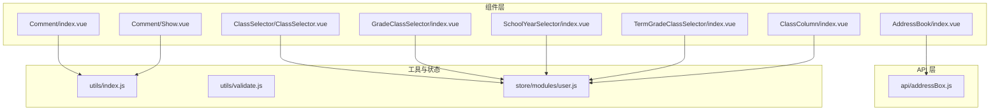
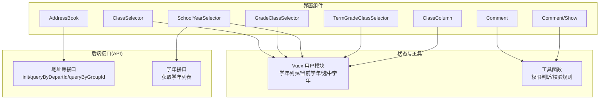
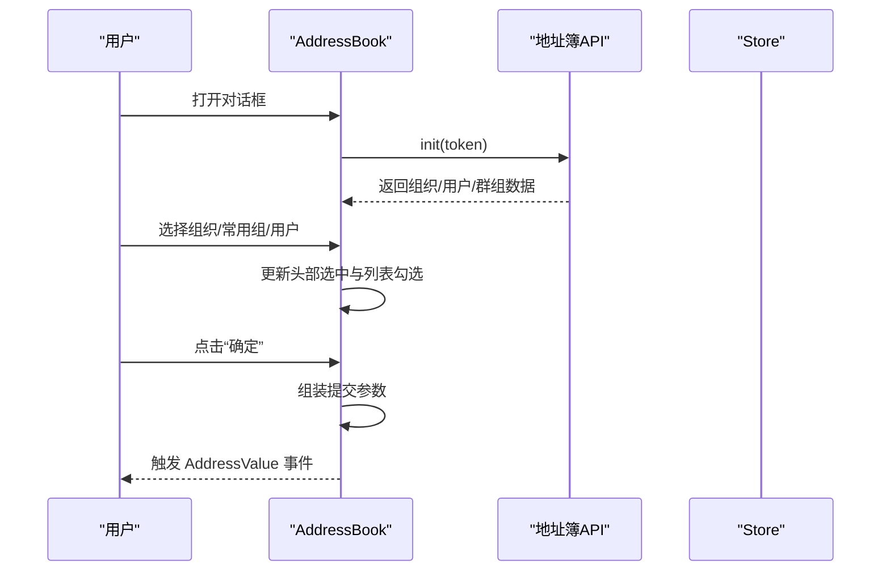
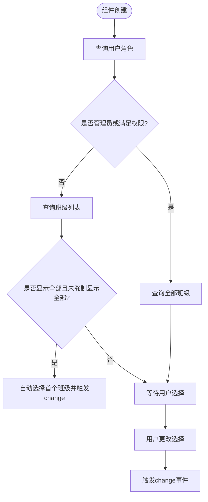
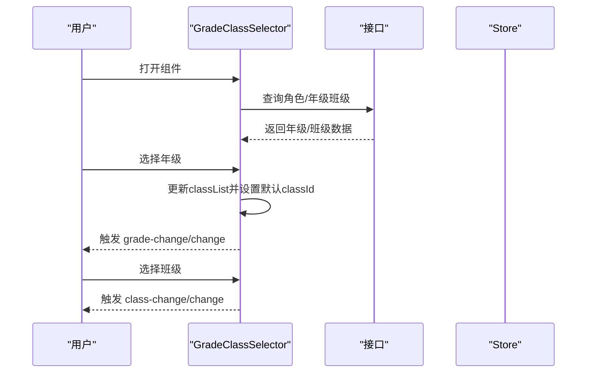
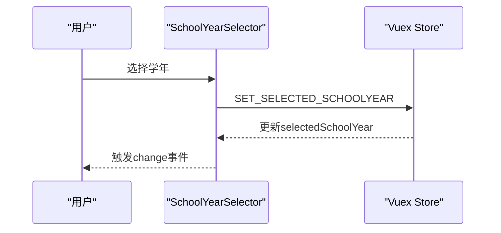
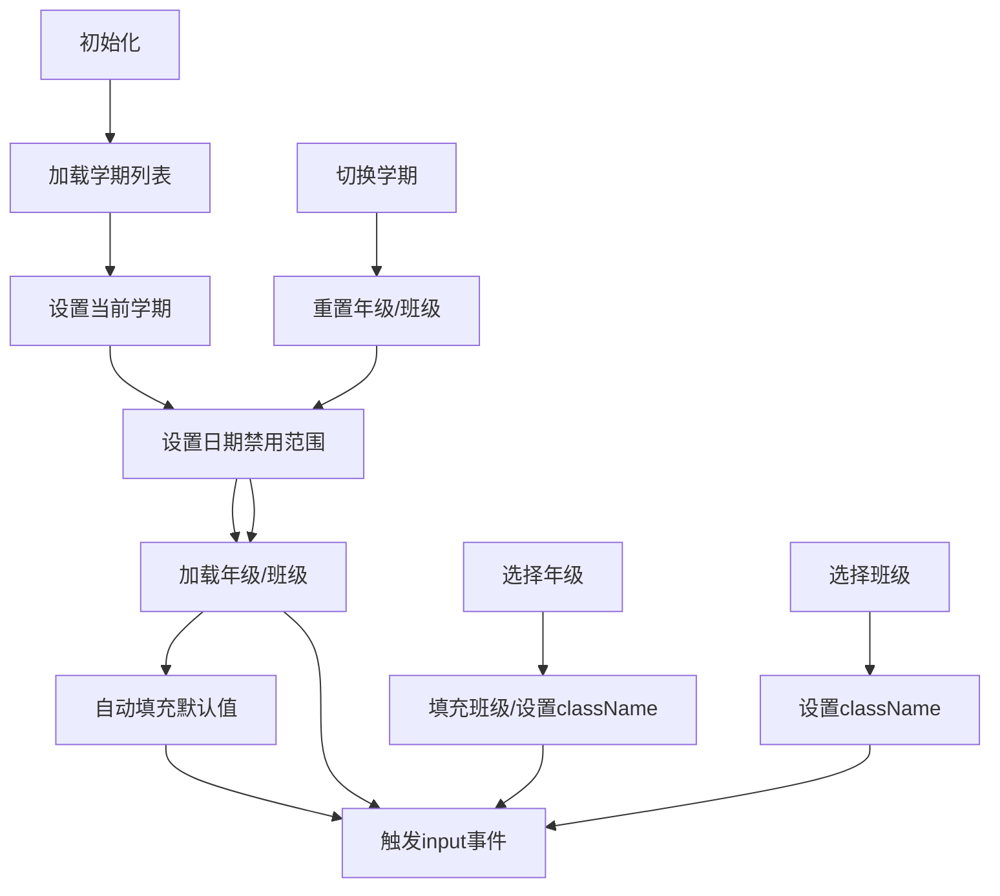
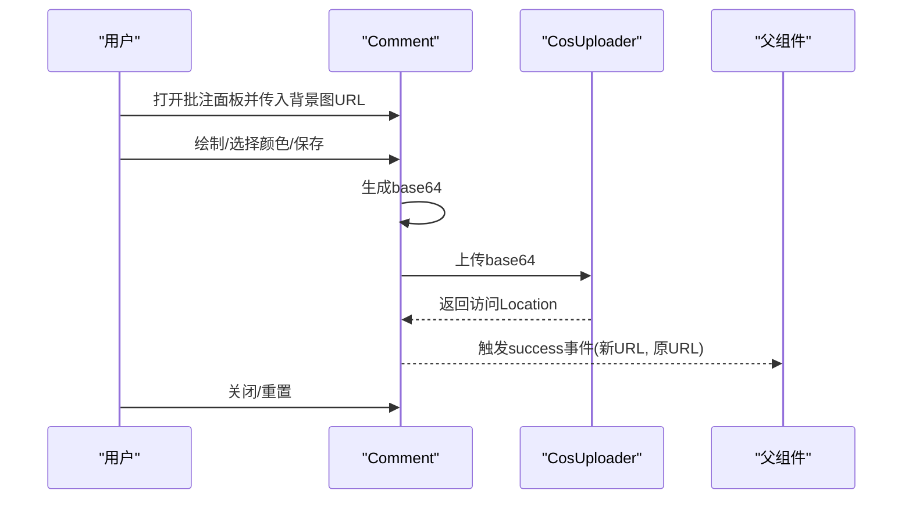
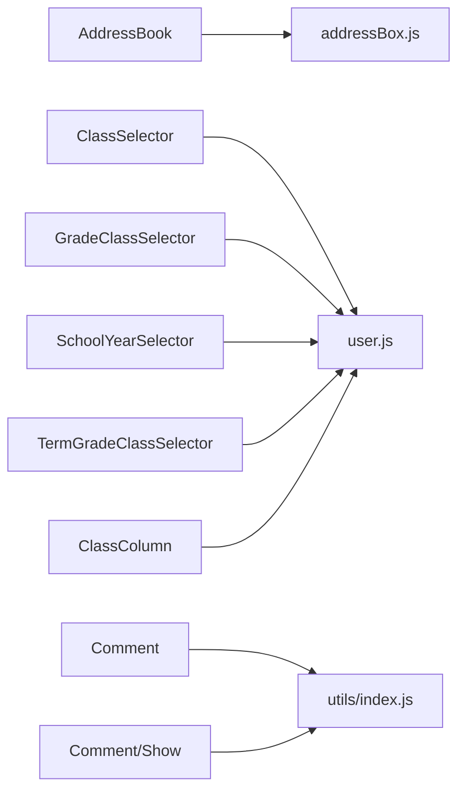

# 业务组件

<cite>
**本文引用的文件**
- [src/components/AddressBook/index.vue](file://src/components/AddressBook/index.vue)
- [src/api/addressBox.js](file://src/api/addressBox.js)
- [src/components/ClassSelector/ClassSelector.vue](file://src/components/ClassSelector/ClassSelector.vue)
- [src/components/GradeClassSelector/index.vue](file://src/components/GradeClassSelector/index.vue)
- [src/components/SchoolYearSelector/index.vue](file://src/components/SchoolYearSelector/index.vue)
- [src/store/modules/user.js](file://src/store/modules/user.js)
- [src/components/ClassColumn/index.vue](file://src/components/ClassColumn/index.vue)
- [src/components/Comment/index.vue](file://src/components/Comment/index.vue)
- [src/components/Comment/Show.vue](file://src/components/Comment/Show.vue)
- [src/utils/index.js](file://src/utils/index.js)
- [src/utils/validate.js](file://src/utils/validate.js)
- [src/components/TermGradeClassSelector/index.vue](file://src/components/TermGradeClassSelector/index.vue)
</cite>

## 目录
1. [简介](#简介)
2. [项目结构](#项目结构)
3. [核心组件](#核心组件)
4. [架构总览](#架构总览)
5. [详细组件分析](#详细组件分析)
6. [依赖关系分析](#依赖关系分析)
7. [性能考量](#性能考量)
8. [故障排查指南](#故障排查指南)
9. [结论](#结论)
10. [附录](#附录)

## 简介
本文件面向校园管理系统的业务开发者，系统性梳理并文档化以下业务组件：地址簿、班级选择器、年级班级选择器、学年选择器、学期选择器、班级列显示、评论组件。内容覆盖组件功能、数据模型、交互行为、配置选项、事件回调、与业务系统的集成方式、最佳实践以及权限控制与数据安全注意事项，帮助开发者快速理解与高效使用。

## 项目结构
围绕业务组件的相关目录与文件分布如下：
- 组件层：位于 src/components 下，包含各业务组件的 Vue 单文件组件与子组件
- API 层：位于 src/api 下，封装与后端交互的接口方法
- 工具层：位于 src/utils 下，提供通用工具函数（如权限判断、校验规则）
- 状态层：位于 src/store/modules 下，集中管理用户、权限、学年等全局状态

图表来源
- [src/components/AddressBook/index.vue:1-427](file://src/components/AddressBook/index.vue#L1-L427)
- [src/api/addressBox.js:1-390](file://src/api/addressBox.js#L1-L390)
- [src/components/ClassSelector/ClassSelector.vue:1-109](file://src/components/ClassSelector/ClassSelector.vue#L1-L109)
- [src/components/GradeClassSelector/index.vue:1-188](file://src/components/GradeClassSelector/index.vue#L1-L188)
- [src/components/SchoolYearSelector/index.vue:1-37](file://src/components/SchoolYearSelector/index.vue#L1-L37)
- [src/components/TermGradeClassSelector/index.vue:1-286](file://src/components/TermGradeClassSelector/index.vue#L1-L286)
- [src/components/ClassColumn/index.vue:1-124](file://src/components/ClassColumn/index.vue#L1-L124)
- [src/components/Comment/index.vue:1-171](file://src/components/Comment/index.vue#L1-L171)
- [src/components/Comment/Show.vue:1-93](file://src/components/Comment/Show.vue#L1-L93)
- [src/utils/index.js:1-200](file://src/utils/index.js#L1-L200)
- [src/utils/validate.js:1-72](file://src/utils/validate.js#L1-L72)
- [src/store/modules/user.js:1-447](file://src/store/modules/user.js#L1-L447)

章节来源
- [src/components/AddressBook/index.vue:1-427](file://src/components/AddressBook/index.vue#L1-L427)
- [src/api/addressBox.js:1-390](file://src/api/addressBox.js#L1-L390)
- [src/components/ClassSelector/ClassSelector.vue:1-109](file://src/components/ClassSelector/ClassSelector.vue#L1-L109)
- [src/components/GradeClassSelector/index.vue:1-188](file://src/components/GradeClassSelector/index.vue#L1-L188)
- [src/components/SchoolYearSelector/index.vue:1-37](file://src/components/SchoolYearSelector/index.vue#L1-L37)
- [src/components/TermGradeClassSelector/index.vue:1-286](file://src/components/TermGradeClassSelector/index.vue#L1-L286)
- [src/components/ClassColumn/index.vue:1-124](file://src/components/ClassColumn/index.vue#L1-L124)
- [src/components/Comment/index.vue:1-171](file://src/components/Comment/index.vue#L1-L171)
- [src/components/Comment/Show.vue:1-93](file://src/components/Comment/Show.vue#L1-L93)
- [src/utils/index.js:1-200](file://src/utils/index.js#L1-L200)
- [src/utils/validate.js:1-72](file://src/utils/validate.js#L1-L72)
- [src/store/modules/user.js:1-447](file://src/store/modules/user.js#L1-L447)

## 核心组件
- 地址簿 AddressBook：支持组织架构树、常用组、用户检索与多类型选择，输出统一的提交参数结构
- 班级选择器 ClassSelector：按角色/权限动态展示可选班级，支持“全部”选项
- 年级班级选择器 GradeClassSelector：联动选择年级与班级，支持学校管理员与年级管理员两类角色
- 学年选择器 SchoolYearSelector：基于全局状态选择学年，并触发变更事件
- 学期-年级-班级选择器 TermGradeClassSelector：选择学期、可选时间段、年级与班级，支持“全部”选项
- 班级列显示 ClassColumn：勾选多个班级以用于列展示
- 评论组件 Comment：手写签名/批注绘制、颜色切换、保存上传、重置与关闭
- 评论展示组件 Comment/Show：展示带遮罩图层的批注结果，支持删除

章节来源
- [src/components/AddressBook/index.vue:1-427](file://src/components/AddressBook/index.vue#L1-L427)
- [src/components/ClassSelector/ClassSelector.vue:1-109](file://src/components/ClassSelector/ClassSelector.vue#L1-L109)
- [src/components/GradeClassSelector/index.vue:1-188](file://src/components/GradeClassSelector/index.vue#L1-L188)
- [src/components/SchoolYearSelector/index.vue:1-37](file://src/components/SchoolYearSelector/index.vue#L1-L37)
- [src/components/TermGradeClassSelector/index.vue:1-286](file://src/components/TermGradeClassSelector/index.vue#L1-L286)
- [src/components/ClassColumn/index.vue:1-124](file://src/components/ClassColumn/index.vue#L1-L124)
- [src/components/Comment/index.vue:1-171](file://src/components/Comment/index.vue#L1-L171)
- [src/components/Comment/Show.vue:1-93](file://src/components/Comment/Show.vue#L1-L93)

## 架构总览
组件与状态/工具的交互关系如下：

图表来源
- [src/components/AddressBook/index.vue:134-299](file://src/components/AddressBook/index.vue#L134-L299)
- [src/api/addressBox.js:10-19](file://src/api/addressBox.js#L10-L19)
- [src/components/ClassSelector/ClassSelector.vue:64-96](file://src/components/ClassSelector/ClassSelector.vue#L64-L96)
- [src/components/GradeClassSelector/index.vue:82-114](file://src/components/GradeClassSelector/index.vue#L82-L114)
- [src/components/SchoolYearSelector/index.vue:21-31](file://src/components/SchoolYearSelector/index.vue#L21-L31)
- [src/store/modules/user.js:97-110](file://src/store/modules/user.js#L97-L110)

## 详细组件分析

### 地址簿 AddressBook
- 功能概述
  - 支持组织架构树浏览与选择、常用组浏览与展开、用户检索
  - 头部展示已选条目，支持逐项删除
  - 确定后输出统一的提交参数结构（部门、用户、群组 JSON）
- 数据模型
  - 列表项字段：id、pid、name、wxDepartId/wxTagId、avatar、mobile、dataType、hasChild、disabled、type
  - 提交参数：departJson、groupJson、userJson
- 交互流程
  - 初始化：根据 token 获取组织与群组数据
  - 组织树：点击节点加载下级，面包屑导航定位
  - 常用组：点击组加载组内用户；返回按钮恢复初始群组列表
  - 选择：复选框勾选；头部展示已选；删除头部项同步取消勾选
  - 确认：生成提交参数并触发自定义事件
- 配置与事件
  - Props：config（控制显示标签页）、isbutton（按钮/输入框两种形态）、default（默认选中）
  - Events：AddressValue（携带提交参数）
- 权限与安全
  - 使用 token 访问接口，避免明文传递敏感信息
  - 仅对可见类型进行过滤（通过 departType 控制）
- 最佳实践
  - 在父组件中监听 AddressValue，将返回的 JSON 字符串持久化或传给后端
  - 若需默认值，传入 default 对象的 departJson/userJson/groupJson 字段

图表来源
- [src/components/AddressBook/index.vue:184-298](file://src/components/AddressBook/index.vue#L184-L298)
- [src/api/addressBox.js:10-19](file://src/api/addressBox.js#L10-L19)

章节来源
- [src/components/AddressBook/index.vue:1-427](file://src/components/AddressBook/index.vue#L1-L427)
- [src/api/addressBox.js:10-390](file://src/api/addressBox.js#L10-L390)

### 班级选择器 ClassSelector
- 功能概述
  - 根据用户角色/权限决定是否显示“全部”选项
  - 仅在非管理员时自动选择首个班级
- 数据模型
  - classList：从查询接口返回的班级列表
  - selectClass：当前选中班级 ID
- 交互流程
  - 查询角色列表，判定是否为学校管理员或满足权限条件
  - 调用查询接口获取班级列表
  - 变更时触发 change 事件
- 配置与事件
  - Props：inline、isShowText、schoolManagerRoles、schoolManagerPermissions、isShowAll
  - Events：change（返回选中班级 ID）

图表来源
- [src/components/ClassSelector/ClassSelector.vue:63-102](file://src/components/ClassSelector/ClassSelector.vue#L63-L102)

章节来源
- [src/components/ClassSelector/ClassSelector.vue:1-109](file://src/components/ClassSelector/ClassSelector.vue#L1-L109)

### 年级班级选择器 GradeClassSelector
- 功能概述
  - 支持学校管理员与年级管理员两类角色
  - 自动联动：选择年级后自动填充班级列表，必要时默认选中第一个班级
- 数据模型
  - gradeList：年级列表
  - classList：当前年级下的班级列表
  - selectGrade/selectClass：当前选中
- 交互流程
  - 查询角色，判定管理员身份
  - 若为学校管理员：直接获取全部年级班级
  - 若为年级管理员：仅获取其负责的年级
  - 若为普通教师：仅获取其负责的班级
  - 选择年级后更新班级列表并触发 grade-change 与 change 事件
  - 选择班级后触发 class-change 与 change 事件
- 配置与事件
  - Props：inline、isShowText、schoolManagerRoles、gradeManagerRoles、schoolManagerPermissions、gradeManagerPermissions
  - Events：grade-change、class-change、change（返回 {gradeId, classId}）

图表来源
- [src/components/GradeClassSelector/index.vue:81-181](file://src/components/GradeClassSelector/index.vue#L81-L181)

章节来源
- [src/components/GradeClassSelector/index.vue:1-188](file://src/components/GradeClassSelector/index.vue#L1-L188)

### 学年选择器 SchoolYearSelector
- 功能概述
  - 基于全局状态 schoolYearList 与 selectedSchoolYear 渲染下拉
  - 修改后通过 Vuex mutation 设置选中学年，并触发 change 事件
- 数据模型
  - computed：schoolYearList、selectedSchoolYear
  - mutation：SET_SELECTED_SCHOOLYEAR
- 交互流程
  - 选择学年后，调用 SET_SELECTED_SCHOOLYEAR 更新状态
  - 触发 change 事件，便于父组件响应
- 配置与事件
  - Props：无
  - Events：change（返回选中学年标识）

图表来源
- [src/components/SchoolYearSelector/index.vue:21-31](file://src/components/SchoolYearSelector/index.vue#L21-L31)
- [src/store/modules/user.js:97-110](file://src/store/modules/user.js#L97-L110)

章节来源
- [src/components/SchoolYearSelector/index.vue:1-37](file://src/components/SchoolYearSelector/index.vue#L1-L37)
- [src/store/modules/user.js:97-110](file://src/store/modules/user.js#L97-L110)

### 学期-年级-班级选择器 TermGradeClassSelector
- 功能概述
  - 选择学期（termId），可选时间段（daterange），再选择年级与班级
  - 支持“全部年级/班级”选项，自动设置默认日期范围
- 数据模型
  - termList：学期列表
  - allGradeClassList：按学期聚合的年级/班级树
  - obj：{termId, duration[], gradeId, classId, className}
- 交互流程
  - 初始化：获取学期列表，设置当前学期，计算禁用日期范围，加载年级/班级
  - 切换学期：重置年级/班级，重新设置日期范围与默认日期
  - 选择年级：根据 isGradeShowAll 决定是否默认“全部班级”，并回填 className
  - 选择班级：回填 className
  - 输入绑定：通过 v-model 的 input 事件向外抛出最新 obj
- 配置与事件
  - Props：value（双向绑定对象）、queryArgs（查询参数）、isShowDuration、isGradeShowAll、isClassShow
  - Events：input（返回最新 obj）、change（由父组件自行处理）

图表来源
- [src/components/TermGradeClassSelector/index.vue:140-279](file://src/components/TermGradeClassSelector/index.vue#L140-L279)

章节来源
- [src/components/TermGradeClassSelector/index.vue:1-286](file://src/components/TermGradeClassSelector/index.vue#L1-L286)

### 班级列显示 ClassColumn
- 功能概述
  - 以弹窗形式提供全选/反选与多选能力，支持将选中班级回显到头部
- 数据模型
  - classList：全部班级列表
  - checkedClassList：已选班级 ID 数组
  - headClassList：头部展示的班级对象数组
- 交互流程
  - 初始化：请求全部班级列表
  - 全选/反选：根据全选状态批量勾选
  - 确定：将已选班级 ID 映射为对象，替换头部展示
- 配置与事件
  - Props：value（默认选中班级数组）
  - 无自定义事件（通过父组件监听 v-model 或内部状态变化）

章节来源
- [src/components/ClassColumn/index.vue:1-124](file://src/components/ClassColumn/index.vue#L1-L124)

### 评论组件 Comment 与展示 Comment/Show
- 功能概述
  - 绘制签名/批注：提供画笔颜色、清空、重置、保存
  - 上传与回调：将绘制结果转为图片并上传，返回访问链接
  - 展示：叠加遮罩图层展示原图与批注图，支持删除
- 数据模型
  - 组件内部：showBox、bgUrl、lineWidth、lineColor、colorList、bgColor、resultImg、cos、isComplete、imgUrl
  - Props：value（初始背景图 URL）、width、height、isShowSaveBtn、isShowResetBtn
- 交互流程
  - 打开：传入背景图 URL，重置画布
  - 保存：生成 base64，上传至云存储，触发 success 回调（返回新 URL 与原 URL）
  - 关闭/重置：确认后关闭或重置画布
  - 展示：传入 picList（包含 picUrl 与 markUrl）渲染叠加图层
- 配置与事件
  - Comment
    - Props：value、width、height、isShowSaveBtn、isShowResetBtn
    - Events：success（返回新 URL 与原 URL）
  - Comment/Show
    - Props：picList、showClose、closeDialog
    - Events：delPic（删除指定索引）

图表来源
- [src/components/Comment/index.vue:76-110](file://src/components/Comment/index.vue#L76-L110)

章节来源
- [src/components/Comment/index.vue:1-171](file://src/components/Comment/index.vue#L1-L171)
- [src/components/Comment/Show.vue:1-93](file://src/components/Comment/Show.vue#L1-L93)

## 依赖关系分析
- 组件与 API
  - AddressBook 依赖地址簿 API（init、queryByDepartId、queryByGroupId、packgeDepartArray、getCommitAddressParams 等）
  - 其他选择器组件依赖公共 API（如学期/班级查询）
- 组件与状态
  - SchoolYearSelector 依赖 Vuex 中的学年列表与当前选中学年
  - ClassSelector、GradeClassSelector、TermGradeClassSelector 依赖用户角色/权限判断与全局状态
- 工具与校验
  - 评论组件依赖工具库进行上传与通用工具函数
  - 表单场景可结合 validate.js 的校验规则

图表来源
- [src/components/AddressBook/index.vue:134-144](file://src/components/AddressBook/index.vue#L134-L144)
- [src/api/addressBox.js:1-390](file://src/api/addressBox.js#L1-L390)
- [src/components/ClassSelector/ClassSelector.vue:16-22](file://src/components/ClassSelector/ClassSelector.vue#L16-L22)
- [src/components/GradeClassSelector/index.vue:25-31](file://src/components/GradeClassSelector/index.vue#L25-L31)
- [src/components/SchoolYearSelector/index.vue:17-29](file://src/components/SchoolYearSelector/index.vue#L17-L29)
- [src/components/TermGradeClassSelector/index.vue:58-63](file://src/components/TermGradeClassSelector/index.vue#L58-L63)
- [src/components/ClassColumn/index.vue](file://src/components/ClassColumn/index.vue#L26)
- [src/components/Comment/index.vue:25-26](file://src/components/Comment/index.vue#L25-L26)
- [src/components/Comment/Show.vue:13-13](file://src/components/Comment/Show.vue#L13-L13)
- [src/utils/index.js:1-200](file://src/utils/index.js#L1-L200)
- [src/store/modules/user.js:97-110](file://src/store/modules/user.js#L97-L110)

章节来源
- [src/components/AddressBook/index.vue:134-144](file://src/components/AddressBook/index.vue#L134-L144)
- [src/api/addressBox.js:1-390](file://src/api/addressBox.js#L1-L390)
- [src/components/ClassSelector/ClassSelector.vue:16-22](file://src/components/ClassSelector/ClassSelector.vue#L16-L22)
- [src/components/GradeClassSelector/index.vue:25-31](file://src/components/GradeClassSelector/index.vue#L25-L31)
- [src/components/SchoolYearSelector/index.vue:17-29](file://src/components/SchoolYearSelector/index.vue#L17-L29)
- [src/components/TermGradeClassSelector/index.vue:58-63](file://src/components/TermGradeClassSelector/index.vue#L58-L63)
- [src/components/ClassColumn/index.vue](file://src/components/ClassColumn/index.vue#L26)
- [src/components/Comment/index.vue:25-26](file://src/components/Comment/index.vue#L25-L26)
- [src/components/Comment/Show.vue:13-13](file://src/components/Comment/Show.vue#L13-L13)
- [src/utils/index.js:1-200](file://src/utils/index.js#L1-L200)
- [src/store/modules/user.js:97-110](file://src/store/modules/user.js#L97-L110)

## 性能考量
- 列表渲染
  - AddressBook 与 GradeClassSelector 使用 v-for 渲染大量选项，建议在父组件中缓存查询结果，避免重复请求
- 事件触发
  - TermGradeClassSelector 在多项变更时频繁触发 input 事件，建议父组件节流或合并状态更新
- 图片上传
  - 评论组件生成 base64 后上传，建议在移动端限制图片尺寸或采用压缩策略，降低网络开销
- 状态更新
  - SchoolYearSelector 通过 mutation 更新全局状态，确保只在必要时触发，避免不必要的重渲染

## 故障排查指南
- 地址簿无法加载数据
  - 检查 token 是否有效；确认 init 接口返回的组织/用户/群组数据结构
  - 确认 departType 过滤是否导致节点不可见
- 选择器无数据或默认值异常
  - 核查角色/权限判断逻辑；确认 queryArgs 参数是否正确传递
  - 对于 TermGradeClassSelector，确认当前学期与日期范围设置
- 评论组件保存失败
  - 检查 CosUploader 初始化参数与上传策略；确认返回的 Location 是否可用
- 学年选择无效
  - 确认 Vuex 中 selectedSchoolYear 是否被正确更新；检查父组件是否监听 change 事件

章节来源
- [src/api/addressBox.js:10-19](file://src/api/addressBox.js#L10-L19)
- [src/components/ClassSelector/ClassSelector.vue:64-96](file://src/components/ClassSelector/ClassSelector.vue#L64-L96)
- [src/components/TermGradeClassSelector/index.vue:140-166](file://src/components/TermGradeClassSelector/index.vue#L140-L166)
- [src/components/Comment/index.vue:84-95](file://src/components/Comment/index.vue#L84-L95)
- [src/store/modules/user.js:107-110](file://src/store/modules/user.js#L107-L110)

## 结论
上述业务组件围绕“选择器 + 地址簿 + 评论”三大类场景构建，具备清晰的职责划分与稳定的交互模式。通过统一的状态管理与工具函数，组件在权限控制与数据安全方面具备良好基础。建议在实际业务中结合父组件的事件与状态管理，合理使用 v-model 与事件回调，确保数据一致性与用户体验。

## 附录
- 权限控制与数据安全
  - 使用 token 访问接口，避免明文传递敏感信息
  - 通过角色/权限判断控制“全部”选项与默认值策略
  - 评论组件上传采用云存储，注意访问策略与防盗链
- 最佳实践
  - 将组件的事件回调与状态更新集中在父组件，减少组件间耦合
  - 对高频操作（如日期选择、班级切换）进行防抖/节流
  - 对移动端上传进行尺寸与格式限制，提升稳定性