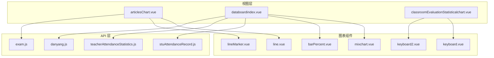
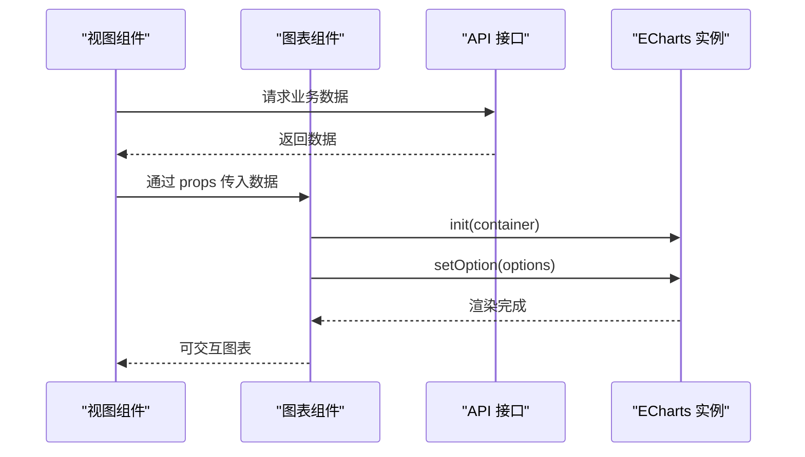
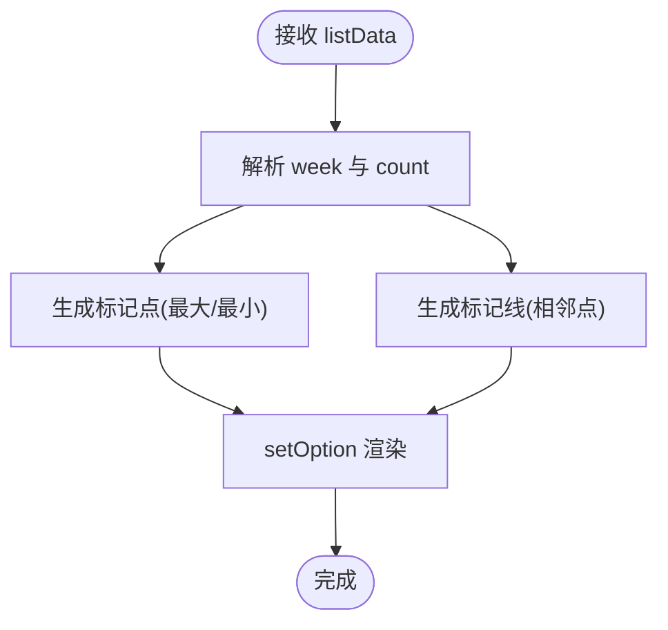
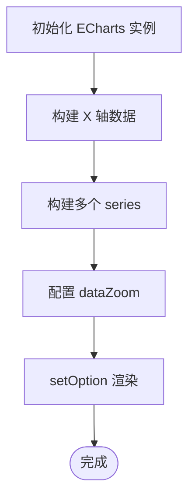
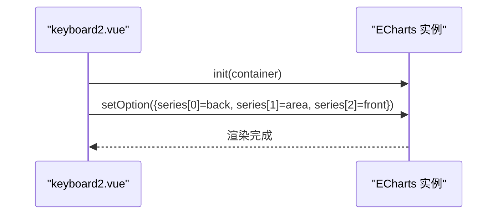
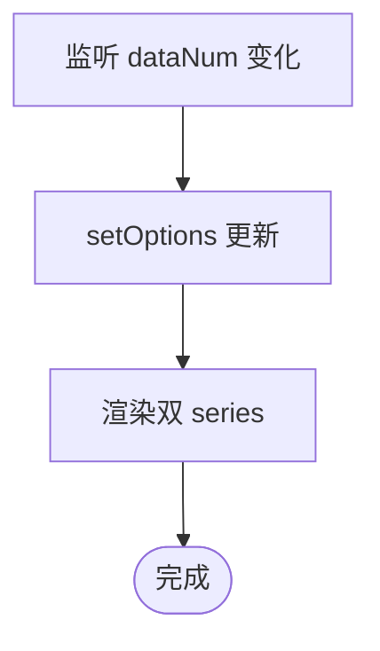
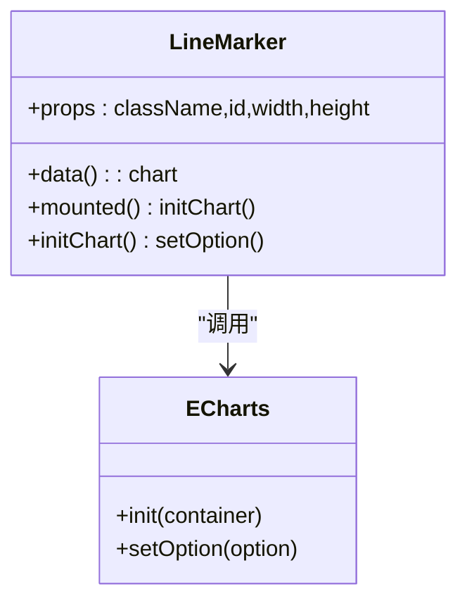
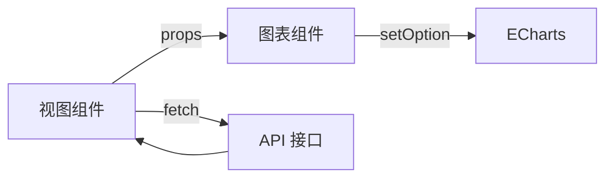

# 图表组件

<cite>
**本文引用的文件**
- [barPercent.vue](file://src/components/Charts/barPercent.vue)
- [keyboard.vue](file://src/components/Charts/keyboard.vue)
- [keyboard2.vue](file://src/components/Charts/keyboard2.vue)
- [line.vue](file://src/components/Charts/line.vue)
- [lineMarker.vue](file://src/components/Charts/lineMarker.vue)
- [mixchart.vue](file://src/components/Charts/mixchart.vue)
- [articlesChart.vue](file://src/views/template/dashboard/editor/articlesChart.vue)
- [databoardindex.vue](file://src/views/databoard/databoardindex.vue)
- [classroomEvaluationStatisticalchart.vue](file://src/views/classroomEvaluation/classroomEvaluationStatisticalchart.vue)
- [stuAttendanceRecord.js](file://src/api/schoolManage/stuAttendanceRecord.js)
- [teacherAttendanceStatistics.js](file://src/api/systemSet/teacherAttendanceStatistics.js)
- [exam.js](file://src/api/systemSet/exam.js)
- [danyang.js](file://src/api/homePage/danyang.js)
</cite>

## 目录
1. [简介](#简介)
2. [项目结构](#项目结构)
3. [核心组件](#核心组件)
4. [架构总览](#架构总览)
5. [详细组件分析](#详细组件分析)
6. [依赖关系分析](#依赖关系分析)
7. [性能考虑](#性能考虑)
8. [故障排查指南](#故障排查指南)
9. [结论](#结论)
10. [附录](#附录)

## 简介
本文件系统性地文档化校园管理系统中的图表可视化组件，覆盖柱状图、折线图、混合图表、键盘图等组件的功能特性、配置选项、数据格式、样式定制、交互行为与集成方式。文档同时提供响应式适配、动画效果与性能优化建议，并给出与后端数据源的集成与实时更新机制说明，帮助数据分析师与开发者高效使用这些组件进行数据展示。

## 项目结构
图表组件集中于 src/components/Charts 目录，配套页面位于 src/views 下，数据接口位于 src/api 目录。典型使用模式为：页面通过 props 将数据传递给图表组件，图表组件内部基于 ECharts 初始化并渲染。

**图表来源**
- [articlesChart.vue:1-35](file://src/views/template/dashboard/editor/articlesChart.vue#L1-L35)
- [databoardindex.vue:1-701](file://src/views/databoard/databoardindex.vue#L1-L701)
- [classroomEvaluationStatisticalchart.vue:1-145](file://src/views/classroomEvaluation/classroomEvaluationStatisticalchart.vue#L1-L145)
- [line.vue:1-147](file://src/components/Charts/line.vue#L1-L147)
- [mixchart.vue:1-267](file://src/components/Charts/mixchart.vue#L1-L267)
- [keyboard.vue:1-113](file://src/components/Charts/keyboard.vue#L1-L113)
- [keyboard2.vue:1-150](file://src/components/Charts/keyboard2.vue#L1-L150)
- [barPercent.vue:1-105](file://src/components/Charts/barPercent.vue#L1-L105)
- [lineMarker.vue:1-220](file://src/components/Charts/lineMarker.vue#L1-L220)
- [stuAttendanceRecord.js:1-111](file://src/api/schoolManage/stuAttendanceRecord.js#L1-L111)
- [teacherAttendanceStatistics.js:1-248](file://src/api/systemSet/teacherAttendanceStatistics.js#L1-L248)
- [exam.js:1-455](file://src/api/systemSet/exam.js#L1-L455)
- [danyang.js:1-52](file://src/api/homePage/danyang.js#L1-L52)

**章节来源**
- [articlesChart.vue:1-35](file://src/views/template/dashboard/editor/articlesChart.vue#L1-L35)
- [databoardindex.vue:1-701](file://src/views/databoard/databoardindex.vue#L1-L701)
- [classroomEvaluationStatisticalchart.vue:1-145](file://src/views/classroomEvaluation/classroomEvaluationStatisticalchart.vue#L1-L145)

## 核心组件
- 折线图组件 line.vue：接收数组型数据，自动解析周序号与数值，支持标记点、标记线与动画。
- 混合图表组件 mixchart.vue：在同一画布内组合柱状图与折线图，支持堆叠、标签显示与缩放。
- 键盘图组件 keyboard.vue / keyboard2.vue：基于 ECharts 的柱状图风格，强调视觉映射与弹性动画。
- 百分比柱状图 barPercent.vue：用于展示单一指标完成度，支持动态数值更新。
- 带标注的折线图 lineMarker.vue：多系列折线叠加面积填充，适合对比类场景。

以上组件均通过 ECharts 初始化，具备统一的 props 接口（className、id、width、height），并在 mounted 生命周期内完成初始化与 setOption 渲染。

**章节来源**
- [line.vue:1-147](file://src/components/Charts/line.vue#L1-L147)
- [mixchart.vue:1-267](file://src/components/Charts/mixchart.vue#L1-L267)
- [keyboard.vue:1-113](file://src/components/Charts/keyboard.vue#L1-L113)
- [keyboard2.vue:1-150](file://src/components/Charts/keyboard2.vue#L1-L150)
- [barPercent.vue:1-105](file://src/components/Charts/barPercent.vue#L1-L105)
- [lineMarker.vue:1-220](file://src/components/Charts/lineMarker.vue#L1-L220)

## 架构总览
图表组件采用“视图层 -> 组件层 -> ECharts 渲染”的分层设计。视图层负责数据拉取与状态管理，组件层负责数据格式转换与 ECharts 配置，最终由 ECharts 完成渲染与交互。

**图表来源**
- [articlesChart.vue:1-35](file://src/views/template/dashboard/editor/articlesChart.vue#L1-L35)
- [line.vue:1-147](file://src/components/Charts/line.vue#L1-L147)
- [mixchart.vue:1-267](file://src/components/Charts/mixchart.vue#L1-L267)
- [keyboard.vue:1-113](file://src/components/Charts/keyboard.vue#L1-L113)
- [keyboard2.vue:1-150](file://src/components/Charts/keyboard2.vue#L1-L150)
- [barPercent.vue:1-105](file://src/components/Charts/barPercent.vue#L1-L105)
- [lineMarker.vue:1-220](file://src/components/Charts/lineMarker.vue#L1-L220)

## 详细组件分析

### 折线图 line.vue
- 功能特性
  - 接收 listData 数组，自动从对象中提取周标识与数值。
  - 支持标记点（最大/最小）、标记线（相邻点连线）与平滑曲线。
  - 提供动画延迟与缓动函数，增强视觉体验。
- 数据格式
  - listData: Array<{ week: string, count: number }>
  - week 字段用于 X 轴标签；count 用于 Y 轴数值。
- 样式与交互
  - 隐藏坐标轴刻度与网格线，突出数据趋势。
  - 支持 tooltip 触发与自定义提示内容。
- 配置要点
  - xAxis.data 由 week 截取末两位生成。
  - series.markPoint、series.markLine 控制关键点与连线。
  - animationDelay、animationEasing 控制入场动画。
- 使用示例
  - 在视图中引入 line.vue，通过 props:listData 传入数据。

**图表来源**
- [line.vue:52-143](file://src/components/Charts/line.vue#L52-L143)

**章节来源**
- [line.vue:1-147](file://src/components/Charts/line.vue#L1-L147)
- [articlesChart.vue:1-35](file://src/views/template/dashboard/editor/articlesChart.vue#L1-L35)

### 混合图表 mixchart.vue
- 功能特性
  - 同时展示柱状图与折线图，支持堆叠与标签显示。
  - 提供 dataZoom（外层与内层）以便缩放浏览。
  - 多系列颜色区分，适合对比不同维度。
- 数据格式
  - series[0..2].data 为数值数组；xAxis.data 为类别数组。
- 样式与交互
  - grid、legend、title、visualMap 等组件配合使用。
  - dataZoom 提供滚动与缩放控制。
- 配置要点
  - stack 属性实现柱状图堆叠。
  - label.formatter 控制标签显示逻辑。
  - inside zoom 与 slider zoom 结合使用提升交互体验。

**图表来源**
- [mixchart.vue:40-262](file://src/components/Charts/mixchart.vue#L40-L262)

**章节来源**
- [mixchart.vue:1-267](file://src/components/Charts/mixchart.vue#L1-L267)
- [databoardindex.vue:285-416](file://src/views/databoard/databoardindex.vue#L285-L416)

### 键盘图 keyboard.vue / keyboard2.vue
- 功能特性
  - keyboard.vue：单系列柱状图，强调视觉映射与背景色。
  - keyboard2.vue：双系列（back/front）+ 面积阴影，形成层次感。
- 数据格式
  - xAxisData：索引或标签数组。
  - data / data2：数值数组。
- 样式与交互
  - backgroundColor、visualMap、splitLine、axisLabel 等丰富视觉细节。
  - animationEasing、animationDelay 控制入场与更新动画。
- 配置要点
  - visualMap.inRange.color 控制颜色渐变。
  - keyboard2 中通过两个 xAxis 与 z 层级实现前后遮挡。

**图表来源**
- [keyboard.vue:42-109](file://src/components/Charts/keyboard.vue#L42-L109)
- [keyboard2.vue:42-146](file://src/components/Charts/keyboard2.vue#L42-L146)

**章节来源**
- [keyboard.vue:1-113](file://src/components/Charts/keyboard.vue#L1-L113)
- [keyboard2.vue:1-150](file://src/components/Charts/keyboard2.vue#L1-L150)
- [classroomEvaluationStatisticalchart.vue:19-63](file://src/views/classroomEvaluation/classroomEvaluationStatisticalchart.vue#L19-L63)

### 百分比柱状图 barPercent.vue
- 功能特性
  - 展示单一指标完成度，支持动态数值更新（watch dataNum）。
  - 双 series 实现“底板 + 进度条”叠加效果。
- 数据格式
  - 通过 props.dataNum 动态传入当前值。
- 样式与交互
  - tooltip 自定义格式化输出。
  - grid 设置为紧凑布局，突出进度条。
- 配置要点
  - 第二个 series 的 barGap 设为 -100% 实现重叠。
  - silent 与 z 层级控制绘制顺序。

**图表来源**
- [barPercent.vue:48-101](file://src/components/Charts/barPercent.vue#L48-L101)

**章节来源**
- [barPercent.vue:1-105](file://src/components/Charts/barPercent.vue#L1-L105)

### 带标注的折线图 lineMarker.vue
- 功能特性
  - 多系列折线，带平滑曲线与面积填充。
  - 支持图例、坐标轴样式与渐变背景。
- 数据格式
  - series[].data 为数值数组；xAxis.data 为时间/类别数组。
- 样式与交互
  - gradient areaStyle 与 shadow 效果增强立体感。
  - tooltip 与 legend 协同使用。

**图表来源**
- [lineMarker.vue:39-216](file://src/components/Charts/lineMarker.vue#L39-L216)

**章节来源**
- [lineMarker.vue:1-220](file://src/components/Charts/lineMarker.vue#L1-L220)

## 依赖关系分析
- 组件依赖
  - 所有组件均依赖 ECharts（按需引入 bar/line/tooltip/title/visualMap/dataZoom 等模块）。
  - 视图层通过 import 引入图表组件并通过 props 注入数据。
- 数据流
  - 视图层通过 API 模块发起请求，拿到数据后传递给图表组件。
  - 图表组件在 mounted 生命周期中初始化 ECharts 并 setOption。
- 典型数据接口
  - 学生考勤相关：stuAttendanceRecord.js
  - 教师考勤统计：teacherAttendanceStatistics.js
  - 成绩分析：exam.js
  - 首页统计：danyang.js

**图表来源**
- [stuAttendanceRecord.js:1-111](file://src/api/schoolManage/stuAttendanceRecord.js#L1-L111)
- [teacherAttendanceStatistics.js:1-248](file://src/api/systemSet/teacherAttendanceStatistics.js#L1-L248)
- [exam.js:1-455](file://src/api/systemSet/exam.js#L1-L455)
- [danyang.js:1-52](file://src/api/homePage/danyang.js#L1-L52)

**章节来源**
- [databoardindex.vue:230-301](file://src/views/databoard/databoardindex.vue#L230-L301)
- [articlesChart.vue:1-35](file://src/views/template/dashboard/editor/articlesChart.vue#L1-L35)

## 性能考虑
- 按需引入 ECharts 模块，避免打包冗余。
- 对大数据量场景，建议启用 dataZoom 或分页加载。
- 合理设置 animationEasing 与 animationDuration，避免过度动画影响性能。
- 使用 watch 监听数据变化时，尽量合并多次更新，减少 setOption 调用频率。
- 在移动端或低性能设备上，可考虑禁用复杂阴影与渐变效果。

## 故障排查指南
- 图表不显示
  - 检查容器 id 是否存在且唯一。
  - 确认 mounted 生命周期已执行，ECharts 已初始化。
- 数据未更新
  - 确认父组件已通过 props 传递最新数据。
  - 对于 barPercent.vue，确认 dataNum 已变化并触发 watch。
- 样式异常
  - 检查 className、width、height 是否正确传入。
  - 确认 visualMap、grid、legend 等配置未被覆盖。
- 交互无效
  - 确认 tooltip、legend、dataZoom 等组件已正确引入与配置。

**章节来源**
- [barPercent.vue:40-44](file://src/components/Charts/barPercent.vue#L40-L44)
- [line.vue:42-46](file://src/components/Charts/line.vue#L42-L46)

## 结论
本项目图表组件以 ECharts 为核心，提供了灵活、可扩展的可视化能力。通过统一的 props 接口与清晰的数据格式约定，开发者可以快速集成各类图表并实现丰富的交互与样式定制。结合 API 层的数据拉取与视图层的状态管理，能够满足校园管理系统的多样化数据展示需求。

## 附录
- 配置示例路径
  - 折线图：[line.vue:52-143](file://src/components/Charts/line.vue#L52-L143)
  - 混合图表：[mixchart.vue:40-262](file://src/components/Charts/mixchart.vue#L40-L262)
  - 键盘图：[keyboard.vue:42-109](file://src/components/Charts/keyboard.vue#L42-L109)、[keyboard2.vue:42-146](file://src/components/Charts/keyboard2.vue#L42-L146)
  - 百分比柱状图：[barPercent.vue:53-101](file://src/components/Charts/barPercent.vue#L53-L101)
  - 带标注的折线图：[lineMarker.vue:40-216](file://src/components/Charts/lineMarker.vue#L40-L216)
- 数据绑定示例路径
  - 折线图绑定：[articlesChart.vue:1-35](file://src/views/template/dashboard/editor/articlesChart.vue#L1-L35)
  - 混合图表绑定：[databoardindex.vue:285-416](file://src/views/databoard/databoardindex.vue#L285-L416)
  - 键盘图绑定：[classroomEvaluationStatisticalchart.vue:73-97](file://src/views/classroomEvaluation/classroomEvaluationStatisticalchart.vue#L73-L97)
- 数据源集成示例路径
  - 考勤统计：[teacherAttendanceStatistics.js:17-26](file://src/api/systemSet/teacherAttendanceStatistics.js#L17-L26)
  - 成绩分析：[exam.js:256-265](file://src/api/systemSet/exam.js#L256-L265)
  - 首页统计：[danyang.js:14-19](file://src/api/homePage/danyang.js#L14-L19)