# 基础组件

<cite>
**本文引用的文件**
- [src/components/MDinput/index.vue](file://src/components/MDinput/index.vue)
- [src/components/MdEditor/index.vue](file://src/components/MdEditor/index.vue)
- [src/components/ImageCropper/index.vue](file://src/components/ImageCropper/index.vue)
- [src/components/FileList/FileList.vue](file://src/components/FileList/FileList.vue)
- [src/components/LocationSelector/index.vue](file://src/components/LocationSelector/index.vue)
- [src/components/Upload/singleImage.vue](file://src/components/Upload/singleImage.vue)
- [src/components/Uploader/Uploader.vue](file://src/components/Uploader/Uploader.vue)
- [src/components/CaptureAvatar/index.vue](file://src/components/CaptureAvatar/index.vue)
- [src/components/PasswordInput/PasswordInput.vue](file://src/components/PasswordInput/PasswordInput.vue)
- [src/components/DefaultPage/index.vue](file://src/components/DefaultPage/index.vue)
- [src/utils/validate.js](file://src/utils/validate.js)
- [src/styles/mixin.scss](file://src/styles/mixin.scss)
- [src/components/ImageCropper/utils.js](file://src/components/ImageCropper/utils.js)
- [src/components/ImageCropper/lang.js](file://src/components/ImageCropper/lang.js)
</cite>

## 目录
1. [简介](#简介)
2. [项目结构](#项目结构)
3. [核心组件](#核心组件)
4. [架构总览](#架构总览)
5. [详细组件分析](#详细组件分析)
6. [依赖关系分析](#依赖关系分析)
7. [性能考量](#性能考量)
8. [故障排查指南](#故障排查指南)
9. [结论](#结论)
10. [附录](#附录)

## 简介
本文件面向校园管理系统中的基础UI组件，系统性梳理并文档化以下组件的能力与使用方法：
- 输入框：Material 风格输入框，支持多种类型、占位动画、错误提示与原生校验联动
- 编辑器：Markdown 编辑器，支持高度、占位、工具栏、受控值与变更事件
- 上传组件：单图上传与通用文件上传，支持 COS 上传、进度显示、图标识别与删除
- 图片裁剪：拖拽/点击选择图片、缩放平移、实时预览、Canvas 输出与上传
- 文件列表：附件列表展示，支持下载、在线预览、图标识别与标题控制
- 位置选择器：省市区三级联动，支持“全部/空值”选项、可选显示维度与编码读取
- 密码输入：密码强度校验与等级指示，支持旧密码差异校验
- 默认页：空态占位图与提示文案
- 工具与样式：统一的校验规则与混入样式，便于主题与响应式适配

## 项目结构
基础组件主要位于 src/components 下，围绕“输入/编辑/上传/展示/选择/校验/样式”七个维度组织，配合 src/utils 与 src/styles 提供校验与样式能力。

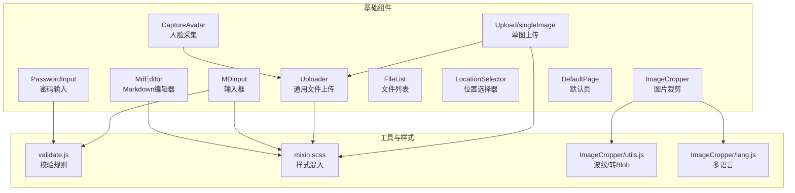

图表来源
- [src/components/MDinput/index.vue:1-298](file://src/components/MDinput/index.vue#L1-L298)
- [src/components/MdEditor/index.vue:1-112](file://src/components/MdEditor/index.vue#L1-L112)
- [src/components/Upload/singleImage.vue:1-128](file://src/components/Upload/singleImage.vue#L1-L128)
- [src/components/Uploader/Uploader.vue:1-439](file://src/components/Uploader/Uploader.vue#L1-L439)
- [src/components/ImageCropper/index.vue:1-696](file://src/components/ImageCropper/index.vue#L1-L696)
- [src/components/FileList/FileList.vue:1-152](file://src/components/FileList/FileList.vue#L1-L152)
- [src/components/LocationSelector/index.vue:1-236](file://src/components/LocationSelector/index.vue#L1-L236)
- [src/components/PasswordInput/PasswordInput.vue:1-124](file://src/components/PasswordInput/PasswordInput.vue#L1-L124)
- [src/components/CaptureAvatar/index.vue:1-49](file://src/components/CaptureAvatar/index.vue#L1-L49)
- [src/utils/validate.js:1-72](file://src/utils/validate.js#L1-L72)
- [src/styles/mixin.scss:1-359](file://src/styles/mixin.scss#L1-L359)
- [src/components/ImageCropper/utils.js:1-59](file://src/components/ImageCropper/utils.js#L1-L59)
- [src/components/ImageCropper/lang.js:1-42](file://src/components/ImageCropper/lang.js#L1-L42)

章节来源
- [src/components/MDinput/index.vue:1-298](file://src/components/MDinput/index.vue#L1-L298)
- [src/components/MdEditor/index.vue:1-112](file://src/components/MdEditor/index.vue#L1-L112)
- [src/components/Upload/singleImage.vue:1-128](file://src/components/Upload/singleImage.vue#L1-L128)
- [src/components/Uploader/Uploader.vue:1-439](file://src/components/Uploader/Uploader.vue#L1-L439)
- [src/components/ImageCropper/index.vue:1-696](file://src/components/ImageCropper/index.vue#L1-L696)
- [src/components/FileList/FileList.vue:1-152](file://src/components/FileList/FileList.vue#L1-L152)
- [src/components/LocationSelector/index.vue:1-236](file://src/components/LocationSelector/index.vue#L1-L236)
- [src/components/PasswordInput/PasswordInput.vue:1-124](file://src/components/PasswordInput/PasswordInput.vue#L1-L124)
- [src/components/CaptureAvatar/index.vue:1-49](file://src/components/CaptureAvatar/index.vue#L1-L49)
- [src/components/DefaultPage/index.vue:1-35](file://src/components/DefaultPage/index.vue#L1-L35)
- [src/utils/validate.js:1-72](file://src/utils/validate.js#L1-L72)
- [src/styles/mixin.scss:1-359](file://src/styles/mixin.scss#L1-L359)
- [src/components/ImageCropper/utils.js:1-59](file://src/components/ImageCropper/utils.js#L1-L59)
- [src/components/ImageCropper/lang.js:1-42](file://src/components/ImageCropper/lang.js#L1-L42)

## 核心组件
- 输入框（MDinput）
  - 功能：Material 风格输入框，支持 text/email/url/number/password/tel 等类型；自动占位动画、焦点状态、禁用状态、错误状态；内置 HTML5 校验联动
  - 属性：id/name/type/value/placeholder/readOnly/disabled/min/max/minLength/maxLength/required/autoComplete/errorMessages
  - 事件：input（透传原生输入事件与值）、内部聚焦/失焦处理
  - 插槽：默认插槽用于标签内容
  - 样式：SCSS 主题变量与状态类，支持错误态与激活态视觉反馈
- 编辑器（MdEditor）
  - 功能：基于 SimpleMDE 的 Markdown 编辑器，支持受控值、占位、高度、层级、工具栏、变更事件
  - 属性：value/id/autofocus/placeholder/height/zIndex/toolbar
  - 生命周期：mounted 初始化编辑器，destroyed 清理实例
  - 事件：input（编辑器内容变更时触发）
- 上传组件
  - 单图上传（Upload/singleImage）
    - 功能：拖拽/点击上传单张图片，预览、删除；通过外部接口获取上传凭证
    - 属性：value（受控图片地址）
    - 事件：input（上传成功后回写地址）
    - 方法：rmImage（清空）、handleImageScucess（上传成功回调）、beforeUpload（获取凭证）
  - 通用文件上传（Uploader）
    - 功能：基于 COS 的文件上传，支持进度显示、图标识别、删除、多文件模式
    - 属性：value（已上传文件数组）、multiple、lineList、showMode、mode、extList
    - 事件：delete（删除项时触发）
    - 方法：upload（选择文件并上传）、uploadFileCos（调用 COS SDK）、successCallBack/errorCallBack/progressCallBack（上传回调）
- 图片裁剪（ImageCropper）
  - 功能：拖拽/点击选择图片，缩放与拖动裁剪，实时预览，Canvas 输出，上传流程与多语言
  - 属性：field/url/params/width/height/noCircle/maxSize/langType
  - 事件：crop-success（生成图片成功）、crop-upload-success（上传成功）、crop-upload-fail（上传失败）
  - 方法：checkFile/setSourceImg/startCrop/imgStartMove/imgMove/zoomImg/createImg/upload/reset
- 文件列表（FileList）
  - 功能：附件列表展示，支持下载、在线预览、图标识别（Word/PPT/Excel/PDF/压缩包/图片/文本）
  - 属性：smallWidth/view/plain/fileList/isShowTitle
  - 事件：无（通过点击下载/预览触发）
- 位置选择器（LocationSelector）
  - 功能：省市区三级联动，支持“全部/空值”选项，可选显示省/市/区，提供名称数组与区域编码读取
  - 属性：value（初始编码数组）、hasProvinceAll/hasCityAll/hasDistAll/allProvinceValue/allCityValue/allDistValue/hasProvinceNone/noDist/showProvince/showCity
  - 事件：input/change（编码数组变更时触发）
  - 方法：initData/getCity/getDist/emitFunc/getNameArray/getCode
- 密码输入（PasswordInput）
  - 功能：密码强度校验（长度、字符种类），等级指示，旧密码差异校验
  - 属性：value/oldPassword
  - 事件：input（输入值变更）
  - 方法：validate（执行一次校验并返回是否通过）、inputHandler（校验逻辑与错误消息、等级更新）
- 默认页（DefaultPage）
  - 功能：空态占位图与提示文案
  - 属性：Mes（提示文案）

章节来源
- [src/components/MDinput/index.vue:1-298](file://src/components/MDinput/index.vue#L1-L298)
- [src/components/MdEditor/index.vue:1-112](file://src/components/MdEditor/index.vue#L1-L112)
- [src/components/Upload/singleImage.vue:1-128](file://src/components/Upload/singleImage.vue#L1-L128)
- [src/components/Uploader/Uploader.vue:1-439](file://src/components/Uploader/Uploader.vue#L1-L439)
- [src/components/ImageCropper/index.vue:1-696](file://src/components/ImageCropper/index.vue#L1-L696)
- [src/components/FileList/FileList.vue:1-152](file://src/components/FileList/FileList.vue#L1-L152)
- [src/components/LocationSelector/index.vue:1-236](file://src/components/LocationSelector/index.vue#L1-L236)
- [src/components/PasswordInput/PasswordInput.vue:1-124](file://src/components/PasswordInput/PasswordInput.vue#L1-L124)
- [src/components/DefaultPage/index.vue:1-35](file://src/components/DefaultPage/index.vue#L1-L35)

## 架构总览
基础组件围绕“输入/编辑/上传/展示/选择/校验/样式”七大主题协同工作，形成从用户交互到数据回写、从本地校验到远端上传的完整链路。

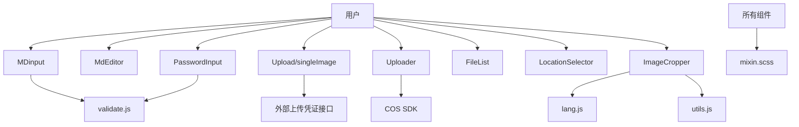

图表来源
- [src/components/MDinput/index.vue:1-298](file://src/components/MDinput/index.vue#L1-L298)
- [src/components/MdEditor/index.vue:1-112](file://src/components/MdEditor/index.vue#L1-L112)
- [src/components/Upload/singleImage.vue:1-128](file://src/components/Upload/singleImage.vue#L1-L128)
- [src/components/Uploader/Uploader.vue:1-439](file://src/components/Uploader/Uploader.vue#L1-L439)
- [src/components/ImageCropper/index.vue:1-696](file://src/components/ImageCropper/index.vue#L1-L696)
- [src/components/FileList/FileList.vue:1-152](file://src/components/FileList/FileList.vue#L1-L152)
- [src/components/LocationSelector/index.vue:1-236](file://src/components/LocationSelector/index.vue#L1-L236)
- [src/components/PasswordInput/PasswordInput.vue:1-124](file://src/components/PasswordInput/PasswordInput.vue#L1-L124)
- [src/utils/validate.js:1-72](file://src/utils/validate.js#L1-L72)
- [src/styles/mixin.scss:1-359](file://src/styles/mixin.scss#L1-L359)
- [src/components/ImageCropper/utils.js:1-59](file://src/components/ImageCropper/utils.js#L1-L59)
- [src/components/ImageCropper/lang.js:1-42](file://src/components/ImageCropper/lang.js#L1-L42)

## 详细组件分析

### 输入框（MDinput）
- 数据绑定与生命周期
  - 使用 v-model 受控 value，内部维护 valueCopy 并在 beforeMount 同步初始值
  - watch 监听外部 value 变更，同步到内部副本并重新校验
- 校验与状态
  - 通过原生 validity.valid 与 errorMessages 计算错误状态
  - computedClasses 根据 focus、value、placeholder、disabled、errorMessages 组合状态类
- 事件与插槽
  - input 事件透传原生输入值与事件
  - 默认插槽用于显示标签文本
- 样式与主题
  - SCSS 变量定义主题色、间距、过渡；通过类名切换激活/错误/禁用状态

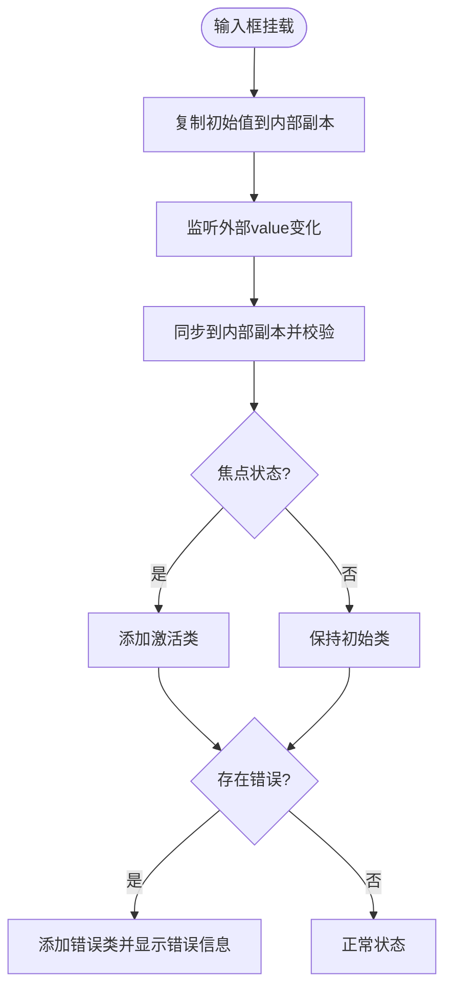

图表来源
- [src/components/MDinput/index.vue:61-86](file://src/components/MDinput/index.vue#L61-L86)
- [src/components/MDinput/index.vue:39-53](file://src/components/MDinput/index.vue#L39-L53)
- [src/components/MDinput/index.vue:67-76](file://src/components/MDinput/index.vue#L67-L76)

章节来源
- [src/components/MDinput/index.vue:1-298](file://src/components/MDinput/index.vue#L1-L298)

### 编辑器（MdEditor）
- 初始化与受控
  - mounted 创建 SimpleMDE 实例，设置占位、工具栏、占位符
  - watch 监听 value，避免循环更新
- 事件与输出
  - change 事件触发 input，向上回写编辑器内容
- 样式
  - 定义 CodeMirror 最小高度与链接样式

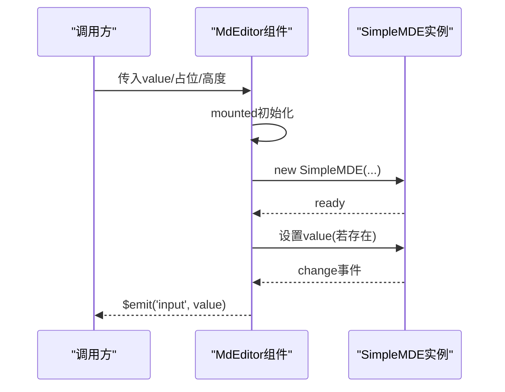

图表来源
- [src/components/MdEditor/index.vue:51-72](file://src/components/MdEditor/index.vue#L51-L72)

章节来源
- [src/components/MdEditor/index.vue:1-112](file://src/components/MdEditor/index.vue#L1-L112)

### 上传组件（Upload/singleImage）
- 凭证与上传
  - beforeUpload 通过外部接口获取 token/key，并记录临时 URL
  - handleImageScucess 将临时 URL 回写到父组件（通过 input 事件）
- 删除与预览
  - rmImage 清空 value
  - 预览区域展示缩略图与删除操作

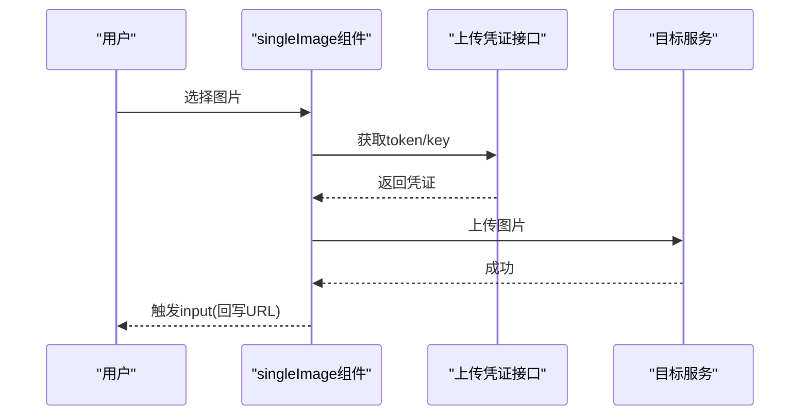

图表来源
- [src/components/Upload/singleImage.vue:54-68](file://src/components/Upload/singleImage.vue#L54-L68)
- [src/components/Upload/singleImage.vue:51-53](file://src/components/Upload/singleImage.vue#L51-L53)

章节来源
- [src/components/Upload/singleImage.vue:1-128](file://src/components/Upload/singleImage.vue#L1-L128)

### 通用文件上传（Uploader）
- 初始化与加载
  - mounted 动态加载 COS SDK，获取上传配置并初始化 COS 实例
- 上传流程
  - 选择文件 -> 校验扩展名 -> 创建时间戳目录 -> 上传 -> 成功回调追加到 value
- 进度与图标
  - progressCallBack 更新进度文案；getImgType/getImgCover 识别文件类型与封面

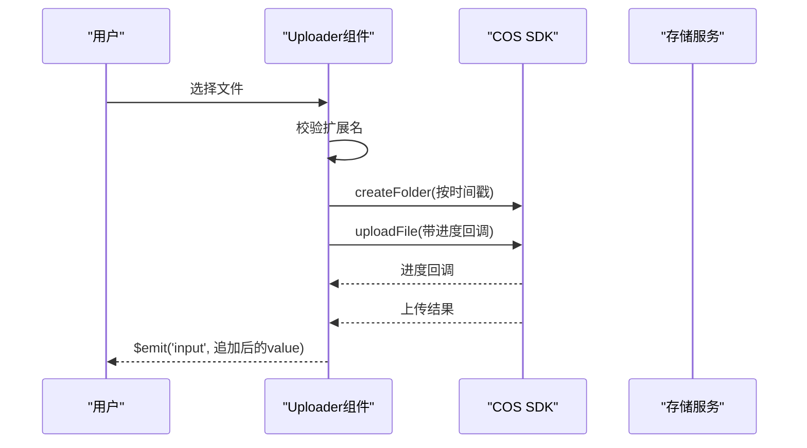

图表来源
- [src/components/Uploader/Uploader.vue:102-107](file://src/components/Uploader/Uploader.vue#L102-L107)
- [src/components/Uploader/Uploader.vue:147-206](file://src/components/Uploader/Uploader.vue#L147-L206)

章节来源
- [src/components/Uploader/Uploader.vue:1-439](file://src/components/Uploader/Uploader.vue#L1-L439)

### 图片裁剪（ImageCropper）
- 三步流程
  - 步骤1：选择文件（拖拽/点击），检测类型与大小
  - 步骤2：缩放/平移裁剪，实时预览
  - 步骤3：Canvas 输出图片，上传并触发成功/失败事件
- 多语言与工具
  - lang.js 提供中英双语文案
  - utils.js 提供波纹效果与 dataURL 转 Blob

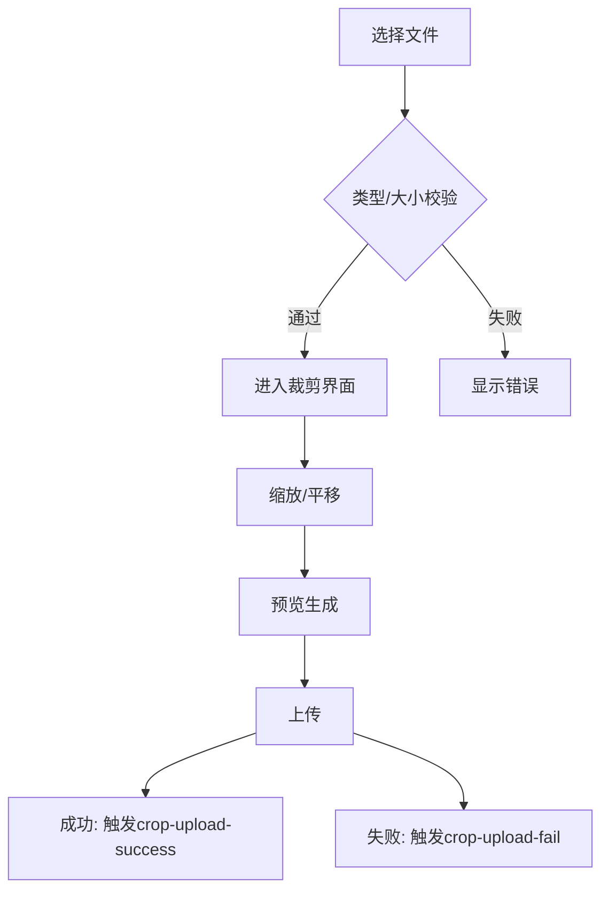

图表来源
- [src/components/ImageCropper/index.vue:355-387](file://src/components/ImageCropper/index.vue#L355-L387)
- [src/components/ImageCropper/index.vue:408-459](file://src/components/ImageCropper/index.vue#L408-L459)
- [src/components/ImageCropper/index.vue:641-688](file://src/components/ImageCropper/index.vue#L641-L688)
- [src/components/ImageCropper/lang.js:1-42](file://src/components/ImageCropper/lang.js#L1-L42)
- [src/components/ImageCropper/utils.js:9-40](file://src/components/ImageCropper/utils.js#L9-L40)

章节来源
- [src/components/ImageCropper/index.vue:1-696](file://src/components/ImageCropper/index.vue#L1-L696)
- [src/components/ImageCropper/lang.js:1-42](file://src/components/ImageCropper/lang.js#L1-L42)
- [src/components/ImageCropper/utils.js:1-59](file://src/components/ImageCropper/utils.js#L1-L59)

### 文件列表（FileList）
- 展示逻辑
  - 遍历 fileList，按文件类型设置背景图标
  - 支持下载与在线预览（非压缩包）
- 标题与样式
  - 可选显示标题；plain 模式下调整图标颜色与对齐

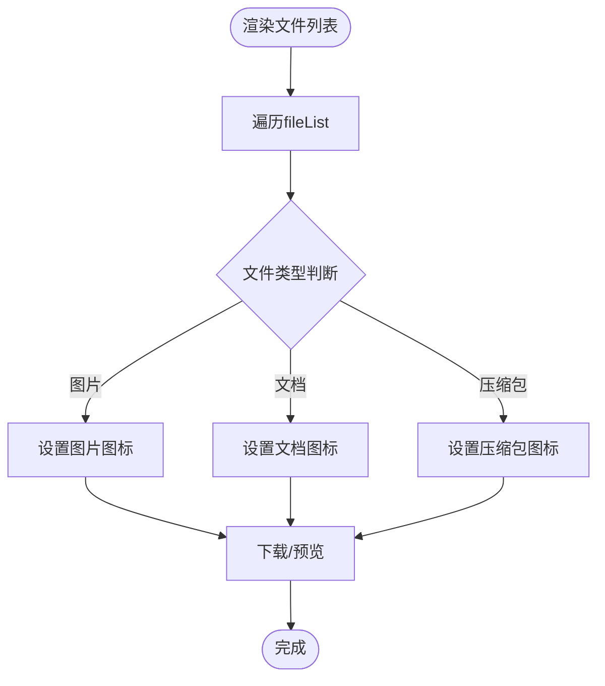

图表来源
- [src/components/FileList/FileList.vue:5-32](file://src/components/FileList/FileList.vue#L5-L32)

章节来源
- [src/components/FileList/FileList.vue:1-152](file://src/components/FileList/FileList.vue#L1-L152)

### 位置选择器（LocationSelector）
- 初始化与联动
  - 初始化时根据 value 设置 dataArray，并拉取省列表
  - 省变更时拉取城市列表；城市变更时拉取区县列表
- 选项与编码
  - 支持“全部/空值”选项；可隐藏某级选择
  - 提供 getNameArray 与 getCode 读取名称与区域编码

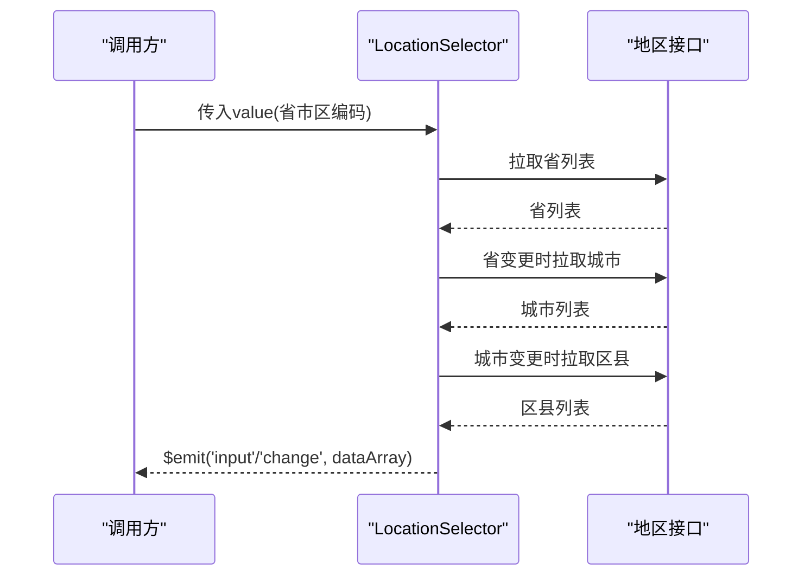

图表来源
- [src/components/LocationSelector/index.vue:87-130](file://src/components/LocationSelector/index.vue#L87-L130)
- [src/components/LocationSelector/index.vue:131-194](file://src/components/LocationSelector/index.vue#L131-L194)

章节来源
- [src/components/LocationSelector/index.vue:1-236](file://src/components/LocationSelector/index.vue#L1-L236)

### 密码输入（PasswordInput）
- 校验规则
  - 非空、长度 8-20、与旧密码不同、至少包含数字/字母/字符两类组合
- 等级指示
  - 弱/中/强三级，右侧等级条可视化
- 事件与方法
  - input 事件回写值；validate 执行一次校验并返回是否通过

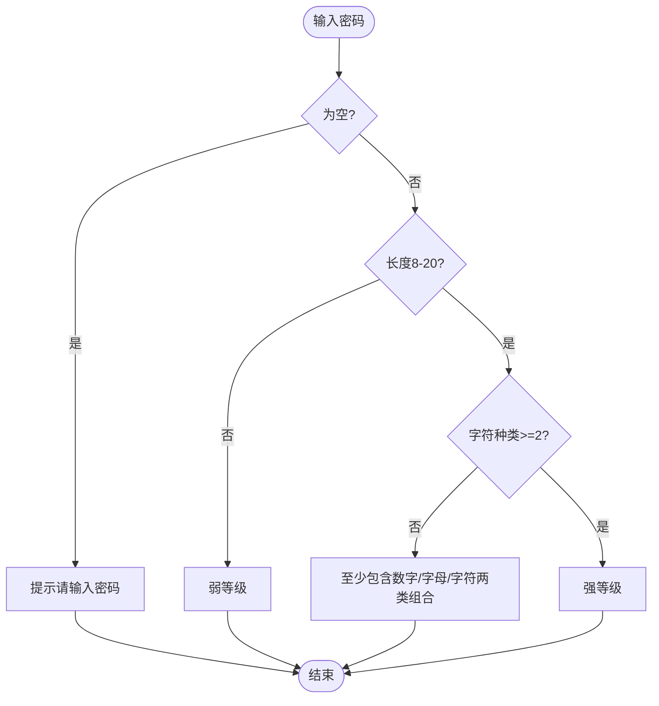

图表来源
- [src/components/PasswordInput/PasswordInput.vue:45-73](file://src/components/PasswordInput/PasswordInput.vue#L45-L73)

章节来源
- [src/components/PasswordInput/PasswordInput.vue:1-124](file://src/components/PasswordInput/PasswordInput.vue#L1-L124)

### 默认页（DefaultPage）
- 功能：空态占位图与提示文案，适合列表/表格为空时展示
- 属性：Mes（提示文案）

章节来源
- [src/components/DefaultPage/index.vue:1-35](file://src/components/DefaultPage/index.vue#L1-L35)

## 依赖关系分析
- 组件间耦合
  - Upload/singleImage 依赖外部上传凭证接口；Uploader 依赖 COS SDK 与后端配置
  - ImageCropper 依赖 utils.js 与 lang.js；MdEditor 依赖 SimpleMDE
  - LocationSelector 依赖地区接口
- 外部依赖
  - Element UI（Select/Tooltip/Upload 等）
  - SimpleMDE（MdEditor）
  - COS SDK（Uploader）
  - validate.js（MDinput/PasswordInput 校验）

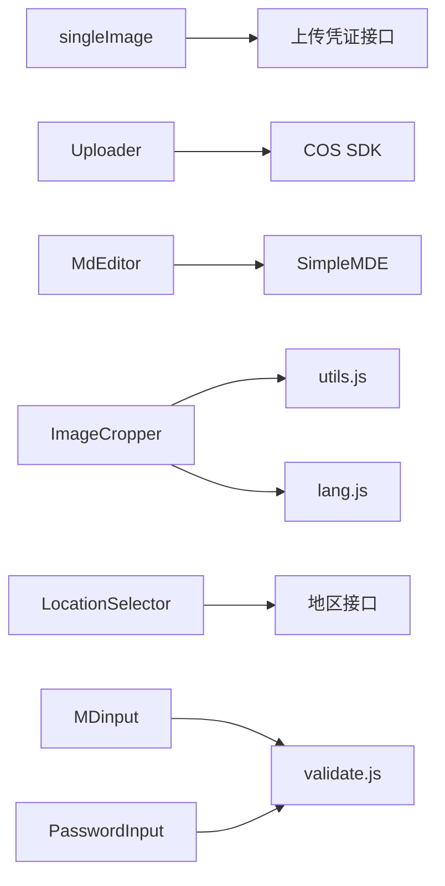

图表来源
- [src/components/Upload/singleImage.vue:27-68](file://src/components/Upload/singleImage.vue#L27-L68)
- [src/components/Uploader/Uploader.vue:102-146](file://src/components/Uploader/Uploader.vue#L102-L146)
- [src/components/MdEditor/index.vue:9-10](file://src/components/MdEditor/index.vue#L9-L10)
- [src/components/ImageCropper/index.vue:107-116](file://src/components/ImageCropper/index.vue#L107-L116)
- [src/components/LocationSelector/index.vue:20-29](file://src/components/LocationSelector/index.vue#L20-L29)
- [src/utils/validate.js:1-72](file://src/utils/validate.js#L1-L72)

章节来源
- [src/components/Upload/singleImage.vue:1-128](file://src/components/Upload/singleImage.vue#L1-L128)
- [src/components/Uploader/Uploader.vue:1-439](file://src/components/Uploader/Uploader.vue#L1-L439)
- [src/components/MdEditor/index.vue:1-112](file://src/components/MdEditor/index.vue#L1-L112)
- [src/components/ImageCropper/index.vue:1-696](file://src/components/ImageCropper/index.vue#L1-L696)
- [src/components/LocationSelector/index.vue:1-236](file://src/components/LocationSelector/index.vue#L1-L236)
- [src/utils/validate.js:1-72](file://src/utils/validate.js#L1-L72)

## 性能考量
- 图片裁剪
  - Canvas 输出与上传建议在移动端谨慎使用大分辨率，避免内存压力
  - 缩放与拖动采用节流策略（如需可引入防抖/节流工具）
- 文件上传
  - COS 上传建议分片与断点续传（当前实现为直传），可结合业务需求优化
  - 进度回调频率过高时可合并更新以减少重绘
- 编辑器
  - SimpleMDE 在大文档时可能影响性能，建议限制内容长度或启用懒加载
- 输入与校验
  - MDinput 使用原生 validity，避免重复校验逻辑；PasswordInput 校验在输入时即时反馈，建议在表单提交时再触发一次全量校验

## 故障排查指南
- 图片裁剪
  - 浏览器不支持：检查 FormData 支持；若不支持则显示提示文案
  - 文件过大：根据 maxSize 限制，超出时显示错误文案
  - 上传失败：捕获异常并触发失败事件，检查网络与后端返回
- 文件上传
  - 扩展名不匹配：根据 extList 校验，提示可接受的后缀
  - COS 初始化失败：确认动态加载 SDK 成功与跨域配置
- 输入与校验
  - MDinput 错误状态：检查 errorMessages 与 required、minLength/maxLength 等属性
  - PasswordInput 校验失败：检查长度、字符种类与旧密码差异
- 位置选择器
  - 无数据：确认地区接口返回与 value 初始值
  - 级联异常：检查省/市/区变更逻辑与 hasProvinceAll/hasCityAll/hasDistAll 配置

章节来源
- [src/components/ImageCropper/index.vue:367-387](file://src/components/ImageCropper/index.vue#L367-L387)
- [src/components/Uploader/Uploader.vue:157-168](file://src/components/Uploader/Uploader.vue#L157-L168)
- [src/components/MDinput/index.vue:74-76](file://src/components/MDinput/index.vue#L74-L76)
- [src/components/PasswordInput/PasswordInput.vue:50-70](file://src/components/PasswordInput/PasswordInput.vue#L50-L70)
- [src/components/LocationSelector/index.vue:87-130](file://src/components/LocationSelector/index.vue#L87-L130)

## 结论
上述基础组件覆盖了校园管理系统常见的输入、编辑、上传、展示与选择场景。通过统一的校验与样式体系，组件具备良好的可复用性与一致性。建议在实际业务中：
- 明确各组件的职责边界，避免过度耦合
- 在移动端关注性能与体验，必要时引入节流/分片/懒加载
- 严格遵循受控值与事件回写的约定，确保表单一致性
- 借助 mixin.scss 与 validate.js 统一风格与规则，提升可维护性

## 附录
- 响应式与主题适配
  - 使用 mixin.scss 的尺寸、颜色、布局混入，保证组件在不同屏幕与主题下的一致表现
- 常见使用场景
  - 表单录入：MDinput + PasswordInput + LocationSelector
  - 文档编辑：MdEditor
  - 图片处理：ImageCropper + Upload/singleImage
  - 文件归档：Uploader + FileList
  - 空态展示：DefaultPage

章节来源
- [src/styles/mixin.scss:1-359](file://src/styles/mixin.scss#L1-L359)
- [src/utils/validate.js:1-72](file://src/utils/validate.js#L1-L72)