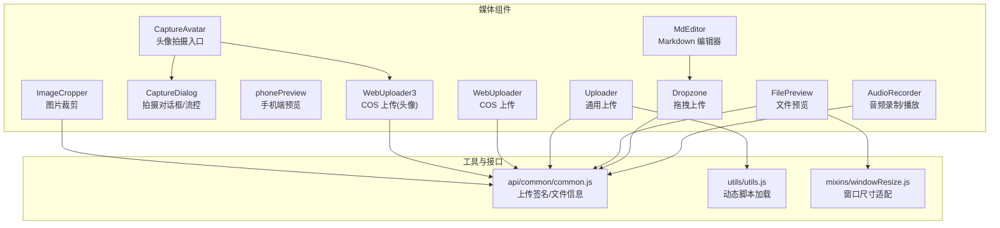
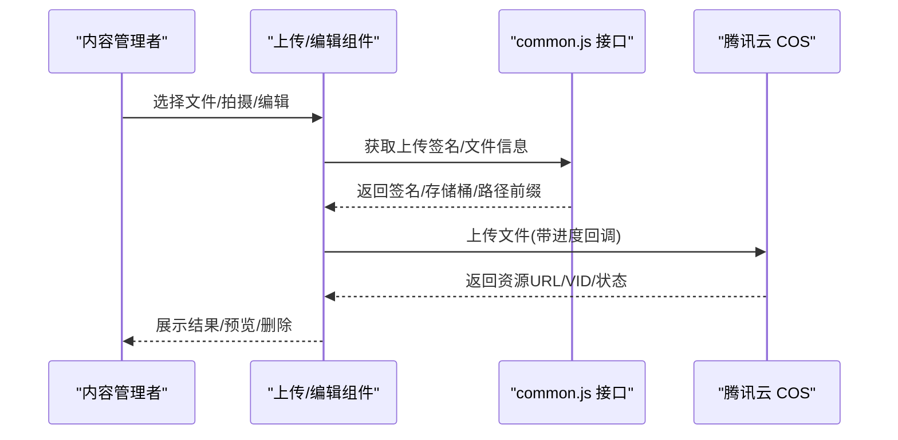
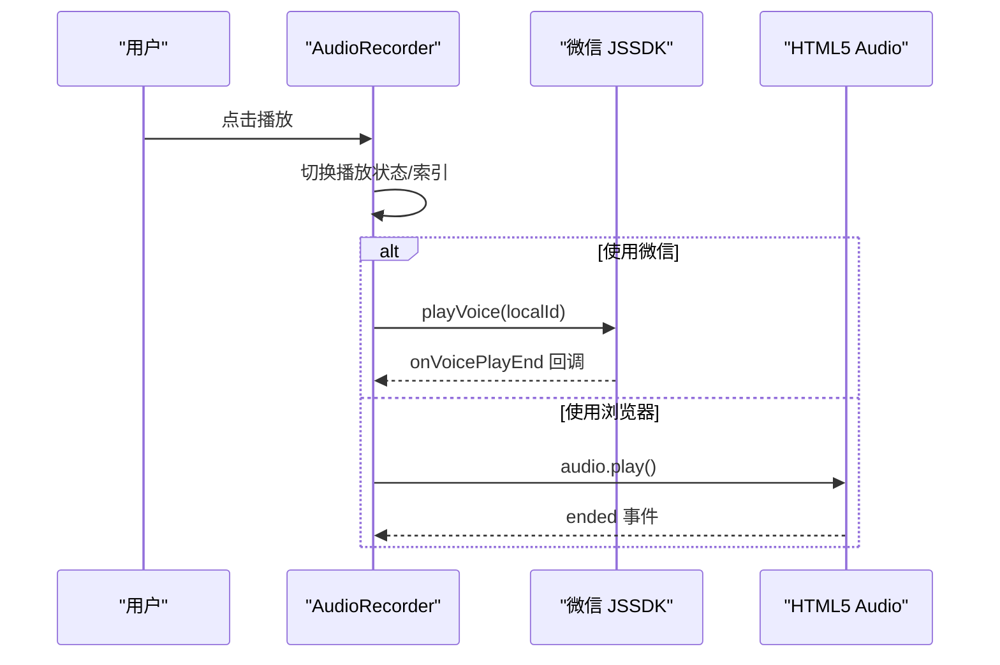
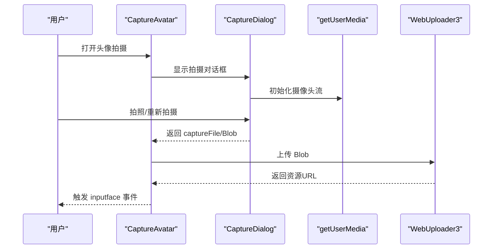
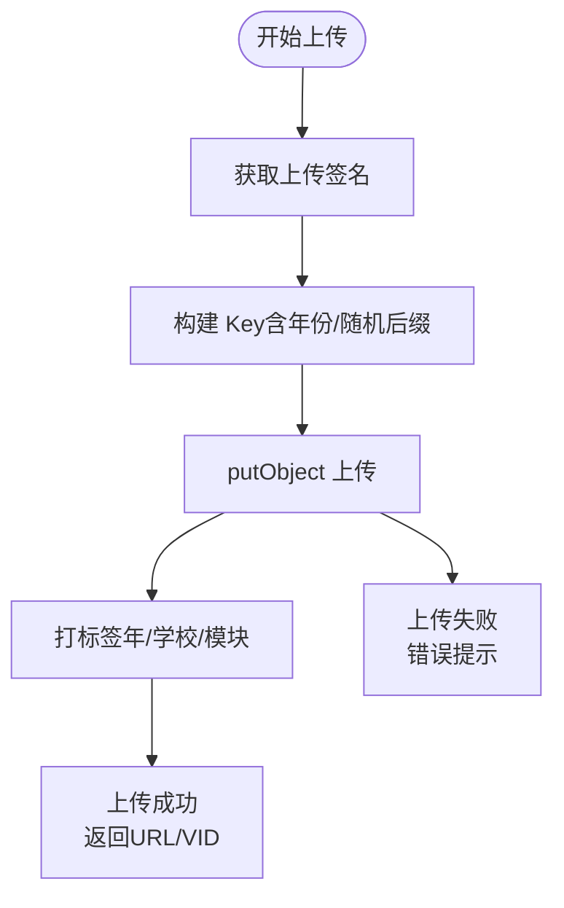
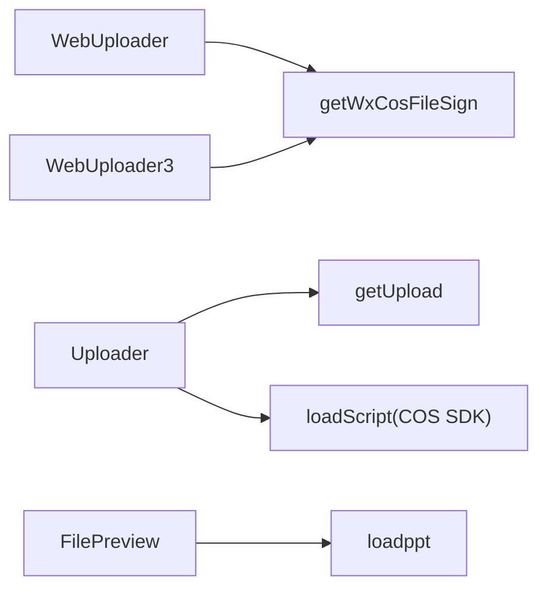

# 媒体组件

<cite>
**本文引用的文件**
- [AudioRecorder/index.vue](file://src/components/AudioRecorder/index.vue)
- [CaptureAvatar/index.vue](file://src/components/CaptureAvatar/index.vue)
- [CaptureAvatar/CaptureDialog.vue](file://src/components/CaptureAvatar/CaptureDialog.vue)
- [MdEditor/index.vue](file://src/components/MdEditor/index.vue)
- [phonePreview/index.vue](file://src/components/phonePreview/index.vue)
- [Dropzone/index.vue](file://src/components/Dropzone/index.vue)
- [FilePreview/FilePreview.vue](file://src/components/FilePreview/FilePreview.vue)
- [Uploader/Uploader.vue](file://src/components/Uploader/Uploader.vue)
- [Uploader/WebUploader.vue](file://src/components/Uploader/WebUploader.vue)
- [Uploader/WebUploader3.vue](file://src/components/Uploader/WebUploader3.vue)
- [ImageCropper/index.vue](file://src/components/ImageCropper/index.vue)
- [ImageCropper/upload.css](file://src/components/ImageCropper/upload.css)
- [ImageCropper/lang.js](file://src/components/ImageCropper/lang.js)
- [utils/utils.js](file://src/utils/utils.js)
- [api/common/common.js](file://src/api/common/common.js)
- [mixins/windowResize.js](file://src/mixins/windowResize.js)
</cite>

## 目录
1. [简介](#简介)
2. [项目结构](#项目结构)
3. [核心组件](#核心组件)
4. [架构总览](#架构总览)
5. [详细组件分析](#详细组件分析)
6. [依赖关系分析](#依赖关系分析)
7. [性能考虑](#性能考虑)
8. [故障排查指南](#故障排查指南)
9. [结论](#结论)
10. [附录](#附录)

## 简介
本文件面向校园管理系统的内容管理者与前端开发者，系统性梳理媒体处理相关组件，包括：
- 音频录制与播放
- 头像拍摄与上传
- Markdown 编辑器
- 手机端预览
- 文件上传与预览
- 图片裁剪与质量控制
- 跨平台兼容性与性能优化策略

目标是帮助使用者快速理解各组件的能力边界、配置方式、上传流程与进度监控，并提供排障建议。

## 项目结构
媒体相关组件主要位于 src/components 下，围绕“上传、预览、编辑、删除”形成闭环。上传链路统一对接腾讯云 COS，预览与编辑通过第三方库或本地实现完成。

图表来源
- [AudioRecorder/index.vue:1-139](file://src/components/AudioRecorder/index.vue#L1-L139)
- [CaptureAvatar/index.vue:1-49](file://src/components/CaptureAvatar/index.vue#L1-L49)
- [CaptureAvatar/CaptureDialog.vue:1-271](file://src/components/CaptureAvatar/CaptureDialog.vue#L1-L271)
- [MdEditor/index.vue:1-112](file://src/components/MdEditor/index.vue#L1-L112)
- [phonePreview/index.vue:1-158](file://src/components/phonePreview/index.vue#L1-L158)
- [Dropzone/index.vue:1-293](file://src/components/Dropzone/index.vue#L1-L293)
- [FilePreview/FilePreview.vue:1-264](file://src/components/FilePreview/FilePreview.vue#L1-L264)
- [Uploader/Uploader.vue:1-439](file://src/components/Uploader/Uploader.vue#L1-L439)
- [Uploader/WebUploader.vue:1-651](file://src/components/Uploader/WebUploader.vue#L1-L651)
- [Uploader/WebUploader3.vue:1-567](file://src/components/Uploader/WebUploader3.vue#L1-L567)
- [ImageCropper/index.vue:1-696](file://src/components/ImageCropper/index.vue#L1-L696)
- [utils/utils.js:1-320](file://src/utils/utils.js#L1-L320)
- [api/common/common.js:1-459](file://src/api/common/common.js#L1-L459)
- [mixins/windowResize.js:1-63](file://src/mixins/windowResize.js#L1-L63)

章节来源
- [AudioRecorder/index.vue:1-139](file://src/components/AudioRecorder/index.vue#L1-L139)
- [CaptureAvatar/index.vue:1-49](file://src/components/CaptureAvatar/index.vue#L1-L49)
- [CaptureAvatar/CaptureDialog.vue:1-271](file://src/components/CaptureAvatar/CaptureDialog.vue#L1-L271)
- [MdEditor/index.vue:1-112](file://src/components/MdEditor/index.vue#L1-L112)
- [phonePreview/index.vue:1-158](file://src/components/phonePreview/index.vue#L1-L158)
- [Dropzone/index.vue:1-293](file://src/components/Dropzone/index.vue#L1-L293)
- [FilePreview/FilePreview.vue:1-264](file://src/components/FilePreview/FilePreview.vue#L1-L264)
- [Uploader/Uploader.vue:1-439](file://src/components/Uploader/Uploader.vue#L1-L439)
- [Uploader/WebUploader.vue:1-651](file://src/components/Uploader/WebUploader.vue#L1-L651)
- [Uploader/WebUploader3.vue:1-567](file://src/components/Uploader/WebUploader3.vue#L1-L567)
- [ImageCropper/index.vue:1-696](file://src/components/ImageCropper/index.vue#L1-L696)
- [utils/utils.js:1-320](file://src/utils/utils.js#L1-L320)
- [api/common/common.js:1-459](file://src/api/common/common.js#L1-L459)
- [mixins/windowResize.js:1-63](file://src/mixins/windowResize.js#L1-L63)

## 核心组件
- 音频录制与播放：支持微信 JSSDK 与 HTML5 音频双通道播放，支持连续播放与循环播放。
- 头像拍摄：基于 getUserMedia 拍摄并生成 Blob，随后走 COS 上传。
- Markdown 编辑器：基于 SimpleMDE，支持占位符、自动聚焦、工具栏自定义。
- 手机端预览：内嵌手机壳样式，支持富文本渲染与媒体元素展示。
- 文件上传：多种上传组件，统一对接腾讯云 COS，支持进度回调、标签打标、删除。
- 文件预览：支持 PDF/PPT/Excel/图片等多格式，大文档分页懒加载。
- 图片裁剪：拖拽、缩放、预览，支持上传成功回调与错误处理。

章节来源
- [AudioRecorder/index.vue:31-84](file://src/components/AudioRecorder/index.vue#L31-L84)
- [CaptureAvatar/index.vue:23-43](file://src/components/CaptureAvatar/index.vue#L23-L43)
- [MdEditor/index.vue:45-76](file://src/components/MdEditor/index.vue#L45-L76)
- [phonePreview/index.vue:22-38](file://src/components/phonePreview/index.vue#L22-L38)
- [Dropzone/index.vue:145-199](file://src/components/Dropzone/index.vue#L145-L199)
- [FilePreview/FilePreview.vue:71-148](file://src/components/FilePreview/FilePreview.vue#L71-L148)
- [Uploader/WebUploader.vue:214-441](file://src/components/Uploader/WebUploader.vue#L214-L441)
- [Uploader/WebUploader3.vue:187-357](file://src/components/Uploader/WebUploader3.vue#L187-L357)
- [ImageCropper/index.vue:323-689](file://src/components/ImageCropper/index.vue#L323-L689)

## 架构总览
媒体上传与预览的整体流程如下：

图表来源
- [Uploader/WebUploader.vue:169-213](file://src/components/Uploader/WebUploader.vue#L169-L213)
- [Uploader/WebUploader3.vue:140-183](file://src/components/Uploader/WebUploader3.vue#L140-L183)
- [api/common/common.js:262-273](file://src/api/common/common.js#L262-L273)

## 详细组件分析

### 音频录制与播放（AudioRecorder）
- 功能要点
  - 支持微信 JSSDK 与 HTML5 音频两种播放路径
  - 支持连续播放多个片段
  - 提供播放/暂停切换与播放结束回调
- 使用建议
  - 在移动端优先使用微信 JSSDK 播放，避免浏览器静音策略
  - 服务端需提供音频访问 URL 或本地 Blob URL
- 注意事项
  - 播放状态与索引需同步维护，避免重复播放

图表来源
- [AudioRecorder/index.vue:31-84](file://src/components/AudioRecorder/index.vue#L31-L84)

章节来源
- [AudioRecorder/index.vue:21-96](file://src/components/AudioRecorder/index.vue#L21-L96)

### 头像拍摄（CaptureAvatar + CaptureDialog）
- 功能要点
  - 基于 getUserMedia 拍摄，支持 1 寸/2 寸尺寸预设
  - 生成 Canvas 并转换为 Blob，随后上传
  - 支持重新拍摄与保存
- 使用建议
  - 建议在桌面端使用虚拟摄像头或测试素材
  - 上传前校验文件类型（jpg/png）

图表来源
- [CaptureAvatar/index.vue:23-43](file://src/components/CaptureAvatar/index.vue#L23-L43)
- [CaptureAvatar/CaptureDialog.vue:120-194](file://src/components/CaptureAvatar/CaptureDialog.vue#L120-L194)
- [Uploader/WebUploader3.vue:266-357](file://src/components/Uploader/WebUploader3.vue#L266-L357)

章节来源
- [CaptureAvatar/index.vue:8-49](file://src/components/CaptureAvatar/index.vue#L8-L49)
- [CaptureAvatar/CaptureDialog.vue:29-210](file://src/components/CaptureAvatar/CaptureDialog.vue#L29-L210)
- [Uploader/WebUploader3.vue:54-357](file://src/components/Uploader/WebUploader3.vue#L54-L357)

### Markdown 编辑器（MdEditor）
- 功能要点
  - 基于 SimpleMDE，支持占位符、自动聚焦、工具栏自定义
  - 输入变更时通过 input 事件向外传递内容
- 使用建议
  - 合理设置高度与占位符，提升编辑体验
  - 如需富文本扩展，可结合其他编辑器组件

章节来源
- [MdEditor/index.vue:8-77](file://src/components/MdEditor/index.vue#L8-L77)

### 手机端预览（phonePreview）
- 功能要点
  - 内嵌手机壳样式，支持标题与内容渲染
  - 适配图片、视频、表格、链接等常见元素
- 使用建议
  - 将富文本内容通过 v-html 注入，注意 XSS 安全

章节来源
- [phonePreview/index.vue:21-38](file://src/components/phonePreview/index.vue#L21-L38)

### 文件上传（Dropzone、Uploader、WebUploader、WebUploader3）
- 统一能力
  - 获取上传签名与存储桶信息
  - 上传进度回调、错误提示
  - 删除文件（COS 删除 + 数据库记录清理）
- 组件差异
  - Dropzone：基于第三方库，支持拖拽、粘贴、缩略图
  - Uploader：通用上传，支持图片/视频/文档等
  - WebUploader/WebUploader3：COS XML API，支持标签打标、封面规则、删除
- 上传配置
  - 路径前缀（pathPrefix）、模块标识（module/moduleCode）、年份目录
  - 图片压缩规则（Pic-Operations），如缩放、方向矫正
  - 删除开关（isDeleteCosUrl）与外部删除回调（deleteFlag/outDelete）

图表来源
- [Uploader/WebUploader.vue:344-441](file://src/components/Uploader/WebUploader.vue#L344-L441)
- [Uploader/WebUploader3.vue:266-357](file://src/components/Uploader/WebUploader3.vue#L266-L357)
- [api/common/common.js:262-273](file://src/api/common/common.js#L262-L273)

章节来源
- [Dropzone/index.vue:145-199](file://src/components/Dropzone/index.vue#L145-L199)
- [Uploader/Uploader.vue:114-244](file://src/components/Uploader/Uploader.vue#L114-L244)
- [Uploader/WebUploader.vue:214-441](file://src/components/Uploader/WebUploader.vue#L214-L441)
- [Uploader/WebUploader3.vue:140-357](file://src/components/Uploader/WebUploader3.vue#L140-L357)

### 文件预览（FilePreview）
- 功能要点
  - 支持 Word/PPT/Excel/PDF/压缩包等图标识别
  - Excel 通过在线预览服务打开，其他格式分页懒加载
  - 支持滚动加载更多页
- 性能建议
  - 大文档采用分页与防抖加载，减少首屏压力

章节来源
- [FilePreview/FilePreview.vue:37-151](file://src/components/FilePreview/FilePreview.vue#L37-L151)
- [mixins/windowResize.js:1-63](file://src/mixins/windowResize.js#L1-L63)

### 图片裁剪（ImageCropper）
- 功能要点
  - 支持拖拽、缩放、圆形/矩形预览
  - 上传成功后回调与错误处理
  - 语言包与尺寸限制
- 使用建议
  - 合理设置最大尺寸与最小像素，避免低分辨率头像

章节来源
- [ImageCropper/index.vue:105-696](file://src/components/ImageCropper/index.vue#L105-L696)
- [ImageCropper/upload.css:46-691](file://src/components/ImageCropper/upload.css#L46-L691)
- [ImageCropper/lang.js:1-42](file://src/components/ImageCropper/lang.js#L1-L42)

## 依赖关系分析
- 上传签名与文件信息
  - WebUploader/WebUploader3 通过 getWxCosFileSign 获取签名
  - Uploader 通过 getUpload 获取 COS 参数
- 动态脚本加载
  - utils/loadScript 用于按需加载 COS SDK
- 文件预览
  - FilePreview 通过 loadppt 获取分页信息与请求地址

图表来源
- [Uploader/WebUploader.vue:169-213](file://src/components/Uploader/WebUploader.vue#L169-L213)
- [Uploader/WebUploader3.vue:140-183](file://src/components/Uploader/WebUploader3.vue#L140-L183)
- [Uploader/Uploader.vue:99-107](file://src/components/Uploader/Uploader.vue#L99-L107)
- [FilePreview/FilePreview.vue:105-125](file://src/components/FilePreview/FilePreview.vue#L105-L125)
- [utils/utils.js:70-102](file://src/utils/utils.js#L70-L102)
- [api/common/common.js:262-273](file://src/api/common/common.js#L262-L273)

章节来源
- [api/common/common.js:1-459](file://src/api/common/common.js#L1-L459)
- [utils/utils.js:64-102](file://src/utils/utils.js#L64-L102)

## 性能考虑
- 上传优化
  - 图片上传自动添加 Pic-Operations 规则，降低存储与带宽成本
  - 分片/断点续传建议：结合业务场景评估是否引入 SDK 的高级特性
- 预览优化
  - 大文档分页与防抖加载，减少一次性渲染压力
  - 图片预览使用缩略图与懒加载策略
- 兼容性
  - 旧浏览器 getUserMedia 兼容处理
  - 静音策略与自动播放限制，建议引导用户交互后再播放音频

## 故障排查指南
- 无法获取摄像头
  - 检查 HTTPS 与权限，确认 getUserMedia 兼容处理生效
- 上传失败
  - 核对签名有效期与存储桶配置
  - 查看 onProgress 与回调中的错误信息
- 预览空白或加载缓慢
  - 确认分页接口返回与地址替换逻辑
  - 检查网络与 CDN 加速配置
- 删除异常
  - 确认 Key 解析与 isDeleteCosUrl 开关
  - 核对外部删除回调 deleteFlag 的使用

章节来源
- [CaptureAvatar/CaptureDialog.vue:98-119](file://src/components/CaptureAvatar/CaptureDialog.vue#L98-L119)
- [Uploader/WebUploader.vue:268-295](file://src/components/Uploader/WebUploader.vue#L268-L295)
- [FilePreview/FilePreview.vue:86-148](file://src/components/FilePreview/FilePreview.vue#L86-L148)
- [Uploader/WebUploader.vue:268-295](file://src/components/Uploader/WebUploader.vue#L268-L295)

## 结论
本套媒体组件覆盖了校园管理系统的典型媒体处理需求：拍摄、录制、编辑、上传、预览与删除。通过统一的 COS 上传链路与丰富的 UI 交互，能够满足内容管理者在 PC 端的高效工作流。建议在生产环境中结合业务场景进一步完善分片上传、转码策略与缓存机制，以获得更佳的用户体验与稳定性。

## 附录
- 常用配置清单
  - 上传签名：getWxCosFileSign
  - 上传参数：getUpload
  - 文件预览：loadppt
  - 动态脚本：loadScript
- 组件属性与行为
  - WebUploader/WebUploader3：pathPrefix、module、moduleCode、extList、picOperationRule、isDeleteCosUrl、deleteFlag
  - FilePreview：fileList、分页懒加载、滚动监听
  - ImageCropper：width/height、maxSize、noCircle、langType

章节来源
- [Uploader/WebUploader.vue:56-146](file://src/components/Uploader/WebUploader.vue#L56-L146)
- [Uploader/WebUploader3.vue:54-122](file://src/components/Uploader/WebUploader3.vue#L54-L122)
- [FilePreview/FilePreview.vue:42-49](file://src/components/FilePreview/FilePreview.vue#L42-L49)
- [ImageCropper/index.vue:118-161](file://src/components/ImageCropper/index.vue#L118-L161)