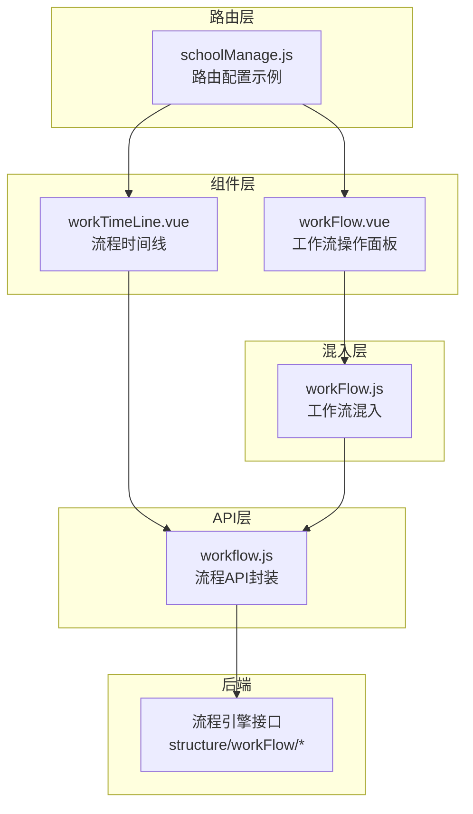
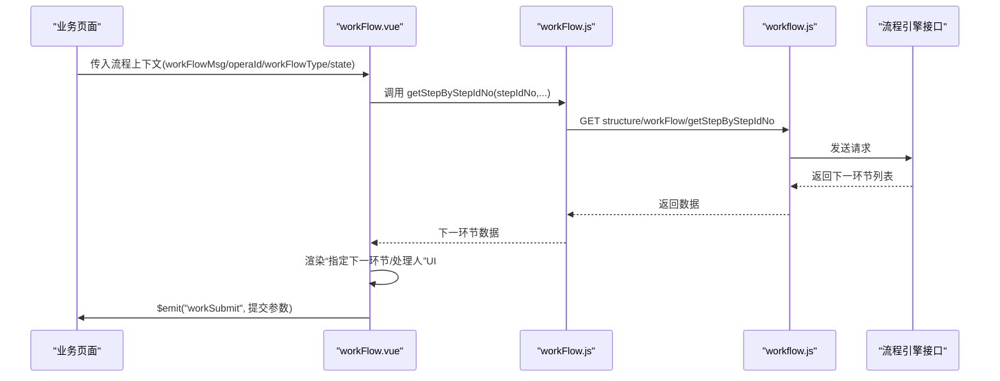
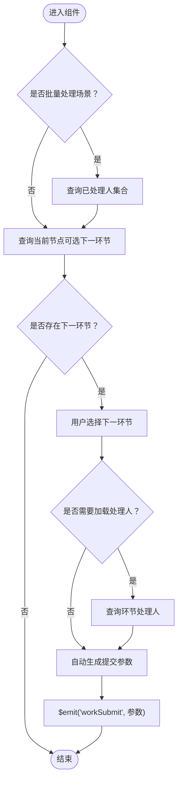
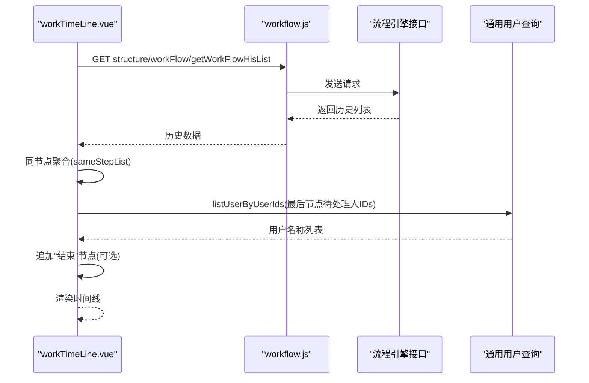
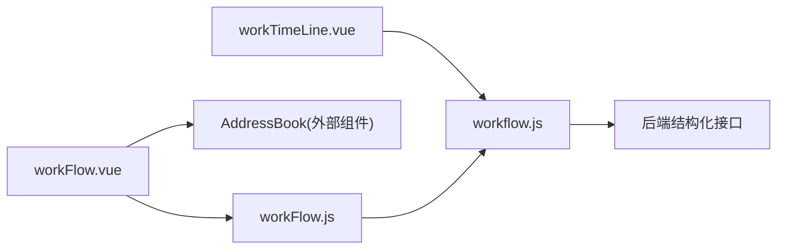

# 工作流组件

<cite>
**本文引用的文件**
- [workFlow.vue](file://src/components/workFlow/workFlow.vue)
- [workTimeLine.vue](file://src/components/workFlow/workTimeLine.vue)
- [workFlow.js（混入）](file://src/mixins/workFlow.js)
- [workflow.js（API封装）](file://src/api/workflow.js)
- [schoolManage.js（路由配置示例）](file://src/router/normal/schoolManage.js)
</cite>

## 目录
1. [简介](#简介)
2. [项目结构](#项目结构)
3. [核心组件](#核心组件)
4. [架构总览](#架构总览)
5. [组件详解](#组件详解)
6. [依赖关系分析](#依赖关系分析)
7. [性能考量](#性能考量)
8. [故障排查指南](#故障排查指南)
9. [结论](#结论)
10. [附录](#附录)

## 简介
本文件面向“校园管理系统”的流程审批模块，系统性梳理“工作流组件”与“时间线组件”的功能、实现与使用方法。重点覆盖：
- 流程节点的配置、连线设置与状态管理
- 流程设计器与流程执行器的使用指南
- 权限控制、条件判断与分支处理
- 组件与后端流程引擎的集成方式与数据同步机制
- 面向流程管理员与开发者的配置与使用建议

## 项目结构
工作流相关前端代码主要由以下部分组成：
- 组件层：工作流操作面板与时间线展示
- 混入层：统一的工作流API调用封装
- API层：对后端流程引擎接口的HTTP封装
- 路由层：业务页面与工作流入口的导航配置

图表来源
- [workFlow.vue:1-294](file://src/components/workFlow/workFlow.vue#L1-L294)
- [workTimeLine.vue:1-147](file://src/components/workFlow/workTimeLine.vue#L1-L147)
- [workFlow.js:1-103](file://src/mixins/workFlow.js#L1-L103)
- [workflow.js:1-150](file://src/api/workflow.js#L1-L150)
- [schoolManage.js:79-92](file://src/router/normal/schoolManage.js#L79-L92)

章节来源
- [workFlow.vue:1-294](file://src/components/workFlow/workFlow.vue#L1-L294)
- [workTimeLine.vue:1-147](file://src/components/workFlow/workTimeLine.vue#L1-L147)
- [workFlow.js:1-103](file://src/mixins/workFlow.js#L1-L103)
- [workflow.js:1-150](file://src/api/workflow.js#L1-L150)
- [schoolManage.js:79-92](file://src/router/normal/schoolManage.js#L79-L92)

## 核心组件
- 工作流操作面板（workFlow.vue）
  - 功能：根据当前节点动态展示“处理意见”“指定下一环节”“指定下一环节处理人”等交互区域；支持单选或多选下一处理人，并通过事件向外抛出提交参数。
  - 关键点：基于混入提供的API完成“查询下一环节”“查询已处理人集合”“查询环节处理人”等操作；通过watch监听输入变化自动触发提交参数更新。
- 流程时间线（workTimeLine.vue）
  - 功能：展示流程历史节点与同节点并发处理记录；在流程未结束时显示“未处理人”列表；支持根据状态追加“结束”节点占位。
  - 关键点：通过API获取历史列表并按节点分组；对最后节点关联的待处理人ID集合进行用户名称解析。

章节来源
- [workFlow.vue:1-294](file://src/components/workFlow/workFlow.vue#L1-L294)
- [workTimeLine.vue:1-147](file://src/components/workFlow/workTimeLine.vue#L1-L147)

## 架构总览
工作流组件与后端流程引擎的交互路径如下：

图表来源
- [workFlow.vue:152-171](file://src/components/workFlow/workFlow.vue#L152-L171)
- [workFlow.js:54-64](file://src/mixins/workFlow.js#L54-L64)
- [workflow.js:106-120](file://src/api/workflow.js#L106-L120)

## 组件详解

### 工作流操作面板（workFlow.vue）
- 输入属性
  - workFlowType：流程类型标识，默认“documentflow”
  - operaId：业务操作实例ID
  - flowState：流程状态
  - flowInfo：流程元数据对象
  - workFlowMsg：当前节点上下文（含stepIdNo、workFlowId、name、statusName、transfer、batchType等）
  - appUserId：当前用户ID（用于处理人筛选）
- 核心逻辑
  - 初始化与批量处理场景：当batchType为2时，先查询“已处理人集合”，再查询“当前节点可选下一环节”
  - 选择下一环节：changeRadio后根据环节配置决定是否加载“环节处理人”列表；同时标记是否为结束节点
  - 处理人选择：支持“多选”和“地址簿选择”两种模式；全选/反选联动
  - 自动提交参数生成：toSubmitWorkFlow根据当前选择组装提交参数（含处理意见、下一节点ID/名称、下一处理人IDs等），并通过事件向外抛出
- 数据同步
  - 通过混入方法调用后端API，保证前后端一致的参数格式与字段语义
- 权限与分支
  - 通过“下一环节列表”与“处理人列表”体现权限与分支；结束节点通过type字段识别

图表来源
- [workFlow.vue:92-137](file://src/components/workFlow/workFlow.vue#L92-L137)
- [workFlow.vue:152-171](file://src/components/workFlow/workFlow.vue#L152-L171)
- [workFlow.vue:210-225](file://src/components/workFlow/workFlow.vue#L210-L225)
- [workFlow.vue:226-278](file://src/components/workFlow/workFlow.vue#L226-L278)

章节来源
- [workFlow.vue:1-294](file://src/components/workFlow/workFlow.vue#L1-L294)

### 流程时间线（workTimeLine.vue）
- 输入属性
  - operaId：业务操作实例ID
  - state：流程状态（用于决定是否追加“结束”节点）
  - workFlowType：流程类型标识
- 核心逻辑
  - 初始化即拉取历史列表；对相同stepIdNo的数据进行合并，形成“同节点并发处理”结构
  - 对最后节点的“待处理人IDs”发起用户名称解析，渲染“未处理人”列表
  - 当state为结束态时，追加一个“结束”节点占位
- 数据展示
  - 使用Element UI的时间线组件逐项展示节点信息与处理意见

图表来源
- [workTimeLine.vue:63-113](file://src/components/workFlow/workTimeLine.vue#L63-L113)
- [workflow.js:20-30](file://src/api/workflow.js#L20-L30)

章节来源
- [workTimeLine.vue:1-147](file://src/components/workFlow/workTimeLine.vue#L1-L147)

### 工作流混入（workFlow.js）
- 职责：封装所有与流程引擎交互的API调用，统一Promise返回，便于组件复用
- 主要方法
  - getWorkFlow：获取流程定义
  - getStartStep：获取开始环节
  - getNowStep：获取当前环节
  - getDealUserList：获取环节处理人
  - getStepByStepIdNo：查询下一环节
  - submitWorkFlow：提交流程
  - getYesHisUserList：查询已处理人集合
- 日期工具：提供日期格式化与计算辅助方法

章节来源
- [workFlow.js:1-103](file://src/mixins/workFlow.js#L1-L103)

### 流程API封装（workflow.js）
- 接口清单
  - 结构化接口前缀：structure/workFlow/*
  - 方法对应接口
    - getWorkFlow → getWorkFlow
    - getStartStep → getStartStep
    - getNowStep → getNowStep
    - getDealUserList → getDealUserList
    - getYesHisUserList → getYesHisUserList
    - getStepByStepIdNo → getStepByStepIdNo
    - submitWorkFlow → submitWorkFlow
    - getWorkFlowHisList → getWorkFlowHisList
- 请求方式
  - 多数GET接口以URLSearchParams拼参
  - submitWorkFlow以JSON体POST发送

章节来源
- [workflow.js:1-150](file://src/api/workflow.js#L1-L150)

### 路由与页面集成（schoolManage.js 示例）
- 在路由中配置“文件流转”相关页面，作为工作流组件的承载页
- 可参考该路由配置在具体业务页中引入工作流组件与时间线组件

章节来源
- [schoolManage.js:79-92](file://src/router/normal/schoolManage.js#L79-L92)

## 依赖关系分析
- 组件耦合
  - workFlow.vue强依赖workFlow.js（混入）；弱依赖AddressBook组件用于“地址簿选择处理人”
  - workTimeLine.vue直接依赖workflow.js（API封装）
- 外部依赖
  - Element UI：时间线与表单控件
  - 通用用户查询接口：用于解析“未处理人”名称
- 数据依赖
  - 所有流程相关数据均来自后端结构化接口，前端仅负责展示与参数组装

图表来源
- [workFlow.vue:35-91](file://src/components/workFlow/workFlow.vue#L35-L91)
- [workTimeLine.vue:29-31](file://src/components/workFlow/workTimeLine.vue#L29-L31)
- [workFlow.js:1](file://src/mixins/workFlow.js#L1)
- [workflow.js:1](file://src/api/workflow.js#L1)

章节来源
- [workFlow.vue:35-91](file://src/components/workFlow/workFlow.vue#L35-L91)
- [workTimeLine.vue:29-31](file://src/components/workFlow/workTimeLine.vue#L29-L31)
- [workFlow.js:1](file://src/mixins/workFlow.js#L1)
- [workflow.js:1](file://src/api/workflow.js#L1)

## 性能考量
- 接口调用频次控制
  - 在组件初始化与用户交互时才触发查询下一环节与处理人，避免不必要的请求
- 列表渲染优化
  - 时间线采用分组渲染，减少重复DOM
- 数据缓存
  - 对于“已处理人集合”“环节处理人”等结果，可在业务层做短期缓存，避免重复查询
- 网络传输
  - 提交流程时使用JSON体，减少参数拼接开销

## 故障排查指南
- 提交流程无响应
  - 检查workSubmit事件是否被上层接收与处理
  - 核对toStepUserIds与selectMemberList是否按预期组装
- 下一环节不可见或为空
  - 确认stepIdNo与workFlowId是否正确
  - 检查后端返回的下一环节列表是否为空
- 未处理人列表为空
  - 确认最后节点的toStepUserIds是否有效
  - 检查通用用户查询接口是否返回数据
- 权限问题导致无法看到处理人
  - 检查环节配置中的“处理人选择类型”与“用户类型过滤”

章节来源
- [workFlow.vue:226-278](file://src/components/workFlow/workFlow.vue#L226-L278)
- [workTimeLine.vue:84-98](file://src/components/workFlow/workTimeLine.vue#L84-L98)

## 结论
工作流组件通过“操作面板+时间线”的组合，实现了从“节点选择—处理人指定—意见填写—提交执行”的完整闭环；借助混入与API封装，组件与后端流程引擎保持清晰的职责边界与稳定的交互协议。流程管理员可通过“下一环节列表”与“处理人列表”灵活配置权限与分支；开发者只需关注事件参数与路由集成即可快速落地。

## 附录

### 流程设计器与流程执行器使用指南
- 设计器侧（后端/平台）
  - 定义流程类型标识（workFlowType）
  - 配置开始环节、节点连线与条件表达式
  - 设置每个节点的“处理人选择类型”与“可见范围”
- 执行器侧（前端）
  - 在业务页面中传入workFlowType、operaId、flowState、workFlowMsg等上下文
  - 监听workSubmit事件，调用submitWorkFlow完成提交
  - 引入workTimeLine展示历史与未处理人

章节来源
- [workFlow.vue:40-68](file://src/components/workFlow/workFlow.vue#L40-L68)
- [workFlow.vue:226-278](file://src/components/workFlow/workFlow.vue#L226-L278)
- [workTimeLine.vue:34-47](file://src/components/workFlow/workTimeLine.vue#L34-L47)