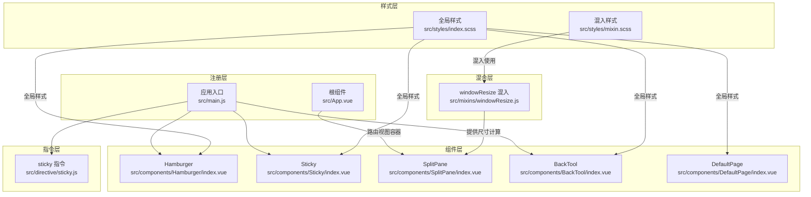
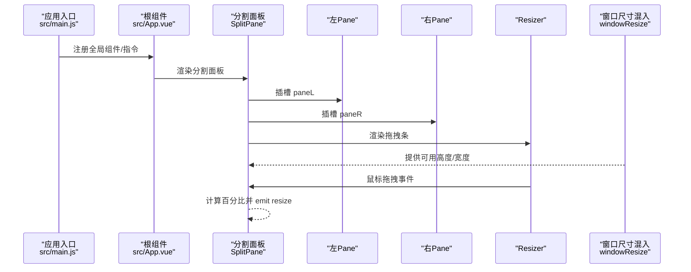
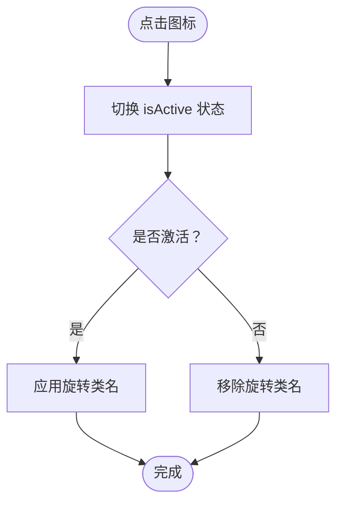
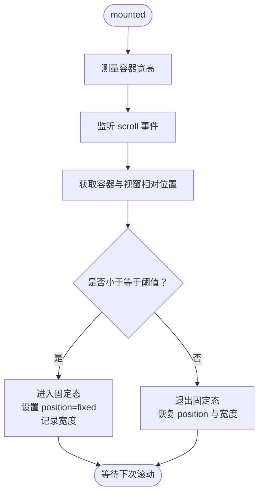
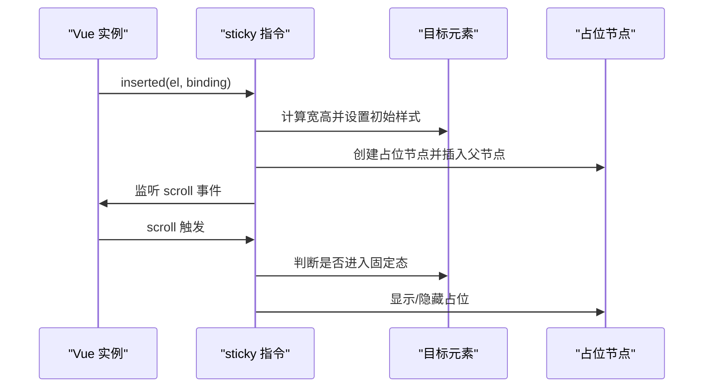
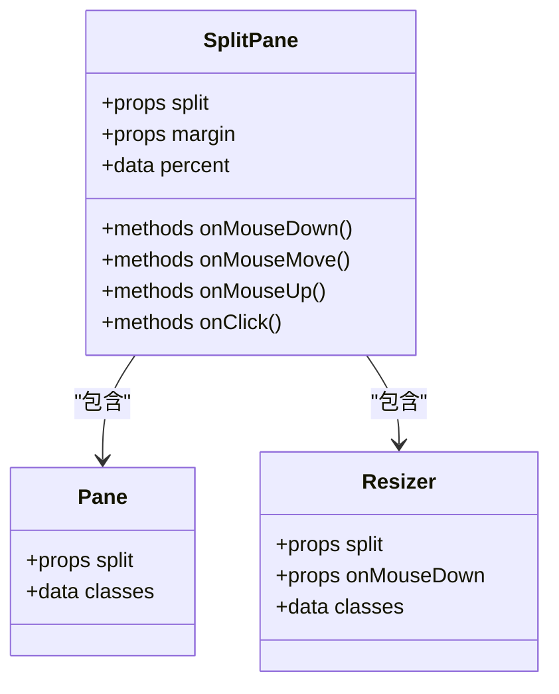
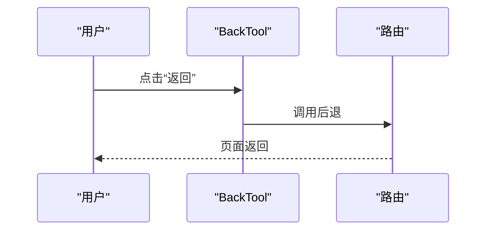
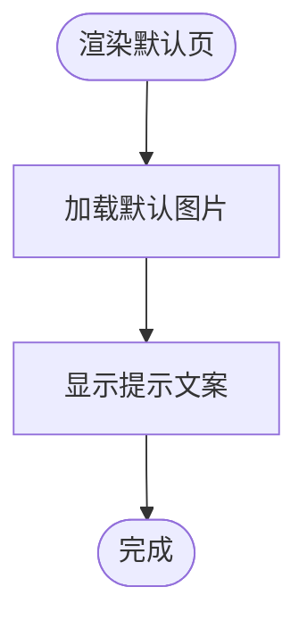
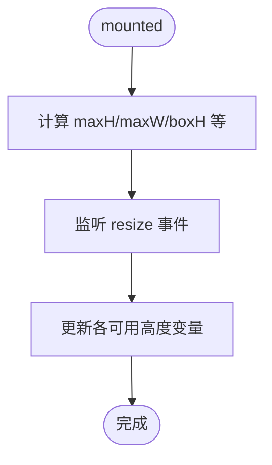
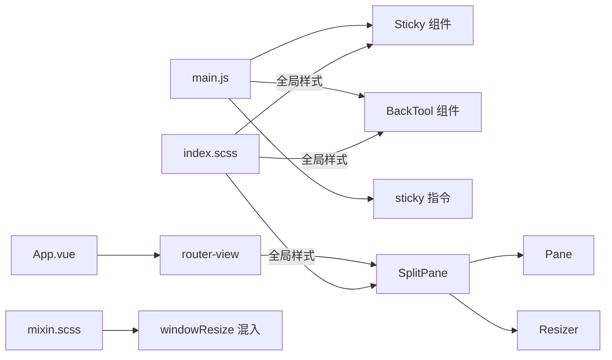

# 布局组件

<cite>
**本文引用的文件**
- [src/components/Hamburger/index.vue](file://src/components/Hamburger/index.vue)
- [src/components/Sticky/index.vue](file://src/components/Sticky/index.vue)
- [src/directive/sticky.js](file://src/directive/sticky.js)
- [src/components/SplitPane/index.vue](file://src/components/SplitPane/index.vue)
- [src/components/SplitPane/Pane.vue](file://src/components/SplitPane/Pane.vue)
- [src/components/SplitPane/Resizer.vue](file://src/components/SplitPane/Resizer.vue)
- [src/components/BackTool/index.vue](file://src/components/BackTool/index.vue)
- [src/components/DefaultPage/index.vue](file://src/components/DefaultPage/index.vue)
- [src/mixins/windowResize.js](file://src/mixins/windowResize.js)
- [src/styles/index.scss](file://src/styles/index.scss)
- [src/styles/mixin.scss](file://src/styles/mixin.scss)
- [src/main.js](file://src/main.js)
- [src/App.vue](file://src/App.vue)
</cite>

## 目录
1. [简介](#简介)
2. [项目结构](#项目结构)
3. [核心组件](#核心组件)
4. [架构总览](#架构总览)
5. [组件详解](#组件详解)
6. [依赖关系分析](#依赖关系分析)
7. [性能考量](#性能考量)
8. [故障排查指南](#故障排查指南)
9. [结论](#结论)
10. [附录](#附录)

## 简介
本文件面向UI设计师与前端开发者，系统化梳理校园管理系统中的布局辅助组件，包括汉堡菜单、粘性定位、分割面板、返回工具、默认页面等。文档覆盖组件功能、实现原理、响应式与屏幕适配策略、布局配置与样式定制、动画与交互体验优化，并给出在不同设备上的表现建议与性能注意事项，帮助团队高效构建一致且优质的用户界面。

## 项目结构
围绕布局与通用样式的相关文件主要分布在以下位置：
- 组件层：src/components 下的 Hamburger、Sticky、SplitPane、BackTool、DefaultPage
- 指令层：src/directive/sticky.js 提供粘性定位指令
- 混合层：src/mixins/windowResize.js 提供窗口尺寸监听与计算
- 样式层：src/styles/index.scss、src/styles/mixin.scss 提供全局样式与混入
- 注册层：src/main.js 中注册组件与指令；src/App.vue 中承载路由视图

图表来源
- [src/main.js:45-46](file://src/main.js#L45-L46)
- [src/main.js:19-25](file://src/main.js#L19-L25)
- [src/App.vue:1-8](file://src/App.vue#L1-L8)
- [src/styles/index.scss:1-349](file://src/styles/index.scss#L1-L349)
- [src/styles/mixin.scss:1-359](file://src/styles/mixin.scss#L1-L359)

章节来源
- [src/main.js:19-25](file://src/main.js#L19-L25)
- [src/App.vue:1-8](file://src/App.vue#L1-L8)
- [src/styles/index.scss:1-349](file://src/styles/index.scss#L1-L349)
- [src/styles/mixin.scss:1-359](file://src/styles/mixin.scss#L1-L359)

## 核心组件
- 汉堡菜单：用于移动端/侧边栏场景的开关图标，支持激活态旋转动画。
- 粘性定位：提供组件级粘性定位能力，支持滚动阈值、层级与占位行为。
- 分割面板：支持水平/垂直拖拽分割，动态计算百分比并发出 resize 事件。
- 返回工具：提供“返回”按钮与插槽扩展，便于统一导航风格。
- 默认页面：用于空数据或无结果场景的占位展示，提升可访问性与一致性。
- 窗口尺寸混入：统一计算页面可用高度/宽度，适配不同布局与头部/分页区域。

章节来源
- [src/components/Hamburger/index.vue:1-37](file://src/components/Hamburger/index.vue#L1-L37)
- [src/components/Sticky/index.vue:1-74](file://src/components/Sticky/index.vue#L1-L74)
- [src/directive/sticky.js:1-100](file://src/directive/sticky.js#L1-L100)
- [src/components/SplitPane/index.vue:1-112](file://src/components/SplitPane/index.vue#L1-L112)
- [src/components/SplitPane/Pane.vue:1-42](file://src/components/SplitPane/Pane.vue#L1-L42)
- [src/components/SplitPane/Resizer.vue:1-72](file://src/components/SplitPane/Resizer.vue#L1-L72)
- [src/components/BackTool/index.vue:1-29](file://src/components/BackTool/index.vue#L1-L29)
- [src/components/DefaultPage/index.vue:1-35](file://src/components/DefaultPage/index.vue#L1-L35)
- [src/mixins/windowResize.js:1-63](file://src/mixins/windowResize.js#L1-L63)

## 架构总览
下图展示了布局组件在应用中的协作关系：组件通过 props 与事件与父组件通信；指令与组件均可实现粘性定位；分割面板由容器与两个 Pane、一个 Resizer 组成；返回工具与默认页面作为页面级辅助；窗口尺寸混入为页面提供统一的布局尺寸计算。

图表来源
- [src/main.js:45-46](file://src/main.js#L45-L46)
- [src/App.vue:1-8](file://src/App.vue#L1-L8)
- [src/components/SplitPane/index.vue:1-112](file://src/components/SplitPane/index.vue#L1-L112)
- [src/mixins/windowResize.js:1-63](file://src/mixins/windowResize.js#L1-L63)

## 组件详解

### 汉堡菜单（Hamburger）
- 功能概述
  - 展示三道杠图标，点击触发父级回调。
  - 激活态时执行旋转动画，直观表达展开/收起状态。
- 关键属性
  - isActive：布尔，控制激活态与旋转。
  - toggleClick：函数，点击回调。
- 样式要点
  - 内联块级显示，指针为手型，具备过渡动画与旋转中心。
- 使用建议
  - 与侧边栏/抽屉配合，保持图标尺寸与点击热区一致。
  - 在深色/浅色主题下注意对比度，必要时通过类名切换样式。

图表来源
- [src/components/Hamburger/index.vue:10-19](file://src/components/Hamburger/index.vue#L10-L19)
- [src/components/Hamburger/index.vue:23-36](file://src/components/Hamburger/index.vue#L23-L36)

章节来源
- [src/components/Hamburger/index.vue:1-37](file://src/components/Hamburger/index.vue#L1-L37)

### 粘性定位（Sticky 组件）
- 功能概述
  - 当滚动超过阈值时，将内容固定到视窗指定位置，并插入占位以避免布局塌陷。
  - 提供 top、zIndex、className 等参数控制定位行为与层级。
- 关键逻辑
  - 监听滚动，计算容器与视窗的相对位置，决定是否进入固定态。
  - 固定态时记录宽度，重置态时恢复自动宽度并隐藏占位。
- 性能与兼容
  - 使用 requestAnimationFrame 或节流可进一步优化滚动事件。
  - 对于现代浏览器可结合原生 CSS sticky，指令版提供降级实现。

图表来源
- [src/components/Sticky/index.vue:38-63](file://src/components/Sticky/index.vue#L38-L63)
- [src/components/Sticky/index.vue:65-71](file://src/components/Sticky/index.vue#L65-L71)

章节来源
- [src/components/Sticky/index.vue:1-74](file://src/components/Sticky/index.vue#L1-L74)

### 粘性定位（sticky 指令）
- 功能概述
  - 通过指令形式为任意元素添加粘性定位，支持 top、zIndex 参数。
  - 若浏览器不支持原生 sticky，则回退到 JS 实现（固定定位 + 占位）。
- 关键逻辑
  - 初始化时计算元素宽高，创建占位节点。
  - 滚动时根据阈值判断进入/退出固定态，同步占位显隐。
- 适用场景
  - 适合在复杂布局中快速为局部区块添加粘性行为，无需封装组件。

图表来源
- [src/directive/sticky.js:5-87](file://src/directive/sticky.js#L5-L87)

章节来源
- [src/directive/sticky.js:1-100](file://src/directive/sticky.js#L1-L100)

### 分割面板（SplitPane）
- 功能概述
  - 支持水平/垂直分割，拖拽中间条实时调整两侧区域占比。
  - 提供 margin 边界限制、resize 事件通知父组件。
- 组件构成
  - 容器：负责鼠标事件与百分比计算。
  - Pane：左侧/右侧容器，按方向绝对定位。
  - Resizer：拖拽条，支持 hover 高亮与方向光标。
- 关键逻辑
  - 鼠标按下激活拖拽，移动时计算当前坐标相对于容器的百分比，限定在 margin 边界内。
  - 每次移动 emit resize 事件，父组件可据此更新布局或持久化比例。

图表来源
- [src/components/SplitPane/index.vue:30-111](file://src/components/SplitPane/index.vue#L30-L111)
- [src/components/SplitPane/Pane.vue:7-17](file://src/components/SplitPane/Pane.vue#L7-L17)
- [src/components/SplitPane/Resizer.vue:5-24](file://src/components/SplitPane/Resizer.vue#L5-L24)

章节来源
- [src/components/SplitPane/index.vue:1-112](file://src/components/SplitPane/index.vue#L1-L112)
- [src/components/SplitPane/Pane.vue:1-42](file://src/components/SplitPane/Pane.vue#L1-L42)
- [src/components/SplitPane/Resizer.vue:1-72](file://src/components/SplitPane/Resizer.vue#L1-L72)

### 返回工具（BackTool）
- 功能概述
  - 提供“返回”按钮，调用路由后退；支持插槽扩展放置其他工具。
  - 可选底部边线，统一页面工具区视觉。
- 使用建议
  - 在详情页/弹窗页顶部工具区统一使用，保证用户操作路径一致。

图表来源
- [src/components/BackTool/index.vue:16-20](file://src/components/BackTool/index.vue#L16-L20)

章节来源
- [src/components/BackTool/index.vue:1-29](file://src/components/BackTool/index.vue#L1-L29)

### 默认页面（DefaultPage）
- 功能概述
  - 空状态占位展示，包含默认图片与提示文案，支持通过属性传入提示信息。
- 样式要点
  - 图片居中显示，标题段落支持断词与换行，保证在不同语言与字号下的可读性。

图表来源
- [src/components/DefaultPage/index.vue:1-12](file://src/components/DefaultPage/index.vue#L1-L12)
- [src/components/DefaultPage/index.vue:14-34](file://src/components/DefaultPage/index.vue#L14-L34)

章节来源
- [src/components/DefaultPage/index.vue:1-35](file://src/components/DefaultPage/index.vue#L1-L35)

### 窗口尺寸混入（windowResize）
- 功能概述
  - 在挂载时计算页面可用高度/宽度，并在窗口变化时更新。
  - 提供多种“可用高度”变体，适配顶部/底部无新增/返回/分页等不同布局形态。
- 使用建议
  - 在表格/列表/富文本编辑器等需要精确高度的容器中使用，避免滚动条遮挡或留白过多。

图表来源
- [src/mixins/windowResize.js:17-32](file://src/mixins/windowResize.js#L17-L32)
- [src/mixins/windowResize.js:48-61](file://src/mixins/windowResize.js#L48-L61)

章节来源
- [src/mixins/windowResize.js:1-63](file://src/mixins/windowResize.js#L1-L63)

## 依赖关系分析
- 组件注册
  - 应用入口在 main.js 中全局注册 Sticky 组件与 BackTool 组件，并引入样式与第三方库。
- 组件间耦合
  - SplitPane 与 Pane/Resizer 为组合关系，内部通过插槽与事件通信。
  - Sticky 组件与 sticky 指令提供两种粘性定位方案，可按需选择。
- 样式依赖
  - 全局样式与混入为布局组件提供基础排版与滚动条样式，确保跨组件一致性。

图表来源
- [src/main.js:45-46](file://src/main.js#L45-L46)
- [src/App.vue:1-8](file://src/App.vue#L1-L8)
- [src/styles/index.scss:1-349](file://src/styles/index.scss#L1-L349)
- [src/styles/mixin.scss:1-359](file://src/styles/mixin.scss#L1-L359)

章节来源
- [src/main.js:19-25](file://src/main.js#L19-L25)
- [src/App.vue:1-8](file://src/App.vue#L1-L8)
- [src/styles/index.scss:1-349](file://src/styles/index.scss#L1-L349)
- [src/styles/mixin.scss:1-359](file://src/styles/mixin.scss#L1-L359)

## 性能考量
- 滚动事件优化
  - 粘性定位组件与分割面板均涉及滚动/鼠标事件，建议在父组件中对事件进行节流/防抖，减少频繁重排与重绘。
- DOM 操作最小化
  - Sticky 组件在固定态时仅设置 position 与宽度，尽量避免频繁读写布局属性。
- 指令回退策略
  - sticky 指令在不支持原生 sticky 的环境下采用 JS 固定定位，注意占位节点的插入与移除开销。
- 响应式与缩放
  - 分割面板百分比计算依赖容器尺寸，建议在父容器尺寸稳定后再初始化，避免首帧抖动。
- 样式与渲染
  - 全局样式与混入提供滚动条与基础排版，避免重复定义导致的样式冲突与回流。

[本节为通用性能建议，不直接分析具体文件]

## 故障排查指南
- 粘性定位不生效
  - 检查父容器是否有 overflow 或 transform 影响定位上下文。
  - 确认 stickyTop 阈值设置是否合理，滚动距离是否达到触发条件。
  - 若使用指令版，确认绑定参数是否正确传递。
- 分割面板拖拽异常
  - 检查容器是否设置了 overflow，影响鼠标坐标计算。
  - 确认 split 方向与 margin 边界设置，避免超出范围导致无法拖拽。
  - 监听 resize 事件，确保父组件在容器尺寸变化后重新计算。
- 返回工具无效
  - 确认路由栈是否存在可后退的历史记录。
  - 检查按钮点击事件是否被其他元素拦截。
- 默认页面显示异常
  - 检查图片资源路径是否正确，网络加载失败会导致空白。
  - 文案过长时注意容器宽度与换行策略。

章节来源
- [src/components/Sticky/index.vue:38-63](file://src/components/Sticky/index.vue#L38-L63)
- [src/directive/sticky.js:5-87](file://src/directive/sticky.js#L5-L87)
- [src/components/SplitPane/index.vue:66-108](file://src/components/SplitPane/index.vue#L66-L108)
- [src/components/BackTool/index.vue:16-20](file://src/components/BackTool/index.vue#L16-L20)
- [src/components/DefaultPage/index.vue:1-12](file://src/components/DefaultPage/index.vue#L1-L12)

## 结论
通过汉堡菜单、粘性定位、分割面板、返回工具与默认页面等布局组件，结合窗口尺寸混入与全局样式体系，能够快速搭建一致、可维护且具有良好用户体验的校园管理系统界面。建议在实际项目中：
- 明确组件职责边界，优先使用指令或组件实现粘性定位；
- 在复杂布局中谨慎使用分割面板，确保边界与事件处理合理；
- 统一使用返回工具与默认页面，提升交互一致性；
- 在移动端与小屏设备上验证布局与滚动行为，必要时增加媒体查询与断点策略。

[本节为总结性内容，不直接分析具体文件]

## 附录

### 响应式与屏幕适配策略
- 移动端优先
  - 控制台与样式中常见断点与媒体查询，建议在关键布局处增加针对窄屏的样式覆盖。
- 字体与间距
  - 使用混入提供的字号与间距变量，确保在不同设备上保持一致的阅读节奏。
- 滚动与溢出
  - 全局滚动条样式与表格溢出处理，避免在小屏设备上出现横向滚动条遮挡内容。

章节来源
- [src/styles/index.scss:284-291](file://src/styles/index.scss#L284-L291)
- [src/styles/mixin.scss:1-359](file://src/styles/mixin.scss#L1-L359)

### 样式定制与主题
- 全局样式
  - 通过 index.scss 引入按钮、表格、滚动条等全局样式，统一视觉规范。
- 混入使用
  - 使用 mixin.scss 中的工具类（如滚动条、居中、三角形、表格列宽等），减少重复样式代码。
- 组件样式
  - 组件内部样式通过 scoped 作用域隔离，必要时可通过深度选择器或 CSS 变量进行主题定制。

章节来源
- [src/styles/index.scss:1-349](file://src/styles/index.scss#L1-L349)
- [src/styles/mixin.scss:1-359](file://src/styles/mixin.scss#L1-L359)