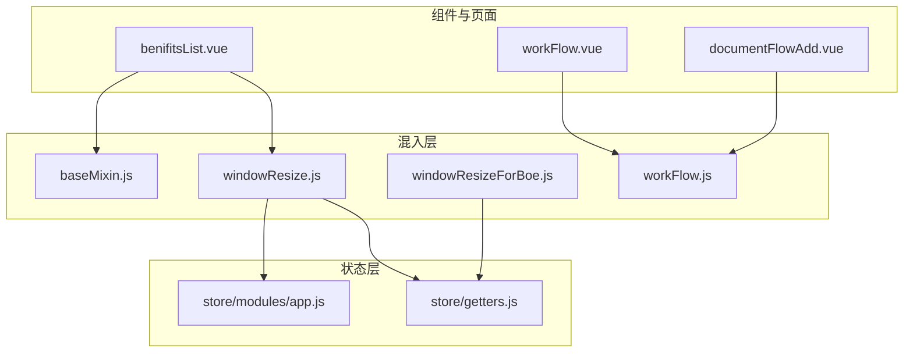
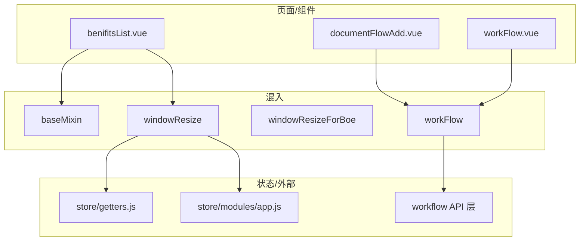
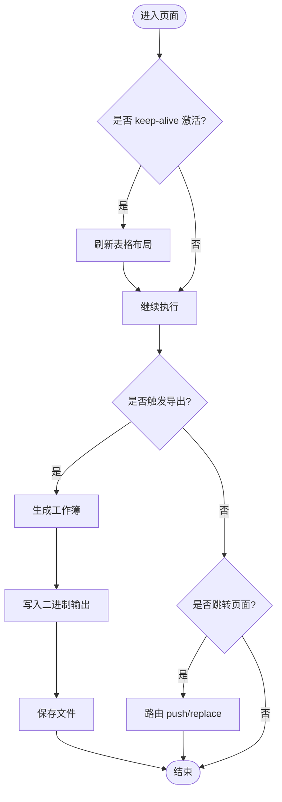
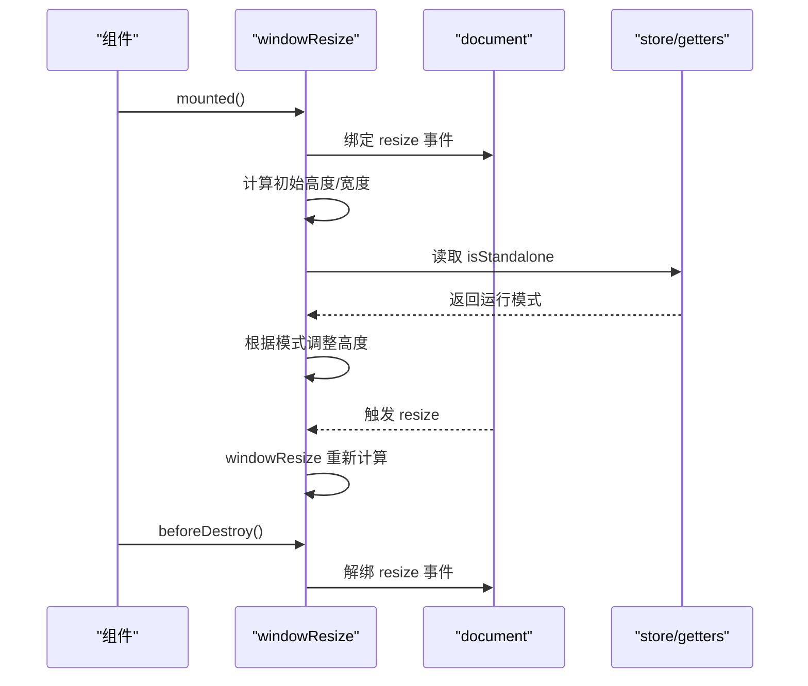
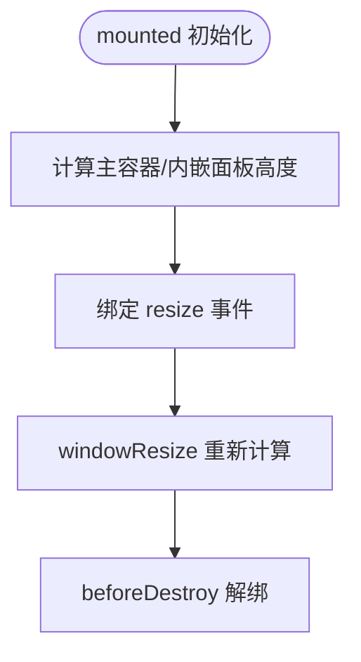
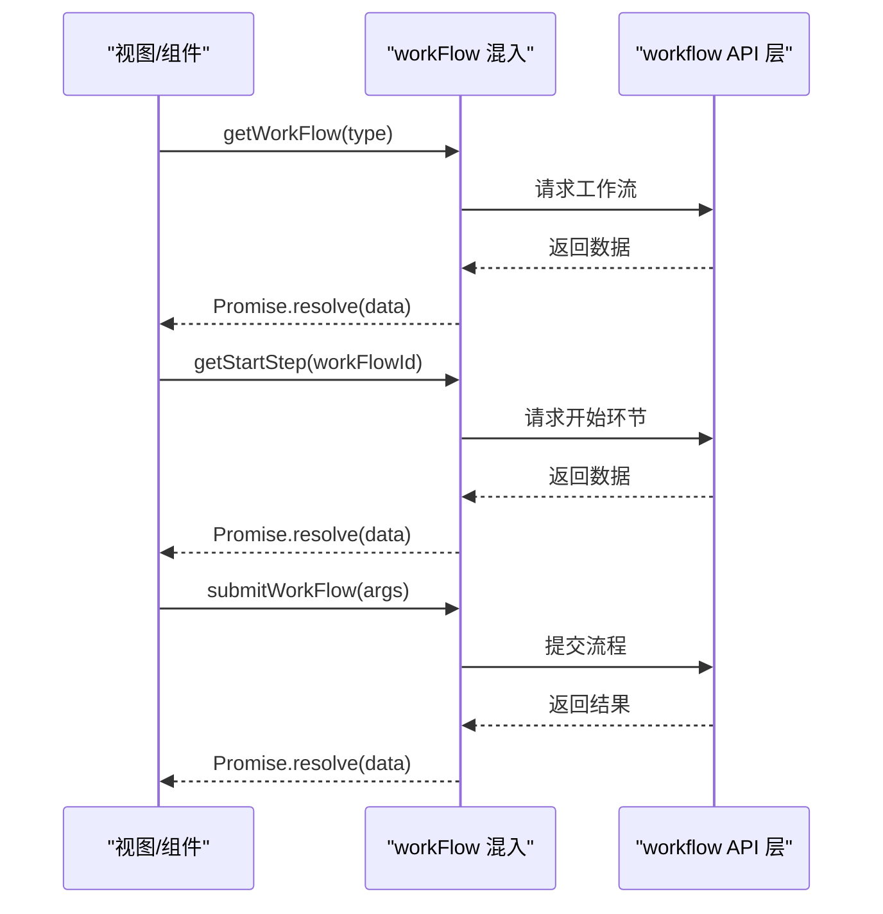
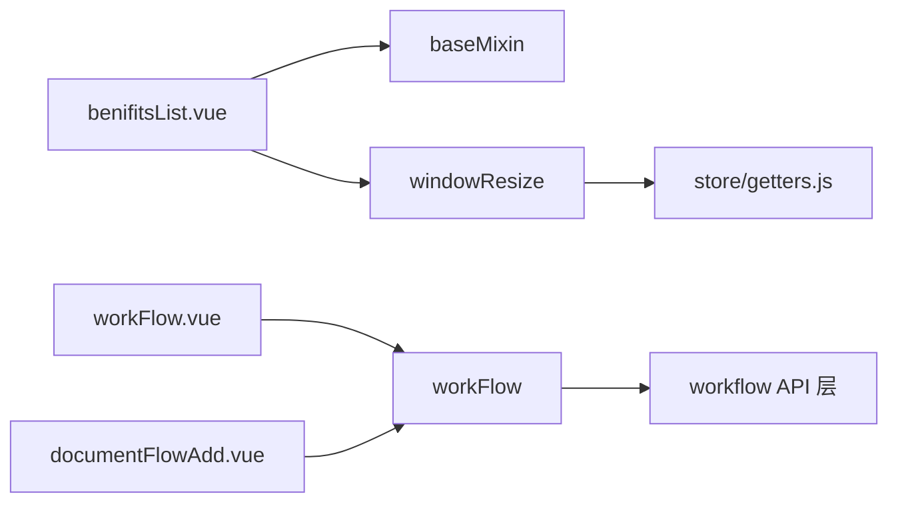

# 混入和辅助工具

<cite>
**本文引用的文件**
- [baseMixin.js](file://src/mixins/baseMixin.js)
- [windowResize.js](file://src/mixins/windowResize.js)
- [windowResizeForBoe.js](file://src/mixins/windowResizeForBoe.js)
- [workFlow.js](file://src/mixins/workFlow.js)
- [benifitsList.vue](file://src/views/benifits/benifitsList.vue)
- [workFlow.vue](file://src/components/workFlow/workFlow.vue)
- [documentFlowAdd.vue](file://src/views/documentFlow/documentFlowAdd.vue)
- [app.js](file://src/store/modules/app.js)
- [getters.js](file://src/store/getters.js)
</cite>

## 目录
1. [引言](#引言)
2. [项目结构](#项目结构)
3. [核心组件](#核心组件)
4. [架构总览](#架构总览)
5. [详细组件分析](#详细组件分析)
6. [依赖关系分析](#依赖关系分析)
7. [性能考量](#性能考量)
8. [故障排查指南](#故障排查指南)
9. [结论](#结论)
10. [附录](#附录)

## 引言
本文件面向校园管理系统中“混入与辅助工具”的使用与扩展，重点覆盖以下方面：
- 基础混入：统一的数据结构、分页参数、路由跳转、权限校验、导出表格、日期工具等能力
- 窗口尺寸监听混入：响应式布局适配、容器高度计算、路由切换差异处理
- BOE 特殊混入：针对特定业务场景的窗口高度适配
- 工作流混入：封装工作流查询、环节处理人获取、提交流程等常用操作
- 生命周期钩子、方法合并策略与数据共享机制
- 完整使用示例与组合模式
- 最佳实践与性能优化建议
- 与组件的集成方式与注意事项

## 项目结构
混入集中位于 src/mixins 目录，配套组件与页面在 src/components 与 src/views 中广泛使用。全局状态通过 src/store 提供，混入可读取 store 的 getter 以适配不同运行环境。

图表来源
- [baseMixin.js:1-103](file://src/mixins/baseMixin.js#L1-L103)
- [windowResize.js:1-63](file://src/mixins/windowResize.js#L1-L63)
- [windowResizeForBoe.js:1-34](file://src/mixins/windowResizeForBoe.js#L1-L34)
- [workFlow.js:1-103](file://src/mixins/workFlow.js#L1-L103)
- [benifitsList.vue:100-109](file://src/views/benifits/benifitsList.vue#L100-L109)
- [workFlow.vue:90-91](file://src/components/workFlow/workFlow.vue#L90-L91)
- [documentFlowAdd.vue:114-114](file://src/views/documentFlow/documentFlowAdd.vue#L114-L114)
- [app.js:1-54](file://src/store/modules/app.js#L1-L54)
- [getters.js:1-26](file://src/store/getters.js#L1-L26)

章节来源
- [baseMixin.js:1-103](file://src/mixins/baseMixin.js#L1-L103)
- [windowResize.js:1-63](file://src/mixins/windowResize.js#L1-L63)
- [windowResizeForBoe.js:1-34](file://src/mixins/windowResizeForBoe.js#L1-L34)
- [workFlow.js:1-103](file://src/mixins/workFlow.js#L1-L103)
- [benifitsList.vue:100-109](file://src/views/benifits/benifitsList.vue#L100-L109)
- [workFlow.vue:90-91](file://src/components/workFlow/workFlow.vue#L90-L91)
- [documentFlowAdd.vue:114-114](file://src/views/documentFlow/documentFlowAdd.vue#L114-L114)
- [app.js:1-54](file://src/store/modules/app.js#L1-L54)
- [getters.js:1-26](file://src/store/getters.js#L1-L26)

## 核心组件
- 基础混入（baseMixin）
  - 数据：全局基础路径、分页参数
  - 过滤器：时间后缀过滤
  - 生命周期：keep-alive 激活时刷新表格布局
  - 方法：路由跳转（支持 replace 与刷新）、分页变更、权限校验、Excel 导出、日期工具
- 窗口尺寸监听混入（windowResize）
  - 数据：多组高度/宽度基准值
  - 生命周期：mounted 绑定 resize；beforeDestroy 解绑
  - 路由监听：根据路由动态调整基准值
  - 方法：windowResize 计算并更新各高度变量
- BOE 特殊混入（windowResizeForBoe）
  - 数据：主容器高度、内嵌面板高度等
  - 生命周期：mounted 初始化；beforeDestroy 解绑
  - 方法：windowResize 重新计算高度
- 工作流混入（workFlow）
  - 方法：获取工作流、开始环节、当前环节、环节处理人、按环节查询、提交流程、历史处理人集合、日期工具
  - 与 API 层解耦，统一 Promise 化调用

章节来源
- [baseMixin.js:4-101](file://src/mixins/baseMixin.js#L4-L101)
- [windowResize.js:2-61](file://src/mixins/windowResize.js#L2-L61)
- [windowResizeForBoe.js:1-33](file://src/mixins/windowResizeForBoe.js#L1-L33)
- [workFlow.js:4-101](file://src/mixins/workFlow.js#L4-L101)

## 架构总览
混入作为“横切关注点”的载体，被多个页面与组件复用，形成“通用能力 + 业务组件”的协作模式。窗口尺寸混入通过 store 的 getter 判断运行环境（如独立运行），工作流混入通过 API 层完成业务交互。

图表来源
- [benifitsList.vue:100-109](file://src/views/benifits/benifitsList.vue#L100-L109)
- [documentFlowAdd.vue:114-114](file://src/views/documentFlow/documentFlowAdd.vue#L114-L114)
- [workFlow.vue:90-91](file://src/components/workFlow/workFlow.vue#L90-L91)
- [windowResize.js:17-31](file://src/mixins/windowResize.js#L17-L31)
- [getters.js:19-19](file://src/store/getters.js#L19-L19)
- [app.js:45-47](file://src/store/modules/app.js#L45-L47)
- [workFlow.js:1-1](file://src/mixins/workFlow.js#L1-L1)

## 详细组件分析

### 基础混入（baseMixin）分析
- 数据共享机制
  - 全局基础路径与分页参数在组件实例中共享，便于统一控制
- 生命周期钩子
  - keep-alive 激活时自动刷新表格布局，避免因 DOM 未就绪导致的渲染错位
- 方法合并策略
  - 与组件 methods 同名时，组件方法优先级更高；filters 与 data 合并注入
- 关键方法
  - 路由跳转：支持 replace 与延迟刷新
  - 分页变更：重置页码或更新页码
  - 权限校验：基于权限列表判断
  - Excel 导出：基于表格生成并下载
  - 日期工具：生成相对日期、格式化日期

图表来源
- [baseMixin.js:21-27](file://src/mixins/baseMixin.js#L21-L27)
- [baseMixin.js:37-54](file://src/mixins/baseMixin.js#L37-L54)
- [baseMixin.js:65-86](file://src/mixins/baseMixin.js#L65-L86)

章节来源
- [baseMixin.js:4-101](file://src/mixins/baseMixin.js#L4-L101)

### 窗口尺寸监听混入（windowResize）分析
- 数据共享机制
  - 多组高度/宽度基准值，用于不同布局场景
- 生命周期钩子
  - mounted 绑定 window.resize；beforeDestroy 解绑，防止内存泄漏
  - $route 监听：根据路由路径动态调整基准值
- 方法合并策略
  - windowResize 在 resize 事件中统一更新各高度变量
- 与状态层集成
  - 通过 store.getters.isStandalone 判断独立运行环境并调整高度

图表来源
- [windowResize.js:17-31](file://src/mixins/windowResize.js#L17-L31)
- [windowResize.js:33-46](file://src/mixins/windowResize.js#L33-L46)
- [windowResize.js:48-61](file://src/mixins/windowResize.js#L48-L61)
- [getters.js:19-19](file://src/store/getters.js#L19-L19)

章节来源
- [windowResize.js:2-61](file://src/mixins/windowResize.js#L2-L61)
- [getters.js:19-19](file://src/store/getters.js#L19-L19)

### BOE 特殊混入（windowResizeForBoe）分析
- 数据共享机制
  - 主容器高度、内嵌面板高度等，满足 BOE 场景的布局需求
- 生命周期钩子
  - mounted 初始化高度；beforeDestroy 解绑
- 方法合并策略
  - windowResize 仅重新计算高度，逻辑简洁

图表来源
- [windowResizeForBoe.js:15-31](file://src/mixins/windowResizeForBoe.js#L15-L31)

章节来源
- [windowResizeForBoe.js:1-33](file://src/mixins/windowResizeForBoe.js#L1-L33)

### 工作流混入（workFlow）分析
- 方法合并策略
  - 所有方法均返回 Promise，便于在组件中链式调用
- 关键流程
  - 获取工作流、开始环节、当前环节、环节处理人、按环节查询、提交流程、历史处理人集合
- 与组件的协作
  - 页面/组件通过混入方法发起请求，接收 Promise 结果并驱动 UI 更新

图表来源
- [workFlow.js:10-18](file://src/mixins/workFlow.js#L10-L18)
- [workFlow.js:21-29](file://src/mixins/workFlow.js#L21-L29)
- [workFlow.js:66-74](file://src/mixins/workFlow.js#L66-L74)

章节来源
- [workFlow.js:4-101](file://src/mixins/workFlow.js#L4-L101)

## 依赖关系分析
- 组件对混入的依赖
  - 页面：benifitsList.vue 同时引入 baseMixin 与 windowResize
  - 组件：workFlow.vue 与 documentFlowAdd.vue 引入 workFlow 混入
- 混入对状态层的依赖
  - windowResize 读取 store.getters.isStandalone 以判断运行模式
- 混入对 API 层的依赖
  - workFlow 混入通过 workflow API 完成业务交互

图表来源
- [benifitsList.vue:100-109](file://src/views/benifits/benifitsList.vue#L100-L109)
- [workFlow.vue:90-91](file://src/components/workFlow/workFlow.vue#L90-L91)
- [documentFlowAdd.vue:114-114](file://src/views/documentFlow/documentFlowAdd.vue#L114-L114)
- [windowResize.js:1-1](file://src/mixins/windowResize.js#L1-L1)
- [getters.js:1-26](file://src/store/getters.js#L1-L26)
- [workFlow.js:1-1](file://src/mixins/workFlow.js#L1-L1)

章节来源
- [benifitsList.vue:100-109](file://src/views/benifits/benifitsList.vue#L100-L109)
- [workFlow.vue:90-91](file://src/components/workFlow/workFlow.vue#L90-L91)
- [documentFlowAdd.vue:114-114](file://src/views/documentFlow/documentFlowAdd.vue#L114-L114)
- [windowResize.js:1-1](file://src/mixins/windowResize.js#L1-L1)
- [getters.js:1-26](file://src/store/getters.js#L1-L26)
- [workFlow.js:1-1](file://src/mixins/workFlow.js#L1-L1)

## 性能考量
- 窗口尺寸监听
  - 使用 window.addEventListener 绑定 resize，务必在 beforeDestroy 解绑，避免内存泄漏
  - 在高频 resize 场景下，建议在组件内部增加节流/防抖策略（可在组件层自行增强）
- 表格布局刷新
  - keep-alive 激活时刷新表格布局，避免布局错位；注意在大量表格场景下的性能影响
- 导出 Excel
  - 基于表格生成工作簿，数据量大时可能产生较大的内存占用；建议在组件层控制导出范围与时机
- 工作流请求
  - 所有方法返回 Promise，建议在组件中进行并发控制与错误处理，避免频繁请求造成卡顿

## 故障排查指南
- 窗口尺寸异常
  - 确认 mounted 是否正确绑定 resize，beforeDestroy 是否解绑
  - 检查 store.getters.isStandalone 的值是否符合预期
- 表格布局错位
  - 确保 keep-alive 激活时触发了布局刷新逻辑
- 导出失败
  - 检查表格元素是否存在以及导出参数配置
- 工作流提交失败
  - 检查传入参数是否完整，接口返回状态码与提示信息

章节来源
- [windowResize.js:30-31](file://src/mixins/windowResize.js#L30-L31)
- [baseMixin.js:21-27](file://src/mixins/baseMixin.js#L21-L27)
- [workFlow.js:66-74](file://src/mixins/workFlow.js#L66-L74)

## 结论
通过混入与辅助工具，系统实现了跨页面与组件的能力复用，提升了开发效率与一致性。建议在后续迭代中：
- 对高频事件（如 resize）增加节流/防抖
- 在组件层对混入方法进行二次封装，统一错误处理与加载态
- 明确混入职责边界，避免过度耦合

## 附录

### 使用示例与组合模式
- 页面同时使用基础与窗口尺寸混入
  - 示例路径：[benifitsList.vue:100-109](file://src/views/benifits/benifitsList.vue#L100-L109)
- 组件使用工作流混入
  - 示例路径：[workFlow.vue:90-91](file://src/components/workFlow/workFlow.vue#L90-L91)
  - 示例路径：[documentFlowAdd.vue:114-114](file://src/views/documentFlow/documentFlowAdd.vue#L114-L114)

章节来源
- [benifitsList.vue:100-109](file://src/views/benifits/benifitsList.vue#L100-L109)
- [workFlow.vue:90-91](file://src/components/workFlow/workFlow.vue#L90-L91)
- [documentFlowAdd.vue:114-114](file://src/views/documentFlow/documentFlowAdd.vue#L114-L114)