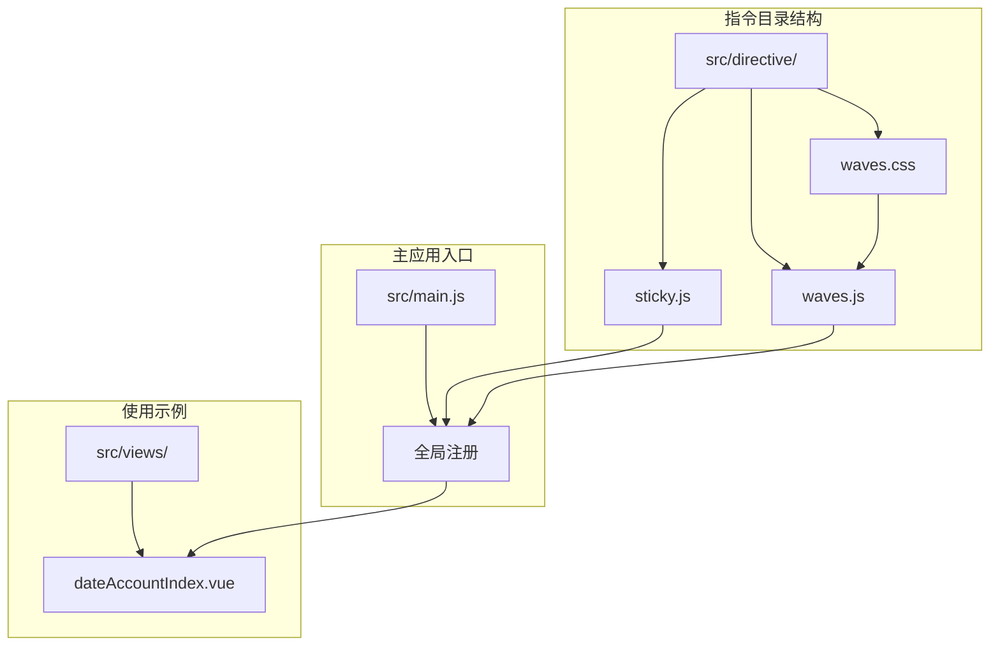
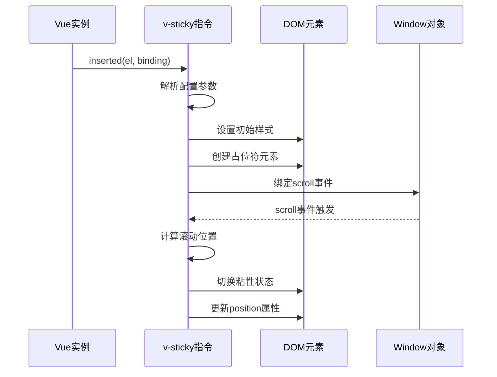
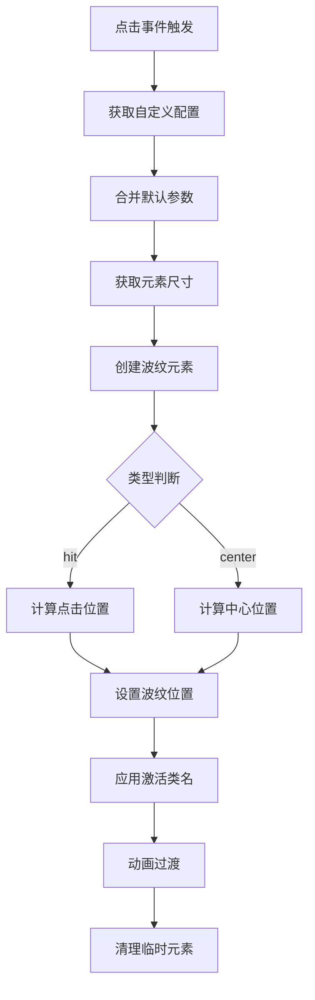
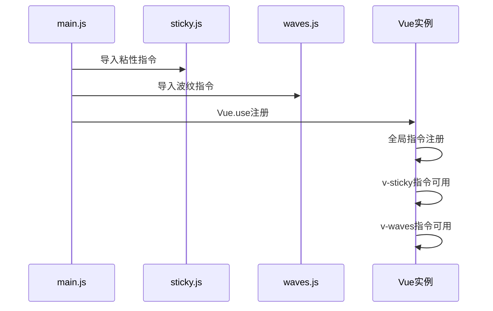
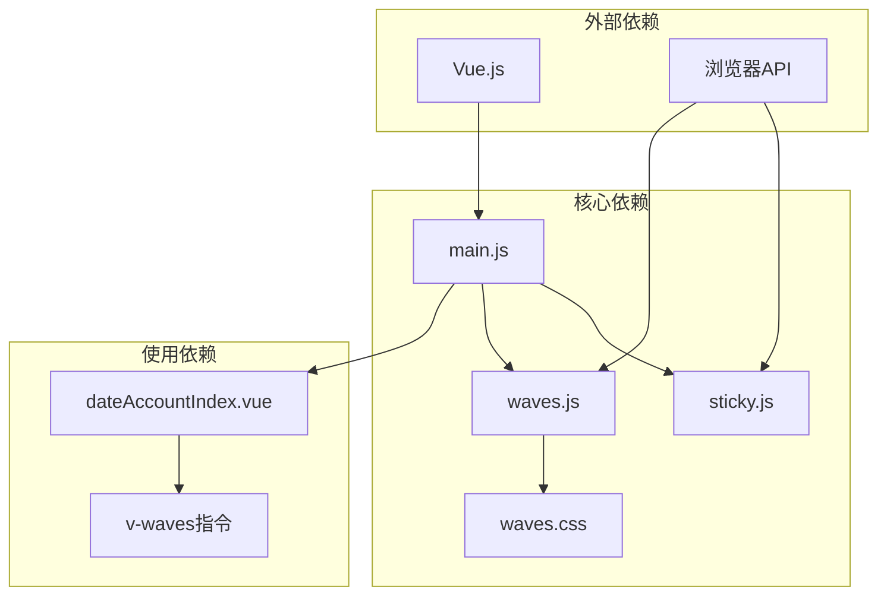

# 自定义指令

<cite>
**本文档引用的文件**
- [sticky.js](file://src/directive/sticky.js)
- [waves.js](file://src/directive/waves.js)
- [waves.css](file://src/directive/waves.css)
- [main.js](file://src/main.js)
- [dateAccountIndex.vue](file://src/views/compositeExam/dateAccountIndex.vue)
</cite>

## 目录
1. [简介](#简介)
2. [项目结构](#项目结构)
3. [核心组件](#核心组件)
4. [架构概览](#架构概览)
5. [详细组件分析](#详细组件分析)
6. [依赖关系分析](#依赖关系分析)
7. [性能考虑](#性能考虑)
8. [故障排除指南](#故障排除指南)
9. [结论](#结论)

## 简介
本文档详细介绍校园管理系统中的两个自定义指令：粘性定位指令和波纹效果指令。这两个指令分别用于实现页面元素的粘性定位效果和按钮点击的波纹动画效果，为用户提供更好的交互体验。

## 项目结构
指令文件位于 `src/directive/` 目录下，采用模块化设计：



**图表来源**
- [sticky.js:1-100](file://src/directive/sticky.js#L1-L100)
- [waves.js:1-55](file://src/directive/waves.js#L1-L55)
- [waves.css:1-26](file://src/directive/waves.css#L1-L26)
- [main.js:1-221](file://src/main.js#L1-L221)

**章节来源**
- [sticky.js:1-100](file://src/directive/sticky.js#L1-L100)
- [waves.js:1-55](file://src/directive/waves.js#L1-L55)
- [waves.css:1-26](file://src/directive/waves.css#L1-L26)
- [main.js:1-221](file://src/main.js#L1-L221)

## 核心组件

### 粘性定位指令 (v-sticky)
粘性定位指令实现了元素的粘性定位功能，支持自定义顶部间距和层级：

**主要特性：**
- 原生CSS sticky 支持检测
- 回退到JavaScript实现
- 动态计算元素尺寸
- 占位符元素管理
- 滚动事件监听

**配置参数：**
- `stickyTop`: 距离顶部的偏移量（默认：0）
- `zIndex`: 层级索引（默认：1000）

### 波纹效果指令 (v-waves)
波纹效果指令为按钮等元素添加点击波纹动画效果：

**主要特性：**
- 点击位置扩散效果
- 中心点扩展模式
- 可定制波纹颜色
- 自动溢出处理

**配置参数：**
- `ele`: 波纹作用元素（默认：指令绑定元素）
- `type`: 扩散类型（'hit' 或 'center'，默认：'hit'）
- `color`: 波纹颜色（默认：'rgba(0, 0, 0, 0.15)'）

**章节来源**
- [sticky.js:1-100](file://src/directive/sticky.js#L1-L100)
- [waves.js:1-55](file://src/directive/waves.js#L1-L55)
- [waves.css:1-26](file://src/directive/waves.css#L1-L26)

## 架构概览

```mermaid
graph TB
subgraph "指令架构"
A[vueSticky] --> B[install函数]
B --> C[Vue.directive注册]
C --> D[v-sticky指令]
E[vueWaves] --> F[install函数]
F --> G[Vue.directive注册]
G --> H[v-waves指令]
end
subgraph "生命周期管理"
I[inserted] --> J[初始化参数]
J --> K[创建占位符]
K --> L[绑定滚动事件]
M[bind] --> N[添加点击事件]
N --> O[创建波纹元素]
end
subgraph "DOM操作机制"
P[sticky元素] --> Q[position: fixed]
R[placeholder] --> S[display: inline-block]
T[ripple元素] --> U[transform: scale(2)]
V[transition] --> W[opacity: 0]
end
D --> I
H --> M
I --> P
I --> R
M --> T
M --> V
```

**图表来源**
- [sticky.js:4-88](file://src/directive/sticky.js#L4-L88)
- [waves.js:4-43](file://src/directive/waves.js#L4-L43)
- [waves.css:1-26](file://src/directive/waves.css#L1-L26)

## 详细组件分析

### 粘性定位指令实现

#### 核心实现逻辑



**图表来源**
- [sticky.js:6-87](file://src/directive/sticky.js#L6-L87)

#### 关键实现细节

**参数解析与默认值：**
- `stickyTop`: 默认0像素偏移
- `zIndex`: 默认1000层级
- 支持动态参数传递

**DOM操作机制：**
- 创建隐藏的占位符元素保持布局稳定
- 动态计算元素宽高
- 条件性应用CSS sticky属性

**事件处理：**
- 滚动事件防抖处理
- 元素可见性检测
- 状态切换逻辑

**章节来源**
- [sticky.js:6-87](file://src/directive/sticky.js#L6-L87)

### 波纹效果指令实现

#### 核心实现逻辑



**图表来源**
- [waves.js:6-41](file://src/directive/waves.js#L6-L41)
- [waves.css:17-26](file://src/directive/waves.css#L17-L26)

#### 核心实现细节

**配置系统：**
- 支持全局默认配置
- 支持局部指令参数覆盖
- 参数合并策略

**波纹生成机制：**
- 动态创建span元素
- 计算合适的尺寸
- 位置计算算法

**样式系统：**
- CSS3 transform 缩放动画
- transition 过渡效果
- 动画时序控制

**章节来源**
- [waves.js:6-41](file://src/directive/waves.js#L6-L41)
- [waves.css:1-26](file://src/directive/waves.css#L1-L26)

### 指令注册与集成

#### 全局注册流程



**图表来源**
- [main.js:1-221](file://src/main.js#L1-L221)
- [sticky.js:4-96](file://src/directive/sticky.js#L4-L96)
- [waves.js:4-52](file://src/directive/waves.js#L4-L52)

**章节来源**
- [main.js:1-221](file://src/main.js#L1-L221)

## 依赖关系分析

### 文件间依赖关系



**图表来源**
- [main.js:1-221](file://src/main.js#L1-L221)
- [dateAccountIndex.vue:40-239](file://src/views/compositeExam/dateAccountIndex.vue#L40-L239)

### 指令使用示例

在项目中，波纹效果指令已被实际使用：

**使用场景：**
- 导出按钮的点击反馈
- 数据表格操作按钮
- 表单提交按钮

**使用方式：**
```html
<el-button v-waves type="primary" icon="upload">
  导出
</el-button>
```

**章节来源**
- [dateAccountIndex.vue:45-55](file://src/views/compositeExam/dateAccountIndex.vue#L45-L55)

## 性能考虑

### 内存管理策略

**事件监听器管理：**
- 粘性指令在卸载时自动移除滚动事件监听
- 波纹指令通过事件委托减少内存占用
- 避免循环引用和闭包泄漏

**DOM操作优化：**
- 使用占位符元素避免布局重排
- CSS transform 替代位置计算
- 动画使用 GPU 加速

**资源管理：**
- 动态创建的DOM元素及时清理
- 避免重复创建相同配置的元素
- 合理的事件处理程序复用

### 性能优化建议

**滚动性能：**
- 使用 requestAnimationFrame 优化滚动处理
- 实施节流或防抖机制
- 减少频繁的DOM查询

**动画性能：**
- 使用 transform 和 opacity 控制动画
- 避免复杂的CSS选择器
- 合理设置动画时长和缓动函数

## 故障排除指南

### 常见问题及解决方案

**粘性定位失效：**
- 检查父容器的 overflow 属性
- 确认 stickyTop 参数是否合理
- 验证元素的定位上下文

**波纹效果不显示：**
- 确认元素是否设置了相对定位
- 检查 z-index 层级设置
- 验证 CSS 样式是否被覆盖

**内存泄漏问题：**
- 确保组件销毁时指令正确卸载
- 检查自定义事件监听器是否清理
- 验证定时器和回调函数的清理

### 调试技巧

**开发工具使用：**
- 使用浏览器开发者工具检查元素样式
- 监控内存使用情况
- 检查事件监听器数量

**日志调试：**
- 在关键节点添加 console.log
- 监控滚动事件触发频率
- 检查 DOM 操作性能

**章节来源**
- [sticky.js:85-87](file://src/directive/sticky.js#L85-L87)
- [waves.js:6-41](file://src/directive/waves.js#L6-L41)

## 结论

校园管理系统的自定义指令提供了优秀的用户体验增强功能。粘性定位指令解决了复杂页面布局中的定位需求，而波纹效果指令则为用户交互提供了直观的视觉反馈。

**主要优势：**
- 模块化设计，易于维护和扩展
- 良好的性能表现和内存管理
- 简洁的API设计和灵活的配置选项
- 完善的生命周期管理和错误处理

**最佳实践建议：**
- 合理使用指令参数，避免过度配置
- 注意性能影响，特别是在大量元素上使用
- 确保正确的内存管理和资源清理
- 提供适当的错误处理和降级方案

这些指令为校园管理系统提供了现代化的交互体验，是Vue.js项目中自定义指令开发的良好范例。