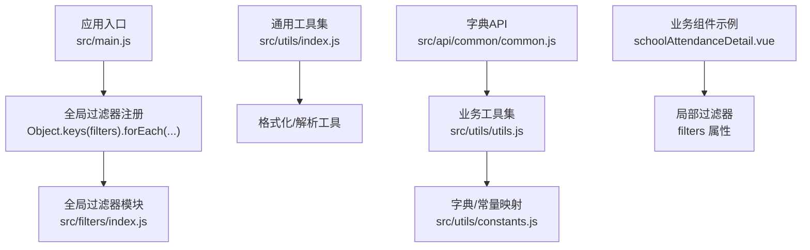
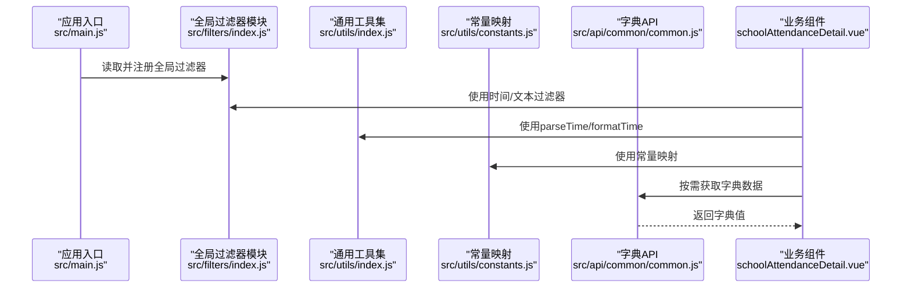
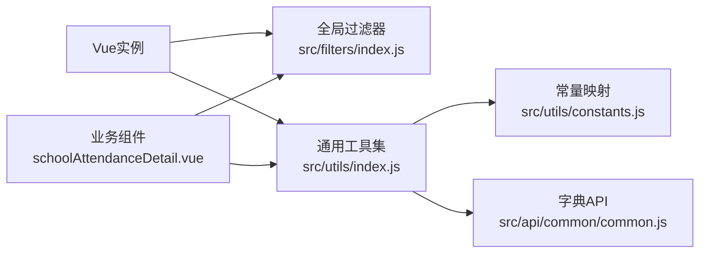

# 过滤器和格式化器

<cite>
**本文引用的文件**
- [src/filters/index.js](file://src/filters/index.js)
- [src/utils/index.js](file://src/utils/index.js)
- [src/utils/utils.js](file://src/utils/utils.js)
- [src/utils/constants.js](file://src/utils/constants.js)
- [src/main.js](file://src/main.js)
- [src/views/attendanceStatistics/schoolAttendanceDetail.vue](file://src/views/attendanceStatistics/schoolAttendanceDetail.vue)
- [src/api/common/common.js](file://src/api/common/common.js)
</cite>

## 目录
1. [简介](#简介)
2. [项目结构](#项目结构)
3. [核心组件](#核心组件)
4. [架构总览](#架构总览)
5. [详细组件分析](#详细组件分析)
6. [依赖分析](#依赖分析)
7. [性能考虑](#性能考虑)
8. [故障排查指南](#故障排查指南)
9. [结论](#结论)
10. [附录](#附录)

## 简介
本文件面向校园管理系统中的数据过滤与格式化工具，系统性梳理并文档化以下内容：
- 数据过滤器的功能特性与使用方法
- 参数配置、链式调用与性能优化策略
- 完整的数据格式化示例与业务场景应用
- 过滤器的扩展方法与自定义实现建议
- 在不同组件中的使用方式与最佳实践

目标是帮助数据处理人员与开发者快速理解并正确使用这些工具，以满足各类数据格式化与展示需求。

## 项目结构
过滤器与格式化相关能力主要分布在如下位置：
- 全局过滤器注册入口：在应用启动时统一注册全局过滤器
- 业务过滤器与格式化工具：集中于 filters 与 utils 目录
- 常量映射与字典解析：通过 constants 与 API 工具进行常量/字典值转换
- 组件内局部过滤器：部分页面按需定义局部过滤器

**图表来源**
- [src/main.js:50-60](file://src/main.js#L50-L60)
- [src/filters/index.js:1-121](file://src/filters/index.js#L1-L121)
- [src/utils/index.js:1-385](file://src/utils/index.js#L1-L385)
- [src/utils/utils.js:1-320](file://src/utils/utils.js#L1-L320)
- [src/utils/constants.js:1-275](file://src/utils/constants.js#L1-L275)
- [src/views/attendanceStatistics/schoolAttendanceDetail.vue:137-141](file://src/views/attendanceStatistics/schoolAttendanceDetail.vue#L137-L141)
- [src/api/common/common.js:1-459](file://src/api/common/common.js#L1-L459)

**章节来源**
- [src/main.js:50-60](file://src/main.js#L50-L60)
- [src/filters/index.js:1-121](file://src/filters/index.js#L1-L121)
- [src/utils/index.js:1-385](file://src/utils/index.js#L1-L385)
- [src/utils/utils.js:1-320](file://src/utils/utils.js#L1-L320)
- [src/utils/constants.js:1-275](file://src/utils/constants.js#L1-L275)
- [src/views/attendanceStatistics/schoolAttendanceDetail.vue:137-141](file://src/views/attendanceStatistics/schoolAttendanceDetail.vue#L137-L141)
- [src/api/common/common.js:1-459](file://src/api/common/common.js#L1-L459)

## 核心组件
本项目的核心过滤与格式化能力由以下模块提供：

- 全局过滤器模块
  - 时间类：timeAgo、parseTime、formatTime、timeIgnoreSecond
  - 数字类：nFormatter、toThousandslsFilter
  - 文本类：html2Text
- 通用工具集
  - 时间解析与相对时间：parseTime、formatTime
  - 字符串与HTML：html2Text、strToHtml
  - 权限与路由辅助：checkPermission、checkIndexPermission、isShowByPermission、isShowByRole
  - 常量映射：parseToConstants、parseToConstantsKey
  - 字典解析：getDicByCode、getSchoolDicByCode、getValueFromDicCode
  - 日期格式化：formatToDate
- 业务工具集
  - 常量映射 Map：teacherTypeConstants、positionConstants、honoraryTitleConstants 等
  - 字典/常量解析：parseToConstants、parseToConstantsKey
  - 导出：thunderExport
- 组件内局部过滤器
  - 示例：在某考勤明细页面定义局部过滤器用于时间字段截断

**章节来源**
- [src/filters/index.js:1-121](file://src/filters/index.js#L1-L121)
- [src/utils/index.js:1-385](file://src/utils/index.js#L1-L385)
- [src/utils/utils.js:1-320](file://src/utils/utils.js#L1-L320)
- [src/utils/constants.js:1-275](file://src/utils/constants.js#L1-L275)
- [src/views/attendanceStatistics/schoolAttendanceDetail.vue:137-141](file://src/views/attendanceStatistics/schoolAttendanceDetail.vue#L137-L141)

## 架构总览
全局过滤器在应用启动阶段统一注册，随后可在任意组件模板中直接使用。业务侧常用格式化逻辑通过工具集与常量映射完成，必要时结合 API 获取远程字典数据。

**图表来源**
- [src/main.js:50-60](file://src/main.js#L50-L60)
- [src/filters/index.js:1-121](file://src/filters/index.js#L1-L121)
- [src/utils/index.js:1-385](file://src/utils/index.js#L1-L385)
- [src/utils/utils.js:1-320](file://src/utils/utils.js#L1-L320)
- [src/utils/constants.js:1-275](file://src/utils/constants.js#L1-L275)
- [src/api/common/common.js:1-459](file://src/api/common/common.js#L1-L459)
- [src/views/attendanceStatistics/schoolAttendanceDetail.vue:137-141](file://src/views/attendanceStatistics/schoolAttendanceDetail.vue#L137-L141)

## 详细组件分析

### 全局过滤器模块（src/filters/index.js）
- 功能概览
  - 时间相对显示：timeAgo
  - 时间格式化：parseTime（支持自定义格式占位符）
  - 相对时间显示：formatTime（支持“刚刚/分钟前/小时前/日期”等）
  - 秒数过滤：timeIgnoreSecond（将 HH:mm:ss 转换为 HH:mm）
  - 数字格式化：nFormatter（科学计数缩写）、toThousandslsFilter（千分位）
  - HTML 文本提取：html2Text（去除标签）

- 参数与行为要点
  - parseTime：支持传入时间戳或对象；格式占位符包括 y/m/d/h/i/s/a；不足两位自动补零；星期 a 映射中文
  - formatTime：输入形如 “yyyy-MM-dd HH:mm:ss.S” 的字符串，截取前19位；根据当前时间差输出“刚刚/分钟前/小时前/日期”
  - timeIgnoreSecond：对空值返回占位符；否则截取最后一个冒号之前的片段
  - nFormatter：按 E/P/T/G/M/k 顺序匹配，保留指定小数位并去除末尾无效零
  - toThousandslsFilter：正则替换每三位加逗号
  - html2Text：通过 DOM 创建临时元素，提取纯文本

- 使用建议
  - 在模板中优先使用 parseTime/formatTime 进行时间展示
  - 对于秒级字段展示，使用 timeIgnoreSecond 去除秒
  - 大数值展示建议使用 nFormatter 或 toThousandslsFilter

**章节来源**
- [src/filters/index.js:1-121](file://src/filters/index.js#L1-L121)

### 通用工具集（src/utils/index.js）
- 功能概览
  - 时间解析与相对时间：parseTime、formatTime（与全局过滤器类似但更严格）
  - 字符串与HTML：html2Text、strToHtml（HTML实体转回文本）
  - 权限与路由：checkPermission、checkIndexPermission、isShowByPermission、isShowByRole
  - 常量映射：parseToConstants、parseToConstantsKey
  - 字典解析：getDicByCode、getSchoolDicByCode、getValueFromDicCode
  - 日期格式化：formatToDate（支持 date/minute/second 三种模式）
  - 导出：thunderExport（拼装下载链接）

- 参数与行为要点
  - parseTime：对空值返回占位符；支持 10 位时间戳乘以 1000
  - formatTime：对空值返回占位符；截取前19位；根据差值输出相对时间
  - strToHtml：支持多种 HTML 实体转换
  - parseToConstants：基于 constants Map 进行值到名称的映射
  - formatToDate：基于 moment 库进行格式化
  - thunderExport：根据环境变量拼接下载地址并打开新窗口

- 使用建议
  - 在组件逻辑中优先使用 parseTime/formatTime 进行时间处理
  - 使用 constants 与 parseToConstants 统一常量展示
  - 需要远程字典时，使用 getDicByCode/getSchoolDicByCode 并缓存结果

**章节来源**
- [src/utils/index.js:1-385](file://src/utils/index.js#L1-L385)

### 业务工具集与常量映射（src/utils/utils.js、src/utils/constants.js）
- 功能概览
  - 常量映射：教师类型、职位、荣誉头衔、政治面貌、学历、学位、教师专业、组织性质、家长称谓、户口性质、地区类型、学生操作类型等
  - 字典解析：封装远程字典获取与按 code 查值的工具
  - 日期格式化：formatToDate（date/minute/second）
  - 导出：thunderExport

- 使用建议
  - 在展示层使用 constants Map 与 parseToConstants 进行本地映射
  - 在需要动态字典时，使用 utils.js 中的字典工具异步获取并缓存

**章节来源**
- [src/utils/utils.js:1-320](file://src/utils/utils.js#L1-L320)
- [src/utils/constants.js:1-275](file://src/utils/constants.js#L1-L275)

### 组件内局部过滤器（示例：考勤明细页面）
- 功能概览
  - 在组件内部定义 filters 属性，提供局部过滤器
  - 示例：将日期字符串截断到秒级，便于展示

- 使用建议
  - 局部过滤器仅作用于当前组件模板，适合特定列或字段的定制化展示
  - 与全局过滤器配合使用，避免重复逻辑

**章节来源**
- [src/views/attendanceStatistics/schoolAttendanceDetail.vue:137-141](file://src/views/attendanceStatistics/schoolAttendanceDetail.vue#L137-L141)

### 字典API（src/api/common/common.js）
- 功能概览
  - 提供字典查询接口：findDicsByCode、findSchoolDicsByCode、getSchoolDicDetailsByTypeCode 等
  - 用于按字典 code 获取字典值列表或子字典项

- 使用建议
  - 在组件初始化时调用，获取字典后缓存，避免重复请求
  - 与 utils.js 的字典工具配合使用，统一处理字典值映射

**章节来源**
- [src/api/common/common.js:1-459](file://src/api/common/common.js#L1-L459)

## 依赖分析
- 全局过滤器依赖
  - Vue 在启动时通过 Object.keys(filters) 注册全局过滤器
  - 过滤器内部依赖浏览器原生 Date 与正则表达式
- 工具集依赖
  - moment 用于日期格式化（业务工具集）
  - constants Map 用于常量映射
  - fetch 封装用于远程字典请求
- 组件依赖
  - 局部过滤器仅在组件模板中生效
  - 页面逻辑中调用工具集与 API 完成数据处理与展示

**图表来源**
- [src/main.js:50-60](file://src/main.js#L50-L60)
- [src/filters/index.js:1-121](file://src/filters/index.js#L1-L121)
- [src/utils/index.js:1-385](file://src/utils/index.js#L1-L385)
- [src/utils/utils.js:1-320](file://src/utils/utils.js#L1-L320)
- [src/utils/constants.js:1-275](file://src/utils/constants.js#L1-L275)
- [src/api/common/common.js:1-459](file://src/api/common/common.js#L1-L459)
- [src/views/attendanceStatistics/schoolAttendanceDetail.vue:137-141](file://src/views/attendanceStatistics/schoolAttendanceDetail.vue#L137-L141)

**章节来源**
- [src/main.js:50-60](file://src/main.js#L50-L60)
- [src/filters/index.js:1-121](file://src/filters/index.js#L1-L121)
- [src/utils/index.js:1-385](file://src/utils/index.js#L1-L385)
- [src/utils/utils.js:1-320](file://src/utils/utils.js#L1-L320)
- [src/utils/constants.js:1-275](file://src/utils/constants.js#L1-L275)
- [src/api/common/common.js:1-459](file://src/api/common/common.js#L1-L459)
- [src/views/attendanceStatistics/schoolAttendanceDetail.vue:137-141](file://src/views/attendanceStatistics/schoolAttendanceDetail.vue#L137-L141)

## 性能考虑
- 过滤器与工具函数
  - 避免在模板中对大量数据进行复杂计算；将计算移至组件逻辑或使用 computed
  - 对于高频展示的时间字段，优先使用 formatTime/timeAgo 输出相对时间，减少重复格式化
- 字典与常量
  - 常量映射使用 Map，查找复杂度 O(1)，适合频繁展示
  - 远程字典建议缓存，避免重复请求
- 日期处理
  - 优先使用 formatToDate 与 moment，确保格式一致性
- 渲染优化
  - 局部过滤器仅在当前组件生效，减少全局影响
  - 大表格中尽量减少过滤器嵌套层级，避免重复渲染

[本节为通用性能建议，无需特定文件引用]

## 故障排查指南
- 时间格式异常
  - 检查输入时间是否为 10 位时间戳（秒），若为毫秒需乘以 1000
  - 确认 parseTime 的格式字符串与期望一致
- 相对时间显示不准确
  - 确认输入时间字符串截取长度（formatTime 截取前19位）
  - 检查浏览器时区设置与本地时间差
- HTML 实体未正确转换
  - 使用 strToHtml 或 html2Text 进行双向转换
- 字典值为空
  - 确认字典 code 正确且已缓存
  - 检查 API 返回结构与 Promise 处理
- 导出链接无效
  - 确认环境变量与 token 拼接逻辑

**章节来源**
- [src/utils/index.js:3-62](file://src/utils/index.js#L3-L62)
- [src/utils/utils.js:136-181](file://src/utils/utils.js#L136-L181)
- [src/api/common/common.js:25-47](file://src/api/common/common.js#L25-L47)

## 结论
本项目的过滤与格式化体系以全局过滤器为核心，辅以通用工具集与常量/字典映射，形成从基础时间/数字/文本处理到业务级字典与权限控制的完整能力链路。通过合理的参数配置、局部过滤器与工具函数的组合使用，能够在保证性能的同时满足多样化的数据展示需求。建议在实际开发中遵循“组件内局部过滤器 + 工具集 + 常量/字典”的分层设计，持续优化渲染性能与用户体验。

[本节为总结性内容，无需特定文件引用]

## 附录

### 过滤器与格式化器清单与用途
- timeAgo：相对时间显示（分钟/小时/天）
- parseTime：时间格式化（支持自定义占位符）
- formatTime：相对时间显示（支持选项）
- timeIgnoreSecond：秒级字段去秒
- nFormatter：大数科学计数缩写
- toThousandslsFilter：千分位
- html2Text：HTML 文本提取
- strToHtml：HTML 实体还原
- parseToConstants / parseToConstantsKey：常量映射
- getDicByCode / getSchoolDicByCode / getValueFromDicCode：字典解析
- formatToDate：日期格式化（date/minute/second）
- thunderExport：导出下载

**章节来源**
- [src/filters/index.js:1-121](file://src/filters/index.js#L1-L121)
- [src/utils/index.js:1-385](file://src/utils/index.js#L1-L385)
- [src/utils/utils.js:1-320](file://src/utils/utils.js#L1-L320)
- [src/utils/constants.js:1-275](file://src/utils/constants.js#L1-L275)