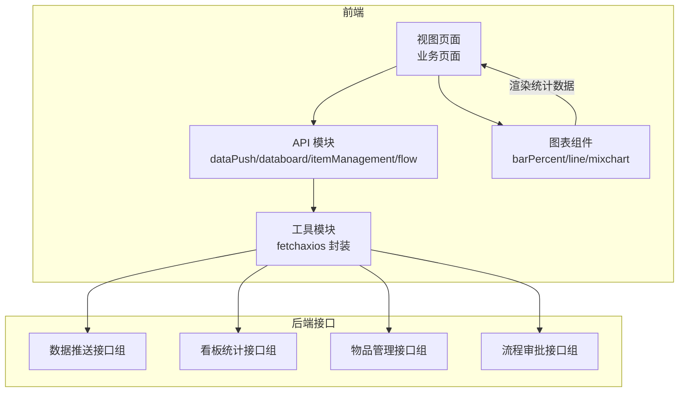
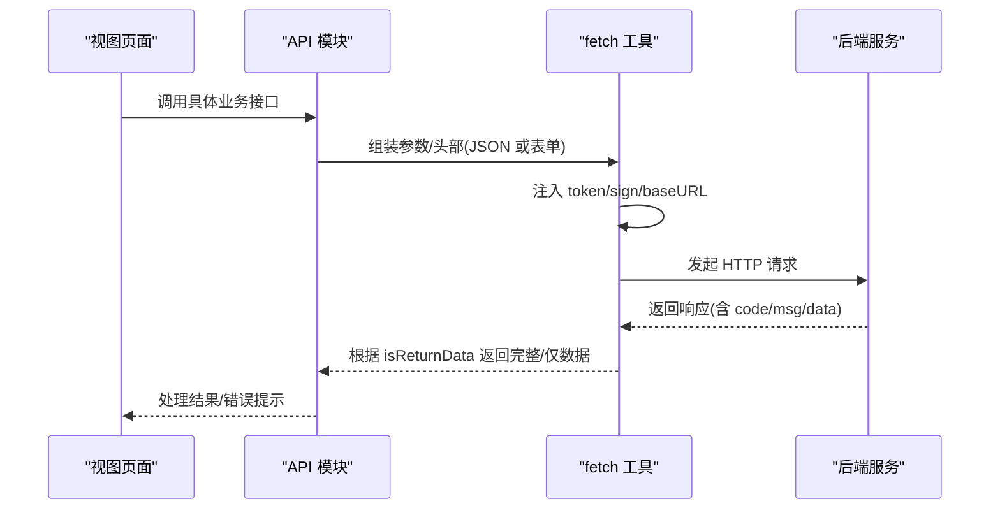
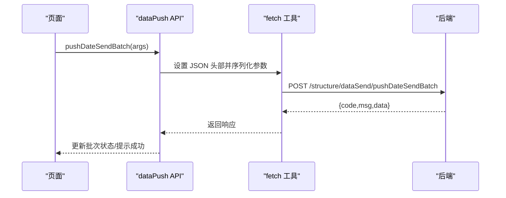
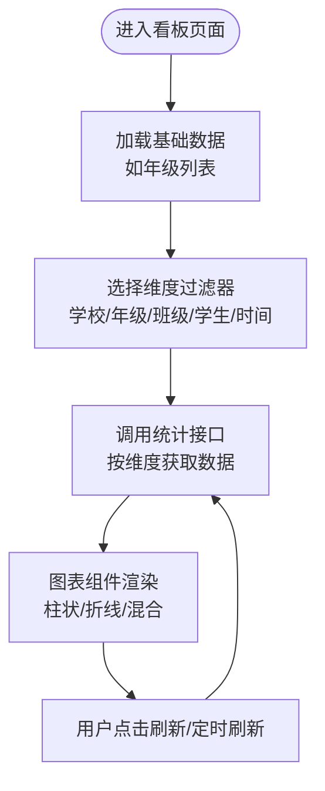
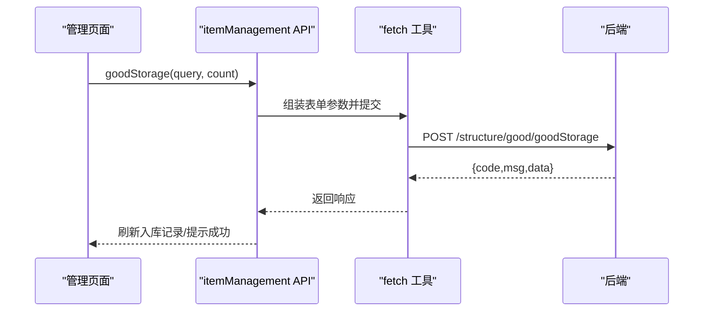
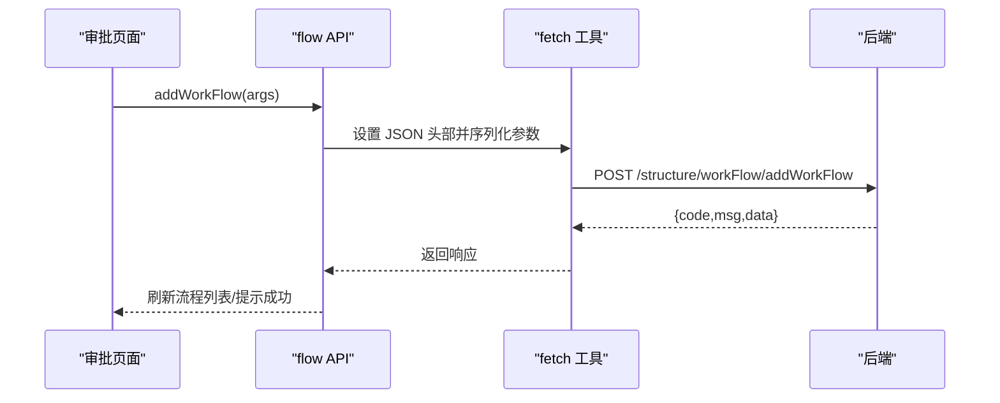
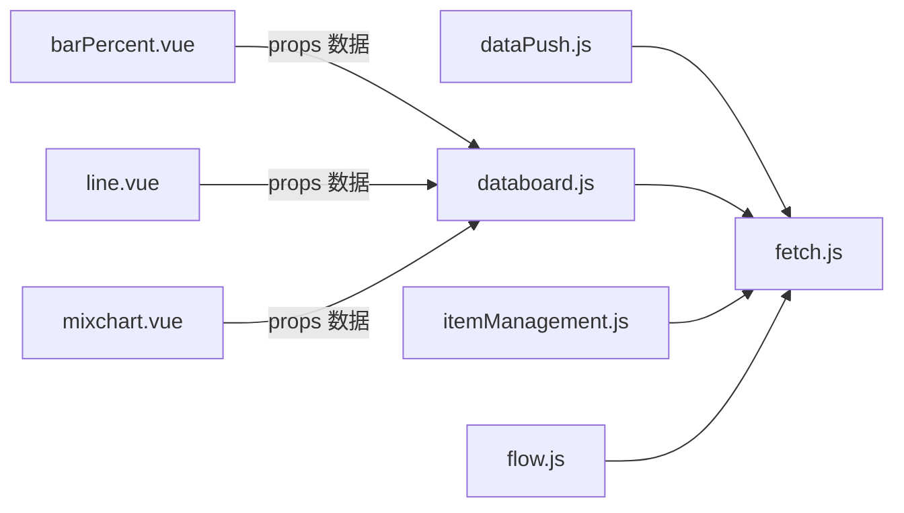

# 业务支撑

<cite>
**本文引用的文件**
- [src/api/dataPush.js](file://src/api/dataPush.js)
- [src/api/databoard.js](file://src/api/databoard.js)
- [src/api/itemManagement.js](file://src/api/itemManagement.js)
- [src/api/flow.js](file://src/api/flow.js)
- [src/utils/fetch.js](file://src/utils/fetch.js)
- [src/components/Charts/barPercent.vue](file://src/components/Charts/barPercent.vue)
- [src/components/Charts/line.vue](file://src/components/Charts/line.vue)
- [src/components/Charts/mixchart.vue](file://src/components/Charts/mixchart.vue)
</cite>

## 目录
1. [简介](#简介)
2. [项目结构](#项目结构)
3. [核心组件](#核心组件)
4. [架构总览](#架构总览)
5. [详细组件分析](#详细组件分析)
6. [依赖关系分析](#依赖关系分析)
7. [性能考虑](#性能考虑)
8. [故障排查指南](#故障排查指南)
9. [结论](#结论)
10. [附录](#附录)

## 简介
本文件面向业务支撑模块，围绕四大核心能力进行系统化文档化：数据推送服务、数据看板展示、物品管理、流程审批。内容覆盖功能边界、调用链路、数据流、错误处理策略与性能优化建议，并提供可操作的配置与集成指引。

## 项目结构
业务支撑相关代码主要分布在以下位置：
- API 层：封装各模块对外接口（数据推送、看板统计、物品管理、流程）
- 工具层：统一网络请求与拦截器（含多环境 baseURL、签名与鉴权）
- 可视化组件：基于 ECharts 的图表组件（柱状、折线、混合图）

**图表来源**
- [src/api/dataPush.js:1-121](file://src/api/dataPush.js#L1-L121)
- [src/api/databoard.js:1-173](file://src/api/databoard.js#L1-L173)
- [src/api/itemManagement.js:1-480](file://src/api/itemManagement.js#L1-L480)
- [src/api/flow.js:1-58](file://src/api/flow.js#L1-L58)
- [src/utils/fetch.js:1-240](file://src/utils/fetch.js#L1-L240)
- [src/components/Charts/barPercent.vue:1-105](file://src/components/Charts/barPercent.vue#L1-L105)
- [src/components/Charts/line.vue:1-147](file://src/components/Charts/line.vue#L1-L147)
- [src/components/Charts/mixchart.vue:1-267](file://src/components/Charts/mixchart.vue#L1-L267)

**章节来源**
- [src/api/dataPush.js:1-121](file://src/api/dataPush.js#L1-L121)
- [src/api/databoard.js:1-173](file://src/api/databoard.js#L1-L173)
- [src/api/itemManagement.js:1-480](file://src/api/itemManagement.js#L1-L480)
- [src/api/flow.js:1-58](file://src/api/flow.js#L1-L58)
- [src/utils/fetch.js:1-240](file://src/utils/fetch.js#L1-L240)

## 核心组件
- 数据推送服务：提供批次管理、推送执行、人员名单分页、提醒未读等能力。
- 数据看板展示：提供多维度统计接口（类型、学生、性别、班级、学年、科目、排名等），配合图表组件实现可视化。
- 物品管理：提供物品与类型管理、出入库、订单统计、归还与盘点、成本核算等。
- 流程审批：提供流程定义的增删改查、节点配置与状态跟踪的基础能力。

**章节来源**
- [src/api/dataPush.js:15-121](file://src/api/dataPush.js#L15-L121)
- [src/api/databoard.js:4-173](file://src/api/databoard.js#L4-L173)
- [src/api/itemManagement.js:6-480](file://src/api/itemManagement.js#L6-L480)
- [src/api/flow.js:4-58](file://src/api/flow.js#L4-L58)

## 架构总览
前端通过统一的 fetch 工具发起请求，自动注入 token、签名、环境 baseURL；后端返回统一结构，错误码由拦截器统一处理并弹窗提示；业务页面调用 API 模块，图表组件消费统计数据进行渲染。

**图表来源**
- [src/utils/fetch.js:13-240](file://src/utils/fetch.js#L13-L240)
- [src/api/dataPush.js:33-43](file://src/api/dataPush.js#L33-L43)
- [src/api/databoard.js:11-23](file://src/api/databoard.js#L11-L23)
- [src/api/itemManagement.js:6-20](file://src/api/itemManagement.js#L6-L20)
- [src/api/flow.js:36-45](file://src/api/flow.js#L36-L45)

## 详细组件分析

### 数据推送服务
- 功能范围
  - 批次管理：新增、修改、分页查询、删除、按批次查询人员名单、按批次查询发送详情。
  - 推送执行：批量推送、按条件提醒未读。
  - 字典配置：获取“dataSend”键对应的系统字典值，用于开关或规则控制。
- 触发机制
  - 前端在满足条件时调用“批量推送”接口，后端按批次规则执行推送。
  - “提醒未读”接口支持对未读人员进行二次提醒。
- 传输协议与参数
  - 多数接口使用 JSON 头部与 JSON 数据体；部分接口使用 URL 表单参数。
  - 分页参数通用包含 pageNo、pageSize；筛选参数包含 batchName、batchId、rosterKey 等。
- 错误处理策略
  - 统一由 fetch 拦截器处理错误码并弹窗提示；登录超时自动登出并跳转登录页。
- 实时性与更新
  - 通过分页查询与刷新按钮实现数据更新；未读提醒可周期性轮询调用。

**图表来源**
- [src/api/dataPush.js:33-43](file://src/api/dataPush.js#L33-L43)
- [src/utils/fetch.js:13-240](file://src/utils/fetch.js#L13-L240)

**章节来源**
- [src/api/dataPush.js:15-121](file://src/api/dataPush.js#L15-L121)
- [src/utils/fetch.js:104-169](file://src/utils/fetch.js#L104-L169)

### 数据看板展示
- 统计维度
  - 类型统计、学生统计、行为记录统计、学年统计、科目统计、班级统计、性别统计、班级排名、学期/课程排名等。
- 配置方式
  - 页面传入 schoolId、gradeId、classId、studentId、时间区间、分页参数等。
  - 使用系统字典接口获取年级列表等基础数据。
- 图表类型
  - 提供柱状百分比、折线图、混合图等组件，支持动态渲染与交互（缩放、标记点/线）。
- 实时更新机制
  - 通过重新拉取统计接口与刷新页面实现；图表组件监听数据变化自动重绘。

**图表来源**
- [src/api/databoard.js:4-173](file://src/api/databoard.js#L4-L173)
- [src/components/Charts/barPercent.vue:49-101](file://src/components/Charts/barPercent.vue#L49-L101)
- [src/components/Charts/line.vue:52-143](file://src/components/Charts/line.vue#L52-L143)
- [src/components/Charts/mixchart.vue:41-262](file://src/components/Charts/mixchart.vue#L41-L262)

**章节来源**
- [src/api/databoard.js:4-173](file://src/api/databoard.js#L4-L173)
- [src/components/Charts/barPercent.vue:1-105](file://src/components/Charts/barPercent.vue#L1-L105)
- [src/components/Charts/line.vue:1-147](file://src/components/Charts/line.vue#L1-L147)
- [src/components/Charts/mixchart.vue:1-267](file://src/components/Charts/mixchart.vue#L1-L267)

### 物品管理
- 功能范围
  - 物品与类型管理：新增/编辑/删除、树形父子类型、字典单位、预警阈值。
  - 入库与出库：入库登记、入库记录查询、订单明细、归还流程。
  - 统计与成本：按物品、按部门、按用户、易耗品统计；支持按时间段与搜索条件筛选。
  - 审批与盘点：查看审批详情、归还清单。
- 流程说明
  - 入库：填写物品信息与数量，提交入库请求。
  - 出库/领用：按物品或用户维度查询订单，支持归还与明细查看。
  - 库存监控：结合预警阈值与统计报表进行库存预警。
  - 成本核算：通过订单统计与单价字段计算成本（需后端提供单价与汇总逻辑）。
- 关键接口路径
  - 订单与统计：queryOrderBySchoolId、orderAnalysisByGood、goodDepartAnalysis、orderByUserId、queryGiveBackGoodOrder 等。
  - 入库与记录：goodStorage、queryGoodStorageRecord、queryGoodStorageRecordByGoodId。
  - 类型与物品：goodTypeData、queryGoodByTypeId、insertGoodType、editGoodType、insertGood、editGood。
  - 审批与归还：getExamineDetails、getGoodGiveBackList。

**图表来源**
- [src/api/itemManagement.js:223-239](file://src/api/itemManagement.js#L223-L239)
- [src/utils/fetch.js:13-240](file://src/utils/fetch.js#L13-L240)

**章节来源**
- [src/api/itemManagement.js:6-480](file://src/api/itemManagement.js#L6-L480)

### 流程审批
- 功能范围
  - 流程定义：查询、新增、修改、删除。
  - 节点配置与状态跟踪：通过后端流程引擎进行节点流转与状态维护（前端提供基础 CRUD 能力）。
- 接口说明
  - 查询列表、按 ID 查询、新增、修改均以 JSON 头部提交参数。
- 集成建议
  - 前端负责表单与状态展示，后端负责流程编排与执行；前后端约定好节点字段与状态枚举。

**图表来源**
- [src/api/flow.js:36-45](file://src/api/flow.js#L36-L45)
- [src/utils/fetch.js:13-240](file://src/utils/fetch.js#L13-L240)

**章节来源**
- [src/api/flow.js:4-58](file://src/api/flow.js#L4-L58)

## 依赖关系分析
- API 模块依赖 fetch 工具，统一处理 baseURL、token、签名、超时与错误码。
- 图表组件独立于业务，通过 props 接收数据并渲染，便于复用。
- 后端接口分组清晰：数据推送、看板统计、物品管理、流程审批。

**图表来源**
- [src/api/dataPush.js:1-121](file://src/api/dataPush.js#L1-L121)
- [src/api/databoard.js:1-173](file://src/api/databoard.js#L1-L173)
- [src/api/itemManagement.js:1-480](file://src/api/itemManagement.js#L1-L480)
- [src/api/flow.js:1-58](file://src/api/flow.js#L1-L58)
- [src/utils/fetch.js:1-240](file://src/utils/fetch.js#L1-L240)
- [src/components/Charts/barPercent.vue:1-105](file://src/components/Charts/barPercent.vue#L1-L105)
- [src/components/Charts/line.vue:1-147](file://src/components/Charts/line.vue#L1-L147)
- [src/components/Charts/mixchart.vue:1-267](file://src/components/Charts/mixchart.vue#L1-L267)

**章节来源**
- [src/utils/fetch.js:13-240](file://src/utils/fetch.js#L13-L240)

## 性能考虑
- 请求合并与去抖
  - 对频繁切换的筛选器（如年级/班级/时间）采用防抖或节流，减少无效请求。
- 分页与懒加载
  - 所有列表接口均支持分页，建议结合虚拟滚动或上拉加载提升长列表体验。
- 缓存策略
  - 基础数据（如字典、单位、类型树）可做本地缓存，降低重复请求。
- 图表渲染优化
  - 图表组件监听数据变化再重绘，避免不必要的 setOption 调用；大数据量时可开启动画开关或降采样。
- 超时与并发
  - fetch 工具已内置超时与拦截器，建议对高耗时接口单独设置超时时间并限制并发数。

## 故障排查指南
- 常见错误码与处理
  - 拦截器对多种错误码进行统一处理，弹窗提示并按需登出；登录超时会自动跳转登录页。
- 排查步骤
  - 确认 token 是否注入成功；检查 sign 参数是否在签名列表中；核对 baseURL 与环境配置。
  - 对于接口 401/403，优先检查权限与登录态；对于 400/404，检查参数与接口路径。
- 日志与定位
  - fetch 工具在构造请求时会打印对象，便于定位请求结构问题。

**章节来源**
- [src/utils/fetch.js:104-169](file://src/utils/fetch.js#L104-L169)
- [src/utils/fetch.js:216-239](file://src/utils/fetch.js#L216-L239)

## 结论
业务支撑模块通过清晰的 API 分层与统一的网络工具，提供了稳定的数据推送、灵活的看板统计、完善的物品管理与基础的流程审批能力。配合 ECharts 图表组件，能够快速构建可视化看板。建议在实际落地中关注参数校验、分页与缓存策略、图表渲染优化以及错误处理的用户体验一致性。

## 附录
- 扩展接口建议
  - 数据推送：增加推送日志与回执追踪、失败重试队列。
  - 看板：支持指标联动与钻取、导出报表。
  - 物品管理：接入条码/RFID、移动端扫码出入库、成本分摊算法。
  - 流程审批：节点权限与路由规则配置、移动端审批。
- 集成方案
  - 与统一认证中心对接，确保 token 自动续期与跨域安全。
  - 与消息中心集成，推送未读提醒与审批通知。
- 性能优化建议
  - 前端：分页懒加载、组件级缓存、请求去重。
  - 后端：索引优化、批量写入、异步任务与队列。