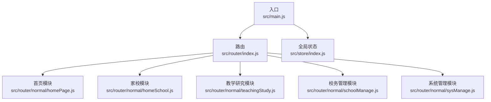
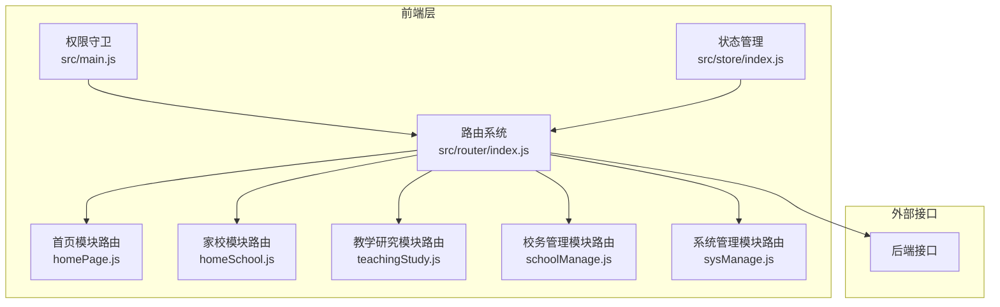
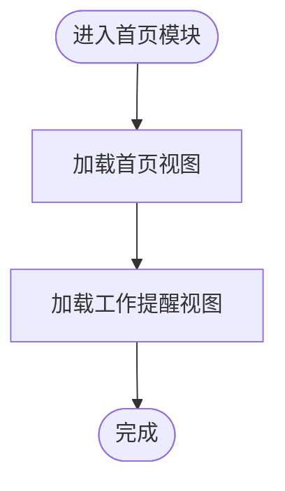
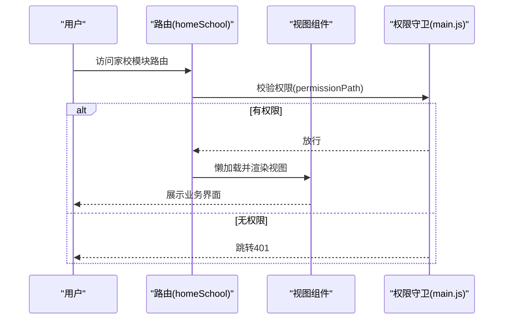
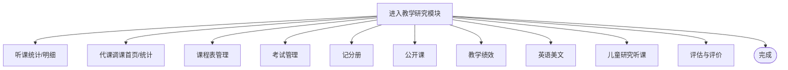
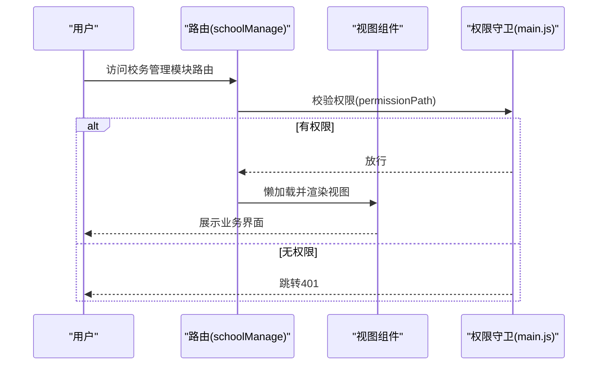
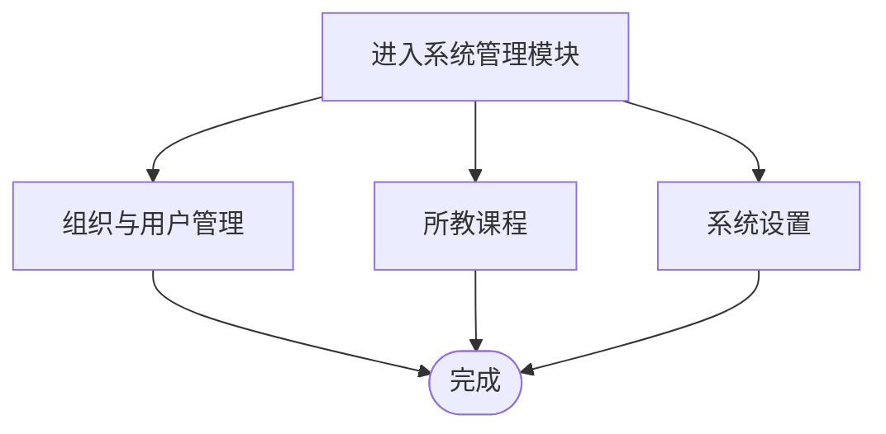
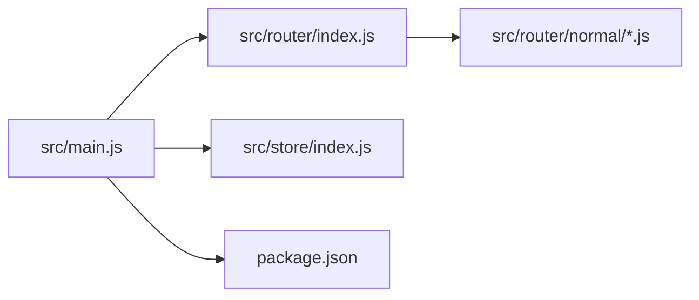

# 功能模块

<cite>
**本文引用的文件**
- [README.md](file://README.md)
- [package.json](file://package.json)
- [src/main.js](file://src/main.js)
- [src/router/index.js](file://src/router/index.js)
- [src/router/normal/homePage.js](file://src/router/normal/homePage.js)
- [src/router/normal/homeSchool.js](file://src/router/normal/homeSchool.js)
- [src/router/normal/teachingStudy.js](file://src/router/normal/teachingStudy.js)
- [src/router/normal/schoolManage.js](file://src/router/normal/schoolManage.js)
- [src/router/normal/sysManage.js](file://src/router/normal/sysManage.js)
- [src/store/index.js](file://src/store/index.js)
</cite>

## 目录
1. [引言](#引言)
2. [项目结构](#项目结构)
3. [核心组件](#核心组件)
4. [架构总览](#架构总览)
5. [详细组件分析](#详细组件分析)
6. [依赖分析](#依赖分析)
7. [性能考虑](#性能考虑)
8. [故障排查指南](#故障排查指南)
9. [结论](#结论)
10. [附录](#附录)

## 引言
本文件面向校园管理系统的核心功能模块，系统性梳理模块划分、业务逻辑、用户界面与交互流程，明确模块间依赖关系、数据流转与权限控制机制，并给出扩展点、自定义能力与集成方式，以及最佳实践、常见问题与性能优化建议，帮助开发者快速理解并高效使用所有核心功能模块。

## 项目结构
项目采用前端单页应用（SPA）架构，基于 Vue 2.x + Vue Router + Vuex 构建，路由按“首页/家校/教学研究/校务管理/系统管理”等维度组织，模块通过路由懒加载与按需加载实现资源优化；全局状态通过 Vuex 管理，路由守卫统一进行登录态与权限校验。

图表来源
- [src/main.js:1-221](file://src/main.js#L1-L221)
- [src/router/index.js:1-207](file://src/router/index.js#L1-L207)
- [src/router/normal/homePage.js:1-18](file://src/router/normal/homePage.js#L1-L18)
- [src/router/normal/homeSchool.js:1-1186](file://src/router/normal/homeSchool.js#L1-L1186)
- [src/router/normal/teachingStudy.js:1-672](file://src/router/normal/teachingStudy.js#L1-L672)
- [src/router/normal/schoolManage.js:1-1066](file://src/router/normal/schoolManage.js#L1-L1066)
- [src/router/normal/sysManage.js:1-928](file://src/router/normal/sysManage.js#L1-L928)
- [src/store/index.js:1-20](file://src/store/index.js#L1-L20)

章节来源
- [src/main.js:1-221](file://src/main.js#L1-L221)
- [src/router/index.js:1-207](file://src/router/index.js#L1-L207)
- [src/store/index.js:1-20](file://src/store/index.js#L1-L20)

## 核心组件
- 路由与导航
  - 主路由集中于 src/router/index.js，按模块拆分至 normal 与 system 子路由文件，支持白名单免登录、权限路径校验与单点登录接入。
- 登录与权限
  - 路由前置守卫在 src/main.js 中实现，结合 Cookie 令牌、用户信息拉取与权限位匹配，支持免登录白名单与特定模块权限拦截。
- 全局状态
  - Vuex Store 在 src/store/index.js 中注册 app、user、org 三大模块，提供全局状态与派生状态（getters）。
- 通用依赖
  - package.json 指定 axios、element-ui、vuex、vue-router 等核心依赖，构建脚本支持开发、测试与生产环境。

章节来源
- [src/router/index.js:1-207](file://src/router/index.js#L1-L207)
- [src/main.js:57-198](file://src/main.js#L57-L198)
- [src/store/index.js:1-20](file://src/store/index.js#L1-L20)
- [package.json:1-98](file://package.json#L1-L98)

## 架构总览
系统采用“路由驱动 + 权限守卫 + 状态管理”的前端架构，模块化路由组织业务域，路由懒加载降低首屏体积，权限守卫保障访问安全，Vuex 提供跨组件共享状态。

图表来源
- [src/router/index.js:1-207](file://src/router/index.js#L1-L207)
- [src/main.js:57-198](file://src/main.js#L57-L198)
- [src/store/index.js:1-20](file://src/store/index.js#L1-L20)

## 详细组件分析

### 首页模块（homePage）
- 功能定位
  - 提供校园首页与工作提醒等入口，承载门户级内容与快捷通道。
- 关键路由
  - 首页入口与省丹中首页
  - 工作提醒入口
- 交互特点
  - 作为主框架下的二级模块，页面切换流畅，支持懒加载。

图表来源
- [src/router/normal/homePage.js:1-18](file://src/router/normal/homePage.js#L1-L18)

章节来源
- [src/router/normal/homePage.js:1-18](file://src/router/normal/homePage.js#L1-L18)

### 家校模块（homeSchool）
- 功能定位
  - 覆盖心理预约、个人档案、照片管理、班级荣誉、通知公告、作业管理、问卷调查、任务管理、请假管理、图书馆、福利发放、卡务管理、校园收费、膳食管理、运动数据、设备库、阅读打卡等多个子域。
- 关键路由示例
  - 心理健康：预约列表、安排表、统计、验证码管理、添加预约
  - 通知公告：发布、收件、统计、批量打印、回复、重复提醒
  - 作业管理：列表、详情、完成情况、统计
  - 问卷调查：列表、详情、新增/编辑/复制、结果、个人列表
  - 任务管理：列表、新增/编辑/详情、统计
  - 请假管理：学生请假首页、新增、详情、统计、离校看板
  - 图书馆：列表、新增/编辑/详情、审批
  - 福利：列表、新增/编辑/详情、接收统计
  - 卡务：设备设置
  - 校园收费：首页、详情、驳回历史、新建/编辑、各班缴费、教师收费
  - 膳食管理：维护、新增/编辑/详情、审批、专家评审、银行账户
  - 运动数据：采集统计
  - 设备库：列表
  - 阅读打卡：周计划、打卡统计、学生已读书籍、班级/个人完成情况
  - 心育：科普、咨询、志愿者统计与推荐
- 交互与权限
  - 部分路由携带 permissionPath，配合权限守卫进行细粒度控制。

图表来源
- [src/router/normal/homeSchool.js:1-1186](file://src/router/normal/homeSchool.js#L1-L1186)
- [src/main.js:88-96](file://src/main.js#L88-L96)

章节来源
- [src/router/normal/homeSchool.js:1-1186](file://src/router/normal/homeSchool.js#L1-L1186)
- [src/main.js:88-96](file://src/main.js#L88-L96)

### 教学研究模块（teachingStudy）
- 功能定位
  - 听课管理、代课调课、课程表、智能排课、考试管理、汉字识读、记分册、公开课、教师教学绩效、英语美文、儿童研究听课、教师评语、评估与评价、阅读平台、青蓝工程、听课本记录等。
- 关键路由示例
  - 听课：预约统计、明细统计、记录统计
  - 代课调课：首页、新增、统计、抵扣、审批
  - 课程表：列表、新增/编辑/详情、临时课表、统计
  - 智能排课：首页、新增、客户端下载
  - 考试：首页、成绩录入/分析/汇总/报告、教师评语、学生详情
  - 汉字识读：多级页面
  - 记分册：首页、班级详情、录分、设置
  - 公开课：学校/我的/审批首页、新增/详情、签到列表、证书查看
  - 教师教学绩效：首页、新增/详情、列表、年统计
  - 英语美文：首页、新增/详情
  - 儿童研究听课：组织/自主入口、表单/详情、评价详情
  - 教师评语：首页
  - 评估与评价：evTea/evTeaKinder、阅读平台、qlth（青蓝工程）
  - 听课本记录：统计/详情
- 交互与权限
  - 部分路由携带 isCached/keepCached，提升用户体验与性能。

图表来源
- [src/router/normal/teachingStudy.js:1-672](file://src/router/normal/teachingStudy.js#L1-L672)

章节来源
- [src/router/normal/teachingStudy.js:1-672](file://src/router/normal/teachingStudy.js#L1-L672)

### 校务管理模块（schoolManage）
- 功能定位
  - 加班统计与抵扣、文件流转、荣誉管理（学校/教师/学生/媒体报道）、六十事统计、新闻管理、录制申请、教师考勤统计、领导看板、活动/会议管理、青年教师发展、综合检查（含两套体系）、大事记、工作计划、校园检查、检查反馈、外出申请、校务日志、建议、疫情上报、值班与进出校、体温检查、日程、教师请假、请假四版、食堂/工作餐设置、梧桐信用、学期/校历/作息/门禁/上下级/模块统计/邀请函/操作日志、德育评价、对接考勤机、缺课/晨午检/通风打卡、值勤护导、教师荣誉设置、积累评价等。
- 关键路由示例
  - 加班：统计/抵扣/记录/统计
  - 文件流转：列表/详情/新增/步骤
  - 荣誉管理：学校/教师/学生/媒体报道统计与详情
  - 六十事：明细/详情
  - 新闻：列表/新增/详情/编辑/发布/评论/审批
  - 录制申请：统计/详情
  - 教师考勤：统计首页/当天/列表/范围/全类型
  - 领导看板
  - 活动/会议：列表/新增/编辑/详情/签到/未签到/上墙
  - 青年教师发展：入口/设置/加减分/检查统计/详情
  - 综合检查：日期/周次/时间段/检查项/问题反馈；两套体系
  - 大事记：上报/新增/编辑/导出/统计/编辑/详情
  - 工作计划：首页/上报/汇总/新增/编辑/详情/大计划详情
  - 校园检查：班级/老师
  - 检查反馈：列表/新增/详情/统计
  - 外出申请：统计/审批设置/详情
  - 校务日志：首页/新增/编辑/详情/设置/已读/未读
  - 建议：列表/详情/统计
  - 疫情上报：学校首页/回执/报告/教师/学生/流动/去国外/未上报/风险统计/详情
  - 值班与进出校：首页
  - 体温检查：静态统计
  - 日程：列表
  - 教师请假：统计/列表/详情/待销假/请假四版/排课/创建/更新
  - 食堂/工作餐：设置/地点/维护/新增
  - 梧桐信用：首页/初始设置/产品/自动申领/积分
  - 学期/校历/作息/门禁/上下级/模块统计/邀请函/操作日志/德育评价/对接考勤机/缺课/晨午检/通风打卡/值勤护导/教师荣誉设置/积累评价
- 交互与权限
  - 多处携带 permissionPath，严格控制访问范围。

图表来源
- [src/router/normal/schoolManage.js:1-1066](file://src/router/normal/schoolManage.js#L1-L1066)
- [src/main.js:118-137](file://src/main.js#L118-L137)

章节来源
- [src/router/normal/schoolManage.js:1-1066](file://src/router/normal/schoolManage.js#L1-L1066)
- [src/main.js:118-137](file://src/main.js#L118-L137)

### 系统管理模块（sysManage）
- 功能定位
  - 组织与用户管理（部门/班级/年级/教师/学生/家长/档案/同步失败/操作日志）、所教课程、系统设置（就餐/报修/资源/停伙/工作餐/报告推送/智能排课/口算打卡/建议类型/成绩管理/课程设置/综合检查/梧桐信用/学期/校历/作息/门禁/上下级/模块统计/邀请函/操作日志/德育评价/对接考勤机/缺课/晨午检/通风打卡/值勤护导/教师荣誉设置/积累评价等）。
- 关键路由示例
  - 组织与用户：部门/班级/年级/教师/学生/家长/档案/同步失败/操作日志
  - 所教课程：首页/新增/编辑/详情
  - 系统设置：就餐/报修/资源/停伙/工作餐/报告推送/智能排课/口算打卡/建议类型/成绩管理/课程设置/综合检查/梧桐信用/学期/校历/作息/门禁/上下级/模块统计/邀请函/操作日志/德育评价/对接考勤机/缺课/晨午检/通风打卡/值勤护导/教师荣誉设置/积累评价
- 交互与权限
  - 系统管理模块通常需要更高权限，路由中多处携带 isCached/keepCached 以优化体验。

图表来源
- [src/router/normal/sysManage.js:1-928](file://src/router/normal/sysManage.js#L1-L928)

章节来源
- [src/router/normal/sysManage.js:1-928](file://src/router/normal/sysManage.js#L1-L928)

## 依赖分析
- 路由依赖
  - 主路由集中于 src/router/index.js，按模块拆分至 normal 与 system 子路由文件，支持白名单免登录、权限路径校验与单点登录接入。
- 权限与登录
  - 路由前置守卫在 src/main.js 中实现，结合 Cookie 令牌、用户信息拉取与权限位匹配，支持免登录白名单与特定模块权限拦截。
- 状态依赖
  - Vuex Store 在 src/store/index.js 中注册 app、user、org 三大模块，提供全局状态与派生状态（getters）。
- 外部依赖
  - package.json 指定 axios、element-ui、vuex、vue-router 等核心依赖，构建脚本支持开发、测试与生产环境。

图表来源
- [src/main.js:1-221](file://src/main.js#L1-L221)
- [src/router/index.js:1-207](file://src/router/index.js#L1-L207)
- [src/store/index.js:1-20](file://src/store/index.js#L1-L20)
- [package.json:1-98](file://package.json#L1-L98)

章节来源
- [src/main.js:1-221](file://src/main.js#L1-L221)
- [src/router/index.js:1-207](file://src/router/index.js#L1-L207)
- [src/store/index.js:1-20](file://src/store/index.js#L1-L20)
- [package.json:1-98](file://package.json#L1-L98)

## 性能考虑
- 路由懒加载
  - 所有模块路由均采用动态导入，减少首屏包体，提升加载速度。
- 页面缓存策略
  - 部分路由携带 isCached/keepCached，避免重复渲染与请求，提升交互流畅度。
- 进度条与错误日志
  - 使用 NProgress 显示加载进度，生产环境配置全局错误处理器，便于问题追踪与定位。
- 构建优化
  - 通过构建脚本区分开发、测试与生产环境，支持打包分析与产物优化。

章节来源
- [src/router/normal/homeSchool.js:359-361](file://src/router/normal/homeSchool.js#L359-L361)
- [src/router/normal/teachingStudy.js:594-603](file://src/router/normal/teachingStudy.js#L594-L603)
- [src/main.js:73-198](file://src/main.js#L73-L198)
- [package.json:7-11](file://package.json#L7-L11)

## 故障排查指南
- 登录与权限
  - 若出现 401，请确认路由 meta.permissionPath 是否在用户权限位中；检查 Cookie 中 token 与 user_token 的传递与存储。
- 白名单与单点登录
  - 白名单路径无需登录即可访问；单点登录场景需确保 userToken 参数正确传递并触发用户信息拉取。
- 页面空白或加载缓慢
  - 检查路由懒加载是否生效；确认 isCached/keepCached 设置是否合理；观察 NProgress 是否正常结束。
- 错误日志
  - 生产环境已配置全局错误处理器，可在控制台查看错误堆栈与上下文信息，辅助定位问题。

章节来源
- [src/main.js:57-198](file://src/main.js#L57-L198)
- [src/router/index.js:40-207](file://src/router/index.js#L40-L207)

## 结论
本系统通过清晰的模块化路由、严格的权限守卫与合理的状态管理，实现了覆盖“首页、家校、教学研究、校务管理、系统管理”的完整校园业务闭环。开发者可依据本文档快速定位模块职责、理解交互流程与权限控制，并结合扩展点与最佳实践进行二次开发与性能优化。

## 附录
- 快速开始
  - 安装依赖：npm install
  - 开发运行：npm run dev
  - 生产构建：npm run build
- 常用命令
  - 开发测试：npm run dev:test
  - 生产构建：npm run build
  - 构建分析：npm run build --report

章节来源
- [README.md:1-24](file://README.md#L1-L24)
- [package.json:7-11](file://package.json#L7-L11)