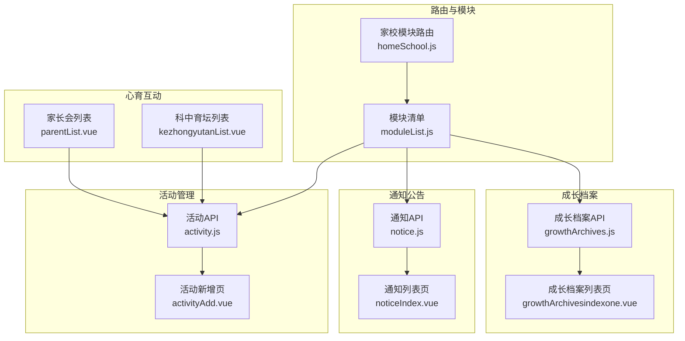
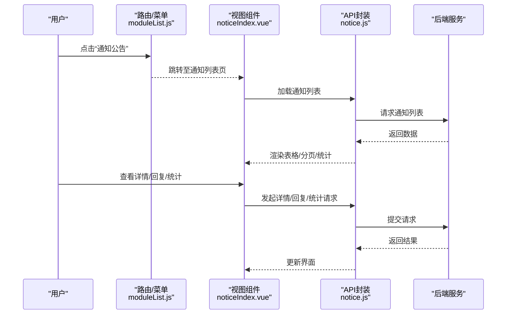
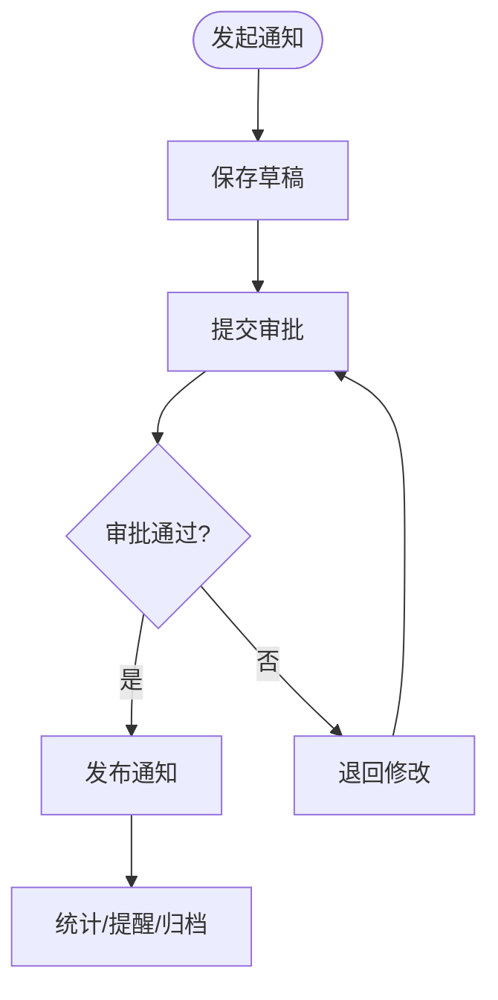
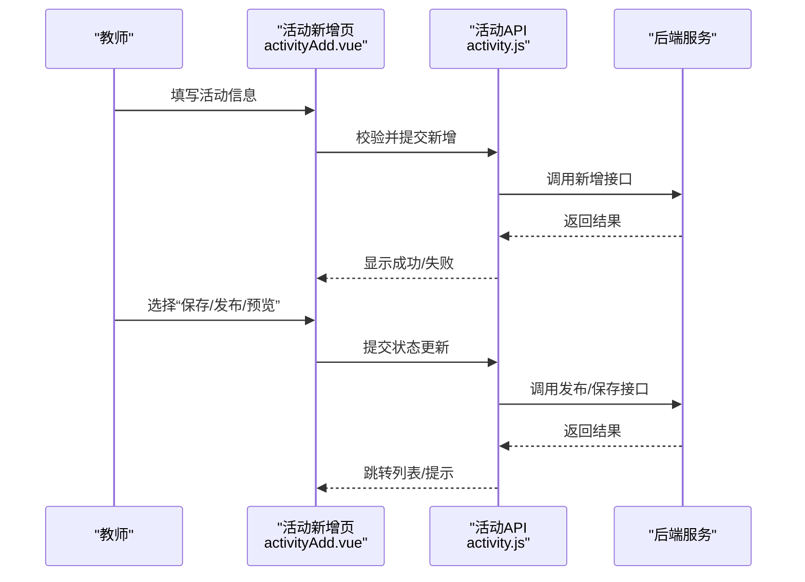
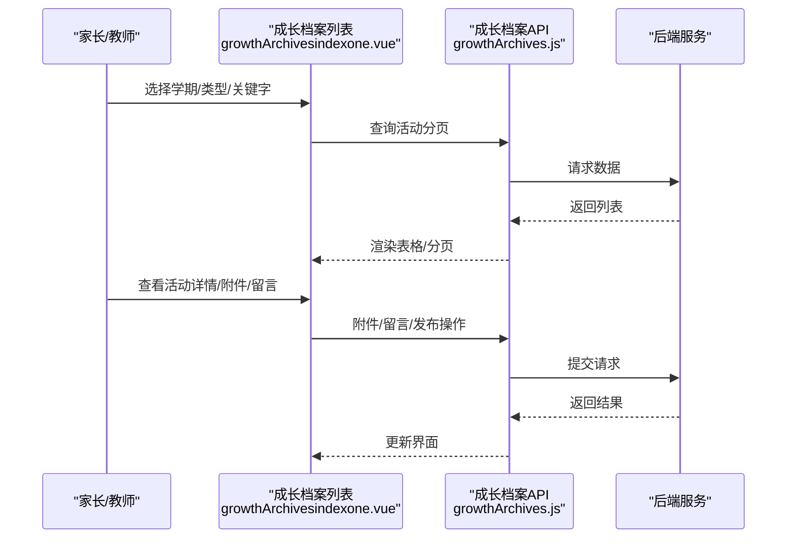
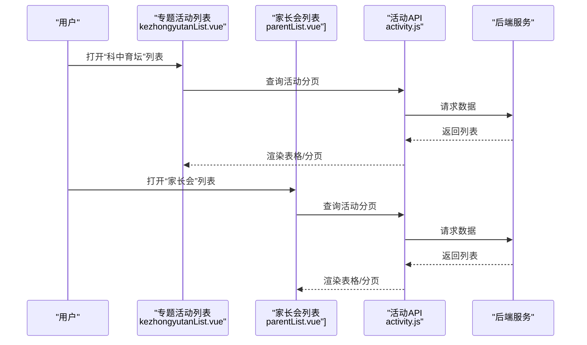
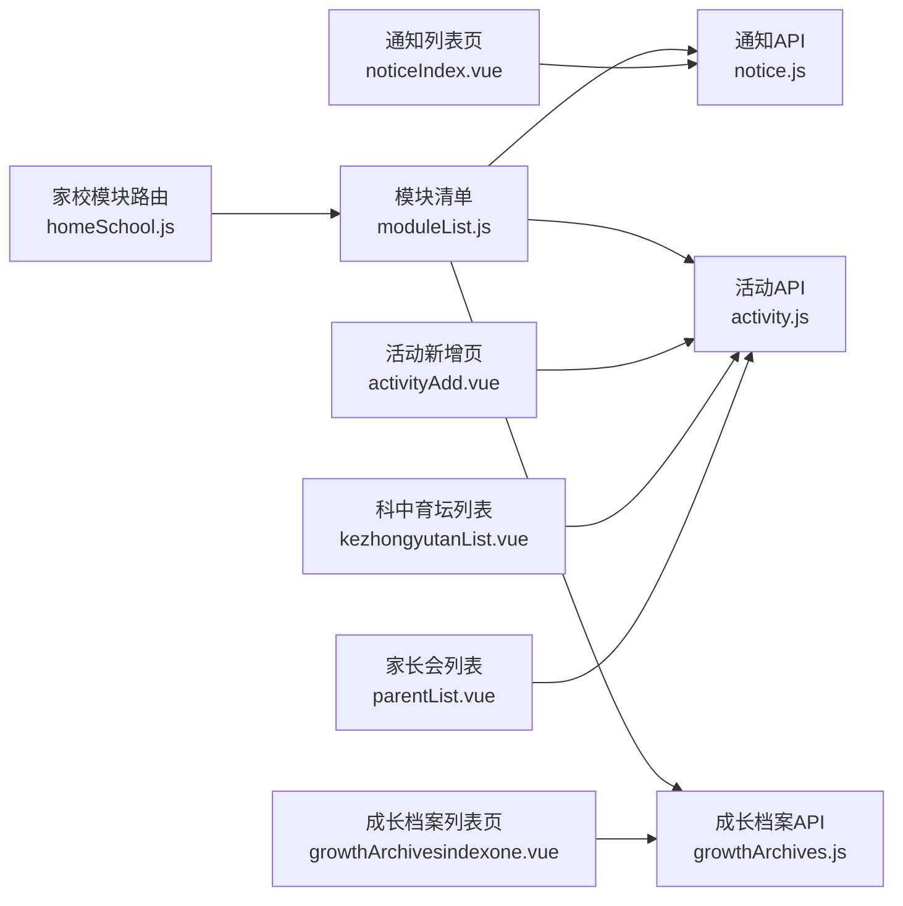

# 家校互动

<cite>
**本文引用的文件**
- [homeSchool.js](file://src/router/normal/homeSchool.js)
- [moduleList.js](file://src/router/moduleList.js)
- [notice.js](file://src/api/notice.js)
- [activity.js](file://src/api/activity.js)
- [growthArchives.js](file://src/api/growthArchives.js)
- [noticeIndex.vue](file://src/views/notice/noticeIndex.vue)
- [activityAdd.vue](file://src/views/activity/activityAdd.vue)
- [growthArchivesindexone.vue](file://src/views/growthArchives/growthArchivesindexone.vue)
- [kezhongyutanList.vue](file://src/views/homeSchool/mentalEducation/kezhongyutan/kezhongyutanList.vue)
- [parentList.vue](file://src/views/homeSchool/mentalEducation/parent/parentList.vue)
</cite>

## 目录
1. [简介](#简介)
2. [项目结构](#项目结构)
3. [核心组件](#核心组件)
4. [架构总览](#架构总览)
5. [详细组件分析](#详细组件分析)
6. [依赖关系分析](#依赖关系分析)
7. [性能考虑](#性能考虑)
8. [故障排查指南](#故障排查指南)
9. [结论](#结论)
10. [附录](#附录)

## 简介
本文件面向“家校互动”模块，系统化梳理通知公告、活动管理、成长档案查看与家校互动社区建设等业务能力，明确家长与学校之间的信息传递机制、互动参与方式与反馈收集流程；规范通知发布的审批流程、活动报名的组织管理、学生成长记录的查看权限控制；阐述数据安全与隐私保护策略，并提供使用指南、功能配置与扩展开发建议。

## 项目结构
家校互动模块在路由与视图层以“模块化”组织，核心入口位于家校模块路由配置，围绕四大业务域展开：
- 通知公告：支持收发通知、统计、阅读率、家长阅读率、归档、回复、转发、审批等
- 活动管理：支持内部/外部活动、报名、签到、调查、资料管理、互动上墙、剪影管理
- 成长档案：支持活动创建、类型字典、关键字筛选、附件与留言、发布与统计
- 心育互动：支持“科中育坛”“家长会”等专题活动的列表与管理

图表来源
- [homeSchool.js:1-1186](file://src/router/normal/homeSchool.js#L1-L1186)
- [moduleList.js:1-478](file://src/router/moduleList.js#L1-L478)
- [notice.js:1-853](file://src/api/notice.js#L1-L853)
- [activity.js:1-418](file://src/api/activity.js#L1-L418)
- [growthArchives.js:1-425](file://src/api/growthArchives.js#L1-L425)
- [noticeIndex.vue:1-289](file://src/views/notice/noticeIndex.vue#L1-L289)
- [activityAdd.vue:1-808](file://src/views/activity/activityAdd.vue#L1-L808)
- [growthArchivesindexone.vue:1-454](file://src/views/growthArchives/growthArchivesindexone.vue#L1-L454)
- [kezhongyutanList.vue:1-264](file://src/views/homeSchool/mentalEducation/kezhongyutan/kezhongyutanList.vue#L1-L264)
- [parentList.vue:1-278](file://src/views/homeSchool/mentalEducation/parent/parentList.vue#L1-L278)

章节来源
- [homeSchool.js:1-1186](file://src/router/normal/homeSchool.js#L1-L1186)
- [moduleList.js:1-478](file://src/router/moduleList.js#L1-L478)

## 核心组件
- 通知公告组件
  - 功能：收通知、发通知、全部通知、班级通知、发送统计、阅读率统计、归档数据、家长阅读率统计、回复、转发、审批、提醒未读、重复提醒设置
  - 关键接口：获取列表、详情、已读未读、回复、统计、审批、转发、提醒等
  - 关键视图：通知列表页、详情页、回复页、统计页
- 活动管理组件
  - 功能：内部/外部活动、报名、签到、调查、资料管理、互动上墙、剪影管理、定时发送、发布范围、落款部门
  - 关键接口：分页列表、新增/编辑、删除、报名/签到/调查数据、资料管理、互动数据
  - 关键视图：活动新增页、列表页、详情页、报名/签到/调查页、资料管理页
- 成长档案组件
  - 功能：活动创建/编辑/删除、类型字典、关键字筛选、附件与留言、发布、统计
  - 关键接口：活动分页、新增/编辑/删除、附件管理、留言、发布、统计
  - 关键视图：活动列表页、详情页、设置页
- 心育互动组件
  - 功能：专题活动列表与管理（如“科中育坛”“家长会”）
  - 关键接口：活动分页、删除
  - 关键视图：专题活动列表页

章节来源
- [notice.js:1-853](file://src/api/notice.js#L1-L853)
- [activity.js:1-418](file://src/api/activity.js#L1-L418)
- [growthArchives.js:1-425](file://src/api/growthArchives.js#L1-L425)
- [noticeIndex.vue:1-289](file://src/views/notice/noticeIndex.vue#L1-L289)
- [activityAdd.vue:1-808](file://src/views/activity/activityAdd.vue#L1-L808)
- [growthArchivesindexone.vue:1-454](file://src/views/growthArchives/growthArchivesindexone.vue#L1-L454)
- [kezhongyutanList.vue:1-264](file://src/views/homeSchool/mentalEducation/kezhongyutan/kezhongyutanList.vue#L1-L264)
- [parentList.vue:1-278](file://src/views/homeSchool/mentalEducation/parent/parentList.vue#L1-L278)

## 架构总览
家校互动采用“路由驱动 + API封装 + 视图组件”的前端架构：
- 路由层：通过模块化路由定义各子模块入口与权限路径
- API层：统一封装HTTP请求，提供通知、活动、成长档案等业务接口
- 视图层：以Vue组件承载具体业务交互，绑定API并渲染数据

图表来源
- [moduleList.js:1-478](file://src/router/moduleList.js#L1-L478)
- [noticeIndex.vue:1-289](file://src/views/notice/noticeIndex.vue#L1-L289)
- [notice.js:1-853](file://src/api/notice.js#L1-L853)

## 详细组件分析

### 通知公告管理
- 业务要点
  - 发布与审批：支持审批流程、转发、提醒未读、重复提醒设置
  - 统计与归档：发送统计、阅读率统计、家长阅读率统计、超期数据归档提示
  - 互动与反馈：回复列表、已读未读列表、签到统计
- 关键流程（审批与发布）

图表来源
- [notice.js:626-678](file://src/api/notice.js#L626-L678)
- [noticeIndex.vue:178-278](file://src/views/notice/noticeIndex.vue#L178-L278)

章节来源
- [notice.js:1-853](file://src/api/notice.js#L1-L853)
- [noticeIndex.vue:1-289](file://src/views/notice/noticeIndex.vue#L1-L289)

### 活动管理功能
- 业务要点
  - 活动类型：内部/外部；支持报名、签到、调查、资料管理、互动上墙、剪影管理
  - 组织管理：发布范围、定时发送、落款部门、允许上传剪影
  - 参与流程：报名截止时间校验、签到时间序列校验、调查选项完整性校验
- 关键流程（活动新增与发布）

图表来源
- [activityAdd.vue:344-625](file://src/views/activity/activityAdd.vue#L344-L625)
- [activity.js:28-143](file://src/api/activity.js#L28-L143)

章节来源
- [activity.js:1-418](file://src/api/activity.js#L1-L418)
- [activityAdd.vue:1-808](file://src/views/activity/activityAdd.vue#L1-L808)

### 成长档案查看
- 业务要点
  - 活动管理：创建/编辑/删除、类型字典、关键字筛选、学期维度
  - 附件与互动：附件管理、留言、星标、复制/移动附件、批量评语
  - 权限控制：基于角色判断可见性与操作权限
- 关键流程（活动列表与详情）

图表来源
- [growthArchivesindexone.vue:215-397](file://src/views/growthArchives/growthArchivesindexone.vue#L215-L397)
- [growthArchives.js:51-133](file://src/api/growthArchives.js#L51-L133)

章节来源
- [growthArchives.js:1-425](file://src/api/growthArchives.js#L1-L425)
- [growthArchivesindexone.vue:1-454](file://src/views/growthArchives/growthArchivesindexone.vue#L1-L454)

### 家校互动社区建设
- 业务要点
  - 心育互动：专题活动（如“科中育坛”“家长会”）的列表与管理
  - 参与与统计：活动状态、签到人数、操作（编辑/删除）
- 关键流程（专题活动列表）

图表来源
- [kezhongyutanList.vue:1-264](file://src/views/homeSchool/mentalEducation/kezhongyutan/kezhongyutanList.vue#L1-L264)
- [parentList.vue:1-278](file://src/views/homeSchool/mentalEducation/parent/parentList.vue#L1-L278)
- [activity.js:3-15](file://src/api/activity.js#L3-L15)

章节来源
- [kezhongyutanList.vue:1-264](file://src/views/homeSchool/mentalEducation/kezhongyutan/kezhongyutanList.vue#L1-L264)
- [parentList.vue:1-278](file://src/views/homeSchool/mentalEducation/parent/parentList.vue#L1-L278)

## 依赖关系分析
- 路由与模块
  - 家校模块路由集中定义通知公告、心理辅导、活动管理、成长档案、心育互动等子模块入口与权限路径
- 视图与API
  - 通知列表页依赖通知API进行列表、详情、统计、审批、转发等操作
  - 活动新增页依赖活动API进行新增、编辑、删除、报名/签到/调查、资料管理等
  - 成长档案列表页依赖成长档案API进行活动管理、附件/留言、发布、统计等
- 组件间耦合
  - 专题活动列表页共享活动API，降低重复依赖
  - 视图组件通过统一API封装进行数据交互，提升内聚性与可维护性

图表来源
- [homeSchool.js:1-1186](file://src/router/normal/homeSchool.js#L1-L1186)
- [moduleList.js:1-478](file://src/router/moduleList.js#L1-L478)
- [notice.js:1-853](file://src/api/notice.js#L1-L853)
- [activity.js:1-418](file://src/api/activity.js#L1-L418)
- [growthArchives.js:1-425](file://src/api/growthArchives.js#L1-L425)
- [noticeIndex.vue:1-289](file://src/views/notice/noticeIndex.vue#L1-L289)
- [activityAdd.vue:1-808](file://src/views/activity/activityAdd.vue#L1-L808)
- [growthArchivesindexone.vue:1-454](file://src/views/growthArchives/growthArchivesindexone.vue#L1-L454)
- [kezhongyutanList.vue:1-264](file://src/views/homeSchool/mentalEducation/kezhongyutan/kezhongyutanList.vue#L1-L264)
- [parentList.vue:1-278](file://src/views/homeSchool/mentalEducation/parent/parentList.vue#L1-L278)

章节来源
- [homeSchool.js:1-1186](file://src/router/normal/homeSchool.js#L1-L1186)
- [moduleList.js:1-478](file://src/router/moduleList.js#L1-L478)

## 性能考虑
- 列表分页与防抖
  - 通知列表、活动列表均采用分页参数控制数据规模，减少一次性渲染压力
  - 输入搜索采用防抖策略，降低频繁请求带来的网络与计算开销
- 图片与富文本
  - 活动封面与附件上传采用分模块管理，避免大体积资源阻塞主流程
- 统计与归档
  - 对超期数据进行归档提示，避免历史数据影响查询性能

## 故障排查指南
- 通知相关
  - 无法查看已读/未读：检查接口参数（通知ID、分页、过滤条件），确认权限路径
  - 审批/转发失败：核对审批内容与转发参数，确保通知ID有效
- 活动相关
  - 报名截止时间校验失败：确保截止时间早于活动开始时间且晚于当前时间
  - 签到时间序列冲突：检查签到开始/结束时间顺序与相邻时间衔接
  - 资料管理异常：确认文件类型、大小限制与上传状态
- 成长档案相关
  - 附件/留言失败：检查文件ID、学生ID、操作类型与权限
  - 发布失败：确认活动状态与发布前置条件
- 通用排查
  - 网络错误：检查API封装中的请求头、参数拼装与后端返回码
  - 权限不足：核对路由权限路径与用户角色

章节来源
- [notice.js:1-853](file://src/api/notice.js#L1-L853)
- [activity.js:1-418](file://src/api/activity.js#L1-L418)
- [growthArchives.js:1-425](file://src/api/growthArchives.js#L1-L425)
- [noticeIndex.vue:178-278](file://src/views/notice/noticeIndex.vue#L178-L278)
- [activityAdd.vue:344-625](file://src/views/activity/activityAdd.vue#L344-L625)
- [growthArchivesindexone.vue:215-397](file://src/views/growthArchives/growthArchivesindexone.vue#L215-L397)

## 结论
家校互动模块以清晰的路由与模块划分、完善的API封装与视图组件，实现了通知公告、活动管理、成长档案与心育互动的闭环业务流程。通过严格的参数校验、权限控制与统计分析，保障了信息传递的准确性与安全性；通过归档与防抖等性能优化，提升了用户体验。后续可在专题活动扩展、权限细化与数据可视化方面持续演进。

## 附录
- 使用指南
  - 通知公告：通过“收通知/发通知/全部通知/班级通知/统计/归档/回复/审批/转发/提醒”等入口开展日常运营
  - 活动管理：在“活动新增”中完善活动信息、报名/签到/调查配置，按需开启定时发送与落款部门
  - 成长档案：在“活动列表”中按学期/类型/关键字筛选，进行附件与留言管理与发布
  - 心育互动：在“科中育坛/家长会”列表中进行活动管理与参与统计
- 功能配置
  - 通知审批流：在“通知审批”中配置审批节点与流转规则
  - 活动发布范围：在“活动新增”中选择发布范围与定时发送
  - 成长档案类型与关键字：在“类型设置”中维护字典项
- 扩展开发
  - 新增专题活动：在路由与模块清单中注册新模块，复用活动API
  - 权限细化：结合权限路径与角色判断，控制按钮与字段显示
  - 数据可视化：在统计页引入图表组件，增强阅读率、签到率等指标展示