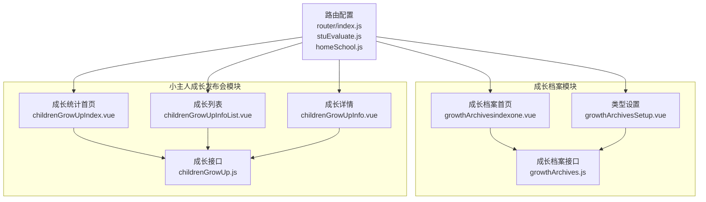
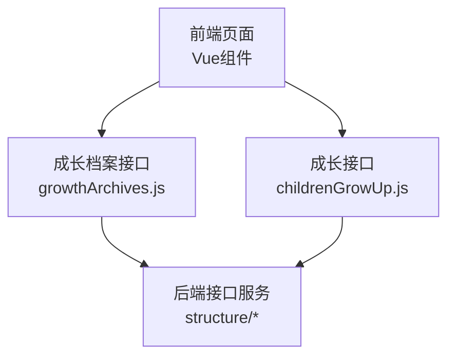
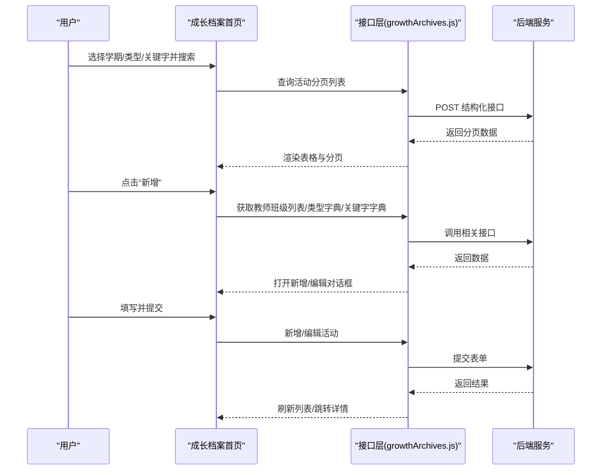
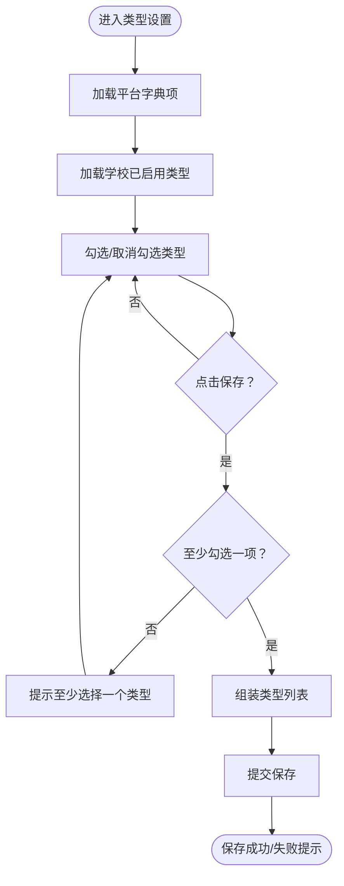
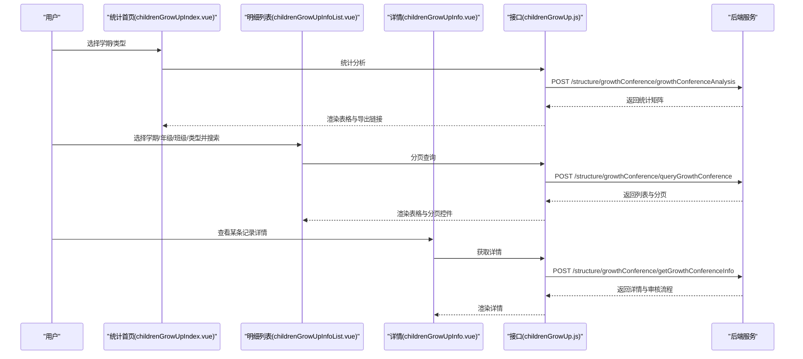
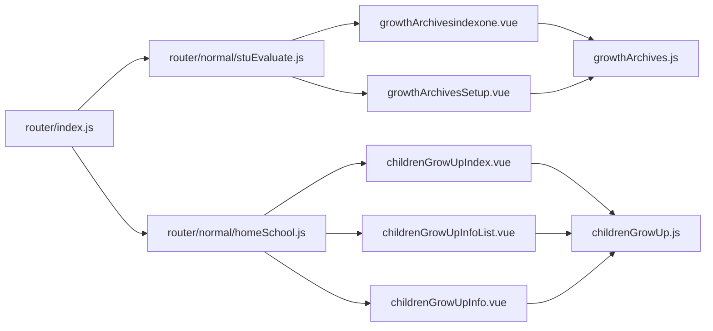

# 成长档案

<cite>
**本文引用的文件**   
- [src/api/growthArchives.js](file://src/api/growthArchives.js)
- [src/views/growthArchives/growthArchivesindexone.vue](file://src/views/growthArchives/growthArchivesindexone.vue)
- [src/views/growthArchives/growthArchivesSetup.vue](file://src/views/growthArchives/growthArchivesSetup.vue)
- [src/views/childrenGrowUp/childrenGrowUpIndex.vue](file://src/views/childrenGrowUp/childrenGrowUpIndex.vue)
- [src/views/childrenGrowUp/childrenGrowUpInfoList.vue](file://src/views/childrenGrowUp/childrenGrowUpInfoList.vue)
- [src/views/childrenGrowUp/childrenGrowUpInfo.vue](file://src/views/childrenGrowUp/childrenGrowUpInfo.vue)
- [src/api/childrenGrowUp.js](file://src/api/childrenGrowUp.js)
- [src/router/index.js](file://src/router/index.js)
- [src/router/normal/stuEvaluate.js](file://src/router/normal/stuEvaluate.js)
- [src/router/normal/homeSchool.js](file://src/router/normal/homeSchool.js)
</cite>

## 目录
1. [简介](#简介)
2. [项目结构](#项目结构)
3. [核心组件](#核心组件)
4. [架构总览](#架构总览)
5. [详细组件分析](#详细组件分析)
6. [依赖分析](#依赖分析)
7. [性能考虑](#性能考虑)
8. [故障排查指南](#故障排查指南)
9. [结论](#结论)
10. [附录](#附录)

## 简介
本技术文档围绕“成长档案”功能展开，系统性阐述学生成长过程的数字化记录与管理，覆盖档案的建立、维护、查看、分类与检索、导出、权限控制、与学籍信息的关联与同步、隐私保护策略、系统配置、数据迁移与扩展接口等。文档以代码为依据，结合前端页面与后端接口，帮助开发者与运维人员快速理解并高效使用该能力。

## 项目结构
成长档案功能由两部分组成：
- 成长档案（成长活动与档案材料管理）：位于“成长档案”模块，包含活动列表、类型设置、活动详情、材料管理、留言与评语、发布与统计等功能。
- 小主人成长发布会（成长展示与统计）：位于“家校共育/小主人成长发布会”模块，包含成长统计、列表查询、详情查看与导出。

**图表来源**
- [src/views/growthArchives/growthArchivesindexone.vue](file://src/views/growthArchives/growthArchivesindexone.vue)
- [src/views/growthArchives/growthArchivesSetup.vue](file://src/views/growthArchives/growthArchivesSetup.vue)
- [src/api/growthArchives.js](file://src/api/growthArchives.js)
- [src/views/childrenGrowUp/childrenGrowUpIndex.vue](file://src/views/childrenGrowUp/childrenGrowUpIndex.vue)
- [src/views/childrenGrowUp/childrenGrowUpInfoList.vue](file://src/views/childrenGrowUp/childrenGrowUpInfoList.vue)
- [src/views/childrenGrowUp/childrenGrowUpInfo.vue](file://src/views/childrenGrowUp/childrenGrowUpInfo.vue)
- [src/api/childrenGrowUp.js](file://src/api/childrenGrowUp.js)
- [src/router/index.js](file://src/router/index.js)
- [src/router/normal/stuEvaluate.js](file://src/router/normal/stuEvaluate.js)
- [src/router/normal/homeSchool.js](file://src/router/normal/homeSchool.js)

**章节来源**
- [src/router/index.js:1-207](file://src/router/index.js#L1-L207)
- [src/router/normal/stuEvaluate.js:381-456](file://src/router/normal/stuEvaluate.js#L381-L456)
- [src/router/normal/homeSchool.js:1116-1126](file://src/router/normal/homeSchool.js#L1116-L1126)

## 核心组件
- 成长档案首页（活动列表与筛选）
  - 功能：按学期、类型、关键字筛选；分页展示；支持新增/编辑/删除；跳转到活动详情或报告详情。
  - 关键接口：活动分页列表、新增/编辑活动、删除活动、教师班级列表、关键字字典、学期列表、类型字典。
- 类型设置
  - 功能：勾选启用的活动类型，保存至学校字典。
  - 关键接口：获取字典项、获取学校类型列表、保存类型列表。
- 小主人成长发布会（统计与导出）
  - 功能：按学期与类型统计，查看明细列表，导出报表；支持按年级/班级/类型筛选与搜索。
  - 关键接口：统计分析、分页查询、详情查询、导出下载。

**章节来源**
- [src/views/growthArchives/growthArchivesindexone.vue:1-454](file://src/views/growthArchives/growthArchivesindexone.vue#L1-L454)
- [src/views/growthArchives/growthArchivesSetup.vue:1-94](file://src/views/growthArchives/growthArchivesSetup.vue#L1-L94)
- [src/views/childrenGrowUp/childrenGrowUpIndex.vue:1-210](file://src/views/childrenGrowUp/childrenGrowUpIndex.vue#L1-L210)
- [src/views/childrenGrowUp/childrenGrowUpInfoList.vue:1-293](file://src/views/childrenGrowUp/childrenGrowUpInfoList.vue#L1-L293)
- [src/views/childrenGrowUp/childrenGrowUpInfo.vue:1-116](file://src/views/childrenGrowUp/childrenGrowUpInfo.vue#L1-L116)

## 架构总览
前端采用 Vue + Element UI，通过统一的 fetch 工具发起请求，调用后端结构化接口。成长档案与小主人成长发布会分别对应不同的业务域与路由入口，但共享统一的数据流与权限控制方式。

**图表来源**
- [src/api/growthArchives.js:1-425](file://src/api/growthArchives.js#L1-L425)
- [src/api/childrenGrowUp.js:1-143](file://src/api/childrenGrowUp.js#L1-L143)

## 详细组件分析

### 成长档案首页（活动列表）
- 数据采集与筛选
  - 学期、类型、关键字多维筛选；支持输入框模糊搜索；分页参数 pageNo/pageSize 控制。
  - 关键字段：学期ID、活动类型编码、关键字编码集合、班级/年级过滤、搜索标题。
- 权限控制
  - 通过角色判断决定是否显示“新增/删除”按钮；同时支持“类型设置”入口。
- 操作流程
  - 新增/编辑弹窗收集活动名称、类型、发布范围（班级）、关键字勾选；提交时拼装编码与名称集合。
  - 删除采用二次确认，成功后刷新列表。
- 跳转逻辑
  - 已发布活动跳转报告详情；草稿跳转活动详情。

**图表来源**
- [src/views/growthArchives/growthArchivesindexone.vue:108-398](file://src/views/growthArchives/growthArchivesindexone.vue#L108-L398)
- [src/api/growthArchives.js:51-133](file://src/api/growthArchives.js#L51-L133)

**章节来源**
- [src/views/growthArchives/growthArchivesindexone.vue:108-398](file://src/views/growthArchives/growthArchivesindexone.vue#L108-L398)
- [src/api/growthArchives.js:51-133](file://src/api/growthArchives.js#L51-L133)

### 类型设置（成长档案类型字典）
- 功能要点
  - 展示平台默认字典项，勾选后保存为学校启用类型；至少选择一项。
  - 保存时将勾选项转换为后端需要的类型列表结构。
- 流程图

**图表来源**
- [src/views/growthArchives/growthArchivesSetup.vue:17-78](file://src/views/growthArchives/growthArchivesSetup.vue#L17-L78)
- [src/api/growthArchives.js:30-50](file://src/api/growthArchives.js#L30-L50)

**章节来源**
- [src/views/growthArchives/growthArchivesSetup.vue:17-78](file://src/views/growthArchives/growthArchivesSetup.vue#L17-L78)
- [src/api/growthArchives.js:30-50](file://src/api/growthArchives.js#L30-L50)

### 小主人成长发布会（统计与导出）
- 统计首页
  - 选择学期与类型，动态生成“年级/班级/总计”的统计矩阵，并提供导出链接。
- 明细列表
  - 支持按学期、年级、班级、类型两级筛选，支持按申请人姓名搜索；分页展示；导出链接。
- 详情页
  - 展示申请人、主题、时间、类型、内容以及审核流程（初审/终审）。

**图表来源**
- [src/views/childrenGrowUp/childrenGrowUpIndex.vue:37-156](file://src/views/childrenGrowUp/childrenGrowUpIndex.vue#L37-L156)
- [src/views/childrenGrowUp/childrenGrowUpInfoList.vue:80-239](file://src/views/childrenGrowUp/childrenGrowUpInfoList.vue#L80-L239)
- [src/views/childrenGrowUp/childrenGrowUpInfo.vue:30-80](file://src/views/childrenGrowUp/childrenGrowUpInfo.vue#L30-L80)
- [src/api/childrenGrowUp.js:20-48](file://src/api/childrenGrowUp.js#L20-L48)

**章节来源**
- [src/views/childrenGrowUp/childrenGrowUpIndex.vue:37-156](file://src/views/childrenGrowUp/childrenGrowUpIndex.vue#L37-L156)
- [src/views/childrenGrowUp/childrenGrowUpInfoList.vue:80-239](file://src/views/childrenGrowUp/childrenGrowUpInfoList.vue#L80-L239)
- [src/views/childrenGrowUp/childrenGrowUpInfo.vue:30-80](file://src/views/childrenGrowUp/childrenGrowUpInfo.vue#L30-L80)
- [src/api/childrenGrowUp.js:20-48](file://src/api/childrenGrowUp.js#L20-L48)

## 依赖分析
- 路由入口
  - 成长档案模块：在“教学研究/学生成长”路由中注册多个页面。
  - 小主人成长发布会：在“家校共育”路由中注册首页、列表、详情页。
- 接口依赖
  - 成长档案：依赖学期、字典、类型、活动分页、附件、留言、发布、统计等接口。
  - 成长（小主人）：依赖统计分析、分页查询、详情、导出下载等接口。
- 权限控制
  - 通过角色判断显示“新增/删除”与“类型设置”入口；部分操作需具备特定角色常量。

**图表来源**
- [src/router/index.js:1-207](file://src/router/index.js#L1-L207)
- [src/router/normal/stuEvaluate.js:381-456](file://src/router/normal/stuEvaluate.js#L381-L456)
- [src/router/normal/homeSchool.js:1116-1126](file://src/router/normal/homeSchool.js#L1116-L1126)

**章节来源**
- [src/router/index.js:1-207](file://src/router/index.js#L1-L207)
- [src/router/normal/stuEvaluate.js:381-456](file://src/router/normal/stuEvaluate.js#L381-L456)
- [src/router/normal/homeSchool.js:1116-1126](file://src/router/normal/homeSchool.js#L1116-L1126)

## 性能考虑
- 列表分页
  - 使用 pageNo/pageSize 控制数据规模，避免一次性加载过多数据。
- 字典与类型懒加载
  - 在进入页面时按需加载学期、类型、关键字字典，减少首屏压力。
- 导出优化
  - 导出采用后端直链下载，前端仅拼接参数，避免前端渲染大体量数据。
- 表格高度自适应
  - 通过窗口尺寸混入计算表格高度，提升大数据量下的滚动体验。

[本节为通用建议，不直接分析具体文件]

## 故障排查指南
- 无法加载活动列表
  - 检查学期/类型/关键字筛选条件是否正确；确认接口返回状态码与消息。
  - 参考：[活动分页列表接口:51-68](file://src/api/growthArchives.js#L51-L68)
- 新增/编辑失败
  - 校验必填字段（活动名称、类型、发布范围），确认类型与关键字编码拼装正确。
  - 参考：[新增/编辑活动接口:69-106](file://src/api/growthArchives.js#L69-L106)
- 删除异常
  - 确认二次确认逻辑触发；检查后端返回的 code 与 msg。
  - 参考：[删除活动接口:124-133](file://src/api/growthArchives.js#L124-L133)
- 权限不足
  - 角色判断失败导致“新增/删除/类型设置”不可见；检查角色常量与后端授权。
  - 参考：[角色判断接口:334-343](file://src/api/growthArchives.js#L334-L343)
- 小主人成长发布会导出为空
  - 检查导出链接中的参数（学期、类型、班级、搜索词）是否完整；确认后端导出任务执行状态。
  - 参考：[导出链接拼装:116-116](file://src/views/childrenGrowUp/childrenGrowUpIndex.vue#L116-L116)、[明细导出链接:214-214](file://src/views/childrenGrowUp/childrenGrowUpInfoList.vue#L214-L214)

**章节来源**
- [src/api/growthArchives.js:51-133](file://src/api/growthArchives.js#L51-L133)
- [src/api/growthArchives.js:334-343](file://src/api/growthArchives.js#L334-L343)
- [src/views/childrenGrowUp/childrenGrowUpIndex.vue:116-116](file://src/views/childrenGrowUp/childrenGrowUpIndex.vue#L116-L116)
- [src/views/childrenGrowUp/childrenGrowUpInfoList.vue:214-214](file://src/views/childrenGrowUp/childrenGrowUpInfoList.vue#L214-L214)

## 结论
成长档案与小主人成长发布会两大模块共同构成了学生成长过程的数字化管理体系。前者聚焦活动与材料的组织与发布，后者聚焦成果的统计与展示。通过清晰的路由划分、统一的接口规范与权限控制，系统实现了从“建立—维护—查看—导出”的闭环管理。建议在后续迭代中进一步完善数据同步与隐私保护策略，增强跨模块联动与审计日志能力。

[本节为总结性内容，不直接分析具体文件]

## 附录

### 数据模型与字段说明（基于接口与页面）
- 成长档案活动
  - 关键字段：活动名称、类型编码/名称、发布范围（班级ID/名称集合）、关键字编码/名称集合、状态（草稿/已发布）、创建者、活动日期等。
  - 参考：[活动分页列表:51-68](file://src/api/growthArchives.js#L51-L68)、[新增/编辑活动:69-106](file://src/api/growthArchives.js#L69-L106)
- 成长档案附件
  - 关键字段：文件类型、文件URL、照片坐标/详情、关联学生、星级标记、留言列表等。
  - 参考：[附件相关接口:145-238](file://src/api/growthArchives.js#L145-L238)
- 小主人成长发布会
  - 关键字段：申请人、班级、主题、时间、类型（一级/二级）、内容、审核流程（初审/终审）。
  - 参考：[统计分析:20-26](file://src/api/childrenGrowUp.js#L20-L26)、[分页查询:31-37](file://src/api/childrenGrowUp.js#L31-L37)、[详情:42-48](file://src/api/childrenGrowUp.js#L42-L48)

**章节来源**
- [src/api/growthArchives.js:51-238](file://src/api/growthArchives.js#L51-L238)
- [src/api/childrenGrowUp.js:20-48](file://src/api/childrenGrowUp.js#L20-L48)

### 配置选项与扩展建议
- 配置项
  - 成长档案类型启用：通过类型设置页面勾选平台字典项并保存。
  - 学期与字典：页面初始化时加载学期列表与关键字字典，确保筛选可用。
- 扩展接口
  - 可在现有接口基础上增加：附件批量导入、评语模板、消息推送、导出格式定制、权限分级控制等。
- 数据迁移
  - 建议制定“活动/附件/评语/留言”四类数据的迁移脚本，按学期与类型维度进行映射与导入。

[本节为通用建议，不直接分析具体文件]