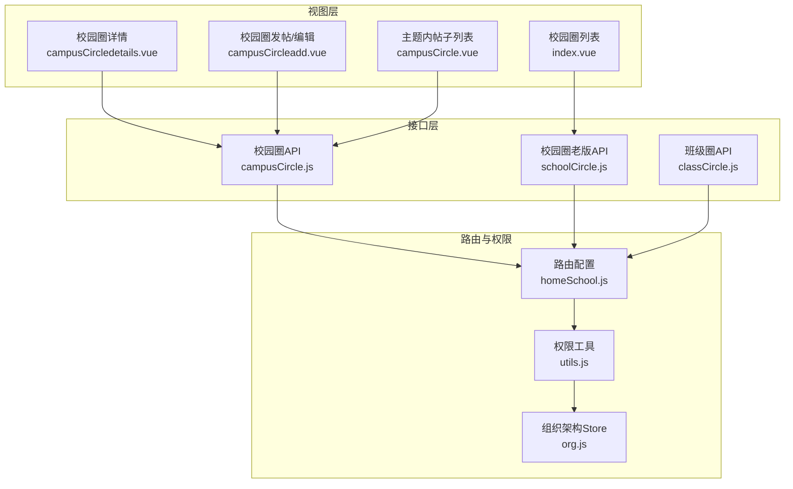
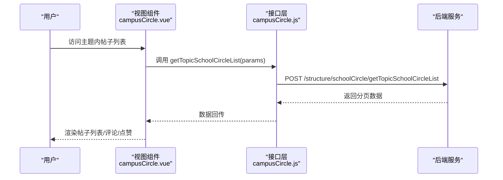
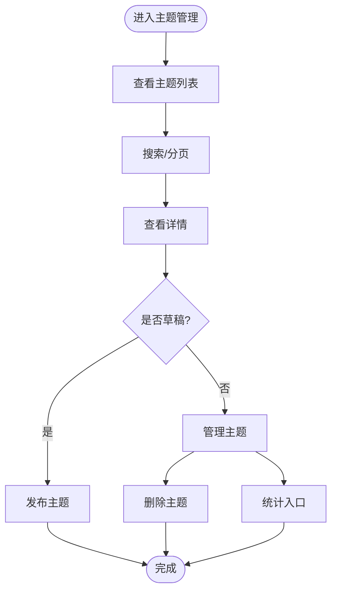
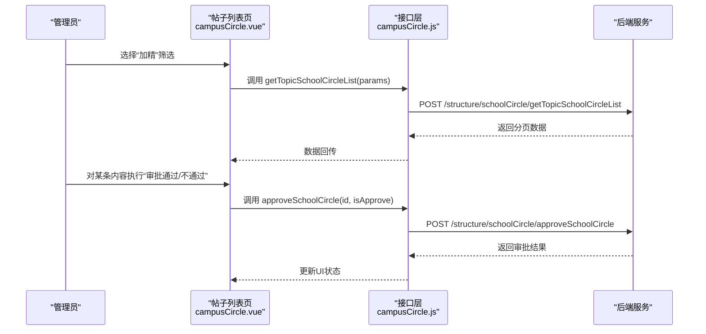
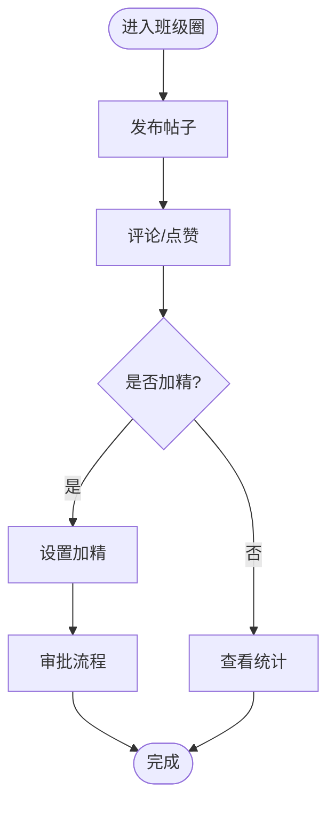
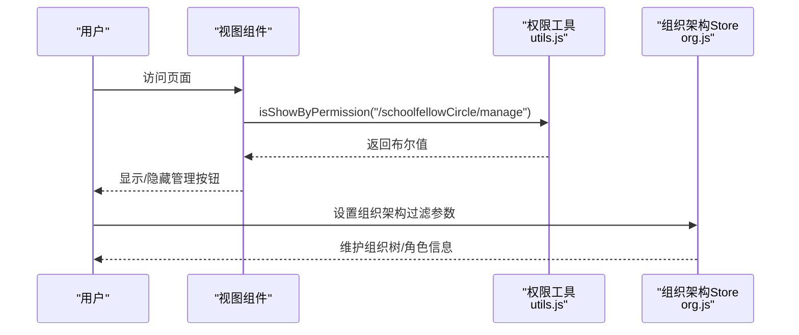
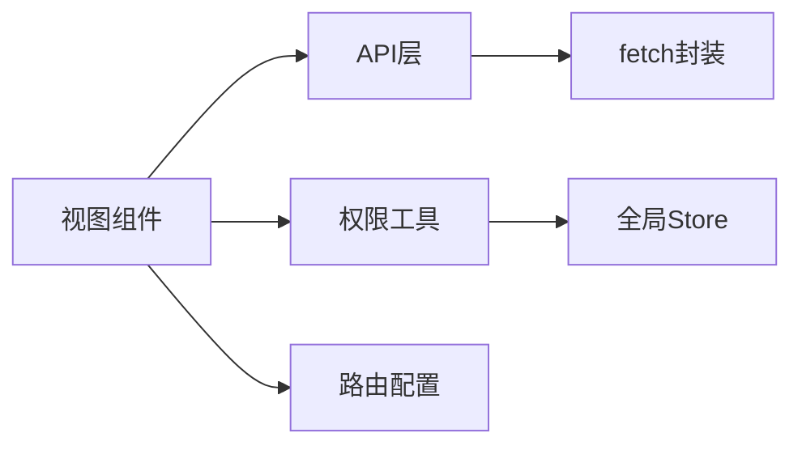

# 校园社区

<cite>
**本文引用的文件**
- [campusCircle.js](file://src/api/campusCircle.js)
- [schoolCircle.js](file://src/api/schoolCircle.js)
- [classCircle.js](file://src/api/classCircle.js)
- [campusCircle.vue](file://src/views/campusCircle/campusCircle.vue)
- [campusCircleadd.vue](file://src/views/campusCircle/campusCircleadd.vue)
- [campusCircledetails.vue](file://src/views/campusCircle/campusCircledetails.vue)
- [index.vue](file://src/views/schoolCircle/index.vue)
- [homeSchool.js](file://src/router/normal/homeSchool.js)
- [org.js](file://src/store/modules/org.js)
- [utils.js](file://src/utils/utils.js)
- [schoolTime.js](file://src/api/common/schoolTime.js)
</cite>

## 目录
1. [简介](#简介)
2. [项目结构](#项目结构)
3. [核心组件](#核心组件)
4. [架构总览](#架构总览)
5. [详细组件分析](#详细组件分析)
6. [依赖分析](#依赖分析)
7. [性能考虑](#性能考虑)
8. [故障排查指南](#故障排查指南)
9. [结论](#结论)
10. [附录](#附录)

## 简介
本技术文档围绕校园内部社交平台的“校园社区”模块，系统性梳理从社区创建、管理、成员与内容管理到互动与审核的完整能力边界。文档覆盖两类社区形态：
- 校园圈（全校范围）：面向全校师生，支持主题发布、审批、统计与内容分发。
- 班级圈（班级范围）：面向特定班级，支持发帖、评论、点赞、加精等互动。

同时，文档阐述了社区与学校组织架构的关联、权限控制、内容安全与数据隔离策略，并给出配置参数、扩展开发指南与常见问题排查方法，帮助开发者快速理解并进行二次开发。

## 项目结构
校园社区功能主要由三层构成：
- 视图层（Views）：承载社区主题管理、帖子列表、详情、统计等页面。
- 接口层（API）：封装与后端交互的统一方法，包含校园圈与班级圈两类接口。
- 路由与权限（Router/Utils）：定义页面路由、权限校验与组织架构数据存储。

**图表来源**
- [index.vue:1-247](file://src/views/schoolCircle/index.vue#L1-L247)
- [campusCircledetails.vue:1-148](file://src/views/campusCircle/campusCircledetails.vue#L1-L148)
- [campusCircleadd.vue:1-262](file://src/views/campusCircle/campusCircleadd.vue#L1-L262)
- [campusCircle.vue:1-343](file://src/views/campusCircle/campusCircle.vue#L1-L343)
- [campusCircle.js:1-275](file://src/api/campusCircle.js#L1-L275)
- [schoolCircle.js:1-215](file://src/api/schoolCircle.js#L1-L215)
- [classCircle.js:1-472](file://src/api/classCircle.js#L1-L472)
- [homeSchool.js:1018-1086](file://src/router/normal/homeSchool.js#L1018-L1086)
- [utils.js:30-62](file://src/utils/utils.js#L30-L62)
- [org.js:1-34](file://src/store/modules/org.js#L1-L34)

**章节来源**
- [homeSchool.js:1018-1086](file://src/router/normal/homeSchool.js#L1018-L1086)
- [index.vue:1-247](file://src/views/schoolCircle/index.vue#L1-L247)
- [campusCircledetails.vue:1-148](file://src/views/campusCircle/campusCircledetails.vue#L1-L148)
- [campusCircleadd.vue:1-262](file://src/views/campusCircle/campusCircleadd.vue#L1-L262)
- [campusCircle.vue:1-343](file://src/views/campusCircle/campusCircle.vue#L1-L343)
- [campusCircle.js:1-275](file://src/api/campusCircle.js#L1-L275)
- [schoolCircle.js:1-215](file://src/api/schoolCircle.js#L1-L215)
- [classCircle.js:1-472](file://src/api/classCircle.js#L1-L472)
- [utils.js:30-62](file://src/utils/utils.js#L30-L62)
- [org.js:1-34](file://src/store/modules/org.js#L1-L34)

## 核心组件
- 校园圈主题管理
  - 主题列表、搜索、发布/草稿切换、删除、统计入口。
  - 支持发布范围（部门/年级/班级/用户）、截止时间、封面与图标选择、是否需要审批。
- 校园圈内容管理
  - 主题内帖子分页列表、加精筛选、审批流、图片/视频预览、评论与点赞展示。
- 班级圈互动
  - 发布、评论、点赞、批量删除、加精、角色与评论设置、统计。
- 权限与组织架构
  - 基于路由权限标识与用户权限集合进行按钮级显示控制；组织架构数据在全局Store中维护，用于范围选择与角色判定。

**章节来源**
- [index.vue:1-247](file://src/views/schoolCircle/index.vue#L1-L247)
- [campusCircledetails.vue:1-148](file://src/views/campusCircle/campusCircledetails.vue#L1-L148)
- [campusCircleadd.vue:1-262](file://src/views/campusCircle/campusCircleadd.vue#L1-L262)
- [campusCircle.vue:1-343](file://src/views/campusCircle/campusCircle.vue#L1-L343)
- [campusCircle.js:1-275](file://src/api/campusCircle.js#L1-L275)
- [classCircle.js:1-472](file://src/api/classCircle.js#L1-L472)
- [utils.js:30-62](file://src/utils/utils.js#L30-L62)
- [org.js:1-34](file://src/store/modules/org.js#L1-L34)

## 架构总览
校园社区采用前后端分离模式，前端通过统一的fetch封装调用后端接口，接口以URL路径作为服务契约，参数通过URLSearchParams或表单形式传递。页面路由由homeSchool.js集中管理，权限通过utils.js中的isShowByPermission进行控制，组织架构数据通过org.js Store进行跨组件共享。

**图表来源**
- [campusCircle.vue:180-186](file://src/views/campusCircle/campusCircle.vue#L180-L186)
- [campusCircle.js:199-210](file://src/api/campusCircle.js#L199-L210)

**章节来源**
- [campusCircle.vue:1-343](file://src/views/campusCircle/campusCircle.vue#L1-L343)
- [campusCircle.js:1-275](file://src/api/campusCircle.js#L1-L275)

## 详细组件分析

### 校园圈主题管理（全校）
- 功能点
  - 主题列表与分页、搜索、发布/草稿切换、删除、统计入口。
  - 发布范围支持部门、年级、班级、用户多维组合；支持截止时间、封面与图标、是否审批。
- 关键接口
  - 主题列表与分页：queryCircleTopicBySchoolId（老版校园圈）；getSchoolCircleTopicPageList（新版校园圈）。
  - 发布/草稿切换：publishCircleTopic。
  - 删除主题：deleteCircleTopic。
  - 主题详情：getSchoolCircleTopicInfoById。
  - 图标字典：listValue。
- 页面与交互
  - 列表页（index.vue）：支持搜索、分页、跳转详情、发布/删除、查看待审数量。
  - 详情页（campusCircledetails.vue）：展示主题信息、发布范围、发布/编辑/统计入口。
  - 发布/编辑页（campusCircleadd.vue）：封面上传、图标选择、发布范围选择、截止时间、是否审批。

**图表来源**
- [index.vue:138-241](file://src/views/schoolCircle/index.vue#L138-L241)
- [campusCircledetails.vue:71-130](file://src/views/campusCircle/campusCircledetails.vue#L71-L130)
- [campusCircleadd.vue:118-177](file://src/views/campusCircle/campusCircleadd.vue#L118-L177)

**章节来源**
- [index.vue:1-247](file://src/views/schoolCircle/index.vue#L1-L247)
- [campusCircledetails.vue:1-148](file://src/views/campusCircle/campusCircledetails.vue#L1-L148)
- [campusCircleadd.vue:1-262](file://src/views/campusCircle/campusCircleadd.vue#L1-L262)
- [schoolCircle.js:13-27](file://src/api/schoolCircle.js#L13-L27)
- [campusCircle.js:5-14](file://src/api/campusCircle.js#L5-L14)
- [campusCircle.js:99-115](file://src/api/campusCircle.js#L99-L115)

### 校园圈内容管理（主题内帖子）
- 功能点
  - 主题内帖子分页列表、加精筛选、审批流（通过/不通过）、图片/视频预览、评论与点赞展示。
  - 支持打印、无限滚动加载。
- 关键接口
  - 帖子列表：getTopicSchoolCircleList。
  - 审批：approveSchoolCircle。
  - 主题详情：getSchoolCircleTopicInfoById。
- 页面与交互
  - 列表页（campusCircle.vue）：顶部筛选加精、圈子详情、打印；主体渲染帖子内容、评论与点赞；滚动触底自动加载。

**图表来源**
- [campusCircle.vue:104-186](file://src/views/campusCircle/campusCircle.vue#L104-L186)
- [campusCircle.js:199-210](file://src/api/campusCircle.js#L199-L210)
- [campusCircle.js:266-275](file://src/api/campusCircle.js#L266-L275)

**章节来源**
- [campusCircle.vue:1-343](file://src/views/campusCircle/campusCircle.vue#L1-L343)
- [campusCircle.js:199-275](file://src/api/campusCircle.js#L199-L275)

### 班级圈互动（班级）
- 功能点
  - 发布、评论、点赞、批量删除、加精、角色与评论设置、统计。
- 关键接口
  - 发布/删除/详情：addClassCircle、delClassCircle、getClassCircleInfo。
  - 评论：addComment、delComment。
  - 点赞：addPraise、delPraise。
  - 设置：getClassCircleSetInfo、getClassCircleDigestSetInfo、addClassCircleRole。
  - 统计：getSchoolCircleStaticPageData。
  - 审批：approveClassCircle。
- 页面与交互
  - 发布页：填写内容、选择类型、上传图片/视频、关联学生。
  - 列表页：展示评论、点赞、加精标记、操作按钮（删除、加精、审批）。

**图表来源**
- [classCircle.js:10-27](file://src/api/classCircle.js#L10-L27)
- [classCircle.js:79-116](file://src/api/classCircle.js#L79-L116)
- [classCircle.js:352-365](file://src/api/classCircle.js#L352-L365)
- [classCircle.js:443-458](file://src/api/classCircle.js#L443-L458)

**章节来源**
- [classCircle.js:1-472](file://src/api/classCircle.js#L1-L472)

### 权限控制与组织架构
- 权限控制
  - 使用isShowByPermission(permissionPath)判断按钮级显示，permissionPath来自路由配置。
  - 支持多权限组合的“或/且”判断。
- 组织架构
  - Store中维护orgFilterParams与organizationalStructure，用于范围选择与角色判定。
- 学期信息
  - 通过getCurrentSchoolTimeBySchoolId获取当前学期，用于统计与时间维度筛选。

**图表来源**
- [utils.js:50-62](file://src/utils/utils.js#L50-L62)
- [org.js:11-29](file://src/store/modules/org.js#L11-L29)
- [schoolTime.js:5-11](file://src/api/common/schoolTime.js#L5-L11)

**章节来源**
- [utils.js:30-62](file://src/utils/utils.js#L30-L62)
- [org.js:1-34](file://src/store/modules/org.js#L1-L34)
- [schoolTime.js:1-19](file://src/api/common/schoolTime.js#L1-L19)

## 依赖分析
- 组件耦合
  - 视图组件通过API层解耦后端服务，降低对具体接口实现的依赖。
  - 权限控制集中在utils.js，避免在各视图重复判断。
- 外部依赖
  - 统一的fetch封装，便于统一错误处理与拦截器扩展。
  - Element UI组件库用于表格、分页、对话框等交互。
- 可能的循环依赖
  - API层仅导出方法，未直接导入视图，避免循环依赖风险。

**图表来源**
- [campusCircle.vue:78-103](file://src/views/campusCircle/campusCircle.vue#L78-L103)
- [campusCircle.js:1-2](file://src/api/campusCircle.js#L1-L2)
- [utils.js:30-62](file://src/utils/utils.js#L30-L62)
- [homeSchool.js:1018-1086](file://src/router/normal/homeSchool.js#L1018-L1086)
- [org.js:1-34](file://src/store/modules/org.js#L1-L34)

**章节来源**
- [campusCircle.vue:1-343](file://src/views/campusCircle/campusCircle.vue#L1-L343)
- [campusCircle.js:1-275](file://src/api/campusCircle.js#L1-L275)
- [utils.js:30-62](file://src/utils/utils.js#L30-L62)
- [homeSchool.js:1018-1086](file://src/router/normal/homeSchool.js#L1018-L1086)
- [org.js:1-34](file://src/store/modules/org.js#L1-L34)

## 性能考虑
- 列表加载
  - 采用分页与滚动触底加载，减少一次性渲染压力；注意在加载中时禁用重复触发。
- 图片/视频
  - 使用预览组件按需加载，避免大体积资源阻塞首屏。
- 审批与统计
  - 审批与统计接口应尽量异步处理，避免阻塞主界面。
- 权限判断
  - 将权限判断逻辑前置，减少不必要的DOM渲染与事件绑定。

[本节为通用建议，无需特定文件来源]

## 故障排查指南
- 无法显示管理按钮
  - 检查当前用户是否拥有对应permissionPath权限；确认isShowByPermission返回值。
- 发布失败或审批无效
  - 核查接口返回状态码与消息；确认参数拼装正确（URLSearchParams）。
- 发布范围不生效
  - 确认地址簿组件返回的departJson格式与接口要求一致；检查后端解析逻辑。
- 图片/视频加载异常
  - 检查上传组件返回的fileUrl与预览组件的v-html渲染；确保CDN可用。
- 组织架构数据缺失
  - 确认org.js中organizationalStructure已正确设置；检查路由守卫与登录流程。

**章节来源**
- [utils.js:50-62](file://src/utils/utils.js#L50-L62)
- [campusCircleadd.vue:118-177](file://src/views/campusCircle/campusCircleadd.vue#L118-L177)
- [campusCircle.vue:122-140](file://src/views/campusCircle/campusCircle.vue#L122-L140)
- [org.js:11-29](file://src/store/modules/org.js#L11-L29)

## 结论
校园社区模块以清晰的三层架构实现了从主题管理到内容互动的全链路能力，结合权限与组织架构，满足了全校与班级两个层级的社交需求。通过统一的API封装与权限工具，系统具备良好的可维护性与扩展性。后续可在内容安全、审核策略与统计维度上进一步增强。

[本节为总结，无需特定文件来源]

## 附录

### 配置参数与字段说明
- 校园圈主题
  - 标题、封面、图标、发布范围（部门/年级/班级/用户）、截止时间、是否审批、状态（草稿/已发布）、主题描述。
- 帖子内容
  - 文本、图片、视频、评论、点赞、加精标记、审批状态。
- 班级圈
  - 类型、角色与评论设置、加精设置、统计维度（按教师/班级/学生）。

**章节来源**
- [campusCircleadd.vue:79-90](file://src/views/campusCircle/campusCircleadd.vue#L79-L90)
- [campusCircledetails.vue:50-59](file://src/views/campusCircle/campusCircledetails.vue#L50-L59)
- [classCircle.js:352-365](file://src/api/classCircle.js#L352-L365)

### 内容安全机制
- 审核流程
  - 校园圈与班级圈均支持审批，管理员可对内容进行通过/不通过操作。
- 发布范围控制
  - 通过组织架构选择发布范围，确保内容仅对授权对象可见。
- 富文本与媒体
  - 使用富文本编辑器与媒体上传组件，建议在后端对内容与文件类型进行白名单校验。

**章节来源**
- [campusCircle.js:266-275](file://src/api/campusCircle.js#L266-L275)
- [classCircle.js:460-471](file://src/api/classCircle.js#L460-L471)
- [campusCircleadd.vue:26-28](file://src/views/campusCircle/campusCircleadd.vue#L26-L28)

### 扩展开发指南
- 新增接口
  - 在对应API文件中新增方法，遵循现有参数拼装与返回格式。
- 新增页面
  - 在homeSchool.js中注册路由；在视图目录新增组件；在utils.js中补充权限标识。
- 权限与组织架构
  - 通过isShowByPermission控制按钮显示；在org.js中维护组织树与过滤参数。
- 统计与报表
  - 使用getSchoolCircleStaticPageData等接口扩展统计维度；注意分页与时间范围参数。

**章节来源**
- [homeSchool.js:1018-1086](file://src/router/normal/homeSchool.js#L1018-L1086)
- [utils.js:50-62](file://src/utils/utils.js#L50-L62)
- [org.js:11-29](file://src/store/modules/org.js#L11-L29)
- [classCircle.js:443-458](file://src/api/classCircle.js#L443-L458)