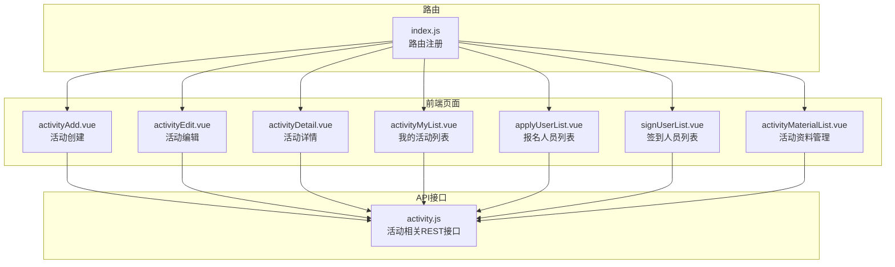
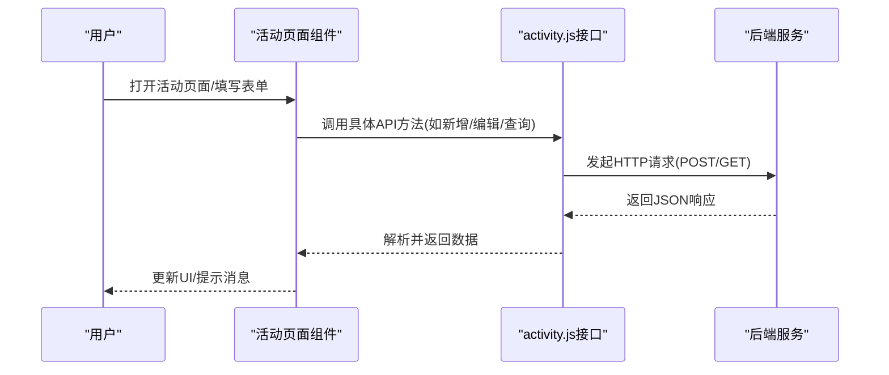
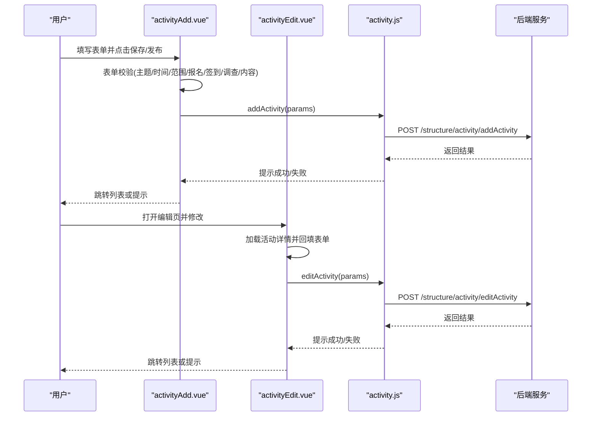
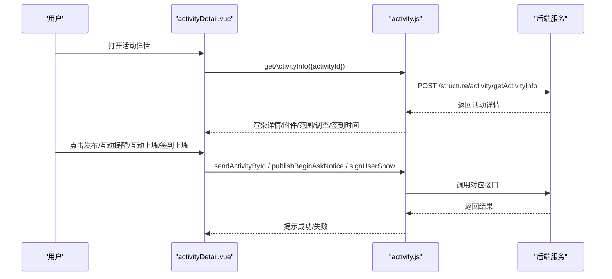
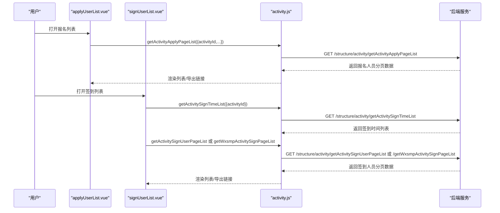
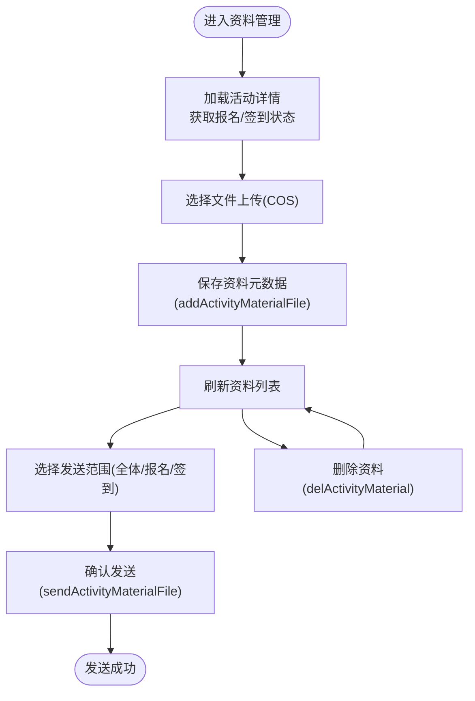
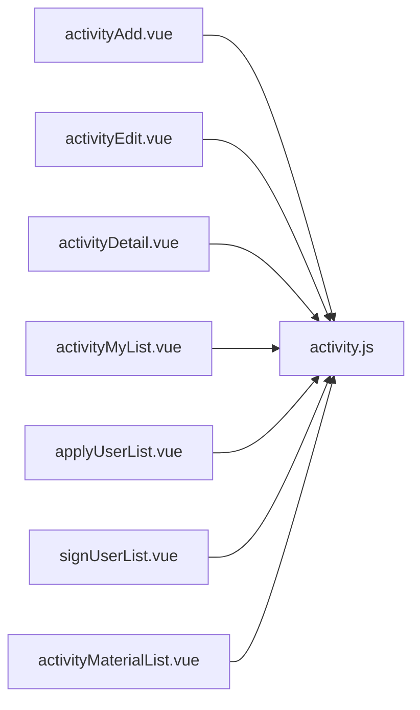

# 活动管理

<cite>
**本文引用的文件**
- [activity.js](file://src/api/activity.js)
- [activityAdd.vue](file://src/views/activity/activityAdd.vue)
- [activityDetail.vue](file://src/views/activity/activityDetail.vue)
- [activityEdit.vue](file://src/views/activity/activityEdit.vue)
- [activityMyList.vue](file://src/views/activity/activityMyList.vue)
- [applyUserList.vue](file://src/views/activity/applyUserList.vue)
- [signUserList.vue](file://src/views/activity/signUserList.vue)
- [activityMaterialList.vue](file://src/views/activity/activityMaterialList.vue)
- [index.js](file://src/router/index.js)
</cite>

## 目录
1. [引言](#引言)
2. [项目结构](#项目结构)
3. [核心组件](#核心组件)
4. [架构总览](#架构总览)
5. [详细组件分析](#详细组件分析)
6. [依赖分析](#依赖分析)
7. [性能考虑](#性能考虑)
8. [故障排查指南](#故障排查指南)
9. [结论](#结论)
10. [附录](#附录)

## 引言
本技术文档围绕“活动管理”模块展开，覆盖校园内各类活动的组织管理流程：活动创建、审核、发布与执行跟踪；活动报名系统的用户管理、签到统计、材料收集与互动交流；活动类型与报名条件设置、参与人数控制与费用管理；活动与班级、年级、学校的关系、权限分配与数据同步机制；以及系统配置参数、扩展接口与性能优化建议。文档以代码级分析为基础，结合可视化图表帮助读者快速理解系统设计与实现。

## 项目结构
活动管理功能由前端页面与API接口共同组成，采用Vue + Element UI构建，路由集中于主入口，活动相关页面位于views/activity目录，业务API封装在src/api/activity.js中。

**图表来源**
- [activityAdd.vue](file://src/views/activity/activityAdd.vue)
- [activityEdit.vue](file://src/views/activity/activityEdit.vue)
- [activityDetail.vue](file://src/views/activity/activityDetail.vue)
- [activityMyList.vue](file://src/views/activity/activityMyList.vue)
- [applyUserList.vue](file://src/views/activity/applyUserList.vue)
- [signUserList.vue](file://src/views/activity/signUserList.vue)
- [activityMaterialList.vue](file://src/views/activity/activityMaterialList.vue)
- [activity.js](file://src/api/activity.js)
- [index.js](file://src/router/index.js)

**章节来源**
- [index.js:136-148](file://src/router/index.js#L136-L148)

## 核心组件
- 活动API层：封装活动创建、编辑、发布、查询、报名、签到、材料管理等REST接口，统一通过fetch调用后端服务。
- 视图层：包含活动创建/编辑/详情/我的列表、报名人员、签到人员、资料管理等页面，负责用户交互与数据展示。
- 路由层：将上述页面挂载至主应用布局，支持跳转与参数传递。

关键职责划分：
- activity.js：定义并导出所有活动相关API方法，包括分页查询、删除、新增、编辑、发布、签到统计、报名列表、材料管理等。
- 各页面组件：负责表单校验、富文本编辑器集成、文件上传、权限控制、分页加载与导出等。

**章节来源**
- [activity.js:1-418](file://src/api/activity.js#L1-L418)
- [activityAdd.vue:150-627](file://src/views/activity/activityAdd.vue#L150-L627)
- [activityDetail.vue:188-495](file://src/views/activity/activityDetail.vue#L188-L495)
- [activityEdit.vue:135-700](file://src/views/activity/activityEdit.vue#L135-L700)
- [activityMyList.vue:106-251](file://src/views/activity/activityMyList.vue#L106-L251)
- [applyUserList.vue:67-154](file://src/views/activity/applyUserList.vue#L67-L154)
- [signUserList.vue:89-234](file://src/views/activity/signUserList.vue#L89-L234)
- [activityMaterialList.vue:116-437](file://src/views/activity/activityMaterialList.vue#L116-L437)

## 架构总览
活动管理从前端到后端的数据流如下：

**图表来源**
- [activity.js:1-418](file://src/api/activity.js#L1-L418)
- [activityAdd.vue:344-624](file://src/views/activity/activityAdd.vue#L344-L624)
- [activityDetail.vue:356-428](file://src/views/activity/activityDetail.vue#L356-L428)
- [activityEdit.vue:413-697](file://src/views/activity/activityEdit.vue#L413-L697)
- [activityMyList.vue:225-249](file://src/views/activity/activityMyList.vue#L225-L249)
- [applyUserList.vue:107-127](file://src/views/activity/applyUserList.vue#L107-L127)
- [signUserList.vue:136-179](file://src/views/activity/signUserList.vue#L136-L179)
- [activityMaterialList.vue:380-403](file://src/views/activity/activityMaterialList.vue#L380-L403)

## 详细组件分析

### 活动创建与编辑流程
活动创建与编辑页面提供统一的表单域：活动类型、主题、地点、时间、发送范围、是否定时发送、封面、签到、调查、附件、内容、报名截止时间与人数、落款部门、允许上传剪影等。页面在提交前进行多项校验，并将表单数据序列化后调用API完成新增或更新。

**图表来源**
- [activityAdd.vue:344-624](file://src/views/activity/activityAdd.vue#L344-L624)
- [activityEdit.vue:413-697](file://src/views/activity/activityEdit.vue#L413-L697)
- [activity.js:28-143](file://src/api/activity.js#L28-L143)

**章节来源**
- [activityAdd.vue:150-627](file://src/views/activity/activityAdd.vue#L150-L627)
- [activityEdit.vue:135-700](file://src/views/activity/activityEdit.vue#L135-L700)
- [activity.js:28-143](file://src/api/activity.js#L28-L143)

### 活动详情与发布流程
活动详情页展示活动基本信息、发布范围、报名/签到/调查配置、附件与签到二维码等。支持互动提醒、互动上墙、签到上墙、报名详情、活动调查、资料管理、补发活动等功能。发布流程支持直接发布或定时发送。

**图表来源**
- [activityDetail.vue:188-495](file://src/views/activity/activityDetail.vue#L188-L495)
- [activity.js:86-155](file://src/api/activity.js#L86-L155)

**章节来源**
- [activityDetail.vue:188-495](file://src/views/activity/activityDetail.vue#L188-L495)
- [activity.js:86-155](file://src/api/activity.js#L86-L155)

### 报名与签到统计
报名列表与签到列表分别提供分页查询、搜索、导出能力。内部活动与外部活动采用不同的签到接口，且支持按签到场次筛选。

**图表来源**
- [applyUserList.vue:67-154](file://src/views/activity/applyUserList.vue#L67-L154)
- [signUserList.vue:89-234](file://src/views/activity/signUserList.vue#L89-L234)
- [activity.js:236-234](file://src/api/activity.js#L236-L234)

**章节来源**
- [applyUserList.vue:67-154](file://src/views/activity/applyUserList.vue#L67-L154)
- [signUserList.vue:89-234](file://src/views/activity/signUserList.vue#L89-L234)
- [activity.js:236-234](file://src/api/activity.js#L236-L234)

### 材料管理与互动
材料管理支持上传活动资料、设置发送范围（全体/报名/签到）、删除资料、查看发布状态与导出结果。互动功能支持上传剪影、删除剪影、批量补发活动。

**图表来源**
- [activityMaterialList.vue:116-437](file://src/views/activity/activityMaterialList.vue#L116-L437)
- [activity.js:298-360](file://src/api/activity.js#L298-L360)

**章节来源**
- [activityMaterialList.vue:116-437](file://src/views/activity/activityMaterialList.vue#L116-L437)
- [activity.js:298-360](file://src/api/activity.js#L298-L360)

### 数据模型与字段说明
以下为活动相关核心字段的语义说明（基于API参数命名与页面表单域）：

- 基础信息
  - 主题(theme)、地点(place)、开始/结束时间(startTime/endTime)、描述(describe)、封面(activityLogo)
- 发布与范围
  - 活动类型(activityType)、发送范围(activityScopes)、是否定时发送(isOntimeSend)、发送时间(sendDate)
- 报名与人数
  - 是否报名(isApply)、报名截止时间(applyEndTime)、报名人数(applyCount)
- 签到与调查
  - 是否签到(isSign)、签到时间数组(signTimeStr)、允许非通知用户签到(notSendSign)、是否调查(isResearch)、调查主题(topicJson)
- 落款与附加
  - 落款部门(departId/departName)、允许上传剪影(allowUploadPicFlag)、附件(filesJson)、模块类型(moduleType)

**章节来源**
- [activity.js:28-143](file://src/api/activity.js#L28-L143)
- [activityAdd.vue:164-226](file://src/views/activity/activityAdd.vue#L164-L226)
- [activityEdit.vue:148-214](file://src/views/activity/activityEdit.vue#L148-L214)

## 依赖分析
- 组件耦合
  - 页面组件与API层松耦合，通过统一接口调用，便于替换与扩展。
  - 活动详情页对多个子功能（报名、签到、材料、互动）存在间接依赖，但均通过独立API解耦。
- 外部依赖
  - 富文本编辑器(Ueditor)、文件上传(WebUploader/COS)、地址簿(AddressBook)、分页(Element Table/Pagination)等第三方组件。
- 可能的循环依赖
  - 当前结构无明显循环依赖，页面间通过路由跳转与共享store访问用户信息。

**图表来源**
- [activityAdd.vue](file://src/views/activity/activityAdd.vue)
- [activityEdit.vue](file://src/views/activity/activityEdit.vue)
- [activityDetail.vue](file://src/views/activity/activityDetail.vue)
- [activityMyList.vue](file://src/views/activity/activityMyList.vue)
- [applyUserList.vue](file://src/views/activity/applyUserList.vue)
- [signUserList.vue](file://src/views/activity/signUserList.vue)
- [activityMaterialList.vue](file://src/views/activity/activityMaterialList.vue)
- [activity.js](file://src/api/activity.js)

**章节来源**
- [activity.js:1-418](file://src/api/activity.js#L1-L418)

## 性能考虑
- 列表分页与防抖
  - 报名与签到列表使用分页加载与输入防抖，减少频繁请求与渲染压力。
- 图片与文件
  - 使用COS直传与标签标记，降低前端处理成本；上传进度与错误提示提升用户体验。
- 表单校验
  - 在提交前进行严格校验，避免无效请求与后端重复处理。
- 路由懒加载
  - 路由按模块组织，可结合路由懒加载进一步优化首屏加载。

[本节为通用指导，无需列出具体文件来源]

## 故障排查指南
- 常见问题
  - 时间校验失败：活动开始/结束时间、报名截止时间、发送时间需满足先后顺序与当前时间约束。
  - 签到时间冲突：多次签到的时间段需严格递增，否则提示错误。
  - 文件类型限制：仅允许指定后缀的文件上传，超出范围将提示错误。
  - 权限不足：部分功能（如资源预约、补发）需具备相应权限。
- 排查步骤
  - 检查网络请求与返回码，定位API调用异常。
  - 查看页面提示与控制台错误，确认组件渲染与事件绑定。
  - 核对表单必填项与格式，确保参数完整正确。
  - 确认COS签名与存储桶配置，避免上传失败。

**章节来源**
- [activityAdd.vue:344-499](file://src/views/activity/activityAdd.vue#L344-L499)
- [activityEdit.vue:413-540](file://src/views/activity/activityEdit.vue#L413-L540)
- [activityMaterialList.vue:310-378](file://src/views/activity/activityMaterialList.vue#L310-L378)

## 结论
活动管理模块通过清晰的前后端分离设计，实现了从活动创建、审核、发布到执行跟踪的全链路管理。页面组件围绕统一API进行交互，具备良好的可维护性与扩展性。建议后续在权限体系、数据同步与性能优化方面持续迭代，以适配更大规模的校园场景。

## 附录

### API一览（节选）
- 获取学校活动分页列表：getSchoolActivityPageList
- 删除活动：deleteActivity
- 新增活动：addActivity
- 获取活动详情：getActivityInfo
- 编辑活动：editActivity
- 发布活动：sendActivityById
- 发布互动提醒：publishBeginAskNotice
- 获取活动签到时间列表：getActivitySignTimeList
- 内部活动签到人员分页：getActivitySignUserPageList
- 外部活动签到人员分页：getWxsmpActivitySignPageList
- 活动报名人员分页：getActivityApplyPageList
- 活动资料分页：getActivityMaterialPageList
- 新增活动资料：addActivityMaterialFile
- 删除活动资料：delActivityMaterial
- 发送活动资料：sendActivityMaterialFile
- 补发活动：reissueActivity
- 互动上墙：signUserShow
- 活动互动图片：getActivityInteractAllPicList
- 上传互动图片：addInteractPics
- 删除互动图片：deleteInteractPic

**章节来源**
- [activity.js:1-418](file://src/api/activity.js#L1-L418)