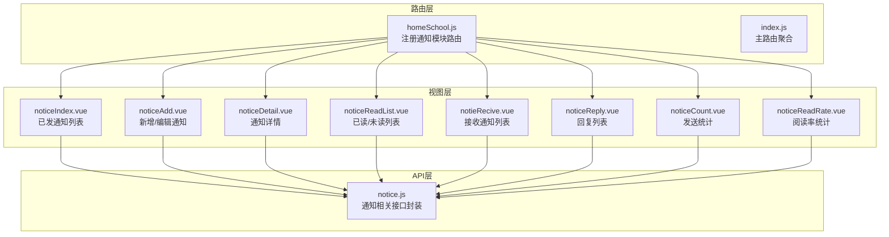
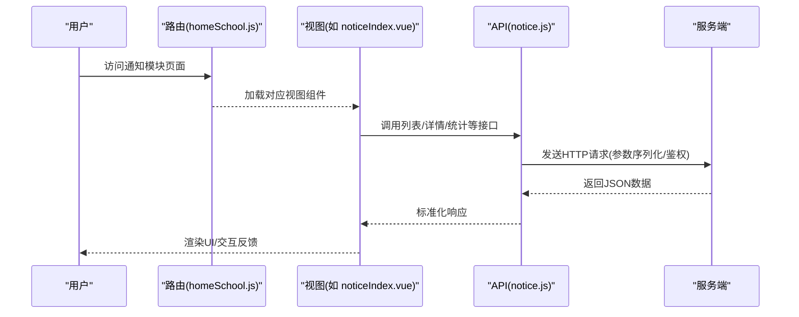
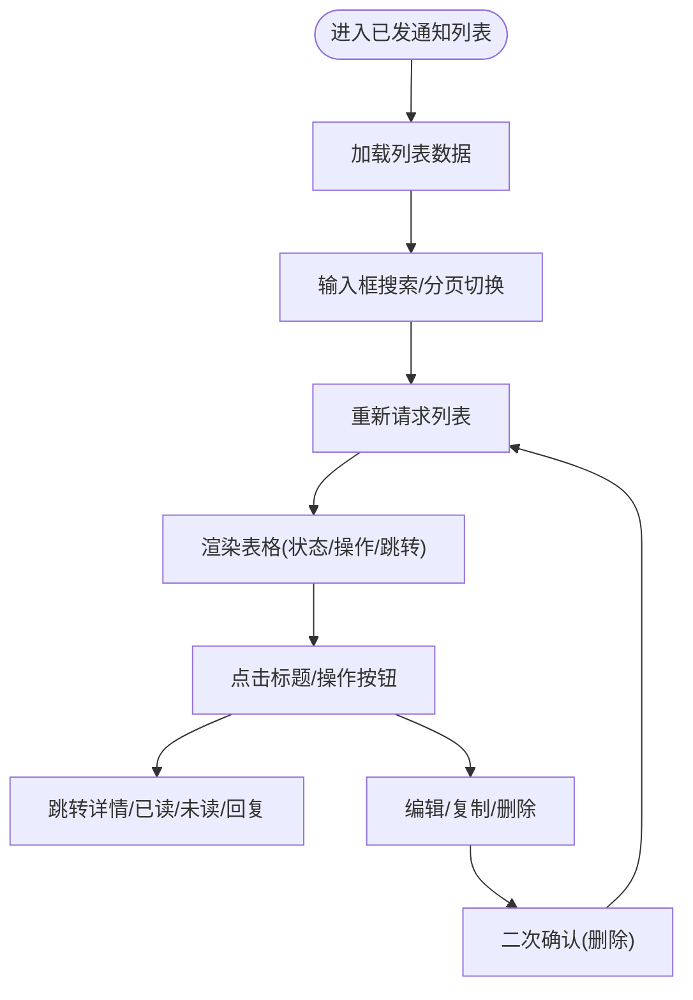
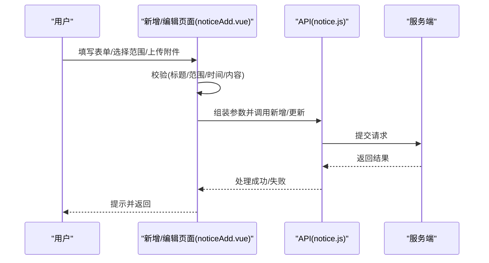
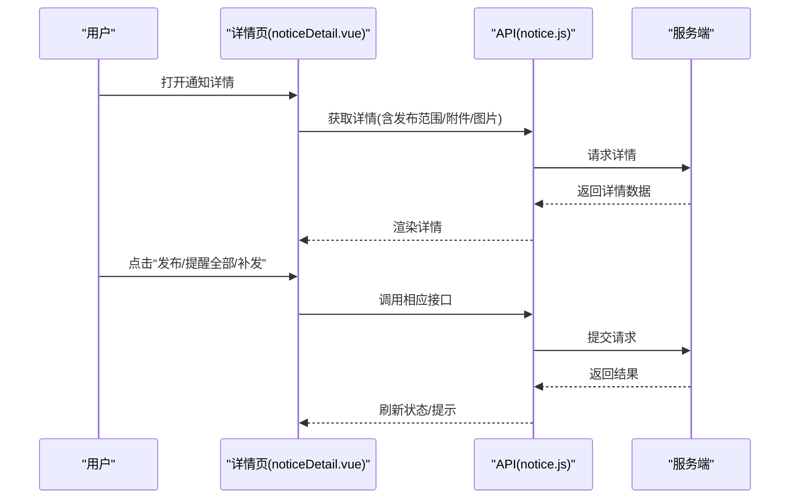
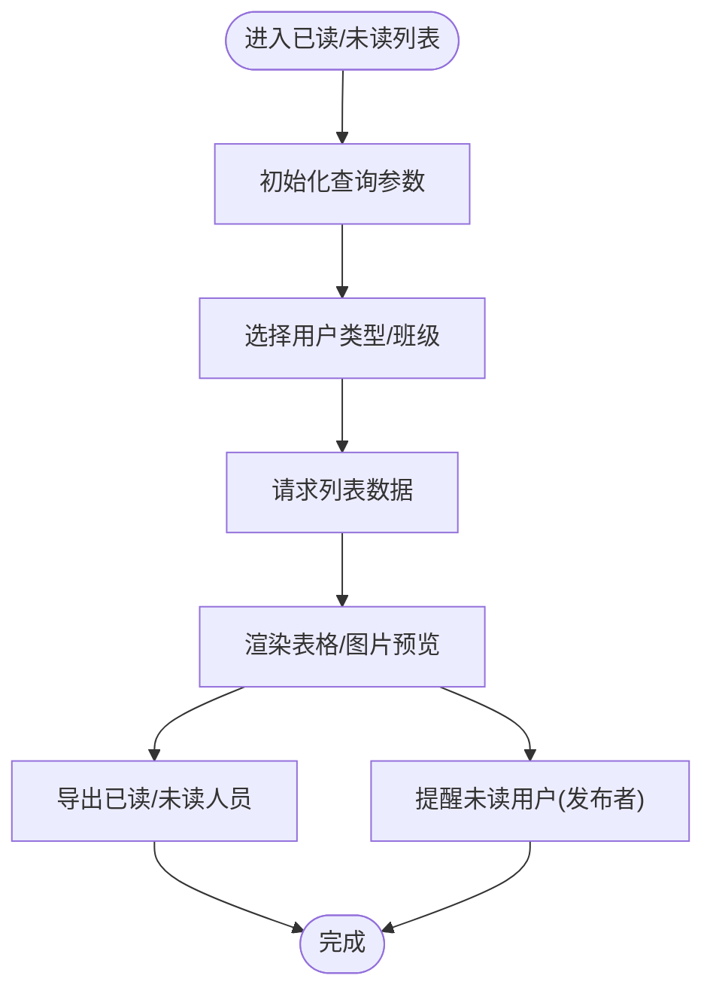
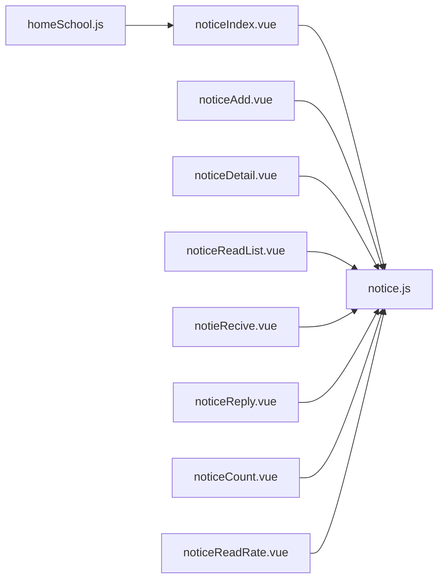

# 通知公告管理

<cite>
**本文引用的文件**
- [notice.js](file://src/api/notice.js)
- [noticeIndex.vue](file://src/views/noticenoticeIndex.vue)
- [noticeAdd.vue](file://src/views/noticenoticeAdd.vue)
- [noticeDetail.vue](file://src/views/noticenoticeDetail.vue)
- [noticeReadList.vue](file://src/views/noticenoticeReadList.vue)
- [notieRecive.vue](file://src/views/noticenotieRecive.vue)
- [noticeReply.vue](file://src/views/noticenoticeReply.vue)
- [noticeCount.vue](file://src/views/noticenoticeCount.vue)
- [noticeReadRate.vue](file://src/views/noticenoticeReadRate.vue)
- [homeSchool.js](file://src/router/normal/homeSchool.js)
- [index.js](file://src/router/index.js)
</cite>

## 目录
1. [简介](#简介)
2. [项目结构](#项目结构)
3. [核心组件](#核心组件)
4. [架构总览](#架构总览)
5. [详细组件分析](#详细组件分析)
6. [依赖分析](#依赖分析)
7. [性能考虑](#性能考虑)
8. [故障排查指南](#故障排查指南)
9. [结论](#结论)
10. [附录](#附录)

## 简介
本技术文档围绕“通知公告管理”功能进行系统化梳理，覆盖通知的创建、编辑、发布、审批、阅读统计、回复处理、批量导出、提醒机制、权限控制与路由集成等能力。文档以代码级事实为基础，结合前端视图与API层，帮助开发者快速理解并扩展该模块。

## 项目结构
通知公告相关功能由三部分组成：
- 路由层：定义通知模块的入口与页面路径
- 视图层：负责展示与交互（列表、详情、已读未读、回复、统计）
- API层：封装后端接口调用，统一参数与返回格式

图表来源
- [homeSchool.js:111-131](file://src/router/normal/homeSchool.js#L111-L131)
- [noticeIndex.vue:1-289](file://src/views/noticenoticeIndex.vue#L1-L289)
- [noticeAdd.vue:1-514](file://src/views/noticenoticeAdd.vue#L1-L514)
- [noticeDetail.vue:1-423](file://src/views/noticenoticeDetail.vue#L1-L423)
- [noticeReadList.vue:1-291](file://src/views/noticenoticeReadList.vue#L1-L291)
- [notieRecive.vue:1-215](file://src/views/noticenotieRecive.vue#L1-L215)
- [noticeReply.vue:1-167](file://src/views/noticenoticeReply.vue#L1-L167)
- [noticeCount.vue:1-145](file://src/views/noticenoticeCount.vue#L1-L145)
- [noticeReadRate.vue:1-192](file://src/views/noticenoticeReadRate.vue#L1-L192)
- [notice.js:1-853](file://src/api/notice.js#L1-L853)

章节来源
- [homeSchool.js:111-131](file://src/router/normal/homeSchool.js#L111-L131)
- [index.js:135-148](file://src/router/index.js#L135-L148)

## 核心组件
- 通知列表（已发/接收）：支持分页、搜索、状态标识、复制/编辑/删除、已读/未读/回复跳转
- 新增/编辑通知：富文本编辑器、封面选择、附件上传、发布范围（部门/群组/用户）、定时发送、过期时间、落款、回复权限、阅读确认
- 通知详情：发布范围展示、图片/附件展示、已读/未读/回复数量、提醒全部/重复提醒、补发
- 已读/未读列表：支持按用户类型/班级筛选、导出、签名图片查看
- 回复列表：支持全量/选择导出、图片预览
- 统计报表：发送统计、阅读率统计（含导出）

章节来源
- [noticeIndex.vue:1-289](file://src/views/noticenoticeIndex.vue#L1-L289)
- [noticeAdd.vue:1-514](file://src/views/noticenoticeAdd.vue#L1-L514)
- [noticeDetail.vue:1-423](file://src/views/noticenoticeDetail.vue#L1-L423)
- [noticeReadList.vue:1-291](file://src/views/noticenoticeReadList.vue#L1-L291)
- [noticeReply.vue:1-167](file://src/views/noticenoticeReply.vue#L1-L167)
- [noticeCount.vue:1-145](file://src/views/noticenoticeCount.vue#L1-L145)
- [noticeReadRate.vue:1-192](file://src/views/noticenoticeReadRate.vue#L1-L192)

## 架构总览
通知公告模块采用“路由驱动 + 视图组件 + API封装”的三层架构：
- 路由层：在模块路由中注册通知相关页面
- 视图层：各页面通过Vuex获取用户信息、权限判断、高度适配等
- API层：统一封装HTTP请求，屏蔽参数构造与数据转换细节

图表来源
- [homeSchool.js:111-131](file://src/router/normal/homeSchool.js#L111-L131)
- [noticeIndex.vue:134-279](file://src/views/noticenoticeIndex.vue#L134-L279)
- [notice.js:12-23](file://src/api/notice.js#L12-L23)

## 详细组件分析

### 通知列表（已发/接收）
- 功能要点
  - 分页与搜索：支持标题/发布人/时间范围过滤
  - 状态展示：未发布/定时未发布/发布中/已发布
  - 操作按钮：复制、编辑、删除；跳转至详情、已读/未读/回复列表
  - 归档提示：超过一年的数据提示归档
- 关键交互
  - 已读/未读/回复数量点击跳转详情页
  - 权限控制：根据权限显示“收通知/所有通知/发送统计/阅读率统计”
- 数据来源
  - 已发列表：getUserNoticeList
  - 接收列表：getUserReceiveNoticeList

图表来源
- [noticeIndex.vue:134-279](file://src/views/noticenoticeIndex.vue#L134-L279)
- [notice.js:12-23](file://src/api/notice.js#L12-L23)
- [notice.js:249-262](file://src/api/notice.js#L249-L262)

章节来源
- [noticeIndex.vue:1-289](file://src/views/noticenoticeIndex.vue#L1-L289)
- [notice.js:12-23](file://src/api/notice.js#L12-L23)
- [notice.js:249-262](file://src/api/notice.js#L249-L262)

### 新增/编辑通知
- 功能要点
  - 富文本编辑器：支持内容编辑与校验
  - 发布范围：部门/群组/用户三选一或组合
  - 封面与附件：封面选择器、文件上传
  - 定时发送与过期时间：时间有效性校验
  - 落款：可选部门落款
  - 回复权限：公开/仅自己可见
  - 阅读确认：签字/阅读两种确认方式
  - 对教师公开阅读情况：开关控制
- 关键流程
  - 表单校验通过后，组装参数调用新增/更新接口
  - 发布前弹窗确认发布范围
  - 成功后返回上一页并提示

图表来源
- [noticeAdd.vue:114-481](file://src/views/noticenoticeAdd.vue#L114-L481)
- [notice.js:329-365](file://src/api/notice.js#L329-L365)
- [notice.js:454-489](file://src/api/notice.js#L454-L489)

章节来源
- [noticeAdd.vue:1-514](file://src/views/noticenoticeAdd.vue#L1-L514)
- [notice.js:329-365](file://src/api/notice.js#L329-L365)
- [notice.js:454-489](file://src/api/notice.js#L454-L489)

### 通知详情
- 功能要点
  - 展示标题、发布时间、发布人、内容、图片、附件
  - 发布范围展示（仅发布者可见）
  - 已读/未读/回复数量跳转
  - 发布按钮（草稿态）
  - 提醒全部/重复提醒/补发（发布态）
- 关键流程
  - 根据是否接收/是否来自发送方决定工具栏显示
  - 补发触发转发接口，成功后刷新详情
  - 发布按钮调用更新接口，将状态置为已发布

图表来源
- [noticeDetail.vue:97-397](file://src/views/noticenoticeDetail.vue#L97-L397)
- [notice.js:89-105](file://src/api/notice.js#L89-L105)
- [notice.js:106-115](file://src/api/notice.js#L106-L115)
- [notice.js:209-228](file://src/api/notice.js#L209-L228)

章节来源
- [noticeDetail.vue:1-423](file://src/views/noticenoticeDetail.vue#L1-L423)
- [notice.js:89-105](file://src/api/notice.js#L89-L105)
- [notice.js:106-115](file://src/api/notice.js#L106-L115)
- [notice.js:209-228](file://src/api/notice.js#L209-L228)

### 已读/未读列表
- 功能要点
  - 已读/未读双态切换
  - 用户类型筛选（教师/学生），学生时可按班级筛选
  - 导出已读/未读人员名单
  - 签名图片预览与查看详情
  - 提醒未读用户（发布者且未读人数>0时）
- 关键流程
  - 根据查询条件动态拼装参数
  - 支持导出URL拼接
  - 提醒接口调用后提示

图表来源
- [noticeReadList.vue:85-244](file://src/views/noticenoticeReadList.vue#L85-L244)
- [notice.js:137-164](file://src/api/notice.js#L137-L164)
- [notice.js:166-191](file://src/api/notice.js#L166-L191)

章节来源
- [noticeReadList.vue:1-291](file://src/views/noticenoticeReadList.vue#L1-L291)
- [notice.js:137-164](file://src/api/notice.js#L137-L164)
- [notice.js:166-191](file://src/api/notice.js#L166-L191)

### 回复列表
- 功能要点
  - 分页展示回复内容、图片、回复人、时间
  - 全量导出与选择导出
  - 图片预览
- 关键流程
  - 支持按回复人姓名搜索
  - 多选后生成选择导出链接

章节来源
- [noticeReply.vue:1-167](file://src/views/noticenoticeReply.vue#L1-L167)
- [notice.js:216-241](file://src/api/notice.js#L216-L241)

### 统计报表
- 发送统计（noticeCount.vue）
  - 时间范围选择、教师姓名过滤
  - 导出发送统计
- 阅读率统计（noticeReadRate.vue）
  - 时间范围选择、姓名过滤
  - 已读/未读人数跳转明细
  - 导出阅读率统计

章节来源
- [noticeCount.vue:1-145](file://src/views/noticenoticeCount.vue#L1-L145)
- [noticeReadRate.vue:1-192](file://src/views/noticenoticeReadRate.vue#L1-L192)
- [notice.js:289-299](file://src/api/notice.js#L289-L299)
- [notice.js:529-539](file://src/api/notice.js#L529-L539)

## 依赖分析
- 路由依赖
  - homeSchool.js 注册通知模块页面
  - index.js 聚合模块路由
- 视图依赖
  - 各页面依赖 notice.js 的接口方法
  - 使用 Element UI 组件库与自定义组件（富文本、上传、地址簿等）
- API依赖
  - notice.js 统一封装了通知列表、详情、已读未读、回复、统计、提醒、补发、置顶等接口

图表来源
- [homeSchool.js:111-131](file://src/router/normal/homeSchool.js#L111-L131)
- [noticeIndex.vue:134-136](file://src/views/noticenoticeIndex.vue#L134-L136)
- [noticeAdd.vue:119](file://src/views/noticenoticeAdd.vue#L119)
- [noticeDetail.vue:101](file://src/views/noticenoticeDetail.vue#L101)
- [noticeReadList.vue:87](file://src/views/noticenoticeReadList.vue#L87)
- [notieRecive.vue:97](file://src/views/noticenotieRecive.vue#L97)
- [noticeReply.vue:57](file://src/views/noticenoticeReply.vue#L57)
- [noticeCount.vue:54](file://src/views/noticenoticeCount.vue#L54)
- [noticeReadRate.vue:74](file://src/views/noticenoticeReadRate.vue#L74)

章节来源
- [homeSchool.js:111-131](file://src/router/normal/homeSchool.js#L111-L131)
- [index.js:135-148](file://src/router/index.js#L135-L148)

## 性能考虑
- 列表分页与防抖
  - 列表搜索使用防抖降低请求频率
  - 默认分页大小按环境调整，移动端更小
- 图片与附件
  - 图片/附件懒加载与预览组件减少首屏压力
- 导出
  - 导出URL拼接后直接下载，避免前端内存占用
- 时间范围
  - 统计类页面默认时间范围回填，减少无效请求

章节来源
- [noticeIndex.vue:198-201](file://src/views/noticenoticeIndex.vue#L198-L201)
- [noticeReadList.vue:179-211](file://src/views/noticenoticeReadList.vue#L179-L211)
- [noticeReply.vue:136-139](file://src/views/noticenoticeReply.vue#L136-L139)
- [noticeReadRate.vue:118-138](file://src/views/noticenoticeReadRate.vue#L118-L138)

## 故障排查指南
- 发布失败
  - 检查表单校验与参数组装
  - 查看接口返回与提示
- 无法查看详情
  - 过期或删除标记导致不可见
  - 检查 isDelete/isOver 标记
- 未读提醒无效
  - 确认通知状态为已发布
  - 确认存在未读用户
- 导出为空
  - 检查时间范围与查询条件
  - 确认导出URL包含token与必要参数

章节来源
- [noticeDetail.vue:145-150](file://src/views/noticenoticeDetail.vue#L145-L150)
- [noticeReadList.vue:224-237](file://src/views/noticenoticeReadList.vue#L224-L237)
- [notice.js:571-580](file://src/api/notice.js#L571-L580)

## 结论
通知公告模块以清晰的路由与视图分工、完善的API封装实现了从创建、发布、阅读到统计的完整闭环。通过权限控制、批量导出、提醒与补发等功能，满足多角色场景下的通知管理需求。建议后续在消息推送与模板管理方面进一步扩展，以提升自动化与复用性。

## 附录
- 路由配置
  - 通知模块页面在 homeSchool.js 中注册
  - 主路由 index.js 聚合模块路由
- 关键接口清单（节选）
  - 列表：getUserNoticeList、getUserReceiveNoticeList、getAllPublishNoticeList
  - 详情：getNoticeInfo、getNoticeInfonew
  - 已读未读：getReadUserNoticeList、getReadUserNoticeListnew
  - 回复：getReplyNoticeList、getReplyNoticeListnew
  - 统计：getNoticeReadRateList、getNoticePublishCount
  - 提醒/补发/置顶：remindAllUsers、remindNotReadUsers、forwardNotice、updateTopState

章节来源
- [homeSchool.js:111-131](file://src/router/normal/homeSchool.js#L111-L131)
- [index.js:135-148](file://src/router/index.js#L135-L148)
- [notice.js:12-23](file://src/api/notice.js#L12-L23)
- [notice.js:249-262](file://src/api/notice.js#L249-L262)
- [notice.js:494-527](file://src/api/notice.js#L494-L527)
- [notice.js:89-105](file://src/api/notice.js#L89-L105)
- [notice.js:106-115](file://src/api/notice.js#L106-L115)
- [notice.js:137-164](file://src/api/notice.js#L137-L164)
- [notice.js:166-191](file://src/api/notice.js#L166-L191)
- [notice.js:216-241](file://src/api/notice.js#L216-L241)
- [notice.js:289-299](file://src/api/notice.js#L289-L299)
- [notice.js:529-539](file://src/api/notice.js#L529-L539)
- [notice.js:571-593](file://src/api/notice.js#L571-L593)
- [notice.js:609-624](file://src/api/notice.js#L609-L624)
- [notice.js:736-745](file://src/api/notice.js#L736-L745)