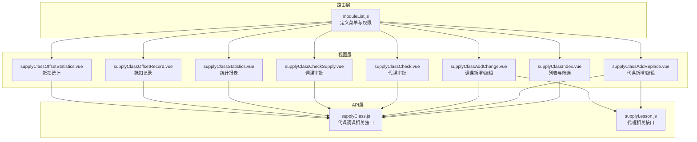
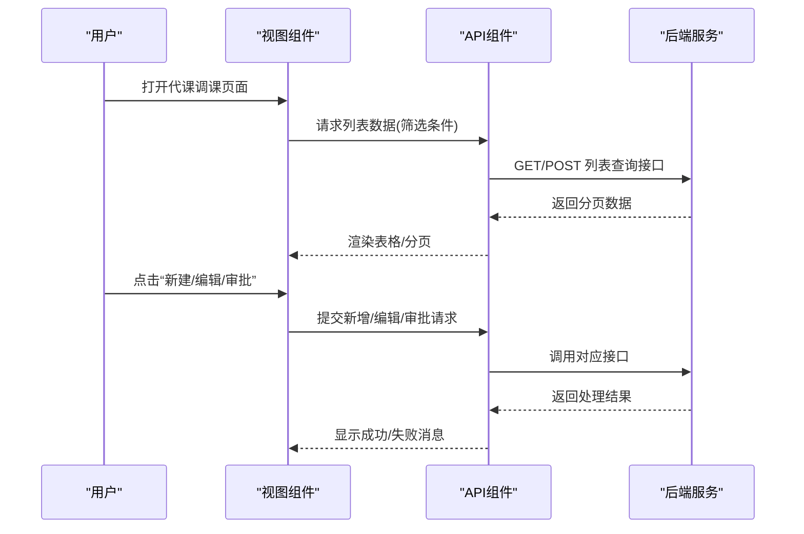
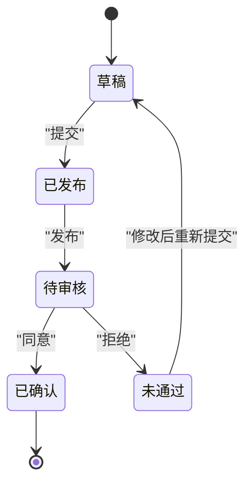
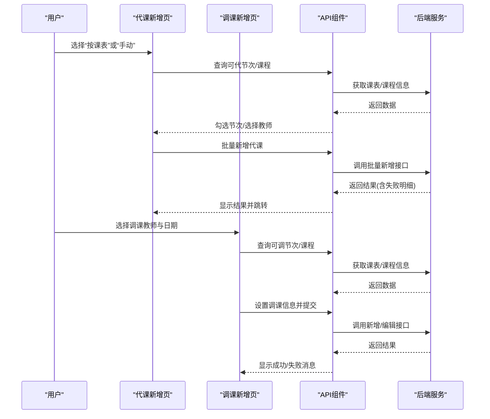
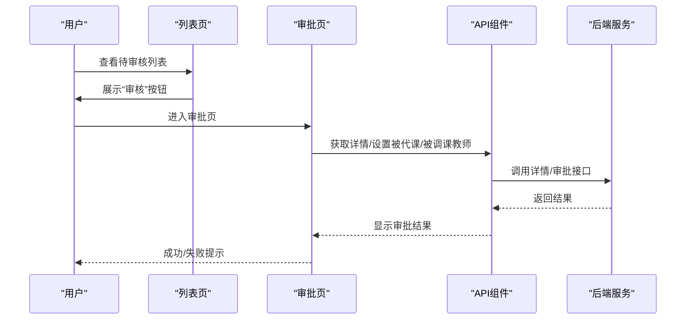
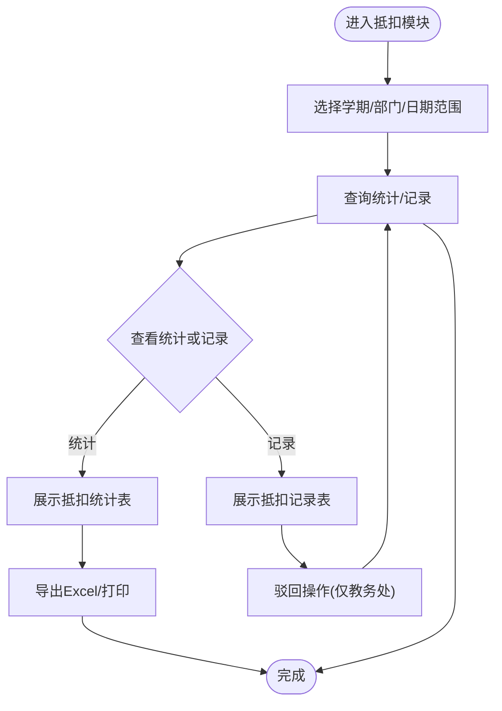
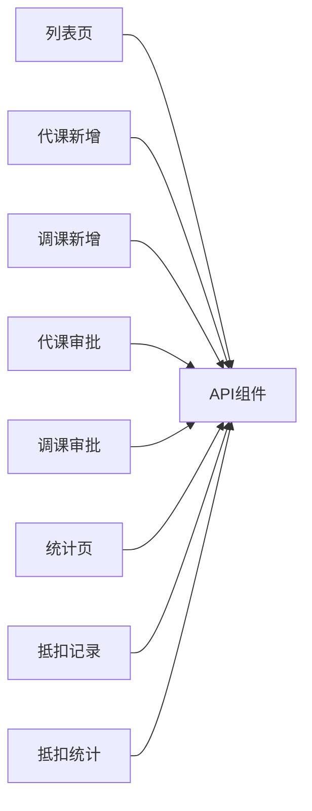

# 代课调课管理

<cite>
**本文档引用的文件**
- [supplyClass.js](file://src/api/supplyClass.js)
- [supplyLesson.js](file://src/api/supplyLesson.js)
- [supplyClassIndex.vue](file://src/views/supplyClass/supplyClassIndex.vue)
- [supplyClassAddReplace.vue](file://src/views/supplyClass/supplyClassAddReplace.vue)
- [supplyClassAddChange.vue](file://src/views/supplyClass/supplyClassAddChange.vue)
- [supplyClassCheck.vue](file://src/views/supplyClass/supplyClassCheck.vue)
- [supplyClassCheckSupply.vue](file://src/views/supplyClass/supplyClassCheckSupply.vue)
- [supplyClassStatistics.vue](file://src/views/supplyClass/supplyClassStatistics.vue)
- [supplyClassOffsetRecord.vue](file://src/views/supplyClass/supplyClassOffsetRecord.vue)
- [supplyClassOffsetStatistics.vue](file://src/views/supplyClass/supplyClassOffsetStatistics.vue)
- [moduleList.js](file://src/router/moduleList.js)
</cite>

## 目录
1. [简介](#简介)
2. [项目结构](#项目结构)
3. [核心组件](#核心组件)
4. [架构总览](#架构总览)
5. [详细组件分析](#详细组件分析)
6. [依赖关系分析](#依赖关系分析)
7. [性能考虑](#性能考虑)
8. [故障排除指南](#故障排除指南)
9. [结论](#结论)

## 简介
本技术文档围绕代课调课管理功能进行系统化梳理，覆盖代课申请、调课安排与审批流程的实现细节；文档化数据模型、状态管理与流程控制机制；详细说明抵扣统计、记录查询与报表生成；解释冲突检测、自动匹配与人工干预机制；并提供权限控制、通知提醒与异常处理的技术实现方案，以及统计分析、预警机制与优化建议。

## 项目结构
代课调课管理功能主要由以下层次构成：
- API 层：封装与后端交互的接口，包括列表查询、详情获取、审批、统计、抵扣等。
- 视图层：提供完整的前端页面，包括列表展示、新增/编辑、审批、统计与抵扣记录等。
- 路由层：定义模块入口与子路由，统一管理权限与导航。

图表来源
- [moduleList.js:521-537](file://src/router/moduleList.js#L521-L537)
- [supplyClass.js:1-482](file://src/api/supplyClass.js#L1-L482)
- [supplyLesson.js:1-173](file://src/api/supplyLesson.js#L1-L173)
- [supplyClassIndex.vue:1-458](file://src/views/supplyClass/supplyClassIndex.vue#L1-L458)
- [supplyClassAddReplace.vue:1-927](file://src/views/supplyClass/supplyClassAddReplace.vue#L1-L927)
- [supplyClassAddChange.vue:1-1003](file://src/views/supplyClass/supplyClassAddChange.vue#L1-L1003)
- [supplyClassCheck.vue:1-155](file://src/views/supplyClass/supplyClassCheck.vue#L1-L155)
- [supplyClassCheckSupply.vue:1-591](file://src/views/supplyClass/supplyClassCheckSupply.vue#L1-L591)
- [supplyClassStatistics.vue:1-170](file://src/views/supplyClass/supplyClassStatistics.vue#L1-L170)
- [supplyClassOffsetRecord.vue:1-383](file://src/views/supplyClass/supplyClassOffsetRecord.vue#L1-L383)
- [supplyClassOffsetStatistics.vue:1-268](file://src/views/supplyClass/supplyClassOffsetStatistics.vue#L1-L268)

章节来源
- [moduleList.js:521-537](file://src/router/moduleList.js#L521-L537)

## 核心组件
- 代课调课 API 组件（supplyClass.js）
  - 列表查询：支持按学期、日期范围、类型、状态、班级筛选，分页返回。
  - 详情获取：按 ID 获取单条记录详情。
  - 审批流程：支持同意/拒绝，可指定被代课/被调课教师。
  - 统计与报表：提供教师维度的代课/被代课统计、调课统计。
  - 抵扣管理：抵扣统计、抵扣记录、抵扣驳回。
  - 配置与联动：节次列表、按班级查询课程、按课表查询可代/可调节次、设置信息获取。
- 代班 API 组件（supplyLesson.js）
  - 代班统计、代班申请、代班列表查询、编辑、详情、删除、时间段内教师代班/被代班记录。
- 视图组件
  - 列表页：筛选器、分页、打印、导出、状态标签、操作列。
  - 新增/编辑页：选择方式（按课表/手动）、地址簿选择、节次勾选、手动添加、图片上传、抵扣条配置。
  - 审批页：审批意见、图片预览、同意/拒绝。
  - 统计与抵扣：按学期/部门筛选、分页、导出、驳回。

章节来源
- [supplyClass.js:1-482](file://src/api/supplyClass.js#L1-L482)
- [supplyLesson.js:1-173](file://src/api/supplyLesson.js#L1-L173)
- [supplyClassIndex.vue:1-458](file://src/views/supplyClass/supplyClassIndex.vue#L1-L458)
- [supplyClassAddReplace.vue:1-927](file://src/views/supplyClass/supplyClassAddReplace.vue#L1-L927)
- [supplyClassAddChange.vue:1-1003](file://src/views/supplyClass/supplyClassAddChange.vue#L1-L1003)
- [supplyClassCheck.vue:1-155](file://src/views/supplyClass/supplyClassCheck.vue#L1-L155)
- [supplyClassCheckSupply.vue:1-591](file://src/views/supplyClass/supplyClassCheckSupply.vue#L1-L591)
- [supplyClassStatistics.vue:1-170](file://src/views/supplyClass/supplyClassStatistics.vue#L1-L170)
- [supplyClassOffsetRecord.vue:1-383](file://src/views/supplyClass/supplyClassOffsetRecord.vue#L1-L383)
- [supplyClassOffsetStatistics.vue:1-268](file://src/views/supplyClass/supplyClassOffsetStatistics.vue#L1-L268)

## 架构总览
代课调课管理采用前后端分离架构，前端通过 API 组件统一调用后端接口，视图组件负责业务交互与数据展示，路由层统一管理模块入口与权限。

图表来源
- [supplyClass.js:19-36](file://src/api/supplyClass.js#L19-L36)
- [supplyClass.js:112-120](file://src/api/supplyClass.js#L112-L120)
- [supplyClass.js:126-149](file://src/api/supplyClass.js#L126-L149)
- [supplyClassIndex.vue:394-408](file://src/views/supplyClass/supplyClassIndex.vue#L394-L408)

## 详细组件分析

### 数据模型与状态管理
- 记录字段要点
  - 通用字段：ID、类型（代课/调课/其他）、状态（草稿/已发布/已确认/待审核/未通过/未发布）、日期、班级、节次、课程、教师信息、原因、图片、创建人类型、选择方式等。
  - 代课特有：被代课教师、可代班节次集合、抵扣条配置。
  - 调课特有：调课教师、目标被调课教师、目标日期/班级/节次/课程。
- 状态流转
  - 草稿 → 已发布/待审核（提交）→ 已确认/未通过（审批）。
  - 待审核 → 同意/拒绝（审批）→ 已确认/未通过。
- 冲突检测与自动匹配
  - 按课表查询可代/可调节次，避免重复占用。
  - 手动模式下支持批量添加节次，校验必填项与唯一性。
- 人工干预
  - 审批环节允许指定被代课/被调课教师，支持驳回与重新设置。

图表来源
- [supplyClass.js:126-149](file://src/api/supplyClass.js#L126-L149)
- [supplyClassCheck.vue:86-125](file://src/views/supplyClass/supplyClassCheck.vue#L86-L125)
- [supplyClassCheckSupply.vue:470-558](file://src/views/supplyClass/supplyClassCheckSupply.vue#L470-L558)

章节来源
- [supplyClass.js:126-149](file://src/api/supplyClass.js#L126-L149)
- [supplyClassAddReplace.vue:432-714](file://src/views/supplyClass/supplyClassAddReplace.vue#L432-L714)
- [supplyClassAddChange.vue:436-588](file://src/views/supplyClass/supplyClassAddChange.vue#L436-L588)
- [supplyClassCheck.vue:86-125](file://src/views/supplyClass/supplyClassCheck.vue#L86-L125)
- [supplyClassCheckSupply.vue:470-558](file://src/views/supplyClass/supplyClassCheckSupply.vue#L470-L558)

### 代课申请与调课安排
- 代课申请
  - 支持按课表自动选择与手动添加两种方式。
  - 自动模式：根据被代课教师与日期查询其课表，勾选可代节次并选择代课教师。
  - 手动模式：选择年级/班级/节次/课程，自动填充原任课教师，再选择代课教师。
  - 批量提交：支持批量新增，返回成功/失败明细。
- 调课安排
  - 调课教师与日期固定，目标被调课教师可按课表或手动选择。
  - 支持设置调课信息（日期、班级、节次、课程、教师），并进行审批。

图表来源
- [supplyClassAddReplace.vue:362-401](file://src/views/supplyClass/supplyClassAddReplace.vue#L362-L401)
- [supplyClassAddReplace.vue:548-711](file://src/views/supplyClass/supplyClassAddReplace.vue#L548-L711)
- [supplyClassAddChange.vue:307-370](file://src/views/supplyClass/supplyClassAddChange.vue#L307-L370)
- [supplyClassAddChange.vue:506-537](file://src/views/supplyClass/supplyClassAddChange.vue#L506-L537)

章节来源
- [supplyClassAddReplace.vue:1-927](file://src/views/supplyClass/supplyClassAddReplace.vue#L1-L927)
- [supplyClassAddChange.vue:1-1003](file://src/views/supplyClass/supplyClassAddChange.vue#L1-L1003)

### 审批流程与权限控制
- 审批入口
  - 列表页对“待审核”状态显示“审核”按钮。
  - 代课审批：可指定代课教师，填写审批意见。
  - 调课审批：可指定被调课教师，填写审批意见。
- 权限控制
  - 菜单权限：通过路由配置的 permissionPath 控制访问。
  - 角色判断：通过 possessRole 接口判断是否具备特定角色（如部门主任/教务处）。
  - 抵扣记录：根据角色显示“全部部门”或仅显示负责部门。

图表来源
- [supplyClassIndex.vue:137-148](file://src/views/supplyClass/supplyClassIndex.vue#L137-L148)
- [supplyClassCheck.vue:86-125](file://src/views/supplyClass/supplyClassCheck.vue#L86-L125)
- [supplyClassCheckSupply.vue:470-558](file://src/views/supplyClass/supplyClassCheckSupply.vue#L470-L558)
- [supplyClass.js:155-165](file://src/api/supplyClass.js#L155-L165)

章节来源
- [supplyClassIndex.vue:1-458](file://src/views/supplyClass/supplyClassIndex.vue#L1-L458)
- [supplyClassCheck.vue:1-155](file://src/views/supplyClass/supplyClassCheck.vue#L1-L155)
- [supplyClassCheckSupply.vue:1-591](file://src/views/supplyClass/supplyClassCheckSupply.vue#L1-L591)
- [supplyClass.js:155-165](file://src/api/supplyClass.js#L155-L165)

### 抵扣统计、记录查询与报表生成
- 抵扣统计
  - 按学期/部门筛选，展示教师代课条总数、已抵扣张数、抵扣时长、剩余张数。
- 抵扣记录
  - 按学期/部门/日期范围筛选，支持“不同意”驳回操作。
- 报表导出
  - 列表页支持打印与 Excel 导出；统计页支持打印与 Excel 导出。

图表来源
- [supplyClassOffsetStatistics.vue:177-206](file://src/views/supplyClass/supplyClassOffsetStatistics.vue#L177-L206)
- [supplyClassOffsetRecord.vue:232-280](file://src/views/supplyClass/supplyClassOffsetRecord.vue#L232-L280)
- [supplyClass.js:74-106](file://src/api/supplyClass.js#L74-L106)
- [supplyClass.js:155-165](file://src/api/supplyClass.js#L155-L165)

章节来源
- [supplyClassOffsetStatistics.vue:1-268](file://src/views/supplyClass/supplyClassOffsetStatistics.vue#L1-L268)
- [supplyClassOffsetRecord.vue:1-383](file://src/views/supplyClass/supplyClassOffsetRecord.vue#L1-L383)
- [supplyClass.js:74-106](file://src/api/supplyClass.js#L74-L106)
- [supplyClass.js:155-165](file://src/api/supplyClass.js#L155-L165)

### 冲突检测、自动匹配与人工干预
- 冲突检测
  - 按课表查询节次占用情况，避免重复安排。
  - 手动添加时检查重复节次，防止重复提交。
- 自动匹配
  - 自动模式下，根据教师与日期自动填充可代/可调节次。
- 人工干预
  - 审批环节可调整被代课/被调课教师，支持驳回与重新设置。

章节来源
- [supplyClassAddReplace.vue:290-344](file://src/views/supplyClass/supplyClassAddReplace.vue#L290-L344)
- [supplyClassAddChange.vue:380-426](file://src/views/supplyClass/supplyClassAddChange.vue#L380-L426)
- [supplyClassCheckSupply.vue:193-250](file://src/views/supplyClass/supplyClassCheckSupply.vue#L193-L250)

### 权限控制、通知提醒与异常处理
- 权限控制
  - 路由级权限：通过 permissionPath 控制菜单可见性。
  - 角色判断：通过 possessRole 判断是否具备部门主任/教务处等角色。
- 通知提醒
  - 审批意见必填（拒绝时）。
  - 操作成功/失败消息提示。
- 异常处理
  - 接口调用失败时统一提示与日志记录。
  - 批量提交返回失败明细，逐条展示失败原因。

章节来源
- [moduleList.js:521-537](file://src/router/moduleList.js#L521-L537)
- [supplyClass.js:155-165](file://src/api/supplyClass.js#L155-L165)
- [supplyClassCheck.vue:94-100](file://src/views/supplyClass/supplyClassCheck.vue#L94-L100)
- [supplyClassAddReplace.vue:567-577](file://src/views/supplyClass/supplyClassAddReplace.vue#L567-L577)

## 依赖关系分析
- 组件耦合
  - 视图组件高度依赖 API 组件提供的接口方法。
  - 审批页与新增/编辑页共享部分逻辑（如课表查询、课程查询）。
- 外部依赖
  - Element UI 表格、分页、对话框等组件库。
  - 上传组件用于图片上传，地址簿组件用于教师选择。
- 可能的循环依赖
  - 当前结构清晰，未发现循环依赖问题。

图表来源
- [supplyClassIndex.vue:1-458](file://src/views/supplyClass/supplyClassIndex.vue#L1-L458)
- [supplyClassAddReplace.vue:1-927](file://src/views/supplyClass/supplyClassAddReplace.vue#L1-L927)
- [supplyClassAddChange.vue:1-1003](file://src/views/supplyClass/supplyClassAddChange.vue#L1-L1003)
- [supplyClassCheck.vue:1-155](file://src/views/supplyClass/supplyClassCheck.vue#L1-L155)
- [supplyClassCheckSupply.vue:1-591](file://src/views/supplyClass/supplyClassCheckSupply.vue#L1-L591)
- [supplyClassStatistics.vue:1-170](file://src/views/supplyClass/supplyClassStatistics.vue#L1-L170)
- [supplyClassOffsetRecord.vue:1-383](file://src/views/supplyClass/supplyClassOffsetRecord.vue#L1-L383)
- [supplyClassOffsetStatistics.vue:1-268](file://src/views/supplyClass/supplyClassOffsetStatistics.vue#L1-L268)
- [supplyClass.js:1-482](file://src/api/supplyClass.js#L1-L482)

章节来源
- [supplyClass.js:1-482](file://src/api/supplyClass.js#L1-L482)

## 性能考虑
- 列表查询
  - 使用分页参数（pageNo/pageSize）避免一次性加载大量数据。
  - 筛选条件尽量精确，减少后端查询压力。
- 图片上传
  - 限制文件类型与大小，避免大文件影响加载速度。
- 批量操作
  - 批量新增时对失败明细进行汇总提示，避免频繁刷新。
- 前端缓存
  - 对常用数据（如节次列表、年级/班级/课程）进行本地缓存，减少重复请求。

## 故障排除指南
- 审批失败
  - 检查审批意见是否填写（拒绝时必填）。
  - 确认被代课/被调课教师是否选择。
- 批量提交失败
  - 查看失败明细，逐条修正后重试。
- 无法查看抵扣记录
  - 确认当前用户角色是否具备查看权限（部门主任/教务处）。
- 课表查询无数据
  - 检查教师与日期是否正确，确认课表是否存在对应节次。

章节来源
- [supplyClassCheck.vue:94-100](file://src/views/supplyClass/supplyClassCheck.vue#L94-L100)
- [supplyClassAddReplace.vue:567-577](file://src/views/supplyClass/supplyClassAddReplace.vue#L567-L577)
- [supplyClassOffsetRecord.vue:287-317](file://src/views/supplyClass/supplyClassOffsetRecord.vue#L287-L317)

## 结论
代课调课管理功能通过清晰的 API 封装与完善的视图组件，实现了从申请、审批到统计与抵扣的完整闭环。系统在冲突检测、自动匹配与人工干预方面提供了灵活的机制，并结合权限控制与异常处理保障了系统的稳定性与安全性。建议后续持续优化批量操作体验与报表导出功能，进一步提升用户体验与管理效率。