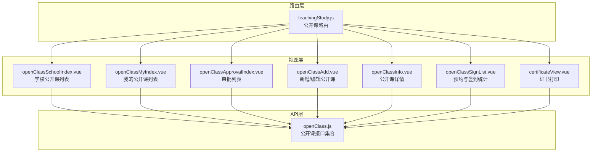
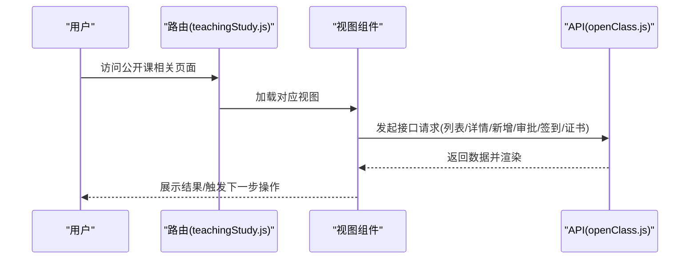
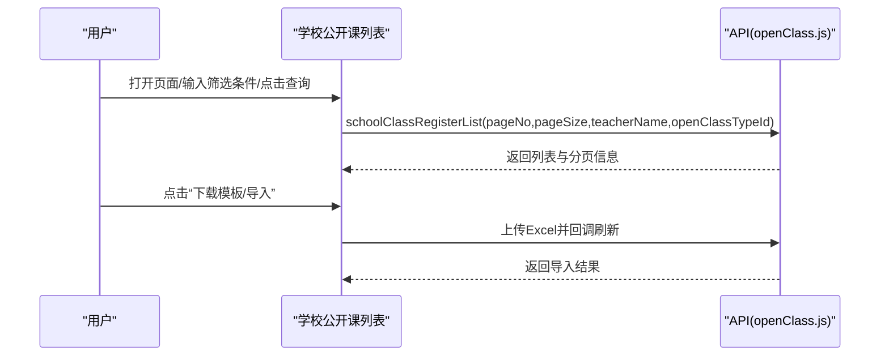
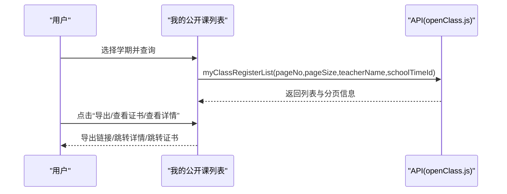
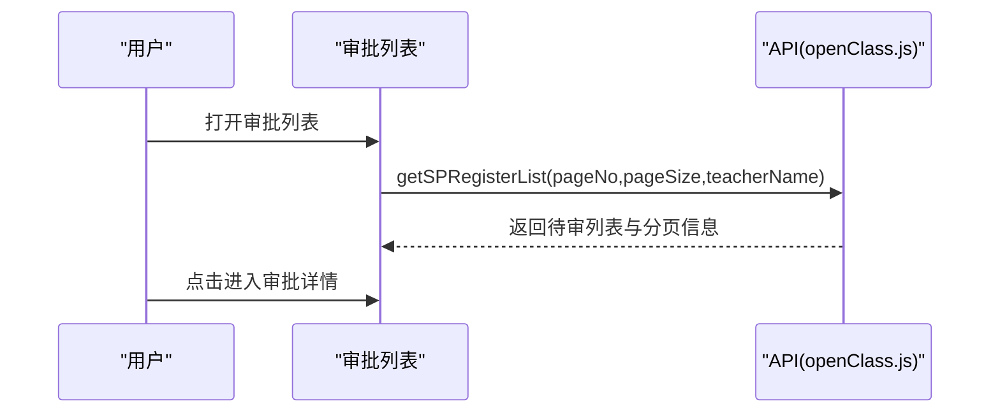
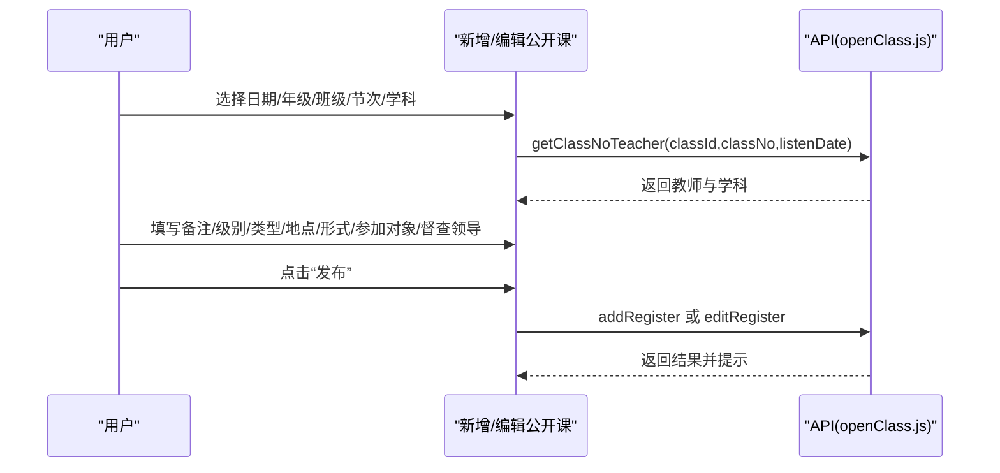
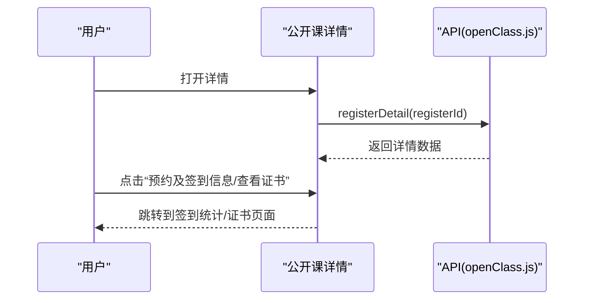
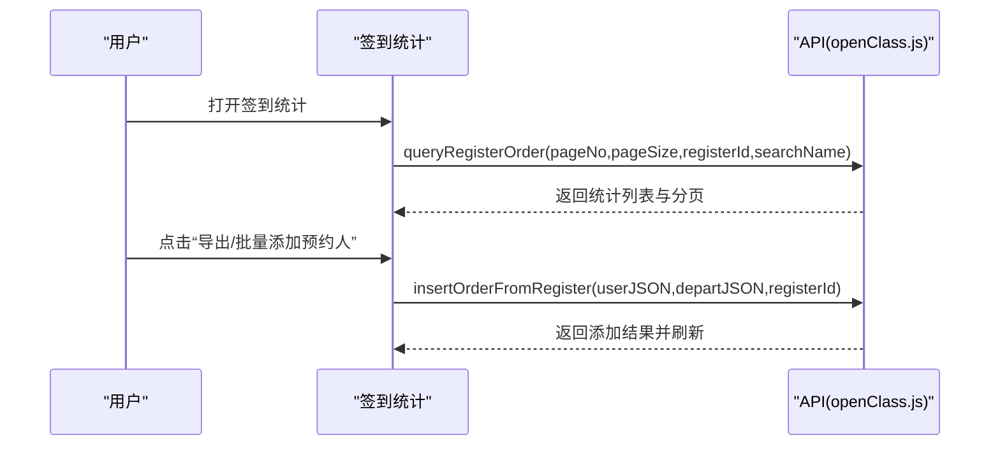
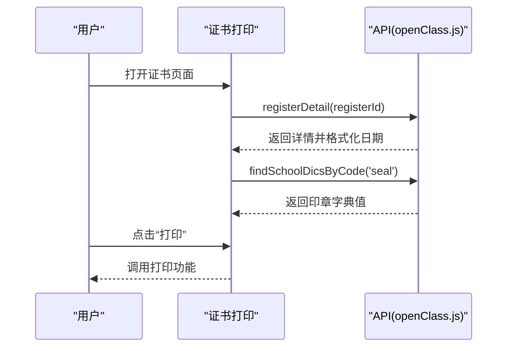
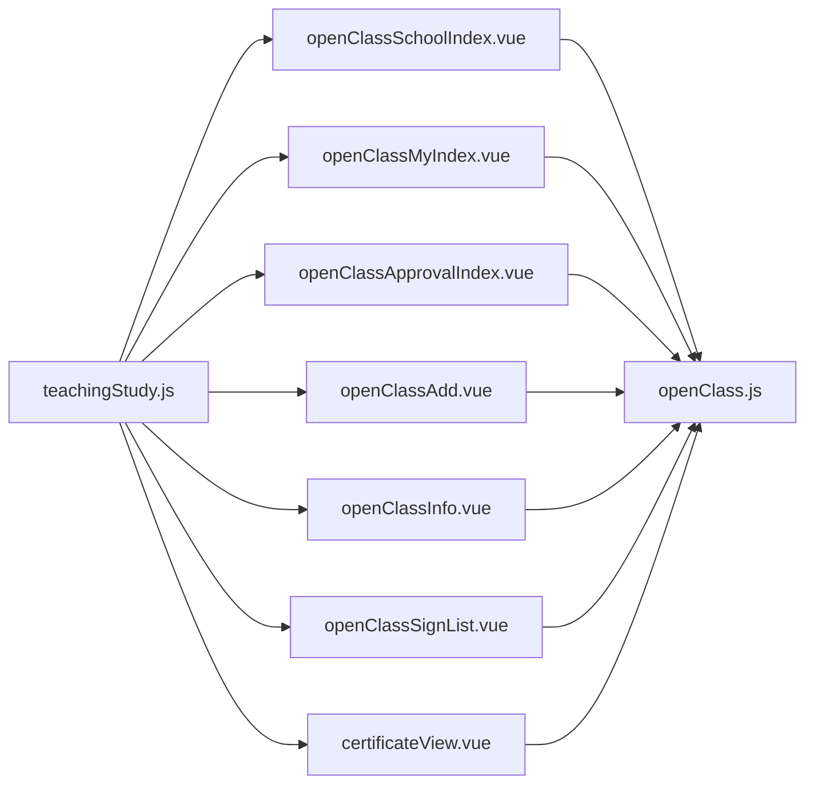

# 公开课管理

<cite>
**本文引用的文件**
- [openClass.js](file://src/api/teachingStudy/openClass.js)
- [teachingStudy.js](file://src/router/noraml/teachingStudy.js)
- [openClassSchoolIndex.vue](file://src/views/openClass/openClassSchoolIndex.vue)
- [openClassMyIndex.vue](file://src/views/openClass/openClassMyIndex.vue)
- [openClassApprovalIndex.vue](file://src/views/openClass/openClassApprovalIndex.vue)
- [openClassAdd.vue](file://src/views/openClass/openClassAdd.vue)
- [openClassInfo.vue](file://src/views/openClass/openClassInfo.vue)
- [openClassSignList.vue](file://src/views/openClass/openClassSignList.vue)
- [certificateView.vue](file://src/views/openClass/certificateView.vue)
</cite>

## 目录
1. [简介](#简介)
2. [项目结构](#项目结构)
3. [核心组件](#核心组件)
4. [架构总览](#架构总览)
5. [详细组件分析](#详细组件分析)
6. [依赖关系分析](#依赖关系分析)
7. [性能考虑](#性能考虑)
8. [故障排查指南](#故障排查指南)
9. [结论](#结论)
10. [附录](#附录)

## 简介
本技术文档围绕“公开课管理”功能进行全面解析，覆盖公开课的发布、报名、评审与展示全流程，并深入说明内容审核、参与统计与效果评估的数据管理机制。文档还涵盖权限控制、通知机制与结果应用、配置项、统计分析与报告生成的技术实现，以及公开课质量分析与改进建议的分析能力。

## 项目结构
公开课管理功能由三层组成：
- API 层：封装与后端交互的接口方法，统一处理请求与响应。
- 视图层：提供学校公开课、我的公开课、审批、详情、签到与证书等页面。
- 路由层：定义页面访问路径与跳转规则，串联各视图组件。

图表来源
- [teachingStudy.js:278-312](file://src/router/noraml/teachingStudy.js#L278-L312)
- [openClassSchoolIndex.vue:1-265](file://src/views/openClass/openClassSchoolIndex.vue#L1-L265)
- [openClassMyIndex.vue:1-254](file://src/views/openClass/openClassMyIndex.vue#L1-L254)
- [openClassApprovalIndex.vue:1-161](file://src/views/openClass/openClassApprovalIndex.vue#L1-L161)
- [openClassAdd.vue:1-576](file://src/views/openClass/openClassAdd.vue#L1-L576)
- [openClassInfo.vue:1-226](file://src/views/openClass/openClassInfo.vue#L1-L226)
- [openClassSignList.vue:1-151](file://src/views/openClass/openClassSignList.vue#L1-L151)
- [certificateView.vue:1-142](file://src/views/openClass/certificateView.vue#L1-L142)
- [openClass.js:1-419](file://src/api/teachingStudy/openClass.js#L1-L419)

章节来源
- [teachingStudy.js:278-312](file://src/router/noraml/teachingStudy.js#L278-L312)

## 核心组件
- 公开课接口集合：提供列表查询、详情、新增/编辑、审批、预约与签到、证书生成、字典查询等能力。
- 页面组件：负责业务交互、数据渲染与权限控制，如学校公开课列表、我的公开课列表、审批列表、新增/编辑、详情、签到统计、证书打印。
- 路由配置：定义页面路径与跳转，支撑从列表到详情、从新增到审批、从详情到签到与证书打印的导航。

章节来源
- [openClass.js:1-419](file://src/api/teachingStudy/openClass.js#L1-L419)
- [openClassSchoolIndex.vue:1-265](file://src/views/openClass/openClassSchoolIndex.vue#L1-L265)
- [openClassMyIndex.vue:1-254](file://src/views/openClass/openClassMyIndex.vue#L1-L254)
- [openClassApprovalIndex.vue:1-161](file://src/views/openClass/openClassApprovalIndex.vue#L1-L161)
- [openClassAdd.vue:1-576](file://src/views/openClass/openClassAdd.vue#L1-L576)
- [openClassInfo.vue:1-226](file://src/views/openClass/openClassInfo.vue#L1-L226)
- [openClassSignList.vue:1-151](file://src/views/openClass/openClassSignList.vue#L1-L151)
- [certificateView.vue:1-142](file://src/views/openClass/certificateView.vue#L1-L142)

## 架构总览
公开课管理采用前后端分离架构，前端通过 API 层统一调用后端接口，页面组件负责渲染与交互，路由层组织页面导航。

图表来源
- [teachingStudy.js:278-312](file://src/router/noraml/teachingStudy.js#L278-L312)
- [openClass.js:1-419](file://src/api/teachingStudy/openClass.js#L1-L419)

## 详细组件分析

### 公开课接口集合（API）
- 列表查询
  - 学校公开课列表：按分页、教师名、类型筛选。
  - 我的公开课列表：按分页、教师名、学期筛选。
  - 审批列表：按分页、教师名筛选。
- 详情与字典
  - 详情：根据注册ID获取公开课详情。
  - 字典：按编码查询字典值（如公开课类型）。
- 新增/编辑
  - 新增/编辑已发布公开课：提交课程基本信息、主讲人、地点、级别、类型、备注等。
  - 新增/编辑我的公开课：提交课程基本信息与审核人信息。
- 审批
  - 审批公开课：提交审批意见与状态。
- 预约与签到
  - 预约与登记记录：按分页与搜索条件查询预约/签到情况。
  - 批量添加预约人：支持部门/用户选择后批量插入。
- 证书与导出
  - 证书视图：根据注册ID获取详情并渲染证书模板。
  - 导出：提供列表与签到统计的导出链接。
- 其他
  - 节次列表、节次带出教师与学科、年级与班级、课程列表、学期列表等辅助查询。

章节来源
- [openClass.js:26-419](file://src/api/teachingStudy/openClass.js#L26-L419)

### 学校公开课列表（openClassSchoolIndex.vue）
- 功能要点
  - 支持按公开课类型与主讲人筛选。
  - 分页加载与权限控制（新建公开课按钮）。
  - 查看证书入口（满足截止时间与有课题时显示）。
  - 模板下载与 Excel 导入（上传至指定地址并回调刷新列表）。
- 数据流
  - 初始化加载列表与字典。
  - 查询时携带分页参数与筛选条件。
  - 导入成功后刷新列表。

图表来源
- [openClassSchoolIndex.vue:121-212](file://src/views/openClass/openClassSchoolIndex.vue#L121-L212)
- [openClass.js:26-38](file://src/api/teachingStudy/openClass.js#L26-L38)

章节来源
- [openClassSchoolIndex.vue:1-265](file://src/views/openClass/openClassSchoolIndex.vue#L1-L265)

### 我的公开课列表（openClassMyIndex.vue）
- 功能要点
  - 选择学期后查询我的公开课列表。
  - 根据状态跳转到详情、编辑或审批详情。
  - 支持导出当前列表。
  - 查看证书入口（满足截止时间与有课题且已发布时显示）。
- 数据流
  - 初始化加载学期列表并默认当前学期。
  - 查询时携带分页参数与学期ID。

图表来源
- [openClassMyIndex.vue:110-200](file://src/views/openClass/openClassMyIndex.vue#L110-L200)
- [openClass.js:43-54](file://src/api/teachingStudy/openClass.js#L43-L54)

章节来源
- [openClassMyIndex.vue:1-254](file://src/views/openClass/openClassMyIndex.vue#L1-L254)

### 审批列表（openClassApprovalIndex.vue）
- 功能要点
  - 展示待审公开课列表，按状态标识。
  - 跳转到审批详情页。
- 数据流
  - 查询审批列表并分页展示。

图表来源
- [openClassApprovalIndex.vue:80-113](file://src/views/openClass/openClassApprovalIndex.vue#L80-L113)
- [openClass.js:59-70](file://src/api/teachingStudy/openClass.js#L59-L70)

章节来源
- [openClassApprovalIndex.vue:1-161](file://src/views/openClass/openClassApprovalIndex.vue#L1-L161)

### 新增/编辑公开课（openClassAdd.vue）
- 功能要点
  - 日期选择器限制在当前学期的工作日范围内。
  - 年级/班级联动，学科列表按班级动态加载。
  - 节次选择联动带出教师与学科。
  - 主讲人选择器支持多选，最终以 JSON 提交。
  - 新增/编辑提交时统一走新增/编辑接口。
- 数据流
  - 初始化：加载学期、字典、节次、年级/班级、学科。
  - 选择节次/日期/班级联动查询教师与学科。
  - 提交时构造完整参数并调用新增/编辑接口。

图表来源
- [openClassAdd.vue:221-453](file://src/views/openClass/openClassAdd.vue#L221-L453)
- [openClass.js:185-248](file://src/api/teachingStudy/openClass.js#L185-L248)

章节来源
- [openClassAdd.vue:1-576](file://src/views/openClass/openClassAdd.vue#L1-L576)

### 公开课详情（openClassInfo.vue）
- 功能要点
  - 展示公开课基本信息（时间、班级、主讲人、学科、课题、地点、级别、类型、形式、参加对象、督查领导、备注）。
  - 权限控制：仅在满足条件时显示“预约及签到信息”与“查看证书”按钮。
  - 显示签到二维码（满足条件时）。
- 数据流
  - 加载详情并判断是否具备相应权限。
  - 跳转到签到统计或证书页面。

图表来源
- [openClassInfo.vue:145-189](file://src/views/openClass/openClassInfo.vue#L145-L189)
- [openClass.js:84-93](file://src/api/teachingStudy/openClass.js#L84-L93)

章节来源
- [openClassInfo.vue:1-226](file://src/views/openClass/openClassInfo.vue#L1-L226)

### 预约与签到统计（openClassSignList.vue）
- 功能要点
  - 展示预约与签到情况，支持导出。
  - 学校管理场景下可批量添加预约人（支持部门与用户选择）。
- 数据流
  - 分页查询预约与签到统计。
  - 批量添加预约人后刷新列表。

图表来源
- [openClassSignList.vue:77-138](file://src/views/openClass/openClassSignList.vue#L77-L138)
- [openClass.js:98-110](file://src/api/teachingStudy/openClass.js#L98-L110)
- [openClass.js:390-401](file://src/api/teachingStudy/openClass.js#L390-L401)

章节来源
- [openClassSignList.vue:1-151](file://src/views/openClass/openClassSignList.vue#L1-L151)

### 证书打印（certificateView.vue）
- 功能要点
  - 根据注册ID获取详情并渲染证书模板。
  - 支持打印与图片水印（印章字典值）。
- 数据流
  - 加载详情并替换日期格式。
  - 获取印章字典值用于水印。

图表来源
- [certificateView.vue:33-68](file://src/views/openClass/certificateView.vue#L33-L68)
- [openClass.js:84-93](file://src/api/teachingStudy/openClass.js#L84-L93)
- [openClass.js:71-80](file://src/api/teachingStudy/openClass.js#L71-L80)

章节来源
- [certificateView.vue:1-142](file://src/views/openClass/certificateView.vue#L1-L142)

## 依赖关系分析
- 路由到视图：路由文件定义了公开课相关页面路径，视图组件按需加载。
- 视图到 API：各视图组件通过 openClass.js 统一调用后端接口，职责清晰。
- 权限控制：部分页面按钮与功能受权限控制（如“新建公开课”、“查看证书”、“批量添加预约人”），通过工具函数进行判断。
- 数据耦合：视图组件之间通过路由参数传递 ID 与状态，减少直接耦合。

图表来源
- [teachingStudy.js:278-312](file://src/router/noraml/teachingStudy.js#L278-L312)
- [openClass.js:1-419](file://src/api/teachingStudy/openClass.js#L1-L419)

章节来源
- [teachingStudy.js:278-312](file://src/router/noraml/teachingStudy.js#L278-L312)

## 性能考虑
- 列表分页：所有列表均采用分页加载，避免一次性传输大量数据。
- 条件筛选：在查询时传入筛选条件，减少后端压力。
- 图片与导出：证书打印使用图片水印，导出采用服务端生成链接，降低前端计算负担。
- 日期选择：通过学期工作日限制日期选择，减少无效请求。

## 故障排查指南
- 列表为空或筛选无结果
  - 检查筛选条件与分页参数是否正确传递。
  - 确认后端接口返回码与数据结构一致。
- 无法添加预约人
  - 确认选择了用户或部门。
  - 检查接口返回结果与错误提示。
- 证书打印异常
  - 确认详情数据已加载完成。
  - 检查印章字典值是否存在。
- 导入失败
  - 确认上传文件格式与大小符合要求。
  - 检查上传地址与 Token 是否正确。

章节来源
- [openClassSignList.vue:82-108](file://src/views/openClass/openClassSignList.vue#L82-L108)
- [certificateView.vue:35-41](file://src/views/openClass/certificateView.vue#L35-L41)
- [openClassSchoolIndex.vue:126-137](file://src/views/openClass/openClassSchoolIndex.vue#L126-L137)

## 结论
公开课管理功能通过清晰的路由与视图划分、统一的 API 接口与完善的权限控制，实现了从发布、报名、评审到展示的全链路闭环。结合预约与签到统计、证书打印与导出能力，满足了日常管理与效果评估需求。建议后续在数据可视化与质量分析方面进一步增强，以支持更深入的效果评估与改进建议。

## 附录
- 配置项
  - 公开课类型字典：通过字典编码查询。
  - 学期列表：用于我的公开课筛选。
  - 印章字典：用于证书水印。
- 统计分析与报告
  - 列表导出：支持导出公开课列表与签到统计。
  - 质量分析与改进建议：建议在现有基础上扩展听课记录评价设置与统计图表，形成闭环分析。