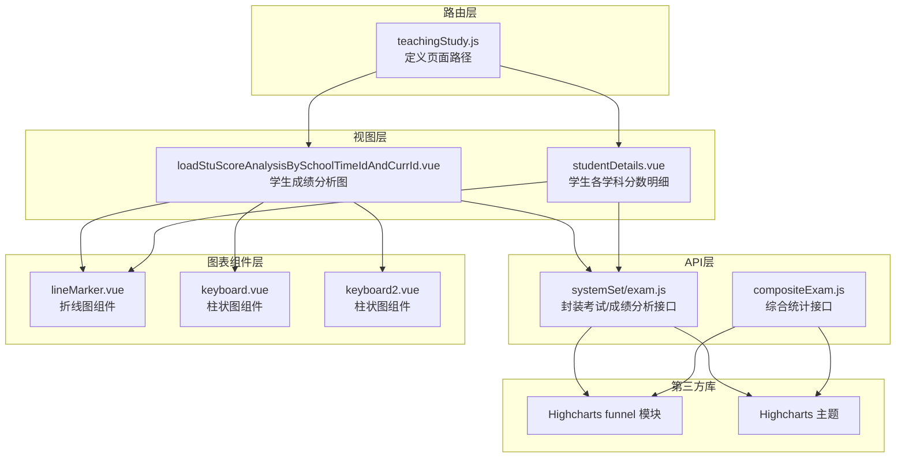
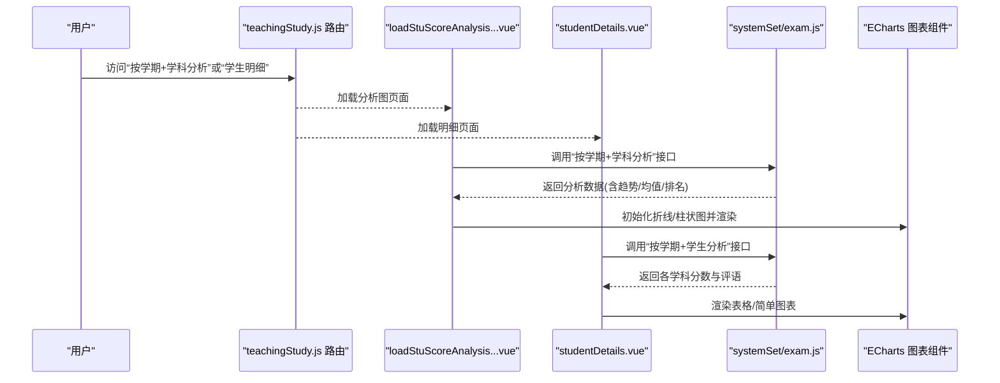
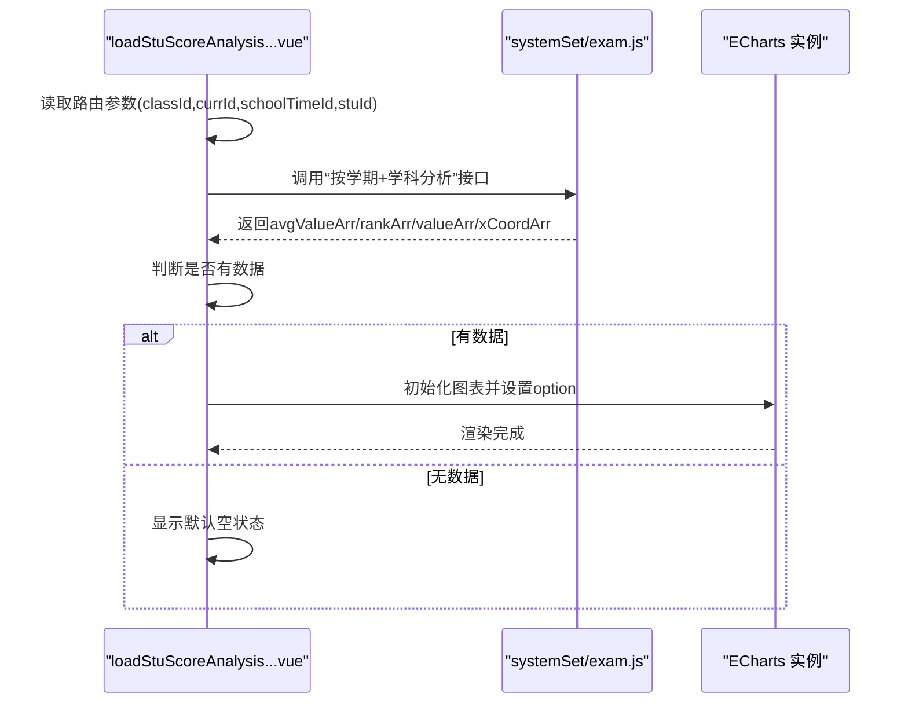
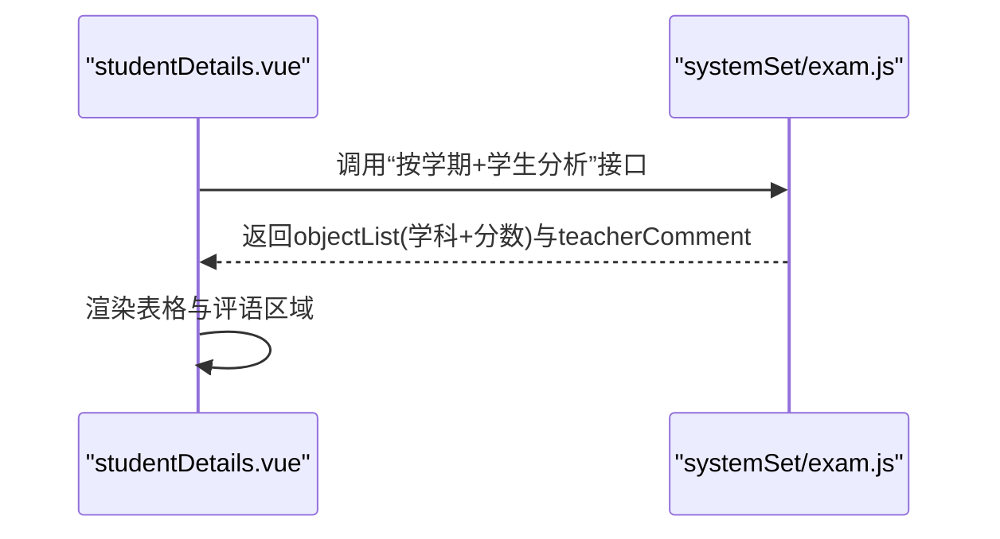
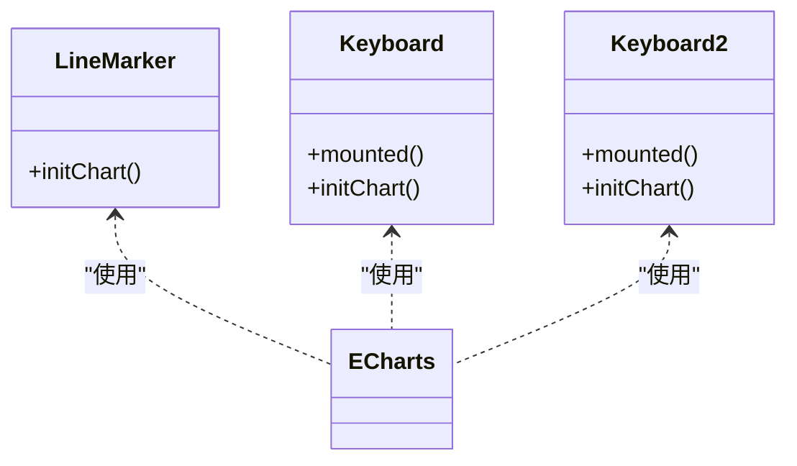
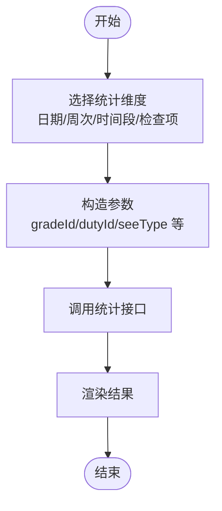
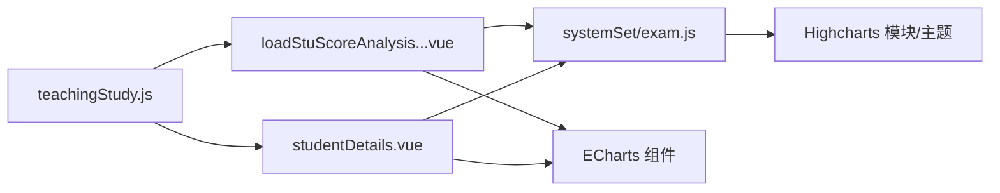

# 成绩分析统计

<cite>
**本文引用的文件**
- [src/api/systemSet/exam.js](file://src/api/systemSet/exam.js)
- [src/views/exam/loadStuScoreAnalysisBySchoolTimeIdAndCurrId.vue](file://src/views/exam/loadStuScoreAnalysisBySchoolTimeIdAndCurrId.vue)
- [src/views/exam/studentDetails.vue](file://src/views/exam/studentDetails.vue)
- [src/router/normal/teachingStudy.js](file://src/router/normal/teachingStudy.js)
- [src/components/Charts/lineMarker.vue](file://src/components/Charts/lineMarker.vue)
- [src/components/Charts/keyboard.vue](file://src/components/Charts/keyboard.vue)
- [src/components/Charts/keyboard2.vue](file://src/components/Charts/keyboard2.vue)
- [src/api/compositeExam.js](file://src/api/compositeExam.js)
- [static/ueditor1_4_3_3/third-party/highcharts/modules/funnel.src.js](file://static/ueditor1_4_3_3/third-party/highcharts/modules/funnel.src.js)
- [static/ueditor1_4_3_3/third-party/highcharts/themes/grid.js](file://static/ueditor1_4_3_3/third-party/highcharts/themes/grid.js)
</cite>

## 目录
1. [引言](#引言)
2. [项目结构](#项目结构)
3. [核心组件](#核心组件)
4. [架构总览](#架构总览)
5. [详细组件分析](#详细组件分析)
6. [依赖关系分析](#依赖关系分析)
7. [性能考虑](#性能考虑)
8. [故障排查指南](#故障排查指南)
9. [结论](#结论)
10. [附录](#附录)

## 引言
本技术文档围绕“成绩分析统计”功能展开，系统性阐述成绩数据的统计分析算法与可视化实现，覆盖班级/年级排名、学科对比、趋势分析等关键场景；同时对成绩分布图、雷达图、柱状图等图表组件进行代码级解析，并明确平均分、及格率、优秀率等指标的计算来源与流程。文档还提供个性化报告生成、学习轨迹分析与预警机制的实现思路，以及大数据量处理、缓存策略与性能优化的最佳实践。

## 项目结构
本功能涉及三层：前端路由与页面、API 层封装、图表组件层。核心入口包括：
- 路由：定义了“按学期+学科的成绩分析”“学生明细”等页面路径
- 视图：加载学生成绩分析图与学生各学科分数明细
- API：封装与后端交互的接口，如“按学期+学科分析”“按学期+学生分析”
- 图表：基于 ECharts 的通用折线/柱状/混合图组件

**图表来源**
- [src/router/normal/teachingStudy.js:177-211](file://src/router/normal/teachingStudy.js#L177-L211)
- [src/views/exam/loadStuScoreAnalysisBySchoolTimeIdAndCurrId.vue:1-143](file://src/views/exam/loadStuScoreAnalysisBySchoolTimeIdAndCurrId.vue#L1-L143)
- [src/views/exam/studentDetails.vue:1-90](file://src/views/exam/studentDetails.vue#L1-L90)
- [src/api/systemSet/exam.js:256-324](file://src/api/systemSet/exam.js#L256-L324)
- [src/api/compositeExam.js:1-142](file://src/api/compositeExam.js#L1-L142)
- [src/components/Charts/lineMarker.vue:1-53](file://src/components/Charts/lineMarker.vue#L1-L53)
- [src/components/Charts/keyboard.vue:92-112](file://src/components/Charts/keyboard.vue#L92-L112)
- [src/components/Charts/keyboard2.vue:48-149](file://src/components/Charts/keyboard2.vue#L48-L149)
- [static/ueditor1_4_3_3/third-party/highcharts/modules/funnel.src.js:122-187](file://static/ueditor1_4_3_3/third-party/highcharts/modules/funnel.src.js#L122-L187)
- [static/ueditor1_4_3_3/third-party/highcharts/themes/grid.js:76-103](file://static/ueditor1_4_3_3/third-party/highcharts/themes/grid.js#L76-L103)

**章节来源**
- [src/router/normal/teachingStudy.js:177-211](file://src/router/normal/teachingStudy.js#L177-L211)

## 核心组件
- 路由与页面
  - “按学期+学科”的学生成绩分析图页面
  - “学生各学科分数明细”页面
- API 封装
  - 成绩分析接口：按学期+学科/按学期+学生维度返回分析数据
  - 成绩查询接口：按学期+班级+学科获取学生成绩列表
- 图表组件
  - 折线/柱状/混合图组件，用于展示趋势、分布与对比

**章节来源**
- [src/views/exam/loadStuScoreAnalysisBySchoolTimeIdAndCurrId.vue:13-69](file://src/views/exam/loadStuScoreAnalysisBySchoolTimeIdAndCurrId.vue#L13-L69)
- [src/views/exam/studentDetails.vue:41-63](file://src/views/exam/studentDetails.vue#L41-L63)
- [src/api/systemSet/exam.js:256-324](file://src/api/systemSet/exam.js#L256-L324)

## 架构总览
下图展示了从路由到视图、API、图表组件与第三方库的整体调用链路。

**图表来源**
- [src/router/normal/teachingStudy.js:177-211](file://src/router/normal/teachingStudy.js#L177-L211)
- [src/views/exam/loadStuScoreAnalysisBySchoolTimeIdAndCurrId.vue:51-69](file://src/views/exam/loadStuScoreAnalysisBySchoolTimeIdAndCurrId.vue#L51-L69)
- [src/views/exam/studentDetails.vue:57-62](file://src/views/exam/studentDetails.vue#L57-L62)
- [src/api/systemSet/exam.js:256-324](file://src/api/systemSet/exam.js#L256-L324)

## 详细组件分析

### 组件A：学生成绩分析图（按学期+学科）
该组件通过路由进入，拉取分析数据并渲染折线/柱状混合图，展示“成绩/平均分/排名”的趋势变化。

**图表来源**
- [src/views/exam/loadStuScoreAnalysisBySchoolTimeIdAndCurrId.vue:42-69](file://src/views/exam/loadStuScoreAnalysisBySchoolTimeIdAndCurrId.vue#L42-L69)
- [src/api/systemSet/exam.js:288-299](file://src/api/systemSet/exam.js#L288-L299)

**章节来源**
- [src/views/exam/loadStuScoreAnalysisBySchoolTimeIdAndCurrId.vue:71-134](file://src/views/exam/loadStuScoreAnalysisBySchoolTimeIdAndCurrId.vue#L71-L134)

#### 数据结构与复杂度
- 输入：按学期+班级+学科+学生标识
- 输出：趋势数组（x 坐标、成绩、平均分、排名）
- 时间复杂度：O(n)，n 为时间点数量；空间复杂度 O(n)

#### 错误处理与边界
- 当返回数组为空时，显示默认空状态
- 图表初始化失败时需捕获异常并提示

### 组件B：学生各学科分数明细
该组件展示学生在某一学期各学科的平时分、期中分、期末分，并支持查看班主任评语。

**图表来源**
- [src/views/exam/studentDetails.vue:54-63](file://src/views/exam/studentDetails.vue#L54-L63)
- [src/api/systemSet/exam.js:341-350](file://src/api/systemSet/exam.js#L341-L350)

**章节来源**
- [src/views/exam/studentDetails.vue:39-64](file://src/views/exam/studentDetails.vue#L39-L64)

### 组件C：图表组件（折线/柱状/混合）
- 折线图组件：提供基础折线配置与主题
- 柱状图组件：提供基础柱状配置与动画效果
- 通用配置：背景色、坐标轴、图例、提示框等

**图表来源**
- [src/components/Charts/lineMarker.vue:36-53](file://src/components/Charts/lineMarker.vue#L36-L53)
- [src/components/Charts/keyboard.vue:92-112](file://src/components/Charts/keyboard.vue#L92-L112)
- [src/components/Charts/keyboard2.vue:48-149](file://src/components/Charts/keyboard2.vue#L48-L149)

**章节来源**
- [src/components/Charts/lineMarker.vue:1-53](file://src/components/Charts/lineMarker.vue#L1-L53)
- [src/components/Charts/keyboard.vue:92-112](file://src/components/Charts/keyboard.vue#L92-L112)
- [src/components/Charts/keyboard2.vue:48-149](file://src/components/Charts/keyboard2.vue#L48-L149)

### 组件D：综合统计接口（按日期/周次/时间段/检查项）
该模块提供综合检查类统计能力，可作为“趋势分析”的扩展能力，支持按多种维度聚合。

**图表来源**
- [src/api/compositeExam.js:14-84](file://src/api/compositeExam.js#L14-L84)

**章节来源**
- [src/api/compositeExam.js:1-142](file://src/api/compositeExam.js#L1-L142)

## 依赖关系分析
- 页面依赖路由定义的路径
- 页面依赖 API 封装的接口
- 图表组件依赖 ECharts 库
- 第三方 Highcharts 模块与主题用于高级图表（如漏斗图）

**图表来源**
- [src/router/normal/teachingStudy.js:177-211](file://src/router/normal/teachingStudy.js#L177-L211)
- [src/views/exam/loadStuScoreAnalysisBySchoolTimeIdAndCurrId.vue:13-25](file://src/views/exam/loadStuScoreAnalysisBySchoolTimeIdAndCurrId.vue#L13-L25)
- [src/views/exam/studentDetails.vue:41-46](file://src/views/exam/studentDetails.vue#L41-L46)
- [src/api/systemSet/exam.js:256-324](file://src/api/systemSet/exam.js#L256-L324)
- [static/ueditor1_4_3_3/third-party/highcharts/modules/funnel.src.js:122-187](file://static/ueditor1_4_3_3/third-party/highcharts/modules/funnel.src.js#L122-L187)
- [static/ueditor1_4_3_3/third-party/highcharts/themes/grid.js:76-103](file://static/ueditor1_4_3_3/third-party/highcharts/themes/grid.js#L76-L103)

**章节来源**
- [src/router/normal/teachingStudy.js:177-211](file://src/router/normal/teachingStudy.js#L177-L211)
- [src/api/systemSet/exam.js:256-324](file://src/api/systemSet/exam.js#L256-L324)

## 性能考虑
- 大数据量处理
  - 分页与分段加载：对“按学期+班级+学科”的学生成绩列表采用分页参数，避免一次性传输过多数据
  - 按时间窗口聚合：趋势分析按周/月/时间段切片，降低渲染节点数
- 图表渲染优化
  - 懒加载：仅在页面创建时初始化图表，避免重复实例化
  - 动画节流：图表组件提供动画延迟配置，减少大规模重绘
- 缓存策略
  - 同一学期+班级+学科的分析结果可短期缓存，键值为组合参数
  - 频繁访问的静态配置（如等级阈值）可在应用启动时缓存
- 网络与并发
  - 并发控制：同一页面内多个请求应限制并发数，避免阻塞
  - 请求合并：对相近时间段的多次请求可合并为一次

## 故障排查指南
- 空数据与默认页
  - 若分析数据为空，页面会显示默认空状态，请检查参数与后端返回
- 图表不显示
  - 确认容器高度与 ECharts 初始化时机
  - 检查坐标轴范围与数据格式
- 接口报错
  - 校验必填参数（学期、班级、学科、学生）
  - 查看网络面板与后端日志定位错误

**章节来源**
- [src/views/exam/loadStuScoreAnalysisBySchoolTimeIdAndCurrId.vue:62-69](file://src/views/exam/loadStuScoreAnalysisBySchoolTimeIdAndCurrId.vue#L62-L69)
- [src/views/exam/studentDetails.vue:57-62](file://src/views/exam/studentDetails.vue#L57-L62)

## 结论
本功能以“按学期+学科/按学期+学生”为核心分析维度，结合 ECharts 图表组件实现趋势、分布与对比展示。通过接口封装与页面解耦，具备良好的扩展性与可维护性。建议后续完善“班级/年级排名”“学科对比”“雷达图”等能力，并引入缓存与分页策略以支撑更大规模数据。

## 附录

### 统计指标与计算逻辑
- 平均分
  - 公式：各分数之和除以人数
  - 数据来源：按学期+学科/按学期+学生的分析接口返回的均值序列
- 及格率/优秀率
  - 及格率：达到及格线的人数占比
  - 优秀率：达到优秀线的人数占比
  - 数据来源：按学期+学科的分布统计（可由分析接口返回区间频次）
- 班级/年级排名
  - 计算方式：按分数降序排序，相同分数名次并列
  - 数据来源：分析接口返回的排名序列

**章节来源**
- [src/api/systemSet/exam.js:256-324](file://src/api/systemSet/exam.js#L256-L324)

### 可视化组件清单
- 折线图组件：用于趋势展示
- 柱状图组件：用于分布与对比
- 混合图组件：在同一图中叠加不同度量（如成绩+排名）

**章节来源**
- [src/components/Charts/lineMarker.vue:1-53](file://src/components/Charts/lineMarker.vue#L1-L53)
- [src/components/Charts/keyboard.vue:92-112](file://src/components/Charts/keyboard.vue#L92-L112)
- [src/components/Charts/keyboard2.vue:48-149](file://src/components/Charts/keyboard2.vue#L48-L149)

### 高级图表参考
- 漏斗图模块：可用于展示通过率/转化率等
- Highcharts 主题：统一图表风格与配色

**章节来源**
- [static/ueditor1_4_3_3/third-party/highcharts/modules/funnel.src.js:122-187](file://static/ueditor1_4_3_3/third-party/highcharts/modules/funnel.src.js#L122-L187)
- [static/ueditor1_4_3_3/third-party/highcharts/themes/grid.js:76-103](file://static/ueditor1_4_3_3/third-party/highcharts/themes/grid.js#L76-L103)