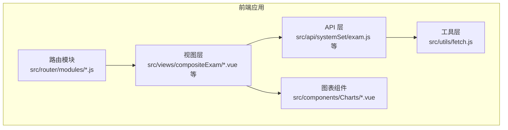
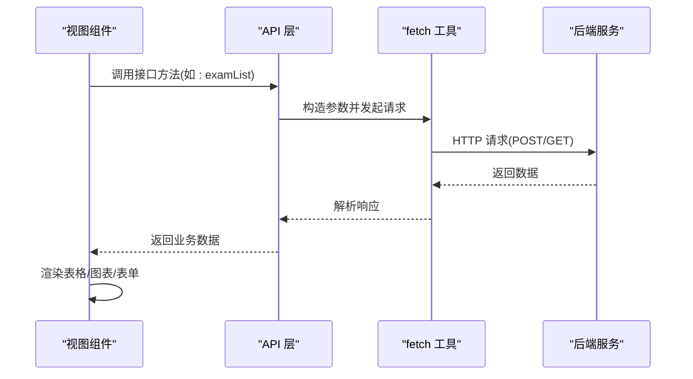
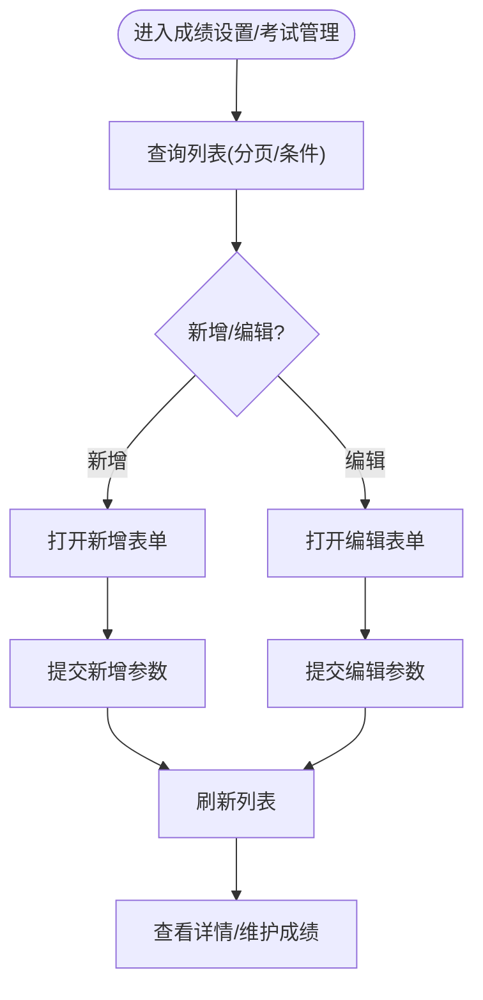
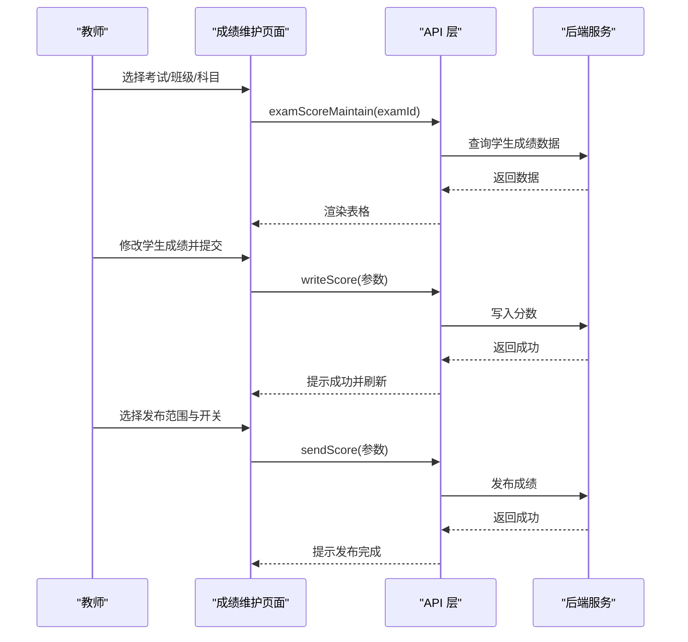
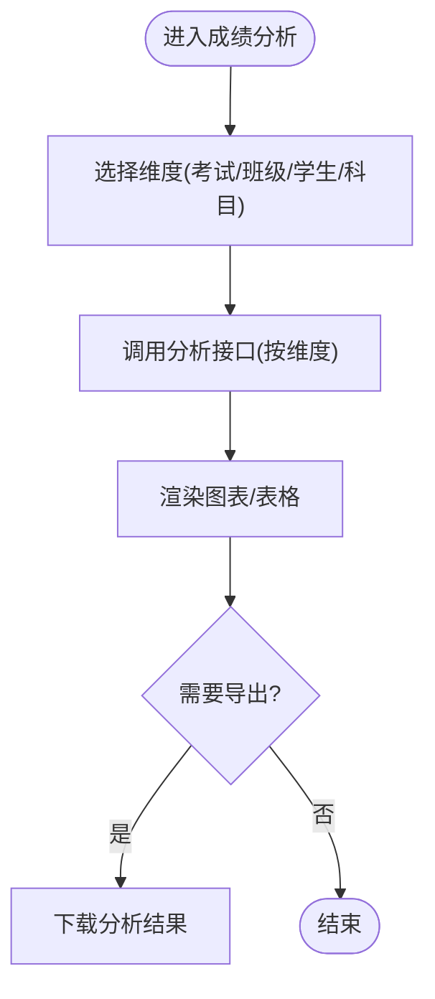
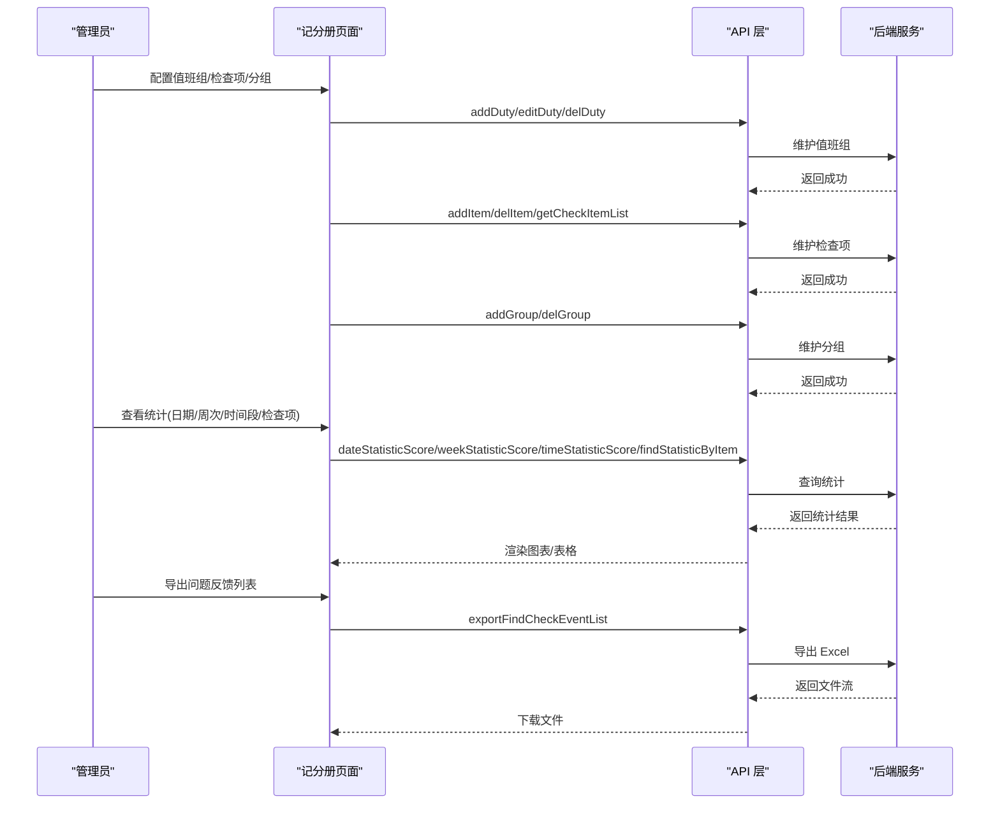
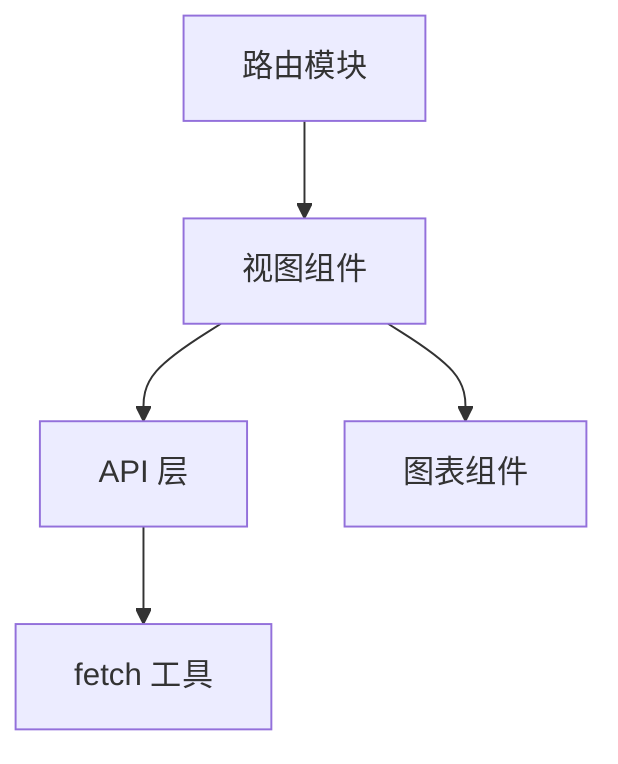

# 成绩管理

<cite>
**本文引用的文件**
- [src/api/systemSet/exam.js](file://src/api/systemSet/exam.js)
- [src/api/compositeExam.js](file://src/api/compositeExam.js)
- [src/api/compositeExamSet.js](file://src/api/compositeExamSet.js)
- [src/utils/fetch.js](file://src/utils/fetch.js)
- [src/router/modules/schoolManage.js](file://src/router/modules/schoolManage.js)
- [src/router/modules/teachingStudy.js](file://src/router/modules/teachingStudy.js)
- [src/components/Charts/line.vue](file://src/components/Charts/line.vue)
- [src/components/Charts/mixchart.vue](file://src/components/Charts/mixchart.vue)
- [src/views/compositeExam/dateAccountIndex.vue](file://src/views/compositeExam/dateAccountIndex.vue)
- [src/views/compositeExam/generalCheckNList.vue](file://src/views/compositeExam/generalCheckNList.vue)
- [src/views/compositeExamTwo/compositeExamTwoIndex.vue](file://src/views/compositeExamTwo/compositeExamTwoIndex.vue)
- [src/views/compositeExamTwo/compositeExamTwoInfo.vue](file://src/views/compositeExamTwo/compositeExamTwoInfo.vue)
- [src/views/compositeExamTwo/compositeExamTwoNo.vue](file://src/views/compositeExamTwo/compositeExamTwoNo.vue)
- [src/views/compositeExamTwo/compositeExamTwoYes.vue](file://src/views/compositeExamTwo/compositeExamTwoYes.vue)
- [src/views/compositeExamTwo/personInCharge.vue](file://src/views/compositeExamTwo/personInCharge.vue)
- [src/views/compositeExamTwo/personInChargeInfo.vue](file://src/views/compositeExamTwo/personInChargeInfo.vue)
</cite>

## 目录
1. [简介](#简介)
2. [项目结构](#项目结构)
3. [核心组件](#核心组件)
4. [架构总览](#架构总览)
5. [详细组件分析](#详细组件分析)
6. [依赖分析](#依赖分析)
7. [性能考虑](#性能考虑)
8. [故障排查指南](#故障排查指南)
9. [结论](#结论)
10. [附录](#附录)

## 简介
本文件面向“成绩管理系统”的功能文档，聚焦以下方面：
- 考试成绩的录入、维护、分析与展示
- 成绩数据模型、计算规则与统计分析算法
- 记分册功能的实现细节（题目设置、分数录入、成绩单生成）
- 成绩管理与其他教学模块的数据交互关系
- 成绩导入导出、批量操作与权限控制的技术实现
- 成绩分析图表、趋势预测与异常检测的功能说明

本系统围绕“考试设置与维护”“学生成绩录入与发布”“按班级/学生维度的成绩分析”“评语模板与发布”等关键流程展开，并通过图表组件对分析结果进行可视化呈现。

## 项目结构
本项目采用前端单页应用架构，成绩管理相关能力主要由以下层次构成：
- API 层：封装与后端交互的接口方法，统一使用 fetch 工具发起请求
- 视图层：基于 Vue 的页面组件，承载业务页面与交互
- 图表组件：基于通用图表库封装的折线图、混合图表等可视化组件
- 路由模块：定义与成绩管理相关的菜单路径与页面映射

**图表来源**
- [src/api/systemSet/exam.js:1-455](file://src/api/systemSet/exam.js#L1-L455)
- [src/api/compositeExam.js:1-142](file://src/api/compositeExam.js#L1-L142)
- [src/api/compositeExamSet.js:1-195](file://src/api/compositeExamSet.js#L1-L195)
- [src/utils/fetch.js](file://src/utils/fetch.js)
- [src/router/modules/schoolManage.js:397-427](file://src/router/modules/schoolManage.js#L397-L427)
- [src/router/modules/teachingStudy.js](file://src/router/modules/teachingStudy.js)
- [src/components/Charts/line.vue](file://src/components/Charts/line.vue)
- [src/components/Charts/mixchart.vue](file://src/components/Charts/mixchart.vue)

**章节来源**
- [src/api/systemSet/exam.js:1-455](file://src/api/systemSet/exam.js#L1-L455)
- [src/api/compositeExam.js:1-142](file://src/api/compositeExam.js#L1-L142)
- [src/api/compositeExamSet.js:1-195](file://src/api/compositeExamSet.js#L1-L195)
- [src/utils/fetch.js](file://src/utils/fetch.js)
- [src/router/modules/schoolManage.js:397-427](file://src/router/modules/schoolManage.js#L397-L427)
- [src/router/modules/teachingStudy.js](file://src/router/modules/teachingStudy.js)
- [src/components/Charts/line.vue](file://src/components/Charts/line.vue)
- [src/components/Charts/mixchart.vue](file://src/components/Charts/mixchart.vue)

## 核心组件
- 成绩设置与考试管理
  - 成绩设置列表、新增、编辑、删除
  - 考试列表、新增、编辑、删除、详情
  - 按学期/班级/科目获取考试科目
- 成绩维护与发布
  - 学生成绩数据查询
  - 单个学生成绩写入
  - 成绩发布（可选择是否发送平均分、最高分、最低分、排名）
- 成绩分析与展示
  - 按考试/科目维度的分析数据
  - 按学期/班级/学生维度的分析数据
  - 评语模板与保存
- 综合检查（与记分册相关）
  - 值班组、检查项、分组的设置与维护
  - 按日期/周次/时间段/检查项的统计与详情查询
  - 问题反馈列表导出 Excel

上述能力均通过统一的 fetch 工具封装网络请求，确保参数构造、请求头与响应处理的一致性。

**章节来源**
- [src/api/systemSet/exam.js:6-455](file://src/api/systemSet/exam.js#L6-L455)
- [src/api/compositeExam.js:1-142](file://src/api/compositeExam.js#L1-L142)
- [src/api/compositeExamSet.js:1-195](file://src/api/compositeExamSet.js#L1-L195)
- [src/utils/fetch.js](file://src/utils/fetch.js)

## 架构总览
下图展示了“成绩管理”在前端的整体调用链路：视图组件通过 API 层发起请求，API 层基于 fetch 工具统一处理参数与响应；分析与展示部分通过图表组件渲染结果。

**图表来源**
- [src/api/systemSet/exam.js:127-137](file://src/api/systemSet/exam.js#L127-L137)
- [src/api/compositeExam.js:14-25](file://src/api/compositeExam.js#L14-L25)
- [src/utils/fetch.js](file://src/utils/fetch.js)

## 详细组件分析

### 成绩设置与考试管理
- 功能要点
  - 成绩等级设置：支持多等级名称与阈值配置，支持父级显示排名与平均分的开关
  - 考试管理：支持按分页条件查询、新增、编辑、删除、详情查询
  - 学期/班级/科目联动：按学期 ID 获取班级某学期的考试科目
- 数据模型
  - 成绩设置对象包含等级名称与阈值、父级显示选项等字段
  - 考试对象包含名称、时间、类型、班级/部门、科目集合等字段
- 处理逻辑
  - 新增/编辑时统一通过 URLSearchParams 或 JSON 字符串传递参数
  - 列表查询支持分页与模糊搜索字段
- 关键接口路径
  - 成绩设置：列表、新增、编辑、删除、详情
  - 考试管理：列表、新增、编辑、删除、详情、按学期获取科目
- 可视化与交互
  - 页面通过表格展示列表，支持分页与筛选
  - 新增/编辑弹窗表单，提交后刷新列表或跳转详情

**图表来源**
- [src/api/systemSet/exam.js:6-122](file://src/api/systemSet/exam.js#L6-L122)
- [src/api/systemSet/exam.js:127-213](file://src/api/systemSet/exam.js#L127-L213)

**章节来源**
- [src/api/systemSet/exam.js:6-122](file://src/api/systemSet/exam.js#L6-L122)
- [src/api/systemSet/exam.js:127-213](file://src/api/systemSet/exam.js#L127-L213)

### 成绩维护与发布
- 功能要点
  - 成绩数据查询：按考试 ID 获取学生成绩数据
  - 单个学生成绩写入：支持传入考试、学期、年级、班级、科目、学生、分数等
  - 成绩发布：可选择是否发送平均分、最高分、最低分、排名
- 数据模型
  - 成绩写入参数包含考试、学期、年级、班级、科目、学生、分数、班级类型等
  - 发布参数包含考试 ID、科目集合、发送开关
- 处理逻辑
  - 写入前校验参数完整性
  - 发布时按科目维度批量发送，支持开关控制
- 关键接口路径
  - 成绩维护数据查询
  - 单个学生成绩写入
  - 成绩发布

**图表来源**
- [src/api/systemSet/exam.js:218-250](file://src/api/systemSet/exam.js#L218-L250)
- [src/api/systemSet/exam.js:306-319](file://src/api/systemSet/exam.js#L306-L319)

**章节来源**
- [src/api/systemSet/exam.js:218-250](file://src/api/systemSet/exam.js#L218-L250)
- [src/api/systemSet/exam.js:306-319](file://src/api/systemSet/exam.js#L306-L319)

### 成绩分析与展示
- 功能要点
  - 按考试/科目维度获取分析数据
  - 按学期/班级/学生维度获取分析数据
  - 评语模板与保存
- 数据模型
  - 分析数据包含各科目统计指标（如平均分、最高分、最低分、及格率等）
  - 评语模板包含内容与类型
- 处理逻辑
  - 分析数据按维度聚合，支持分页与筛选
  - 评语保存时绑定学期与学生
- 关键接口路径
  - 按考试/科目分析
  - 按学期/班级/学生分析
  - 评语模板新增与选择

**图表来源**
- [src/api/systemSet/exam.js:256-300](file://src/api/systemSet/exam.js#L256-L300)
- [src/api/systemSet/exam.js:324-350](file://src/api/systemSet/exam.js#L324-L350)
- [src/api/systemSet/exam.js:355-393](file://src/api/systemSet/exam.js#L355-L393)

**章节来源**
- [src/api/systemSet/exam.js:256-300](file://src/api/systemSet/exam.js#L256-L300)
- [src/api/systemSet/exam.js:324-350](file://src/api/systemSet/exam.js#L324-L350)
- [src/api/systemSet/exam.js:355-393](file://src/api/systemSet/exam.js#L355-L393)

### 记分册与综合检查（与记分册相关）
- 功能要点
  - 值班组设置：新增、编辑、删除、详情
  - 检查项设置：新增、编辑、删除、分页查询、全量查询
  - 分组设置：按日/值班组/分组类型维护人员
  - 统计与详情：按日期、周次、时间段、检查项统计
  - 导出：问题反馈列表导出 Excel
- 数据模型
  - 值班组包含值班周期、分组等
  - 检查项包含名称、星级等
  - 分组包含星期与人员字段
- 处理逻辑
  - 统一使用 URLSearchParams 传递参数
  - 统一使用 JSON 字符串传递复杂对象
- 关键接口路径
  - 值班组：列表、新增、编辑、删除、详情
  - 检查项：列表、新增、编辑、删除、详情、全量
  - 统计：日期/周次/时间段/检查项
  - 导出：问题反馈列表

**图表来源**
- [src/api/compositeExamSet.js:4-51](file://src/api/compositeExamSet.js#L4-L51)
- [src/api/compositeExamSet.js:91-121](file://src/api/compositeExamSet.js#L91-L121)
- [src/api/compositeExamSet.js:165-195](file://src/api/compositeExamSet.js#L165-L195)
- [src/api/compositeExam.js:14-85](file://src/api/compositeExam.js#L14-L85)
- [src/api/compositeExam.js:137-142](file://src/api/compositeExam.js#L137-L142)

**章节来源**
- [src/api/compositeExamSet.js:4-51](file://src/api/compositeExamSet.js#L4-L51)
- [src/api/compositeExamSet.js:91-121](file://src/api/compositeExamSet.js#L91-L121)
- [src/api/compositeExamSet.js:165-195](file://src/api/compositeExamSet.js#L165-L195)
- [src/api/compositeExam.js:14-85](file://src/api/compositeExam.js#L14-L85)
- [src/api/compositeExam.js:137-142](file://src/api/compositeExam.js#L137-L142)

### 图表组件与可视化
- 折线图组件：用于展示趋势类数据
- 混合图表组件：用于组合柱状/折线等多维数据
- 使用方式
  - 在页面中引入组件并传入数据源
  - 通过分析接口返回的数据驱动图表渲染

**图表来源**
- [src/components/Charts/line.vue](file://src/components/Charts/line.vue)
- [src/components/Charts/mixchart.vue](file://src/components/Charts/mixchart.vue)
- [src/api/systemSet/exam.js:256-300](file://src/api/systemSet/exam.js#L256-L300)

**章节来源**
- [src/components/Charts/line.vue](file://src/components/Charts/line.vue)
- [src/components/Charts/mixchart.vue](file://src/components/Charts/mixchart.vue)
- [src/api/systemSet/exam.js:256-300](file://src/api/systemSet/exam.js#L256-L300)

## 依赖分析
- 组件耦合
  - 视图组件依赖 API 层提供的接口方法
  - API 层依赖 fetch 工具进行统一请求
  - 图表组件独立于业务逻辑，仅消费数据
- 外部依赖
  - 后端服务提供考试设置、成绩维护、分析与发布等接口
  - 综合检查模块提供值班组、检查项、统计与导出接口
- 路由映射
  - 路由模块将页面路径与视图组件建立映射，便于导航与权限控制

**图表来源**
- [src/api/systemSet/exam.js:1-455](file://src/api/systemSet/exam.js#L1-L455)
- [src/api/compositeExam.js:1-142](file://src/api/compositeExam.js#L1-L142)
- [src/api/compositeExamSet.js:1-195](file://src/api/compositeExamSet.js#L1-L195)
- [src/utils/fetch.js](file://src/utils/fetch.js)
- [src/router/modules/schoolManage.js:397-427](file://src/router/modules/schoolManage.js#L397-L427)

**章节来源**
- [src/router/modules/schoolManage.js:397-427](file://src/router/modules/schoolManage.js#L397-L427)

## 性能考虑
- 请求合并与去重
  - 对频繁触发的查询（如分页/筛选）建议增加防抖与去重策略，避免重复请求
- 数据缓存
  - 对不常变动的配置数据（如等级设置、检查项列表）可在内存中缓存，减少重复请求
- 分页与懒加载
  - 列表数据采用分页加载，结合虚拟滚动优化长列表渲染
- 图表渲染优化
  - 大数据量时采用采样或分段渲染，降低图表组件压力
- 批量操作
  - 成绩发布与批量写入应采用批处理与进度提示，避免长时间阻塞 UI

## 故障排查指南
- 常见问题
  - 参数缺失：检查接口调用时是否正确传入必要参数（如 examId、classId、currId、schoolTimeId 等）
  - 权限不足：确认当前用户角色是否具备相应操作权限（如发布成绩、维护记分册）
  - 网络异常：检查 fetch 工具的错误处理与重试机制
- 定位步骤
  - 打开浏览器开发者工具，查看网络面板中的请求与响应
  - 根据接口路径定位到对应 API 方法，核对参数构造与请求头
  - 若涉及导出功能，确认后端返回的文件流格式与下载处理逻辑
- 建议
  - 在视图组件中增加统一的错误提示与重试按钮
  - 对关键操作（如发布成绩）增加二次确认

**章节来源**
- [src/utils/fetch.js](file://src/utils/fetch.js)
- [src/api/systemSet/exam.js:306-319](file://src/api/systemSet/exam.js#L306-L319)
- [src/api/compositeExam.js:137-142](file://src/api/compositeExam.js#L137-L142)

## 结论
本系统围绕“成绩设置—成绩维护—成绩分析—发布展示”的完整闭环构建，辅以记分册相关的值班组与检查项管理，满足教学场景下的多维度成绩管理需求。通过统一的 API 封装与图表组件，实现了良好的可扩展性与可维护性。后续可在性能优化、异常检测与趋势预测等方面进一步增强。

## 附录
- 路由与页面映射
  - 记分册相关页面已在路由模块中注册，便于导航与权限控制
- 数据交互建议
  - 成绩分析图表建议支持多维度对比与钻取，提升分析效率
  - 引入异常检测（如离群点识别）与趋势预测（如回归分析）可辅助教学决策

**章节来源**
- [src/router/modules/schoolManage.js:397-427](file://src/router/modules/schoolManage.js#L397-L427)
- [src/router/modules/teachingStudy.js](file://src/router/modules/teachingStudy.js)