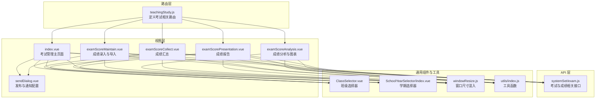
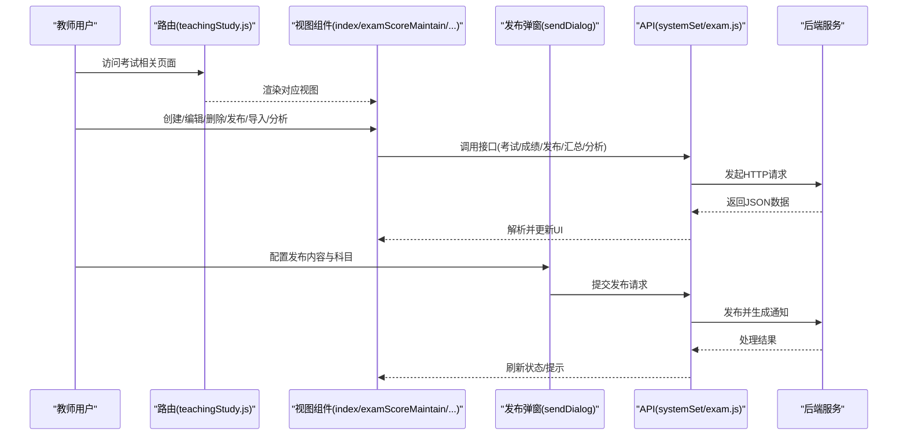
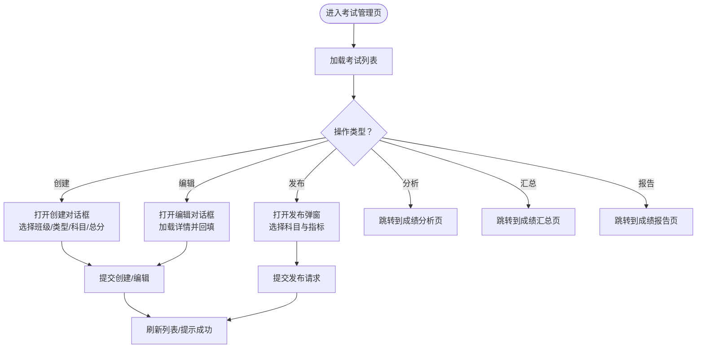
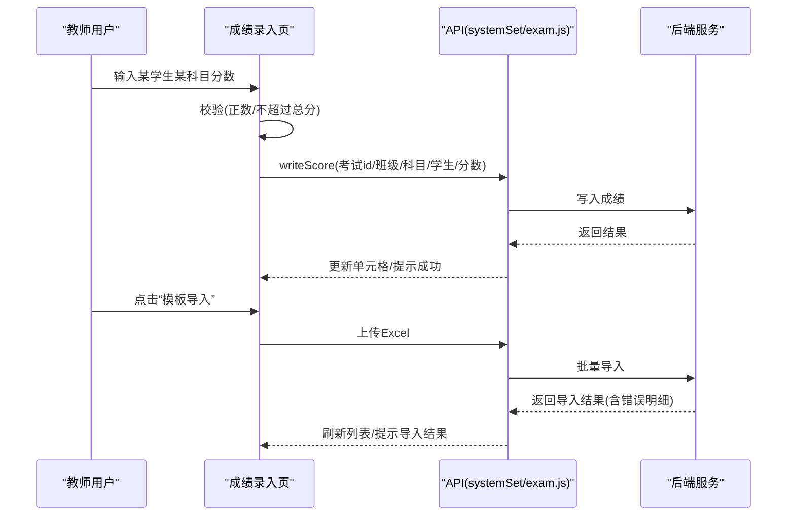
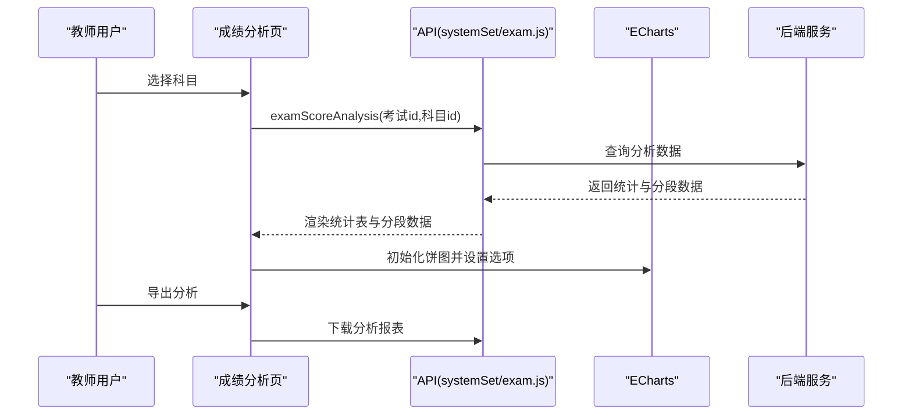
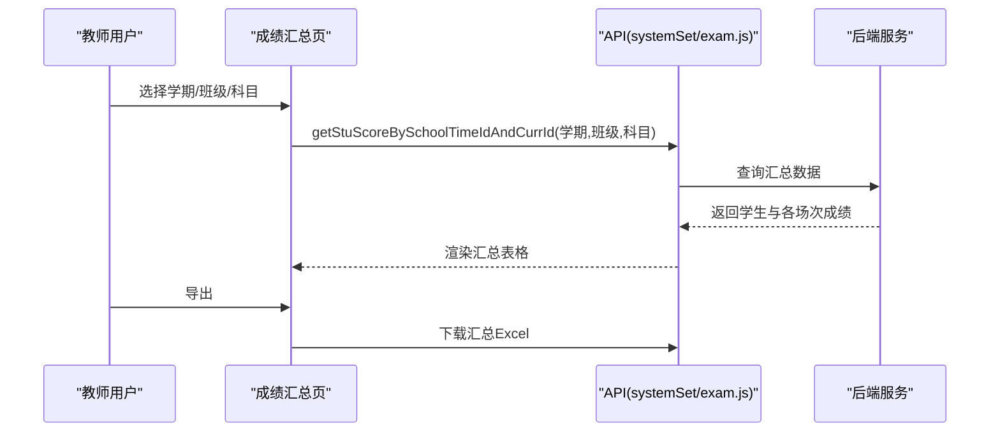
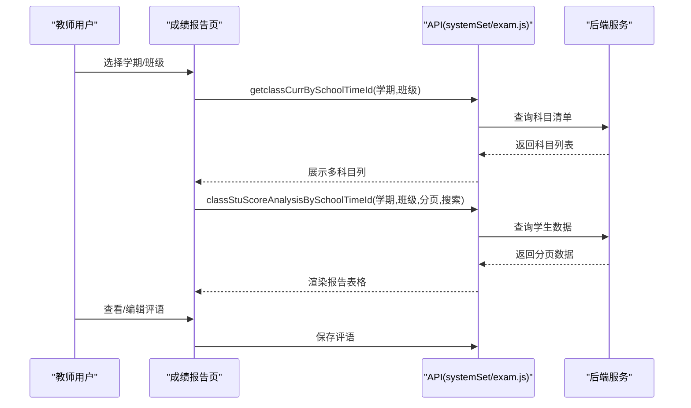
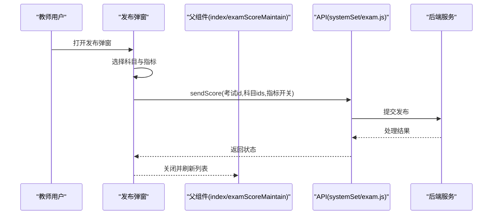
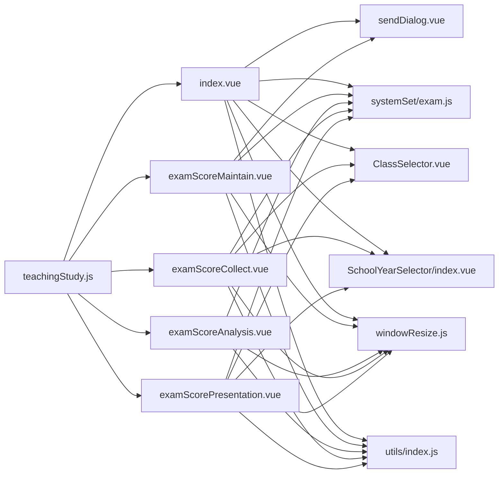

# 考试成绩管理

<cite>
**本文引用的文件**
- [src/views/exam/index.vue](file://src/views/exam/index.vue)
- [src/views/exam/examScoreMaintain.vue](file://src/views/exam/examScoreMaintain.vue)
- [src/views/exam/examScoreAnalysis.vue](file://src/views/exam/examScoreAnalysis.vue)
- [src/views/exam/examScoreCollect.vue](file://src/views/exam/examScoreCollect.vue)
- [src/views/exam/examScorePresentation.vue](file://src/views/exam/examScorePresentation.vue)
- [src/views/exam/sendDialog.vue](file://src/views/exam/sendDialog.vue)
- [src/api/systemSet/exam.js](file://src/api/systemSet/exam.js)
- [src/router/normal/teachingStudy.js](file://src/router/normal/teachingStudy.js)
- [src/mixins/windowResize.js](file://src/mixins/windowResize.js)
- [src/utils/index.js](file://src/utils/index.js)
- [src/components/ClassSelector/ClassSelector.vue](file://src/components/ClassSelector/ClassSelector.vue)
- [src/components/SchoolYearSelector/index.vue](file://src/components/SchoolYearSelector/index.vue)
</cite>

## 目录
1. [简介](#简介)
2. [项目结构](#项目结构)
3. [核心组件](#核心组件)
4. [架构总览](#架构总览)
5. [详细组件分析](#详细组件分析)
6. [依赖关系分析](#依赖关系分析)
7. [性能考量](#性能考量)
8. [故障排查指南](#故障排查指南)
9. [结论](#结论)
10. [附录](#附录)

## 简介
本技术文档围绕“考试成绩管理”功能进行系统化梳理，覆盖考试与成绩全生命周期：考试创建与维护、成绩录入与批量导入、成绩统计与可视化分析、成绩汇总与报告展示、成绩发布与通知提醒、家长查询入口等。文档同时给出数据模型设计建议、异常处理与重复录入检测机制、权限控制与角色适配策略，并通过多种图示帮助读者快速理解前后端交互流程。

## 项目结构
考试成绩管理相关前端页面集中在 exam 目录，配合系统设置中的考试 API、路由配置、通用组件与工具方法共同完成功能闭环。

**图表来源**
- [src/router/normal/teachingStudy.js:151-188](file://src/router/normal/teachingStudy.js#L151-L188)
- [src/views/exam/index.vue:1-740](file://src/views/exam/index.vue#L1-L740)
- [src/views/exam/examScoreMaintain.vue:1-219](file://src/views/exam/examScoreMaintain.vue#L1-L219)
- [src/views/exam/examScoreAnalysis.vue:1-264](file://src/views/exam/examScoreAnalysis.vue#L1-L264)
- [src/views/exam/examScoreCollect.vue:1-165](file://src/views/exam/examScoreCollect.vue#L1-L165)
- [src/views/exam/examScorePresentation.vue:1-319](file://src/views/exam/examScorePresentation.vue#L1-L319)
- [src/views/exam/sendDialog.vue:1-133](file://src/views/exam/sendDialog.vue#L1-L133)
- [src/api/systemSet/exam.js:1-455](file://src/api/systemSet/exam.js#L1-L455)
- [src/components/ClassSelector/ClassSelector.vue:1-109](file://src/components/ClassSelector/ClassSelector.vue#L1-L109)
- [src/components/SchoolYearSelector/index.vue:1-37](file://src/components/SchoolYearSelector/index.vue#L1-L37)
- [src/mixins/windowResize.js:1-63](file://src/mixins/windowResize.js#L1-L63)
- [src/utils/index.js:1-385](file://src/utils/index.js#L1-L385)

**章节来源**
- [src/router/normal/teachingStudy.js:151-188](file://src/router/normal/teachingStudy.js#L151-L188)
- [src/views/exam/index.vue:1-740](file://src/views/exam/index.vue#L1-L740)
- [src/views/exam/examScoreMaintain.vue:1-219](file://src/views/exam/examScoreMaintain.vue#L1-L219)
- [src/views/exam/examScoreAnalysis.vue:1-264](file://src/views/exam/examScoreAnalysis.vue#L1-L264)
- [src/views/exam/examScoreCollect.vue:1-165](file://src/views/exam/examScoreCollect.vue#L1-L165)
- [src/views/exam/examScorePresentation.vue:1-319](file://src/views/exam/examScorePresentation.vue#L1-L319)
- [src/views/exam/sendDialog.vue:1-133](file://src/views/exam/sendDialog.vue#L1-L133)
- [src/api/systemSet/exam.js:1-455](file://src/api/systemSet/exam.js#L1-L455)
- [src/mixins/windowResize.js:1-63](file://src/mixins/windowResize.js#L1-L63)
- [src/utils/index.js:1-385](file://src/utils/index.js#L1-L385)
- [src/components/ClassSelector/ClassSelector.vue:1-109](file://src/components/ClassSelector/ClassSelector.vue#L1-L109)
- [src/components/SchoolYearSelector/index.vue:1-37](file://src/components/SchoolYearSelector/index.vue#L1-L37)

## 核心组件
- 考试管理主页面：负责考试创建、编辑、删除、发布、分析、汇总、报告等入口，支持按考试类型、状态筛选，集成发布弹窗。
- 成绩录入与维护：提供逐行录入、模板下载、Excel 批量导入、实时校验与保存。
- 成绩分析与图表：按科目维度输出统计指标与饼图分布，支持导出分析报表。
- 成绩汇总：按学期、班级、科目聚合展示多场次成绩，支持导出。
- 成绩报告：按学期与班级汇总多科目“期末/期中/平时”三类分数组合，支持评语管理与家长查询。
- 发布与通知：统一配置发布范围与通知内容片段，支持选择科目与关键指标（最高/最低/平均/排名）。
- 通用选择器与工具：班级/学期选择器、窗口自适应高度混入、权限与格式化工具。

**章节来源**
- [src/views/exam/index.vue:1-740](file://src/views/exam/index.vue#L1-L740)
- [src/views/exam/examScoreMaintain.vue:1-219](file://src/views/exam/examScoreMaintain.vue#L1-L219)
- [src/views/exam/examScoreAnalysis.vue:1-264](file://src/views/exam/examScoreAnalysis.vue#L1-L264)
- [src/views/exam/examScoreCollect.vue:1-165](file://src/views/exam/examScoreCollect.vue#L1-L165)
- [src/views/exam/examScorePresentation.vue:1-319](file://src/views/exam/examScorePresentation.vue#L1-L319)
- [src/views/exam/sendDialog.vue:1-133](file://src/views/exam/sendDialog.vue#L1-L133)
- [src/components/ClassSelector/ClassSelector.vue:1-109](file://src/components/ClassSelector/ClassSelector.vue#L1-L109)
- [src/components/SchoolYearSelector/index.vue:1-37](file://src/components/SchoolYearSelector/index.vue#L1-L37)
- [src/mixins/windowResize.js:1-63](file://src/mixins/windowResize.js#L1-L63)
- [src/utils/index.js:1-385](file://src/utils/index.js#L1-L385)

## 架构总览
考试成绩管理采用“路由驱动 + 视图组件 + API 调用 + 通用组件”的分层架构。视图组件通过 API 层访问后端服务，使用工具与混入提升交互体验与可维护性。

**图表来源**
- [src/router/normal/teachingStudy.js:151-188](file://src/router/normal/teachingStudy.js#L151-L188)
- [src/views/exam/index.vue:1-740](file://src/views/exam/index.vue#L1-L740)
- [src/views/exam/examScoreMaintain.vue:1-219](file://src/views/exam/examScoreMaintain.vue#L1-L219)
- [src/views/exam/examScoreAnalysis.vue:1-264](file://src/views/exam/examScoreAnalysis.vue#L1-L264)
- [src/views/exam/examScoreCollect.vue:1-165](file://src/views/exam/examScoreCollect.vue#L1-L165)
- [src/views/exam/examScorePresentation.vue:1-319](file://src/views/exam/examScorePresentation.vue#L1-L319)
- [src/views/exam/sendDialog.vue:1-133](file://src/views/exam/sendDialog.vue#L1-L133)
- [src/api/systemSet/exam.js:1-455](file://src/api/systemSet/exam.js#L1-L455)

## 详细组件分析

### 考试管理主页面（index）
- 功能要点
  - 考试列表展示：名称、班级、类型、科目、时间、状态（未发布/已发布）、操作按钮。
  - 考试创建/编辑：名称、时间、班级、类型、科目与总分配置；支持走班场景识别。
  - 成绩发布：弹窗选择科目与关键指标（最高/最低/平均/排名）。
  - 成绩分析/汇总/报告入口跳转。
- 关键交互
  - 班级变更联动科目列表；走班时仅显示单一科目。
  - 权限控制：根据路径权限决定按钮可用性。
- 数据来源
  - 调用考试列表、详情、增删改、发布等 API。
  - 使用窗口自适应混入动态计算表格高度。

**图表来源**
- [src/views/exam/index.vue:360-688](file://src/views/exam/index.vue#L360-L688)
- [src/api/systemSet/exam.js:127-199](file://src/api/systemSet/exam.js#L127-L199)
- [src/views/exam/sendDialog.vue:119-130](file://src/views/exam/sendDialog.vue#L119-L130)

**章节来源**
- [src/views/exam/index.vue:1-740](file://src/views/exam/index.vue#L1-L740)
- [src/api/systemSet/exam.js:127-199](file://src/api/systemSet/exam.js#L127-L199)
- [src/views/exam/sendDialog.vue:1-133](file://src/views/exam/sendDialog.vue#L1-L133)
- [src/mixins/windowResize.js:1-63](file://src/mixins/windowResize.js#L1-L63)

### 成绩录入与维护（examScoreMaintain）
- 功能要点
  - 表格逐行录入：学号、姓名、各科目分数，失焦自动保存。
  - 模板下载与 Excel 导入：支持批量写入与错误提示。
  - 实时校验：正数与不超过科目总分的限制。
  - 发布入口：统一调用发布弹窗。
- 关键逻辑
  - 读取考试详情填充查询参数与上传表单数据。
  - 写入接口按字段组合提交，失败回滚输入并提示。

**图表来源**
- [src/views/exam/examScoreMaintain.vue:138-211](file://src/views/exam/examScoreMaintain.vue#L138-L211)
- [src/api/systemSet/exam.js:218-250](file://src/api/systemSet/exam.js#L218-L250)

**章节来源**
- [src/views/exam/examScoreMaintain.vue:1-219](file://src/views/exam/examScoreMaintain.vue#L1-L219)
- [src/api/systemSet/exam.js:218-250](file://src/api/systemSet/exam.js#L218-L250)

### 成绩分析与图表（examScoreAnalysis）
- 功能要点
  - 科目下拉切换：按当前考试包含的科目动态展示。
  - 统计指标：平均分、最高/最低分、优生率、及格率、低分率。
  - 图表展示：科目成绩段分布饼图。
  - 导出：分析结果 Excel 下载。
- 关键逻辑
  - 读取考试详情获取科目列表并默认选中第一项。
  - 请求分析接口获取明细与分段数据，渲染 ECharts。

**图表来源**
- [src/views/exam/examScoreAnalysis.vue:134-213](file://src/views/exam/examScoreAnalysis.vue#L134-L213)
- [src/api/systemSet/exam.js:256-265](file://src/api/systemSet/exam.js#L256-L265)

**章节来源**
- [src/views/exam/examScoreAnalysis.vue:1-264](file://src/views/exam/examScoreAnalysis.vue#L1-L264)
- [src/api/systemSet/exam.js:256-265](file://src/api/systemSet/exam.js#L256-L265)

### 成绩汇总（examScoreCollect）
- 功能要点
  - 选择学期、班级、科目，按“学生+多场次考试”的矩阵展示。
  - 支持导出当前筛选条件下的汇总结果。
  - 点击学生姓名跳转到其“按学期+科目”的个人分析页。
- 关键逻辑
  - 通过班级切换联动科目列表。
  - 调用按学期+班级+科目查询接口获取数据。

**图表来源**
- [src/views/exam/examScoreCollect.vue:99-155](file://src/views/exam/examScoreCollect.vue#L99-L155)
- [src/api/systemSet/exam.js:271-282](file://src/api/systemSet/exam.js#L271-L282)

**章节来源**
- [src/views/exam/examScoreCollect.vue:1-165](file://src/views/exam/examScoreCollect.vue#L1-L165)
- [src/api/systemSet/exam.js:271-282](file://src/api/systemSet/exam.js#L271-L282)

### 成绩报告（examScorePresentation）
- 功能要点
  - 按学期与班级展示多科目“期末/期中/平时”三类分数组合。
  - 支持评语管理与“未评价”标识。
  - 支持按学生姓名搜索与分页。
- 关键逻辑
  - 根据角色判断是否为部门负责人，分别加载全校或本人任教班级。
  - 通过“按学期+班级”接口获取科目清单与学生数据。

**图表来源**
- [src/views/exam/examScorePresentation.vue:130-307](file://src/views/exam/examScorePresentation.vue#L130-L307)
- [src/api/systemSet/exam.js:42-51](file://src/api/systemSet/exam.js#L42-L51)
- [src/api/systemSet/exam.js:324-350](file://src/api/systemSet/exam.js#L324-L350)

**章节来源**
- [src/views/exam/examScorePresentation.vue:1-319](file://src/views/exam/examScorePresentation.vue#L1-L319)
- [src/api/systemSet/exam.js:42-51](file://src/api/systemSet/exam.js#L42-L51)
- [src/api/systemSet/exam.js:324-350](file://src/api/systemSet/exam.js#L324-L350)

### 发布与通知（sendDialog）
- 功能要点
  - 通知范例展示：包含“最高/最低/平均/排名”等可选片段。
  - 选择发布科目与指标，提交后刷新状态。
- 关键逻辑
  - 将勾选的科目拼接为逗号分隔字符串传给后端。
  - 发布成功提示并触发父组件刷新。

**图表来源**
- [src/views/exam/sendDialog.vue:119-130](file://src/views/exam/sendDialog.vue#L119-L130)
- [src/api/systemSet/exam.js:306-319](file://src/api/systemSet/exam.js#L306-L319)

**章节来源**
- [src/views/exam/sendDialog.vue:1-133](file://src/views/exam/sendDialog.vue#L1-L133)
- [src/api/systemSet/exam.js:306-319](file://src/api/systemSet/exam.js#L306-L319)

### 通用组件与工具
- 班级选择器：支持是否显示“全部”、是否显示文本标签、是否为校级管理者等策略。
- 学期选择器：基于 Vuex 状态选择当前学期并触发变更事件。
- 窗口自适应混入：根据浏览器窗口动态计算表格高度，适配不同页面布局。
- 工具函数：时间格式化、权限判断、URL 参数解析等。

**章节来源**
- [src/components/ClassSelector/ClassSelector.vue:1-109](file://src/components/ClassSelector/ClassSelector.vue#L1-L109)
- [src/components/SchoolYearSelector/index.vue:1-37](file://src/components/SchoolYearSelector/index.vue#L1-L37)
- [src/mixins/windowResize.js:1-63](file://src/mixins/windowResize.js#L1-L63)
- [src/utils/index.js:1-385](file://src/utils/index.js#L1-L385)

## 依赖关系分析
- 路由层依赖视图组件，视图组件依赖 API 层，API 层封装对后端的 HTTP 请求。
- 视图组件共享通用组件与混入，降低重复代码与提高一致性。
- 发布弹窗作为子组件被多个页面复用，形成“发布能力”的集中实现。

**图表来源**
- [src/router/normal/teachingStudy.js:151-188](file://src/router/normal/teachingStudy.js#L151-L188)
- [src/views/exam/index.vue:1-740](file://src/views/exam/index.vue#L1-L740)
- [src/views/exam/examScoreMaintain.vue:1-219](file://src/views/exam/examScoreMaintain.vue#L1-L219)
- [src/views/exam/examScoreAnalysis.vue:1-264](file://src/views/exam/examScoreAnalysis.vue#L1-L264)
- [src/views/exam/examScoreCollect.vue:1-165](file://src/views/exam/examScoreCollect.vue#L1-L165)
- [src/views/exam/examScorePresentation.vue:1-319](file://src/views/exam/examScorePresentation.vue#L1-L319)
- [src/views/exam/sendDialog.vue:1-133](file://src/views/exam/sendDialog.vue#L1-L133)
- [src/api/systemSet/exam.js:1-455](file://src/api/systemSet/exam.js#L1-L455)
- [src/components/ClassSelector/ClassSelector.vue:1-109](file://src/components/ClassSelector/ClassSelector.vue#L1-L109)
- [src/components/SchoolYearSelector/index.vue:1-37](file://src/components/SchoolYearSelector/index.vue#L1-L37)
- [src/mixins/windowResize.js:1-63](file://src/mixins/windowResize.js#L1-L63)
- [src/utils/index.js:1-385](file://src/utils/index.js#L1-L385)

**章节来源**
- [src/router/normal/teachingStudy.js:151-188](file://src/router/normal/teachingStudy.js#L151-L188)
- [src/api/systemSet/exam.js:1-455](file://src/api/systemSet/exam.js#L1-L455)

## 性能考量
- 表格高度自适应：通过窗口尺寸混入动态计算，避免滚动条频繁闪烁，提升长列表浏览体验。
- 分页与懒加载：报告与汇总页面采用分页与延迟渲染，减少一次性渲染压力。
- 图表渲染时机：分析页在数据就绪后使用 $nextTick 初始化 ECharts，确保 DOM 可用。
- 导入与导出：批量导入采用异步上传与进度提示，导出链接直连后端生成文件，避免前端大对象处理。

[本节为通用指导，无需特定文件引用]

## 故障排查指南
- 成绩录入异常
  - 现象：输入非正数或超过科目总分时无法保存。
  - 处理：检查输入正则与总分上限逻辑，确认接口返回错误后及时回滚输入并提示。
  - 参考路径：[src/views/exam/examScoreMaintain.vue:139-170](file://src/views/exam/examScoreMaintain.vue#L139-L170)
- 批量导入失败
  - 现象：导入后返回错误明细或空结果。
  - 处理：确认模板格式、后缀名与必填字段；查看返回的错误消息并逐条修正。
  - 参考路径：[src/views/exam/examScoreMaintain.vue:171-183](file://src/views/exam/examScoreMaintain.vue#L171-L183)
- 发布未生效
  - 现象：发布后状态未更新或通知未下发。
  - 处理：确认已选择科目与指标；检查接口返回与父组件刷新逻辑。
  - 参考路径：[src/views/exam/sendDialog.vue:83-118](file://src/views/exam/sendDialog.vue#L83-L118)
- 权限不足
  - 现象：部分按钮不可见或操作受限。
  - 处理：核对权限路径与当前用户角色，确保路由与按钮显隐逻辑一致。
  - 参考路径：[src/utils/index.js:241-246](file://src/utils/index.js#L241-L246)

**章节来源**
- [src/views/exam/examScoreMaintain.vue:139-183](file://src/views/exam/examScoreMaintain.vue#L139-L183)
- [src/views/exam/sendDialog.vue:83-118](file://src/views/exam/sendDialog.vue#L83-L118)
- [src/utils/index.js:241-246](file://src/utils/index.js#L241-L246)

## 结论
考试成绩管理模块通过清晰的页面分工与统一的 API 接口，实现了从“考试创建—成绩录入—统计分析—汇总报告—发布通知”的完整闭环。借助通用组件与工具方法，系统具备良好的可扩展性与可维护性。后续可在以下方面持续优化：完善重复录入检测与数据一致性校验、增强异常场景的提示与回滚、引入更丰富的图表与导出格式、以及扩展家长查询与移动端适配。

[本节为总结性内容，无需特定文件引用]

## 附录

### 数据模型设计建议（概念性）
- 考试实体：id、名称、考试日期、班级/走班标识、类型、创建者、状态、发布时间等。
- 科目实体：id、名称、总分、适用年级/班级等。
- 成绩实体：id、考试id、学生id、科目id、分数、录入时间、录入人等。
- 发布记录：id、考试id、发布范围（科目列表）、通知内容片段开关、发布时间等。
- 报告实体：按学期+班级+学生+科目聚合的“期末/期中/平时”三类分数组合与评语。

[本节为概念性描述，无需特定文件引用]