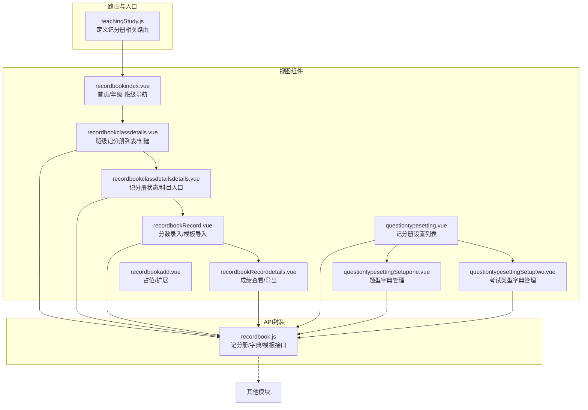
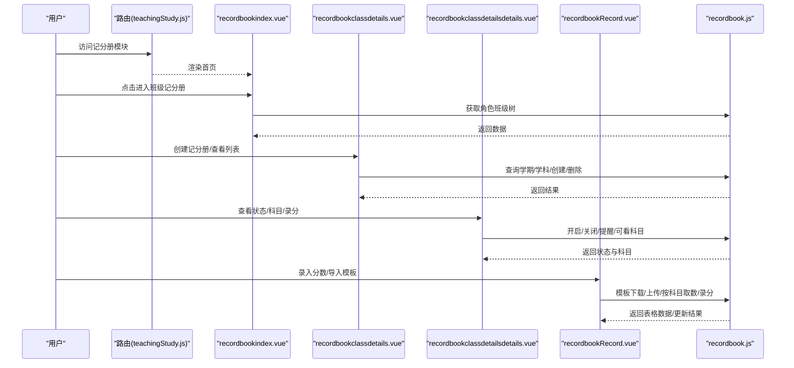
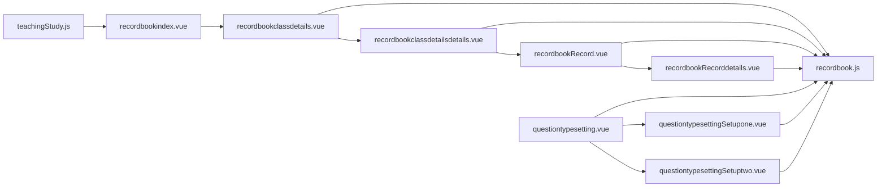
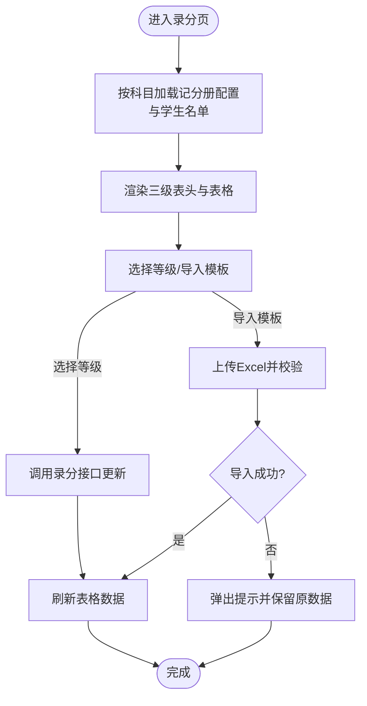
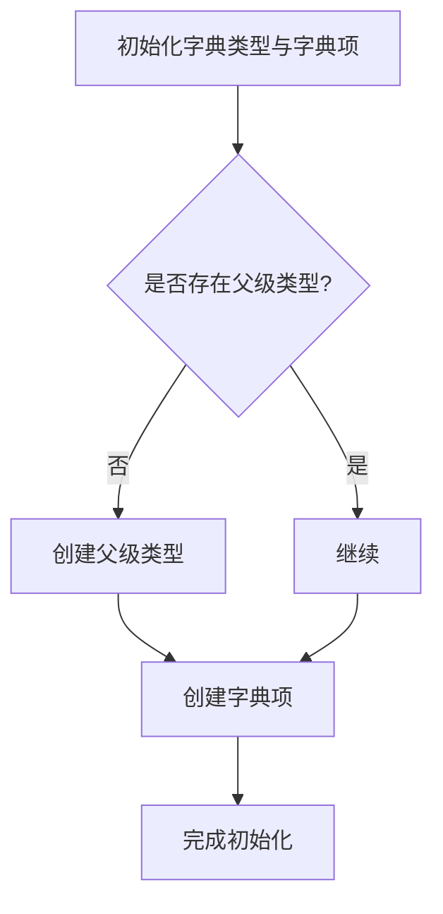

# 记分册管理

<cite>
**本文引用的文件**
- [recordbook.js](file://src/api/recordbook.js)
- [teachingStudy.js](file://src/router/normal/teachingStudy.js)
- [recordbookindex.vue](file://src/views/recordbook/recordbookindex.vue)
- [recordbookclassdetails.vue](file://src/views/recordbook/recordbookclassdetails.vue)
- [recordbookclassdetailsdetails.vue](file://src/views/recordbook/recordbookclassdetailsdetails.vue)
- [recordbookRecord.vue](file://src/views/recordbook/recordbookRecord.vue)
- [recordbookRecorddetails.vue](file://src/views/recordbook/recordbookRecorddetails.vue)
- [questiontypesetting.vue](file://src/views/recordbook/questiontypesetting.vue)
- [questiontypesettingSetupone.vue](file://src/views/recordbook/questiontypesettingSetupone.vue)
- [questiontypesettingSetuptwo.vue](file://src/views/recordbook/questiontypesettingSetuptwo.vue)
- [recordbookadd.vue](file://src/views/recordbook/recordbookadd.vue)
- [recordbook.js（第200-333行）](file://src/api/recordbook.js)
</cite>

## 目录
1. [简介](#简介)
2. [项目结构](#项目结构)
3. [核心组件](#核心组件)
4. [架构总览](#架构总览)
5. [组件详解](#组件详解)
6. [依赖关系分析](#依赖关系分析)
7. [性能考量](#性能考量)
8. [故障排查指南](#故障排查指南)
9. [结论](#结论)
10. [附录](#附录)

## 简介
本技术文档围绕“记分册管理系统”展开，系统覆盖记分册的创建、维护与使用全流程，包括：记分册类型配置、题目分类管理、评分标准设置、题目与考试类型的联动、分数录入、批改记录、成绩单导出、权限控制与模板管理等。文档同时解释记分册与教学进度、作业布置和考试安排的数据关联关系，并提供数据分析、趋势统计与学习档案建立的实现思路。

## 项目结构
记分册模块采用前端路由与视图组件分离的组织方式，API层封装了与后端交互的接口，视图层负责页面渲染与用户交互。核心路由集中在教学研究模块下，视图组件分布在 recordbook 目录中，配合通用工具与混入提升复用性。

图表来源
- [teachingStudy.js:209-272](file://src/router/normal/teachingStudy.js#L209-L272)
- [recordbookindex.vue:1-110](file://src/views/recordbook/recordbookindex.vue#L1-L110)
- [recordbookclassdetails.vue:1-222](file://src/views/recordbook/recordbookclassdetails.vue#L1-L222)
- [recordbookclassdetailsdetails.vue:1-172](file://src/views/recordbook/recordbookclassdetailsdetails.vue#L1-L172)
- [recordbookRecord.vue:1-203](file://src/views/recordbook/recordbookRecord.vue#L1-L203)
- [recordbookRecorddetails.vue:1-113](file://src/views/recordbook/recordbookRecorddetails.vue#L1-L113)
- [questiontypesetting.vue:1-146](file://src/views/recordbook/questiontypesetting.vue#L1-L146)
- [questiontypesettingSetupone.vue:1-152](file://src/views/recordbook/questiontypesettingSetupone.vue#L1-L152)
- [questiontypesettingSetuptwo.vue:1-155](file://src/views/recordbook/questiontypesettingSetuptwo.vue#L1-L155)
- [recordbookadd.vue:1-36](file://src/views/recordbook/recordbookadd.vue#L1-L36)
- [recordbook.js:1-204](file://src/api/recordbook.js#L1-L204)

章节来源
- [teachingStudy.js:209-272](file://src/router/normal/teachingStudy.js#L209-L272)

## 核心组件
- 首页与导航
  - recordbookindex.vue：按年级聚合展示班级入口，支持跳转到科目题型设置。
- 班级记分册管理
  - recordbookclassdetails.vue：列出某班级的记分册条目，支持创建与删除；弹窗选择学期与考试学科，生成记分册 JSON。
  - recordbookclassdetailsdetails.vue：展示记分册状态、科目列表与录分按钮；支持开启/关闭录分、录分通知、成绩查看。
- 分数录入与导出
  - recordbookRecord.vue：按科目加载题型与考试类型，支持模板下载、批量导入、逐项录分；录分变更通过接口实时更新。
  - recordbookRecorddetails.vue：汇总展示全班各科成绩，支持导出 Excel。
- 记分册类型与字典管理
  - questiontypesetting.vue：分页查询记分册设置，支持新增、编辑、删除；可跳转题型与考试类型设置。
  - questiontypesettingSetupone.vue：题型字典管理（题型编码、名称、排序、描述）。
  - questiontypesettingSetuptwo.vue：考试类型字典管理（考试编码、名称、排序、描述）。
- 扩展与占位
  - recordbookadd.vue：当前为空白页，可用于后续扩展。

章节来源
- [recordbookindex.vue:1-110](file://src/views/recordbook/recordbookindex.vue#L1-L110)
- [recordbookclassdetails.vue:1-222](file://src/views/recordbook/recordbookclassdetails.vue#L1-L222)
- [recordbookclassdetailsdetails.vue:1-172](file://src/views/recordbook/recordbookclassdetailsdetails.vue#L1-L172)
- [recordbookRecord.vue:1-203](file://src/views/recordbook/recordbookRecord.vue#L1-L203)
- [recordbookRecorddetails.vue:1-113](file://src/views/recordbook/recordbookRecorddetails.vue#L1-L113)
- [questiontypesetting.vue:1-146](file://src/views/recordbook/questiontypesetting.vue#L1-L146)
- [questiontypesettingSetupone.vue:1-152](file://src/views/recordbook/questiontypesettingSetupone.vue#L1-L152)
- [questiontypesettingSetuptwo.vue:1-155](file://src/views/recordbook/questiontypesettingSetuptwo.vue#L1-L155)
- [recordbookadd.vue:1-36](file://src/views/recordbook/recordbookadd.vue#L1-L36)

## 架构总览
系统采用“路由驱动 + 视图组件 + API 封装”的三层结构。路由集中于 teachingStudy.js，视图组件负责业务交互，API 封装统一处理请求参数与后端接口映射。权限控制通过 isShowByPermission 判断按钮显示与操作可用性。

图表来源
- [teachingStudy.js:209-272](file://src/router/normal/teachingStudy.js#L209-L272)
- [recordbookindex.vue:35-68](file://src/views/recordbook/recordbookindex.vue#L35-L68)
- [recordbookclassdetails.vue:84-177](file://src/views/recordbook/recordbookclassdetails.vue#L84-L177)
- [recordbookclassdetailsdetails.vue:42-120](file://src/views/recordbook/recordbookclassdetailsdetails.vue#L42-L120)
- [recordbookRecord.vue:81-173](file://src/views/recordbook/recordbookRecord.vue#L81-L173)
- [recordbook.js:11-204](file://src/api/recordbook.js#L11-L204)

## 组件详解

### 首页与导航：recordbookindex.vue
- 功能要点
  - 基于角色获取班级树并按年级分组展示。
  - 支持跳转“科目题型设置”。
  - 使用窗口自适应混入优化布局。
- 关键交互
  - 路由跳转至 recordbookclassdetails.vue 并传递班级与年级信息。
- 权限控制
  - 顶部按钮通过 isShowByPermission 判断是否显示。

章节来源
- [recordbookindex.vue:1-110](file://src/views/recordbook/recordbookindex.vue#L1-L110)

### 班级记分册列表与创建：recordbookclassdetails.vue
- 功能要点
  - 展示某班级的记分册条目（按学期维度），支持删除。
  - 弹窗创建记分册：选择学期、勾选考试学科，生成 currJSon 并提交创建接口。
  - 从字典加载“考试类型数量”，用于前置校验。
- 关键交互
  - 查询学期列表与当前学期默认值。
  - 查询班级学科列表，供创建时勾选。
  - 创建成功后刷新列表。
- 权限控制
  - 创建、删除按钮通过 isShowByPermission 控制。

章节来源
- [recordbookclassdetails.vue:1-222](file://src/views/recordbook/recordbookclassdetails.vue#L1-L222)

### 记分册状态与科目入口：recordbookclassdetailsdetails.vue
- 功能要点
  - 展示记分册状态（开启/关闭）、科目卡片与录分按钮。
  - 支持录分通知、开启/关闭录分、跳转成绩查看。
- 关键交互
  - 通过 getCanLookCurr 获取可查看科目与状态。
  - 状态为开启时允许录分；点击科目进入录分页。
- 权限控制
  - 录分通知、开启/关闭、录分按钮均受 isShowByPermission 控制。

章节来源
- [recordbookclassdetailsdetails.vue:1-172](file://src/views/recordbook/recordbookclassdetailsdetails.vue#L1-L172)

### 分数录入与模板导入：recordbookRecord.vue
- 功能要点
  - 动态渲染“科目-考试类型-题型”三级表头，支持“合并题型”场景。
  - 提供模板下载链接与 Excel 导入能力。
  - 录分采用下拉框选择等级，变更即调用接口更新。
- 关键交互
  - 按科目获取当前记分册配置与学生名单，组装二维表数据。
  - 导入成功后刷新表格；失败弹出提示。
  - 录分接口返回成功/失败消息并提示。
- 性能与体验
  - 表格布局延迟触发以保证列宽计算稳定。
  - 仅允许 .xls 文件上传。

章节来源
- [recordbookRecord.vue:1-203](file://src/views/recordbook/recordbookRecord.vue#L1-L203)

### 成绩查看与导出：recordbookRecorddetails.vue
- 功能要点
  - 展示全班各科成绩，支持导出 Excel。
  - 通过 getScoreBookRecord 获取科目与成绩结构，组装表格数据。
- 关键交互
  - 使用隐藏表格进行导出，避免导出样式与展示样式差异。
  - 表格单元格索引用于区分不同列，便于导出时定位。

章节来源
- [recordbookRecorddetails.vue:1-113](file://src/views/recordbook/recordbookRecorddetails.vue#L1-L113)

### 记分册设置与字典管理：questiontypesetting.vue
- 功能要点
  - 分页查询记分册设置，支持搜索、删除、编辑。
  - 跳转题型设置与考试类型设置页面。
- 关键交互
  - 使用 queryScoreBookSet 获取分页数据。
  - 删除与编辑通过路由传参实现。

章节来源
- [questiontypesetting.vue:1-146](file://src/views/recordbook/questiontypesetting.vue#L1-L146)

### 题型字典管理：questiontypesettingSetupone.vue
- 功能要点
  - 自动初始化字典类型与字典项，若不存在则创建。
  - 支持分页查询、新增、编辑、删除题型字典。
- 关键交互
  - 通过 getDicDetailInfoByCode 与 getSchoolDicTypeInfoByCode 判断是否存在父级类型。
  - 不存在则先创建父级类型，再创建字典项。

章节来源
- [questiontypesettingSetupone.vue:1-152](file://src/views/recordbook/questiontypesettingSetupone.vue#L1-L152)

### 考试类型字典管理：questiontypesettingSetuptwo.vue
- 功能要点
  - 类似题型管理，但面向“考试类型”字典。
  - 支持分页查询、新增、编辑、删除。
- 关键交互
  - 初始化逻辑与题型一致，确保字典类型存在。

章节来源
- [questiontypesettingSetuptwo.vue:1-155](file://src/views/recordbook/questiontypesettingSetuptwo.vue#L1-L155)

### 扩展占位：recordbookadd.vue
- 当前为空白页，可用于后续扩展功能或占位。

章节来源
- [recordbookadd.vue:1-36](file://src/views/recordbook/recordbookadd.vue#L1-L36)

## 依赖关系分析
- 路由依赖
  - teachingStudy.js 定义了记分册模块的所有子路由，包括首页、班级详情、录分、成绩查看、题型与考试类型设置等。
- 视图与API
  - 各视图组件通过 import 方式引入 recordbook.js 中的接口函数，形成清晰的调用链。
- 权限与工具
  - isShowByPermission 用于按钮级权限控制；windowResize/baseMixin 用于布局与通用逻辑复用。

图表来源
- [teachingStudy.js:209-272](file://src/router/normal/teachingStudy.js#L209-L272)
- [recordbook.js:1-204](file://src/api/recordbook.js#L1-L204)

章节来源
- [teachingStudy.js:209-272](file://src/router/normal/teachingStudy.js#L209-L272)
- [recordbook.js:1-204](file://src/api/recordbook.js#L1-L204)

## 性能考量
- 表格渲染
  - 在录分与成绩查看页面，通过 $nextTick 与定时器延后执行 doLayout，确保列宽计算准确，避免首屏闪烁与布局抖动。
- 文件上传
  - 限制上传后缀为 .xls，减少无效文件带来的解析开销。
- 分页与懒加载
  - 字典与记分册设置采用分页查询，降低一次性数据量。
- 权限判断
  - 在渲染阶段即通过 isShowByPermission 过滤不可见按钮，减少 DOM 渲染压力。

## 故障排查指南
- 创建记分册失败
  - 检查是否已设置“考试类型”数量（前置校验会阻止创建）。
  - 确认所选学期与学科是否有效。
- 录分未生效
  - 确认记分册状态为“开启”。
  - 检查下拉框是否选择了等级，接口返回错误时查看消息提示。
- 模板导入失败
  - 确认上传文件为 .xls 格式。
  - 查看导入后提示信息，确认具体失败原因。
- 成绩导出空白
  - 确认当前有数据；检查隐藏导出示例表格与展示表格字段一致性。

章节来源
- [recordbookclassdetails.vue:75-82](file://src/views/recordbook/recordbookclassdetails.vue#L75-L82)
- [recordbookclassdetailsdetails.vue:67-102](file://src/views/recordbook/recordbookclassdetailsdetails.vue#L67-L102)
- [recordbookRecord.vue:126-150](file://src/views/recordbook/recordbookRecord.vue#L126-L150)
- [recordbookRecorddetails.vue:72-91](file://src/views/recordbook/recordbookRecorddetails.vue#L72-L91)

## 结论
记分册管理系统通过清晰的路由与视图分层、完善的 API 封装以及细粒度的权限控制，实现了从“记分册创建—录分—批改—导出—字典配置”的完整闭环。系统具备良好的扩展性与可维护性，适合在教学进度、作业布置与考试安排中作为数据支撑与可视化呈现的基础模块。

## 附录

### 数据流与处理逻辑（录分流程）

图表来源
- [recordbookRecord.vue:81-173](file://src/views/recordbook/recordbookRecord.vue#L81-L173)

### 记分册类型配置与字典初始化

图表来源
- [questiontypesettingSetupone.vue:52-87](file://src/views/recordbook/questiontypesettingSetupone.vue#L52-L87)
- [questiontypesettingSetuptwo.vue:52-87](file://src/views/recordbook/questiontypesettingSetuptwo.vue#L52-L87)