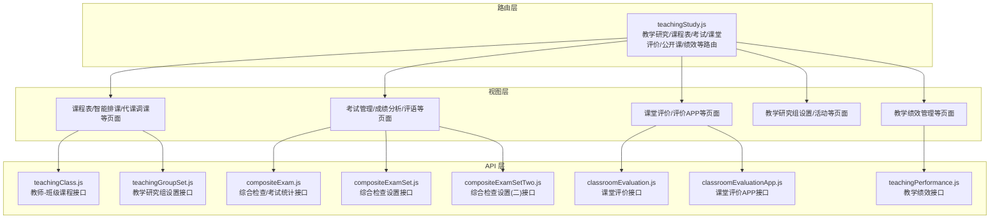
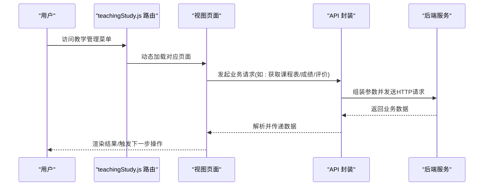
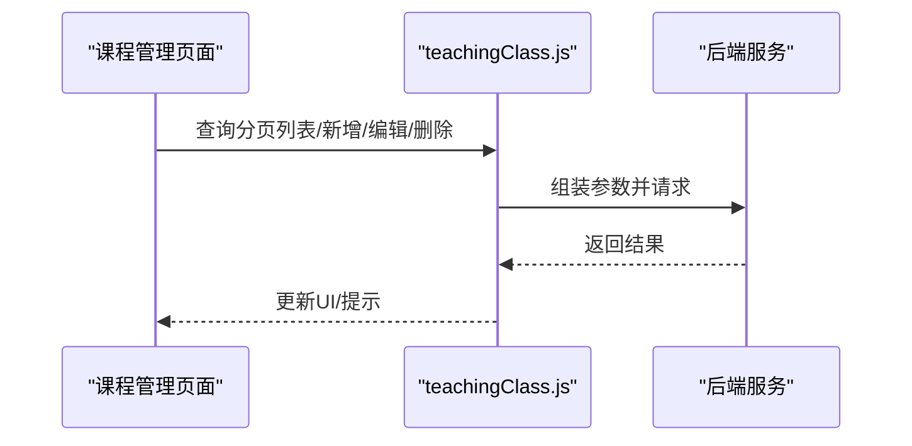
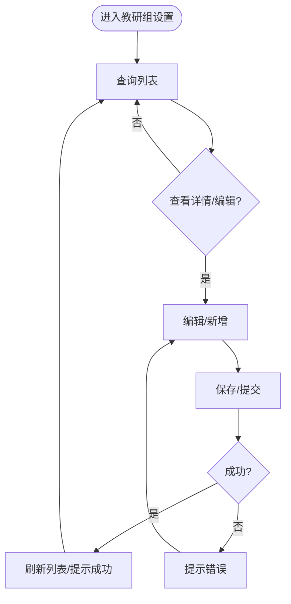
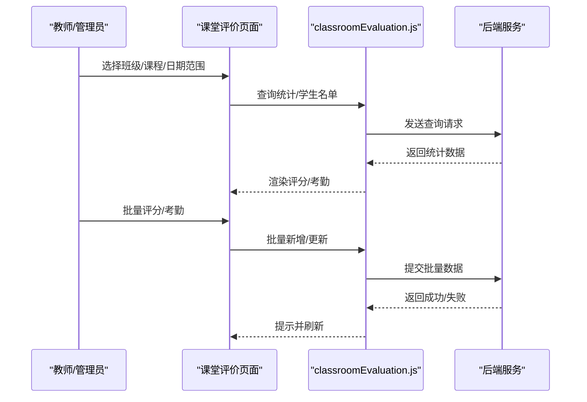
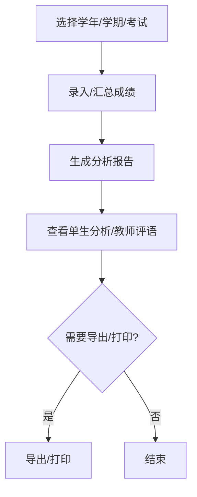
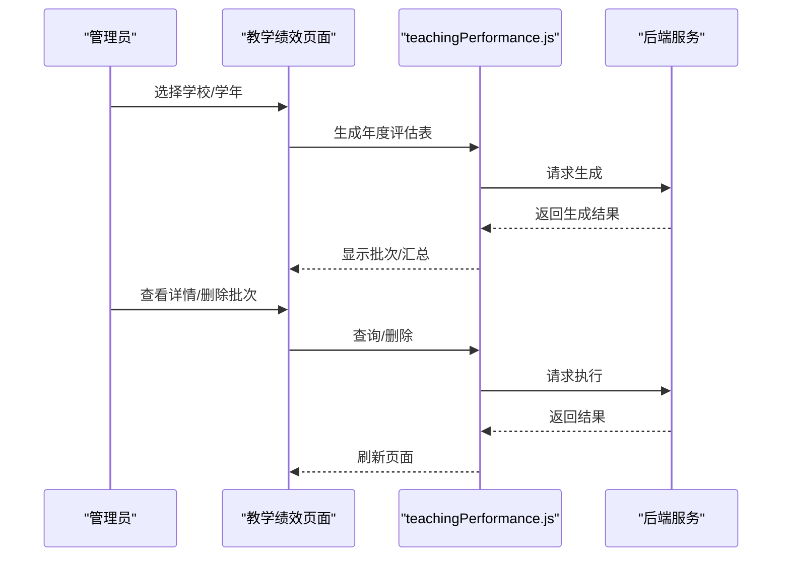
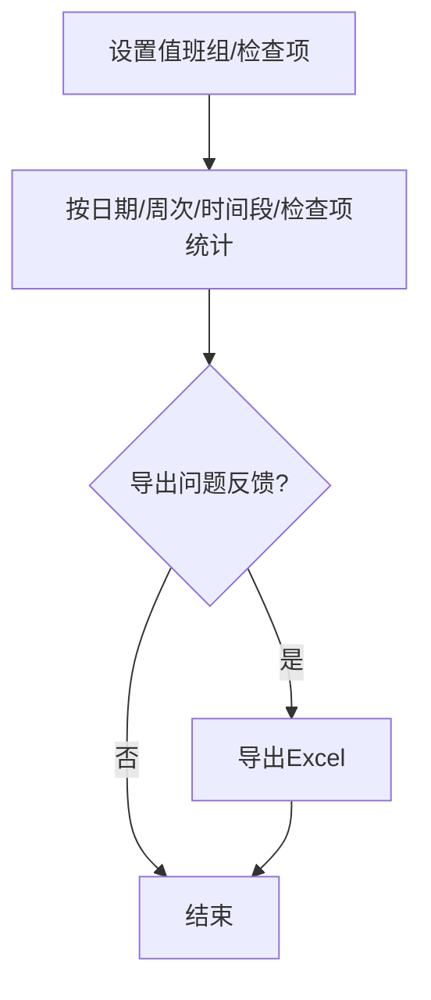
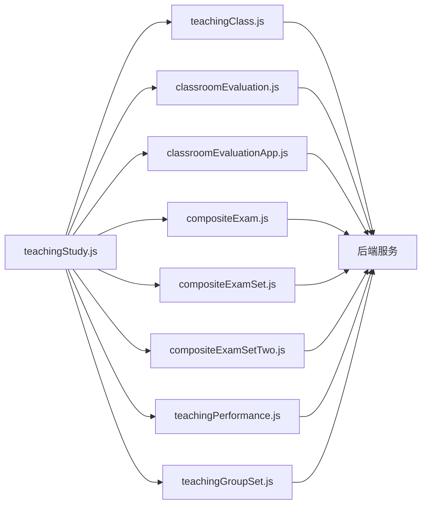

# 教学管理

<cite>
**本文引用的文件**
- [teachingClass.js](file://src/api/teachingClass.js)
- [teachingPerformance.js](file://src/api/teachingPerformance.js)
- [teachingGroupSet.js](file://src/api/systemSet/teachingGroupSet.js)
- [teachingStudy.js](file://src/router/normal/teachingStudy.js)
- [classroomEvaluation.js](file://src/api/classroomEvaluation.js)
- [classroomEvaluationApp.js](file://src/api/classroomEvaluationApp.js)
- [compositeExam.js](file://src/api/compositeExam.js)
- [compositeExamSet.js](file://src/api/compositeExamSet.js)
- [compositeExamSetTwo.js](file://src/api/compositeExamSetTwo.js)
</cite>

## 目录
1. [引言](#引言)
2. [项目结构](#项目结构)
3. [核心组件](#核心组件)
4. [架构总览](#架构总览)
5. [详细组件分析](#详细组件分析)
6. [依赖分析](#依赖分析)
7. [性能考虑](#性能考虑)
8. [故障排查指南](#故障排查指南)
9. [结论](#结论)
10. [附录](#附录)

## 引言
本文件面向教学管理模块，系统化梳理课程安排、成绩管理、课堂评价、教学资源与绩效评估等核心业务流程，阐明数据采集、处理与展示机制，并说明与学生管理、教师管理等模块的交互关系。同时提供配置项、权限控制与扩展能力说明，帮助开发者与运维人员快速理解并高效使用该模块。

## 项目结构
教学管理模块在前端采用“路由 + API 封装”的分层设计：
- 路由层：集中于 teachingStudy.js，承载课程表、考试、课堂评价、公开课、绩效等子业务入口。
- API 层：围绕具体业务域封装 HTTP 请求，统一通过 fetch 工具发起请求，便于复用与治理。
- 视图层：各子业务对应的页面视图，由路由动态加载。

图表来源
- [teachingStudy.js:1-672](file://src/router/normal/teachingStudy.js#L1-L672)
- [teachingClass.js:1-139](file://src/api/teachingClass.js#L1-L139)
- [teachingPerformance.js:1-140](file://src/api/teachingPerformance.js#L1-L140)
- [teachingGroupSet.js:1-82](file://src/api/systemSet/teachingGroupSet.js#L1-L82)
- [classroomEvaluation.js:1-242](file://src/api/classroomEvaluation.js#L1-L242)
- [classroomEvaluationApp.js:1-242](file://src/api/classroomEvaluationApp.js#L1-L242)
- [compositeExam.js:1-142](file://src/api/compositeExam.js#L1-L142)
- [compositeExamSet.js:1-195](file://src/api/compositeExamSet.js#L1-L195)
- [compositeExamSetTwo.js:1-175](file://src/api/compositeExamSetTwo.js#L1-L175)

章节来源
- [teachingStudy.js:1-672](file://src/router/normal/teachingStudy.js#L1-L672)

## 核心组件
- 教师-班级课程管理：提供教师与班级课程的增删改查、导入、同步等能力，支撑课程安排与教师工作量统计。
- 教学研究组设置：支持教研组的新增、编辑、删除与详情查看，便于跨学科协作与教学研究组织。
- 课堂评价：提供按班级、按教师、按日期维度的课堂行为评分与统计，支持一键满分、初始分设置等。
- 考试与成绩：覆盖考试组织、成绩录入、统计分析、报告呈现与学生成绩明细。
- 教学绩效：支持学年绩效评估表生成、批次管理、汇总与分析。
- 综合检查：支持值班组设置、检查项配置、按日期/周次/时间段/检查项统计与问题反馈导出。

章节来源
- [teachingClass.js:1-139](file://src/api/teachingClass.js#L1-L139)
- [teachingGroupSet.js:1-82](file://src/api/systemSet/teachingGroupSet.js#L1-L82)
- [classroomEvaluation.js:1-242](file://src/api/classroomEvaluation.js#L1-L242)
- [classroomEvaluationApp.js:1-242](file://src/api/classroomEvaluationApp.js#L1-L242)
- [compositeExam.js:1-142](file://src/api/compositeExam.js#L1-L142)
- [teachingPerformance.js:1-140](file://src/api/teachingPerformance.js#L1-L140)
- [compositeExamSet.js:1-195](file://src/api/compositeExamSet.js#L1-L195)
- [compositeExamSetTwo.js:1-175](file://src/api/compositeExamSetTwo.js#L1-L175)

## 架构总览
教学管理模块以“路由聚合 + API 封装 + 视图页面”三层协同工作：
- 路由层负责导航与页面装载；
- API 层负责与后端交互，统一封装参数与返回格式；
- 视图层负责数据渲染与用户交互。

图表来源
- [teachingStudy.js:1-672](file://src/router/normal/teachingStudy.js#L1-L672)
- [teachingClass.js:1-139](file://src/api/teachingClass.js#L1-L139)
- [classroomEvaluation.js:1-242](file://src/api/classroomEvaluation.js#L1-L242)
- [compositeExam.js:1-142](file://src/api/compositeExam.js#L1-L142)

## 详细组件分析

### 课程安排与教师-班级课程管理
- 主要职责
  - 管理教师与班级课程的绑定关系，支持分页查询、新增/修改、删除、导入、同步至企业微信等。
  - 提供课程弹窗、是否存在判断、编辑入口等辅助能力。
- 关键接口
  - 分页列表、保存/更新、课程弹窗、是否存在、删除、编辑、上传、同步。
- 数据流
  - 页面选择条件 -> API 参数组装 -> 调用后端 -> 返回列表/状态 -> 视图刷新。

图表来源
- [teachingClass.js:1-139](file://src/api/teachingClass.js#L1-L139)

章节来源
- [teachingClass.js:1-139](file://src/api/teachingClass.js#L1-L139)

### 教学研究组设置
- 主要职责
  - 教研组的增删改查与详情查看，支持成员、负责人、学科、年级等字段维护。
- 关键接口
  - 列表、详情、删除、新增、修改。
- 数据流
  - 页面提交 -> API 参数拼装 -> 调用后端 -> 返回状态 -> 视图提示与刷新。

图表来源
- [teachingGroupSet.js:1-82](file://src/api/systemSet/teachingGroupSet.js#L1-L82)

章节来源
- [teachingGroupSet.js:1-82](file://src/api/systemSet/teachingGroupSet.js#L1-L82)

### 课堂评价（Web 与 APP）
- 主要职责
  - 支持按班级/教师/日期维度的课堂行为评分统计；支持批量新增、按座位统计、初始分设置与清空、一键满分等。
  - APP 场景下提供节次查询、行为类型列表、学生名单、考勤统计与批量新增等能力。
- 关键接口
  - 班级/教师/日期统计、节次列表、行为类型列表、学生名单、批量新增、考勤统计、初始分设置/清空、一键满分。
- 数据流
  - 选择范围/筛选 -> 调用统计接口 -> 展示评分/考勤 -> 批量更新 -> 提交 -> 成功提示。

图表来源
- [classroomEvaluation.js:1-242](file://src/api/classroomEvaluation.js#L1-L242)

章节来源
- [classroomEvaluation.js:1-242](file://src/api/classroomEvaluation.js#L1-L242)
- [classroomEvaluationApp.js:1-242](file://src/api/classroomEvaluationApp.js#L1-L242)

### 考试与成绩管理
- 主要职责
  - 考试组织、成绩录入、统计分析、报告呈现、学生成绩明细、教师评语等。
- 关键接口
  - 路由覆盖“考试主页/成绩录入/分析/汇总/报告/单生分析/教师评语”等页面。
- 数据流
  - 选择学年/学期/考试 -> 录入/汇总 -> 分析 -> 报告 -> 导出/打印。

图表来源
- [teachingStudy.js:150-188](file://src/router/normal/teachingStudy.js#L150-L188)

章节来源
- [teachingStudy.js:150-188](file://src/router/normal/teachingStudy.js#L150-L188)

### 教学绩效管理
- 主要职责
  - 学年绩效评估表生成、批次管理、汇总与分析、删除批次、详情查看等。
- 关键接口
  - 年度/批次/汇总/评估表查询、生成、删除、详情。
- 数据流
  - 选择学校/学年 -> 生成批次 -> 查看汇总 -> 分析 -> 导出/归档。

图表来源
- [teachingPerformance.js:1-140](file://src/api/teachingPerformance.js#L1-L140)

章节来源
- [teachingPerformance.js:1-140](file://src/api/teachingPerformance.js#L1-L140)

### 综合检查（值班/检查项/统计）
- 主要职责
  - 值班组设置、检查项配置、按日期/周次/时间段/检查项统计、问题反馈导出等。
- 关键接口
  - 值班组/检查项/分组 CRUD、课表节次信息、统计查询、导出 Excel。
- 数据流
  - 设置值班/检查项 -> 统计 -> 导出问题反馈 -> 归档。

图表来源
- [compositeExamSet.js:1-195](file://src/api/compositeExamSet.js#L1-L195)
- [compositeExam.js:1-142](file://src/api/compositeExam.js#L1-L142)
- [compositeExamSetTwo.js:1-175](file://src/api/compositeExamSetTwo.js#L1-L175)

章节来源
- [compositeExamSet.js:1-195](file://src/api/compositeExamSet.js#L1-L195)
- [compositeExam.js:1-142](file://src/api/compositeExam.js#L1-L142)
- [compositeExamSetTwo.js:1-175](file://src/api/compositeExamSetTwo.js#L1-L175)

## 依赖分析
- 路由与视图
  - teachingStudy.js 聚合了课程表、考试、课堂评价、公开课、教学绩效、综合检查等子模块的页面入口，形成统一的导航与访问路径。
- API 与后端
  - 各业务 API 文件通过统一的 fetch 工具封装请求，参数以 URLSearchParams 或 JSON 方式传递，便于统一治理与调试。
- 模块间耦合
  - 教师-班级课程与课堂评价存在强关联（按教师/班级统计），课程数据是评价统计的基础。
  - 绩效管理依赖考试/评价等数据源进行汇总分析。
  - 综合检查与课程表/值班设置存在时间维度上的耦合。

图表来源
- [teachingStudy.js:1-672](file://src/router/normal/teachingStudy.js#L1-L672)
- [teachingClass.js:1-139](file://src/api/teachingClass.js#L1-L139)
- [classroomEvaluation.js:1-242](file://src/api/classroomEvaluation.js#L1-L242)
- [classroomEvaluationApp.js:1-242](file://src/api/classroomEvaluationApp.js#L1-L242)
- [compositeExam.js:1-142](file://src/api/compositeExam.js#L1-L142)
- [compositeExamSet.js:1-195](file://src/api/compositeExamSet.js#L1-L195)
- [compositeExamSetTwo.js:1-175](file://src/api/compositeExamSetTwo.js#L1-L175)
- [teachingPerformance.js:1-140](file://src/api/teachingPerformance.js#L1-L140)
- [teachingGroupSet.js:1-82](file://src/api/systemSet/teachingGroupSet.js#L1-L82)

章节来源
- [teachingStudy.js:1-672](file://src/router/normal/teachingStudy.js#L1-L672)

## 性能考虑
- 接口参数优化
  - 使用 URLSearchParams 统一参数编码，避免重复拼接字符串，提升可读性与可维护性。
- 分页与批量
  - 列表查询采用分页参数，避免一次性拉取大量数据；批量新增/更新时建议后端支持幂等与事务，确保一致性。
- 缓存与重用
  - 对常用枚举（如节次、行为类型、检查项）进行前端缓存，减少重复请求。
- 错误与超时
  - 在 fetch 工具中统一处理错误与超时，避免页面阻塞；对高频请求增加防抖策略。

## 故障排查指南
- 常见问题
  - 无法加载课程/班级列表：检查网络与后端接口连通性，确认参数是否正确传入。
  - 课堂评价无数据：确认日期范围、班级/课程选择是否匹配，检查初始分是否已设置。
  - 成绩统计为空：确认学年/学期/考试是否正确选择，是否已完成成绩录入与汇总。
  - 绩效生成失败：检查学校/学年参数，确认是否存在未完成的前置流程。
- 排查步骤
  - 打开浏览器开发者工具，查看 Network 面板中的请求与响应。
  - 核对请求 URL、参数与返回状态码，定位具体接口问题。
  - 若为批量操作，检查后端日志与事务回滚情况。

章节来源
- [classroomEvaluation.js:1-242](file://src/api/classroomEvaluation.js#L1-L242)
- [compositeExam.js:1-142](file://src/api/compositeExam.js#L1-L142)
- [teachingPerformance.js:1-140](file://src/api/teachingPerformance.js#L1-L140)

## 结论
教学管理模块通过清晰的路由与 API 设计，实现了从课程安排、课堂评价、考试成绩到教学绩效的全链路管理。模块间通过统一的参数与返回格式实现低耦合高内聚，具备良好的扩展性与可维护性。建议在实际部署中完善权限控制与审计日志，持续优化接口性能与用户体验。

## 附录
- 配置选项
  - 教学研究组设置：支持成员、负责人、学科、年级等字段配置。
  - 综合检查设置：支持值班组、检查项、分组、课表节次等配置。
  - 课堂评价设置：支持行为类型、节次、座位统计等配置。
- 权限控制
  - 建议基于角色区分“教师/管理员/教务”等权限，限制敏感操作（如删除、批量更新）。
- 扩展能力
  - 新增业务可通过 teachingStudy.js 路由注册与 API 封装对接，保持一致的交互体验与数据治理标准。