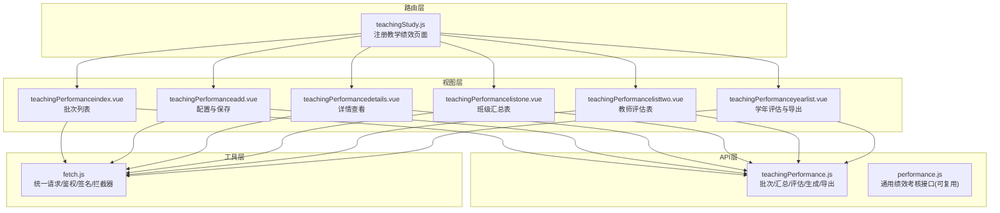
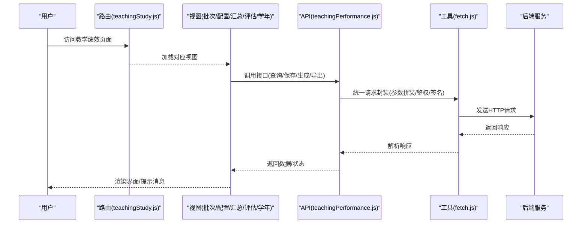
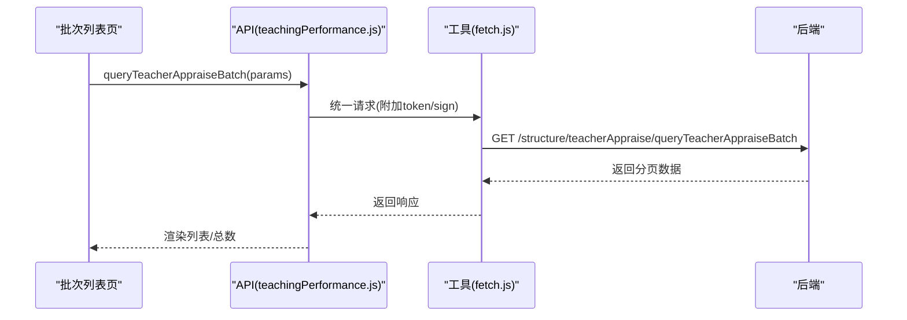
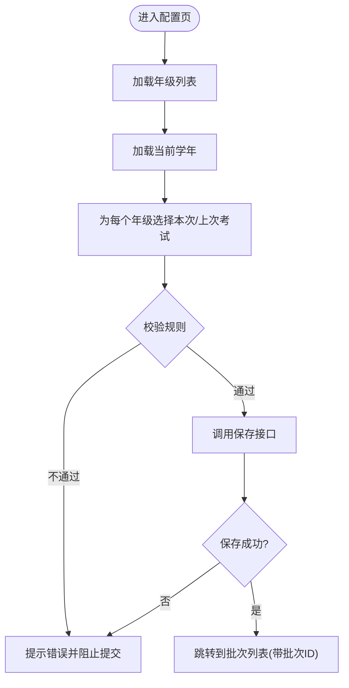
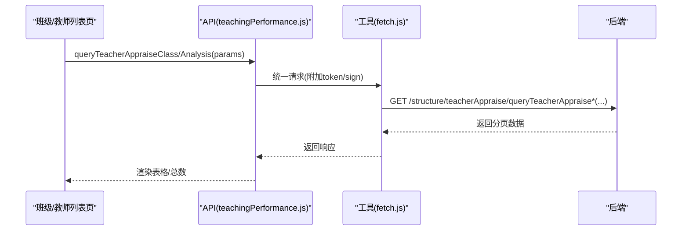
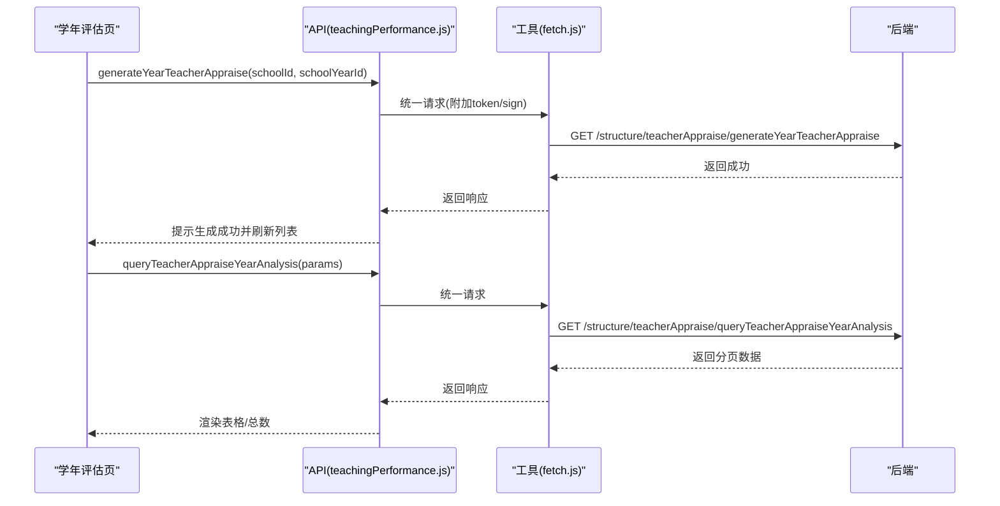
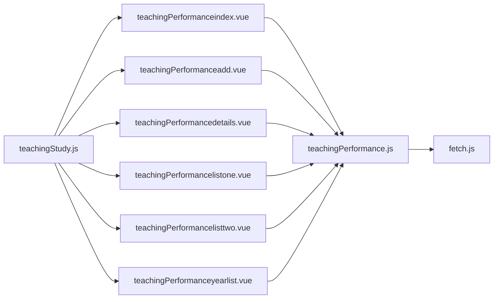

# 教学绩效管理

<cite>
**本文引用的文件**
- [src/api/teachingPerformance.js](file://src/api/teachingPerformance.js)
- [src/views/teachingPerformance/teachingPerformanceindex.vue](file://src/views/teachingPerformance/teachingPerformanceindex.vue)
- [src/views/teachingPerformance/teachingPerformanceadd.vue](file://src/views/teachingPerformance/teachingPerformanceadd.vue)
- [src/views/teachingPerformance/teachingPerformancedetails.vue](file://src/views/teachingPerformance/teachingPerformancedetails.vue)
- [src/views/teachingPerformance/teachingPerformancelistone.vue](file://src/views/teachingPerformance/teachingPerformancelistone.vue)
- [src/views/teachingPerformance/teachingPerformancelisttwo.vue](file://src/views/teachingPerformance/teachingPerformancelisttwo.vue)
- [src/views/teachingPerformance/teachingPerformanceyearlist.vue](file://src/views/teachingPerformance/teachingPerformanceyearlist.vue)
- [src/router/normal/teachingStudy.js](file://src/router/normal/teachingStudy.js)
- [src/utils/fetch.js](file://src/utils/fetch.js)
- [src/api/performance.js](file://src/api/performance.js)
</cite>

## 目录
1. [简介](#简介)
2. [项目结构](#项目结构)
3. [核心组件](#核心组件)
4. [架构总览](#架构总览)
5. [详细组件分析](#详细组件分析)
6. [依赖分析](#依赖分析)
7. [性能考虑](#性能考虑)
8. [故障排查指南](#故障排查指南)
9. [结论](#结论)
10. [附录](#附录)

## 简介
本技术文档围绕“教学绩效管理”功能展开，覆盖教师教学工作量统计、绩效评估与奖励机制的前端实现。重点包括：
- 绩效指标计算方法、权重分配与等级评定规则的前端配置与展示
- 绩效数据采集、处理与展示流程
- 绩效统计报表生成逻辑与导出能力
- 配置选项、审核流程与结果应用的前端交互
- 绩效对比分析与趋势预测的前端支持点

本功能由教学绩效配置页面、批次管理、班级/教师绩效汇总与评估、学年评估生成与导出等模块组成，并通过统一的网络层封装与路由组织。

## 项目结构
教学绩效管理位于“teachingStudy”模块下，采用按功能分层的目录组织：
- API 层：封装与后端交互的接口，如批次查询、保存、生成学年评估、导出等
- 视图层：提供配置、列表、详情、汇总与评估、学年评估等页面
- 路由层：在 teachingStudy 模块中注册各页面路径
- 工具层：统一的网络请求封装 fetch.js

图表来源
- [src/router/normal/teachingStudy.js:315-343](file://src/router/normal/teachingStudy.js#L315-L343)
- [src/views/teachingPerformance/teachingPerformanceindex.vue:1-197](file://src/views/teachingPerformance/teachingPerformanceindex.vue#L1-L197)
- [src/views/teachingPerformance/teachingPerformanceadd.vue:1-307](file://src/views/teachingPerformance/teachingPerformanceadd.vue#L1-L307)
- [src/views/teachingPerformance/teachingPerformancedetails.vue:1-170](file://src/views/teachingPerformance/teachingPerformancedetails.vue#L1-L170)
- [src/views/teachingPerformance/teachingPerformancelistone.vue:1-124](file://src/views/teachingPerformance/teachingPerformancelistone.vue#L1-L124)
- [src/views/teachingPerformance/teachingPerformancelisttwo.vue:1-135](file://src/views/teachingPerformance/teachingPerformancelisttwo.vue#L1-L135)
- [src/views/teachingPerformance/teachingPerformanceyearlist.vue:1-159](file://src/views/teachingPerformance/teachingPerformanceyearlist.vue#L1-L159)
- [src/api/teachingPerformance.js:1-140](file://src/api/teachingPerformance.js#L1-L140)
- [src/utils/fetch.js:1-240](file://src/utils/fetch.js#L1-L240)

章节来源
- [src/router/normal/teachingStudy.js:315-343](file://src/router/normal/teachingStudy.js#L315-L343)
- [src/views/teachingPerformance/teachingPerformanceindex.vue:1-197](file://src/views/teachingPerformance/teachingPerformanceindex.vue#L1-L197)
- [src/views/teachingPerformance/teachingPerformanceadd.vue:1-307](file://src/views/teachingPerformance/teachingPerformanceadd.vue#L1-L307)
- [src/views/teachingPerformance/teachingPerformancedetails.vue:1-170](file://src/views/teachingPerformance/teachingPerformancedetails.vue#L1-L170)
- [src/views/teachingPerformance/teachingPerformancelistone.vue:1-124](file://src/views/teachingPerformance/teachingPerformancelistone.vue#L1-L124)
- [src/views/teachingPerformance/teachingPerformancelisttwo.vue:1-135](file://src/views/teachingPerformance/teachingPerformancelisttwo.vue#L1-L135)
- [src/views/teachingPerformance/teachingPerformanceyearlist.vue:1-159](file://src/views/teachingPerformance/teachingPerformanceyearlist.vue#L1-L159)
- [src/api/teachingPerformance.js:1-140](file://src/api/teachingPerformance.js#L1-L140)
- [src/utils/fetch.js:1-240](file://src/utils/fetch.js#L1-L240)

## 核心组件
- 批次管理页面：提供学年筛选、创建批次、查看详情、删除批次、分页查询等功能
- 配置页面：配置评估方式、权重、等级比例、考试数据映射等，并保存生成批次
- 汇总与评估页面：分别展示班级维度与教师维度的绩效统计与评估结果
- 学年评估页面：生成学年评估并支持导出
- API 封装：统一的请求方法、参数拼装、鉴权与签名处理
- 路由注册：在 teachingStudy 模块下集中注册教学绩效相关页面

章节来源
- [src/views/teachingPerformance/teachingPerformanceindex.vue:1-197](file://src/views/teachingPerformance/teachingPerformanceindex.vue#L1-L197)
- [src/views/teachingPerformance/teachingPerformanceadd.vue:1-307](file://src/views/teachingPerformance/teachingPerformanceadd.vue#L1-L307)
- [src/views/teachingPerformance/teachingPerformancelistone.vue:1-124](file://src/views/teachingPerformance/teachingPerformancelistone.vue#L1-L124)
- [src/views/teachingPerformance/teachingPerformancelisttwo.vue:1-135](file://src/views/teachingPerformance/teachingPerformancelisttwo.vue#L1-L135)
- [src/views/teachingPerformance/teachingPerformanceyearlist.vue:1-159](file://src/views/teachingPerformance/teachingPerformanceyearlist.vue#L1-L159)
- [src/api/teachingPerformance.js:1-140](file://src/api/teachingPerformance.js#L1-L140)
- [src/router/normal/teachingStudy.js:315-343](file://src/router/normal/teachingStudy.js#L315-L343)

## 架构总览
前端采用“路由 -> 视图 -> API -> 工具”的分层架构。视图层通过 API 层调用后端接口，工具层负责统一的请求配置、鉴权与拦截处理。

图表来源
- [src/router/normal/teachingStudy.js:315-343](file://src/router/normal/teachingStudy.js#L315-L343)
- [src/views/teachingPerformance/teachingPerformanceindex.vue:1-197](file://src/views/teachingPerformance/teachingPerformanceindex.vue#L1-L197)
- [src/api/teachingPerformance.js:1-140](file://src/api/teachingPerformance.js#L1-L140)
- [src/utils/fetch.js:1-240](file://src/utils/fetch.js#L1-L240)

## 详细组件分析

### 批次管理页面（teachingPerformanceindex）
- 功能要点
  - 学年筛选与当前学年默认值
  - 分页查询批次列表
  - 查看详情、删除批次
  - 跳转到配置与学年评估页面
- 关键接口
  - 查询批次列表：queryTeacherAppraiseBatch
  - 删除批次：deleteTeacherAppraiseBatch
  - 获取当前学年：getCurrentSchoolTimeBySchoolId
  - 获取学年列表：getSchoolYear
- 数据字段
  - 主题、绩效MAX/MIN、均分/优秀率提升百分比、评估方式、R/M、操作列

图表来源
- [src/views/teachingPerformance/teachingPerformanceindex.vue:108-142](file://src/views/teachingPerformance/teachingPerformanceindex.vue#L108-L142)
- [src/api/teachingPerformance.js:24-49](file://src/api/teachingPerformance.js#L24-L49)
- [src/utils/fetch.js:66-169](file://src/utils/fetch.js#L66-L169)

章节来源
- [src/views/teachingPerformance/teachingPerformanceindex.vue:1-197](file://src/views/teachingPerformance/teachingPerformanceindex.vue#L1-L197)
- [src/api/teachingPerformance.js:1-140](file://src/api/teachingPerformance.js#L1-L140)
- [src/utils/fetch.js:1-240](file://src/utils/fetch.js#L1-L240)

### 配置页面（teachingPerformanceadd）
- 功能要点
  - 配置评估方式（平均/占比）、权重、等级比例
  - 选择各年级的“本次/上次”考试数据
  - 表单校验与保存，生成批次并跳转列表
- 关键接口
  - 保存批次：saveTeacherAppraiseBatch
  - 获取年级列表：querySchoolGrade
  - 获取当前学年：getCurrentSchoolTimeBySchoolId
  - 获取某年级考试列表：getExamListByGradeId
- 表单校验规则
  - MAX≥MIN
  - 占比模式下最高/最低占比之和为100
  - 奖励比例之和不超过10
  - 至少选择一个年级的考试

图表来源
- [src/views/teachingPerformance/teachingPerformanceadd.vue:176-236](file://src/views/teachingPerformance/teachingPerformanceadd.vue#L176-L236)
- [src/api/teachingPerformance.js:108-140](file://src/api/teachingPerformance.js#L108-L140)

章节来源
- [src/views/teachingPerformance/teachingPerformanceadd.vue:1-307](file://src/views/teachingPerformance/teachingPerformanceadd.vue#L1-L307)
- [src/api/teachingPerformance.js:1-140](file://src/api/teachingPerformance.js#L1-L140)

### 详情页面（teachingPerformancedetails）
- 功能要点
  - 展示批次配置详情（含相对考试关系）
  - 跳转到班级/教师绩效列表
- 关键接口
  - 获取批次详情：getTeacherAppraiseBatchById

章节来源
- [src/views/teachingPerformance/teachingPerformancedetails.vue:1-170](file://src/views/teachingPerformance/teachingPerformancedetails.vue#L1-L170)
- [src/api/teachingPerformance.js:98-107](file://src/api/teachingPerformance.js#L98-L107)

### 汇总与评估页面
- 班级汇总表（teachingPerformancelistone）
  - 字段：班级、学科、均分、及格率、优秀率、标准差、均分比、推进率、原始值、综合值
  - 支持导出与分页查询
  - 关键接口：queryTeacherAppraiseClass
- 教师评估表（teachingPerformancelisttwo）
  - 字段：教师、班级、学科、个人综合值、名次、奖项
  - 支持导出与分页查询
  - 关键接口：queryTeacherAppraiseAnalysis

图表来源
- [src/views/teachingPerformance/teachingPerformancelistone.vue:76-91](file://src/views/teachingPerformance/teachingPerformancelistone.vue#L76-L91)
- [src/views/teachingPerformance/teachingPerformancelisttwo.vue:87-102](file://src/views/teachingPerformance/teachingPerformancelisttwo.vue#L87-L102)
- [src/api/teachingPerformance.js:51-76](file://src/api/teachingPerformance.js#L51-L76)
- [src/utils/fetch.js:66-169](file://src/utils/fetch.js#L66-L169)

章节来源
- [src/views/teachingPerformance/teachingPerformancelistone.vue:1-124](file://src/views/teachingPerformance/teachingPerformancelistone.vue#L1-L124)
- [src/views/teachingPerformance/teachingPerformancelisttwo.vue:1-135](file://src/views/teachingPerformance/teachingPerformancelisttwo.vue#L1-L135)
- [src/api/teachingPerformance.js:1-140](file://src/api/teachingPerformance.js#L1-L140)

### 学年评估页面（teachingPerformanceyearlist）
- 功能要点
  - 生成学年评估（批量计算并落库）
  - 导出学年评估报表
  - 支持按教师姓名搜索与分页
- 关键接口
  - 生成：generateYearTeacherAppraise
  - 查询：queryTeacherAppraiseYearAnalysis
  - 导出：构造下载链接（后端提供）

图表来源
- [src/views/teachingPerformance/teachingPerformanceyearlist.vue:103-130](file://src/views/teachingPerformance/teachingPerformanceyearlist.vue#L103-L130)
- [src/api/teachingPerformance.js:87-97](file://src/api/teachingPerformance.js#L87-L97)
- [src/utils/fetch.js:66-169](file://src/utils/fetch.js#L66-L169)

章节来源
- [src/views/teachingPerformance/teachingPerformanceyearlist.vue:1-159](file://src/views/teachingPerformance/teachingPerformanceyearlist.vue#L1-L159)
- [src/api/teachingPerformance.js:1-140](file://src/api/teachingPerformance.js#L1-L140)

### 绩效指标计算与权重分配（前端配置与展示）
- 配置项
  - 评估方式：平均/占比
  - 绩效MAX/MIN、均分/优秀率提升百分比
  - 奖励比例：卓越奖、优秀奖、合格奖
  - 考试数据映射：各年级“本次/上次”考试
- 展示字段
  - 班级维度：均分、及格率、优秀率、标准差、均分比、推进率、原始值、综合值
  - 教师维度：个人综合值、名次、奖项
- 说明
  - 以上字段与计算规则来源于后端批次配置与生成逻辑；前端负责展示与导出

章节来源
- [src/views/teachingPerformance/teachingPerformanceadd.vue:1-307](file://src/views/teachingPerformance/teachingPerformanceadd.vue#L1-L307)
- [src/views/teachingPerformance/teachingPerformancelistone.vue:1-124](file://src/views/teachingPerformance/teachingPerformancelistone.vue#L1-L124)
- [src/views/teachingPerformance/teachingPerformancelisttwo.vue:1-135](file://src/views/teachingPerformance/teachingPerformancelisttwo.vue#L1-L135)

### 审核流程与结果应用（前端交互）
- 通用绩效考核接口（performance.js）
  - 任务管理：创建、发布、查询、完成
  - 上报与审核：填报、上报、审核、驳回、撤销
  - 修改记录：新增、编辑、提交、审核、查询
  - 导出与查询：任务内人员、报表、留言等
- 与教学绩效的关系
  - 教学绩效的批次与评估可复用通用绩效模块的流程与接口
  - 前端通过统一 API 层调用，实现“填报-上报-审核-发布”的闭环

章节来源
- [src/api/performance.js:1-875](file://src/api/performance.js#L1-L875)
- [src/utils/fetch.js:1-240](file://src/utils/fetch.js#L1-L240)

## 依赖分析
- 组件耦合
  - 视图层依赖 API 层；API 层依赖工具层 fetch.js
  - 路由层集中注册教学绩效页面，降低跨模块耦合
- 外部依赖
  - Element UI 组件库用于表格、分页、对话框等
  - Axios 作为 HTTP 客户端，统一拦截器处理鉴权与签名
- 可能的循环依赖
  - 当前结构清晰，未发现循环依赖迹象

图表来源
- [src/views/teachingPerformance/teachingPerformanceindex.vue:1-197](file://src/views/teachingPerformance/teachingPerformanceindex.vue#L1-L197)
- [src/views/teachingPerformance/teachingPerformanceadd.vue:1-307](file://src/views/teachingPerformance/teachingPerformanceadd.vue#L1-L307)
- [src/views/teachingPerformance/teachingPerformancedetails.vue:1-170](file://src/views/teachingPerformance/teachingPerformancedetails.vue#L1-L170)
- [src/views/teachingPerformance/teachingPerformancelistone.vue:1-124](file://src/views/teachingPerformance/teachingPerformancelistone.vue#L1-L124)
- [src/views/teachingPerformance/teachingPerformancelisttwo.vue:1-135](file://src/views/teachingPerformance/teachingPerformancelisttwo.vue#L1-L135)
- [src/views/teachingPerformance/teachingPerformanceyearlist.vue:1-159](file://src/views/teachingPerformance/teachingPerformanceyearlist.vue#L1-L159)
- [src/api/teachingPerformance.js:1-140](file://src/api/teachingPerformance.js#L1-L140)
- [src/router/normal/teachingStudy.js:315-343](file://src/router/normal/teachingStudy.js#L315-L343)
- [src/utils/fetch.js:1-240](file://src/utils/fetch.js#L1-L240)

章节来源
- [src/router/normal/teachingStudy.js:315-343](file://src/router/normal/teachingStudy.js#L315-L343)
- [src/utils/fetch.js:1-240](file://src/utils/fetch.js#L1-L240)

## 性能考虑
- 分页查询：列表页均使用分页参数，避免一次性加载大量数据
- 参数拼装：统一使用 URLSearchParams，减少无效参数传递
- 鉴权与签名：自动附加 token/sign，避免重复逻辑
- 导出优化：通过后端直链下载，前端仅构造链接，降低内存占用

## 故障排查指南
- 接口失败
  - 检查统一拦截器中的错误码处理与提示
  - 关注 1000（登录超时）等特殊状态的处理
- 参数问题
  - 确认必填字段与校验规则是否满足
  - 占比模式下最高/最低占比之和应为100
- 导出异常
  - 确认下载链接是否包含 token 与必要参数
  - 检查后端是否允许当前用户访问导出资源

章节来源
- [src/utils/fetch.js:104-169](file://src/utils/fetch.js#L104-L169)
- [src/views/teachingPerformance/teachingPerformanceadd.vue:202-236](file://src/views/teachingPerformance/teachingPerformanceadd.vue#L202-L236)
- [src/views/teachingPerformance/teachingPerformanceyearlist.vue:121-123](file://src/views/teachingPerformance/teachingPerformanceyearlist.vue#L121-L123)

## 结论
教学绩效管理功能通过清晰的分层架构与统一的 API/工具封装，实现了从配置、批次管理、班级/教师绩效统计到学年评估与导出的完整流程。前端重点在于配置校验、数据展示与导出支持；与通用绩效模块的接口复用，进一步提升了可维护性与扩展性。后续可在前端补充对比分析与趋势预测的可视化组件，以增强数据分析能力。

## 附录
- 路由注册位置：teachingStudy 模块下的教学绩效页面
- API 方法清单（节选）
  - 批次：queryTeacherAppraiseBatch、deleteTeacherAppraiseBatch、saveTeacherAppraiseBatch、getTeacherAppraiseBatchById
  - 汇总/评估：queryTeacherAppraiseClass、queryTeacherAppraiseAnalysis
  - 学年：queryTeacherAppraiseYearAnalysis、generateYearTeacherAppraise
  - 考试映射：getExamListByGradeId
- 通用绩效接口（节选）
  - 任务：newTest、publishTaskById、finishTaskByTaskId
  - 上报与审核：reportPerformance、submitReportPerformanceAssess、auditPass、auditReject
  - 修改记录：insertRecord、editRecord、submitRecord、auditRecord

章节来源
- [src/router/normal/teachingStudy.js:315-343](file://src/router/normal/teachingStudy.js#L315-L343)
- [src/api/teachingPerformance.js:1-140](file://src/api/teachingPerformance.js#L1-L140)
- [src/api/performance.js:1-875](file://src/api/performance.js#L1-L875)