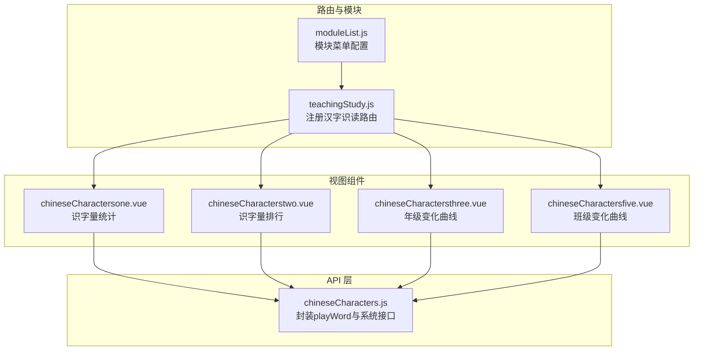
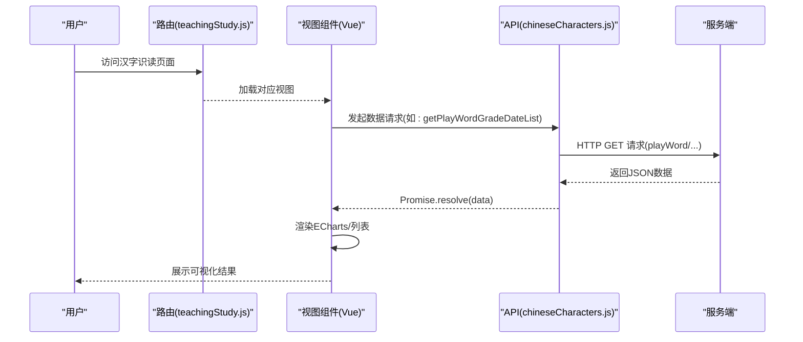
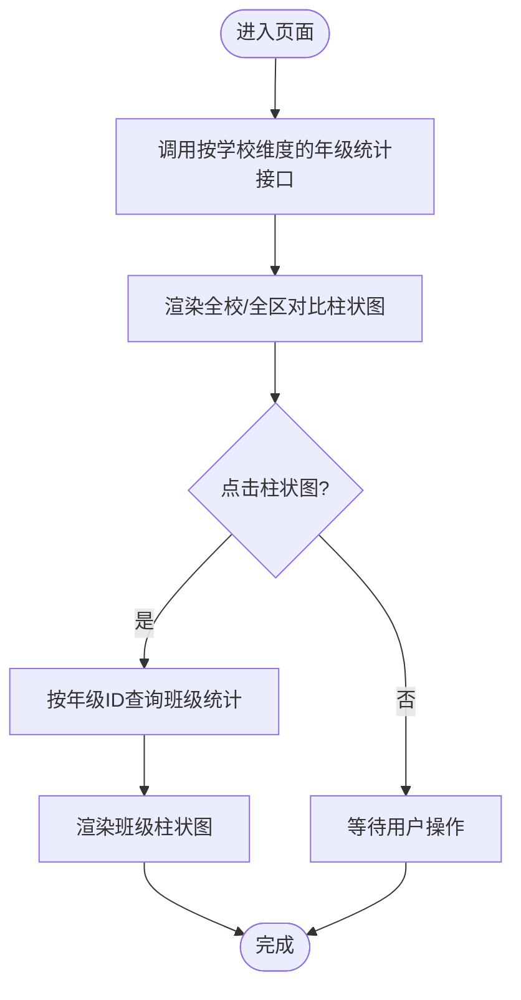
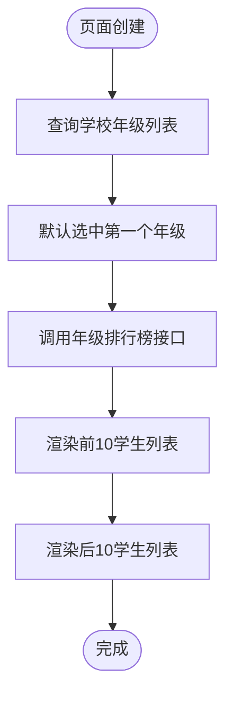
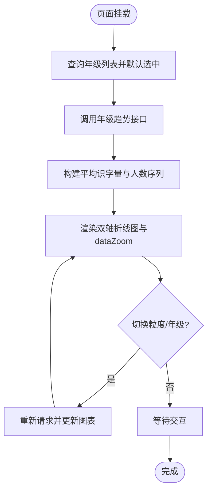
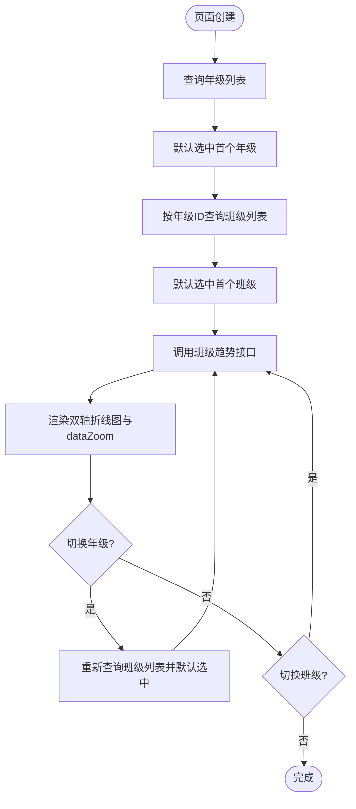
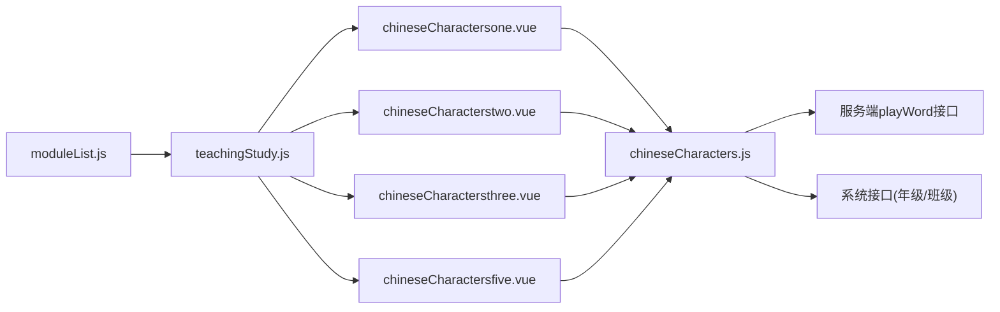

# 汉字识读

<cite>
**本文引用的文件**
- [chineseCharactersone.vue](file://src/views/chineseCharacters/chineseCharactersone.vue)
- [chineseCharacterstwo.vue](file://src/views/chineseCharacters/chineseCharacterstwo.vue)
- [chineseCharactersthree.vue](file://src/views/chineseCharacters/chineseCharactersthree.vue)
- [chineseCharactersfive.vue](file://src/views/chineseCharacters/chineseCharactersfive.vue)
- [chineseCharacters.js](file://src/api/chineseCharacters.js)
- [teachingStudy.js](file://src/router/normal/teachingStudy.js)
- [moduleList.js](file://src/router/moduleList.js)
</cite>

## 目录
1. [引言](#引言)
2. [项目结构](#项目结构)
3. [核心组件](#核心组件)
4. [架构总览](#架构总览)
5. [详细组件分析](#详细组件分析)
6. [依赖分析](#依赖分析)
7. [性能考虑](#性能考虑)
8. [故障排查指南](#故障排查指南)
9. [结论](#结论)
10. [附录](#附录)

## 引言
本技术文档围绕“汉字识读”功能模块展开，系统性梳理其教学设计与实现细节，覆盖识字量统计、年级与班级趋势分析、排行榜展示等前端视图，并结合后端接口定义，说明资源分类（按年级/班级）、难度与进度追踪、学习活动组织与评价、个性化学习路径、导入导出与权限控制、统计分析与智能推荐的可扩展方案。文档以代码级事实为基础，辅以可视化图示帮助不同背景读者理解。

## 项目结构
汉字识读功能由四个核心页面组成，分别对应“识字量统计”“识字量排行”“年级变化曲线”“班级变化曲线”。它们通过统一的路由注册挂载在“teachingStudy”模块下，使用公共API模块进行数据交互，并借助 ECharts 实现多维数据可视化。



**图表来源**
- [teachingStudy.js:190-204](file://src/router/normal/teachingStudy.js#L190-L204)
- [moduleList.js:656-673](file://src/router/moduleList.js#L656-L673)
- [chineseCharactersone.vue:1-150](file://src/views/chineseCharacters/chineseCharactersone.vue#L1-L150)
- [chineseCharacterstwo.vue:1-132](file://src/views/chineseCharacters/chineseCharacterstwo.vue#L1-L132)
- [chineseCharactersthree.vue:1-174](file://src/views/chineseCharacters/chineseCharactersthree.vue#L1-L174)
- [chineseCharactersfive.vue:1-156](file://src/views/chineseCharacters/chineseCharactersfive.vue#L1-L156)
- [chineseCharacters.js:1-85](file://src/api/chineseCharacters.js#L1-L85)

**章节来源**
- [teachingStudy.js:190-204](file://src/router/normal/teachingStudy.js#L190-L204)
- [moduleList.js:656-673](file://src/router/moduleList.js#L656-L673)

## 核心组件
- 识字量统计（chineseCharactersone.vue）
  - 功能：按学校维度展示各年级识字量对比，支持点击进入班级维度；使用柱状图呈现“全校平均”“全区平均”。
  - 关键点：双图表联动、ECharts 初始化与事件绑定、动态高度适配。
- 识字量排行（chineseCharacterstwo.vue）
  - 功能：按年级筛选，展示“识字之星（前10）”与“重点关注（后10）”学生列表。
  - 关键点：年级选择器联动、前后端分页参数传递。
- 年级变化曲线（chineseCharactersthree.vue）
  - 功能：按周/月/学期维度展示某年级平均识字量与参与人数趋势。
  - 关键点：时间粒度切换、双轴折线图、数据缩放条。
- 班级变化曲线（chineseCharactersfive.vue）
  - 功能：按周/月/学期维度展示某班级平均识字量与参与人数趋势。
  - 关键点：年级-班级两级联动、ECharts 双轴配置。

**章节来源**
- [chineseCharactersone.vue:1-150](file://src/views/chineseCharacters/chineseCharactersone.vue#L1-L150)
- [chineseCharacterstwo.vue:1-132](file://src/views/chineseCharacters/chineseCharacterstwo.vue#L1-L132)
- [chineseCharactersthree.vue:1-174](file://src/views/chineseCharacters/chineseCharactersthree.vue#L1-L174)
- [chineseCharactersfive.vue:1-156](file://src/views/chineseCharacters/chineseCharactersfive.vue#L1-L156)

## 架构总览
前端采用 Vue 单页应用模式，路由负责页面导航，视图组件负责数据请求与渲染，API 模块封装网络请求。ECharts 用于多维数据可视化，mixins 提供窗口尺寸监听能力，DefaultPage 组件处理空态展示。



**图表来源**
- [teachingStudy.js:190-204](file://src/router/normal/teachingStudy.js#L190-L204)
- [chineseCharacters.js:1-85](file://src/api/chineseCharacters.js#L1-L85)

## 详细组件分析

### 识字量统计（chineseCharactersone.vue）
- 数据流
  - 首次加载：调用“按学校维度的年级统计”接口，渲染全校/全区对比柱状图。
  - 点击柱状图：根据选中年级 ID 查询该年级下各班的识字量，切换到班级维度图表。
- 关键实现要点
  - ECharts 实例初始化与选项设置，含颜色、提示框、图例、坐标轴与标签。
  - 图表点击事件绑定，解析 seriesIndex 与 dataIndex，提取 gradeId 与 gradeName。
  - 响应式布局：通过 mixin 的窗口尺寸监听，动态计算内容区高度。
- 可视化流程



**图表来源**
- [chineseCharactersone.vue:43-95](file://src/views/chineseCharacters/chineseCharactersone.vue#L43-L95)

**章节来源**
- [chineseCharactersone.vue:1-150](file://src/views/chineseCharacters/chineseCharactersone.vue#L1-L150)
- [chineseCharacters.js:47-64](file://src/api/chineseCharacters.js#L47-L64)

### 识字量排行（chineseCharacterstwo.vue）
- 数据流
  - 页面创建时：拉取学校年级列表并默认选择首个年级。
  - 切换年级：调用“年级排行榜接口”，返回前10与后10学生信息，渲染头像、姓名、班级、识字量。
- 关键实现要点
  - 使用 Element UI 的 el-select 进行年级选择，@change 触发重新请求。
  - 接口参数包含 gradeId、endCount、startCount，便于前后端分页。
- 可视化流程



**图表来源**
- [chineseCharacterstwo.vue:49-73](file://src/views/chineseCharacters/chineseCharacterstwo.vue#L49-L73)

**章节来源**
- [chineseCharacterstwo.vue:1-132](file://src/views/chineseCharacters/chineseCharacterstwo.vue#L1-L132)
- [chineseCharacters.js:33-43](file://src/api/chineseCharacters.js#L33-L43)

### 年级变化曲线（chineseCharactersthree.vue）
- 数据流
  - 初始化：拉取年级列表，选择默认年级；调用“年级趋势接口”按周/月/学期聚合。
  - 切换粒度或年级：重新请求并更新折线图。
- 关键实现要点
  - 使用 el-radio-group 控制 searchType（1=周，2=月，3=学期）。
  - ECharts 双轴：左侧“平均识字量”，右侧“参加人数”；启用 dataZoom slider。
- 可视化流程



**图表来源**
- [chineseCharactersthree.vue:39-108](file://src/views/chineseCharacters/chineseCharactersthree.vue#L39-L108)

**章节来源**
- [chineseCharactersthree.vue:1-174](file://src/views/chineseCharacters/chineseCharactersthree.vue#L1-L174)
- [chineseCharacters.js:19-28](file://src/api/chineseCharacters.js#L19-L28)

### 班级变化曲线（chineseCharactersfive.vue）
- 数据流
  - 初始化：拉取年级列表，选择默认年级；根据年级 ID 拉取班级列表并默认选中首个班级。
  - 切换年级/班级：先更新班级列表，再调用“班级趋势接口”。
- 关键实现要点
  - 三级联动：年级 -> 班级 -> 时间粒度；确保参数合法后再发起请求。
  - ECharts 配置同“年级变化曲线”，双轴与 dataZoom 同步。
- 可视化流程



**图表来源**
- [chineseCharactersfive.vue:44-126](file://src/views/chineseCharacters/chineseCharactersfive.vue#L44-L126)

**章节来源**
- [chineseCharactersfive.vue:1-156](file://src/views/chineseCharacters/chineseCharactersfive.vue#L1-L156)
- [chineseCharacters.js:6-15](file://src/api/chineseCharacters.js#L6-L15)
- [chineseCharacters.js:77-85](file://src/api/chineseCharacters.js#L77-L85)

### API 与数据契约
- 接口清单（playWord）
  - getPlayWordClassDateList(classId, searchType)：班级趋势
  - getPlayWordGradeDateList(gradeId, searchType)：年级趋势
  - getGradeRankStuList(gradeId, endCount, startCount)：年级排行榜
  - getCheckClassCharByGradeId(gradeId)：按年级的班级识字量统计
  - getCheckGradeCharBySchoolId()：按学校维度的年级识字量统计
- 接口清单（系统）
  - querySchoolGrade()：获取学校年级列表
  - queryClassByGradeId(gradeId)：按年级获取班级列表
- 数据字段要点（基于调用处使用）
  - 年级统计：gradeId、gradeName、agvRightCount、postCodeAgvRightCount
  - 班级统计：className、agvRightCount
  - 排行榜：firstRankList、lastRankList（含学生头像、姓名、班级、rightCount）
  - 趋势：dateInfo、agvRightCount、checkStuCount

```mermaid
erDiagram
GRADE {
string id PK
string name
}
CLASS {
string id PK
string name
string grade_id FK
}
STUDENT {
string id PK
string name
string avatar
string class_id FK
}
GRADE ||--o{ CLASS : "拥有"
CLASS ||--o{ STUDENT : "拥有"
```

**图表来源**
- [chineseCharacters.js:68-85](file://src/api/chineseCharacters.js#L68-L85)
- [chineseCharacters.js:33-43](file://src/api/chineseCharacters.js#L33-L43)

**章节来源**
- [chineseCharacters.js:1-85](file://src/api/chineseCharacters.js#L1-L85)

## 依赖分析
- 组件耦合
  - 四个视图组件均依赖公共 API 模块，降低重复网络层逻辑。
  - 共享混入（windowResize）提升响应式体验，减少重复代码。
  - 默认空态组件（DefaultPage）统一空数据场景。
- 外部依赖
  - ECharts：用于柱状图、折线图与双轴图。
  - Element UI：下拉选择器、单选按钮组等基础控件。
- 路由与菜单
  - 路由集中注册于 teachingStudy.js，模块菜单在 moduleList.js 中配置，保证入口一致、权限可控。



**图表来源**
- [chineseCharactersone.vue:20-23](file://src/views/chineseCharacters/chineseCharactersone.vue#L20-L23)
- [chineseCharacterstwo.vue:35-37](file://src/views/chineseCharacters/chineseCharacterstwo.vue#L35-L37)
- [chineseCharactersthree.vue:23-26](file://src/views/chineseCharacters/chineseCharactersthree.vue#L23-L26)
- [chineseCharactersfive.vue:26-29](file://src/views/chineseCharacters/chineseCharactersfive.vue#L26-L29)
- [chineseCharacters.js:1-85](file://src/api/chineseCharacters.js#L1-L85)
- [teachingStudy.js:190-204](file://src/router/normal/teachingStudy.js#L190-L204)
- [moduleList.js:656-673](file://src/router/moduleList.js#L656-L673)

**章节来源**
- [teachingStudy.js:190-204](file://src/router/normal/teachingStudy.js#L190-L204)
- [moduleList.js:656-673](file://src/router/moduleList.js#L656-L673)

## 性能考虑
- 图表渲染优化
  - 按需初始化 ECharts 实例，避免重复创建导致内存占用。
  - 在窗口尺寸变化时仅更新图表容器大小，减少重绘成本。
- 数据请求优化
  - 下拉选择器变更时才触发请求，避免频繁刷新。
  - 对趋势类接口增加时间粒度缓存策略（建议后端实现），减少重复计算。
- 分页与截取
  - 排行榜接口已支持分页参数，前端可按需调整 endCount/startCount，避免一次性传输大量数据。

## 故障排查指南
- 空数据场景
  - 所有视图均集成默认空态组件，若出现空白，请检查接口返回码与 data 结构是否符合预期。
- 图表不显示
  - 确认容器元素已渲染且具备宽高；检查 ECharts 初始化时机与容器 ID 是否正确。
- 下拉无数据
  - 确认“查询学校年级列表”与“按年级查询班级列表”接口返回非空；检查 gradeId/classId 参数是否传入。
- 趋势图数据异常
  - 检查 searchType（周/月/学期）与接口期望是否一致；确认 dateInfo/agvRightCount/checkStuCount 字段存在。

**章节来源**
- [chineseCharactersone.vue:8-9](file://src/views/chineseCharacters/chineseCharactersone.vue#L8-L9)
- [chineseCharacterstwo.vue](file://src/views/chineseCharacters/chineseCharacterstwo.vue#L29)
- [chineseCharactersthree.vue](file://src/views/chineseCharacters/chineseCharactersthree.vue#L17)
- [chineseCharactersfive.vue](file://src/views/chineseCharacters/chineseCharactersfive.vue#L21)

## 结论
汉字识读模块以清晰的页面职责划分与统一的 API 抽象实现了“统计—趋势—排行”的完整闭环。通过 ECharts 的多维可视化与路由/菜单的统一入口，满足了教学管理与数据分析需求。后续可在资源分类、难度等级、学习进度、个性化路径、导入导出与权限控制等方面进一步扩展，形成更完整的汉字学习体系。

## 附录

### 教学设计与实现映射
- 笔画识别与结构分析
  - 当前视图聚焦统计与趋势，未直接展示笔画/结构细节。建议在“资源管理”模块中引入笔画/结构数据模型，并在学习路径中串联至练习页面。
- 书写练习
  - 可在现有“练习/测试”页面基础上扩展汉字书写交互（如 SVG 路径绘制、笔序校验），并与资源库联动。
- 学习活动组织与评价
  - 将“活动”与“评价”模块与识读数据打通，形成“活动-练习-评测-反馈”的闭环。
- 个性化学习路径
  - 基于排行榜与趋势数据，为不同水平学生生成差异化练习清单与复习计划。
- 导入导出、权限控制与统计分析
  - 导入导出：在资源管理模块中提供 CSV/Excel 导入模板与批量导入/导出接口。
  - 权限控制：结合模块菜单与路由守卫，限制访问范围。
  - 统计分析：扩展趋势接口维度（如按性别、生源类型等），丰富报表能力。
- 智能推荐
  - 基于学习行为与能力画像，利用协同过滤或内容推荐算法生成“今日识字任务”。