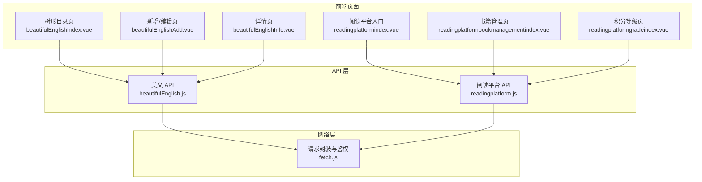
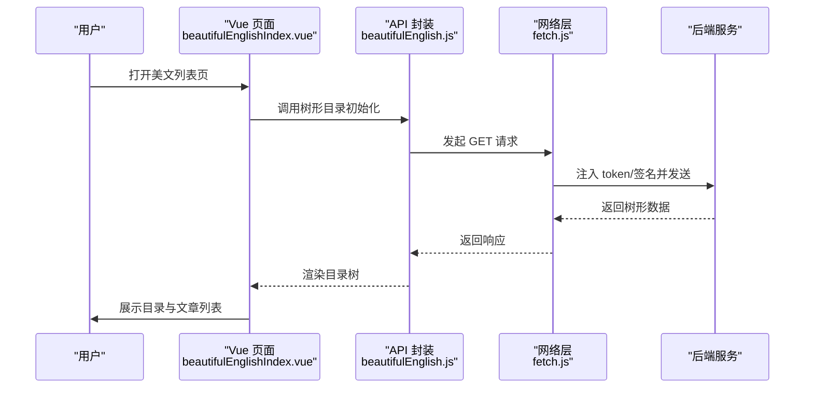
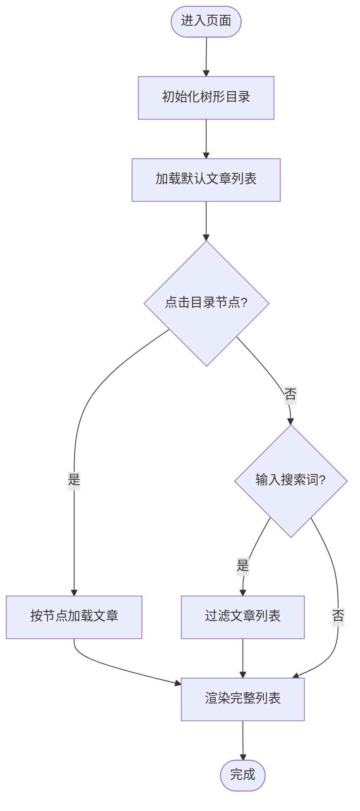
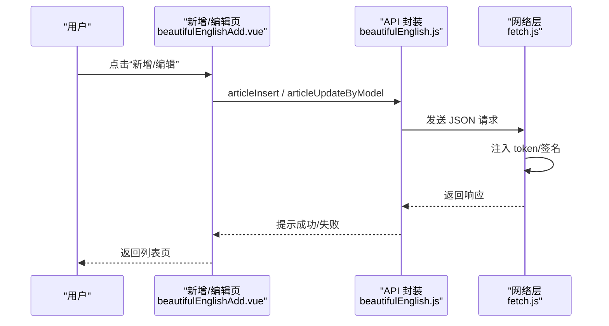
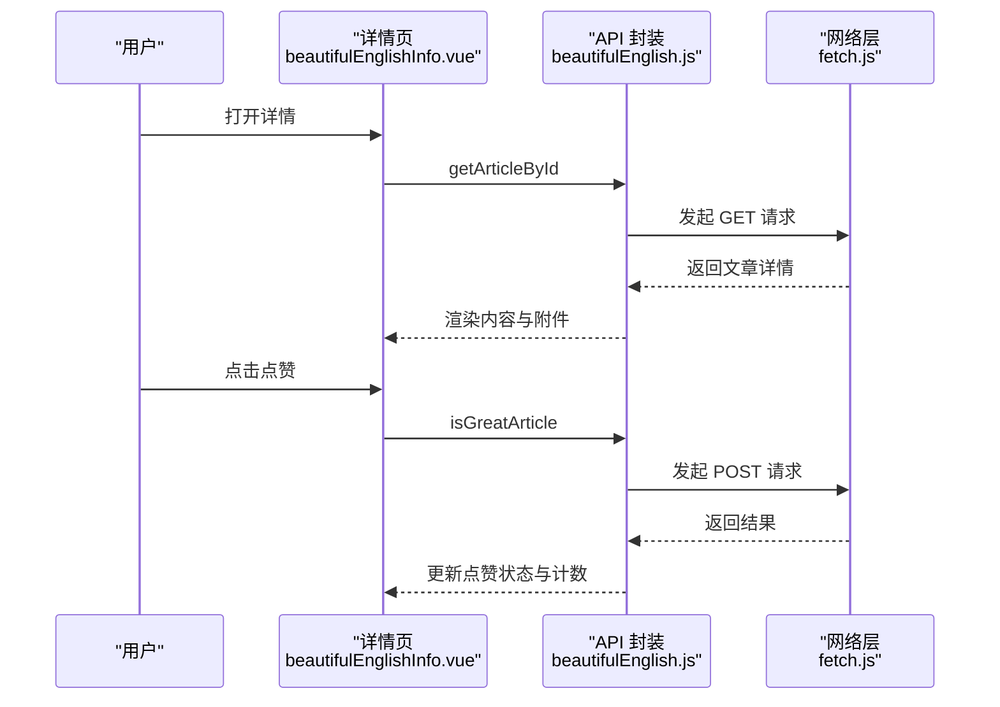
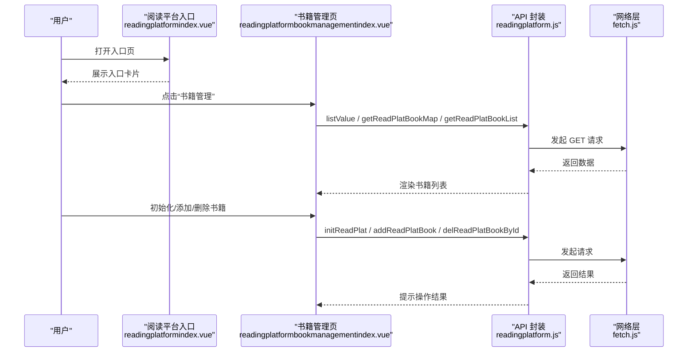
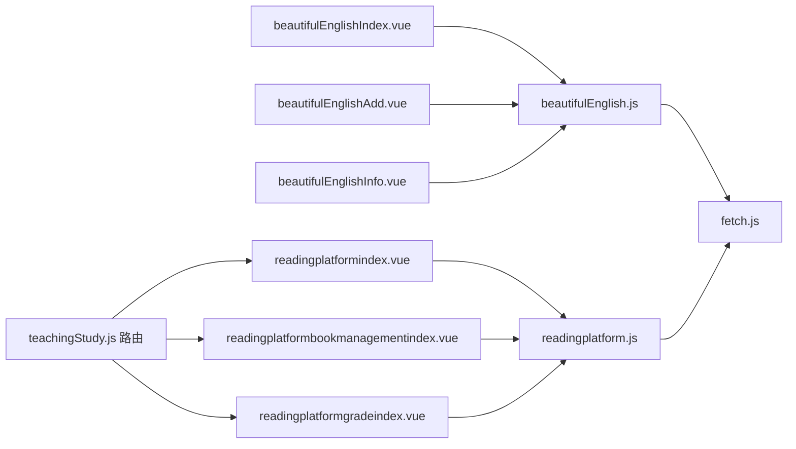

# 英语美文

<cite>
**本文引用的文件**
- [beautifulEnglish.js](file://src/api/beautifulEnglish.js)
- [beautifulEnglishIndex.vue](file://src/views/beautifulEnglish/beautifulEnglishIndex.vue)
- [beautifulEnglishAdd.vue](file://src/views/beautifulEnglish/beautifulEnglishAdd.vue)
- [beautifulEnglishInfo.vue](file://src/views/beautifulEnglish/beautifulEnglishInfo.vue)
- [fetch.js](file://src/utils/fetch.js)
- [readingplatformindex.vue](file://src/views/readingplatform/readingplatformindex.vue)
- [readingplatformbookmanagementindex.vue](file://src/views/readingplatform/readingplatformbookmanagementindex.vue)
- [readingplatformgradeindex.vue](file://src/views/readingplatform/readingplatformgradeindex.vue)
- [readingplatform.js](file://src/api/readingplatform.js)
- [teachingStudy.js](file://src/router/normal/teachingStudy.js)
</cite>

## 目录
1. [引言](#引言)
2. [项目结构](#项目结构)
3. [核心组件](#核心组件)
4. [架构总览](#架构总览)
5. [详细组件分析](#详细组件分析)
6. [依赖关系分析](#依赖关系分析)
7. [性能考量](#性能考量)
8. [故障排查指南](#故障排查指南)
9. [结论](#结论)
10. [附录](#附录)

## 引言
本技术文档围绕“英语美文阅读”功能展开，系统性梳理了英语阅读教学系统的设计与实现细节，涵盖美文阅读材料的组织与分类、难度分级与阅读进度跟踪、阅读活动的布置与效果评估、个性化学习路径设计、资源导入导出与权限控制、统计分析以及阅读效果评估与智能推荐等能力。文档同时结合现有“阅读平台”模块，给出可复用的架构建议与扩展方案，帮助开发者快速落地并持续演进。

## 项目结构
英语美文阅读功能由三部分组成：
- 美文管理与展示：树形目录（分类）+ 文章列表 + 文章详情 + 点赞
- 阅读平台：书籍管理、任务封面、基础设置、积分等级、地图管理、管理员管理
- 基础网络层：统一的请求封装与鉴权拦截

**图表来源**
- [beautifulEnglishIndex.vue:1-496](file://src/views/beautifulEnglish/beautifulEnglishIndex.vue#L1-L496)
- [beautifulEnglishAdd.vue:1-174](file://src/views/beautifulEnglish/beautifulEnglishAdd.vue#L1-L174)
- [beautifulEnglishInfo.vue:1-150](file://src/views/beautifulEnglish/beautifulEnglishInfo.vue#L1-L150)
- [readingplatformindex.vue:1-86](file://src/views/readingplatform/readingplatformindex.vue#L1-L86)
- [readingplatformbookmanagementindex.vue:1-575](file://src/views/readingplatform/readingplatformbookmanagementindex.vue#L1-L575)
- [readingplatformgradeindex.vue:1-130](file://src/views/readingplatform/readingplatformgradeindex.vue#L1-L130)
- [beautifulEnglish.js:1-166](file://src/api/beautifulEnglish.js#L1-L166)
- [readingplatform.js:1-411](file://src/api/readingplatform.js#L1-L411)
- [fetch.js:1-240](file://src/utils/fetch.js#L1-L240)

**章节来源**
- [beautifulEnglishIndex.vue:1-496](file://src/views/beautifulEnglish/beautifulEnglishIndex.vue#L1-L496)
- [beautifulEnglishAdd.vue:1-174](file://src/views/beautifulEnglish/beautifulEnglishAdd.vue#L1-L174)
- [beautifulEnglishInfo.vue:1-150](file://src/views/beautifulEnglish/beautifulEnglishInfo.vue#L1-L150)
- [readingplatformindex.vue:1-86](file://src/views/readingplatform/readingplatformindex.vue#L1-L86)
- [readingplatformbookmanagementindex.vue:1-575](file://src/views/readingplatform/readingplatformbookmanagementindex.vue#L1-L575)
- [readingplatformgradeindex.vue:1-130](file://src/views/readingplatform/readingplatformgradeindex.vue#L1-L130)
- [beautifulEnglish.js:1-166](file://src/api/beautifulEnglish.js#L1-L166)
- [readingplatform.js:1-411](file://src/api/readingplatform.js#L1-L411)
- [fetch.js:1-240](file://src/utils/fetch.js#L1-L240)

## 核心组件
- 美文树形目录与文章列表
  - 支持按树节点筛选文章，支持全文检索，支持分页
  - 提供新增/编辑/删除目录、新增/编辑/删除文章、点赞/取消点赞
- 美文新增/编辑
  - 支持富文本编辑器、附件上传、学生选择
- 美文详情
  - 展示文章内容、附件列表、点赞状态
- 阅读平台
  - 书籍管理、任务封面、基础设置、积分等级、地图管理、管理员管理
- 统一网络层
  - 自动注入 token、签名参数、错误处理与登录态失效跳转

**章节来源**
- [beautifulEnglishIndex.vue:84-371](file://src/views/beautifulEnglish/beautifulEnglishIndex.vue#L84-L371)
- [beautifulEnglishAdd.vue:31-149](file://src/views/beautifulEnglish/beautifulEnglishAdd.vue#L31-L149)
- [beautifulEnglishInfo.vue:31-94](file://src/views/beautifulEnglish/beautifulEnglishInfo.vue#L31-L94)
- [readingplatformindex.vue:32-58](file://src/views/readingplatform/readingplatformindex.vue#L32-L58)
- [readingplatformbookmanagementindex.vue:163-366](file://src/views/readingplatform/readingplatformbookmanagementindex.vue#L163-L366)
- [readingplatformgradeindex.vue:52-115](file://src/views/readingplatform/readingplatformgradeindex.vue#L52-L115)
- [fetch.js:65-169](file://src/utils/fetch.js#L65-L169)

## 架构总览
前端采用 Vue 单页应用，通过 API 层调用后端接口；网络层负责统一的请求参数、鉴权与错误处理。美文模块与阅读平台模块相对独立，但共享同一网络层。

**图表来源**
- [beautifulEnglishIndex.vue:230-249](file://src/views/beautifulEnglish/beautifulEnglishIndex.vue#L230-L249)
- [beautifulEnglish.js:6-14](file://src/api/beautifulEnglish.js#L6-L14)
- [fetch.js:65-169](file://src/utils/fetch.js#L65-L169)

## 详细组件分析

### 组件一：美文树形目录与文章列表
- 功能要点
  - 树形目录初始化与默认展开
  - 目录节点点击切换文章列表
  - 按标题全文检索
  - 分页加载文章
  - 权限控制显示新增/编辑/删除按钮
- 关键流程
  - 初始化树 → 加载全校文章或按节点加载 → 搜索过滤 → 分页渲染

**图表来源**
- [beautifulEnglishIndex.vue:230-369](file://src/views/beautifulEnglish/beautifulEnglishIndex.vue#L230-L369)

**章节来源**
- [beautifulEnglishIndex.vue:84-371](file://src/views/beautifulEnglish/beautifulEnglishIndex.vue#L84-L371)
- [beautifulEnglish.js:67-93](file://src/api/beautifulEnglish.js#L67-L93)

### 组件二：美文新增/编辑
- 功能要点
  - 学生选择（地址簿）
  - 富文本编辑器
  - 附件上传（限制扩展名）
  - 保存时校验必填项
- 关键流程
  - 进入编辑页 → 若有 ID 则拉取详情 → 保存时区分新增/更新

**图表来源**
- [beautifulEnglishAdd.vue:91-147](file://src/views/beautifulEnglish/beautifulEnglishAdd.vue#L91-L147)
- [beautifulEnglish.js:98-123](file://src/api/beautifulEnglish.js#L98-L123)
- [fetch.js:65-169](file://src/utils/fetch.js#L65-L169)

**章节来源**
- [beautifulEnglishAdd.vue:31-149](file://src/views/beautifulEnglish/beautifulEnglishAdd.vue#L31-L149)
- [beautifulEnglish.js:98-123](file://src/api/beautifulEnglish.js#L98-L123)

### 组件三：美文详情与点赞
- 功能要点
  - 展示文章内容与附件
  - 点赞/取消点赞，实时更新计数与状态
  - 权限控制显示“编辑”按钮
- 关键流程
  - 进入详情 → 拉取文章详情 → 点击点赞 → 更新本地状态

**图表来源**
- [beautifulEnglishInfo.vue:64-92](file://src/views/beautifulEnglish/beautifulEnglishInfo.vue#L64-L92)
- [beautifulEnglish.js:128-137](file://src/api/beautifulEnglish.js#L128-L137)
- [beautifulEnglish.js:156-165](file://src/api/beautifulEnglish.js#L156-L165)
- [fetch.js:65-169](file://src/utils/fetch.js#L65-L169)

**章节来源**
- [beautifulEnglishInfo.vue:31-94](file://src/views/beautifulEnglish/beautifulEnglishInfo.vue#L31-L94)
- [beautifulEnglish.js:128-165](file://src/api/beautifulEnglish.js#L128-L165)

### 组件四：阅读平台（书籍管理与积分等级）
- 功能要点
  - 书籍管理：按类型筛选、搜索、初始化平台书籍、批量添加、删除
  - 积分等级：列表展示、图片预览、新增/编辑/删除
  - 入口导航：统一入口页跳转到各子页面
- 关键流程
  - 入口页 → 书籍管理页 → 拉取字典类型 → 拉取平台书籍映射 → 操作书籍

**图表来源**
- [readingplatformindex.vue:32-58](file://src/views/readingplatform/readingplatformindex.vue#L32-L58)
- [readingplatformbookmanagementindex.vue:213-366](file://src/views/readingplatform/readingplatformbookmanagementindex.vue#L213-L366)
- [readingplatform.js:1-411](file://src/api/readingplatform.js#L1-L411)
- [fetch.js:1-240](file://src/utils/fetch.js#L1-L240)

**章节来源**
- [readingplatformindex.vue:32-58](file://src/views/readingplatform/readingplatformindex.vue#L32-L58)
- [readingplatformbookmanagementindex.vue:163-366](file://src/views/readingplatform/readingplatformbookmanagementindex.vue#L163-L366)
- [readingplatformgradeindex.vue:52-115](file://src/views/readingplatform/readingplatformgradeindex.vue#L52-L115)
- [readingplatform.js:1-411](file://src/api/readingplatform.js#L1-L411)

## 依赖关系分析
- 视图组件依赖 API 层，API 层依赖网络层
- 美文模块与阅读平台模块共享网络层，互不直接耦合
- 路由模块定义了阅读平台相关页面的访问路径

**图表来源**
- [beautifulEnglishIndex.vue:84-96](file://src/views/beautifulEnglish/beautifulEnglishIndex.vue#L84-L96)
- [beautifulEnglishAdd.vue:36-44](file://src/views/beautifulEnglish/beautifulEnglishAdd.vue#L36-L44)
- [beautifulEnglishInfo.vue:35-41](file://src/views/beautifulEnglish/beautifulEnglishInfo.vue#L35-L41)
- [beautifulEnglish.js:1-166](file://src/api/beautifulEnglish.js#L1-L166)
- [readingplatformindex.vue:32-58](file://src/views/readingplatform/readingplatformindex.vue#L32-L58)
- [readingplatformbookmanagementindex.vue:163-173](file://src/views/readingplatform/readingplatformbookmanagementindex.vue#L163-L173)
- [readingplatformgradeindex.vue:52-59](file://src/views/readingplatform/readingplatformgradeindex.vue#L52-L59)
- [readingplatform.js:1-411](file://src/api/readingplatform.js#L1-L411)
- [fetch.js:1-240](file://src/utils/fetch.js#L1-L240)
- [teachingStudy.js:510-551](file://src/router/normal/teachingStudy.js#L510-L551)

**章节来源**
- [teachingStudy.js:510-551](file://src/router/normal/teachingStudy.js#L510-L551)

## 性能考量
- 列表分页与搜索
  - 使用分页参数避免一次性加载过多数据
  - 搜索采用前端过滤，建议在文章较多时引入后端分页/搜索接口
- 图片与富文本
  - 详情页富文本渲染建议开启懒加载与图片压缩
- 网络层优化
  - 统一注入 token/签名，减少重复逻辑
  - 错误码集中处理，避免重复弹窗

[本节为通用指导，无需特定文件引用]

## 故障排查指南
- 登录态失效
  - 网络层对特定错误码进行统一处理，并触发登出与跳转
- 接口返回非 200
  - 统一提示消息，检查后端返回字段与业务状态
- 权限不足
  - 页面按钮显示受权限控制，确认权限标识与后端策略一致

**章节来源**
- [fetch.js:104-169](file://src/utils/fetch.js#L104-L169)

## 结论
英语美文阅读功能以树形目录为核心组织方式，结合文章列表、详情与点赞，形成完整的阅读闭环。阅读平台模块提供了书籍、任务、等级、地图等基础设施，便于后续扩展难度分级、阅读任务布置与效果评估。通过统一网络层与权限控制，系统具备良好的可维护性与扩展性。建议后续在以下方面持续演进：
- 引入后端分页与搜索接口，提升大数据量场景下的性能
- 设计阅读任务模板与执行流程，完善阅读活动的布置与评估
- 建立基于阅读行为的画像与推荐模型，实现智能推荐
- 完善统计分析看板，支撑教学与管理决策

[本节为总结性内容，无需特定文件引用]

## 附录

### A. 美文模块 API 概览
- 树形目录
  - 初始化树：GET
  - 新增/编辑/删除目录节点：POST(JSON)
- 文章记录
  - 全校文章列表：GET
  - 按目录节点文章列表：GET
  - 新增/编辑/删除文章：POST(JSON)
  - 文章详情：GET
  - 点赞/取消点赞：POST

**章节来源**
- [beautifulEnglish.js:6-165](file://src/api/beautifulEnglish.js#L6-L165)

### B. 阅读平台模块 API 概览
- 平台设置与封面
  - 获取/保存平台设置：GET/POST
  - 获取/保存任务封面：GET/POST
- 书籍管理
  - 获取平台书籍映射：GET
  - 获取平台书籍列表：GET
  - 初始化平台书籍：GET
  - 新增/删除平台书籍：POST/GET
- 字典与类型
  - 获取书籍类型字典：GET
- 积分等级
  - 获取学校阅读设置：GET
  - 新增/编辑/删除等级：POST/GET
- 地图管理
  - 获取/新增/编辑/删除地图：GET/POST/POST/GET
  - 获取地图书籍映射：GET
  - 新增/编辑/删除地图书籍：POST/POST/GET
- 管理员管理
  - 查询/新增/编辑/删除管理员：GET/POST/POST/POST
  - 获取班级/年级列表：GET

**章节来源**
- [readingplatform.js:1-411](file://src/api/readingplatform.js#L1-L411)

### C. 路由与页面映射
- 阅读平台入口页
- 书籍管理页
- 积分等级页
- 任务封面设置页
- 地图管理页
- 管理员管理页

**章节来源**
- [teachingStudy.js:510-551](file://src/router/normal/teachingStudy.js#L510-L551)