# 语言文化教育

<cite>
**本文引用的文件**
- [chineseCharacters.js](file://src/api/chineseCharacters.js)
- [beautifulEnglish.js](file://src/api/beautifulEnglish.js)
- [chineseCharactersone.vue](file://src/views/chineseCharacters/chineseCharactersone.vue)
- [chineseCharacterstwo.vue](file://src/views/chineseCharacters/chineseCharacterstwo.vue)
- [chineseCharactersthree.vue](file://src/views/chineseCharacters/chineseCharactersthree.vue)
- [chineseCharactersfive.vue](file://src/views/chineseCharacters/chineseCharactersfive.vue)
- [beautifulEnglishIndex.vue](file://src/views/beautifulEnglish/beautifulEnglishIndex.vue)
- [beautifulEnglishAdd.vue](file://src/views/beautifulEnglish/beautifulEnglishAdd.vue)
- [beautifulEnglishInfo.vue](file://src/views/beautifulEnglish/beautifulEnglishInfo.vue)
- [stackRoom.js](file://src/api/stackRoom.js)
- [stackRoomIndex.vue](file://src/views/readBook/stackRoomIndex.vue)
- [readTaskIndex.vue](file://src/views/readBook/readTaskIndex.vue)
- [teachingStudy.js](file://src/router/normal/teachingStudy.js)
- [moduleList.js](file://src/router/moduleList.js)
</cite>

## 目录
1. [引言](#引言)
2. [项目结构](#项目结构)
3. [核心组件](#核心组件)
4. [架构总览](#架构总览)
5. [详细组件分析](#详细组件分析)
6. [依赖关系分析](#依赖关系分析)
7. [性能考量](#性能考量)
8. [故障排查指南](#故障排查指南)
9. [结论](#结论)
10. [附录](#附录)

## 引言
本技术文档聚焦于语言文化教育功能，围绕“汉字识读系统”与“英语美文阅读平台”的教学设计与实现进行系统化梳理。文档涵盖：
- 教学资源管理机制：内容分类、难度分级、学习进度跟踪
- 学习活动组织与评价：任务发布、打卡记录、统计分析
- 个性化学习路径：基于年级/班级/时间维度的学习趋势与排行
- 导入导出、权限控制与统计分析：目录树、文件附件、点赞与分页
- 学习效果评估与个性化推荐：识字量趋势、排行榜、阅读任务状态

## 项目结构
语言文化教育功能主要分布在以下模块：
- API 层：提供与后端交互的接口封装（汉字识读、英语美文、阅读书库与任务）
- 视图层：提供可视化界面（汉字识读图表、英语美文目录与文章详情、书库与任务管理）
- 路由层：定义教学研究模块下的语言文化教育入口与子页面

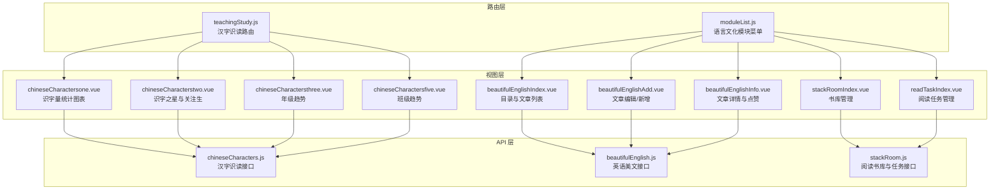

**图表来源**
- [teachingStudy.js:190-204](file://src/router/normal/teachingStudy.js#L190-L204)
- [moduleList.js:396-407](file://src/router/moduleList.js#L396-L407)
- [chineseCharacters.js:1-85](file://src/api/chineseCharacters.js#L1-L85)
- [beautifulEnglish.js:1-166](file://src/api/beautifulEnglish.js#L1-L166)
- [stackRoom.js:61-425](file://src/api/stackRoom.js#L61-L425)
- [chineseCharactersone.vue:1-150](file://src/views/chineseCharacters/chineseCharactersone.vue#L1-L150)
- [chineseCharacterstwo.vue:1-132](file://src/views/chineseCharacters/chineseCharacterstwo.vue#L1-L132)
- [chineseCharactersthree.vue:1-174](file://src/views/chineseCharacters/chineseCharactersthree.vue#L1-L174)
- [chineseCharactersfive.vue:1-156](file://src/views/chineseCharacters/chineseCharactersfive.vue#L1-L156)
- [beautifulEnglishIndex.vue:1-496](file://src/views/beautifulEnglish/beautifulEnglishIndex.vue#L1-L496)
- [beautifulEnglishAdd.vue:1-174](file://src/views/beautifulEnglish/beautifulEnglishAdd.vue#L1-L174)
- [beautifulEnglishInfo.vue:1-150](file://src/views/beautifulEnglish/beautifulEnglishInfo.vue#L1-L150)
- [stackRoomIndex.vue:1-444](file://src/views/readBook/stackRoomIndex.vue#L1-L444)
- [readTaskIndex.vue:1-185](file://src/views/readBook/readTaskIndex.vue#L1-L185)

**章节来源**
- [teachingStudy.js:190-204](file://src/router/normal/teachingStudy.js#L190-L204)
- [moduleList.js:396-407](file://src/router/moduleList.js#L396-L407)

## 核心组件
- 汉字识读系统
  - 统计图表：全校/年级/班级识字量趋势与对比
  - 排行与关注：识字之星与需要关注的学生
  - 时间粒度：周/月/学期
- 英语美文阅读
  - 目录树：分级目录、新增/编辑/删除
  - 文章管理：列表、详情、点赞、附件上传
  - 权限控制：基于权限标识的按钮显隐
- 阅读书库与任务
  - 书库管理：书籍类型筛选、搜索、批量添加与删除
  - 阅读任务：创建、编辑、发布、删除、打卡记录与状态展示

**章节来源**
- [chineseCharacters.js:1-85](file://src/api/chineseCharacters.js#L1-L85)
- [beautifulEnglish.js:1-166](file://src/api/beautifulEnglish.js#L1-L166)
- [stackRoom.js:61-425](file://src/api/stackRoom.js#L61-L425)

## 架构总览
前端采用 Vue 单页应用，通过路由组织语言文化教育模块；视图组件通过 API 层调用后端接口，完成数据加载与业务操作。

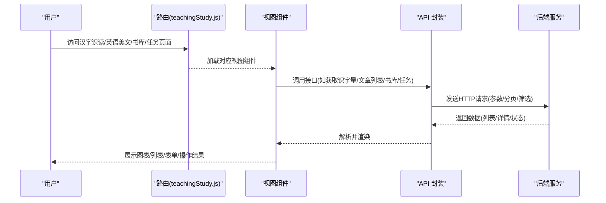

**图表来源**
- [teachingStudy.js:190-204](file://src/router/normal/teachingStudy.js#L190-L204)
- [chineseCharactersone.vue:22-56](file://src/views/chineseCharacters/chineseCharactersone.vue#L22-L56)
- [beautifulEnglishIndex.vue:306-335](file://src/views/beautifulEnglish/beautifulEnglishIndex.vue#L306-L335)
- [stackRoomIndex.vue:154-163](file://src/views/readBook/stackRoomIndex.vue#L154-L163)

## 详细组件分析

### 汉字识读系统

#### 组件一：识字量统计图表（全校/年级/班级）
- 功能要点
  - 全校识字量对比：按年级展示“全校平均”与“全区平均”
  - 年级点击进入班级视图：支持从年级到班级的钻取
  - ECharts 图表：柱状图，支持点击事件与标签显示
- 数据流
  - 获取全校数据 -> 渲染年级柱状图
  - 点击某年级 -> 获取该年级下班级数据 -> 渲染班级柱状图
- 关键接口
  - 全校识字量：[getCheckGradeCharBySchoolId:59-64](file://src/api/chineseCharacters.js#L59-L64)
  - 年级班级识字量：[getCheckClassCharByGradeId:47-55](file://src/api/chineseCharacters.js#L47-L55)

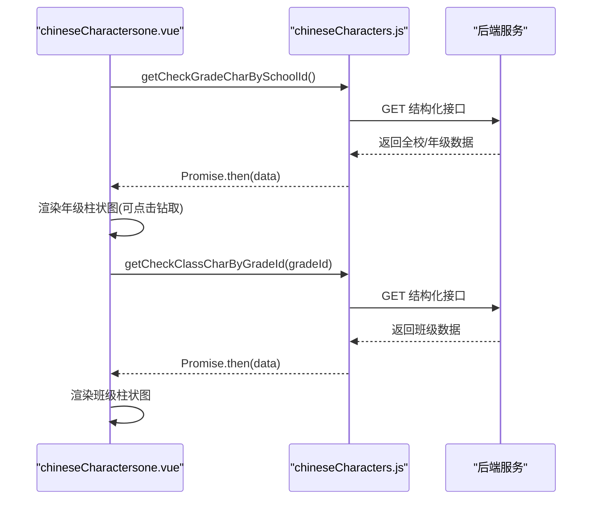

**图表来源**
- [chineseCharactersone.vue:43-68](file://src/views/chineseCharacters/chineseCharactersone.vue#L43-L68)
- [chineseCharacters.js:47-64](file://src/api/chineseCharacters.js#L47-L64)

**章节来源**
- [chineseCharactersone.vue:1-150](file://src/views/chineseCharacters/chineseCharactersone.vue#L1-L150)
- [chineseCharacters.js:1-85](file://src/api/chineseCharacters.js#L1-L85)

#### 组件二：识字之星与关注生
- 功能要点
  - 年级下拉切换
  - 识字之星 Top10 与关注生 End10 展示
  - 基于接口返回的排行数据渲染
- 关键接口
  - 年级列表：[querySchoolGrade:68-73](file://src/api/chineseCharacters.js#L68-L73)
  - 年级排行：[getGradeRankStuList:33-43](file://src/api/chineseCharacters.js#L33-L43)

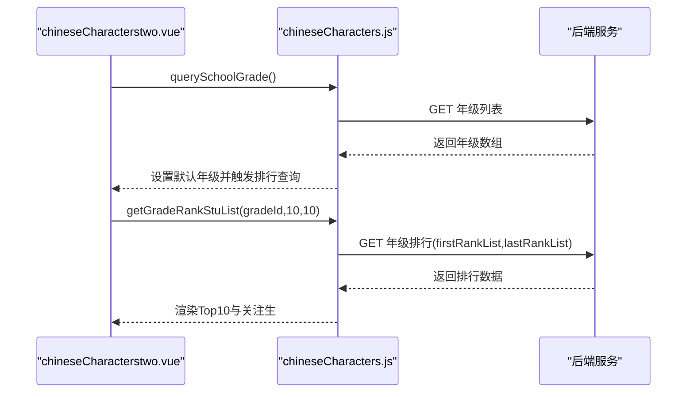

**图表来源**
- [chineseCharacterstwo.vue:49-72](file://src/views/chineseCharacters/chineseCharacterstwo.vue#L49-L72)
- [chineseCharacters.js:33-73](file://src/api/chineseCharacters.js#L33-L73)

**章节来源**
- [chineseCharacterstwo.vue:1-132](file://src/views/chineseCharacters/chineseCharacterstwo.vue#L1-L132)
- [chineseCharacters.js:1-85](file://src/api/chineseCharacters.js#L1-L85)

#### 组件三：年级识字量趋势（周/月/学期）
- 功能要点
  - 时间粒度切换：周/月/学期
  - 折线图双轴：平均识字量与参与人数
  - dataZoom 支持横向缩放
- 关键接口
  - 年级趋势：[getPlayWordGradeDateList:19-28](file://src/api/chineseCharacters.js#L19-L28)

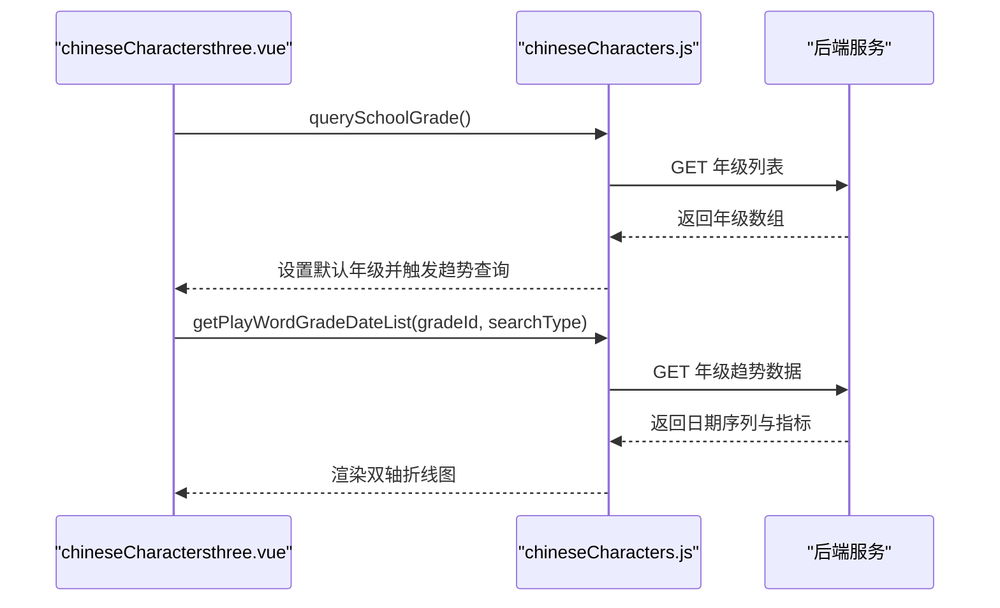

**图表来源**
- [chineseCharactersthree.vue:39-108](file://src/views/chineseCharacters/chineseCharactersthree.vue#L39-L108)
- [chineseCharacters.js:19-28](file://src/api/chineseCharacters.js#L19-L28)

**章节来源**
- [chineseCharactersthree.vue:1-174](file://src/views/chineseCharacters/chineseCharactersthree.vue#L1-L174)
- [chineseCharacters.js:1-85](file://src/api/chineseCharacters.js#L1-L85)

#### 组件四：班级识字量趋势（周/月/学期）
- 功能要点
  - 年级/班级联动下拉
  - 双轴折线图展示班级平均识字量与参与人数
- 关键接口
  - 年级列表：[querySchoolGrade:68-73](file://src/api/chineseCharacters.js#L68-L73)
  - 班级列表：[queryClassByGradeId:77-85](file://src/api/chineseCharacters.js#L77-L85)
  - 班级趋势：[getPlayWordClassDateList:6-15](file://src/api/chineseCharacters.js#L6-L15)

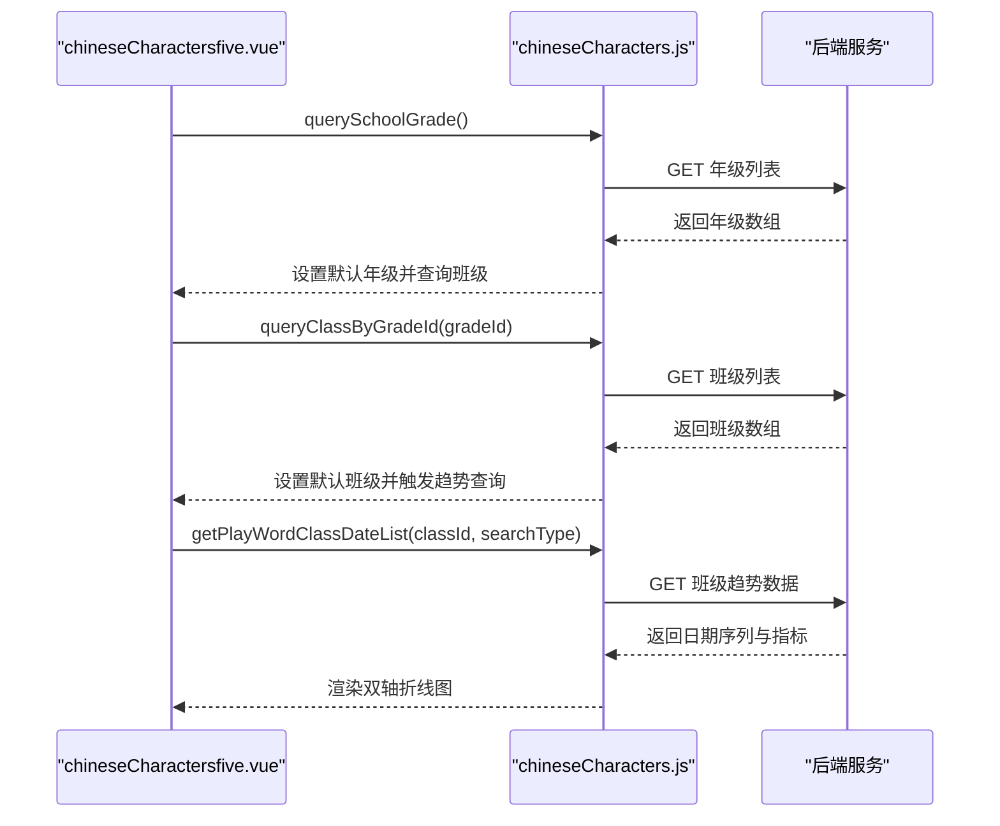

**图表来源**
- [chineseCharactersfive.vue:44-125](file://src/views/chineseCharacters/chineseCharactersfive.vue#L44-L125)
- [chineseCharacters.js:6-85](file://src/api/chineseCharacters.js#L6-L85)

**章节来源**
- [chineseCharactersfive.vue:1-156](file://src/views/chineseCharacters/chineseCharactersfive.vue#L1-L156)
- [chineseCharacters.js:1-85](file://src/api/chineseCharacters.js#L1-L85)

### 英语美文阅读平台

#### 组件五：目录树与文章列表
- 功能要点
  - 目录树：支持新增/编辑/删除目录；默认展开首节点
  - 文章列表：分页展示；支持按内容搜索；支持编辑/删除
  - 权限控制：根据权限标识控制按钮显隐
- 关键接口
  - 目录树：[initTree:6-14](file://src/api/beautifulEnglish.js#L6-L14)
  - 目录操作：[treeDomInsert:19-29](file://src/api/beautifulEnglish.js#L19-L29)、[treeDomUpdateByModel:34-44](file://src/api/beautifulEnglish.js#L34-L44)、[deleteTreeDomById:49-58](file://src/api/beautifulEnglish.js#L49-L58)
  - 文章列表：[listBySchoolIdAndContent:67-77](file://src/api/beautifulEnglish.js#L67-L77)、[listByTreeNodeId:82-93](file://src/api/beautifulEnglish.js#L82-L93)
  - 文章操作：[articleInsert:98-108](file://src/api/beautifulEnglish.js#L98-L108)、[articleUpdateByModel:113-123](file://src/api/beautifulEnglish.js#L113-L123)、[deleteArticleById:142-151](file://src/api/beautifulEnglish.js#L142-L151)

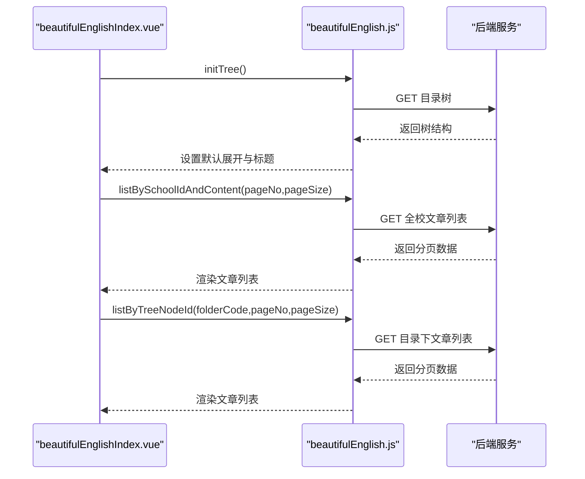

**图表来源**
- [beautifulEnglishIndex.vue:230-335](file://src/views/beautifulEnglish/beautifulEnglishIndex.vue#L230-L335)
- [beautifulEnglish.js:6-151](file://src/api/beautifulEnglish.js#L6-L151)

**章节来源**
- [beautifulEnglishIndex.vue:1-496](file://src/views/beautifulEnglish/beautifulEnglishIndex.vue#L1-L496)
- [beautifulEnglish.js:1-166](file://src/api/beautifulEnglish.js#L1-L166)

#### 组件六：文章编辑与新增
- 功能要点
  - 学生选择器：单选学生
  - 富文本编辑器：UEditor
  - 附件上传：WebUploader（限制扩展名）
  - 保存：新增或编辑
- 关键接口
  - 新增/编辑文章：[articleInsert:98-108](file://src/api/beautifulEnglish.js#L98-L108)、[articleUpdateByModel:113-123](file://src/api/beautifulEnglish.js#L113-L123)
  - 获取详情：[getArticleById:128-137](file://src/api/beautifulEnglish.js#L128-L137)

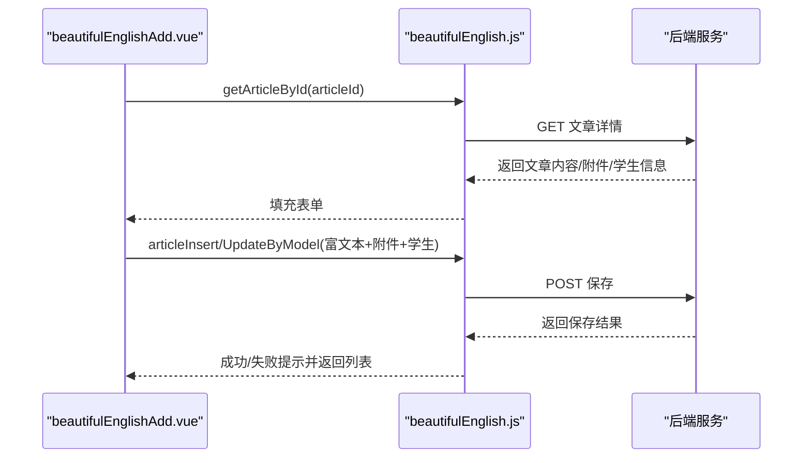

**图表来源**
- [beautifulEnglishAdd.vue:74-148](file://src/views/beautifulEnglish/beautifulEnglishAdd.vue#L74-L148)
- [beautifulEnglish.js:98-137](file://src/api/beautifulEnglish.js#L98-L137)

**章节来源**
- [beautifulEnglishAdd.vue:1-174](file://src/views/beautifulEnglish/beautifulEnglishAdd.vue#L1-L174)
- [beautifulEnglish.js:1-166](file://src/api/beautifulEnglish.js#L1-L166)

#### 组件七：文章详情与点赞
- 功能要点
  - 文章详情展示：标题、作者、时间、内容、附件
  - 点赞/取消点赞：调用点赞接口并更新本地状态
  - 编辑入口：根据权限控制按钮显隐
- 关键接口
  - 获取详情：[getArticleById:128-137](file://src/api/beautifulEnglish.js#L128-L137)
  - 点赞操作：[isGreatArticle:156-165](file://src/api/beautifulEnglish.js#L156-L165)

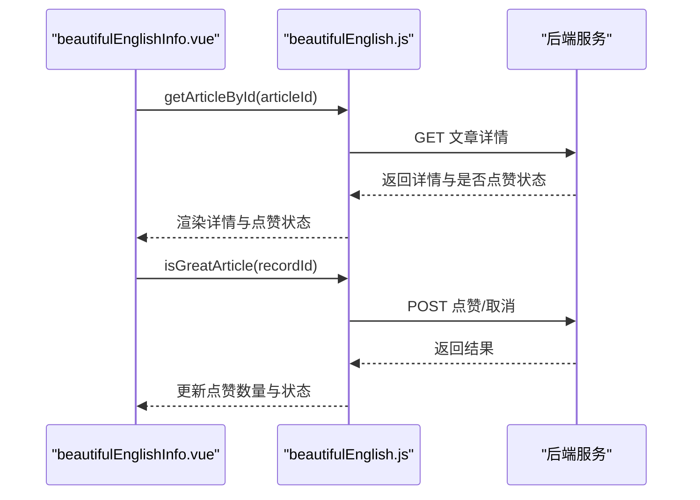

**图表来源**
- [beautifulEnglishInfo.vue:64-93](file://src/views/beautifulEnglish/beautifulEnglishInfo.vue#L64-L93)
- [beautifulEnglish.js:128-165](file://src/api/beautifulEnglish.js#L128-L165)

**章节来源**
- [beautifulEnglishInfo.vue:1-150](file://src/views/beautifulEnglish/beautifulEnglishInfo.vue#L1-L150)
- [beautifulEnglish.js:1-166](file://src/api/beautifulEnglish.js#L1-L166)

### 阅读书库与任务

#### 组件八：书库管理
- 功能要点
  - 书籍类型筛选与搜索
  - 书籍列表展示与删除
  - 新增书籍：弹窗选择书籍并批量添加
  - 权限控制：仅管理员可见删除与新增
- 关键接口
  - 书库列表：[getLanguageBookList:386-393](file://src/api/stackRoom.js#L386-L393)
  - 类型字典：[findDicsByCode:370-376](file://src/api/stackRoom.js#L370-L376)
  - 批量添加：[addLanguageBookList:398-406](file://src/api/stackRoom.js#L398-L406)
  - 删除书籍：[delBook:400-407](file://src/api/stackRoom.js#L400-L407)

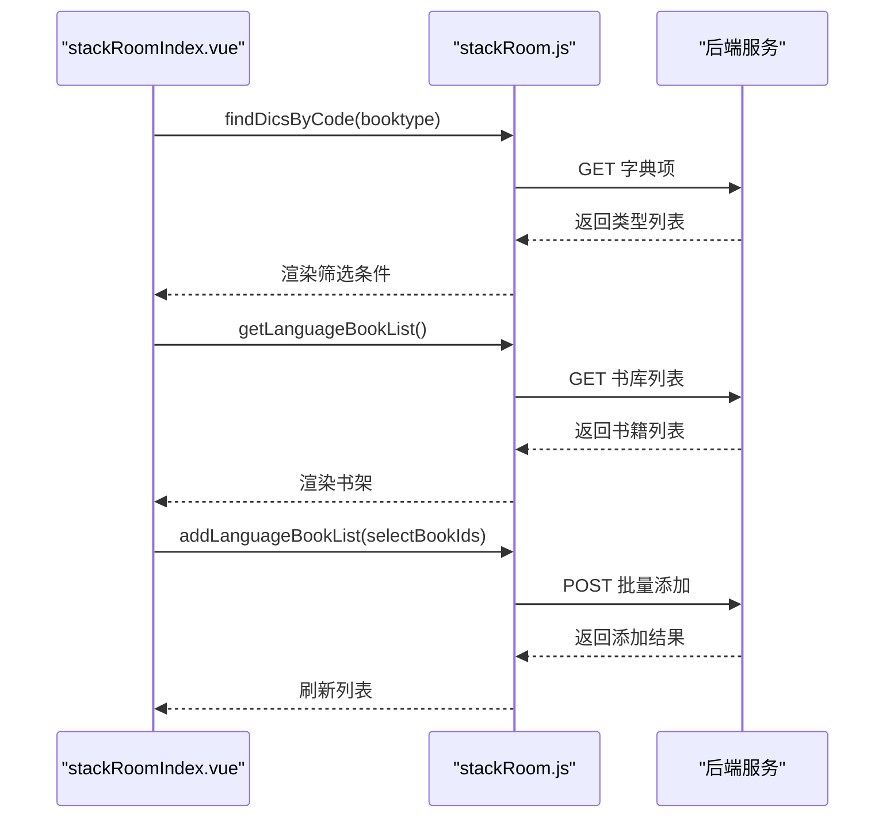

**图表来源**
- [stackRoomIndex.vue:146-271](file://src/views/readBook/stackRoomIndex.vue#L146-L271)
- [stackRoom.js:370-407](file://src/api/stackRoom.js#L370-L407)

**章节来源**
- [stackRoomIndex.vue:1-444](file://src/views/readBook/stackRoomIndex.vue#L1-L444)
- [stackRoom.js:61-425](file://src/api/stackRoom.js#L61-L425)

#### 组件九：阅读任务管理
- 功能要点
  - 任务列表：主题、书籍、周期、发布范围、状态
  - 操作：编辑、删除、发布、打卡记录
  - 状态判断：草稿/未开始/进行中/已结束
- 关键接口
  - 任务列表：[getLanguageBookTaskList:426-434](file://src/api/stackRoom.js#L426-L434)
  - 发布任务：[sendLanguageBookTask:436-445](file://src/api/stackRoom.js#L436-L445)
  - 删除任务：[delLanguageBookTask:452-463](file://src/api/stackRoom.js#L452-L463)

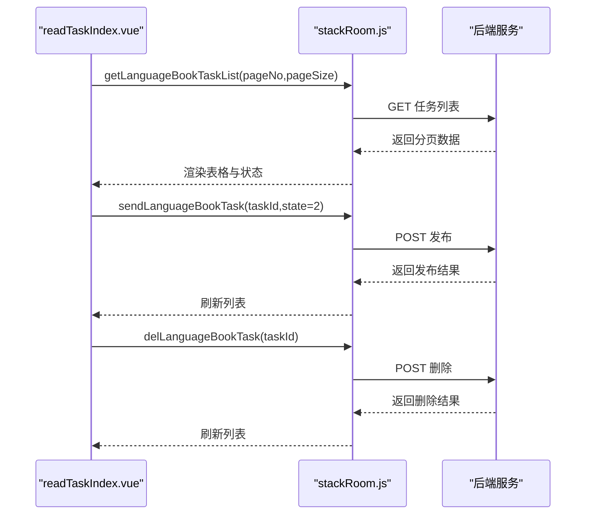

**图表来源**
- [readTaskIndex.vue:129-172](file://src/views/readBook/readTaskIndex.vue#L129-L172)
- [stackRoom.js:426-463](file://src/api/stackRoom.js#L426-L463)

**章节来源**
- [readTaskIndex.vue:1-185](file://src/views/readBook/readTaskIndex.vue#L1-L185)
- [stackRoom.js:408-463](file://src/api/stackRoom.js#L408-L463)

## 依赖关系分析

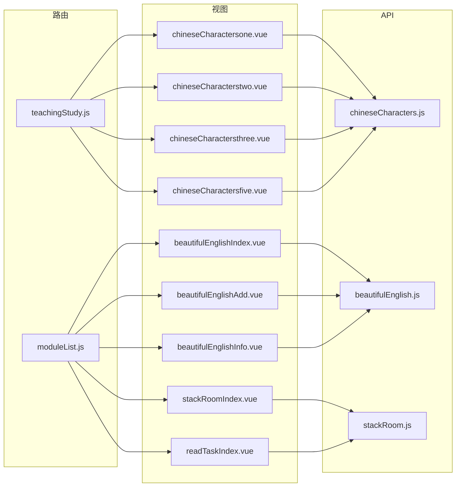

**图表来源**
- [teachingStudy.js:190-204](file://src/router/normal/teachingStudy.js#L190-L204)
- [moduleList.js:396-407](file://src/router/moduleList.js#L396-L407)
- [chineseCharacters.js:1-85](file://src/api/chineseCharacters.js#L1-L85)
- [beautifulEnglish.js:1-166](file://src/api/beautifulEnglish.js#L1-L166)
- [stackRoom.js:61-425](file://src/api/stackRoom.js#L61-L425)

**章节来源**
- [teachingStudy.js:190-204](file://src/router/normal/teachingStudy.js#L190-L204)
- [moduleList.js:396-407](file://src/router/moduleList.js#L396-L407)

## 性能考量
- 图表渲染
  - 使用 ECharts 进行大数据量渲染时，建议对数据进行分页或采样，避免一次性渲染过多点位导致卡顿
  - 在组件销毁时及时释放图表实例，防止内存泄漏
- 列表加载
  - 分页接口已使用 pageNo/pageSize 控制数据规模，建议结合虚拟滚动组件进一步优化长列表性能
- 文件上传
  - 附件上传需限制文件类型与大小，避免大体积文件影响响应速度
- 网络请求
  - 对高频请求（如目录树、文章列表）可增加缓存策略与防抖，减少重复请求

## 故障排查指南
- 目录树为空
  - 检查 [initTree:6-14](file://src/api/beautifulEnglish.js#L6-L14) 是否返回数据；确认默认展开逻辑与权限标识
- 文章列表不刷新
  - 确认 [listBySchoolIdAndContent:67-77](file://src/api/beautifulEnglish.js#L67-L77) 与 [listByTreeNodeId:82-93](file://src/api/beautifulEnglish.js#L82-L93) 的分页参数传递正确
- 点赞失败
  - 检查 [isGreatArticle:156-165](file://src/api/beautifulEnglish.js#L156-L165) 返回码与消息；确认用户登录状态与权限
- 书库新增失败
  - 检查 [addLanguageBookList:398-406](file://src/api/stackRoom.js#L398-L406) 的请求体格式与权限角色
- 任务发布/删除异常
  - 核对 [sendLanguageBookTask:436-445](file://src/api/stackRoom.js#L436-L445) 与 [delLanguageBookTask:452-463](file://src/api/stackRoom.js#L452-L463) 的 taskId 参数

**章节来源**
- [beautifulEnglish.js:6-165](file://src/api/beautifulEnglish.js#L6-L165)
- [stackRoom.js:370-463](file://src/api/stackRoom.js#L370-L463)

## 结论
本语言文化教育功能以“汉字识读系统”和“英语美文阅读平台”为核心，配合“阅读书库与任务管理”，构建了从资源管理、活动组织到学习评价的完整闭环。通过多维数据图表与权限控制，实现了个性化学习路径与学习效果评估的基础能力。后续可在数据缓存、虚拟滚动与推荐算法方面进一步优化体验。

## 附录
- 路由入口
  - 汉字识读：见 [teachingStudy.js:190-204](file://src/router/normal/teachingStudy.js#L190-L204)
  - 语言文化模块菜单：见 [moduleList.js:396-407](file://src/router/moduleList.js#L396-L407)
- 关键接口清单
  - 汉字识读：[chineseCharacters.js:1-85](file://src/api/chineseCharacters.js#L1-L85)
  - 英语美文：[beautifulEnglish.js:1-166](file://src/api/beautifulEnglish.js#L1-L166)
  - 阅读书库与任务：[stackRoom.js:61-425](file://src/api/stackRoom.js#L61-L425)