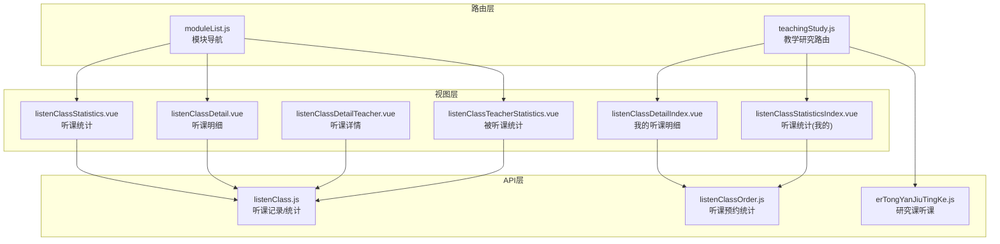
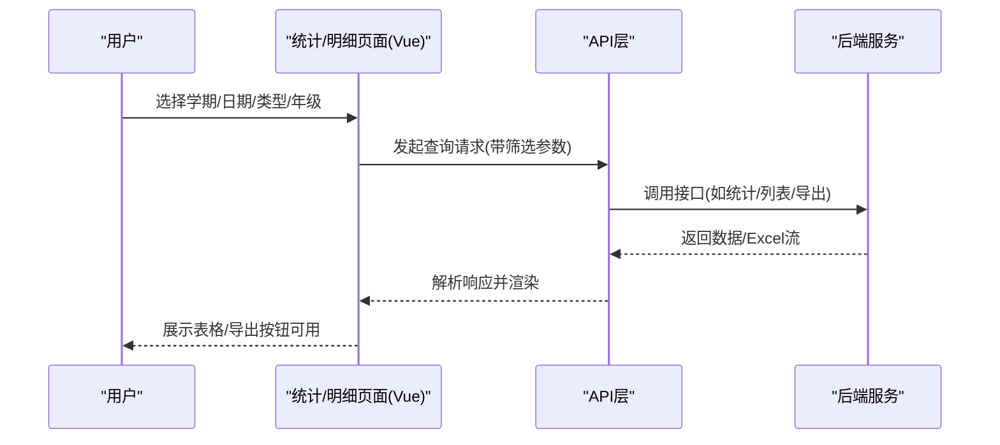
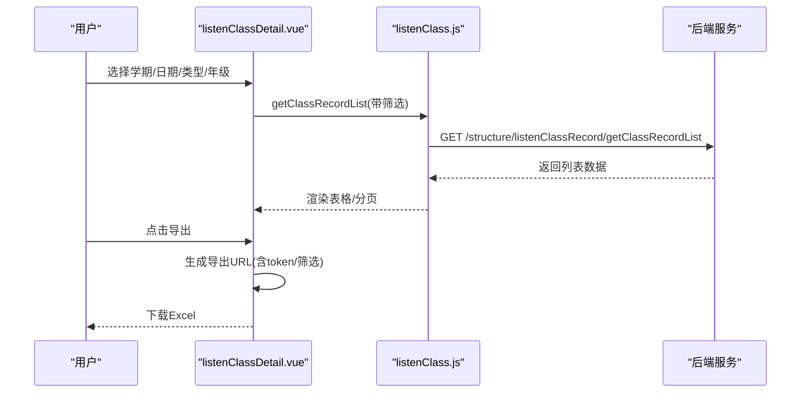
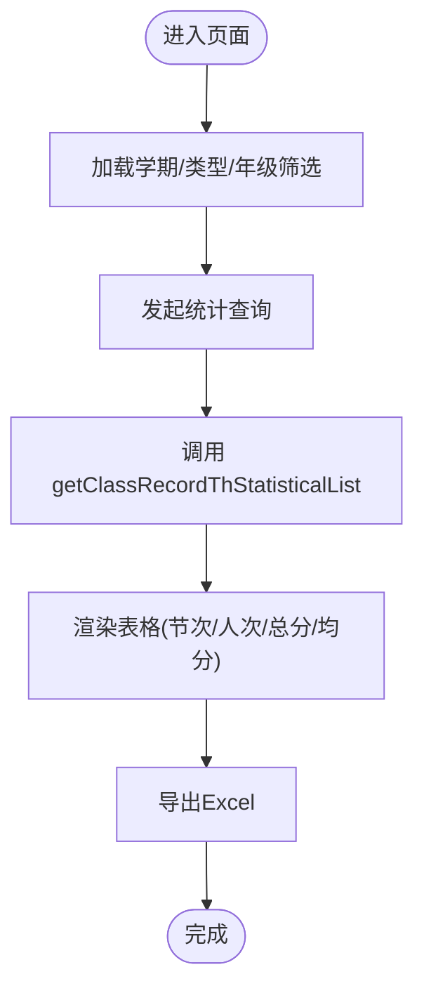
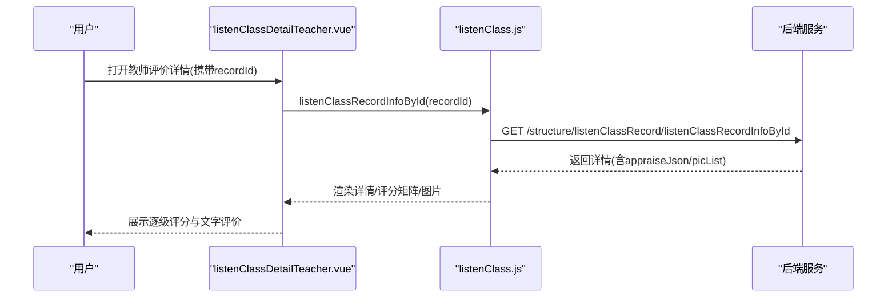
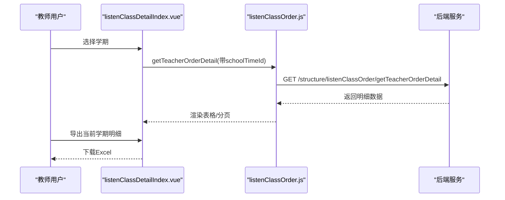
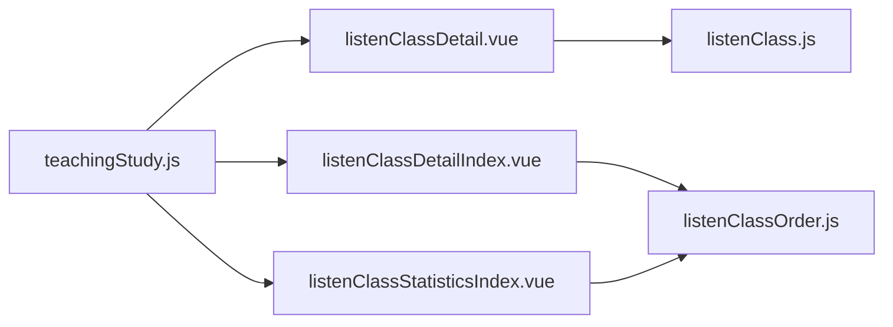

# 组织听课

<cite>
**本文引用的文件**
- [src/router/moduleList.js](file://src/router/moduleList.js)
- [src/router/normal/teachingStudy.js](file://src/router/normal/teachingStudy.js)
- [src/api/listenClass.js](file://src/api/listenClass.js)
- [src/api/teachingStudy/listenClassOrder.js](file://src/api/teachingStudy/listenClassOrder.js)
- [src/api/teachingStudy/erTongYanJiuTingKe.js](file://src/api/teachingStudy/erTongYanJiuTingKe.js)
- [src/views/leaderSee/listenClassStatistics.vue](file://src/views/leaderSee/listenClassStatistics.vue)
- [src/views/leaderSee/listenClassDetail.vue](file://src/views/leaderSee/listenClassDetail.vue)
- [src/views/leaderSee/listenClassDetailTeacher.vue](file://src/views/leaderSee/listenClassDetailTeacher.vue)
- [src/views/leaderSee/listenClassTeacherStatistics.vue](file://src/views/leaderSee/listenClassTeacherStatistics.vue)
- [src/views/listenClass/listenClassDetailIndex.vue](file://src/views/listenClass/listenClassDetailIndex.vue)
- [src/views/listenClass/listenClassStatisticsIndex.vue](file://src/views/listenClass/listenClassStatisticsIndex.vue)
</cite>

## 目录
1. [引言](#引言)
2. [项目结构](#项目结构)
3. [核心组件](#核心组件)
4. [架构总览](#架构总览)
5. [详细组件分析](#详细组件分析)
6. [依赖关系分析](#依赖关系分析)
7. [性能考虑](#性能考虑)
8. [故障排查指南](#故障排查指南)
9. [结论](#结论)
10. [附录](#附录)

## 引言
本技术文档围绕“组织听课”功能进行系统化梳理，覆盖教学观察活动的组织与管理机制（任务创建、分配与执行）、听课评价指标体系（教学目标达成度、教学方法运用、课堂管理效果等维度的评分标准）、听课记录填写规范与评价反馈机制、听课数据的采集、整理与分析（统计汇总与质量分析）、权限控制与时间安排、参与人员管理以及评价报告的生成与导出。文档以代码为依据，结合前端页面与API接口，帮助开发者与使用者快速理解并高效使用该模块。

## 项目结构
“组织听课”相关能力分布在以下层次：
- 路由层：定义模块入口与页面路径，包含“组织听课”“儿童研究听课”“听课预约统计”等子模块。
- API层：封装与后端交互的数据接口，涵盖听课记录、听课统计、听课评价设置、研究课听课等。
- 视图层：提供统计、明细、详情、教师评价等页面，支持导出与图片预览。

图表来源
- [src/router/moduleList.js:565-597](file://src/router/moduleList.js#L565-L597)
- [src/router/moduleList.js:683-715](file://src/router/moduleList.js#L683-L715)
- [src/router/normal/teachingStudy.js:380-422](file://src/router/normal/teachingStudy.js#L380-L422)
- [src/api/listenClass.js:1-95](file://src/api/listenClass.js#L1-L95)
- [src/api/teachingStudy/listenClassOrder.js:1-42](file://src/api/teachingStudy/listenClassOrder.js#L1-L42)
- [src/api/teachingStudy/erTongYanJiuTingKe.js:1-153](file://src/api/teachingStudy/erTongYanJiuTingKe.js#L1-L153)
- [src/views/leaderSee/listenClassStatistics.vue:1-325](file://src/views/leaderSee/listenClassStatistics.vue#L1-L325)
- [src/views/leaderSee/listenClassDetail.vue:1-425](file://src/views/leaderSee/listenClassDetail.vue#L1-L425)
- [src/views/leaderSee/listenClassDetailTeacher.vue:1-204](file://src/views/leaderSee/listenClassDetailTeacher.vue#L1-L204)
- [src/views/leaderSee/listenClassTeacherStatistics.vue:1-333](file://src/views/leaderSee/listenClassTeacherStatistics.vue#L1-L333)
- [src/views/listenClass/listenClassDetailIndex.vue:1-185](file://src/views/listenClass/listenClassDetailIndex.vue#L1-L185)
- [src/views/listenClass/listenClassStatisticsIndex.vue:1-149](file://src/views/listenClass/listenClassStatisticsIndex.vue#L1-L149)

章节来源
- [src/router/moduleList.js:565-597](file://src/router/moduleList.js#L565-L597)
- [src/router/moduleList.js:683-715](file://src/router/moduleList.js#L683-L715)
- [src/router/normal/teachingStudy.js:380-422](file://src/router/normal/teachingStudy.js#L380-L422)

## 核心组件
- 路由与模块导航
  - “组织听课”“儿童研究听课”“听课预约统计”等模块在路由中定义，提供统一入口与页面跳转。
- API接口
  - 听课记录与统计：提供按时间段、类型、年级筛选的统计与列表查询；支持导出。
  - 听课预约统计：提供学期选择、月度统计、明细查询与导出。
  - 研究课听课：提供研究课的新增/编辑、分析、提醒、删除评价等接口。
- 视图组件
  - 统计与明细：支持按学期、日期范围、上课类型筛选，导出Excel。
  - 教师评价详情：展示逐级指标评分与文字评价。
  - 我的听课：面向教师个人的听课明细与统计。

章节来源
- [src/router/moduleList.js:565-597](file://src/router/moduleList.js#L565-L597)
- [src/router/moduleList.js:683-715](file://src/router/moduleList.js#L683-L715)
- [src/api/listenClass.js:1-95](file://src/api/listenClass.js#L1-L95)
- [src/api/teachingStudy/listenClassOrder.js:1-42](file://src/api/teachingStudy/listenClassOrder.js#L1-L42)
- [src/api/teachingStudy/erTongYanJiuTingKe.js:1-153](file://src/api/teachingStudy/erTongYanJiuTingKe.js#L1-L153)
- [src/views/leaderSee/listenClassStatistics.vue:1-325](file://src/views/leaderSee/listenClassStatistics.vue#L1-L325)
- [src/views/leaderSee/listenClassDetail.vue:1-425](file://src/views/leaderSee/listenClassDetail.vue#L1-L425)
- [src/views/leaderSee/listenClassDetailTeacher.vue:1-204](file://src/views/leaderSee/listenClassDetailTeacher.vue#L1-L204)
- [src/views/leaderSee/listenClassTeacherStatistics.vue:1-333](file://src/views/leaderSee/listenClassTeacherStatistics.vue#L1-L333)
- [src/views/listenClass/listenClassDetailIndex.vue:1-185](file://src/views/listenClass/listenClassDetailIndex.vue#L1-L185)
- [src/views/listenClass/listenClassStatisticsIndex.vue:1-149](file://src/views/listenClass/listenClassStatisticsIndex.vue#L1-L149)

## 架构总览
“组织听课”采用前后端分离架构，前端通过API层调用后端接口，完成数据的获取、筛选、导出与展示。统计与明细页面支持多维筛选（学期、日期、类型、年级），并提供导出能力；教师评价详情支持逐级指标评分与图片预览。

图表来源
- [src/views/leaderSee/listenClassDetail.vue:263-296](file://src/views/leaderSee/listenClassDetail.vue#L263-L296)
- [src/views/leaderSee/listenClassStatistics.vue:142-173](file://src/views/leaderSee/listenClassStatistics.vue#L142-L173)
- [src/views/leaderSee/listenClassTeacherStatistics.vue:172-194](file://src/views/leaderSee/listenClassTeacherStatistics.vue#L172-L194)
- [src/api/listenClass.js:6-17](file://src/api/listenClass.js#L6-L17)
- [src/api/listenClass.js:54-67](file://src/api/listenClass.js#L54-L67)

## 详细组件分析

### 听课统计与明细（领导看板）
- 功能要点
  - 支持“校内听课/校外听课”切换，按学期、日期范围、上课类型、年级筛选。
  - 提供导出Excel能力，支持两种表格形态（统计卡片与表格）。
  - 数据来源区分“听课记录”与“青蓝同辉”，并在表格中标注数据来源。
- 关键实现
  - 通过学期字典与类型字典动态加载筛选项。
  - 导出链接拼接当前筛选条件与token，直接下载Excel。
  - 明细页支持分页与图片预览，点击“听课评价”可跳转到教师评价详情。

图表来源
- [src/views/leaderSee/listenClassDetail.vue:263-296](file://src/views/leaderSee/listenClassDetail.vue#L263-L296)
- [src/api/listenClass.js:54-67](file://src/api/listenClass.js#L54-L67)

章节来源
- [src/views/leaderSee/listenClassDetail.vue:1-425](file://src/views/leaderSee/listenClassDetail.vue#L1-L425)
- [src/views/leaderSee/listenClassStatistics.vue:1-325](file://src/views/leaderSee/listenClassStatistics.vue#L1-L325)
- [src/api/listenClass.js:1-95](file://src/api/listenClass.js#L1-L95)

### 被听课统计（质量分析）
- 功能要点
  - 按学期/日期/类型/年级统计被听课教师的节次、人次、总评分、平均分。
  - 支持导出Excel，便于质量分析与报表归档。
- 关键实现
  - 使用“听课记录”接口返回的统计数据，前端计算并展示。

图表来源
- [src/views/leaderSee/listenClassTeacherStatistics.vue:172-194](file://src/views/leaderSee/listenClassTeacherStatistics.vue#L172-L194)
- [src/api/listenClass.js:72-83](file://src/api/listenClass.js#L72-L83)

章节来源
- [src/views/leaderSee/listenClassTeacherStatistics.vue:1-333](file://src/views/leaderSee/listenClassTeacherStatistics.vue#L1-L333)
- [src/api/listenClass.js:72-83](file://src/api/listenClass.js#L72-L83)

### 教师评价详情（逐级指标评分）
- 功能要点
  - 展示听课基本信息（班级/课程/时间/教师/类型/照片）。
  - 若采用星级评分（starAppraise=1），则展示逐级指标评分（一级指标合并行，二级指标逐条显示）。
  - 支持图片预览与只读评分控件。
- 关键实现
  - 通过recordId获取详情，解析appraiseJson生成一级/二级指标评分矩阵。
  - 使用el-rate组件展示星级评分，禁用编辑态。

图表来源
- [src/views/leaderSee/listenClassDetailTeacher.vue:105-135](file://src/views/leaderSee/listenClassDetailTeacher.vue#L105-L135)
- [src/api/listenClass.js:85-94](file://src/api/listenClass.js#L85-L94)

章节来源
- [src/views/leaderSee/listenClassDetailTeacher.vue:1-204](file://src/views/leaderSee/listenClassDetailTeacher.vue#L1-L204)
- [src/api/listenClass.js:85-94](file://src/api/listenClass.js#L85-L94)

### 听课预约统计（我的视角）
- 功能要点
  - 面向教师个人，按学期查看听课明细与统计。
  - 支持导出当前学期的听课明细。
- 关键实现
  - 通过学期列表与月度统计接口获取数据，支持分页与导出。

图表来源
- [src/views/listenClass/listenClassDetailIndex.vue:100-120](file://src/views/listenClass/listenClassDetailIndex.vue#L100-L120)
- [src/api/teachingStudy/listenClassOrder.js:30-41](file://src/api/teachingStudy/listenClassOrder.js#L30-L41)

章节来源
- [src/views/listenClass/listenClassDetailIndex.vue:1-185](file://src/views/listenClass/listenClassDetailIndex.vue#L1-L185)
- [src/views/listenClass/listenClassStatisticsIndex.vue:1-149](file://src/views/listenClass/listenClassStatisticsIndex.vue#L1-L149)
- [src/api/teachingStudy/listenClassOrder.js:1-42](file://src/api/teachingStudy/listenClassOrder.js#L1-L42)

### 研究课听课（组织听课扩展）
- 功能要点
  - 支持新增/编辑研究课听课，设置评价维度与提醒未评价教师。
  - 提供分析与评价详情接口，支撑组织听课的深度应用。
- 关键实现
  - 使用JSON方式提交新增/编辑数据，支持字典项与周次查询。

章节来源
- [src/router/normal/teachingStudy.js:380-422](file://src/router/normal/teachingStudy.js#L380-L422)
- [src/api/teachingStudy/erTongYanJiuTingKe.js:37-96](file://src/api/teachingStudy/erTongYanJiuTingKe.js#L37-L96)
- [src/api/teachingStudy/erTongYanJiuTingKe.js:98-128](file://src/api/teachingStudy/erTongYanJiuTingKe.js#L98-L128)

## 依赖关系分析
- 路由依赖
  - “组织听课”“儿童研究听课”“听课预约统计”在模块导航中注册，页面路径在教学研究路由中定义。
- 视图与API耦合
  - 统计/明细页面依赖listenClass.js提供的统计与列表接口；教师评价详情依赖详情接口；我的听课明细依赖listenClassOrder.js。
- 外部依赖
  - 图片预览组件用于随堂照片展示；Excel导出通过拼接后端导出接口URL实现。

图表来源
- [src/router/normal/teachingStudy.js:380-422](file://src/router/normal/teachingStudy.js#L380-L422)
- [src/views/leaderSee/listenClassDetail.vue:143-150](file://src/views/leaderSee/listenClassDetail.vue#L143-L150)
- [src/views/listenClass/listenClassDetailIndex.vue:52](file://src/views/listenClass/listenClassDetailIndex.vue#L52)
- [src/views/listenClass/listenClassStatisticsIndex.vue:35](file://src/views/listenClass/listenClassStatisticsIndex.vue#L35)
- [src/api/listenClass.js:54-67](file://src/api/listenClass.js#L54-L67)
- [src/api/teachingStudy/listenClassOrder.js:30-41](file://src/api/teachingStudy/listenClassOrder.js#L30-L41)

章节来源
- [src/router/normal/teachingStudy.js:380-422](file://src/router/normal/teachingStudy.js#L380-L422)
- [src/views/leaderSee/listenClassDetail.vue:143-150](file://src/views/leaderSee/listenClassDetail.vue#L143-L150)
- [src/views/listenClass/listenClassDetailIndex.vue:52](file://src/views/listenClass/listenClassDetailIndex.vue#L52)
- [src/views/listenClass/listenClassStatisticsIndex.vue:35](file://src/views/listenClass/listenClassStatisticsIndex.vue#L35)
- [src/api/listenClass.js:54-67](file://src/api/listenClass.js#L54-L67)
- [src/api/teachingStudy/listenClassOrder.js:30-41](file://src/api/teachingStudy/listenClassOrder.js#L30-L41)

## 性能考虑
- 分页与筛选
  - 列表查询与统计接口均支持分页参数，建议在大数据量场景下启用分页，避免一次性加载过多数据。
- 导出优化
  - 导出接口为服务端生成，前端仅拼接URL并触发下载，减少前端内存压力。
- 图片预览
  - 图片预览组件按需渲染，避免大图全量加载；注意控制图片数量与尺寸，提升首屏渲染效率。

## 故障排查指南
- 无数据或空列表
  - 检查筛选条件是否正确（学期/日期/类型/年级），确认接口返回状态码与提示信息。
- 导出失败
  - 确认token有效且未过期；检查导出URL是否包含必要参数（startDate、endDate、recordTypeId、gradeId、token）。
- 评价详情为空
  - 确认recordId有效；检查appraiseJson格式与字段是否存在；确保后端已保存评价数据。
- 权限问题
  - 确认用户角色具备相应模块访问权限；检查路由与菜单配置中的permissionPath是否匹配。

章节来源
- [src/views/leaderSee/listenClassDetail.vue:274-279](file://src/views/leaderSee/listenClassDetail.vue#L274-L279)
- [src/views/leaderSee/listenClassDetail.vue:193-212](file://src/views/leaderSee/listenClassDetail.vue#L193-L212)
- [src/views/leaderSee/listenClassDetailTeacher.vue:105-135](file://src/views/leaderSee/listenClassDetailTeacher.vue#L105-L135)

## 结论
“组织听课”模块通过清晰的路由与API设计，实现了从任务创建、分配到执行与评价的完整闭环。统计与明细页面支持多维筛选与导出，教师评价详情提供逐级指标评分，满足教学观察的质量分析需求。结合权限控制与时间安排，可有效支撑学校层面的听课管理工作。

## 附录

### 听课评价指标体系（参考）
- 教学目标达成度
  - 评价维度：目标明确性、达成路径、目标检测与反馈。
  - 评分方式：星级评分或等级制（优/良/中/合格/不合格）。
- 教学方法运用
  - 评价维度：教学策略、互动方式、资源利用、差异化教学。
  - 评分方式：逐级指标（一级策略，二级具体行为）。
- 课堂管理效果
  - 评价维度：课堂纪律、学习氛围、学生参与度、时间分配。
  - 评分方式：综合评分与文字评价结合。
- 评价反馈机制
  - 反馈形式：文字评价+星级/等级；支持导出与归档。
  - 提醒机制：针对未评价教师发送提醒（研究课听课接口支持）。

章节来源
- [src/views/leaderSee/listenClassDetailTeacher.vue:52-69](file://src/views/leaderSee/listenClassDetailTeacher.vue#L52-L69)
- [src/api/teachingStudy/erTongYanJiuTingKe.js:114-128](file://src/api/teachingStudy/erTongYanJiuTingKe.js#L114-L128)

### 听课记录填写规范与评价反馈
- 记录填写
  - 必填项：听课人、班级/课程、时间、教师、类型、照片（可选）。
  - 评价项：星级评分或等级制；文字评价。
- 反馈机制
  - 教师可在详情页查看评价；支持导出记录用于归档与复盘。

章节来源
- [src/views/leaderSee/listenClassDetail.vue:42-121](file://src/views/leaderSee/listenClassDetail.vue#L42-L121)
- [src/views/leaderSee/listenClassDetailTeacher.vue:13-69](file://src/views/leaderSee/listenClassDetailTeacher.vue#L13-L69)

### 听课数据的收集、整理与分析
- 数据来源
  - 听课记录与“青蓝同辉”两类数据源，页面中均有标识。
- 统计口径
  - 听课统计：按学期/月度统计人数与次数。
  - 被听课统计：按教师统计节次、人次、总分、均分。
- 报告生成与导出
  - 页面提供Excel导出按钮，支持一键导出当前筛选条件下的数据。

章节来源
- [src/views/leaderSee/listenClassDetail.vue:71-76](file://src/views/leaderSee/listenClassDetail.vue#L71-L76)
- [src/views/leaderSee/listenClassStatistics.vue:32](file://src/views/leaderSee/listenClassStatistics.vue#L32)
- [src/views/leaderSee/listenClassTeacherStatistics.vue:30](file://src/views/leaderSee/listenClassTeacherStatistics.vue#L30)

### 权限控制、时间安排与参与人员管理
- 权限控制
  - 路由与模块导航中配置permissionPath，确保用户具备访问相应页面的权限。
- 时间安排
  - 通过学期字典与周次查询接口，支持按学期与周次进行听课安排。
- 参与人员管理
  - 研究课听课支持新增/编辑，包含评价设置与提醒未评价教师等功能。

章节来源
- [src/router/moduleList.js:565-597](file://src/router/moduleList.js#L565-L597)
- [src/api/teachingStudy/erTongYanJiuTingKe.js:48-61](file://src/api/teachingStudy/erTongYanJiuTingKe.js#L48-L61)
- [src/api/teachingStudy/erTongYanJiuTingKe.js:87-96](file://src/api/teachingStudy/erTongYanJiuTingKe.js#L87-L96)
- [src/api/teachingStudy/erTongYanJiuTingKe.js:114-128](file://src/api/teachingStudy/erTongYanJiuTingKe.js#L114-L128)