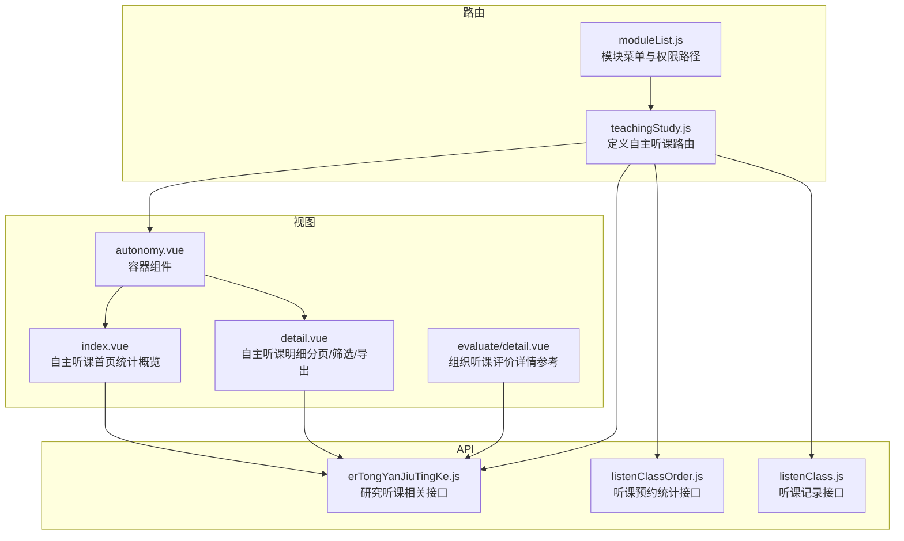
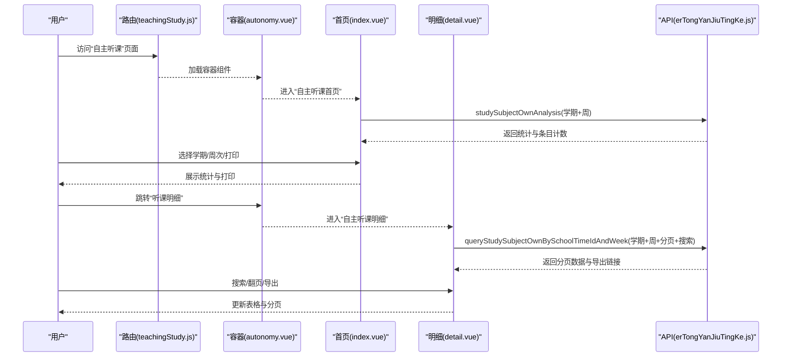
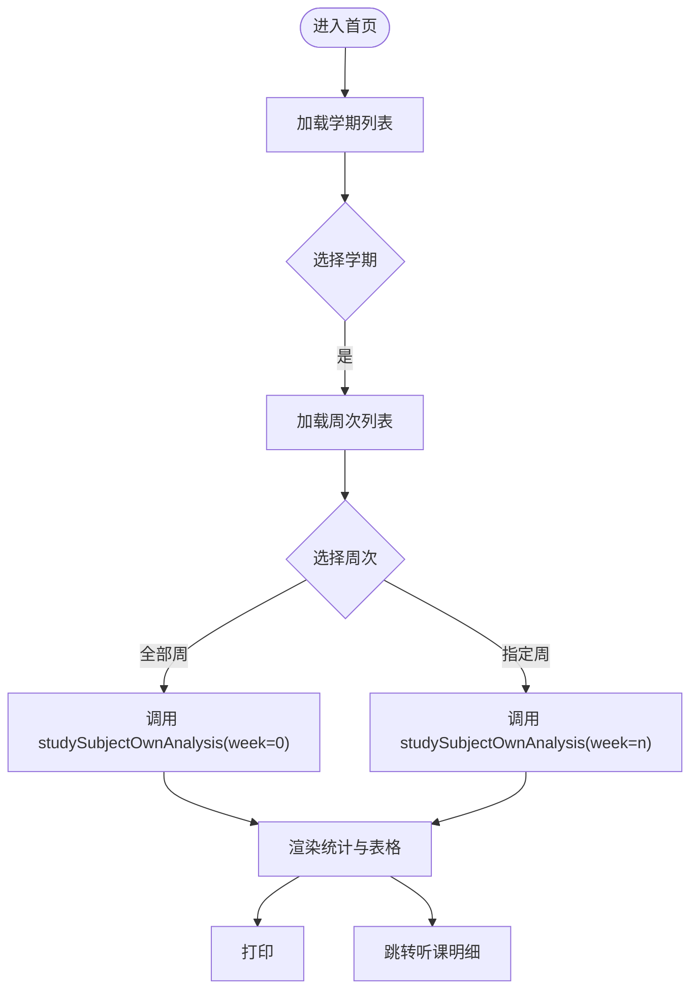
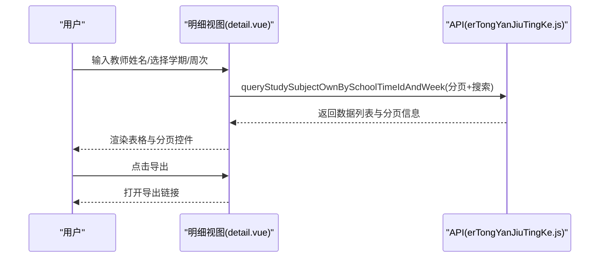
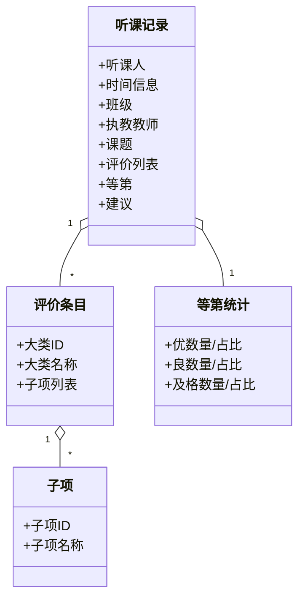
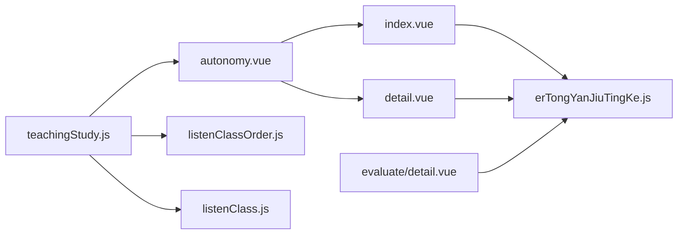

# 自主听课

<cite>
**本文引用的文件**
- [src/api/teachingStudy/erTongYanJiuTingKe.js](file://src/api/teachingStudy/erTongYanJiuTingKe.js)
- [src/api/teachingStudy/listenClassOrder.js](file://src/api/teachingStudy/listenClassOrder.js)
- [src/api/listenClass.js](file://src/api/listenClass.js)
- [src/router/normal/teachingStudy.js](file://src/router/normal/teachingStudy.js)
- [src/router/moduleList.js](file://src/router/moduleList.js)
- [src/views/teachingStudy/studySubject/autonomy.vue](file://src/views/teachingStudy/studySubject/autonomy.vue)
- [src/views/teachingStudy/studySubject/autonomy/index.vue](file://src/views/teachingStudy/studySubject/autonomy/index.vue)
- [src/views/teachingStudy/studySubject/autonomy/detail.vue](file://src/views/teachingStudy/studySubject/autonomy/detail.vue)
- [src/views/teachingStudy/studySubject/organization/detail/evaluate/detail.vue](file://src/views/teachingStudy/studySubject/organization/detail/evaluate/detail.vue)
</cite>

## 目录
1. [简介](#简介)
2. [项目结构](#项目结构)
3. [核心组件](#核心组件)
4. [架构总览](#架构总览)
5. [组件详解](#组件详解)
6. [依赖关系分析](#依赖关系分析)
7. [性能考量](#性能考量)
8. [故障排查指南](#故障排查指南)
9. [结论](#结论)
10. [附录](#附录)

## 简介
本技术文档围绕“自主听课”功能展开，系统性阐述教师如何自主制定听课计划并开展课堂观察与反思，覆盖以下方面：
- 听课计划制定：通过学期与周次维度筛选，支持按教师姓名检索，形成个人听课清单。
- 个人评价实施：基于评价指标体系对被听课堂进行等级评价与改进建议记录。
- 评价标准与评分：以“优/良/及格”三级等第为主，结合具体评价条目进行量化统计。
- 记录生成与补充：系统自动汇总统计，支持导出；同时允许手动补充课堂实录、观察要点与改进建议。
- 数据分析与反馈：提供自主听课统计与明细，支持导出与打印，辅助建立个人教学档案与专业发展指导。
- 提醒与进度：提供“提醒未评价人员”能力，便于跟踪与推进评价进度。

## 项目结构
自主听课功能主要由前端路由、视图组件与API模块构成，核心文件如下：
- 路由层：定义“儿童研究听课-自主听课”的页面入口与跳转路径。
- 视图层：包含自主听课首页（统计概览）、明细（分页与筛选）以及通用的组织听课评价详情页。
- API层：封装与“研究听课”“听课预约统计”“听课记录”相关的后端接口，支撑数据拉取、筛选、导出与提醒。

**图表来源**
- [src/router/normal/teachingStudy.js:388-418](file://src/router/normal/teachingStudy.js#L388-L418)
- [src/router/moduleList.js:565-597](file://src/router/moduleList.js#L565-L597)
- [src/views/teachingStudy/studySubject/autonomy.vue:1-19](file://src/views/teachingStudy/studySubject/autonomy.vue#L1-L19)
- [src/views/teachingStudy/studySubject/autonomy/index.vue:1-420](file://src/views/teachingStudy/studySubject/autonomy/index.vue#L1-L420)
- [src/views/teachingStudy/studySubject/autonomy/detail.vue:1-445](file://src/views/teachingStudy/studySubject/autonomy/detail.vue#L1-L445)
- [src/views/teachingStudy/studySubject/organization/detail/evaluate/detail.vue:1-263](file://src/views/teachingStudy/studySubject/organization/detail/evaluate/detail.vue#L1-L263)
- [src/api/teachingStudy/erTongYanJiuTingKe.js:1-153](file://src/api/teachingStudy/erTongYanJiuTingKe.js#L1-L153)
- [src/api/teachingStudy/listenClassOrder.js:1-42](file://src/api/teachingStudy/listenClassOrder.js#L1-L42)
- [src/api/listenClass.js:1-95](file://src/api/listenClass.js#L1-L95)

**章节来源**
- [src/router/normal/teachingStudy.js:388-418](file://src/router/normal/teachingStudy.js#L388-L418)
- [src/router/moduleList.js:565-597](file://src/router/moduleList.js#L565-L597)
- [src/views/teachingStudy/studySubject/autonomy.vue:1-19](file://src/views/teachingStudy/studySubject/autonomy.vue#L1-L19)
- [src/views/teachingStudy/studySubject/autonomy/index.vue:1-420](file://src/views/teachingStudy/studySubject/autonomy/index.vue#L1-L420)
- [src/views/teachingStudy/studySubject/autonomy/detail.vue:1-445](file://src/views/teachingStudy/studySubject/autonomy/detail.vue#L1-L445)
- [src/views/teachingStudy/studySubject/organization/detail/evaluate/detail.vue:1-263](file://src/views/teachingStudy/studySubject/organization/detail/evaluate/detail.vue#L1-L263)
- [src/api/teachingStudy/erTongYanJiuTingKe.js:1-153](file://src/api/teachingStudy/erTongYanJiuTingKe.js#L1-L153)
- [src/api/teachingStudy/listenClassOrder.js:1-42](file://src/api/teachingStudy/listenClassOrder.js#L1-L42)
- [src/api/listenClass.js:1-95](file://src/api/listenClass.js#L1-L95)

## 核心组件
- 自主听课首页（统计概览）
  - 功能：按学期、周次筛选，展示优/良/及格数量与占比，支持打印与跳转“听课明细”。
  - 关键交互：选择学期与周次后触发统计分析接口，渲染表格与统计信息。
- 自主听课明细（分页/筛选/导出）
  - 功能：按学期、周次、教师姓名筛选，分页展示听课记录，支持导出。
  - 关键交互：输入搜索词、切换页码/页大小后重新拉取数据。
- 组织听课评价详情（参考）
  - 功能：展示组织听课的评价结果与等第，支持提醒未评价人员与删除评价。
  - 参考价值：为自主听课评价体系提供等第与提醒机制的实现思路。

**章节来源**
- [src/views/teachingStudy/studySubject/autonomy/index.vue:1-420](file://src/views/teachingStudy/studySubject/autonomy/index.vue#L1-L420)
- [src/views/teachingStudy/studySubject/autonomy/detail.vue:1-445](file://src/views/teachingStudy/studySubject/autonomy/detail.vue#L1-L445)
- [src/views/teachingStudy/studySubject/organization/detail/evaluate/detail.vue:1-263](file://src/views/teachingStudy/studySubject/organization/detail/evaluate/detail.vue#L1-L263)

## 架构总览
自主听课从前端路由进入，经由容器组件加载首页或明细视图，视图通过API模块调用后端接口，完成数据拉取、筛选、统计与导出。

**图表来源**
- [src/router/normal/teachingStudy.js:388-418](file://src/router/normal/teachingStudy.js#L388-L418)
- [src/views/teachingStudy/studySubject/autonomy.vue:1-19](file://src/views/teachingStudy/studySubject/autonomy.vue#L1-L19)
- [src/views/teachingStudy/studySubject/autonomy/index.vue:280-335](file://src/views/teachingStudy/studySubject/autonomy/index.vue#L280-L335)
- [src/views/teachingStudy/studySubject/autonomy/detail.vue:366-395](file://src/views/teachingStudy/studySubject/autonomy/detail.vue#L366-L395)
- [src/api/teachingStudy/erTongYanJiuTingKe.js:138-153](file://src/api/teachingStudy/erTongYanJiuTingKe.js#L138-L153)

## 组件详解

### 自主听课首页（统计概览）
- 数据来源：studySubjectOwnAnalysis
- 关键字段：优/良/及格数量与占比、评价条目统计（含A/B/C数量与比例）
- 交互逻辑：
  - 选择学期后加载周次列表，再发起统计请求。
  - 支持“打印”“听课明细”跳转。
- 统计渲染：合并评价大类与子项，按类型分组合并行，展示各等级数量与百分比。

**图表来源**
- [src/views/teachingStudy/studySubject/autonomy/index.vue:223-277](file://src/views/teachingStudy/studySubject/autonomy/index.vue#L223-L277)
- [src/views/teachingStudy/studySubject/autonomy/index.vue:280-335](file://src/views/teachingStudy/studySubject/autonomy/index.vue#L280-L335)
- [src/api/teachingStudy/erTongYanJiuTingKe.js:138-144](file://src/api/teachingStudy/erTongYanJiuTingKe.js#L138-L144)

**章节来源**
- [src/views/teachingStudy/studySubject/autonomy/index.vue:1-420](file://src/views/teachingStudy/studySubject/autonomy/index.vue#L1-L420)
- [src/api/teachingStudy/erTongYanJiuTingKe.js:138-144](file://src/api/teachingStudy/erTongYanJiuTingKe.js#L138-L144)

### 自主听课明细（分页/筛选/导出）
- 数据来源：queryStudySubjectOwnBySchoolTimeIdAndWeek
- 关键字段：听课人、时间（周次/星期/时段/节次）、班级、执教教师、课题、各评价条目等级、等第、改进建议
- 交互逻辑：
  - 支持按学期、周次、教师姓名筛选。
  - 分页组件联动，支持页大小变更与当前页变更。
  - 支持导出，导出链接包含学期、周次、教师姓名等参数。
- 渲染逻辑：按评价大类展开子项列，显示A/B/C标识；等第以文字呈现；支持搜索框实时过滤。

**图表来源**
- [src/views/teachingStudy/studySubject/autonomy/detail.vue:366-395](file://src/views/teachingStudy/studySubject/autonomy/detail.vue#L366-L395)
- [src/api/teachingStudy/erTongYanJiuTingKe.js:147-153](file://src/api/teachingStudy/erTongYanJiuTingKe.js#L147-L153)

**章节来源**
- [src/views/teachingStudy/studySubject/autonomy/detail.vue:1-445](file://src/views/teachingStudy/studySubject/autonomy/detail.vue#L1-L445)
- [src/api/teachingStudy/erTongYanJiuTingKe.js:147-153](file://src/api/teachingStudy/erTongYanJiuTingKe.js#L147-L153)

### 评价标准与评分体系
- 等第层级：优/良/及格（对应数值等级）
- 评价条目：来源于“研究听课”字典项，支持按大类展开子项，逐项给出A/B/C等级
- 等第计算：以“优/良/及格”数量与占比作为统计输出，用于首页概览与明细展示
- 改进建议：在明细中展示，支持导出

**图表来源**
- [src/views/teachingStudy/studySubject/autonomy/index.vue:299-327](file://src/views/teachingStudy/studySubject/autonomy/index.vue#L299-L327)
- [src/views/teachingStudy/studySubject/autonomy/detail.vue:382-394](file://src/views/teachingStudy/studySubject/autonomy/detail.vue#L382-L394)

**章节来源**
- [src/views/teachingStudy/studySubject/autonomy/index.vue:299-327](file://src/views/teachingStudy/studySubject/autonomy/index.vue#L299-L327)
- [src/views/teachingStudy/studySubject/autonomy/detail.vue:382-394](file://src/views/teachingStudy/studySubject/autonomy/detail.vue#L382-L394)

### 听课记录的自动生成与手动补充
- 自动生成：系统根据学期与周次自动聚合统计与明细，无需人工录入即可生成概览与列表。
- 手动补充：在明细中可查看并导出评价与建议，便于教师在系统外补充课堂实录、观察要点与改进建议，并与系统记录关联。

**章节来源**
- [src/views/teachingStudy/studySubject/autonomy/detail.vue:390-391](file://src/views/teachingStudy/studySubject/autonomy/detail.vue#L390-L391)

### 数据分析与反馈机制
- 统计分析：首页提供优/良/及格的数量与占比，便于快速掌握整体情况。
- 明细导出：支持将筛选后的听课明细导出，便于归档与进一步分析。
- 个人教学档案：结合导出数据与系统其他教学活动记录，形成个人教学档案。
- 专业发展指导：通过对比不同周次、不同教师的等第分布，识别优势与改进点，指导后续教学实践。

**章节来源**
- [src/views/teachingStudy/studySubject/autonomy/index.vue:47-64](file://src/views/teachingStudy/studySubject/autonomy/index.vue#L47-L64)
- [src/views/teachingStudy/studySubject/autonomy/detail.vue:390-391](file://src/views/teachingStudy/studySubject/autonomy/detail.vue#L390-L391)

### 提醒机制、进度跟踪与成果展示
- 提醒未评价人员：提供“提醒未评价人员”按钮，便于推动评价进度。
- 进度跟踪：通过“听课预约统计”接口可查看月度预约数量，辅助跟踪听课安排与执行情况。
- 成果展示：首页与明细均支持打印与导出，便于成果展示与存档。

**章节来源**
- [src/views/teachingStudy/studySubject/organization/detail/evaluate/detail.vue:166-185](file://src/views/teachingStudy/studySubject/organization/detail/evaluate/detail.vue#L166-L185)
- [src/api/teachingStudy/listenClassOrder.js:16-25](file://src/api/teachingStudy/listenClassOrder.js#L16-L25)
- [src/views/teachingStudy/studySubject/autonomy/index.vue:36-41](file://src/views/teachingStudy/studySubject/autonomy/index.vue#L36-L41)

## 依赖关系分析
- 路由依赖：teachingStudy.js 定义“自主听课”页面路径，moduleList.js 提供模块菜单与权限路径。
- 视图依赖：autonomy.vue 作为容器，内部加载 index.vue 与 detail.vue；二者均依赖 erTongYanJiuTingKe.js 的接口。
- API依赖：首页与明细分别调用 studySubjectOwnAnalysis 与 queryStudySubjectOwnBySchoolTimeIdAndWeek；评价详情页依赖 getStudySubjectAppraiseDetails 与 remindAppraise。

**图表来源**
- [src/router/normal/teachingStudy.js:388-418](file://src/router/normal/teachingStudy.js#L388-L418)
- [src/router/moduleList.js:565-597](file://src/router/moduleList.js#L565-L597)
- [src/views/teachingStudy/studySubject/autonomy.vue:1-19](file://src/views/teachingStudy/studySubject/autonomy.vue#L1-L19)
- [src/views/teachingStudy/studySubject/autonomy/index.vue:103-109](file://src/views/teachingStudy/studySubject/autonomy/index.vue#L103-L109)
- [src/views/teachingStudy/studySubject/autonomy/detail.vue:164-171](file://src/views/teachingStudy/studySubject/autonomy/detail.vue#L164-L171)
- [src/views/teachingStudy/studySubject/organization/detail/evaluate/detail.vue:84-88](file://src/views/teachingStudy/studySubject/organization/detail/evaluate/detail.vue#L84-L88)
- [src/api/teachingStudy/erTongYanJiuTingKe.js:138-153](file://src/api/teachingStudy/erTongYanJiuTingKe.js#L138-L153)
- [src/api/teachingStudy/listenClassOrder.js:1-42](file://src/api/teachingStudy/listenClassOrder.js#L1-L42)
- [src/api/listenClass.js:1-95](file://src/api/listenClass.js#L1-L95)

**章节来源**
- [src/router/normal/teachingStudy.js:388-418](file://src/router/normal/teachingStudy.js#L388-L418)
- [src/router/moduleList.js:565-597](file://src/router/moduleList.js#L565-L597)
- [src/views/teachingStudy/studySubject/autonomy/index.vue:103-109](file://src/views/teachingStudy/studySubject/autonomy/index.vue#L103-L109)
- [src/views/teachingStudy/studySubject/autonomy/detail.vue:164-171](file://src/views/teachingStudy/studySubject/autonomy/detail.vue#L164-L171)
- [src/views/teachingStudy/studySubject/organization/detail/evaluate/detail.vue:84-88](file://src/views/teachingStudy/studySubject/organization/detail/evaluate/detail.vue#L84-L88)
- [src/api/teachingStudy/erTongYanJiuTingKe.js:138-153](file://src/api/teachingStudy/erTongYanJiuTingKe.js#L138-L153)
- [src/api/teachingStudy/listenClassOrder.js:1-42](file://src/api/teachingStudy/listenClassOrder.js#L1-L42)
- [src/api/listenClass.js:1-95](file://src/api/listenClass.js#L1-L95)

## 性能考量
- 接口调用频次：首页与明细均涉及多次接口调用（学期列表、周次列表、统计/分页数据），建议在组件销毁前取消未完成请求，避免内存泄漏。
- 分页优化：明细采用分页加载，建议合理设置默认页大小，减少一次性渲染压力。
- 渲染优化：首页表格使用分组合并行，注意大数据量时的渲染性能，必要时采用虚拟滚动或服务端分页。
- 导出与打印：导出为服务端生成，打印采用浏览器打印功能，注意网络与设备兼容性。

## 故障排查指南
- 接口返回非200状态：在调用API后统一进行状态判断，若失败则弹出错误提示并停止后续渲染。
- 无数据或空列表：检查学期/周次选择是否正确，确认筛选条件（如教师姓名）是否导致结果为空。
- 导出链接无效：确认token与参数拼接是否完整，确保登录态有效。
- 提醒功能异常：确认当前用户是否有权限触发提醒，检查接口返回状态。

**章节来源**
- [src/views/teachingStudy/studySubject/autonomy/index.vue:212-218](file://src/views/teachingStudy/studySubject/autonomy/index.vue#L212-L218)
- [src/views/teachingStudy/studySubject/autonomy/detail.vue:271-277](file://src/views/teachingStudy/studySubject/autonomy/detail.vue#L271-L277)
- [src/views/teachingStudy/studySubject/organization/detail/evaluate/detail.vue:166-185](file://src/views/teachingStudy/studySubject/organization/detail/evaluate/detail.vue#L166-L185)

## 结论
自主听课功能通过“学期+周次”的筛选与“教师姓名”的检索，实现了教师自主制定听课计划与开展课堂观察的目标。系统提供统计概览、明细分页、导出与打印能力，并具备“提醒未评价人员”的进度管理手段。结合组织听课评价详情页的实现思路，可进一步完善自主听课的评价标准与反馈闭环，助力教师建立个人教学档案并指导专业发展。

## 附录
- 路由与模块菜单
  - “儿童研究听课-自主听课”路由定义与跳转路径
  - 模块菜单中的“听课预约统计”与“听课明细”入口
- API一览
  - 研究听课：studySubjectOwnAnalysis、queryStudySubjectOwnBySchoolTimeIdAndWeek、getStudySubjectAppraiseDetails、remindAppraise
  - 听课预约统计：getSchoolTimeList、getTeacherMonOrderNum、getTeacherOrderDetail
  - 听课记录：getClassRecordStatisticalList、getClassRecordList、getClassRecordThStatisticalList、listenClassRecordInfoById

**章节来源**
- [src/router/normal/teachingStudy.js:388-418](file://src/router/normal/teachingStudy.js#L388-L418)
- [src/router/moduleList.js:565-597](file://src/router/moduleList.js#L565-L597)
- [src/api/teachingStudy/erTongYanJiuTingKe.js:138-153](file://src/api/teachingStudy/erTongYanJiuTingKe.js#L138-L153)
- [src/api/teachingStudy/listenClassOrder.js:1-42](file://src/api/teachingStudy/listenClassOrder.js#L1-L42)
- [src/api/listenClass.js:1-95](file://src/api/listenClass.js#L1-L95)