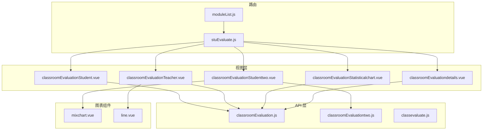
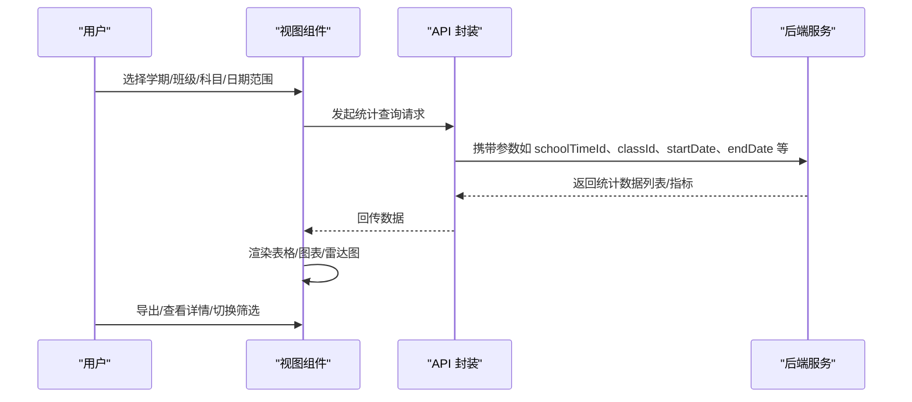
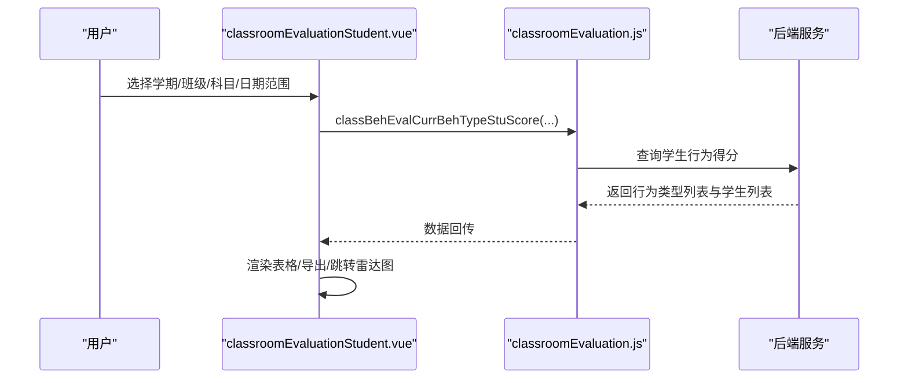
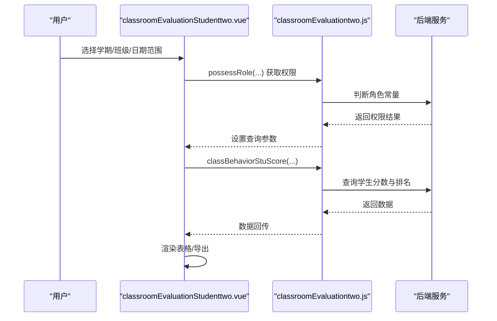
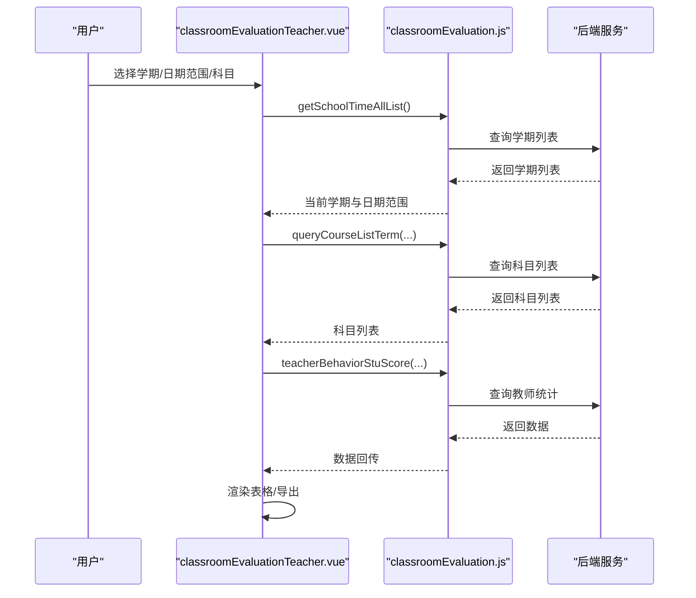
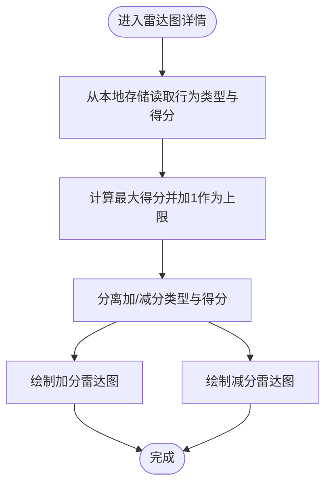
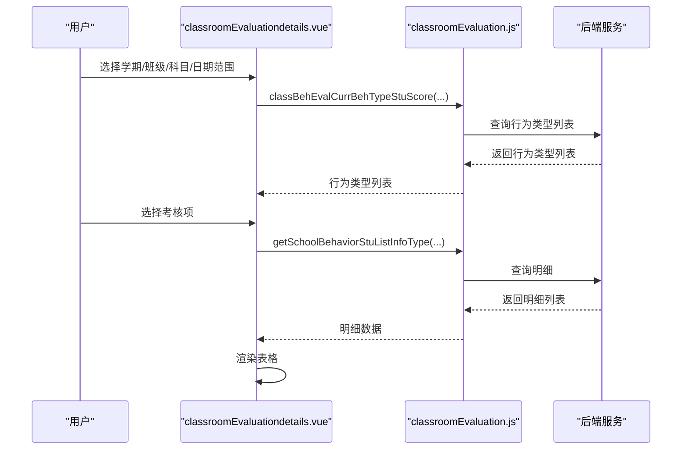
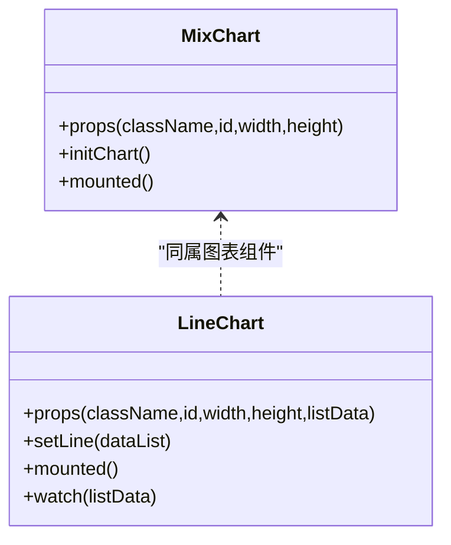
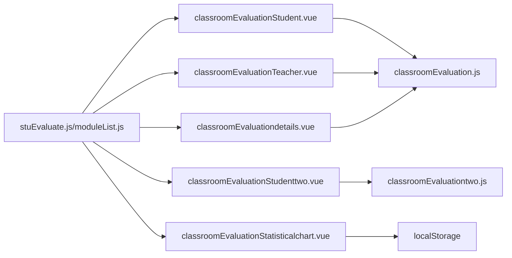

# 评价统计

<cite>
**本文引用的文件**
- [classroomEvaluationStatisticalchart.vue](file://src/views/classroomEvaluation/classroomEvaluationStatisticalchart.vue)
- [classroomEvaluationStudenttwo.vue](file://src/views/classroomEvaluation/classroomEvaluationStudenttwo.vue)
- [classroomEvaluationTeacher.vue](file://src/views/classroomEvaluation/classroomEvaluationTeacher.vue)
- [classroomEvaluationStudent.vue](file://src/views/classroomEvaluation/classroomEvaluationStudent.vue)
- [classroomEvaluationdetails.vue](file://src/views/classroomEvaluation/classroomEvaluationdetails.vue)
- [classroomEvaluation.js](file://src/api/classroomEvaluation.js)
- [classroomEvaluationtwo.js](file://src/api/classroomEvaluationtwo.js)
- [classevaluate.js](file://src/api/systemSet/classevaluate.js)
- [mixchart.vue](file://src/components/Charts/mixchart.vue)
- [line.vue](file://src/components/Charts/line.vue)
- [moduleList.js](file://src/router/moduleList.js)
- [stuEvaluate.js](file://src/router/normal/stuEvaluate.js)
</cite>

## 目录
1. [简介](#简介)
2. [项目结构](#项目结构)
3. [核心组件](#核心组件)
4. [架构总览](#架构总览)
5. [详细组件分析](#详细组件分析)
6. [依赖关系分析](#依赖关系分析)
7. [性能考量](#性能考量)
8. [故障排查指南](#故障排查指南)
9. [结论](#结论)
10. [附录](#附录)

## 简介
本技术文档聚焦“课堂评价统计”功能，系统性阐述评价数据的统计分析机制、指标计算方法、可视化展示、对比分析与导出能力，并给出可扩展的报表与个性化定制建议。该功能覆盖学生维度的得分与排名、教师维度的评价频次与正负向分布、以及按班级/学科/时间维度的多维聚合与趋势分析。

## 项目结构
围绕“课堂评价统计”的前端页面与API组织如下：
- 视图层（views/classroomEvaluation）：学生端统计、教师端统计、雷达图详情、统计图表页、导入与期初分数设置等。
- API 层（api/classroomEvaluation*.js）：封装与后端交互的接口，包括按学期/班级/科目/日期范围查询统计、导出、行为类型配置等。
- 图表组件（components/Charts）：通用混合柱线图、折线图等，供趋势与对比分析使用。
- 路由（router/normal/stuEvaluate.js、router/moduleList.js）：定义“课堂评价统计”相关路由入口与权限路径。

**图表来源**
- [classroomEvaluationStudent.vue:1-347](file://src/views/classroomEvaluation/classroomEvaluationStudent.vue#L1-L347)
- [classroomEvaluationStudenttwo.vue:1-115](file://src/views/classroomEvaluation/classroomEvaluationStudenttwo.vue#L1-L115)
- [classroomEvaluationTeacher.vue:1-218](file://src/views/classroomEvaluation/classroomEvaluationTeacher.vue#L1-L218)
- [classroomEvaluationStatisticalchart.vue:1-145](file://src/views/classroomEvaluation/classroomEvaluationStatisticalchart.vue#L1-L145)
- [classroomEvaluationdetails.vue:1-104](file://src/views/classroomEvaluation/classroomEvaluationdetails.vue#L1-L104)
- [classroomEvaluation.js:1-242](file://src/api/classroomEvaluation.js#L1-L242)
- [classroomEvaluationtwo.js:1-198](file://src/api/classroomEvaluationtwo.js#L1-L198)
- [classevaluate.js:1-39](file://src/api/systemSet/classevaluate.js#L1-L39)
- [mixchart.vue:1-267](file://src/components/Charts/mixchart.vue#L1-L267)
- [line.vue:1-147](file://src/components/Charts/line.vue#L1-L147)
- [stuEvaluate.js:92-119](file://src/router/normal/stuEvaluate.js#L92-L119)
- [moduleList.js:1952-1977](file://src/router/moduleList.js#L1952-L1977)

**章节来源**
- [classroomEvaluationStudent.vue:1-347](file://src/views/classroomEvaluation/classroomEvaluationStudent.vue#L1-L347)
- [classroomEvaluationStudenttwo.vue:1-115](file://src/views/classroomEvaluation/classroomEvaluationStudenttwo.vue#L1-L115)
- [classroomEvaluationTeacher.vue:1-218](file://src/views/classroomEvaluation/classroomEvaluationTeacher.vue#L1-L218)
- [classroomEvaluationStatisticalchart.vue:1-145](file://src/views/classroomEvaluation/classroomEvaluationStatisticalchart.vue#L1-L145)
- [classroomEvaluationdetails.vue:1-104](file://src/views/classroomEvaluation/classroomEvaluationdetails.vue#L1-L104)
- [classroomEvaluation.js:1-242](file://src/api/classroomEvaluation.js#L1-L242)
- [classroomEvaluationtwo.js:1-198](file://src/api/classroomEvaluationtwo.js#L1-L198)
- [classevaluate.js:1-39](file://src/api/systemSet/classevaluate.js#L1-L39)
- [mixchart.vue:1-267](file://src/components/Charts/mixchart.vue#L1-L267)
- [line.vue:1-147](file://src/components/Charts/line.vue#L1-L147)
- [stuEvaluate.js:92-119](file://src/router/normal/stuEvaluate.js#L92-L119)
- [moduleList.js:1952-1977](file://src/router/moduleList.js#L1952-L1977)

## 核心组件
- 学生端统计页：按学期/班级/科目/日期范围查询学生得分与排名，支持导出与雷达图详情跳转。
- 教师端统计页：按学期/日期范围/科目筛选教师评价统计（课时数、评价次数、加/扣分次数）。
- 雷达图详情页：基于本地缓存的行为类型与得分，绘制加/减分雷达图。
- 统计明细页：按考核项过滤展示具体评价记录。
- API 封装：统一调用后端接口，负责参数拼装、导出链接生成与行为类型配置管理。
- 图表组件：提供混合柱线图与折线图，便于趋势与对比分析。

**章节来源**
- [classroomEvaluationStudent.vue:1-347](file://src/views/classroomEvaluation/classroomEvaluationStudent.vue#L1-L347)
- [classroomEvaluationStudenttwo.vue:1-115](file://src/views/classroomEvaluation/classroomEvaluationStudenttwo.vue#L1-L115)
- [classroomEvaluationTeacher.vue:1-218](file://src/views/classroomEvaluation/classroomEvaluationTeacher.vue#L1-L218)
- [classroomEvaluationStatisticalchart.vue:1-145](file://src/views/classroomEvaluation/classroomEvaluationStatisticalchart.vue#L1-L145)
- [classroomEvaluationdetails.vue:1-104](file://src/views/classroomEvaluation/classroomEvaluationdetails.vue#L1-L104)
- [classroomEvaluation.js:1-242](file://src/api/classroomEvaluation.js#L1-L242)
- [classroomEvaluationtwo.js:1-198](file://src/api/classroomEvaluationtwo.js#L1-L198)
- [mixchart.vue:1-267](file://src/components/Charts/mixchart.vue#L1-L267)
- [line.vue:1-147](file://src/components/Charts/line.vue#L1-L147)

## 架构总览
课堂评价统计采用“视图-API-图表-路由”分层设计，数据流从视图组件发起请求，经API层封装后调用后端服务，返回统计结果并渲染到表格或图表中；同时支持导出与进一步钻取到明细。

**图表来源**
- [classroomEvaluationStudent.vue:172-240](file://src/views/classroomEvaluation/classroomEvaluationStudent.vue#L172-L240)
- [classroomEvaluationStudenttwo.vue:80-102](file://src/views/classroomEvaluation/classroomEvaluationStudenttwo.vue#L80-L102)
- [classroomEvaluationTeacher.vue:140-150](file://src/views/classroomEvaluation/classroomEvaluationTeacher.vue#L140-L150)
- [classroomEvaluation.js:37-58](file://src/api/classroomEvaluation.js#L37-L58)
- [classroomEvaluationtwo.js:77-114](file://src/api/classroomEvaluationtwo.js#L77-L114)

## 详细组件分析

### 学生端统计（按学期/班级/科目）
- 功能要点
  - 通过学期选择器与日期范围选择器限定统计周期。
  - 支持按科目筛选，动态加载课程列表与行为类型。
  - 表格列包含各行为类型的得分字符串、总分与排名。
  - 提供导出按钮，生成指定范围内的 Excel 文件。
  - 点击“得分总计”进入雷达图详情页，展示加/减分雷达图。
- 关键流程
  - 初始化：读取学期列表，设置当前学期与日期范围。
  - 查询：按班级、科目、学期、日期范围调用接口获取列表。
  - 渲染：根据行为类型列表动态生成列，区分加/减分颜色。
  - 导出：构造后端导出链接并触发下载。
  - 雷达图：将行为类型与得分写入本地存储，跳转详情页绘制雷达图。

**图表来源**
- [classroomEvaluationStudent.vue:172-240](file://src/views/classroomEvaluation/classroomEvaluationStudent.vue#L172-L240)
- [classroomEvaluation.js:22-49](file://src/api/classroomEvaluation.js#L22-L49)

**章节来源**
- [classroomEvaluationStudent.vue:1-347](file://src/views/classroomEvaluation/classroomEvaluationStudent.vue#L1-L347)
- [classroomEvaluation.js:1-242](file://src/api/classroomEvaluation.js#L1-L242)

### 学生端统计（按学期汇总）
- 功能要点
  - 按学期/班级/日期范围查询学生各科分数与总分、排名。
  - 支持导出当前班级与导出全校范围的 Excel。
  - 使用权限控制决定是否显示“所有班级/年级”筛选。
- 关键流程
  - 权限判断：调用角色判定接口，动态调整查询参数。
  - 查询：调用按学期/班级/日期范围的统计接口。
  - 导出：拼装导出链接，分别指向当前班级与全校范围。

**图表来源**
- [classroomEvaluationStudenttwo.vue:68-102](file://src/views/classroomEvaluation/classroomEvaluationStudenttwo.vue#L68-L102)
- [classroomEvaluationtwo.js:155-114](file://src/api/classroomEvaluationtwo.js#L155-L114)

**章节来源**
- [classroomEvaluationStudenttwo.vue:1-115](file://src/views/classroomEvaluation/classroomEvaluationStudenttwo.vue#L1-L115)
- [classroomEvaluationtwo.js:1-198](file://src/api/classroomEvaluationtwo.js#L1-L198)

### 教师端统计（按学期/科目/日期）
- 功能要点
  - 选择学期后自动加载当前学期日期范围。
  - 可按科目筛选，获取教师评价统计（课时数、评价次数、加/扣分次数）。
  - 支持导出 Excel。
- 关键流程
  - 初始化学期列表与当前学期日期范围。
  - 加载科目列表后查询教师统计。
  - 导出：构造导出链接并触发下载。

**图表来源**
- [classroomEvaluationTeacher.vue:68-150](file://src/views/classroomEvaluation/classroomEvaluationTeacher.vue#L68-L150)
- [classroomEvaluation.js:8-15](file://src/api/classroomEvaluation.js#L8-L15)
- [classroomEvaluation.js:166-187](file://src/api/classroomEvaluation.js#L166-L187)

**章节来源**
- [classroomEvaluationTeacher.vue:1-218](file://src/views/classroomEvaluation/classroomEvaluationTeacher.vue#L1-L218)
- [classroomEvaluation.js:1-242](file://src/api/classroomEvaluation.js#L1-L242)

### 雷达图详情（加/减分）
- 功能要点
  - 基于本地存储的行为类型与得分数组，绘制加/减分雷达图。
  - 页面包含两个雷达图容器，分别展示加分与减分维度。
- 关键流程
  - 从上一页面传递行为类型列表与得分数组至本地存储。
  - 计算最大值用于坐标轴缩放。
  - 分离加/减分类型，分别绘制雷达图。

**图表来源**
- [classroomEvaluationStatisticalchart.vue:73-97](file://src/views/classroomEvaluation/classroomEvaluationStatisticalchart.vue#L73-L97)

**章节来源**
- [classroomEvaluationStatisticalchart.vue:1-145](file://src/views/classroomEvaluation/classroomEvaluationStatisticalchart.vue#L1-L145)

### 统计明细（按考核项）
- 功能要点
  - 选择考核项后，按学生ID与科目/学期/日期范围查询具体评价记录。
  - 展示评价老师、类型（加/减）、分数、日期、节次等字段。
- 关键流程
  - 初始化时加载行为类型列表（含“全部考核项”）。
  - 切换考核项后重新查询明细列表。

**图表来源**
- [classroomEvaluationdetails.vue:43-83](file://src/views/classroomEvaluation/classroomEvaluationdetails.vue#L43-L83)
- [classroomEvaluation.js:22-36](file://src/api/classroomEvaluation.js#L22-L36)

**章节来源**
- [classroomEvaluationdetails.vue:1-104](file://src/views/classroomEvaluation/classroomEvaluationdetails.vue#L1-L104)
- [classroomEvaluation.js:1-242](file://src/api/classroomEvaluation.js#L1-L242)

### 图表组件（趋势与对比）
- 混合柱线图（mixchart.vue）
  - 适用于多系列对比与趋势叠加，如不同性别/维度的累计数量与平均值。
  - 支持数据缩放、图例与提示框。
- 折线图（line.vue）
  - 适用于周次/时间序列的趋势展示，支持标记点与标记线。

**图表来源**
- [mixchart.vue:1-267](file://src/components/Charts/mixchart.vue#L1-L267)
- [line.vue:1-147](file://src/components/Charts/line.vue#L1-L147)

**章节来源**
- [mixchart.vue:1-267](file://src/components/Charts/mixchart.vue#L1-L267)
- [line.vue:1-147](file://src/components/Charts/line.vue#L1-L147)

## 依赖关系分析
- 视图组件依赖 API 层进行数据拉取与导出链接生成。
- 学生端统计与教师端统计共享部分 API（如学期列表、课程列表、日期范围），但统计维度不同。
- 雷达图详情依赖本地存储的数据，避免重复网络请求。
- 路由模块定义了“课堂评价统计”相关入口与权限路径，确保访问控制。

**图表来源**
- [classroomEvaluationStudent.vue:1-347](file://src/views/classroomEvaluation/classroomEvaluationStudent.vue#L1-L347)
- [classroomEvaluationStudenttwo.vue:1-115](file://src/views/classroomEvaluation/classroomEvaluationStudenttwo.vue#L1-L115)
- [classroomEvaluationTeacher.vue:1-218](file://src/views/classroomEvaluation/classroomEvaluationTeacher.vue#L1-L218)
- [classroomEvaluationdetails.vue:1-104](file://src/views/classroomEvaluation/classroomEvaluationdetails.vue#L1-L104)
- [classroomEvaluationStatisticalchart.vue:1-145](file://src/views/classroomEvaluation/classroomEvaluationStatisticalchart.vue#L1-L145)
- [classroomEvaluation.js:1-242](file://src/api/classroomEvaluation.js#L1-L242)
- [classroomEvaluationtwo.js:1-198](file://src/api/classroomEvaluationtwo.js#L1-L198)
- [stuEvaluate.js:92-119](file://src/router/normal/stuEvaluate.js#L92-L119)
- [moduleList.js:1952-1977](file://src/router/moduleList.js#L1952-L1977)

**章节来源**
- [classroomEvaluation.js:1-242](file://src/api/classroomEvaluation.js#L1-L242)
- [classroomEvaluationtwo.js:1-198](file://src/api/classroomEvaluationtwo.js#L1-L198)
- [stuEvaluate.js:92-119](file://src/router/normal/stuEvaluate.js#L92-L119)
- [moduleList.js:1952-1977](file://src/router/moduleList.js#L1952-L1977)

## 性能考量
- 列表渲染优化
  - 使用虚拟滚动与固定列，减少 DOM 重排与布局开销。
  - 在数据更新后延迟执行布局刷新，避免频繁重绘。
- 图表渲染优化
  - 按需引入 ECharts 组件，避免全量打包。
  - 雷达图详情仅在进入页面时初始化一次，避免重复渲染。
- 请求合并与去抖
  - 对筛选条件变更进行去抖处理，减少无效请求。
- 导出性能
  - 后端导出接口应限制一次性导出的数据量，必要时分页或异步导出。

[本节为通用指导，无需列出具体文件来源]

## 故障排查指南
- 无数据或空表
  - 检查学期/班级/科目/日期范围是否正确设置。
  - 确认权限接口返回的查询参数是否符合预期。
- 雷达图不显示
  - 确认本地存储中行为类型与得分数组已正确写入。
  - 检查最大值计算与雷达图配置项是否一致。
- 导出失败
  - 核对导出链接中的 token、参数是否完整。
  - 确认后端接口允许跨域访问与文件下载权限。
- 教师统计异常
  - 确认科目列表加载成功后再发起统计查询。
  - 检查日期范围格式与后端期望格式一致。

**章节来源**
- [classroomEvaluationStudent.vue:172-240](file://src/views/classroomEvaluation/classroomEvaluationStudent.vue#L172-L240)
- [classroomEvaluationStudenttwo.vue:80-102](file://src/views/classroomEvaluation/classroomEvaluationStudenttwo.vue#L80-L102)
- [classroomEvaluationTeacher.vue:140-150](file://src/views/classroomEvaluation/classroomEvaluationTeacher.vue#L140-L150)
- [classroomEvaluationStatisticalchart.vue:73-97](file://src/views/classroomEvaluation/classroomEvaluationStatisticalchart.vue#L73-L97)

## 结论
课堂评价统计功能以清晰的视图-API-图表分层架构实现，覆盖学生与教师双视角的统计与可视化需求。通过本地存储与导出能力提升用户体验，结合路由与权限控制保障访问安全。后续可在指标体系、报表模板与智能分析方面持续增强。

[本节为总结性内容，无需列出具体文件来源]

## 附录

### 评价指标与计算方法
- 平均分
  - 公式：各维度得分之和除以维度数量。
  - 适用场景：学生维度总分与平均分、教师维度平均评价次数。
- 优秀率
  - 公式：达到设定阈值（如≥90分）的学生人数占比。
  - 适用场景：按班级/学科/学期统计优秀比例。
- 改进幅度
  - 公式：期末得分减去期初得分；或按周/月序列计算环比变化。
  - 适用场景：跟踪学生进步趋势与教学效果评估。
- 加/扣分次数
  - 统计维度：按教师、班级、学科、学期的加/减分事件频次。
  - 适用场景：教师工作量与课堂规范度评估。

[本节为通用方法说明，无需列出具体文件来源]

### 可视化展示与报表
- 图表类型
  - 雷达图：展示加/减分维度的相对强度。
  - 柱线混合图：对比不同维度的累计数量与平均值。
  - 折线图：展示周次/时间序列的趋势变化。
- 报表生成
  - 支持按班级/全校导出 Excel。
  - 明细页支持按考核项筛选导出。

**章节来源**
- [classroomEvaluationStatisticalchart.vue:1-145](file://src/views/classroomEvaluation/classroomEvaluationStatisticalchart.vue#L1-L145)
- [mixchart.vue:1-267](file://src/components/Charts/mixchart.vue#L1-L267)
- [line.vue:1-147](file://src/components/Charts/line.vue#L1-L147)
- [classroomEvaluationStudent.vue:10-18](file://src/views/classroomEvaluation/classroomEvaluationStudent.vue#L10-L18)
- [classroomEvaluationStudenttwo.vue:5-10](file://src/views/classroomEvaluation/classroomEvaluationStudenttwo.vue#L5-L10)

### 对比分析与导出
- 教师间比较
  - 按教师姓名、部门、课时数、评价次数、加/扣分次数排序与筛选。
- 学科间对比
  - 按科目维度聚合统计，比较不同学科的评价分布。
- 时间序列分析
  - 周次/月份维度展示趋势，结合折线图与标记线分析波动。
- 导出与报告模板
  - 支持 Excel 导出，可作为报告模板基础。
  - 可扩展为自定义模板（如按班级/教师/学科生成专属报表）。

**章节来源**
- [classroomEvaluationTeacher.vue:1-218](file://src/views/classroomEvaluation/classroomEvaluationTeacher.vue#L1-L218)
- [line.vue:1-147](file://src/components/Charts/line.vue#L1-L147)

### 质量监控与改进建议
- 质量监控
  - 关注异常波动（如某班级/教师加/扣分次数骤增）与低分段分布。
  - 对比历史数据，识别趋势变化。
- 改进建议
  - 基于雷达图差异定位薄弱维度，制定针对性教学改进计划。
  - 结合导出报表定期复盘，形成闭环管理。

[本节为通用指导，无需列出具体文件来源]