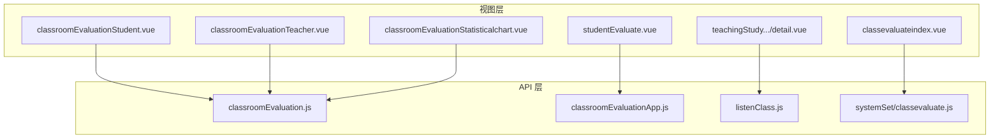
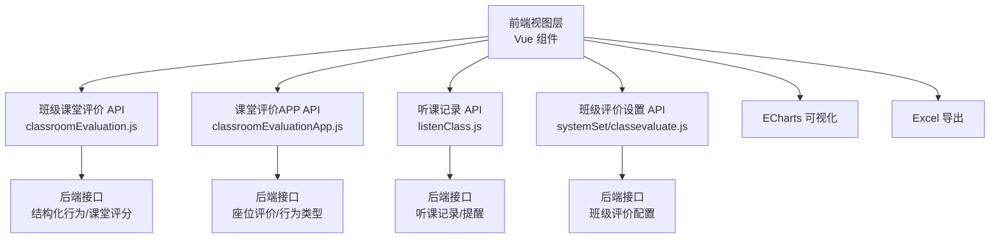
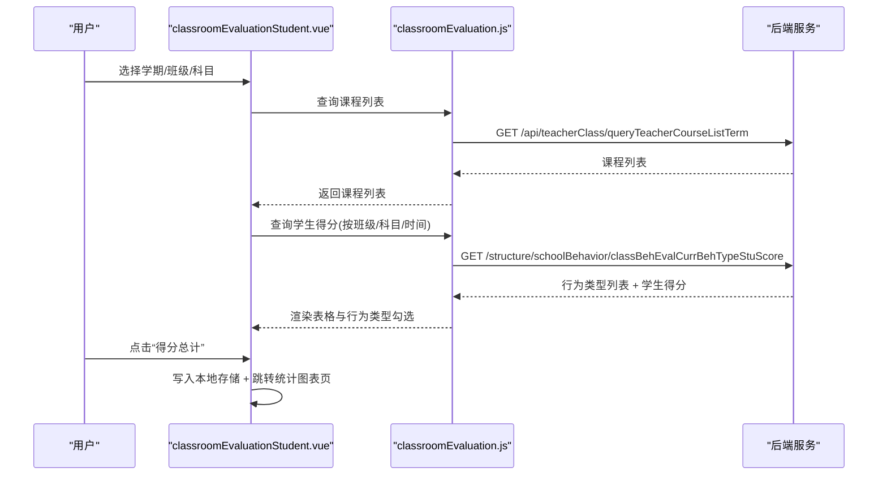
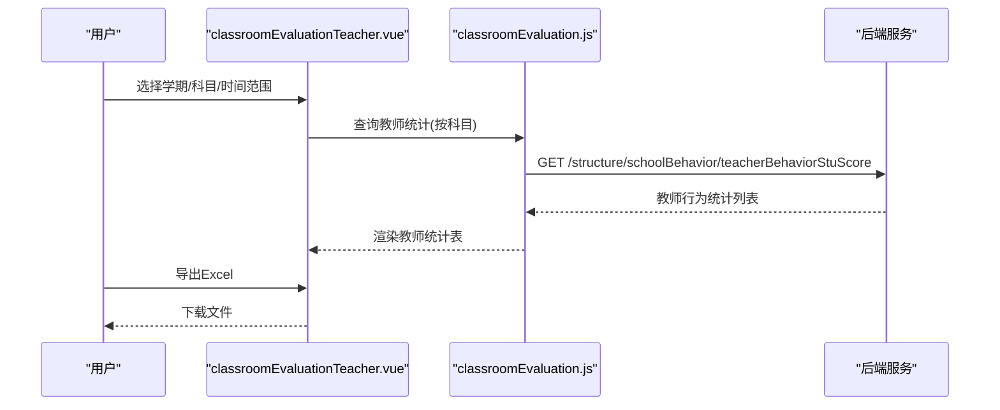
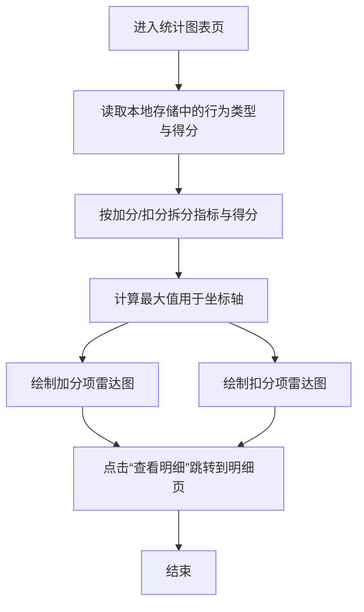
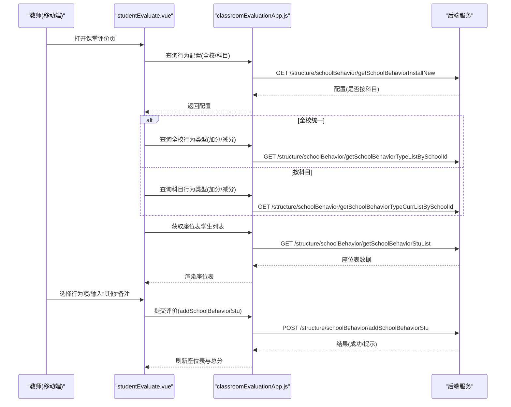
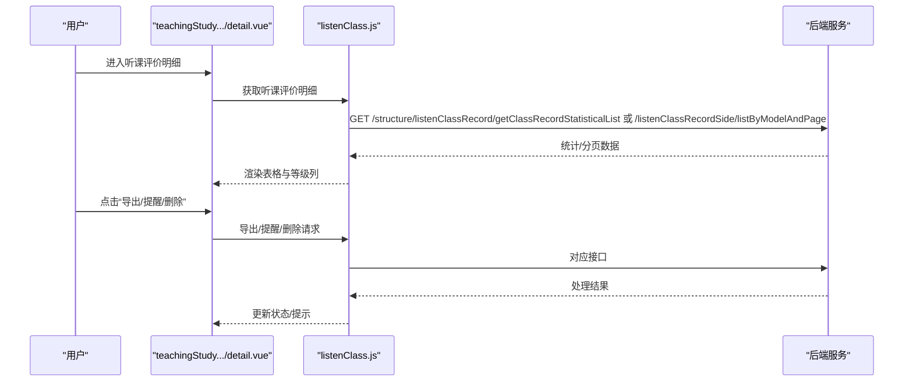
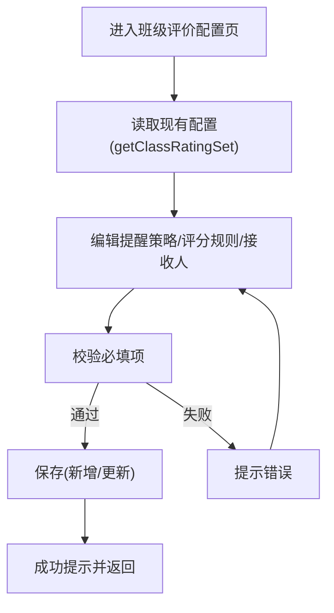
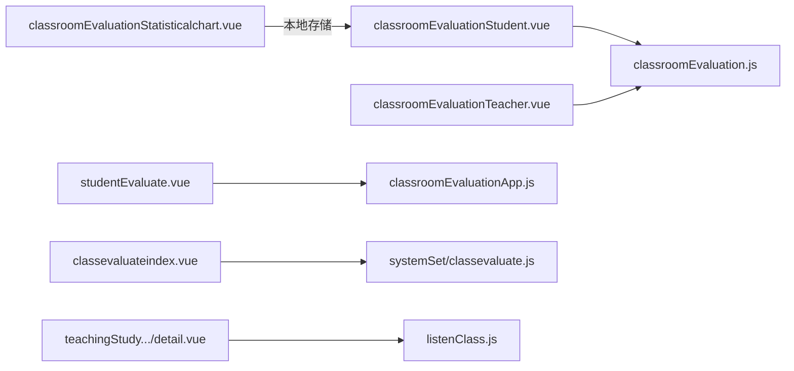

# 课堂评价

<cite>
**本文引用的文件**
- [src/api/classroomEvaluation.js](file://src/api/classroomEvaluation.js)
- [src/api/classroomEvaluationApp.js](file://src/api/classroomEvaluationApp.js)
- [src/api/listenClass.js](file://src/api/listenClass.js)
- [src/views/classroomEvaluation/classroomEvaluationStudent.vue](file://src/views/classroomEvaluation/classroomEvaluationStudent.vue)
- [src/views/classroomEvaluation/classroomEvaluationTeacher.vue](file://src/views/classroomEvaluation/classroomEvaluationTeacher.vue)
- [src/views/classroomEvaluation/classroomEvaluationStatisticalchart.vue](file://src/views/classroomEvaluation/classroomEvaluationStatisticalchart.vue)
- [src/views/classroomEvaluationApp/studentEvaluate.vue](file://src/views/classroomEvaluationApp/studentEvaluate.vue)
- [src/views/sysSet/classevaluate/classevaluateindex.vue](file://src/views/sysSet/classevaluate/classevaluateindex.vue)
- [src/api/systemSet/classevaluate.js](file://src/api/systemSet/classevaluate.js)
- [src/views/teachingStudy/studySubject/organization/detail/evaluate/detail.vue](file://src/views/teachingStudy/studySubject/organization/detail/evaluate/detail.vue)
</cite>

## 目录
1. [引言](#引言)
2. [项目结构](#项目结构)
3. [核心组件](#核心组件)
4. [架构总览](#架构总览)
5. [详细组件分析](#详细组件分析)
6. [依赖关系分析](#依赖关系分析)
7. [性能考量](#性能考量)
8. [故障排查指南](#故障排查指南)
9. [结论](#结论)
10. [附录](#附录)

## 引言
本技术文档围绕“课堂评价”功能展开，系统性阐述教学观察与评价体系的设计与实现，覆盖组织听课与自主听课两类模式；详述评价指标设置、评分标准与数据分析；梳理评价流程的自动化实现（任务分配、数据采集、统计汇总）；解释评价数据的可视化展示与报告生成机制；并给出配置项、权限控制与扩展能力说明，以及评价质量分析与改进建议的实现思路。

## 项目结构
课堂评价相关代码主要分布在以下区域：
- API 层：封装与后端交互的接口，分别面向“班级课堂评价”和“课堂评价APP”两大场景，并包含“听课记录”相关接口。
- 视图层：提供学生维度、教师维度、统计图表、移动端课堂评价入口与配置页面。
- 系统设置：提供“班级评价”配置页面，支持提醒策略、评分规则与接收人设置。

**图表来源**
- [src/views/classroomEvaluation/classroomEvaluationStudent.vue](file://src/views/classroomEvaluation/classroomEvaluationStudent.vue)
- [src/views/classroomEvaluation/classroomEvaluationTeacher.vue](file://src/views/classroomEvaluation/classroomEvaluationTeacher.vue)
- [src/views/classroomEvaluation/classroomEvaluationStatisticalchart.vue](file://src/views/classroomEvaluation/classroomEvaluationStatisticalchart.vue)
- [src/views/classroomEvaluationApp/studentEvaluate.vue](file://src/views/classroomEvaluationApp/studentEvaluate.vue)
- [src/views/sysSet/classevaluate/classevaluateindex.vue](file://src/views/sysSet/classevaluate/classevaluateindex.vue)
- [src/api/classroomEvaluation.js](file://src/api/classroomEvaluation.js)
- [src/api/classroomEvaluationApp.js](file://src/api/classroomEvaluationApp.js)
- [src/api/listenClass.js](file://src/api/listenClass.js)
- [src/api/systemSet/classevaluate.js](file://src/api/systemSet/classevaluate.js)

**章节来源**
- [src/api/classroomEvaluation.js](file://src/api/classroomEvaluation.js)
- [src/api/classroomEvaluationApp.js](file://src/api/classroomEvaluationApp.js)
- [src/api/listenClass.js](file://src/api/listenClass.js)
- [src/views/classroomEvaluation/classroomEvaluationStudent.vue](file://src/views/classroomEvaluation/classroomEvaluationStudent.vue)
- [src/views/classroomEvaluation/classroomEvaluationTeacher.vue](file://src/views/classroomEvaluation/classroomEvaluationTeacher.vue)
- [src/views/classroomEvaluation/classroomEvaluationStatisticalchart.vue](file://src/views/classroomEvaluation/classroomEvaluationStatisticalchart.vue)
- [src/views/classroomEvaluationApp/studentEvaluate.vue](file://src/views/classroomEvaluationApp/studentEvaluate.vue)
- [src/views/sysSet/classevaluate/classevaluateindex.vue](file://src/views/sysSet/classevaluate/classevaluateindex.vue)
- [src/api/systemSet/classevaluate.js](file://src/api/systemSet/classevaluate.js)
- [src/views/teachingStudy/studySubject/organization/detail/evaluate/detail.vue](file://src/views/teachingStudy/studySubject/organization/detail/evaluate/detail.vue)

## 核心组件
- 班级课堂评价（Web）
  - 学生维度：按学期、班级、科目筛选，展示学生各行为类型的得分与合计，支持期初分、导入、导出与明细查看。
  - 教师维度：按学期、科目筛选，统计教师课时、评价次数、加分/扣分次数。
  - 统计图表：基于雷达图展示加分项与扣分项得分分布。
- 课堂评价APP（移动端）
  - 基于座位表进行课堂即时评价，支持全校统一或按科目配置的行为类型，提供“真棒/加油”快捷项与“其他”备注。
- 听课记录（组织听课）
  - 支持按时间段、年级、记录类型统计与列表查询，提供研究课听课评价明细与提醒功能。
- 系统设置（班级评价）
  - 配置提醒策略（反馈报告、提醒任课老师、提醒班主任）、评分规则与接收人。

**章节来源**
- [src/views/classroomEvaluation/classroomEvaluationStudent.vue](file://src/views/classroomEvaluation/classroomEvaluationStudent.vue)
- [src/views/classroomEvaluation/classroomEvaluationTeacher.vue](file://src/views/classroomEvaluation/classroomEvaluationTeacher.vue)
- [src/views/classroomEvaluation/classroomEvaluationStatisticalchart.vue](file://src/views/classroomEvaluation/classroomEvaluationStatisticalchart.vue)
- [src/views/classroomEvaluationApp/studentEvaluate.vue](file://src/views/classroomEvaluationApp/studentEvaluate.vue)
- [src/views/sysSet/classevaluate/classevaluateindex.vue](file://src/views/sysSet/classevaluate/classevaluateindex.vue)
- [src/api/listenClass.js](file://src/api/listenClass.js)

## 架构总览
课堂评价系统采用前后端分离架构，前端通过API模块调用后端接口，完成数据的获取、提交与更新；移动端提供座位式快速评价入口；后台提供行为类型配置、提醒与报告机制。

**图表来源**
- [src/api/classroomEvaluation.js](file://src/api/classroomEvaluation.js)
- [src/api/classroomEvaluationApp.js](file://src/api/classroomEvaluationApp.js)
- [src/api/listenClass.js](file://src/api/listenClass.js)
- [src/api/systemSet/classevaluate.js](file://src/api/systemSet/classevaluate.js)

## 详细组件分析

### 学生维度课堂评价（Web）
- 功能要点
  - 学期/班级/科目筛选，联动查询课程列表与行为类型。
  - 展示学生各行为类型得分与合计，支持期初分、导入、导出与明细查看。
  - 行为类型区分加分/扣分，界面以不同颜色标识。
- 数据流
  - 选择学期与时间范围后，调用“按班级与科目查询学生得分”接口，渲染表格与行为类型勾选框。
  - 点击“得分总计”进入统计图表页，使用本地存储传递指标与数值，绘制雷达图。
- 关键接口
  - 查询学期列表、课程列表、按班级与科目查询学生得分、行为类型列表等。

**图表来源**
- [src/views/classroomEvaluation/classroomEvaluationStudent.vue](file://src/views/classroomEvaluation/classroomEvaluationStudent.vue)
- [src/api/classroomEvaluation.js](file://src/api/classroomEvaluation.js)

**章节来源**
- [src/views/classroomEvaluation/classroomEvaluationStudent.vue](file://src/views/classroomEvaluation/classroomEvaluationStudent.vue)
- [src/api/classroomEvaluation.js](file://src/api/classroomEvaluation.js)

### 教师维度课堂评价（Web）
- 功能要点
  - 按学期、科目筛选，统计教师的课时数、评价次数、加分/扣分次数。
  - 支持导出Excel。
- 数据流
  - 选择学期与时间范围后，调用“按科目统计教师得分”接口，渲染教师统计表。

**图表来源**
- [src/views/classroomEvaluation/classroomEvaluationTeacher.vue](file://src/views/classroomEvaluation/classroomEvaluationTeacher.vue)
- [src/api/classroomEvaluation.js](file://src/api/classroomEvaluation.js)

**章节来源**
- [src/views/classroomEvaluation/classroomEvaluationTeacher.vue](file://src/views/classroomEvaluation/classroomEvaluationTeacher.vue)
- [src/api/classroomEvaluation.js](file://src/api/classroomEvaluation.js)

### 统计图表（雷达图）
- 功能要点
  - 将加分项与扣分项分别绘制雷达图，直观展示学生在各维度的表现。
  - 支持从图表页跳转到明细页。
- 数据流
  - 从前一页读取行为类型与得分数组，计算最大值并分类绘制雷达图。

**图表来源**
- [src/views/classroomEvaluation/classroomEvaluationStatisticalchart.vue](file://src/views/classroomEvaluation/classroomEvaluationStatisticalchart.vue)

**章节来源**
- [src/views/classroomEvaluation/classroomEvaluationStatisticalchart.vue](file://src/views/classroomEvaluation/classroomEvaluationStatisticalchart.vue)

### 课堂评价APP（移动端）
- 功能要点
  - 基于座位表展示学生，点击学生弹出“真棒/加油”快捷项与“其他”备注对话框。
  - 支持全校统一或按科目配置的行为类型；自动显示当前总分（含期初分）。
  - 提交后刷新座位表与总分显示。
- 数据流
  - 进入页面后根据配置策略加载行为类型列表，再请求座位表数据。
  - 选择行为项后提交评价，成功后刷新数据并显示评分动画。

**图表来源**
- [src/views/classroomEvaluationApp/studentEvaluate.vue](file://src/views/classroomEvaluationApp/studentEvaluate.vue)
- [src/api/classroomEvaluationApp.js](file://src/api/classroomEvaluationApp.js)

**章节来源**
- [src/views/classroomEvaluationApp/studentEvaluate.vue](file://src/views/classroomEvaluationApp/studentEvaluate.vue)
- [src/api/classroomEvaluationApp.js](file://src/api/classroomEvaluationApp.js)

### 听课记录与组织听课
- 功能要点
  - 支持按时间段、年级、记录类型统计与分页查询听课记录。
  - 提供研究课听课评价明细页，支持导出、提醒未评价人员与删除评价。
- 数据流
  - 查询统计列表与分页列表，进入明细页解析评价项与等级，支持提醒与删除。

**图表来源**
- [src/views/teachingStudy/studySubject/organization/detail/evaluate/detail.vue](file://src/views/teachingStudy/studySubject/organization/detail/evaluate/detail.vue)
- [src/api/listenClass.js](file://src/api/listenClass.js)

**章节来源**
- [src/views/teachingStudy/studySubject/organization/detail/evaluate/detail.vue](file://src/views/teachingStudy/studySubject/organization/detail/evaluate/detail.vue)
- [src/api/listenClass.js](file://src/api/listenClass.js)

### 班级评价配置（系统设置）
- 功能要点
  - 配置“一周反馈报告”“提醒任课老师”“提醒班主任”等提醒策略。
  - 设置“评分规则”，支持富文本编辑器。
  - 接收人可从通讯录选择。
- 数据流
  - 读取现有配置，支持新增与更新；提交时将富文本内容写入字段并序列化接收人列表。

**图表来源**
- [src/views/sysSet/classevaluate/classevaluateindex.vue](file://src/views/sysSet/classevaluate/classevaluateindex.vue)
- [src/api/systemSet/classevaluate.js](file://src/api/systemSet/classevaluate.js)

**章节来源**
- [src/views/sysSet/classevaluate/classevaluateindex.vue](file://src/views/sysSet/classevaluate/classevaluateindex.vue)
- [src/api/systemSet/classevaluate.js](file://src/api/systemSet/classevaluate.js)

## 依赖关系分析
- 组件与API的耦合
  - 学生/教师维度视图直接依赖“classroomEvaluation.js”提供的查询接口。
  - APP视图依赖“classroomEvaluationApp.js”的行为类型与座位表接口。
  - 听课明细依赖“listenClass.js”的统计与分页接口。
  - 班级评价配置依赖“systemSet/classevaluate.js”的读取、新增与更新接口。
- 数据依赖
  - 行为类型配置来源后端“学校行为配置”与“科目行为配置”。
  - 统计图表依赖本地存储传递的行为类型与得分数组。
- 可视化与导出
  - ECharts用于雷达图展示；Excel导出通过表格复制与第三方库实现。

**图表来源**
- [src/views/classroomEvaluation/classroomEvaluationStudent.vue](file://src/views/classroomEvaluation/classroomEvaluationStudent.vue)
- [src/views/classroomEvaluation/classroomEvaluationTeacher.vue](file://src/views/classroomEvaluation/classroomEvaluationTeacher.vue)
- [src/views/classroomEvaluation/classroomEvaluationStatisticalchart.vue](file://src/views/classroomEvaluation/classroomEvaluationStatisticalchart.vue)
- [src/views/classroomEvaluationApp/studentEvaluate.vue](file://src/views/classroomEvaluationApp/studentEvaluate.vue)
- [src/views/sysSet/classevaluate/classevaluateindex.vue](file://src/views/sysSet/classevaluate/classevaluateindex.vue)
- [src/views/teachingStudy/studySubject/organization/detail/evaluate/detail.vue](file://src/views/teachingStudy/studySubject/organization/detail/evaluate/detail.vue)
- [src/api/classroomEvaluation.js](file://src/api/classroomEvaluation.js)
- [src/api/classroomEvaluationApp.js](file://src/api/classroomEvaluationApp.js)
- [src/api/systemSet/classevaluate.js](file://src/api/systemSet/classevaluate.js)
- [src/api/listenClass.js](file://src/api/listenClass.js)

**章节来源**
- [src/views/classroomEvaluation/classroomEvaluationStudent.vue](file://src/views/classroomEvaluation/classroomEvaluationStudent.vue)
- [src/views/classroomEvaluation/classroomEvaluationTeacher.vue](file://src/views/classroomEvaluation/classroomEvaluationTeacher.vue)
- [src/views/classroomEvaluation/classroomEvaluationStatisticalchart.vue](file://src/views/classroomEvaluation/classroomEvaluationStatisticalchart.vue)
- [src/views/classroomEvaluationApp/studentEvaluate.vue](file://src/views/classroomEvaluationApp/studentEvaluate.vue)
- [src/views/sysSet/classevaluate/classevaluateindex.vue](file://src/views/sysSet/classevaluate/classevaluateindex.vue)
- [src/views/teachingStudy/studySubject/organization/detail/evaluate/detail.vue](file://src/views/teachingStudy/studySubject/organization/detail/evaluate/detail.vue)
- [src/api/classroomEvaluation.js](file://src/api/classroomEvaluation.js)
- [src/api/classroomEvaluationApp.js](file://src/api/classroomEvaluationApp.js)
- [src/api/systemSet/classevaluate.js](file://src/api/systemSet/classevaluate.js)
- [src/api/listenClass.js](file://src/api/listenClass.js)

## 性能考量
- 渲染优化
  - 使用虚拟滚动与固定高度容器减少长列表渲染压力；对表格布局进行延迟刷新，避免首屏抖动。
- 图表渲染
  - 雷达图仅在进入图表页时初始化，避免重复创建实例；按需拆分加分/扣分项，降低数据处理复杂度。
- 接口调用
  - 在移动端座位表场景下，提交后及时刷新数据，避免重复请求；对“其他”备注进行表单校验后再提交，减少无效请求。
- 导出与报表
  - Excel导出采用表格复制方式，避免大体量数据直接渲染导致的内存压力。

[本节为通用指导，无需列出具体文件来源]

## 故障排查指南
- 无法加载行为类型
  - 检查“学校行为配置”接口返回；若按科目配置，确认科目ID正确。
  - 参考路径：[src/api/classroomEvaluationApp.js](file://src/api/classroomEvaluationApp.js)
- 提交评价无响应
  - 检查提交接口返回码与提示；移动端存在防抖逻辑，避免重复提交。
  - 参考路径：[src/views/classroomEvaluationApp/studentEvaluate.vue](file://src/views/classroomEvaluationApp/studentEvaluate.vue)
- 统计图表为空
  - 确认本地存储中行为类型与得分数组已正确写入；检查时间范围与筛选条件。
  - 参考路径：[src/views/classroomEvaluation/classroomEvaluationStatisticalchart.vue](file://src/views/classroomEvaluation/classroomEvaluationStatisticalchart.vue)
- 听课明细为空或缺少等级
  - 检查后端返回的评价项与等级映射；确认导出URL携带有效token。
  - 参考路径：[src/views/teachingStudy/studySubject/organization/detail/evaluate/detail.vue](file://src/views/teachingStudy/studySubject/organization/detail/evaluate/detail.vue)

**章节来源**
- [src/api/classroomEvaluationApp.js](file://src/api/classroomEvaluationApp.js)
- [src/views/classroomEvaluationApp/studentEvaluate.vue](file://src/views/classroomEvaluationApp/studentEvaluate.vue)
- [src/views/classroomEvaluation/classroomEvaluationStatisticalchart.vue](file://src/views/classroomEvaluation/classroomEvaluationStatisticalchart.vue)
- [src/views/teachingStudy/studySubject/organization/detail/evaluate/detail.vue](file://src/views/teachingStudy/studySubject/organization/detail/evaluate/detail.vue)

## 结论
课堂评价系统通过Web与APP双端协同，实现了从指标配置、行为类型管理到即时评价、统计分析与报告生成的完整闭环。系统具备良好的可扩展性与可配置性，支持提醒策略与评分规则定制，并提供可视化与导出能力，满足组织听课与自主听课的多样化需求。

[本节为总结性内容，无需列出具体文件来源]

## 附录

### 评价流程自动化实现（概览）
- 任务分配
  - 通过“按科目统计教师得分”接口识别教师评价任务；移动端座位表支持即时评价，减少人工派发。
- 数据采集
  - Web端按学期/班级/科目批量查询；APP端按座位表逐项采集；听课记录支持分页与提醒。
- 结果统计
  - 教师维度按课时与加分/扣分次数统计；学生维度按行为类型汇总；图表页按雷达图呈现。
- 报告生成
  - 支持Excel导出；系统设置可配置反馈报告与接收人。

[本节为概念性说明，无需列出具体文件来源]

### 配置选项与权限控制
- 配置选项
  - 班级评价：提醒策略（反馈报告/提醒任课老师/提醒班主任）、评分规则、接收人。
  - 行为类型：全校统一或按科目配置。
- 权限控制
  - 部分页面通过角色判断限制可见范围；系统设置页面支持新增/更新操作的权限校验。

**章节来源**
- [src/views/sysSet/classevaluate/classevaluateindex.vue](file://src/views/sysSet/classevaluate/classevaluateindex.vue)
- [src/api/systemSet/classevaluate.js](file://src/api/systemSet/classevaluate.js)
- [src/views/classroomEvaluation/classroomEvaluationStudent.vue](file://src/views/classroomEvaluation/classroomEvaluationStudent.vue)

### 扩展能力说明
- 指标扩展
  - 新增行为类型时，后端需同步维护；前端通过配置接口动态加载。
- 场景扩展
  - 可接入更多移动端场景（如课后服务），复用行为类型与提交流程。
- 报告扩展
  - 可增加多维度对比、趋势分析与导出模板自定义。

[本节为概念性说明，无需列出具体文件来源]

### 评价质量分析与改进建议
- 质量分析
  - 通过雷达图与等级分布识别薄弱环节；结合“提醒未评价人员”功能提升覆盖率。
- 改进建议
  - 增加行为类型权重与综合评分算法；提供历史对比与趋势图；完善“其他”备注的归类与统计。

**章节来源**
- [src/views/teachingStudy/studySubject/organization/detail/evaluate/detail.vue](file://src/views/teachingStudy/studySubject/organization/detail/evaluate/detail.vue)